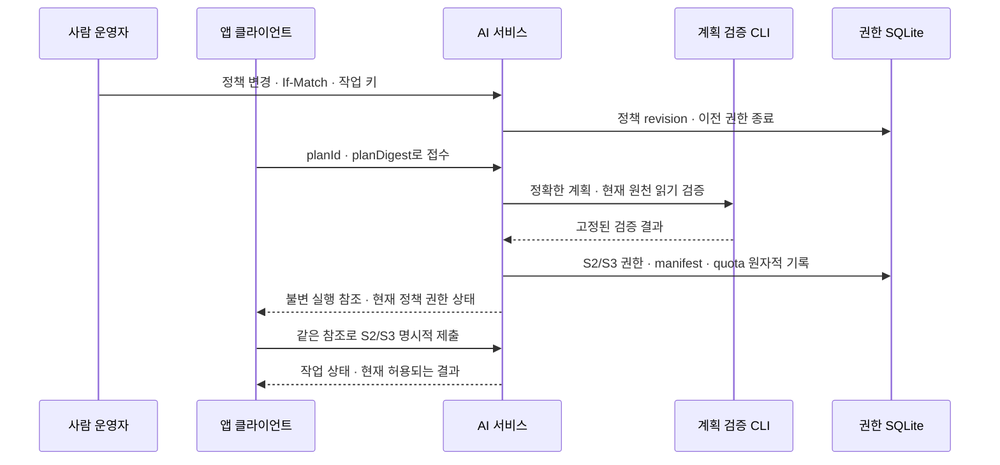

# 그래프 읽기 인수 문서 (정세빈 · 앱 상태·공개 조회용)

Spring 백엔드에서 내부 AI 서비스의 그래프 버전 읽기(`graph.read`), handoff bundle 읽기(`handoff.read`), 공개 영향 ID 조회(`handoff.exposure`)를 연결할 때 참고하는 문서입니다. 요청·응답, 오류 처리, 현재 구현 범위와 앱 소유 경계를 정리했습니다. 기계 판독 계약은 [`internal-ai-openapi.json`](../../docs/api/internal-ai-openapi.json)을, 서버 설정·실행 명령은 [AI 서비스 README](../../ai/service/README.md)를, 생산자 CLI 계약은 [pipeline README](../../ai/pipeline/README.md)를 따릅니다.

## 지금 상태 (사실)


> **구현과 공개 운영을 구분합니다.** 생산자와 reader는 기존 bundle `zoop-graph-handoff-bundle-8` / 정책 `zoop-public-projection-policy-2` / 판정 파일 `zoop-public-decisions-4`와 새 bundle `-9` / 정책 `-3` / 판정 파일 `-5`를 정확한 조합으로 구분합니다. 기존 앱 공개 스냅샷은 형식 3으로 읽으며, 명시적 미확인 메타데이터는 새 형식 4에 저장합니다. 비활성 스테이징 수입, 일반 graph 근거·structural basis-only·impact-only 근거 읽기, 읽기 전용 exposure CLI·내부 HTTP가 구현되어 있습니다. 요약·영향 행은 비공개 import receipt에 보존되며, 요약의 공개 `getEvent` 소비는 백엔드 소유의 후속 범위입니다. 이 구현은 전체 철회나 AWS 배포 완료를 뜻하지 않습니다. 아래 날짜별 절은 각 변경 당시의 계약·검증 이력이며 현재 지원하는 버전 조합을 대신하지 않습니다.
- **AI 읽기와 앱 공개 상태는 별개입니다.** 내부 서비스(`127.0.0.1`, 앞단 TLS 프록시는 미배포)에는 활성 버전 포인터가 없습니다. graph 버전 응답의 `publication`은 항상 `not-published`입니다. `delivery.state=current`는 “이번 요청에서 검증됨”이지 “앱이 보여 주는 활성 버전”이 아닙니다. exposure는 별도 `handoff.exposure` scope를 요구하고 기본 비활성화이며, 원문 없이 영향 ID만 반환합니다. 앱의 현재 제외 목록·revision·공개 활성화를 변경하지 않습니다([HTTP 소비 계약](#내부-http-소비-계약)).
- **Spring 구현 기준.** 공개 `GET /api/v1/graph`, 기업·관계·시점 조회, `graph_versions`·`graph_activations`, 버전 선택기와 `PublicGraphReader`가 있습니다. `AdminGraphVersionController`·서비스와 활성화 사전 검사, 버전별 공개 제외 저장소와 운영자 제외 명령(2026-10-24, [api README](../README.md#공개-제외-명령-fs081))이 구현되어 있습니다. 기본 활성화 게이트는 안전 조건이 충족되지 않으면 차단하며, 명시적인 로컬·운영자 플래그는 운영 준비 완료를 뜻하지 않습니다. 스냅샷 source는 기본 `none`, local/dev용 `fixture`, 수입된 불변 파일을 검증해 읽는 `artifact`로 구분합니다. Spring은 Neo4j에 직접 접속하지 않고 Neo4j 자격을 받지 않습니다.
- **운영자 스테이징 수입.** `com.zoop.graph.importer`는 설치된 handoff·ingestion CLI 또는 설정된 HTTP 읽기 경로의 현재 결과와 앱 DB·본문을 대조해 근거 및 비활성 버전을 등록하며, 활성 포인터를 변경하지 않습니다. 스냅샷 형식 3·4는 읽기용 투영이고 원본 manifest·bundle 전체는 영수증에 보존됩니다. 앱 mention ID는 문서·버전·원천 ID로 결정해 문서 간 같은 로컬 ID를 구분합니다. 원래 언급 값은 `verification: none`이고, 운영자의 `eventTime`·`period` verdict(`fieldVerdicts`)는 앱 verifier가 독립 재계산해 보류·거절된 머리 값을 snapshot에서 `null`로 만듭니다(영수증에는 원본과 verdict가 그대로 남음). `quote_verified`도 인용 무결성이지 의미 검증·공개 승인 자체가 아닙니다([필드 verdict 계약](#2026-10-21-bundle--4의-운영자-필드-verdict--eventtimeperiod의-보류거절)). `structuralPath`·`pathCompanies`·basis 범위 텍스트·`impacts[]`·`issues[].summary`는 snapshot의 공개 필드가 아닙니다. 근거 읽기는 [graph 본문 근거 계약](#2026-10-20-getevidence의-graph-본문-근거-경로)과 아래 `-5`·`-6` 절을, 수입 명령과 설정은 [API 실행 안내](../README.md#그래프-handoff-스테이징-import)를 따릅니다.
- 운영자가 AI 버전을 만들고 서버 allowlist에 올립니다. 이 AI 읽기 서비스는 버전을 **만들거나 찾거나 나열하지 못합니다**(목록 라우트 없음). 앱의 operator 스테이징 명령은 전달받은 handoff를 별도의 비활성 앱 버전으로 등록합니다.
- 실제 로컬 HTTP 서버 → 설치된 graph CLI → 격리된 Neo4j 5.26 경로의 smoke를 통과했습니다(2026-10-15 로컬 실행 기록이며 현재 `main`의 재검증이 아닙니다). 1~3홉·권한 분리·digest 불일치·원천 권한 철회·canonical 변경·그래프 변조·원장 잠금·시간 초과를 확인했습니다. 원천 원장 변경과 모델 호출은 없었습니다. 이 서비스 구현은 이후 PR #213에서 `main`에 병합됐지만, 배포·실제 데이터 운영은 하지 않았습니다.
- **불변 native 전달.** 원본 호스트는 현재 source를 검증한 비활성 수입과 outbox seal을 별도 transaction으로 커밋합니다. package `zoop-graph-delivery-package-2`는 공개 snapshot·전체 receipt·숨겨진 기사까지 포함한 본문·구성 행의 규칙 적용 전 projection을 전달합니다. 설치기는 별도 root에서 같은 PostgreSQL과 현재 registry로 closure와 권리를 독립 검증합니다. 설치 후 공개 JVM은 설치된 앱 artifact와 DB·registry를 읽으며 native 원장이나 Python을 사용하지 않습니다. 초기 설치 동안 operator와 serving 앱의 자동 활성화를 끄고, 완료 후 기존 관리자 route로 명시적으로 활성화합니다. `already_sealed`와 delivery status는 현재 source 권한의 증명이 아닙니다([실행·복구·인프라 전제](../README.md#원본-호스트-seal과-java-전용-artifact-설치)).

## HTTP로 문서와 native handoff 수입

API 이미지의 비웹 operator 프로세스는 문서 등록과 graph 수입 모두에서 AI service를 HTTP로 읽을 수 있습니다. native CLI·원장·source-host 경로는 AI service 쪽에만 둡니다. 수입기는 실제 대상 PostgreSQL과 durable artifact root를 사용하며, 전송 방식이 바뀌어도 본문·문서 binding·정확한 span과 commit 직전 현재 권리 검사는 그대로 적용합니다.

기존 웹 회차의 `GraphRoundImportBridge`도 같은 importer를 사용합니다. handoff는 HTTP 클라이언트로 읽고, 관측의 현재 권리는 `ZOOP_GRAPH_ROUND_IMPORT_SOURCE=cli`에서 설치된 `zoop-ai-ingest export --require-store`로 재확인합니다. 이 회차 profile에는 API 쪽 ingestion CLI·원장·source registry 경로가 필요합니다. 회차 연결은 버전 수입 트랜잭션 안에서 원래 lease token으로 기록하고, 기존 delivery의 root-lock 호출 계약을 유지합니다. 결과는 비활성 incoming 버전이며 누적 composition·활성화와 구분합니다([회차 계약](GRAPH_ROUND.md)).

### TaskDefinition 설정 이름과 profile 조건

| 실행 profile | 설정 |
|---|---|
| 문서 등록 RunTask | `ZOOP_DOCUMENT_IMPORT_ENABLED=true`, `ZOOP_DOCUMENT_IMPORT_OBSERVATION_SOURCE=http`, `ZOOP_DOCUMENT_IMPORT_REQUEST`, `ZOOP_DOCUMENT_IMPORT_RESULT`, `ZOOP_ARTIFACT_ROOT`, 대상 `DB_URL`·`DB_USERNAME`·`DB_PASSWORD`와 기존 앱 인증 초기화 설정입니다. |
| 문서·graph 공통 observation client | `ZOOP_AI_OBSERVATION_EXPORT_CLIENT_ENABLED=true`, 운영자가 확정한 `ZOOP_AI_OBSERVATION_EXPORT_CLIENT_BASE_URL`, 비밀 저장소에서 주입하는 `ZOOP_AI_OBSERVATION_EXPORT_CLIENT_TOKEN`입니다. 선택 설정은 `_CONNECT_TIMEOUT=3s`, `_REQUEST_TIMEOUT=50s`, `_MAX_RESPONSE_BYTES=16777216`입니다. |
| graph 수입 RunTask | `ZOOP_GRAPH_HANDOFF_IMPORT_ENABLED=true`, `ZOOP_GRAPH_HANDOFF_IMPORT_HANDOFF_SOURCE=http`, `ZOOP_GRAPH_HANDOFF_IMPORT_OBSERVATION_SOURCE=http`, `ZOOP_GRAPH_HANDOFF_IMPORT_REQUEST`, `ZOOP_GRAPH_HANDOFF_IMPORT_RESULT`, 대상 DB와 artifact root입니다. |
| graph handoff client | `ZOOP_AI_HANDOFF_READ_CLIENT_ENABLED=true`, 운영자 주소 `ZOOP_AI_HANDOFF_READ_CLIENT_BASE_URL`, 비밀 저장소의 `ZOOP_AI_HANDOFF_READ_CLIENT_TOKEN`입니다. 선택 설정은 `_CONNECT_TIMEOUT=3s`, `_REQUEST_TIMEOUT=60s`, `_MAX_RESPONSE_BYTES=16777216`입니다. |
| AI 읽기 service | [service 설정 표](../../ai/service/README.md#관측-export와-앱-수입용-읽기-profile)의 필수 base 설정과 native command·source inventory·handoff operator 파일·allowlist를 사용합니다. 두 context 설정 쌍은 같은 파일과 SHA를 가리킵니다. |

각 RunTask는 `--spring.main.web-application-type=none`으로 실행하며 문서 등록과 graph 수입을 한 JVM에서 함께 켜지 않습니다. 문서 HTTP profile에서는 `ZOOP_INGESTION_CLI`·`ZOOP_INGESTION_STATE_DIR`·`ZOOP_INGESTION_SOURCES`를 비웁니다. graph의 양쪽 HTTP profile에서는 이 세 값 외에 handoff CLI·state, relation·extraction state, canonical·decisions·bindings, `ZOOP_GRAPH_HANDOFF_IMPORT_SOURCE_CONTEXTS`와 `_SHA256`도 비웁니다. 혼합 profile은 CLI가 실제로 읽는 경로만 유지합니다.

앱 수입 principal은 `handoff.read`와 `observation.read`를 사용합니다. 기존 online admission principal의 scope·binding은 바꾸지 않습니다. service는 token digest만 설정하고 API task에는 토큰 평문을 비밀 저장소로 주입합니다. 문서 scope는 설정된 전체 inventory의 정확한 관측 조회를 허용합니다. handoff의 principal별 allowlist·canonical digest pin·현재성 검사는 계속 별도로 적용됩니다.

client는 비-loopback 주소에 HTTPS를 요구하고 proxy·redirect·자동 재시도를 사용하지 않습니다. AI service의 `ZOOP_AI_SERVICE_HOST` 기본값은 `127.0.0.1`이며, ECS에서 다른 task가 접근하려면 승인된 TLS ingress 뒤에서 literal IP bind를 명시해야 합니다. 주소·토큰 값, 보안 그룹과 ingress 설정은 배포 책임자가 확정합니다. Docker 기본값은 loopback을 유지하며 서비스 이미지에는 세 native read 명령이 설치됩니다.

### 대상 DB와 동결된 handoff의 연결

1. 전체 selector로 각 문서를 HTTP 등록합니다. 기존 문서 포인터와 CAS 의미는 [문서 import](DOCUMENT_IMPORT.md)를 따릅니다.
2. 같은 DB에서 [document bindings exporter](DOCUMENT_BINDINGS.md)를 실행하고 `documentId`, `documentVersion`, `articleId`, `articleVersion`, `textSha256`, `offsetUnit`을 frozen binding과 대조합니다. 이미 동결된 manifest의 binding 파일을 덮어쓰지 않습니다. 값이 다르면 해당 handoff의 pin을 그대로 사용한 수입을 중단합니다.
3. allowlist와 요청에 canonical manifest·bundle digest를 지정하고 graph를 비활성 수입합니다. 입력 native bundle 한도는 source 20개·6 MiB입니다. bundle8/P2/decisions4와 bundle9/P3/decisions5를 각각 검증하며, exact tuple별 `zoop-source-authority-set-1` 읽기는 두 조합에 동일하게 적용합니다.
4. 앱 공개 reader에는 현재 registry authority set과 대상 artifact root를 제공합니다. 수입 성공과 별도로 기존 활성 포인터·CAS를 확인하고 승인된 활성화 절차를 수행합니다.

### 합성 종단 smoke

이미 설치된 pipeline·service·worker 환경, 최신 API jar와 비어 있는 전용 loopback PostgreSQL을 준비합니다. 아래 변수는 운영자가 해당 로컬 검증 환경에서 지정합니다.

```sh
ai/pipeline/.venv/bin/python api/scripts/http_native_delivery_smoke.py \
  --jar "$API_JAR" --java "$JAVA_BIN" --output "$NEW_SMOKE_ROOT" \
  --psql-container "$LOCAL_POSTGRES_CONTAINER"
```

DB 연결은 기존 `DB_URL`·`DB_USERNAME`·`DB_PASSWORD`를 사용하며 `.env`를 읽지 않습니다. `--output`은 새 디렉터리여야 합니다. 시나리오는 두 native context를 합성 loopback provider로 만들고 실제 인증 401/403, 전체 selector, 잘못된 route, inventory 변경, 문서 등록·target binding, 최종 재확인 중 권리 철회, 비활성 native 수입, 공개 graph·근거 span과 authority-set 철회를 검사합니다. 공개 읽기 단계의 활성화는 **합성 DB의 SQL 시험 활성화**이며 관리자 HTTP 활성화의 증거가 아닙니다. source·본문·결과와 `report.json`은 지정 디렉터리에 남깁니다. 이 명령의 성공은 실제 기사 package·클라우드 연결을 대신하지 않습니다.


### 관리자 활성화 HTTP의 합성 검증 경계

`api/scripts/graph_handoff_activation_smoke.py`는 기존 SQL 활성화 harness와 별도로 실행합니다([실행 명령과 전제](../README.md#관리자-http-활성화의-별도-합성-smoke)). 설치된 CLI의 합성 bundle `-7`을 Spring으로 비활성 수입한 뒤, 공개 제외 저장소가 연결된 기본 설정에서 현재 권리 철회로 활성화가 409 `REVISION_CONFLICT`로 거절되고 포인터·review revision·이력·감사·멱등 기록이 바뀌지 않는지 확인합니다. 권리를 복구한 뒤 같은 JVM에서 개발용 우회 플래그 없이 실제 관리자 HTTP 활성화, 멱등·stale 조건, 같은 공개 버전의 graph·event·evidence HTTP와 현재 권리 철회·복구를 검사합니다. 공개 제외 저장소의 읽기 실패에 따른 503 `SOURCE_UNAVAILABLE` 계약은 Java 시험의 범위입니다.

합성 관리자 세션은 소유한 임시 DB에만 준비하며 실제 세션 조회·CSRF·Origin 검사를 통과합니다. 비밀번호 로그인·OAuth·운영 계정 발급, 제외 명령의 변경·해제나 운영 공개 준비는 증명하지 않습니다. 모델 호출은 없으며, SQL로 활성 포인터를 움직여 HTTP 성공으로 간주하지 않습니다. 기존 `graph_handoff_import_smoke.py`의 `harnessActivations`는 계속 **SQL 시험 활성화**를 뜻하고, 새 명령의 `adminHttpActivations`·`httpPointerChanges` 및 fixture seed 이력과 구분합니다.

최초 smoke에서는 bundle `-7`의 사건 상세가 503 `SOURCE_UNAVAILABLE`로 거절됐습니다. 이후 `EventDetailService`가 소비 필드의 의미가 같은 정확한 bundle `-5`·`-6`·`-7` receipt를 읽도록 수정했고, 새 수입은 계속 `-7`만 허용합니다. 당시 수정 후 새 jar의 실제 HTTP 28단계에서 활성화·graph·event·evidence 조회와 현재 권리 철회/복원을 확인했으며, 공개 제외 저장소 통합 후 기본 설정 경로의 재검증과는 별개입니다. 미지원 과거·미래 버전과 접두어 유사값은 거절하며, 요약의 미제공 상태는 바꾸지 않았습니다. 이 로컬 검증은 운영 배포나 수령자의 실행 확인을 뜻하지 않습니다.


## 수집·분석 실행과 공개 스케줄의 책임

**계획 생성·접수·실행·공개를 구분합니다.** `plan-round`는 완료된 수집 회차의 정확한 계획을 파일로 만듭니다. 수동 모드에서는 사람이 검토한 계획을 서비스 정지 상태에서 설치하고, 별도 온라인 모드에서는 사람이 사전 등록한 정책 안에서 실행 중인 서비스가 계획을 접수합니다. 문서의 **운영자는 사람인 운영 책임자**이며 LLM이나 AI 에이전트를 뜻하지 않습니다. 실행·원천 사용·비용 허가, HOLD 후보의 최종 의미 검수, 앱 공개 활성화는 서로 대체할 수 없습니다.

공개 전환은 기존 앱 소유 경계를 유지합니다. 계획 접수·Spring 전송 클라이언트에 더해, 앱의 불변 계획 등록과 별도 `analyze_plan` 큐 worker도 `feat/55-analyze-plan-jobs`에서 구현·로컬 검증됐습니다. 이 큐는 `ingest`와 구분해 고정된 S2/S3 작업을 진행하고 내용 없는 처리 인계(`ai_processing_handoff`)를 기록하며, 수집 baseline·검수·그래프·공개 활성화를 변경하지 않습니다. 통합·수령자 실행 확인·운영 수용은 별도이며, 정기 호출에서 결과 수입·공통 버전 공개까지 잇는 연결은 미구현입니다. 설정·재시도·취소·실행 검증 명령은 [관리자 계획 분석 큐](AI_INTEGRATION.md#관리자-계획-분석-큐)를 따릅니다.

| 담당 경계 | 맡는 일 | 맡지 않는 일 |
|---|---|---|
| 사람 운영자 | 정확한 계획과 실행 범위 검토, 원천 권리·모델·예산 설정 승인, HOLD의 최종 검수 | AI 결과만으로 새 실행 권한이 생겼다고 간주하지 않음 |
| AI 파이프라인·내부 서비스 | 수집 회차와 계획 제공, 현재 허가·입력 검사, S2/S3 실행·상태, 고정된 인계 결과 제공 | 앱의 활성 버전 포인터 변경, 앱 호출자가 보낸 registry 설치 지시 수용 |
| 앱 스케줄러·백엔드 | 준비된 계획의 진행 관리, 인계 결과 수입, 공개 조건 확인과 공통 버전 활성화 | AI 서버 파일 직접 덮어쓰기, HOLD 자동 승인, 실패를 새 공개 결과로 대체 |

**수입 뒤 자동 활성화(앱).** 수입은 지금처럼 운영자 비웹 명령으로 하고, 웹 애플리케이션의 공개 스케줄러(`GraphAutoActivationScheduler`, `ZOOP_GRAPH_AUTO_ACTIVATION_ENABLED`, 기본 꺼짐)가 새로 수입된 가장 최근 비활성 버전을 관리자 활성화와 같은 사전 검사를 거쳐 공통 공개 버전으로 전환합니다. 더 오래된 수입이 현재 버전을 덮지 않고, 검사에 실패하거나 새 대상이 없으면 기존 버전을 유지합니다. 이 스케줄러는 AI CLI(tick·plan-round·freeze)를 실행하지 않으며, 새 계획·인계 ID의 자동 전달과 decisions 생성은 이 범위가 아닙니다([api README](../README.md) 환경 변수 표).

온라인 접수는 `planId`·`planDigest`만 받고 서버의 고정 계획을 검증해 S2 승인·단위별 단 하나의 S3 ID·manifest·quota를 함께 기록합니다. 앱의 `PlanAdmissionClient`는 접수·조회만 제공하고 정책 변경이나 권한 파일 쓰기를 제공하지 않습니다([설정·소비 규칙](AI_INTEGRATION.md#계획-접수-클라이언트)). 실제 Java→서비스→S2/S3 합성 검증은 서비스 재시작 없이 두 회차를 처리했습니다. 운영 정책·live 예산·배포 설정은 이 검증으로 등록되지 않습니다.



정책은 카탈로그·snapshot·prompt·fixture/runtime을 정확히 고정합니다. 이 내용이 달라지면 사람의 정책 개정이 필요하며, 정책 변경·비활성화·관측된 만료로 종료된 기존 admission은 옛 정책을 다시 넣어도 되살아나지 않습니다. plan/unit 상한은 누적 작업 수 제한이지 금액 예산이 아닙니다. 이미 시작된 child를 정책 만료 시각에 취소하거나 이미 전달한 내용을 회수한다는 보장도 없으며, 후속 실행·전달에서는 현재 권한을 다시 검사합니다. 세부 계약은 [서비스 안내](../../ai/service/README.md#온라인-plan-admission선택-기본-꺼짐)를 따릅니다.

**30분은 회차 간격이지 분석 허용 시간이나 달성한 SLA가 아닙니다.** [비기능 명세](../../docs/evidence/raw/functional-spec_2026-10-12/12-비기능-상세.csv)의 목표는 KST 05분/35분 예정 회차를 각각 10분/40분까지 메인 그래프와 기업 상세의 새 조회에서 같은 공개 버전으로 확인하는 것입니다. 처리량·환경별 실측은 별도로 필요하며, 늦은 시작으로 기한을 늘리거나 미검증 결과를 공개하지 않습니다.

새 공개 대상이 없거나 분석·권리·제외·조회 준비 검사가 실패하면 기존 유효 버전을 유지합니다. 정상 0건, HOLD/REJECT, 실패와 관측 누락을 구분하고, 늦게 끝난 이전 회차가 최신 활성 버전을 되돌리지 않도록 합니다. 기존 버전 유지도 현재 공개 제외를 우회하는 이유가 되지 않습니다. 현재 단발 실행이나 합성 smoke만으로 정기 발행 완료를 선언하지 않습니다.

## 호출

헤더 `Authorization: Bearer <토큰>`(운영자 발급, principal에 scope `graph.read` 필요). 선택 `X-Request-ID`(`^[A-Za-z0-9._-]{1,128}$`, 응답에 그대로 반환). 모든 응답은 `Cache-Control: no-store`.

| 요청 | 의미 |
|---|---|
| `GET /internal/v1/graph-versions/{versionId}` | 한 버전의 검증된, 내용 없는 상태 |
| `GET /internal/v1/graph-versions/{versionId}/focus?companyId=&depth=` | 한 회사의 이웃(깊이 1~3) |

- `versionId`: `^[A-Za-z0-9._:-]{1,120}$`. **운영자 allowlist에 principal별로 올라 있는 버전만** 읽힙니다.
- 쿼리는 **정확히** `companyId`(`^[A-Za-z0-9._:-]{1,200}$`)와 `depth`(정확히 `1`·`2`·`3`) 하나씩. 모르는 키·중복·`01`·`4`·빈 값·status 라우트의 쿼리는 422 `invalid_request`(`error.field`에 이름).
- `companyId`는 운영자가 확정한 회사 ID입니다. 본개발에서는 합의된 대로 `companies.id`와 일치시켜야 합니다. 합성 시험의 `kr-000100` 등은 예시일 뿐이며, S2/S3 후보 ID를 그대로 넣지 않습니다. 운영자 canonical 결정 registry가 후보 ID를 회사 ID에 연결합니다.

## 응답 `GraphVersionStatus` (status)

```json
{"schemaVersion":"zoop-ai-internal-graph-1","versionId":"…","state":"ready","publication":"not-published",
 "delivery":{"state":"current","reason":null},
 "verification":{"graphDigest":"<64hex>","payloadDigest":"<64hex>","nodes":6,"edges":6},"observedAt":"2026-10-15T00:00:00Z"}
```

| 필드 | 의미 |
|---|---|
| `state` | 운영자 원장의 버전 상태 `frozen\|reserved\|unknown\|ready\|failed` (`ready`만 읽기 대상) |
| `delivery.state` | `current`(지금 검증됨) 또는 `withheld` |
| `delivery.reason` | withheld일 때 사유 코드(아래), current면 `null` |
| `verification` | **current일 때만.** 저장된 그래프 전체가 동결된 digest와 일치함을 이 요청에서 확인한 결과: `graphDigest`·`payloadDigest`(allowlist와 같은 값)·`nodes`·`edges`(그래프의 노드·간선 수) |
| `observedAt` | 서버 시각(UTC, 초) |

status는 노드·간선·증거를 담지 않습니다. **Issue 수는 없습니다**: 이 그래프는 S3 관계(company/event/topic 노드, 관계 간선)이며 공개 `Neo4jStatus`의 `issuesInLedger·issuesProjected·missingIssueIds·staleIssueIds`와 다른 모델입니다(아래 "하지 말 것").

## 응답 `GraphFocusResult` (focus)

공통 필드는 status와 같고 추가로:

| 필드 | current | withheld |
|---|---|---|
| `focus` | `{companyId, depth, found}` (`found=false`면 검증된 버전에 그 회사가 없음; 오류 아님, `graph.nodes/edges`·`evidence`는 빈 배열) | `{companyId, depth, found:null}` (요청 에코) |
| `verification` | 위와 동일 | `null` |
| `graph.nodes[]` | `{kind: company\|event\|topic, id, distance}` — 시작 회사 0, 무방향 BFS 거리 | `null` |
| `graph.edges[]` | 아래 | `null` |
| `evidence[]` | 보이는 간선이 참조하는 근거 좌표만 | `null` |

간선(`graph.edges[]`): `relationId`(`rel-…`)·`type`(`SUPPLIES\|INVESTS_IN\|COMPETES_WITH\|PARTICIPATES_IN\|RELATES_TO_TOPIC`, 어휘는 pipeline이 정하며 늘 수 있음)·`direction`(`directed\|symmetric`)·`connection`(`direct\|indirect`)·`subject{kind,id}`·`object{kind,id}`·`businessScope`·`productScope`(문자열|null)·`validity{from,until}`(날짜 문자열|null)·`countries[]`·`path{companyIds[]}`(`indirect`일 때 3사 경로)·`evidence{relation[],validity[],steps[[],[]]}`(근거 id)·`sourceRelationCandidateIds[]`(S3 후보 id).
근거(`evidence[]`): `evidenceId`·`documentId`·`documentVersion`·`rawVersion`·`start`·`end`(문서 span 좌표). **인용문·제목·URL·모델 근거·검수 메모는 그래프에도 응답에도 없습니다.**

깊이 의미: 시작 회사에서 무방향 BFS, 간선은 한 끝점이 `depth-1` 이내일 때 표시(깊이 1은 회사 자신의 간선). 깊이 3은 S3 경로 길이와 무관한 읽기 한계입니다.

## withheld 사유 (200, 내용 없음)

`delivery.state=withheld`는 **오류가 아니며 빈 그래프도 아닙니다.** 앱은 이를 "지금 표시 불가"로 처리해야 합니다.

| `delivery.reason` | 뜻 |
|---|---|
| `source_unauthorized` 등 S3/S2 권한 코드 | source grant/권리·S2 export 철회·변경 |
| `canonical_mapping_changed` | 운영자 canonical 결정이 달라지거나 빠짐 |
| `review_revision_changed` | 투영된 관계의 S3 검수 상태가 동결 시점과 다름 |
| `upstream_changed`·`relation_input_mismatch`·`relation_not_ready` | S3/S2 원천이 동결된 것과 다름 |
| `graph_version_corrupt` | Neo4j에 저장된 그래프가 동결 digest와 다름(추가·삭제·변조) |
| `graph_store_identity_mismatch`·`graph_store_foreign_data`·`graph_store_schema_mismatch` | Neo4j 데이터베이스가 묶인 store가 아님 |
| `version_not_ready` | 상태가 `ready`가 아님(`state`가 `frozen`·`reserved`·`unknown`·`failed`) |
| `version_pin_mismatch` | pipeline이 보고한 digest가 allowlist의 `graphDigest`/`payloadDigest`와 다름 |
| `source_pin_mismatch` | 동결된 S3 relation job이 allowlist의 `sourceRelation`과 다름 |

사유 문자열은 짧은 기계 코드이거나 `redacted`입니다. 새 코드가 생길 수 있으니 모르는 값은 "withheld(원인 불명)"로 처리하세요.

## HTTP 오류 (`{schemaVersion, error:{code, retryable, requestId, runtimeCode, field}}`, 메시지·경로·URI·stderr 없음)

| 상태 | `error.code` | 재시도 | 뜻과 조치 |
|---|---|---|---|
| 401 | `authentication_required` | 아니오 | 토큰 없음·형식 오류·모름 |
| 403 | `scope_denied` | 아니오 | principal에 `graph.read` 없음 |
| 403 | `version_not_allowed` | 아니오 | allowlist에 없음. **버전이 존재하든 없든 같은 응답**. 요청 중 항목이 빠지거나 바뀌어도 같은 403(아무 내용도 안 나감) |
| 404 | `version_not_found` | 아니오 | 운영자가 allowlist에 올렸지만 그래프 원장에 없음(운영 설정 누락). `route_not_found`도 404 |
| 409 | `execution_unavailable` | 아니오 | 서비스의 graph 설정 그룹이 꺼져 있음 |
| 422 | `invalid_request` | 아니오 | 경로·쿼리·헤더 검증(`field`에 이름) |
| 500 | `runtime_binding_mismatch`·`internal_error` | 아니오 | 응답이 요청에 묶이지 않음·예기치 않은 pipeline 코드(`runtimeCode`) — 에스컬레이션 |
| 503 | `runtime_busy` | **예** | 운영자 writer가 원장을 쥠(`runtimeCode` `graph_busy`·`relation_busy`·`extraction_busy`·`ingestion_busy`). `Retry-After`. **빈 그래프로 답하지 않음** |
| 503 | `runtime_unavailable` | **예** | Neo4j 무응답·child 비정상 종료·deadline(45초)·읽을 수 없는 출력 |
| 503 | `service_configuration_invalid` | 예(운영 조치 필요) | 서버 설정·상태 결함(자격 증명·store 미결속·원장 손상·allowlist 읽기 불가) |
| 503 | `service_busy` | **예** | 동시 child 4개 초과 |

503은 모두 `Retry-After`가 있습니다. 5xx를 "그래프에 데이터가 없음"으로 해석하면 안 됩니다.

## 백엔드 연결 시 확인할 사항

1. **인증·권한**: 전용 principal(예: `app-graph`)과 토큰, scope는 `graph.read`만. 토큰은 운영자가 발급하고 서비스는 SHA-256 digest만 보관합니다. 토큰·URL을 로그에 남기지 마세요.
2. **버전 ID와 활성화 구분**: 운영자가 전달한 버전 ID를 사용합니다. 어느 버전을 공개할지는 앱의 별도 활성화 절차가 결정하며, 이 서비스에는 활성 포인터가 없습니다. 활성화 UI·FS059는 후속 연동 범위입니다.
3. **withheld·503을 데이터로 캐시·표시하지 않기**: `current`도 "그 순간 검증됨"일 뿐입니다. 확인과 응답 사이의 철회(TOCTOU)는 보이지 않고, 이미 받은 내용은 서비스가 회수하지 못합니다. 앱이 보관(캐시·DB 복제)한다면 **앱의 권한 재확인·철회 절차**가 필요합니다. 철회(FS081)는 이 서비스의 기능이 아닙니다.
4. **공개 상태 모델 매핑은 미정**(아래). 임의로 `GraphDbStatus`/`Neo4jStatus`/`GraphDbVersionState` 값을 만들어 채우지 마세요.
5. **동시성·재시도**: 동시 호출은 4 이하로 제한하세요. 503에는 `Retry-After`와 `retryable`이 있으나, 이 서비스 자체는 자동 재시도하지 않습니다. 백엔드에서 재시도를 도입한다면 횟수·총 대기시간 상한을 정하고, 설정 오류는 운영 조치와 구분해야 합니다. 요청마다 child 프로세스가 Neo4j 전체 그래프를 검증하므로 **조회 비용은 버전 크기에 비례**합니다. 합성 6노드 시험의 CLI focus p50은 약 280ms였으며, HTTP 경로와 실제 데이터 규모의 성능은 별도 측정 대상입니다.
6. **계약 소비**: 응답 모델은 `extra` 금지(`additionalProperties:false`)이지만 서비스는 pipeline이 새 키를 더해도 그것을 전달하지 않습니다. 새 필드는 이 문서·OpenAPI 갱신으로만 늘어납니다. 알 수 없는 enum 값(`type`·`reason`)은 실패시키지 말고 보존·무시하세요.

## 하지 말 것 / 아직 없는 것 (공개 상태 매핑)

- 공개 `GraphDbStatus`(`neo4j`, `lastCompletedAt`, `checkedAt`), `Neo4jStatus`(`reachable\|unreachable`, `issuesInLedger`, `issuesProjected`, `missingIssueIds`, `staleIssueIds`, `error`), `GraphDbVersionState`(`reflected\|pending\|unknown`)에 **대응하는 생산자가 없습니다.** 현재 투영은 S3 관계 그래프이고 Neo4j 상태 모델은 Issue 기준이라 **서로 다른 모델**입니다. 이 서비스의 `state`/`delivery`를 `reflected` 등으로 대응시킬지는 윤서진(그래프 writer·canonical 스키마)과 정세빈이 정할 사항이며 이 slice는 결정하지 않았고, **Issue 수는 추정하지 않습니다.** `reachable`을 흉내 내려면 별도의 상태 명령이 pipeline에 필요합니다(요청 사항).
- 앱 활성 포인터를 바꾸는 관리 route(`/api/v1/admin/graph/versions/{id}/activate`)와 이 AI 서비스 기반 공개 그래프 질의는 이 서비스가 제공하지 않습니다. 공개 `/api/v1/graph`와 `CompanyIssueCountQuery` 구현은 Spring 쪽에 있으며(위 "Spring 쪽 현재 상태") 이 서비스의 응답에 의존하지 않습니다.
- 목록·검색·임의 Cypher·버전 생성·`recover`·삭제는 없습니다.

## 역할 (사용자 확정)

- 안재현: Neo4j 인프라·**읽기 전용 role**(현재 서비스의 child는 `none` 또는 `basic` 자격으로 읽기만 하지만 전용 reader role·비밀 경로·비루프백 TLS(`bolt+s`)는 안재현이 정해야 합니다. 루프백 `none`은 개발용).
- 윤서진: 스키마·writer·recovery(`init`/`freeze`/`project`/`recover`, canonical 결정 registry, 회사 id 질의 조율). 이 slice는 pipeline을 바꾸지 않았습니다.
- 정세빈: 공개 읽기·상태(위 의무, Java 클라이언트, 공개 상태 매핑).

## 운영자가 서버에 넣는 것 (참고)

`ZOOP_AI_SERVICE_GRAPH_VERSIONS`는 다음 구조의 서버 소유 파일입니다. digest는 운영자가 `zoop-ai-graph read`로 확인한 `digests.graph`·`digests.payload`를 사용합니다. 아래 값은 구조를 설명하기 위한 예시이며 실제 버전과 digest로 바꿔야 합니다.

```json
{
  "schemaVersion": "zoop-ai-graph-versions-1",
  "versions": [
    {
      "principal": "app-graph",
      "versionId": "operator-supplied-version",
      "graphDigest": "<64자리 SHA-256>",
      "payloadDigest": "<64자리 SHA-256>"
    }
  ]
}
```

필요하면 각 항목에 `sourceRelation: {"jobId": "...", "inputDigest": "<64자리 SHA-256>"}`를 추가해 원천 작업도 고정할 수 있습니다. 요청 시작·실행 직전·결과 수신 시 허용 목록을 다시 읽습니다. 항목이 제거되거나 바뀌면 403으로 거절합니다. 최종 확인 이후 응답 전달 사이에 발생하는 변경까지 원자적으로 막지는 못합니다.

## 재현 명령과 검증 범위

`make service-test`, `make service-pipeline-test`, `make service-openapi-check`로 서비스 계약과 설치된 CLI 연동을 검사합니다. 실제 Neo4j 검증은 **다른 데이터가 없는 격리된 시험 DB**에 대해 다음 명령으로 실행합니다.

```sh
ZOOP_GRAPH_SMOKE_URI=bolt://127.0.0.1:<시험포트> \
ZOOP_GRAPH_AUTH=none make service-graph-smoke
```

2026-10-15 Main 실행: 실제 HTTP smoke의 9개 점검 묶음이 통과했습니다. 처음에는 smoke가 요청한 `companyId`의 정상 에코를 내용 유출로 오판했습니다. 응답의 허용 필드·정확한 에코·내용 null을 각각 검사하도록 시험을 수정한 뒤 같은 시나리오가 통과했습니다. 서비스 동작을 느슨하게 바꾸지 않았습니다. 운영 인증·TLS·실제 규모의 부하·Spring 공개 API는 이 시험으로 검증되지 않았습니다.

## 개발 환경 Neo4j 운영자 실행 (Infra 질문 5개 답변 · 제안 · 코드는 PR #213으로 main 병합 · 인프라는 미배포)

이 절의 이름·경로·명령은 **제안**입니다. `neo4j.dev.zoop.internal`은 지금 존재하는 DNS 레코드가 아니며, AWS 배포·IAM·SSM 승인은 보류입니다. 아래 `preflight`와 TLS smoke는 로컬 Community 5.26 TLS + 기본 인증 증명이지 AWS·Fargate·RBAC·`GraphDbStatus` 준비 증명이 아닙니다(사실 근거: `ai/pipeline`의 `graph_projection*.py`, `graph_neo4j.py`, `scripts/graph_tls_smoke.py`).

1. **누가 쓰는가.** 개발 단계에서는 **사람 운영자가 영구 로컬 POSIX 디스크의 작업 디렉터리에서** `zoop-ai-graph init/freeze/project/recover`를 직접 실행합니다. AI ECS 서비스·BFF·Spring·Fargate가 아닙니다. 원장(SQLite+WAL+`flock`)은 한 호스트의 로컬 파일시스템이 필요해 EFS 공유나 임시 Fargate 저장소에 둘 수 없습니다. 이 단계에서 `graph.read` HTTP는 꺼 둡니다(`GRAPH_SWITCH` 변수를 하나도 설정하지 않음). handoff HTTP는 Neo4j 자격은 필요 없지만 S2/S3/ingestion 원장과 원천 registry를 같은 호스트에서 읽으므로 원장이 운영자 작업 디렉터리에 있는 동안 Fargate에서 서빙할 수 없습니다. 나중의 별도 Worker는 저장소·소유권 설계가 먼저이며 자동 프로비저닝은 없습니다.
2. **TLS.** 원격 개발 대상은 `bolt+s`가 필수입니다(`bolt+ssc`·인증서 검증 끄기·평문 터널 우회 없음). Neo4j 서버는 `server.bolt.tls_level=REQUIRED`(Docker: `NEO4J_server_bolt_tls__level=REQUIRED`), `dbms.ssl.policy.bolt.enabled=true`, `base_directory`(`private.key`는 PKCS#8, `public.crt`, 비어 있어도 `trusted/`·`revoked/` 디렉터리 필요), `client_auth=NONE`으로 설정합니다. REQUIRED여야 터널을 통해 와도 서버가 평문 Bolt를 거절합니다. 사설 CA의 **공개 PEM만** 그래프 명령마다 `SSL_CERT_FILE=<pem>`으로 줍니다(드라이버 `bolt+s`는 `load_default_certs()`를 쓰며 OpenSSL이 이 변수를 읽습니다). `SSL_CERT_FILE`은 기본 CA 파일을 **대체**하므로 프로필에 export하지 말고 해당 명령의 subshell에만 두세요(`zoop-ai-collect`의 공개 HTTPS가 닫힙니다). macOS 키체인·hosts·시스템 CA 저장소는 바꾸지 않습니다. 서버 TLS 설정 변경은 EC2 `user_data`를 바꾸는 **AWS 변경**이며 `user_data_replace_on_change=true`이면 인스턴스가 교체되어 사설 IP가 바뀝니다. TLS 적용은 `preflight`·`init`보다 먼저 합니다. 지금까지 이 경로의 실제 TLS 동작은 `scripts/graph_tls_smoke.py`로만 증명합니다(아래).
3. **내부 DNS.** `neo4j.dev.zoop.internal:7687`은 **제안한 안정 논리 FQDN**입니다. 원장에 묶이는 URI 문자열은 `bolt+s://neo4j.dev.zoop.internal:7687`로 영구 고정이어야 하고(다른 URI는 `graph_store_already_bound`), 포트도 URI의 일부입니다. 운영자만 접속하는 동안 Route53은 필요 없습니다: 운영자 로컬 hosts에서 이름을 `127.0.0.1`로 매핑하고 로컬 7687을 SSM 포트 포워딩으로 인스턴스 7687에 잇습니다(TLS는 여전히 서버 이름을 종단 검증). 이 경로는 별도 IAM 승인(`ssm:StartSession`, `AWS-StartPortForwardingSession`)이 필요하고 승인 전에는 실행하지 않습니다. 7474(Browser)는 포워딩하지 않습니다. VPC 안에 클라이언트가 생기면 같은 FQDN의 private hosted zone이 필요합니다(새 리소스·비용).
4. **init.** 빈 인스턴스에 대한 일회성 운영자 명령이며 **통과한 `preflight`와 같은 stdin·같은 URI 뒤에만** 실행합니다. `preflight`는 `init`과 같은 순수 규칙으로 비어 있는 Neo4j 5 database인지 읽기만 하며(원장·디렉터리·잠금 없음, DDL·쓰기 없음) `eligible-empty-target`과 `ddlPermission:"unverified"`를 냅니다. **DDL 권한이나 확인 이후 상태 불변은 증명하지 못하므로 `init` 성공 보장이 아닙니다.** 이미 원장이 있으면 `graph_store_already_bound`로 거절합니다(바인딩 재확인은 멱등한 `init` 재실행: DDL·store 쓰기 없음). 설치된(비편집) wheel은 `ZOOP_STATE_DIR`·`ZOOP_AI_WORKER_STATE_DIR`(둘 다 절대 경로)가 없으면 `state_ownership_unconfigured`로 닫힙니다.
5. **database·storeId·비밀.** `database=neo4j`, `storeId=zoop-dev-graph`(`^[A-Za-z0-9._:-]{1,200}$`), 전용 빈 Community 인스턴스입니다. Community는 표준 database가 하나뿐이어서 **인스턴스 전체가 이 projection의 것**이고, `Zg*` 외 라벨·관계 유형이 보이면 읽기가 `graph_store_foreign_data`로 withheld되므로 다른 앱은 이 인스턴스에 쓸 수 없습니다. 비밀 `zoop-dev/neo4j/auth`는 EC2 부트스트랩과 전용 운영자만 쓰며 환경변수로만 주고(argv·파일·셸 이력 금지) API·BFF·일반 AI 작업에는 주지 않습니다.

**Community 한계.** Community에는 역할이 없고 모든 사용자가 암묵적 관리자 권한을 가집니다([Neo4j 문서](https://neo4j.com/docs/operations-manual/5/authentication-authorization/manage-users/)). 사용자 이름은 `neo4j`로 바꿀 수 없고 두 번째 사용자를 만들어도 권한은 같습니다. 따라서 **reader role이 있다고 주장하지 않으며** 이 자격은 사실상 관리자 자격입니다. `graph.read` HTTP는 Enterprise RBAC reader role(라이선스 결정) 또는 문서화된 위험 수용 전까지 켜지 않습니다. 이 자격이 AI 작업 정의의 `secrets`에 들어가는 것은 별개의 미래 결정이며 ECS 주입은 실행 역할의 정확한 ARN 범위로만, 현재 IAM 변경은 없습니다.

**EBS ↔ 원장 백업 짝.** 원장(`graph.sqlite3`, 운영자 호스트)과 Neo4j 데이터(별도 EBS `/opt/neo4j`)는 **하나의 단위**입니다. `init`이 `dbId`·owner를 원장에 묶으며 rebind 경로가 없습니다: 원장을 잃으면 DB에 남은 store 마커가 고아가 되어 `init`이 `graph_store_not_empty`로 거절하고, DB를 새로 만들면 `dbId`가 달라져 읽기가 `graph_store_identity_mismatch`입니다. 두 백업은 **같은 정지 시점**(어떤 `zoop-ai-graph` 프로세스도 실행 중이 아닐 때)에 같이 만들고 같이 복원하며 원장을 두 번째 writer에 복사하지 않습니다. Community의 오프라인 dump/load가 `db.info().id`를 보존하는지는 **미검증**입니다(로컬에서 dump→load→`db.info()` 비교→멱등 `init`이 `bound`를 돌려주는지로 먼저 관측). 인스턴스가 교체돼도 별도 EBS의 `dbId`가 유지될 것으로 [INFERENCE] 보지만 교체 전후 `db.info().id`를 확인해야 합니다.

**운영자 실행 순서(제안, 승인 전 미실행).**

```sh
WS=<운영자 로컬 영구 POSIX 디스크 경로>   # NFS·EFS·iCloud/Dropbox 동기화 폴더·심볼릭 상위 경로·macOS의 /tmp·/var 금지. $WS/graph는 init 전에 없어야 한다
# 고정된 커밋에서 빌드한 wheel을 전용 venv에 설치(편집 설치 금지). $WS/requests/init.json:
#   {"schemaVersion":"zoop-graph-projection-1","storeId":"zoop-dev-graph","database":"neo4j"}   $WS/trust/zoop-dev-graph-ca.pem: 공개 CA 인증서만
run() { ( read -rs ZOOP_GRAPH_PASSWORD </dev/tty; export ZOOP_GRAPH_PASSWORD
          export ZOOP_GRAPH_AUTH=basic ZOOP_GRAPH_USER=neo4j SSL_CERT_FILE="$WS/trust/zoop-dev-graph-ca.pem" \
                 ZOOP_STATE_DIR="$WS/reserved/app-state" ZOOP_AI_WORKER_STATE_DIR="$WS/reserved/worker-state"
          exec "$WS/venv/bin/zoop-ai-graph" "$1" --state-dir "$WS/graph" --graph-uri bolt+s://neo4j.dev.zoop.internal:7687 < "$WS/requests/init.json" ) }
run preflight   # exit 0, {"preflight":{"result":"eligible-empty-target","ddlPermission":"unverified","tls":"verified","ledger":"absent",…}}
run init        # 같은 stdin·같은 URI. 성공 store: {state:"bound", schemaObjects:{constraints:10, indexes:13}}
run init        # 멱등 재확인(원장·Neo4j 불변)
```

`preflight`·`init`의 오류는 모두 기존 안정 코드(exit 2, 자동 재시도 없음)입니다. TLS 실패 원인(CA 불신·이름 불일치·평문 Bolt)은 모두 `graph_unavailable{driver:"ServiceUnavailable"}` 하나로 모이므로 진단은 한 번에 변수 하나만 바꿔 건강한 서버와 비교합니다. `ZOOP_GRAPH_AUTH=none`은 루프백 평문에서만 허용됩니다.

**로컬 TLS 증명(실제 Neo4j, 명시 옵트인, `make pipeline-graph-tls-smoke`).** `ai/pipeline/.venv/bin/python ai/pipeline/scripts/graph_tls_smoke.py --manage-containers`는 임시 PKI와 자기 컨테이너(공식 `neo4j@sha256:f1e52d4dc6da122468c4a3c1050a4f5e117f6d3268625237c34d49166f0d6082` = 5.26.32, pull하지 않음, `127.0.0.1`만 게시, 사용 통계 보고 끔)로 `preflight`(좋은 CA·이름·인증)와 7개 부정 사례(CA 변수 없음·다른 CA·이름 불일치·TLS REQUIRED 서버에 평문 Bolt·잘못된 비밀번호 한 번·TLS에 `auth=none`·안전하지 않은 URI)와 `init`/반복/`preflight` 거절을 확인하고, 이어서 기존 전체 graph smoke와 회귀를 **새 빈 컨테이너마다** TLS로 실행한 뒤 만든 컨테이너와 키를 모두 지웁니다. 이미 가진 서버에는 `ZOOP_GRAPH_TLS_SMOKE_URI/_CA/_WRONG_CA`와 `--stage`를 씁니다(스크립트 도움말 참조).

**Fargate·배포 게이트(사실 근거, 새 기능 아님).** 현재 AI 서비스는 `127.0.0.1:8797`에만 바인딩하고(Infra 정의는 8000), `/health`가 없으며, `ai`용 Dockerfile이 없고, 원장이 영구 로컬 SQLite를 요구하며, graph child는 `SSL_CERT_FILE`을 받지 않아(컨테이너라면 이미지의 OS 신뢰 저장소에 CA가 있거나 변수 전달을 검토된 코드로 추가해야 함) 지금은 Fargate에 올릴 수 없습니다. API의 7687 보안그룹 ingress는 Spring이 Neo4j 비밀을 갖지 않으므로 불필요해 보입니다(Infra 권고). 이전에 게이트였던 private-PoC 의존성은 AI pipeline의 로컬 cutover가 PR #213(`main`)으로 병합되면서 해소됐고 기본 설치는 공개 의존성만 씁니다. **AWS 배포는 보류입니다.**

**실행 기록(2026-10-16, 당시 로컬 작업 트리 시점의 Main 실행 이력이며 현재 `main` HEAD의 재검증이 아님).** `ai/pipeline` 시험 665개가 통과했고, 로컬 TLS smoke(`--manage-containers`, 실행 `dd2cfee7`, digest 고정 `neo4j@sha256:f1e52d4d…` 5.26.32 Community)는 `cases`·`smoke`·`regression` 3단계를 모두 통과했습니다(`bolt+s`, 기본 인증, 단계마다 새 빈 컨테이너, 명령 출력 JSON 34개에서 비밀·자격 필드·대상·경로 노출 없음, 컨테이너와 임시 PKI 제거). `preflight`는 올바른 CA·이름·인증에서 `eligible-empty-target`이었고 CA 변수 없음·다른 CA·이름 불일치·평문 Bolt·잘못된 비밀번호·`auth=none`·안전하지 않은 URI는 각각 기존 안정 코드로 거절됐으며 ledger·상태·Neo4j 변경은 없었습니다. 설치된(비편집) wheel에서 소유권 변수가 없거나 비었거나 상대 경로이면 `state_ownership_unconfigured`(소켓 이벤트 0, 상태 0)였고, 올바른 변수와 닫힌 포트는 `graph_unavailable`로 이유가 바뀌었습니다. **이는 로컬 Community 5.26 TLS·기본 인증 증명이며 AWS·Fargate·RBAC·SSM·실제 DNS·`GraphDbStatus` 준비 증명이 아닙니다.** AWS 배포는 보류입니다.

**남은 인프라 선행 조건.** (a) CA 방식·키 보관자·서버 키를 EC2에 두는 방법·회전·만료 담당(오프라인 CA 또는 AWS Private CA), (b) 운영자 IAM의 SSM 포트 포워딩 승인과 비밀을 가져오는 방법, SSM 에이전트 등록 확인, (c) Community 수용 또는 Enterprise 결정, (d) dump/load의 `dbId` 보존 관측, (e) 운영자 호스트의 디스크 암호화·접근·백업(원장에 원천 유래 데이터), (f) 이미지 digest 기록(`sha256:f1e52d4d…`는 5.26.32 태그와 같은 다이제스트로 Main이 로컬에서 확인).

---

# 공개 그래프 handoff bundle (AI 생산물 → 백엔드 import) — 현재와 계획

위의 비공개 S3 그래프 읽기와 **별개**입니다. 앱이 공개 그래프(`company`/`issue` 노드, `INVOLVES`·`STRUCTURALLY_RELATED_TO`·`FOLLOWS`)를 만들 때 소비하는 **AI 측 산출물**입니다. 설계·근거 규칙 전문은 [AI 설계 문서의 해당 절](../../docs/design/ai-system.md#s2s3--공개-그래프-handoff-bundle-ai-측-생산물-앱-importㆍ활성화는-백엔드-소유)입니다.

| | 현재 AI 구현 | 앱 구현과 남은 소유 범위 |
|---|---|---|
| 생산 | 설치 명령 `zoop-ai-handoff {freeze,inspect,recover,export}`가 둘 이상의 S3 job을 고정해 불변 bundle 생성 | operator 비웹 스테이징 import가 앱 `graph_versions`에 **비활성 등록**합니다([api README](../README.md#그래프-handoff-스테이징-import)). 앱 활성화 관리 API·사전 검사는 별도 구현이며 수입이 활성화를 수행하지 않습니다. |
| 상태 | `publication=not-published`, `readiness={app:"import-pending", evidenceRegistration:"not-registered", publicActivation:"none", graphDb:"none"}` | `GraphDbStatus`/`Neo4jStatus`/`GraphDbVersionState` 대응 생산자 없음(**만들어 채우지 마세요**) |
| 근거 | 앱 호환 evidence id를 **제안**하고 좌표·`quoteSha256`·locator를 제공 | 스테이징 import가 앱 텍스트 기준 인용 해시 검증과 `evidence` 행 등록을 수행합니다(인용 무결성만, 의미 검증 아님). `getEvidence`의 graph·basis-only·impact-only 읽기와 버전별 공개 제외(이슈·관계·근거)가 구현되어 있습니다. |
| 시각 | `publishedAt`/`observedAt`/`eventTime`/`verifiedAt`을 따로 보존 | `asOf` 정책(버전 선택 vs 고정 버전 안 disclosure 필터) |

## 소유 경계

- **AI(pipeline):** 원천(S2/S3) 읽기·권한 재검증·projection·bundle·`recover`. 앱 DB, 공개 route, Neo4j 상태를 쓰지 않습니다.
- **백엔드(정세빈):** bundle 소비, 앱 article/company 대조, evidence 등록, 그래프 버전 행·활성화, 공개 읽기·상태. 앱에 **가변 후보 사본을 두지 않습니다**(ERD 원천 소유: 후보는 원천에서 읽음). bundle은 import 입력일 뿐 앱의 활성 버전이 아닙니다. 대조·evidence 등록·**비활성** 버전 행 등록은 operator 스테이징 import가 담당합니다. 공개 graph·근거 읽기와 활성화 관리 API·사전 검사는 앱 구현이며, 공개 요약 소비·제외 저장소·상태 모델은 별도의 백엔드 소유 범위입니다.
- **운영자(서버 소유):** canonical registry, 공개 결정 파일, 앱 문서 바인딩 파일. 호출자(HTTP/UI)가 고를 수 없습니다.

## 하위 프로세스 계약

```sh
zoop-ai-handoff export --state-dir DIR --relation-state-dir DIR --extraction-state-dir DIR --ingestion-state-dir DIR \
  --sources FILE --canonical FILE --decisions FILE --bindings FILE   < {"schemaVersion":"zoop-ai-handoff-1","handoffId":"…"}
zoop-ai-handoff inspect --state-dir DIR < {"schemaVersion":"zoop-ai-handoff-1","handoffId":"…"}      # 내용 없음: 상태·receipt·시도
```

- stdin JSON 하나(≤65,536B), stdout canonical JSON 한 줄. 설치형은 `ZOOP_STATE_DIR`·`ZOOP_AI_WORKER_STATE_DIR` 절대 경로가 필요합니다(없으면 `state_ownership_unconfigured`). 네트워크·모델 호출 0, 원천 원장 쓰기 0.
- exit 0: 현재 export(`delivery.status="current"`, `bundle`) 또는 원장 결과. exit 2: 오류 `{schemaVersion,error:{code[,detail]}}` 또는 **withheld**(`delivery.status="withheld"`, `bundle`·개수·id 없음). 백엔드는 withheld·오류를 "그래프에 데이터 없음"으로 해석하면 안 됩니다. 응답 크기는 ≤6 MiB(bundle 상한)이며 클라이언트 읽기 상한은 8 MiB 이상으로 두세요.
- 재시도 가능: `handoff_busy`, `relation_busy`, `extraction_busy`, `ingestion_busy`(writer가 잡음), `handoff_recovery_required`(강제 종료된 writer 뒤 — 운영자가 `recover`/writer 명령으로 정리). 운영 조치: `handoff_artifact_missing|invalid`(저장 bundle 이상 → 새 handoffId), `operator_file_changed`, `*_invalid`. withheld 코드 예: `canonical_mapping_changed`, `decisions_changed`, `bindings_changed`, `review_revision_changed`, `upstream_changed`, `source_unauthorized`, `grant_revision_changed`, `handoff_content_changed`, `source_pin_missing`. 모르는 코드는 "withheld(원인 불명)"로 처리하세요.
- 무결성 검증: `receipt.bundleDigest`는 `canonical(bundle)`(Python `json.dumps(sort_keys=True, separators=(",",":"), ensure_ascii=False)`, 앱 `Canonical.write`와 같은 형식)의 UTF-8 바이트 sha256입니다. 받은 bundle을 다시 canonical화해 같은지 확인할 수 있습니다.

## bundle `zoop-graph-handoff-bundle-8` (닫힌 스키마)

| 키 | 내용 |
|---|---|
| `handoffId`, `manifestDigest`, `provenance` | ID, manifest sha256, `{declaredSourceKind, observedSourceKind, executionMode, recordingKind}` (선언≠관측이면 생산 거부) |
| `policy` | 정책 버전 `zoop-public-projection-policy-2`, 운영자 파일 3개의 sha256, evidence id 종류 `graph-body-span`, 좌표 단위 `unicode_code_point`, `issueSummary: "zoop-issue-summary-policy-1"` |
| `sources[]` | S3 job·S2 upstream(grant revision 포함 digest)·review digest·닫힌 정책 버전과 감사 개수·**사용한 relation의 review revision** |
| `companies[]` | `{id=companies.id, canonicalId, label, decisionRef}` — import 시 앱 카탈로그에 존재하고 label이 같아야 함 |
| `pathCompanies[]` | `companies[]`와 같은 닫힌 `{id, canonicalId, label, decisionRef}`, id 오름차순 유일(최대 20000): 완전한 2홉 경로의 **매핑된 중간 회사 중 공개 `companies[]`에 없는 것**의 정확한 폐포입니다. **비공개 지원 참조**이며 공개 그래프 노드·이슈·mention 참여자가 되지 않고 `companies[]`·이슈 id와 서로소입니다. import 때 카탈로그 존재·label 일치를 `companies[]`와 합쳐 확인합니다. |
| `issues[]` | `{id, canonicalId, title, action, target, eventTime, timePrecision(year|month|day|datetime|unknown), period, assertionStatus, geography{value domestic|international, decisionRef, decisionVersion, policyVersion, countries, verification:"operator-field-verdict", evidenceIds, basis[]}, evidenceIds, sourceEvents[], mentions[], decisionRef, representative, fieldProvenance, fieldVerdicts}`. `sourceEvents[]`는 각각 `{upstream,kind,ref,mentionId,documentId,documentVersion,observation}`이며 `observation`은 정확한 `{roundId,sourceId,page,ordinal,documentId,rawVersion,documentVersion}`입니다. geography의 `basis[]`에도 동일한 원천 식별자와 국가 집합을 기록합니다. 대표 mention을 선택할 때도 이 전체 식별자를 지정해야 합니다. 이슈의 `evidenceIds`는 모든 `mentions[].evidenceIds`와 `geography.evidenceIds`와 `fieldVerdicts[].evidenceIds`의 합집합과 정확히 같습니다. 운영자 verdict가 `eventTime`·`period`를 보류·거절한 선택 기준(대표 mention, 대표가 없으면 모든 mention)에서는 이슈의 그 머리 필드가 `null`이고(`eventTime`이면 `timePrecision`은 `unknown`) 원본 mention 값은 그대로입니다. |
| `issues[].fieldProvenance` | 닫힌 객체 `{selection:"unanimous"|"operator-representative", verification:"none", withheld:["eventTime"?,"period"?], sameValueMentions:{title, action, target, eventTime, period, assertionStatus}}`이며 각 값은 비어 있지 않은 `{documentId, documentVersion, mentionId}` 배열입니다: **선택된 원본 값**(대표가 있으면 대표 mention의 값, 없으면 모든 mention이 공유하는 값)과 **JSON으로 정확히 같은** 값을 가진 원본 mention을 mention 순서대로 모두 담습니다. 가려져 `null`이 된 값이 아니라 원본 선택 값으로 비교합니다. `selection`은 `representative`가 있을 때만 `operator-representative`(대표가 모든 목록에 있음)이고 아니면 `unanimous`(모든 목록이 모든 mention). `withheld`는 verdict에서 다시 계산되는 `eventTime`·`period`의 부분 집합(필드 순서, 중복 없음)입니다. 선택의 기록이며 검증·근거 지지·승인·`fieldDecisions`가 아닙니다(아래 2026-10-20 `-3`·2026-10-21 `-4` 절). |
| `issues[].fieldVerdicts[]` | 닫힌 배열(최대 2000개), 항목은 `{documentId, documentVersion, mentionId, field:"eventTime"|"period", value, decision:"ALLOW"|"HOLD"|"REJECT", reasonCode:"stated"|"unstated"|"ambiguous"|"unsupported-format"|"contradicted", evidenceIds[], verification:"operator-field-verdict", reviewer, decisionRef, decisionVersion}`입니다. 운영자 검토이며 `value`는 그 mention의 정확한 원래 문자열(null 불가)입니다. ALLOW/`stated`, HOLD/`ambiguous`, REJECT/`contradicted`는 근거 ≥1, HOLD/`unstated`는 근거 0입니다. HOLD/`unsupported-format`은 unresolved `eventTime`에만 허용하며 자기 기사 근거 ≥1이 필요합니다. `evidenceIds`는 그 mention 자신의 기사 근거만이며 오름차순 유일(최대 20)입니다. (mention, field)당 하나이고 mention 식별자 정규 JSON 순서 다음 필드 순서(`eventTime`, `period`)로 정렬합니다. unresolved mention은 대표 여부와 관계없이 각각 non-ALLOW verdict가 필수입니다. |
| `issues[].summary` | 닫힌 객체(`-7`부터, 이슈마다 필수). 이슈 `fieldVerdicts`에 HOLD/REJECT가 하나라도 있으면 정확히 `{"status":"unavailable","code":"temporal-review-pending","source":null}`이고(요약 문장이 bundle 어디에도 없음), 입력 인용이 60개를 넘으면 `input-too-large`, 운영자 decisions가 결과를 고정했으면 그 불변 작업 결과(`available` 또는 `producer-invalid`·`verifier-hold`·`verifier-reject`, `source{jobId,inputDigest,resultDigest,basisDigest}`), 아니면 `not-requested`입니다. 자세한 wire·검증 규칙·앱 사용 주의는 맨 끝 "bundle `-7`" 절. **receipt 전용**이며 snapshot에는 없습니다. |
| `issues[].mentions[]` | 닫힌 배열(최대 1000개). `{documentId, documentVersion, mentionId, articleId, articleVersion, verification:"none", title, action, target, eventTime, timePrecision, period, assertionStatus(occurred|announced|planned|forecast|cancelled|unknown), background(JSON bool), participants[{sourceCompanyId, companyId, name, role}], evidenceIds[]}`입니다. 식별자 `(documentId, documentVersion, mentionId)` 집합은 `sourceEvents[]`와 정확히 같고 정규 JSON 오름차순 유일입니다. 같은 문서 버전의 정확히 한 article에 닫히며 근거는 그 기사 것만 최소 1개, 오름차순으로 담습니다. S2 후보/snapshot 원본 값과 참여자 순서를 보존하고 `verification`은 `none`입니다. 엄격한 시각 문법은 ASCII `YYYY`, `YYYY-MM`, `YYYY-MM-DD`, `YYYY-MM-DDTHH:MM[:SS[.f{1,9}]](Z|±HH:MM)`이며 대문자 T/Z, offset ≤18시간, 실제 달력 날짜(0000년은 bare year만)를 요구합니다. 공유 `mention-time-vectors.json`이 Python·서비스·Java의 분류를 검사합니다. 문법 밖의 **비어 있지 않은** 문자열은 receipt에서만 `unresolved`로 보존합니다. null은 `unknown`이고, 공개 머리 시각은 지원 문법 또는 null/unknown입니다. 같은 식별자의 운반 upstream 값이 다르면 `mention_values_conflict`로 이슈를 제외합니다. 참가자의 `sourceCompanyId`·`name`·`role`은 원본 텍스트이며, `companyId`는 모든 운반 upstream이 같은 공개 회사로 매핑하고 그 회사가 이 bundle에 게시될 때만 채웁니다. 그 외에는 null이고, 공개 companyId가 있으면 sourceCompanyId도 있어야 합니다. |
| `relations[]` | `{id, type INVOLVES|STRUCTURALLY_RELATED_TO|FOLLOWS, source, target, role, assertionStatus, evidenceIds, basis[], structuralPath, provenance{…}, decisionRef, sourceRefs[]}` — INVOLVES/STRUCTURAL은 issue→company, FOLLOWS는 뒤 이슈→앞 이슈. 구조 `basis[]`의 각 항목은 `{sourceRelation{jobId,relationCandidateId},relationKey,relationType,businessScope,productScope,validFrom,validUntil,countries,verifiedAt,sourceArticles[],evidenceIds[]}`이며 직접 관계 인용과 별도 유효기간 인용을 모두 포함하고 두 scope는 S3 텍스트 그대로의 문자열 또는 `null`(최대 500 코드 포인트, 엔티티 ID가 아님)입니다. `structuralPath`는 `STRUCTURALLY_RELATED_TO`에서만 객체이고 INVOLVES·FOLLOWS에서는 `null`입니다(아래 bundle `-5` 절). `SHARES_ISSUE`는 **없음**(소비자가 권한·시간 필터 뒤 파생). |
| `evidence[]` | `{id, kind:"graph-body-span", articleId, articleVersion, start, end, offsetUnit, quoteSha256, rawLocatorIds[], source{documentId, documentVersion, rawVersion, textArtifactId, sourceEvidenceId(S2 ev-…32hex), inputKind:"body"}}` — 인용문·본문 없음 |
| `articles[]` | `{articleId, articleVersion, documentId, documentVersion, rawVersion, title, url, publishedAt, publicationPrecision(datetime|day|unknown; `day`는 수집 시 날짜만 선언된 문서이며 `publishedAt`이 `YYYY-MM-DD` 날짜이고 자정으로 바꾸지 않는다. 오프셋 없는 선언 시각은 `unknown`), observations[{roundId, sourceId, page, ordinal, observedAt, grant}]}` — 같은 문서 버전의 **모든 서로 다른 관측**을 보존합니다. 관측별 제목·URL·발행 시각이 다르면 freeze를 거부합니다. |
| `exclusions` | `{counts{code:n}, items[{kind, id, jobId, code[, detail]}]}` — id·코드만(내용 없음), current export에서만 노출 |
| `counts`, `checks`, `readiness`, `digests.content` | 개수(`pathCompanies`·`impacts` 포함), `producerConfirmed`/`appImportPending`, 위 상태, 내용 digest(`companies`·`pathCompanies`·`issues`·`relations`·`evidence`·`articles`·`impacts`) |

> 2026-10-21 변경 이력: `provenance`·`sources[]`·`articles[]`·`issues[]`에는 아래 "2026-10-21: bundle `-4` 확장" 절의 키·의미가 더해졌습니다. `INVOLVES`의 운영자 최종 승인 가능성 등 당시 확장 내용은 현재 `-8` 계약에도 포함됩니다.

**관계 출처 표시를 소비자는 보존해야 합니다.** `STRUCTURALLY_RELATED_TO.provenance`는 `origin:"manual-operator-review"`, `s3SemanticValidation:"none"`, `status:"operator-asserted"`, `reviewer`, `decisionVersion`, `bindingDigest`입니다. `FOLLOWS`는 S2 비교와 운영자 결정이며, `INVOLVES`의 실제 승인 근거는 독립 verifier 또는 운영자 최종 승인으로 구분합니다. geography는 명시적 운영자 field verdict입니다. 원천 `[]`는 basis에 그대로 남고, 비어 있지 않은 모든 원천 국가 집합은 공개 결정 집합과 정확히 같아야 합니다. 근거는 해당 이슈의 원천 문서·버전·좌표·해시와 현재 권리에 묶이며, 사건과 국가의 의미적 관련성은 운영자가 판단합니다.

### 2026-10-30: 국가 미상 보완과 원래 시각의 검토

새 freeze·import는 bundle `-8`, policy `-2`, decisions `-4`만 받습니다. 원천 국가가 미상이어도 운영자가 비어 있지 않은 국가 집합과 해당 사건의 정확한 근거를 명시하면 공개 투영할 수 있습니다. 부분집합·상위집합도 비어 있지 않은 원천 선언과 다르면 충돌입니다.

`10.19일`, `'25.8월` 같은 원래 시각은 source와 receipt에 그대로 남습니다. 대표 여부와 관계없이 unresolved인 모든 언급에 각각 non-ALLOW 판정이 있어야 하며, 형식만 지원하지 않는 값은 `HOLD/unsupported-format`과 정확한 자기 문서 근거로 검토합니다. 선택 기준의 HOLD/REJECT를 먼저 적용한 뒤 공개 머리 시각을 검증합니다. `sameValueMentions`는 원래 선택 문자열 기준이고, 공개 상세는 보류·거절된 각 mention 시각을 null/unknown으로 표시합니다. 요약의 `temporal-review-pending`과 기존 구조 관계 게이트는 유지합니다.

이미 동결된 `-1`~`-7` 원장·bundle·receipt는 원래 바이트와 버전으로 보존합니다. 생산자는 기존 이력 전용 경로로 응답하고, 이미 등록된 `-5`·`-6`·`-7`의 사건 상세·구조·영향 읽기는 기존 명시적 버전 분기를 유지합니다. `legacy-real-2` 수입·읽기도 별도 계약 그대로입니다. 새 투영은 새 판정 파일과 handoff ID로 만듭니다.

새 exposure 조회는 생산자의 현재 계약인 `-8`만 선택합니다. 이미 보존한 `-7` exposure report의 적용은 명시적 `-7`·`-8` 파서가 유지하며, 각 report의 스키마와 handoff ID·manifest/bundle/content digest를 해당 불변 import receipt와 정확히 대조합니다. 이 경로는 ID와 pin을 다루므로 과거 원본 국가·시각의 의미를 바꾸지 않습니다.

합성 증거는 `scripts/public_unknown_fields_smoke.py`가 만드는 `export-unknown-fields.json`·`public-unknown-fields-cases.json`을 세 구현이 공유합니다. 엄격한 달력 분류 vector는 기존 의미를 유지합니다.

검증기는 source·감사·정책·source event·대표 선택·관계별 provenance/sourceRefs·구조 basis·제외 상세의 중첩 필드까지 닫힌 형식으로 확인합니다. sourceRefs와 upstream·기사 근거의 참조 관계, 관계 ID(`edge-`+정규 JSON preimage의 SHA-256)도 검증합니다. `STRUCTURALLY_RELATED_TO` ID의 preimage는 `{type,source,target,basis:[relationKey,…]}`이며 다른 두 유형은 `{type,source,target}`입니다. 문서와 앱의 실제 텍스트 일치는 앱이 import 때 별도로 확인해야 합니다.

기존 `handoff.sqlite3`가 있는 네임스페이스는 어떤 파일이나 권한을 변경하기 전에 읽기 전용으로 소유 표식과 원장 구조를 검사합니다. 다른 DB나 일부만 존재하는 디렉터리는 채택하지 않습니다. 새 원장만 초기화할 수 있습니다. `export`의 마지막 확인과 응답 직렬화는 S3 읽기 잠금을 유지한 채 수행하지만, 잠금이 보호하지 않는 원천 권한·운영자 파일은 확인 직후에도 바뀔 수 있습니다. 앱 import 직전의 별도 재확인은 여전히 필요합니다.

## 앱 import가 해야 할 것 (AI가 확인하지 않은 것 = `appImportPending`)

**현재 상태.** 아래 1·2·4와 3의 `evidence` 행 삽입은 operator 스테이징 import가 수행하며(대조 항목은 article version의 제목·URL·게시 시각 정밀도, 앱 텍스트와 export 텍스트의 byte 일치·인용 코드 포인트 해시, 회사 ID·이름; 정확한 규칙은 [api README](../README.md#그래프-handoff-스테이징-import)) 결과는 **비활성** 버전입니다. `getEvidence` graph 경로와 앱의 활성화 관리 API·사전 검사는 별도 구현되어 있습니다. AI가 확인하지 않은 항목이라는 아래 구분은 AI 산출물 기준이며, 앱의 공개 제외 저장소와 상태 모델이 완료되었다는 뜻은 아닙니다.

1. `articles[]`의 `(articleId, articleVersion)`이 앱 `articles`/`article_versions`에 있고 `title`·`url`·`publishedAt`(+정밀도)이 **그 버전의** 값과 같은지(현재 최신 버전이 아님). 문서 import 매핑: `articles.id=documentId`, `article_versions.version=documentVersion`([문서 import](DOCUMENT_IMPORT.md)).
2. 각 evidence의 `[start,end)`를 **앱이 저장한 본문**에서 코드 포인트로 잘라 sha256이 `quoteSha256`과 같은지, 바인딩의 `textSha256`(앱 `artifacts.sha256`과 같아야 함)이 앱 저장 텍스트와 같은지. AI는 **원천** 텍스트만 검증했고 앱 텍스트는 보지 않았습니다.
3. `evidence` 행 등록(불변, `input_kind=body`, `quote_verified`, `raw_locator_ids`)은 이 id로 **import가 직접 삽입하거나 동일성 검증**해야 합니다. AI가 제안한 id 자체는 등록·공개 완료를 뜻하지 않습니다. 구현된 `getEvidence` graph 경로는 버전 소속·현재 권한·인용 표시 grant를 검사합니다([graph 본문 근거 계약](#2026-10-20-getevidence의-graph-본문-근거-경로)).
4. `companies[]` id·label을 앱 카탈로그와 대조, issue id가 `companies.id`와 겹치지 않는지 확인.
5. 그래프 버전 행·활성화·`asOf` 정책·상태 모델. 이 bundle의 `readiness`를 `reflected`/`active`로 바꾸지 마세요.

## 제안 fixture 경로와 명령

생성기: `ai/pipeline/scripts/graph_handoff_smoke.py --write-fixture DIR`. 2026-10-16 Main이 보수 후 실제 subprocess smoke와 생성 fixture를 검증했습니다. 확인한 패키지는 `/tmp/zoop-graph-handoff-20261016-verified/`이며, 백엔드 테스트에 넣을 때의 제안 위치는 `api/src/test/resources/graph-handoff/`입니다(AI는 해당 경로를 쓰지 않았습니다). 시각(`observedAt`)과 digest가 실행마다 달라 **고정 fixture가 아니라 생성 시점의 스냅샷**입니다.

```sh
ai/pipeline/.venv/bin/python ai/pipeline/scripts/graph_handoff_smoke.py --write-fixture /abs/new-dir   # 새 디렉터리만: 이미 있으면 거절하고 아무것도 덮어쓰지 않음
```

| 파일 | 기대 결과 |
|---|---|
| `export-valid.json` | 유효한 current export 전체(이슈 2·관계 4·evidence 6·기사 3·제외 3 코드) — import가 모두 수용해야 함 |
| `export-withheld.json` | bundle 없는 withheld — 어떤 것도 import하면 안 됨 |
| `bundle-forged-evidence-id.json` | evidence id가 좌표 공식과 다름 — 거부 |
| `bundle-missing-geography.json` | 이슈 geography 없음 — 거부 |
| `bundle-dangling-endpoint.json` | 관계 끝점이 노드에 없음 — 거부 |
| `bundle-wrong-article-version.json` | evidence의 articleVersion이 articles와 불일치 — 거부 |
| `bundle-shares-issue-edge.json` | 저장 `SHARES_ISSUE` 간선 — 거부 |

**검증 결과(2026-10-16, 병합 전 로컬 작업 트리 이력).** pipeline 전체 365개 테스트와 두 S2/S3 작업을 사용하는 실제 CLI smoke가 통과했습니다. 독립 검토의 6개 결함은 15개 실패 시나리오로 먼저 재현한 뒤 수정했으며, 중첩 스키마 변조는 19개 독립 사례로 검사했습니다. export 중 권한/운영자 파일 변경, 문서 간 동일 mention ID, 유효기간만 증명하는 별도 근거, 중복 관측의 URL 충돌, 외부 원장 채택·변경을 거절합니다. 생성한 유효 export는 검증기를 통과했고 위 잘못된 bundle 5종은 모두 거절됐습니다. source 원장의 bytes·권한·mtime은 유지됐고 provider/model 호출은 0이었습니다. `public-check`는 생성물 275개 drift 0·hard error 0·문서 테스트 21개 통과이며 기존 경고는 보존했습니다.

이 결과는 AI 생산자 경로의 검증입니다. 앱 import·`getEvidence` 소비·공개 활성화·운영자 수동 단언의 공개 수용 정책·실제 데이터 품질은 완료된 것으로 처리하지 않습니다. 관련 #52/#53/#75/#78/#79의 전체 종료 근거도 아닙니다. 이 변경은 이후 PR #213(`main`)에 병합됐습니다.

이후 앱 쪽 **비활성 스테이징 import**가 로컬 작업 트리에 별도로 구현됐지만(위 "지금 상태"), 이 절의 병합 전 검증 이력이나 AI 생산자 검증에 포함되지 않으며 공개 활성화·`getEvidence` 소비를 완료로 바꾸지 않습니다.

## 재현 가능한 operator handoff package (`--write-package` / `--verify-package`)

위 `--write-fixture`는 임시 세계를 만들고 **지웁니다**: 남는 것은 JSON 봉투뿐이라 받는 쪽이 같은 handoff를 다시 export하거나 문서 입력을 맞춰 볼 수 없습니다(원장·운영자 파일·source registry가 임시 디렉터리와 함께 삭제됨). 같은 생산자 세계(실제 ingestion + S2 두 개 + S3 두 개, authored replay)를 **명시한 새 디렉터리에 그대로 남기는** 명령이 별도로 있습니다. 새 프레임워크가 아니라 같은 스크립트의 두 옵션입니다.

```sh
# 선행: make pipeline-install (설치된 zoop-ai-handoff·zoop-ai-ingest가 같은 venv에 있어야 함)
PY=ai/pipeline/.venv/bin/python
$PY ai/pipeline/scripts/graph_handoff_smoke.py --write-package /abs/real/new-dir   # 생성: 한 handoff를 설치된 CLI로 freeze·export, 손으로 쓴 기대값과 비교, 세계 보존
$PY ai/pipeline/scripts/graph_handoff_smoke.py --verify-package /abs/real/new-dir [--export-out /abs/new-file.json]   # 새 프로세스로 재 export, PACKAGE.json의 핀과 비교
```

- `DIR`은 **없어야** 합니다(이미 있으면 빈 디렉터리여도 거절, `--export-out`도 새 파일만). 부모는 symlink 성분이 없는 실경로여야 합니다(macOS `/tmp`는 `/private/tmp`로). 생성이 실패하면 이번 실행이 만든 `DIR`만 지웁니다(PACKAGE.json은 마지막에 쓰므로 PACKAGE.json이 있으면 완성본).
- 합성 데이터뿐입니다: 실제 뉴스·라이선스 주장·API 키·AWS·PoC·Neo4j·유료 모델 호출이 없고(`providerCalls=0`, `modelCalls=0`, CLI는 소켓 감사 훅 아래 실행) 결과는 `not-published`·활성화 없음입니다. 공개 회사 ID는 앱 카탈로그의 시드 ID와 겹치지 않도록 `SYNTH:000001`(합성기업)·`SYNTH:000002`(합성부품)입니다(`--write-fixture`의 `KRX:*`와 다름). importer 대상 DB에는 이 두 회사를 같은 id·label로 넣어야 합니다(PACKAGE.json `companies`).

기대 파일 트리(경로·본문·비밀 없는 값은 PACKAGE.json, 아래 모두 `DIR` 직하):

```
PACKAGE.json                      핀(manifestDigest·bundleDigest·contentDigest)·운영자 파일 sha256·개수·회사·`locationBound:true`. 절대 경로 없음
export-request.json               zoop-ai-handoff export의 stdin ({"schemaVersion":"zoop-ai-handoff-1","handoffId":"synthetic-handoff-1"})
export-valid.json                 생성 시점의 current export 봉투(manifest+bundle). 시각·digest는 생성마다 다름
document-import-request.json      zoop-document-import-1: 세 문서의 관측 3개(kind=news), Java 문서 import의 요청 그대로
graph-handoff-import-request.json zoop-graph-handoff-import-1: 위 핀을 담은 요청(operator=package-operator)
sources.json                      source registry (S2-1/S3/handoff가 읽는 권한 원천)
canonical.json decisions.json bindings.json   freeze에 쓴 운영자 파일(manifest가 sha256으로 고정)
ingestion/ extraction/ relation/  S2-1·S2·S3 원천 원장 (export·importer가 읽기 전용으로 엶)
handoff/                          handoff 원장 + bundles/<bundleDigest>.json
inputs/ *.replay.json *-manifest.json …   authored 입력과 replay (원장이 참조하는 재료, export는 필요 없음)
```

**위치 결속(중요).** S2-1 원장은 `sources.json`의 source `inputRoot`(절대 경로)를 scope 설정으로 고정하고 읽을 때마다 현재 registry와 대조합니다(소스: `ingestion.py`의 `authority.check(..., config=저장된 config)`). 그래서 패키지는 **만들어진 그 절대 경로에서만** export되는 것으로 설계돼 있습니다: 복사·이동하면 원천 설정 불일치로 거절될 것이며([INFERENCE] 이동 실행은 하지 않았고 정확한 오류 코드는 확인하지 않음), `--verify-package`는 이를 "moved or copied"로 먼저 알려 줍니다. 다른 위치로 전달하려면 파일을 옮기지 말고 그 위치에서 `--write-package`를 다시 실행하세요(세계는 생성마다 시각·digest가 달라 **핀도 새로 나옵니다**; 받는 쪽은 자기 생성의 PACKAGE.json·핀만 쓰세요). 전달 뒤 낡은 경로를 가리키는 파일은 없습니다(PACKAGE.json·요청 파일에 경로 없음; 경로는 `sources.json`과 원장 안에서만 이 위치를 가리킴).

`--verify-package`가 하는 일: PACKAGE.json의 운영자 파일 sha256 대조 → 설치된 `zoop-ai-handoff export`를 새 프로세스로 실행(`delivery.status=current`) → manifest·bundle을 canonical로 다시 해시해 PACKAGE.json과 receipt의 세 핀과 비교 → 문서 요청의 관측마다 설치된 `zoop-ai-ingest export --require-store` 실행(rc 0) → 세 source 원장의 bytes·mode·mtime 불변 확인. 하나라도 다르면 0이 아닌 코드로 끝납니다. 같은 명령은 셸에서 직접도 됩니다(ZOOP_STATE_DIR·ZOOP_AI_WORKER_STATE_DIR은 패키지 **밖**의 비어 있는 절대 경로 디렉터리):

```sh
D=/abs/real/new-dir; W=ai/pipeline/.venv/bin
ZOOP_STATE_DIR=$(mktemp -d) ZOOP_AI_WORKER_STATE_DIR=$(mktemp -d) $W/zoop-ai-handoff export --state-dir $D/handoff \
  --relation-state-dir $D/relation --extraction-state-dir $D/extraction --ingestion-state-dir $D/ingestion \
  --sources $D/sources.json --canonical $D/canonical.json --decisions $D/decisions.json --bindings $D/bindings.json < $D/export-request.json
```

Java 스테이징 import에 쓰는 법(기존 계약 그대로, 변경 없음): ① `document-import-request.json`을 `ZOOP_DOCUMENT_IMPORT_REQUEST`로 문서 import를 먼저 실행하고([문서 import](DOCUMENT_IMPORT.md#실행)), ② 위 두 회사를 카탈로그에 넣은 뒤, ③ `graph-handoff-import-request.json`을 `ZOOP_GRAPH_HANDOFF_IMPORT_REQUEST`로 실행합니다. 설정은 `ZOOP_HANDOFF_CLI`=`.venv/bin/zoop-ai-handoff`, `ZOOP_INGESTION_CLI`=`.venv/bin/zoop-ai-ingest`, `ZOOP_HANDOFF_STATE_DIR=$D/handoff`, `ZOOP_RELATION_STATE_DIR=$D/relation`, `ZOOP_EXTRACTION_STATE_DIR=$D/extraction`, `ZOOP_INGESTION_STATE_DIR=$D/ingestion`, `ZOOP_INGESTION_SOURCES=$D/sources.json`, `ZOOP_HANDOFF_CANONICAL/_DECISIONS/_BINDINGS=$D/<name>.json`이고 `ZOOP_ARTIFACT_ROOT`와 결과 파일은 `DIR` 밖(원장 안은 거절)에 둡니다([api README](../README.md#그래프-handoff-스테이징-import)). 결과는 **비활성** 버전이며 활성화·공개·`getEvidence`는 이 패키지가 증명하지 않습니다.

현재 브랜치(`feat/78-handoff-current-contract`)의 게시 경계: 이 두 옵션과 문서는 로컬 작업 트리이며 PR #229 갱신으로 게시되기 전에는 원격에 없습니다. Neo4j는 필요 없습니다(handoff는 비공개 graph를 읽지 않음). 이 패키지는 AI 생산자 쪽 재현 경로이고 앱 import·공개 활성화·실제 데이터 품질·실제 뉴스 권리는 증명하지 않습니다.

## 아직 결정되지 않은 공개 계약 (AI가 정하지 않음)

`STRUCTURALLY_RELATED_TO`의 수동 단언 수용과 이슈별 적용성 verifier, geography verdict의 성격, company–company 구조 간선의 공개 유형, `graphDb` 상태 모델, `FOLLOWS`의 independent verifier 필요 여부는 AI가 공개 계약으로 정하지 않습니다. `asOf`·graph evidence의 `getEvidence` 경로·인용 표시 grant는 아래 구현 계약을 따르며, 앱 활성화 사전 검사와 공개 제외 저장소의 운영 준비 여부는 별도로 판단해야 합니다.

**유효기간 끝 경계(2026-10-20 확정: 끝 포함).** 생산자의 사건 적용성 판정은 `validFrom <= eventTime의 날짜 <= validUntil`입니다. `validFrom`은 첫 유효일, `validUntil`은 마지막 유효일이며 그날도 유효합니다(공개 FS042와 백엔드 `RelationValidity`의 방향과 같음). `eventTime`은 쓰인 달력 날짜로 비교하며 소스 정책 없이 시간대를 옮기지 않고, 공개 조회의 상태는 asOf(없으면 요청 시각)의 Asia/Seoul 날짜와 비교하므로 두 기준은 서로를 대체하지 않습니다. 날짜는 원래 `YYYY-MM-DD`를 보존하고 자정이나 다음 날을 추정하지 않으며, 원천의 “D일까지”는 그대로 `validUntil = D`이고 null은 종료 시점 미상이지 영구 유효의 보장이 아닙니다. 공개 조회에서 구조 근거는 검증 시각(`verifiedAt`)이 asOf 이하이면 보이며, 유효기간은 표시 여부를 정하지 않고 끝난 근거도 `ended` 상태로 남습니다. 2026-10-17 로컬 수정이 잠시 끝 제외로 바꿨던 규칙은 이 변경으로 되돌렸습니다.

동결된 묶음은 원본을 고치지 않습니다. 정책 버전(`zoop-public-projection-policy-1`)은 올리지 않았고, 현재 규칙으로 다시 만든 내용이 저장된 내용과 다르면(예: 끝 제외 규칙으로 동결해 종료일 당일 끝나는 근거를 뺀 묶음) export가 `handoff_content_changed`로 내용을 차단하며 새 `handoffId`로 다시 동결해야 합니다. 내용이 같은 묶음은 그대로 전달됩니다. 경계 회귀(`ai/pipeline/tests/test_handoff.py`)는 종료일 당일 포함, 전날 종료 제외, 끝 제외 규칙으로 동결된 묶음의 withheld와 보존을 확인하고, 설치된 CLI smoke(`ai/pipeline/scripts/graph_handoff_smoke.py`)도 같은 세 경계를 확인합니다.

---

# handoff bundle 내부 HTTP 읽기 (AI 소유, 읽기 전용) — 현재 구현과 백엔드 사용 주의

2026-10-16 AI 측이 위의 하위 프로세스 계약을 **읽기 전용 내부 HTTP**로 감싸 두었고 PR #213으로 `main`에 병합됐습니다(배포 없음; 앞단 TLS 프록시는 미배포). 이는 백엔드 [PR #189](https://github.com/Donbug/zoop/pull/189)(`docs/api/graph-read-contract-proposal.md`)가 "AI 측 인계 묶음"으로 합의한 단위를 **AI가 소유한 읽기 경로로 제공**한 것입니다. **백엔드의 Java 수입기·앱 스냅샷 등록·활성화·관리 API를 대신하지 않으며**, 위 "앱 import가 해야 할 것"은 그대로 백엔드 몫입니다. 이 HTTP는 Neo4j 자격이 필요 없고 `graph.read`는 선택·기본 꺼짐입니다. 기존 비공개 그래프 읽기(`graph-versions`, scope `graph.read`)와는 **별개 가족**입니다(변수·scope·allowlist 공유 없음).

**앱 연결 방식.** 백엔드의 비활성 스테이징 import(`com.zoop.graph.importer`)는 기본으로 설치된 CLI를 직접 실행하고, `ZOOP_GRAPH_HANDOFF_IMPORT_HANDOFF_SOURCE=http`이면 이 `/bundle` route를 handoff 원천으로 씁니다([2026-10-29 절](#2026-10-29-수입기의-handoff-읽기-http-전환)). 앱의 활성화 관리 API·사전 검사는 이 AI 읽기 경로와 별개이며, 수입이나 HTTP 조회가 활성 포인터를 변경하지 않습니다.

| 요청 | scope | 의미 |
|---|---|---|
| `GET /internal/v1/graph-handoffs/{handoffId}` | `handoff.read` | 이번 요청에서 검증한 **내용 없는** 상태: 신원·`state`·`delivery`·(current일 때만) `verification{manifestDigest,bundleDigest,contentDigest,bundleBytes,counts,sources,provenance}` |
| `GET /internal/v1/graph-handoffs/{handoffId}/bundle` | `handoff.read` | 위 필드 + 두 pin이 맞는 current일 때만 **`manifest`(동결된 manifest 본문)와 `bundle` 전체**. withheld·status에는 `manifest`가 없습니다. 쿼리 파라미터는 허용되지 않음(422) |

- `handoffId`: `^[A-Za-z0-9._:-]{1,200}$`. 정본은 생성된 [`docs/api/internal-ai-openapi.yaml`](../../docs/api/internal-ai-openapi.yaml)(`.json`)이며 예시는 생산자의 id 공식·digest를 실제로 계산한 완전한 합성 bundle입니다. 서비스 설명은 [ai/service README](../../ai/service/README.md#ai-handoff-bundle-읽기-internalv1graph-handoffs).
- 응답은 항상 `publication:"not-published"`, `appImport:"pending"`이며 bundle의 `readiness`는 그대로 `import-pending`입니다. `current`는 "이번 요청 순간의 AI 측 검증"이지 앱의 활성·공개 근거가 아닙니다.

## 인증·설정 파일 (선택한 이름)

| 대상 | 이름 | 설명 |
|---|---|---|
| 요청 | `Authorization: Bearer <토큰>` | 운영자 발급. principal에 scope **`handoff.read`**(다른 scope로는 불가, 반대로 `graph.read`로 이 경로 불가). 서비스는 토큰의 sha256만 `ZOOP_AI_SERVICE_PRINCIPALS`에 보관 |
| 서버 allowlist | `ZOOP_AI_SERVICE_HANDOFF_EXPORTS` → 예: `handoff-exports.json` | `{"schemaVersion":"zoop-ai-handoff-exports-1","handoffs":[{"principal":"app-backend","handoffId":"…","manifestDigest":"<64hex>","bundleDigest":"<64hex>"}]}`. **두 pin 모두 필수**. 운영자가 새 handoff마다 갱신(요청마다 다시 읽음) |
| 운영자 파일(매니페스트가 sha256으로 고정) | `ZOOP_AI_SERVICE_HANDOFF_CANONICAL`/`_DECISIONS`/`_BINDINGS` → 예: `canonical.json`·`decisions.json`·`bindings.json` | 호출자가 고를 수 없음. 바뀌면 withheld(`canonical_mapping_changed`·`decisions_changed`·`bindings_changed`) |
| 원장·원천 | `ZOOP_AI_HANDOFF_STATE_DIR`·`ZOOP_AI_SERVICE_HANDOFF_COMMAND`와 단일 원천 경로 묶음 또는 `ZOOP_AI_SERVICE_HANDOFF_SOURCE_CONTEXTS`·`_SHA256` | 공통 운영자 파일·allowlist까지 완전하게 설정해야 켜짐. [service 설정](../../ai/service/README.md)을 따르며 미설정이면 두 route 모두 409 `execution_unavailable` |

pin을 얻는 방법: 운영자가 `zoop-ai-handoff freeze` 뒤 receipt의 `manifestDigest`·`bundleDigest`를 위 allowlist에 적습니다. 백엔드는 handoff id를 **조회·나열할 수 없습니다**(목록 route 없음): id와 pin은 운영 절차로 전달받습니다.

**한 응답으로 manifest+bundle 검증.** `/bundle`의 current 응답은 `manifest`와 `bundle`을 함께 줍니다. 백엔드는 응답만으로 다음을 재계산합니다(Python `json.dumps(sort_keys=True, separators=(",",":"), ensure_ascii=False)`와 같은 정규 JSON, JS도 동일 결과):

1. `sha256(canonical(manifest)) == verification.manifestDigest == bundle.manifestDigest == allowlist의 manifestDigest`
2. `sha256(canonical(bundle)) == verification.bundleDigest == allowlist의 bundleDigest`
3. `manifest.handoffId == bundle.handoffId`, `manifest.sourceKind == bundle.provenance.declaredSourceKind`, `manifest.policyVersion == bundle.policy.version`, `manifest.files == bundle.policy.files`, `manifest.sources[]` 핀 집합 == `bundle.sources[]`의 `{relation, upstream, reviewDigest}` 집합.

`manifest`는 **freeze 때 원장에 저장된 원래 요청**(`{schemaVersion, handoffId, sourceKind, policyVersion, sources[{relation{jobId,inputDigest}, upstream{jobId,inputDigest,digest}, reviewDigest}], files{canonical,decisions,bindings}}`)이며 오늘의 설정·파일로 다시 만들지 않습니다. 서버가 만든 sha256 핀만 있고 파일 경로·비밀은 없습니다. 서비스는 digest·handoffId·선언·정책 버전·파일 해시·source 핀 중 하나라도 어긋나면 500 `runtime_binding_mismatch`, manifest 누락·알 수 없는 필드는 500 `runtime_contract_mismatch`로 거절하고 내용은 주지 않습니다. 생산자도 export마다 저장된 manifest가 저장 digest와 bundle의 `manifestDigest`에 맞는지 확인하며, 손상되면 `handoff_artifact_invalid`입니다. bundle 바이트는 변하지 않습니다(manifest는 응답의 별도 형제 필드).

## 백엔드가 알아야 할 것 (caveat)

1. **withheld·오류는 "데이터 없음"이 아닙니다.** `delivery.state="withheld"`(200, `verification`·`bundle`=null, 사유 코드만), 503, 500, 404, 403을 빈 그래프·빈 import로 해석하거나 캐시하지 마세요. 사유 코드는 모르는 값이 올 수 있으며 모르면 "withheld(원인 불명)"입니다.
2. **오류 매핑:** 403 `handoff_not_allowed`(없는 id·다른 principal·pin 미등록 모두 같은 답), 404 `handoff_not_found`(allowlist에는 있으나 원장에 없음: 운영 설정 오류), 409 `execution_unavailable`(그룹 꺼짐), 422(쿼리·id 형식), 503 `runtime_busy`/`runtime_unavailable`/`service_busy`/`service_configuration_invalid`(`Retry-After`, 같은 요청 재시도 가능), 500 `runtime_contract_mismatch`/`runtime_binding_mismatch`(재시도해도 같음: 운영자·계약 확인). 동시 child는 2개이고 child당 deadline 45초이므로 클라이언트 타임아웃은 그 이상으로, 재시도는 backoff로 하세요.
3. **digest를 직접 확인하세요.** `verification.bundleDigest`는 `bundle`의 canonical JSON(키 정렬, `,`·`:` 구분자, 비ASCII 비이스케이프) UTF-8 바이트 sha256이며 운영자 pin과 같습니다. 숫자는 음이 아닌 정수뿐, 키는 ASCII뿐이라 **JSON 파서로 읽은 뒤 같은 규칙으로 다시 직렬화해도 같은 digest**입니다(JavaScript로 재계산해 확인). 필드를 정규화·삭제·추가한 뒤에 해시하지 말고, 서비스가 추가한 키(`appImport`·`delivery`·`verification`·`observedAt`)는 `bundle` 안에 없습니다.
4. **모르는 필드는 거부됩니다.** 서비스는 bundle을 모든 수준에서 닫힌 모델로 검증하므로 생산자가 키를 추가하면 서비스·OpenAPI·이 문서가 함께 바뀌기 전까지 500 `runtime_contract_mismatch`입니다(digest와 pin을 새 내용에 맞춰도 마찬가지). Java DTO도 모르는 필드를 허용하지 않는 쪽(`FAIL_ON_UNKNOWN_PROPERTIES`)을 권합니다.
5. **크기.** bundle 상한은 canonical 6 MiB입니다. 응답은 약 7 MiB까지 가능하므로 클라이언트 읽기 상한은 8 MiB 이상(권장 16 MiB)으로 두세요. 서비스는 잘라 보내지 않습니다.
6. **검사 시각.** 권한·운영자 파일·pin 검사는 서로 다른 순간의 읽기이고 이미 나간 내용은 회수되지 않습니다. 앱 import·스냅샷 생성·활성화 직전에 이 상태 route(또는 bundle route)를 **다시 호출**해 `current`와 같은 digest를 확인하세요.
7. **source 유래 값은 데이터입니다.** 제목·URL·label·관측·grant 메타데이터·`sourceKind` 선언은 권한·공개 가능의 근거가 아닙니다(`declaredSourceKind`는 생산자가 관측한 값과 같을 때만 생산됩니다). `actual` 선언도 앱의 공개 정책을 대체하지 않습니다.
8. **`provenance`·`readiness`를 보존하세요.** `STRUCTURALLY_RELATED_TO`는 `manual-operator-review`/`operator-asserted`(AI_ALLOW가 **아님**), geography는 `operator-field-verdict`, `FOLLOWS`는 S2 비교+운영자 결정입니다. 공개 표기·수용은 백엔드 결정 사항입니다.
9. **구조 검증만 서비스가 확인합니다.** 키 집합·타입·패턴·크기 한도는 서비스가, 참조 닫힘·id 공식·개수·권한 같은 의미 규칙은 생산자가 쓰기 전과 매 export마다 확인합니다. 앱 텍스트·카탈로그와의 일치는 여전히 백엔드 몫(`appImportPending`)입니다.

## PR #189 계약과의 차이 (AI 구현 기준)

PR #189의 확정 사항(§0)은 방향이 같습니다: AI 인계 ID≠앱 `graphVersion`, 앱 수입 → 검증 → 등록 → **별도 활성화**, 인계 묶음은 manifest 고정·digest·충돌은 덮어쓰지 않음. 아래는 **문서와 AI 구현이 다른 부분**이며 어느 쪽도 조용히 바꾸지 않았습니다.

| 주제 | PR #189 | AI handoff 구현 | 결정 필요 |
|---|---|---|---|
| 인계 경로 | "인계 계약 v1은 서진님 작성 대기", 현재 전체 export 없음(§1 구현 범위) | `zoop-ai-handoff` + 위 HTTP로 manifest 고정·전체 내용·digest 제공(`main` 병합, 배포 없음) | 백엔드가 이 읽기 HTTP를 수입 경로로 채택할지, 파일 전달로 할지(로컬 스테이징 import는 HTTP가 아니라 설치된 CLI를 직접 실행하므로 이 결정과 별개) |
| manifest | manifest(원천 작업·input digest·원천/검수 revision·canonical 매핑·정책 버전) + 내용 | **`/bundle` 응답의 `manifest`가 동결된 manifest 본문**(위 형식)이며 `sha256(canonical(manifest))`가 `manifestDigest`와 같습니다. bundle에도 `manifestDigest`, `sources[]`, `policy.files`, `policy.version`이 그대로 있습니다 | 없음(스키마는 생성된 OpenAPI의 `HandoffManifest`) |
| 표시 ID와 AI ID | 앱이 공개 표시 ID(간선·evidence·graph version)를 결정 | bundle의 `issues[].id`·`companies[].id`·`relations[].id`·`evidence[].id`는 **AI handoff 계약의 ID**(원천 ID 보존)이며 **앱 표시 ID와 같다고 주장하지 않습니다**. 앱 importer는 `(type, source, target)`으로 묶고 `basis`·`evidenceIds`·`sourceRefs`를 합집합하되 사실을 조용히 버리지 않습니다. 실제 공개 ID의 바이트 정의는 백엔드 계약이며 여기서 바꾸지 않습니다 | 백엔드의 공개 ID 계산·매핑 |
| 표시 간선 ID | `edge-`+SHA-256(`relationType`,source,target) (§0) | `INVOLVES`·`FOLLOWS`는 `edge-`+digest(`{type,source,target}`), **`STRUCTURALLY_RELATED_TO`는 preimage에 `basis`(관계 키 목록)가 포함**됨. 동일한 구성요소라도 정규 JSON·키 이름 등 바이트 정의가 합의되기 전에는 공개 표시 ID와 같다고 보장하지 않음. 원천 관계 id는 `sourceRefs[]`/`basis[].sourceRelation`(`rc-…`) | 앱의 표시 간선 ID 계산·그룹핑과 AI 인계 관계 ID를 구분하고, 통일하려면 preimage까지 함께 확정 |
| evidence ID | 앱이 결정적 규칙으로 `ev-`(64hex) 발급, AI id는 매핑용 | AI는 `ev-`+digest(`{kind:"graph-body-span",articleId,articleVersion,start,end}`)를 **제안**하고 `source.sourceEvidenceId`(S2 `ev-`+32hex)를 매핑용으로 따로 둠 | 앱이 제안 id를 그대로 채택할지 별도 발급할지 |
| geography | "AI가 근거와 판정 정책 버전 제공" | **운영자 field verdict**(`verification:"operator-field-verdict"`, 국가 집합과 근거 span에 결속)이며 AI가 자동 검증하지 않음. 근거 없거나 충돌하면 `exclusions`(`geography_unproven`) | 공개 수용 정책 |
| 구조 간선 | "구조 근거 경로와 적용 여부가 **검증된** 경우만" | 적용성은 **운영자 수동 단언**(`operator-asserted`, `s3SemanticValidation:"none"`). S3 결과·verifier가 만든 것이 아니며 AI_ALLOW로 표기하지 않음 | 수동 단언의 공개 수용·표기 |
| `FOLLOWS` | 검증된 선후 관계 | S2 replay 비교 + 운영자 결정 + 증거 게이트(`exact-source-citation-in-incoming-article`), independent verifier 없음 | verifier 필요 여부 |
| revision | 앱 revision·AI 원천/검수 revision·writer 적용 결과를 합치지 않음 | bundle은 AI 쪽만 담음: 원천별 `reviewDigest`·사용한 `reviewUsed[(relationCandidateId, revision)]`. 앱 revision·writer 결과 없음 | 필드 이름 합의(PR #189는 "필드 이름은 인계 계약 v1") |
| 작업 연결 키 | `analysisJobId+unitKey ↔ aiJobId`, `aiAttemptId`, `commandKey`(회신 없음) | **제공하지 않음.** bundle은 AI job id만 가짐 | 키 전달 방식 |
| asOf | 두 단계(버전 선택 + 버전 안 필터) | 시각을 따로 보존(`publishedAt`·`observations[].observedAt`·`eventTime`+`timePrecision`·`validFrom/Until`·`verifiedAt`). 공개 시각·활성화 이력 없음 | 정책은 백엔드(AI는 제안만, 현재 공개 구현 없음) |
| 철회 신호 | 전체 공개 제외 목록·철회 완료 신호 없음 | 여전히 없음. 현재 권한 철회는 export가 **withheld**로 돌려줄 뿐(전달 차단), 앱이 받은 내용은 회수되지 않음 | 철회 완료 신호 형식 |
| 상태 | `ready+current`를 `reflected`/active로 자동 변환 금지 | `appImport:"pending"`·`readiness.app:"import-pending"`·`graphDb:"none"`. `GraphDb*` 값은 생산자 없음 | — |

PR #189의 사용자 결정은 팀 설계 기록으로 읽었고, 원격 문서·공개 OpenAPI·백엔드 코드를 이 작업에서 수정하지 않았습니다.

## 시험·명령 (로컬)

```sh
make service-test                                  # 시험 소유 stand-in 명령: tests/test_handoff_{unit,http}.py
make service-pipeline-test                         # 실제 zoop-ai-handoff + 두 S3 job 세계: pipeline_tests/test_handoff_real_cli.py
make service-handoff-smoke                         # 종단 smoke (Neo4j 불필요, pipeline 설치 없으면 실패)
ai/service/.venv/bin/python ai/service/scripts/export_openapi.py [--check]   # docs/api/internal-ai-openapi.{json,yaml} 재생성/확인
```

2026-10-16 Main 실행: 서비스 전체 870개 중 최초 869개가 통과했고, 나머지 1개는 두 번째 handoff의 응답·digest가 첫 번째 것을 가리키던 시험 fixture를 고친 뒤 단독 재실행해 통과했습니다(서비스의 결속 검사는 유지). 설치된 실제 pipeline 통합 시험 115개, 내부 OpenAPI 재생성 일치 검사, 실제 HTTP→CLI handoff smoke도 통과했습니다. smoke는 두 원천 작업의 bundle이 CLI·생산자 검증기·JS canonical digest와 일치함을 확인했고, 권한 철회·pin 불일치·busy·동시 호출 제한·deadline·중첩 필드 위조·정보 노출을 검사했습니다. 원천 원장은 변경되지 않았고 provider/model 호출은 0이었습니다. `public-check`는 생성물 275개 drift 0·hard error 0·문서 시험 21개 통과이며 기존 경고는 보존했습니다. 운영 인증·TLS·실제 데이터 규모·Spring 소비자·앱 import는 검증되지 않았습니다.

후속 manifest 본문 인계 검증: producer handoff 시험은 최초 101개 통과 후 손상 주입 fixture의 보호 trigger를 시험용 DB에서만 해제해 나머지 1개도 통과했습니다. HTTP handoff 단위·실제 HTTP·실제 CLI 통합 시험 238개와 OpenAPI 일치 검사, 전체 HTTP smoke가 통과했습니다. 응답 하나에서 frozen manifest와 bundle의 digest를 각각 재계산하고 source/file pin이 맞는지 확인하며, 바뀐 pin·빠진 manifest는 내용을 반환하지 않습니다. 기존 bundle artifact bytes는 바꾸지 않았습니다.

## 2026-10-17 로컬 스테이징 검증

- Java `test assemble`: 전체 640개 중 606개 통과·34개 제외, 실패 0. 별도 PostgreSQL importer 통합 시험 9개 통과.
- 실제 설치된 AI CLI → Spring 실행 jar → 임시 PostgreSQL → 공개 그래프 HTTP 경로의 smoke 13단계 통과: 원문 3건, 근거 6개, handoff 2개를 비활성 버전 2개로 등록했습니다. 활성화 쓰기는 0건이며 기존 기본·asOf 그래프는 계속 조회되고, 새 비활성 버전 직접 조회는 409 `VERSION_UNAVAILABLE`입니다.
- 동일 입력 재실행은 행·파일을 바꾸지 않았고, 잘못된 pin·저장 권리 누락·원천 권한 철회는 거절됐습니다. AI 원장의 바이트·권한·수정 시각은 유지됐습니다.
- 검토에서 발견한 앱 문서 상태 변경 경합, 미검증 근거 재사용, 응답 유실 후 재시도 시 가변 기업 표시값에 따른 파일 충돌은 회귀 3개가 실패하는 것을 확인한 뒤 수정했습니다. PostgreSQL 시험은 문서 행 잠금과 동시 철회 직렬화도 확인했습니다.
- 공급자·모델 호출 0건. 임시 DB 컨테이너는 제거했습니다. 실제 뉴스·운영 권한·AWS·공개 활성화·PR #217의 스냅샷 형식 3 연동은 이 결과에 포함되지 않습니다.

## 2026-10-18 마감: CI 검증 경로 연결

`make api-graph-handoff-import-smoke`를 추가하고 기존 CI `api` job에 연결했습니다. 기존 PostgreSQL 서비스 안에 전용 빈 `zoop_graph_import_smoke` DB를 만들며, 회사·인증 통합 시험의 DB와 분리합니다. 새 job·외부 서비스·모델 키는 추가하지 않았고, 기존 `companyIntegrationTest`의 graph-postgres 시험도 유지합니다. 설치·빌드는 smoke가 자동으로 수행하지 않으므로 [api README](../README.md)의 선행 명령과 환경변수를 사용하세요.

새 Make 명령으로 실제 CLI·jar·PostgreSQL·HTTP smoke 13단계를 다시 통과했습니다. workflow YAML·고정 action 입력·Bash 문법 검사와 저장소 도구 시험 42개도 통과했습니다. 임시 컨테이너는 제거했습니다. 로컬 DB는 PostgreSQL 17이며 CI의 PostgreSQL 16.13 및 GitHub runner에서의 실행은 아직 확인하지 않았습니다. 원격 CI 통과나 배포 완료를 뜻하지 않습니다.

2026-10-20: PR #217 병합 후 main의 스냅샷 형식 3과 FS042 유효기간(끝 포함)에 맞춰 수입기와 smoke를 갱신했습니다(로컬 작업 트리, 미게시). 문서가 같은 로컬 mentionId를 쓰는 정상 입력은 기사 id·버전·원천 mentionId로 결정적 앱 ID를 만들어 구분하고, 원래 ID는 receipt에 보존합니다. 카탈로그 변경과 수입의 경합은 트랜잭션 시작 시 companies SHARE 잠금으로 직렬화합니다.

검증 결과: pipeline 674개 통과, Java 681개 중 647개 통과·34개 제외 및 빌드 성공, 새 PostgreSQL DB의 통합 시험 40개 통과. 실제 CLI→Spring→PostgreSQL→HTTP smoke 14단계에서 비활성 버전 3개 등록, 다문서 로컬 ID 중복의 정상 수입·대표 언급 선택·동일 바이트 재시도, 기존 공개 조회 유지와 비활성 버전 409를 확인했습니다. AI CLI·handoff HTTP smoke도 통과했고 원장 불변·모델/공급자 호출 0을 확인했습니다. 종료일 포함 회귀 2개, 카탈로그 경합 3개, 언급 ID 회귀 6개는 수정 전 실패를 관측했습니다. 사용했던 DB로 전체 통합 시험을 다시 실행했을 때 기존 카탈로그 건수 기대치가 실패했으며, 새 전용 DB에서 40개가 통과했습니다. 임시 DB 컨테이너는 제거했습니다.

당시 PR #229의 이전 커밋 b593226은 원격 CI 9개를 통과했습니다([실행 기록](https://github.com/Donbug/zoop/actions/runs/39044477309)). 2026-10-20 기록 시점에는 위 main 통합 변경을 아직 원격에 게시하지 않았고, 공개 활성화·graph 근거 조회·철회 처리는 후속 범위였습니다. 이는 현재 구현 상태가 아니라 당시의 기록입니다. 2026-10-17·10-18의 검증 기록도 형식 1·끝 제외 규칙 시점의 이력입니다.

## 2026-10-20: bundle `-2`의 원본 mention

bundle 스키마만 `zoop-graph-handoff-bundle-1` → `-2`로 한 번에 바꿨습니다(manifest·runtime `zoop-ai-handoff-1`, 원장, 정책 `zoop-public-projection-policy-1`, 서비스 `zoop-ai-internal-handoff-1`, import 요청·receipt `zoop-graph-handoff-import-1`/`-receipt-1`, snapshot 형식 3은 그대로). 각 issue에 닫힌 `mentions[]`가 추가되었고(위 표) 앱 verifier는 생산자 검증을 그대로 이식합니다: 식별자 partition(`mentions` = `sourceEvents`), 문서 버전의 기사 하나에 닫힘, mention 근거는 자기 기사의 근거 행, 이슈 `evidenceIds` = mention 근거 ∪ geography 근거, `verification:"none"`, `background`는 실제 bool, 회사 참조는 bundle `companies[]`와 `sourceCompanyId`, 시간은 `HandoffTime.mentionEventTime`(위 문법, `temporal_unsupported`).

**BE가 지금 받는 값.** mention별 원본 S2 값(제목·행위·대상·시각과 정밀도·기간·assertion 상태·background), 참가자의 원본 `sourceCompanyId`·`name`·`role` 텍스트와 (조건부) 공개 `companyId`, mention 자신의 인용 근거 id, mention이 속한 기사 `articleId`/`articleVersion`. 이 값들은 receipt의 완전한 bundle에만 남고 snapshot(형식 3)·공개 읽기는 그대로입니다: snapshot의 mention 참조는 여전히 `{mentionId(앱 id), articleId, articleVersion}`이며 `-2`에서는 모든 mention의 기사가 이슈 근거로 인용되므로 참조가 모든 mention을 덮습니다. 앱 mention id `mention-sha256({articleId, articleVersion, sourceMentionId})`와 같은 local id의 두 문서 매핑은 변하지 않았습니다.

**bundle `-2` 당시의 한계(이 절 작성 시점의 사실이며 현재 상태가 아닙니다; 값은 없는 것을 만들어 채우지 않았습니다).** 이 `-2` 단계에서는 어떤 필드도 검증·결정·승인되지 않았고 `publisher`, `fieldDecisions`, `sourceSupport`, `approval`, impact·lineage 계열은 bundle에 없었습니다. 이후 단계가 일부를 다른 형태로 구현했습니다: `-3`의 `fieldProvenance`(선택 기록, 검증 아님), `-4`의 `fieldVerdicts`(운영자 필드 verdict)와 같은 `-4` 확장의 `sourceSupport`·`approvalBasis`(감사 메타데이터)·실행 provenance, `-6`의 `impacts[]`(receipt에만 남는 영향 행). 각 절이 정확한 의미와 한계를 말하며, 이 목록은 공개 필드(`EventDetail`·`fieldDecisions`·`SourceSupportOut`·impact 경로 등)로의 매핑이 끝났다는 뜻이 **아닙니다**: 공개 매핑과 공개 노출은 해당 절이 말하듯 백엔드 소유자의 결정이며 구현되지 않았습니다. `-2`에서도 확인된 참가자 역할(`roleUnconfirmed` 같은 필드도 없고 `role`을 어떻게 쓸지는 백엔드 소유자가 정합니다)은 없었고, S3가 검증한 참가 관계는 `INVOLVES` relation에만 있습니다. 공개 `EventDetail` endpoint와 OpenAPI 대상 계약은 바뀌지 않았습니다. 이 변경은 `getEvidence`의 graph 본문 근거 경로도 바꾸지 않습니다.

**이전 산출물.** `-1` export는 `BUNDLE_INVALID`로 거절되고(아무것도 쓰지 않음), 생산자가 `handoff_contract_changed`로 withheld한 이전 handoff는 `HANDOFF_WITHHELD`로 응답합니다(새 handoff id를 freeze해야 함). 이미 import된 버전은 건드리지 않습니다: snapshot 형식 3은 그대로 읽히고 receipt reader(`GraphReceiptGrants`)는 스키마와 무관하게 `bundle.articles[]`만 읽으므로 `-1` receipt의 `getEvidence` 읽기도 유지됩니다(receipt를 새 검증기로 다시 검증하지 않음). 이후 receipt의 mention을 읽는 코드는 `receipt.bundle.schemaVersion`을 먼저 확인해야 하며 `-1`의 mention 값은 **없음**입니다(빈 값도, 이슈 필드 복사도 아님).

**검증(이 절 작성 시점).** Java 시험·smoke는 이 변경에서 실행하지 않았습니다. 시험 fixture와 `src/test/resources/graph-handoff/*.json`은 생산자 변경 뒤 `graph_handoff_smoke.py --write-fixture`로 다시 만들어야 하며(이전 fixture는 `-1` 모양이라 새 verifier가 거절합니다), 그 전의 실패는 이 때문입니다.

## 2026-10-20: bundle `-3`의 `fieldProvenance` — 선택 근거이며 검증이 아님

bundle 스키마만 `zoop-graph-handoff-bundle-2` → `-3`으로 한 번에 바꿨습니다(manifest·runtime `zoop-ai-handoff-1`, 원장, 정책, 서비스 `zoop-ai-internal-handoff-1`, import 요청·receipt, snapshot 형식 3, 공개 `EventDetail`·OpenAPI는 그대로). 각 issue에 닫힌 `fieldProvenance`가 추가되었습니다. 앱 verifier는 생산자 `validate_bundle`을 그대로 이식해 다시 계산합니다.

**무엇을 말하는가.** 이슈의 머리 필드 6개(`title`·`action`·`target`·`eventTime`·`period`·`assertionStatus`)의 값을 **어느 원본 mention이 정확히 같은 값으로 진술하는가**와, 이슈 값을 어떻게 골랐는가입니다. `selection`은 이슈당 하나입니다: `representative`가 있으면 `operator-representative`(운영자가 고른 대표 mention이 모든 필드의 값을 정했고, 그 식별자는 모든 목록에 있음), 없으면 `unanimous`(모든 mention이 여섯 필드 모두 같은 값이라 모든 목록이 모든 mention). `sameValueMentions[필드]`는 `issue.mentions` 순서(식별자 정규 JSON 오름차순)대로, 값이 이슈 값과 **JSON으로 정확히 같은** mention의 `{documentId, documentVersion, mentionId}`입니다. 비교는 코드 포인트 그대로이며 `null`은 `null`과만 같고(공백 제거·시간 정규화 없음: `2026-09-30`과 `2026-09-30T00:00+09:00`은 다른 값) 목록은 비어 있을 수 없습니다. 그래서 어떤 mention도 진술하지 않는 이슈 값, 포함되지 않은 같은 값 mention, 섞여 들어간 다른 값 mention, 순서·중복·bundle에 없는 참조, `selection`과 `representative`의 불일치, 대표가 빠진 목록은 모두 `BUNDLE_INVALID`입니다. `verification`은 항상 `none`입니다.

**말하지 않는 것.** 이것은 선택의 기록이지 사실 검증·근거 지지·승인이 아닙니다. 같은 값이 여러 mention에 있다는 것은 그 값이 맞다는 뜻이 아니며, 의미적 필드별 결정(`fieldDecisions`)도 아닙니다. `timePrecision`(시각에서 파생)과 `geography`(자체 `operator-field-verdict`)는 이 객체에 없습니다. issue·mention·provenance의 `fieldDecisions`는 닫힌 스키마에서 계속 거절됩니다. 공개 `EventDetail`의 `fieldDecisions`에 대응시키지 않았습니다(그 필드는 시각·기간 공개 여부를 정하는 verdict이므로 선택 규칙 문자열을 넣으면 없는 검증을 주장하고 값을 숨기게 됩니다). 백엔드가 `-3` import를 `EventDetail`에 연결할 때 `fieldDecisions`는 verdict가 없으므로 `[]`만 진실이며, 그것이 "검증됨"으로 읽히는지는 API 소유자의 결정입니다.

**snapshot은 그대로.** provenance는 receipt의 완전한 bundle에만 남고 snapshot 형식 3에는 들어가지 않습니다(smoke가 `fieldProvenance`·`sameValueMentions` 문자열의 부재를 확인).

**이전 산출물.** `-1`·`-2` export는 `BUNDLE_INVALID`로 거절되고(아무것도 쓰지 않음), 생산자가 `handoff_contract_changed`로 withheld한 이전 handoff는 `HANDOFF_WITHHELD`입니다(새 handoff id 필요, 보관 중인 package·fixture도 이력이 되므로 다시 만들어야 함). 이미 import된 `-1`·`-2` receipt는 건드리지 않으며 `GraphReceiptGrants`는 스키마와 무관하게 `bundle.articles[]`만 읽으므로 `getEvidence` 읽기는 그대로입니다. receipt의 mention·provenance를 읽는 코드는 `receipt.bundle.schemaVersion`을 먼저 확인해야 합니다: `-2`에는 `fieldProvenance`가 **없음**이며, 대표가 null이라는 이유로 `unanimous`를 재구성하면 안 됩니다.

**검증(이 절 작성 시점).** Java 시험·smoke는 실행하지 않았습니다. `src/test/resources/graph-handoff/*`는 생산자 변경 뒤 `graph_handoff_smoke.py --write-fixture`로 다시 만들어야 하며(이전 fixture는 `-2` 모양이라 새 verifier가 거절), 그 전의 실패는 이 때문입니다. 시험 fixture 빌더(`HandoffFixtures`)는 합법적 대표 선택을 반영하도록 고쳤고, 변형 회귀(같은 값 mention 누락·다른 값 mention 포함·대표 누락·selection 불일치·이슈 값 무근거·순서·중복·알 수 없는 키·`-2`/`-4` 스키마)를 추가했습니다.

## 2026-10-21: bundle `-4`의 운영자 필드 verdict — `eventTime`·`period`의 보류·거절

bundle 스키마만 `zoop-graph-handoff-bundle-3` → `-4`로 한 번에 바꿨고(운영자 판정 파일은 `zoop-public-decisions-2`), manifest·runtime `zoop-ai-handoff-1`, 정책, 원장, 서비스, import 요청·receipt, **snapshot 형식 3**, 공개 `EventDetail`·OpenAPI·DB 스키마는 그대로입니다. 새 출처는 **운영자의 필드별 검토**뿐입니다. S2에는 이 두 필드의 검증기가 없고 S3 검증기는 관계 주장을 판정하므로(event 필드를 보지 않음) 그 출력을 재사용하지 않았고, 유료 호출도 만들지 않았습니다. 이 slice는 진짜 출처 경로를 만들지만 **실제 데이터의 검토는 아직 없습니다**(아래 smoke·fixture의 verdict는 합성 시험 검토이며 운영 산출물이 아닙니다).

**앱 verifier가 하는 일(생산자와 독립 재계산).** `HandoffBundleVerifier`는 생산자 `validate_bundle`을 이식하되 아무 생산자 주장도 믿지 않습니다. (1) 모든 verdict는 닫힌 키·허용 `decision`/`reasonCode` 조합·근거 개수 규칙을 지키고, `value`가 그 원본 mention의 현재 문자열과 같으며(null 값은 판정 대상 없음), 근거는 그 mention 자신의 기사 근거이고, (mention, field)당 하나이며 정렬 순서가 맞아야 합니다. (2) 선택 값은 대표가 있으면 대표 mention의 값, 없으면 모든 mention이 공유하는 값입니다(서로 다르면 거절). (3) 선택 기준(대표 식별자, 또는 대표가 없을 때 모든 식별자)에 대한 HOLD/REJECT만 그 필드를 가립니다: `withheld`는 verdict에서 다시 계산되어 `fieldProvenance.withheld`와 같아야 하고, 가려진 필드의 이슈 값은 `null`(`eventTime`이면 `timePrecision`도 `unknown`), 가려지지 않은 필드는 선택 값 그대로이며 `timePrecision`은 선택 mention의 것입니다. 다른 mention의 값으로 대체하지 않습니다. 대표가 아닌 mention의 HOLD/REJECT는 아무것도 가리지 않습니다. (4) `sameValueMentions`는 가려져 `null`이 된 값이 아니라 **원본 선택 값**과 비교합니다. (5) 이슈 `evidenceIds`는 mention 근거 ∪ geography 근거 ∪ verdict 근거입니다(verdict 근거는 geography 근거와 같은 기존 공개 근거 가시성·현재 권한 경로를 따르며 비공개 검토 서술은 어디에도 내보내지 않습니다). 위조된 가림(verdict 없는 `null`·`withheld`, ALLOW인데 가림, 대표가 아닌 verdict로 가림)과 새어 나온 선택 값(가려야 하는데 값이 남음), 정밀도·목록·근거 합집합 불일치는 `BUNDLE_INVALID`입니다.

**snapshot과 receipt.** snapshot 형식 3은 verifier가 다시 계산한 이슈 머리 값을 그대로 씁니다: 가려진 `eventTime`은 `null`/`unknown`, 가려진 `period`는 `null`이며 verdict·사유·검토자·`withheld`는 snapshot에 들어가지 않습니다(시험이 문자열 부재를 확인). receipt에는 완전한 bundle이 남으므로 원본 mention 값·verdict(`value` 포함)·`withheld`·근거 id가 모두 보존됩니다(삭제 없음). 구조 관계는 **공개** 이슈 시각으로 자격을 판단해, 시각이 가려지고 유효기간이 있으면 `basis_validity_unprovable`, 승인 시 본 시각과 다르면 `applicability_binding_mismatch`로 생산자가 제외합니다(fail closed, 앱은 이를 다시 만들지 않음). `FOLLOWS`는 시각에 의존하지 않아 영향이 없습니다.

**이전 산출물과 이미 import된 receipt.** `-1`·`-2`·`-3` export는 `BUNDLE_INVALID`로 거절되고(아무것도 쓰지 않음) 생산자가 `handoff_contract_changed`로 withheld한 이전 handoff는 `HANDOFF_WITHHELD`입니다(새 handoff id 필요). 이미 import된 `-1`~`-3` receipt는 건드리지 않으며 `GraphReceiptGrants`는 스키마와 무관하게 `bundle.articles[]`만 읽으므로 `getEvidence` 읽기는 그대로입니다. receipt의 verdict를 읽는 코드는 `receipt.bundle.schemaVersion`을 먼저 확인해야 합니다: `-1`~`-3`에는 `fieldVerdicts`와 `fieldProvenance.withheld`가 **없음**이며 headline 값에서 "verdict 없음"이나 "가림"을 재구성하면 안 됩니다.

**공개 `EventDetail.fieldDecisions` 매핑(권장일 뿐, 백엔드 소유자가 정하며 합의·구현되지 않았습니다).** 공개 `getEvent`와 `FieldDecisionOut` 모양은 바꾸지 않았습니다. 권장: verdict가 하나 이상인 mention마다 한 항목 — `candidateId: null`(PoC candidate가 없으며 `evc-…`나 `decisionRef`를 대신 넣지 않음), `mentionId`는 `MentionOut`이 쓰는 앱 mention id, `outcomes[{field, decision, reason}]`(`reason`은 `reasonCode`의 고정 라벨). verdict가 없으면 `[]`는 "필드 verdict 없음"이며 "검증됨"이 아닙니다. mention 값을 노출하는 곳은 가림 규칙(HOLD/REJECT → 공개 값 `null`)을 따라야 합니다. geography는 `countries` outcome으로 대응시키지 않습니다. `-1`~`-3` receipt는 `[]`이며 재구성하지 않습니다. `fieldDecisions`는 자동으로 도출하지 않습니다(선택 기록이나 geography로 만들면 없는 검증을 주장). verdict를 receipt에서 읽을지 새 snapshot 형식으로 옮길지는 백엔드 소유자 결정입니다.

**운영자 입력 예(합성, 실제 검토 아님).** `decisions.json`(`zoop-public-decisions-2`)의 `issues[].fieldVerdicts[]` 한 항목입니다. `evidence`는 본문 span이며 `quoteSha256`으로 묶입니다(생산자가 정확한 인용을 다시 확인하고 앱 근거 id로 바꿔 bundle에 `evidenceIds`로 내보냄):

```json
{"documentId": "doc-…", "documentVersion": "…", "mentionId": "m-a", "field": "eventTime", "value": "2026-09-30",
 "decision": "REJECT", "reasonCode": "contradicted",
 "evidence": [{"documentId": "doc-…", "documentVersion": "…", "start": 12, "end": 41, "quoteSha256": "…"}],
 "reviewer": "reviewer-a", "decisionRef": "fverdict-2026-10-21:a-m-a-eventTime", "decisionVersion": "fv1"}
```

검토를 바꾸려면 새 decisions 파일(새 pin)과 새 handoff id가 필요하며, 같은 id는 `decisions_changed`로 withheld됩니다. 판정이 원본 mention에 묶이지 않거나(`field_verdict_unbound`·`field_verdict_stale`) 근거가 그 mention의 문서 밖이거나 맞지 않으면(`field_verdict_evidence_unbound`·`field_verdict_evidence_mismatch`) 그 이슈만 보이는 코드로 제외됩니다.

**검증(이 절 작성 시점).** 시험·smoke는 이 작성 단계에서 실행하지 않았습니다. 앱 쪽 회귀: 합성 bundle의 모든 verdict 규칙(닫힌 키, 조합, 값 일치, 자기 기사 근거, 중복·순서, `withheld` 재계산, 선택 기준·unanimous·대표, 정밀도, 근거 합집합), 실제 export fixture(`export-field-verdicts.json`·`export-field-verdicts-time.json`)의 손으로 쓴 기대값(`expected-field-verdicts.json`·`expected-headline-values.json`·`expected-field-provenance.json`·`expected-mentions.json`)과 위조 거절, 이전 스키마 `-1`~`-3` 거절, `-4` receipt의 `getEvidence` 읽기. `api/scripts/graph_handoff_import_smoke.py`는 생산자가 만든 verdict 세계(`verdict_export`)를 실제 import해 가려진 `eventTime`·`period`가 snapshot·공개 그래프 읽기에는 없고 receipt에는 원본과 verdict 근거가 정확히 남는지를 확인합니다. 활성화는 격리된 smoke 하네스에서만 합니다(import도 운영 경로도 활성화하지 않음).

## 2026-10-29: 수입기의 handoff 읽기 HTTP 전환

앱 그래프 handoff import(`com.zoop.graph.importer`)가 handoff를 읽는 원천을 설정으로 고릅니다(`zoop.graph-handoff-import.handoff-source`, `ZOOP_GRAPH_HANDOFF_IMPORT_HANDOFF_SOURCE`). 기본 `cli`는 지금까지의 설치된 `zoop-ai-handoff export`이고, `http`는 위 "handoff bundle 내부 HTTP 읽기"의 `GET /internal/v1/graph-handoffs/{handoffId}/bundle`(`getGraphHandoffBundle`, scope `handoff.read`, 클라이언트 설정 `zoop.ai.handoff-read-client.*`)입니다. #55(WBS 6.5.4) 정기 회차에서 API와 AI가 별도 Fargate Task이고 공유 디스크가 없으므로 Spring이 AI CLI를 실행할 수 없다는 전제(#387)의 앱 쪽 첫 조각입니다. 관측 export(`zoop-ai-ingest export --require-store`)는 아직 CLI이며 #387 ①이 생기면 같은 자리에서 바꿉니다.

**검증 깊이는 CLI 경로와 같습니다.** `HandoffReadParser`는 ① `delivery.state=current`이고 `state=ready`이며 manifest·bundle이 있을 것(withheld는 `handoff_withheld`에 서비스 사유 코드 그대로; 사유 코드는 서비스의 `Safe` 알파벳 `[A-Za-z0-9_.:-]{1,80}`을 결과 파일 `handoffCode`까지 보존하고 모르는 코드도 실패시키지 않음), ② 받은 manifest·bundle을 생산자 canonical JSON으로 다시 직렬화해 두 digest를 계산하고 요청의 `expectedManifestDigest`·`expectedBundleDigest`와 대조(`pin_mismatch`; 서비스가 운영자 allowlist와 대조한 것과 별개로 앱이 다시 봄), ③ 서비스의 `verification`(manifest·bundle·content digest, `bundleBytes`, `counts`, `provenance`, `sources` 수)이 재계산·bundle 자신과 일치할 것(아니면 `handoff_export_invalid`), ④ bundle 전체를 같은 `HandoffBundleVerifier`로 검증하고 manifest와의 신원·선언·정책·파일 핀·source 핀 일치를 확인합니다. CLI envelope의 `delivery.reviewDigestMatches`는 HTTP에 없지만, 생산자는 사용한 검수 revision 검사(`used_review_revisions_unchanged`)를 통과해야만 `current`를 말하고 서비스는 `current`가 아니면 내용을 주지 않으므로 같은 조건이 `withheld(review_revision_changed)`로 나타납니다. commit 직전 재확인은 내용 없는 상태 route `GET /internal/v1/graph-handoffs/{handoffId}`(`getGraphHandoffStatus`)를 호출해 같은 신원·전달·상태·핀 규칙 아래 서비스가 지금 보고하는 두 digest를 첫 읽기와 비교하고, 관측 사실은 이미 검증한 bundle 위에서 다시 모읍니다(digest가 내용을 고정하므로; 다르면 rollback). 6 MiB를 두 번 받지 않습니다. CLI 경로는 상태 route가 없어 export를 다시 실행하고 digest만 씁니다.

**오류 매핑.** 서비스 503(`runtime_busy`·`runtime_unavailable`·`service_busy`·`service_configuration_invalid`)과 전송 실패(연결·timeout·I/O)는 `handoff_export_unavailable`(다음 실행이 성공할 수 있음). 계약 밖 응답(형식·스키마·신원 위반, 크기 초과, redirect, 예상 밖 상태)은 `handoff_export_invalid`(서비스가 고쳐지기 전에는 다시 시도해도 같음). 그 밖의 `HdErrorEnvelope`(401, 403 `handoff_not_allowed`, 404 `handoff_not_found`, 409 `execution_unavailable`, 422, 500 `runtime_contract_mismatch`·`runtime_binding_mismatch`)는 `handoff_refused`에 그 코드(결과 파일 `handoffCode`)입니다. 클라이언트 응답 상한 기본 16 MiB(bundle 6 MiB + envelope), 요청 deadline 기본 60초(서비스 child deadline 45초 이상), 재시도·proxy·redirect 없음.

**receipt.** `verification_receipt/<gv>.json`의 최상위(`handoffId`·세 digest·`manifest`·`bundle`·`appVerification`)와 스냅샷 바이트는 CLI 경로와 같고, `producer`만 다릅니다: CLI는 `{receipt, attempts}`(생산자 receipt·시도), HTTP는 `{read: {schemaVersion, transport: "internal-http", handoffId, state, delivery{state}, verification{…}}}`(서비스 답에서 내용과 요청마다 새로 찍히는 `observedAt`·`delivery.checkedAt`을 뺀 것. receipt는 검증한 핀의 함수여야 같은 핀의 재수입이 `unchanged`가 되므로, 두 시각은 로그에만 남긴다). 읽기 소비자(근거·사건 상세·활성화 검사·제외)는 최상위 필드만 읽으므로 두 receipt를 같은 방식으로 읽습니다.

**설정 규칙.** `http`면 `zoop.ai.handoff-read-client.enabled=true`가 없을 때 기동 거절(`handoff-source`), 그리고 CLI 전용 설정 7개(`handoff-cli`·`handoff-state-dir`·`relation-state-dir`·`extraction-state-dir`·`canonical`·`decisions`·`bindings`)가 설정되어 있으면 그 이름으로 기동 거절(이 프로세스가 읽지 않는 권한을 암시하지 않기 위해). 빈 값은 `cli`이며, `cli`는 켜진 읽기 클라이언트를 무시합니다(같은 환경의 웹 애플리케이션 회차 bridge가 그것을 씁니다). `ingestion-cli`·`ingestion-state-dir`·`ingestion-sources`·`artifact-root`·요청·결과 파일 규칙은 그대로입니다. 시험: `HttpHandoffReadClientTest`(envelope 닫힘·withheld·오류 envelope·id 형식), `HttpHandoffSourceTest`(CLI 파서와 같은 결과, 상태 route 재확인의 핀·withheld 규칙, 핀·verification 불일치·forged bundle·오류 매핑), `GraphHandoffImporterTest`(HTTP 원천으로 같은 스냅샷 바이트 스테이징, bundle 1회·status 1회, receipt `producer.read`, commit 직전 withheld rollback), `GraphHandoffImportConfigurationTest`·`AiHandoffReadClientConfigurationTest`(설정 닫힘). 실제 ai/service와의 종단 실행은 이 변경에 포함되지 않았습니다(합성 회차 smoke는 #387 ①과 함께).

여러 native 원장을 읽을 때는 Java와 서비스가 같은 `zoop-handoff-source-contexts-1` 파일·SHA-256을 사용합니다. 단일 원천 경로 대신 고정 inventory를 지정하는 [API 설정](../README.md#여러-원장-읽기와-현재-권한)은 CLI·HTTP handoff 모두에 적용됩니다. Java의 관측 재확인은 각 전체 selector가 지정한 실제 ingestion 원장에서 수행합니다. 선택한 source job은 전체 20개까지이며, inventory 자체는 공개 provenance나 현재 권한을 대체하지 않습니다.

## 2026-10-20: `getEvidence`의 graph 본문 근거 경로

공개 `GET /api/v1/evidence/{id}`가 스테이징된 graph 본문 근거를 **기존 경로·기존 응답 스키마 그대로** 읽습니다. 이 절은 graph 근거를 미등록으로 취급하던 이전 구현을 대체한 변경 이력과 현재 읽기 계약을 설명합니다. OpenAPI·DB 스키마·snapshot 형식은 바뀌지 않았고, 이 경로는 활성화·쓰기·잠금·Neo4j·AI CLI 호출을 하지 않습니다.

**권한 선택(정세빈 확인 대기).** 이 읽기의 권한은 operator의 S2-1 source registry(`zoop-ingestion-s2-1`, handoff import가 `zoop-ai-ingest export --require-store`로 확인하는 바로 그 파일)이며, 요청마다 새로 읽는 엄격한 Java reader(`SourceRegistry`)로 판정합니다. 이 선택은 사용자가 로컬 구현으로 승인한 것이고 `GRAPH_READ_HANDOFF.md`가 이 경로를 백엔드(정세빈) 몫으로 둔 만큼 **백엔드 소유자 확인 전에는 배포하지 않습니다**(승인된 것으로 쓰지 않았습니다). S1 grant registry(`zoop-ai-s1-1`)는 이 경로에서 읽지도 쓰지도 않으며 purpose·recipient 인자도 없습니다.

**분기.** 저장된 evidence 행의 검증 artifact가 graph import `verification_receipt`이면 graph 경로, 그 외는 S1 경로입니다. 요청 파라미터로 고르지 않습니다. S1 행은 이전과 같고(`graphVersion`·`asOf`는 S1 registry를 읽기 전 409, 핀 없는 읽기는 S1 grant 필요) 달라지는 순서는 둘입니다. (1) 행 조회가 S1 registry 읽기보다 먼저라 모르는 id는 S1 grant가 없어도 404 `RESOURCE_NOT_FOUND`입니다. (2) `graphVersion`·`asOf`가 있어도 id 형식이 잘못되었거나 행이 없으면 409 대신 404입니다(`round`는 여전히 DB 조회 전 409). 전면 호환을 주장하지 않습니다.

**graph 경로 순서.**

1. 공개 `PublicGraphReader.read(null, graphVersion, asOf)`로 버전을 고정합니다(selector의 409/422, snapshot 저장소의 503은 그대로). staged(한 번도 활성화되지 않은) 버전은 409이고 fallback도 활성화도 없습니다.
2. 가시성: 필터된 snapshot의 evidence 목록에 있고 **보이는 issue(`evidenceIds`·`geographyEvidenceIds`) 또는 보이는 relation이 인용**해야 합니다. 아니면 404 `EVIDENCE_UNAVAILABLE`. `eventIds`는 그 id를 인용하는 보이는 issue입니다. 예외는 **basis-only span**입니다(아래 2026-10-21 bundle `-5` 절): 어떤 보이는 issue·relation도 직접 인용하지 않지만 보이는 구조 basis가 그 span의 기사 버전을 가리키면, 선택된 버전의 receipt가 정확히 그 relation의 그 basis가 이 id를 인용함을 증명할 때만 서비스하며 `eventIds`는 비어 있습니다.
3. span `(articleId, articleVersion, start, end)`가 행과 같아야 하고, 현재 article이 `available`이며, 그 버전 행·텍스트 artifact가 행과 맞고, 인용 문자열의 코드 포인트 수가 offset과 맞아야 합니다. 버전은 snapshot이 고정하므로 `current_version`은 요구하지 않습니다.
4. **선택된 버전의** receipt(`artifact-receipt-<versionId>`, 행 자신의 receipt가 아님: 행을 공유한 뒤의 import는 첫 import의 receipt를 가리킵니다)를 등록된 해시·크기로 검증해 읽습니다. 공통 `GraphPublicationReader`가 원본·누적 publication의 proof를 검증하므로 파일 불일치·등록 없음·종류 오류·artifact root 미설정·I/O 실패는 `503 SOURCE_UNAVAILABLE`입니다. 원본 native receipt는 스키마 `zoop-graph-handoff-import-receipt-1`과 `"gv-"+sha256(handoffId)==versionId`를 요구하며, 이 식별 계약의 오류도 503입니다. 검증된 receipt에서 해당 article 버전이 `bundle.articles[]`에 정확히 하나이고 각 observation의 `sourceId`가 `articles.provider`와 같아야 `(sourceId, grantId, revision)` pin을 얻습니다. 이 근거별 소속·grant pin 검사가 거절되면 `404 EVIDENCE_UNAVAILABLE`입니다. receipt는 pin만 줄 뿐 권한을 주지 않습니다.
5. **현재** source registry에서 모든 pin이 통과해야 합니다: source 존재, grant id·revision 일치, enabled, rights=known, 비어 있지 않은 evidence, `read`·`store`·`quote-display` 허용, **지금** 만료되지 않음(`asOf`는 권한 시계를 옮기지 않음). `model-send`는 요구하지 않습니다(인용 표시는 모델에 보내지 않음). registry 미설정·읽기 불가·검증 실패는 503, 거절은 404이며 사유는 로그에만 남습니다.
6. `companyId`는 증거 판정 뒤 확인합니다(모르는 id 404 `RESOURCE_NOT_FOUND`, 알면 `partial=true`와 sentiment 실패 구역·`sentiment=null`).

**200 응답.** `metadata.source=public_graph_snapshot`, `asOf`·`graphVersion`은 실제 선택 결과, `partial`은 `companyId`가 있을 때만 true, `quoteVerified=true`, `documentVersion=articleVersion`. `documentSummary`·`analysisStatus`·`analysisProvenance`·`resultVersion`은 `null`입니다(S1 요약은 S1 권한이 필요해 지어내지 않습니다). 이 경로는 EventDetail의 mentions·fieldDecisions·sourceSupport·publisher 계열(#64)이나 impact 경로(#65·#66)를 만들거나 열었다고 주장하지 않습니다.

**`article.publisher`의 출처.** 응답의 `article`(`title`·`publisher`·`url`·`publishedAt`)은 snapshot·bundle이 아니라 snapshot이 고정한 `(articleId, articleVersion)`의 **저장된 `article_versions` 행**에서 만들어집니다. `publisher`는 handoff bundle(`articles[]`는 닫혀 있고 publisher를 싣지 않음)이나 `sourceId`·`articles.provider` registry가 아니라 문서 import가 쓴 그 버전 행의 `article_versions.publisher`이며, 그 값은 운영자가 수집·원장 단계에서 선언한 발행 매체가 export `observation.publisher`로 흘러온 것입니다([문서 import](DOCUMENT_IMPORT.md)). 선언이 없는 버전(이전 import 포함)은 `null`이고, 같은 문서에 매체를 선언한 새 버전이 생겨도 이전 버전의 `null`은 바뀌지 않습니다(버전이 불변이고 새 선언은 다른 `documentVersion`). BE가 `EventDetail` 등 다른 경로에서 발행 매체가 필요하면 같은 저장 버전 행을 읽어야 하며 bundle에서 찾지 않습니다. 소비자(Java parser)를 먼저 배포해야 매체를 선언한 export를 import할 수 있습니다.

**설정.** `ZOOP_DOCUMENT_READ_INGESTION_SOURCES`(= `zoop.document-read.ingestion-sources`)는 단일 `zoop-ingestion-s2-1` registry 또는 `zoop-source-authority-set-1` wrapper를 지정합니다. 단일 입력은 import와 같은 현재 권한 파일을 사용하고, wrapper는 receipt의 정확한 `(sourceId, grantId, revision)`을 호스트 로컬 leaf에 연결합니다. 형식과 환경 변수는 [API README의 여러 원장 읽기와 현재 권한](../README.md#여러-원장-읽기와-현재-권한)을 따릅니다. 미설정이면 graph 근거 읽기는 503이며, 정규화된 절대 경로의 기존 파일이 아니면 기동에 실패합니다. receipt 읽기에는 `ZOOP_DOCUMENT_READ_ARTIFACT_ROOT`도 필요합니다.

**source registry 파일 경계.** 운영자만 `ZOOP_DOCUMENT_READ_INGESTION_SOURCES`의 파일과 상위 디렉터리를 바꿀 수 있어야 하고, 웹 프로세스에는 파일 읽기 권한만 부여합니다. 운영자는 쓰기 가능한 전용 디렉터리에서 완성된 일반 파일을 만든 뒤 같은 디렉터리의 `sources.json`으로 원자적으로 교체합니다. 기존 파일을 FIFO·장치로 바꾸거나 symlink를 끼워 넣지 않습니다. reader는 매 요청에 경로의 symlink·파일 종류·크기를 확인하고, POSIX 파일 속성이 있으면 그룹/기타 쓰기 권한도 거절합니다. 지원하는 파일시스템에서는 디렉터리 핸들에 상대적인 `NOFOLLOW_LINKS` 순회를 사용하지만, 현재 macOS JDK는 이를 제공하지 않아 일반 경로 검사 후 다시 엽니다. Java의 이 파일 읽기에는 원자적인 비차단 열기·열린 파일 종류 확인이 없어, 파일이나 상위 디렉터리를 동시에 교체할 수 있는 권한 있는 로컬 공격자까지 막는다고 주장하지 않습니다. POSIX 속성을 제공하지 않는 환경이나 공유 임시 디렉터리 아래에 놓는 경우에도 운영자가 상위 경로의 소유권과 교체 권한을 통제해야 합니다(스티키 디렉터리는 그 아래 운영자 소유 항목을 다른 사용자가 교체할 수 없어야 함). reader는 권한을 수정하지 않고, 읽기·검증 실패는 파일 내용이나 경로를 응답에 담지 않고 503으로 처리합니다.

authority-set의 각 leaf는 기존 S2-1 검증을 그대로 적용합니다. 선택된 leaf가 거절하면 근거는 404, 읽기·형식 검증에 실패하면 503입니다. 중복 tuple과 재귀 set은 거절합니다. wrapper의 실행 중 변경은 실패시키되 leaf 권한은 매 검사에 새로 읽으므로 다른 cohort의 허용 grant가 철회된 grant를 대신하지 않습니다. 설치는 처음 읽은 wrapper의 경로 배정을 마지막 권한 검사까지 대조합니다.

**한계.** source registry의 scope만 제거하는 철회는 이미 노출된 근거를 막지 못합니다(scope pin이 handoff에 없음): grant를 disable하거나 revision을 바꾸거나 operation을 빼야 합니다. 공개 제외 overlay와 관리자 활성화는 이후 구현됐으며 현재 계약은 [지금 상태](#지금-상태-사실)와 [공개 제외 명령](../README.md#공개-제외-명령-fs081)을 따릅니다. 요청마다 registry·snapshot·receipt를 읽고 캐시하지 않습니다.

**검증.** `EvidenceServiceTest`·`GraphEvidenceServiceTest`·`GraphEvidenceSnapshotReaderTest`·`SourceRegistryTest`·`DocumentReadPropertiesTest`(단위), `make api-graph-handoff-import-smoke`(실제 jar·PostgreSQL·HTTP; 기본으로 evidence 읽기 단계 포함, `--no-with-evidence-read`로 끔). 이 smoke는 **시험 harness 전용** psql 활성화 2건(`harnessActivations: 2`: evidence 읽기 단계 1건, bundle `-4` verdict 세계의 공개 그래프 읽기 1건; import의 `importActivationsWritten: 0`과 별개, production 게시 아님)을 격리 DB에서 수행합니다. 앞의 한 건 뒤에는 공유 행·나중 receipt, 권한 변경별 CLI parity(`read`/`store`/`quote-display` 제거, disabled, rights, 빈 evidence, 만료, revision·grant id 변경, `model-send` 대조), 과거 `asOf`+현재 권한, registry 변조·삭제 503, receipt 변조 503 `SOURCE_UNAVAILABLE`, 비공개 article 404, 읽기 전용(표·artifact 트리 불변)을 확인합니다.

**발행 매체 검증.** 같은 smoke는 운영자가 실제 수집 매니페스트 항목에 선언한 발행 매체(문서 `a`만 `합성일보 Synthetic Daily`, `a2`·`b`는 선언 없음)가 실제 export → Spring import → `article_versions.publisher` → 공개 `GET /api/v1/evidence/{id}`의 `article.publisher`까지 정확히 같은 문자열로 오고(`a`), 선언이 없는 버전은 DB도 응답도 `null`임을 smoke 안에 손으로 적은 기대값으로 확인합니다. `api/scripts/document_import_smoke.py`는 같은 문서 A의 선언 없는 이전 버전(NULL)이 매체를 선언한 새 버전 import 뒤에도 NULL로 남고, 저장된 NULL과 선언 값이 충돌하면 `version_conflict`임을 확인합니다.

## 2026-10-21: bundle `-4` 확장 — 실행 provenance·승인 근거·sourceSupport

2026-10-21 당시 아직 게시·활성화되지 않은 `-4`를 **같은 스키마 문자열로 제자리 확장**했습니다(`-1`~`-3`과 이미 import된 receipt는 역사로 두고 건드리지 않음). 이 절은 당시 변경 이력이며 현재 생산자 계약은 `-7`입니다. 당시 이 확장이 없는 이전 로컬 `-4` export는 닫힌 스키마 위반으로 `BUNDLE_INVALID`였으며 아무것도 쓰지 않았습니다. snapshot 형식 3, 공개 `EventDetail`·`BriefingItem`·OpenAPI·DB 스키마, import 요청·manifest는 **바뀌지 않았습니다**. 아래 값은 모두 retained `verification_receipt`(완전한 bundle)에만 남고 snapshot에는 들어가지 않습니다(시험이 문자열 부재를 확인).

**실행 provenance(정직한 짝).** `provenance.executionMode`/`recordingKind`는 `(replay, authored-test)` 또는 `(live, provider)` 두 쌍만 허용하며 `declaredSourceKind`(`synthetic`|`actual`)와 독립입니다: provider 기록이 합성 문서일 수 있고(`live`+`synthetic`), 실제 문서의 replay도 가능합니다. 새 `sources[i].provenance`는 `{sourceKind, executionMode, recordingKind}`이며 **모든 source가 bundle과 정확히 같아야** 합니다. 한 bundle에 모드·종류가 섞이면 생산자가 거절(freeze `provenance_mode_conflict`, export withheld)하고 Java verifier도 `Malformed`로 거절합니다: 첫 job 값을 베끼지 않습니다. import 결과 문서의 `provenance.executionMode`/`recordingKind`는 bundle의 실제 값입니다(항상 `replay`가 아님).

**승인 근거(`approvalBasis`)는 감사 메타데이터이며 verifier 판정이 아닙니다.** `sources[i].reviewUsed[]`는 `{relationCandidateId, revision, approvalBasis{kind, revision, reviewer, decidedAt}}`(후보 id 오름차순·유일)로 바뀌었습니다. `kind`는 `automatic-verifier`(독립 verifier가 모든 claim을 지지, `reviewer: null`) 또는 `operator-final-approval`(사람이 HOLD를 **최종 의미 승인**, `reviewer` 필수·모델/verifier/impact 호출 없음). `approvalBasis.revision`은 위 `revision`(= 그 eligibility를 결정한 S3 이벤트 revision)과 같아야 하며 `decidedAt`은 그 이벤트의 시각입니다. 간선은 `sourceRefs`/`basis.sourceRelation`의 `(jobId, relationCandidateId)`로 이 표를 조회하며 복사본은 없습니다(단일 출처).
- `INVOLVES.provenance.s3SemanticValidation`: 기여한 S3 relation이 **모두** 자동이면 `independent-verifier-supported-all-claims`, **하나라도** 운영자 최종 승인이면 `manual-operator-final-approval`(모든 근거가 사람 승인이라는 뜻이 아니라 하나 이상이라는 뜻). 자동 literal은 참일 때만 나옵니다.
- `STRUCTURALLY_RELATED_TO.provenance.basisEligibility`: 모든 basis가 자동이면 `s3-independent-verifier-supported-all-claims`, 아니면 `s3-operator-final-approval`. 구조 관계 자체의 `origin:"manual-operator-review"`·`s3SemanticValidation:"none"`은 그대로이며 **승인 literal과 별개**입니다(구조 운영자 asserted ≠ S3 승인).
- `basis[].verifiedAt`은 그 basis relation의 `approvalBasis.decidedAt`과 같아야 합니다(자동이면 마지막 eligible verdict, 수동이면 승인 이벤트의 시각). 수동 승인은 자동 verifier가 모든 claim을 지지했다는 뜻이 **아니며** 그렇게 읽으면 안 됩니다. 승인 이후의 HOLD 이력·claim 분포는 S3 원장에 불변으로 남습니다(bundle에 싣지 않음).
- 소비자 거절(모두 `Malformed`→`BUNDLE_INVALID`): 수동 승인을 자동 literal로 표시, 자동을 수동으로 표시, `revision` 불일치, 자동에 reviewer가 있거나 수동에 reviewer가 없음, 모르는 kind(구조 literal `manual-operator-review`를 승인 kind로 재사용 포함), timestamp가 아닌 `decidedAt`, `verifiedAt`≠`decidedAt`, 쌍 모양의 이전 `reviewUsed`.

**`sourceSupport`(독립 출처 수 — 선언된 origin과 정확한 텍스트 일치로만 계산).** 정책에 `policy.sourceSupport: "origin-or-exact-text-union"`이 추가되고, `articles[]`는 `textSha256`(bundle 바인딩의 정확한 본문 sha256)과 `origin`(`null` 또는 `{originId, reviewer, decisionRef, decisionVersion, verification:"operator-declared-origin"}`, 문서 버전별 운영자 선언·`decisions-2`의 `origins[]`)을 갖고, 모든 이슈는 **정확히 다섯 키** `sourceSupport`를 갖습니다. 출처는 운영자 선언뿐이며 publisher·도메인·URL·`sourceId`·제목·raw 해시로 추정하지 않습니다(선언이 없으면 알 수 없음).
- 알고리즘(PoC `storage._source_support` 이식, 앱 `HandoffBundleVerifier`가 독립 재계산): 이슈의 근거 행들이 인용하는 서로 다른 article(이슈당 article의 **버전은 하나**여야 하며 한 article의 두 버전을 인용하면 생산자가 `issue_article_versions_multiple`로 제외하고 Java도 거절)을 노드로, **선언된 originId가 같거나 `textSha256`이 정확히 같으면** 같은 lineage 그룹(union-find).
- `articleCount` = 서로 다른 article id 수. `knownLineageCount` = **origin을 가진 lineage 그룹의 수이며 article 수가 아닙니다**(같은 origin의 재게재 둘 → `articleCount 2`, `knownLineageCount 1`). article 수가 필요하면 `articleCount − |unknownLineageArticles|`이며 다른 이름으로 노출해야 합니다. `unknownLineageArticles` = origin 선언이 없는 article id(정렬). `independentSourceCount` = origin 없는 article이 있거나 한 그룹에 서로 다른 origin이 둘 이상이면 `null`, 아니면 `knownLineageCount`. `duplicateGroups` = **정확히 같은 텍스트**의 article 묶음만(크기 ≥2, 각 묶음·전체 정렬): 공유 origin만으로 이어진 그룹이나 연결 성분이 아닙니다. 생산자는 이 값을 `null`로 내지 않습니다(`0`은 선언 없음).
- 앱 import는 `articles[].textSha256`이 앱 저장 본문의 sha256과 다르면 `TEXT_MISMATCH`로 거절합니다(버전 drift·다른 텍스트 위의 lineage 방지). 위조된 개수·그룹·독립 수·origin 제거·`verification` 변조는 모두 `BUNDLE_INVALID`입니다.
- **문서·화면 매핑(권장, 백엔드 소유자가 결정):** 공개 `SourceSupportOut`(`articleCount`, `knownLineageCount`, `unknownLineageArticles`, `independentSourceCount`, `duplicateGroups`)의 다섯 키는 이 값을 **그대로** 복사하고 재계산하지 않습니다. 이 값은 아직 snapshot에 없어 공개 응답은 변하지 않았고, receipt에서 읽을지 새 snapshot 형식으로 옮길지는 백엔드 소유자가 정합니다. "독립 출처 N개"라는 UI 문구는 `independentSourceCount`가 `null`이면 쓸 수 없습니다(알 수 없음 ≠ 0). origin 선언의 편집 기준과 URL·유사 본문 정책은 정해지지 않았고 실제 검토 데이터도 아직 없습니다.

**import 결과와 receipt.** 결과 문서의 `provenance.approvalBases`는 staged 간선이 기대는 S3 relation의 승인 근거별 개수(`{"automatic-verifier": n, "operator-final-approval": m}`)이고, receipt의 `appVerification`은 `approvalBasis: "audit-metadata-not-a-verifier-verdict"`와 새 검사 이름 3개(`article_textSha256_equals_app_text_sha256`, `source_support_recomputed_from_declared_origins_and_exact_text`, `approval_basis_recomputed_and_bound_to_eligibility_revision`)를 더합니다. `GraphReceiptGrants`는 여전히 `bundle.articles[].observations`만 읽으므로 이미 import된 이전 receipt와 이 확장 receipt 모두 `getEvidence` 읽기가 그대로입니다(새 키가 없어도 있어도 같음).

**검증(이 절 작성 시점).** 소스만 작성했고 시험·smoke는 실행하지 않았습니다. 추가한 회귀: `HandoffBundleVerifierTest`(실행 모드 쌍·source provenance 반복, 승인 위조·재라벨·revision·`verifiedAt`, 혼합 승인에서 수동 literal, `sourceSupport` 위조와 PoC 사례(재게재→그룹 1, 동일 텍스트·origin 없음→중복 묶음, 충돌 origin→독립 수 `null`, 한 article의 두 버전 거절)), `GraphHandoffImporterTest`(live/provider+수동 승인+origin의 staging·결과 문서·receipt 보존·snapshot 비노출·재시도 no-op, 위조 bundle과 텍스트 digest drift 거절), `GraphEvidenceServiceTest`(새 키가 담긴 receipt의 `getEvidence`). `src/test/resources/graph-handoff/*`와 `api/scripts/graph_handoff_import_smoke.py`의 실제 생산자 export는 생산자 변경 뒤 Main이 다시 생성해야 합니다(그 전에는 이전 모양이라 거절됩니다). 기본 smoke는 유료 모델 호출 0이며 live/provider 쌍은 단위 시험으로만 확인합니다(실제 provider 기록 handoff는 별도 승인·실행 필요).

## 2026-10-21: bundle `-5` — 구조 경로·비공개 경로 회사·basis 범위, 그리고 basis-only 근거 읽기

bundle 스키마만 `-4` → `-5`로 한 번에 바꿨습니다(manifest·runtime `zoop-ai-handoff-1`, 정책 `zoop-public-projection-policy-1`, 운영자 판정 파일, import 요청·receipt `zoop-graph-handoff-import-1`/`-receipt-1`, snapshot 형식 3, 공개 `EventDetail`·OpenAPI·DB 스키마, 공개 API는 그대로이고 **ImpactPath 공개 구현은 없습니다**). 기존 `-1`~`-4` 원장 행은 history-only이며 앱은 `-5`가 아닌 bundle을 거절합니다(`bundle_invalid`). 이미 staged된 이전 버전의 snapshot·receipt는 바이트 그대로입니다.

**닫힌 규칙(앱 verifier가 다시 계산, 생산자 `validate_bundle`과 같은 규칙).**

- 최상위 `pathCompanies`(위 표)와 `counts.pathCompanies`는 길이와 정확히 같고 `digests.content`는 `companies`·`pathCompanies`·`issues`·`relations`·`evidence`·`articles`를 덮습니다.
- 모든 relation에 `structuralPath`가 있습니다. INVOLVES·FOLLOWS는 `null`입니다. `STRUCTURALLY_RELATED_TO`는 (a) `{status:"complete", companyIds, links}`: `companyIds`는 `[P, C]`(basis 1개) 또는 `[P, M, C]`(basis 2개), `links`는 basis 순서대로 `{supplierCompanyId, customerCompanyId}` 하나씩이며 각 link의 두 끝은 인접한 chain id와 같은 쌍(순서 무관, 방향은 S3 공급자/고객 사실 그대로)입니다. `P`는 **같은 issue의 INVOLVES 참여자**, `C`는 relation의 target이며 참여자가 **아니고**, 모든 id는 서로 다릅니다. `M`은 공개 `companies[]` 또는 `pathCompanies[]`에 있어야 합니다. 또는 (b) `{status:"unavailable", reason:"intermediate_company_unmapped"}`: 운영자가 중간 회사를 매핑하지 않은 **basis 2개짜리** 간선에만 허용됩니다(1홉은 항상 complete). 자르거나 지어내지 않습니다. 간선 ID 공식(`edge-`+`{type,source,target,basis:[relationKey…]}`)은 그대로입니다.
- `pathCompanies`는 완전한 경로의 중간 회사 중 공개 `companies[]`에 없는 것과 **정확히 같습니다**(고아·누락 모두 거부). mention participant의 `companyId`는 여전히 `companies[]`만 가리킵니다.
- 각 basis에 `businessScope`·`productScope`(문자열|null, 최대 500 코드 포인트, S3 텍스트 그대로, 엔티티 ID 아님)가 있어야 합니다.

**import.** 카탈로그 확인은 기존 `LOCK TABLE companies` 아래에서 `companies[]` ∪ `pathCompanies[]` 전체의 존재·label 일치를 확인합니다(불일치 `company_mismatch`, 아무것도 쓰지 않음). **snapshot은 경로·경로 회사·scope를 싣지 않습니다**(공개 노드·간선·읽기에 그 회사 id가 나타나지 않음). 완전한 bundle은 receipt에 그대로 남고, receipt `appVerification.checks`에 `structural_path_closed_over_involves_basis_and_catalog`, `structuralPath: "operator-mapped-basis-chain-not-causality-or-price-direction"`이 더해집니다. 이 경로는 **운영자가 매핑한 basis 연쇄**이며 인과·가격 방향·독립 원천 증명이 아닙니다(생산자가 고정된 원천으로 다시 확인할 뿐). import 결과 문서에 비공개 카운터를 더하지 않았습니다.

**basis-only 근거 읽기(`GET /api/v1/evidence/{id}`).** 구조 basis의 `evidenceIds`는 relation의 `evidenceIds`에 **합치지 않습니다**(asOf가 걸러낸 미래 basis의 누출 방지). 대신 필터된 snapshot의 가시성만 바뀝니다: span이 보이는 issue·relation에 직접 인용되지 않아도, **보이는 구조 relation의 보이는 basis**(asOf까지 검증됨, relation 제외 없음)가 그 span의 기사 버전을 가리키면 후보 `BasisRef{relationId, relationType, source, target, basisId}`와 함께 span이 유지됩니다(`eventIds`는 빈 배열). snapshot은 basis가 어떤 근거에 기대는지 모르므로, 서비스는 **선택된 버전의 receipt**(등록된 해시·크기·스키마·`gv-`+sha256(handoffId)로 검증, **바이트는 한 번만 읽어** 권한 pin과 basis 소속에 함께 사용)에서 후보마다 id·type·source·target이 같은 relation이 **정확히 하나**, 그 `basis[].relationKey == basisId`가 **정확히 하나**여야 하고, 어느 후보의 basis `evidenceIds`가 이 id를 포함해야만 서비스합니다. 누락·중복·불일치는 모두 404 `EVIDENCE_UNAVAILABLE`(fail closed, 사유는 로그에만)이며 `relations[].basis[]`(`relationKey`·`evidenceIds`)가 없는 이전 receipt는 basis-only span을 서비스하지 못하고(직접 인용 근거는 그대로 서비스) 새 필터·codec·스키마·DB 변경은 없습니다. 기존 현재 권한(source registry), 행·본문·span·텍스트 해시, article 가용성 검사는 모두 그대로 적용되며 receipt/registry의 저장소 접근 불가는 503, 거절·철회는 404입니다. `GraphReceiptBasis`(패키지 전용)는 `GraphReceiptGrants`와 같은 검증된 receipt bundle을 읽습니다.

**이미 import된 이전 receipt.** 서비스는 receipt의 `bundle.schemaVersion`이 아니라 형태만 봅니다. 따라서 `-4` 등 이전 스키마로 import된 receipt도 `relations[].basis[]`가 `relationKey`·`evidenceIds`를 갖추고 relation의 `id`·`type`·`source`·`target`이 snapshot과 같으면 **지금의 모든 게이트(현재 source registry 권한, 행·본문·span·텍스트 해시, article 가용성, 선택 버전의 등록된 해시·크기)를 그대로 적용한 채** basis-only span을 서비스합니다(`-4` receipt에는 `structuralPath`·`pathCompanies`·basis scope가 없지만 이 읽기는 그것들을 읽지 않습니다). 그 형태가 없는 receipt만 basis-only span에서 404로 fail closed합니다. 한 relation에 basis가 둘 이상이고 asOf가 그중 일부만 검증한 시점이면, 아직 검증되지 않은 basis의 근거는 같은 기사를 가리키는 앞선 basis가 보인다는 이유로 서비스되지 않습니다(후보 basis의 receipt `evidenceIds`에 정확히 그 id가 있어야 함).

**알려진 한계·검증 상태.** 이 import smoke는 공개 제외 저장소의 변경을 구동하지 않습니다. relation·issue·evidence 제외는 실제 `PublicGraphReader`+`EvidenceService`를 묶은 Java 시험(`GraphEvidenceServiceTest`, `GraphEvidenceSnapshotReaderTest`)이 가변 overlay로 확인합니다. 현재 앱 저장소와 운영자 명령은 [공개 제외 명령](../README.md#공개-제외-명령-fs081)을 따릅니다. 시험: `HandoffBundleVerifierTest`(알려진·비공개·미매핑 중간, 1홉 unavailable·고아·카운트·scope 크기·비구조 경로 거부, 생산자의 `export-path-*`·`bundle-path-01..22` fixture), `GraphHandoffImporterTest`·`GraphHandoffImportPostgresIntegrationTest`(catalogue ∪ 검증·롤백·snapshot 배제·receipt 문구), `GraphEvidenceServiceTest`(basis 소속·권한·tamper), `make api-graph-handoff-import-smoke`(실제 jar·PostgreSQL·HTTP, 구조 경로 세계를 마지막에 import하고 시험 harness 활성화 1건을 **거꾸로 날짜 지정**해 basis 검증 이전의 asOf를 구동하며 `harnessActivations`는 4가 됩니다). 실행 결과는 Main이 통합 검증에서 확인합니다.

## 2026-10-21: bundle `-6` — 영향 행(`impacts[]`)과 impact-only 근거 읽기

bundle 스키마만 `-5` → `-6`으로 한 번에 바꿨습니다(manifest·runtime `zoop-ai-handoff-1`, 정책 `zoop-public-projection-policy-1`, 운영자 판정 파일 `zoop-public-decisions-2`, import 요청·receipt `zoop-graph-handoff-import-1`/`-receipt-1`, **snapshot 형식 3**, 공개 route·`EventDetail`·OpenAPI·DB 스키마는 그대로이고 **ImpactPath 공개 구현·영향 라벨의 공개 표기는 없습니다**). 최상위에 `impacts`가 더해지고 `counts.impacts`, `policy.impacts = "s3-independent-verifier-quote-effect"`가 필수이며 `digests.content`는 기존 여섯 컬렉션 뒤에 `impacts`까지 덮습니다. 기존 `-1`~`-5` 원장 행은 history-only이며 앱 verifier는 `-6`이 아닌 bundle을 거절합니다(`bundle_invalid`). 이미 staged된 이전 버전의 snapshot·receipt는 바이트 그대로이고 계속 읽힙니다: **receipt에 `impacts`가 없는 것은 "영향 정보 없음(unavailable)"이지 `not-proposed`·`not-applicable`이 아닙니다.**

**닫힌 행(정확히 13개 키).** INVOLVES 간선의 `sourceRefs`(S3 relation) **하나당 정확히 한 행**이며 `(edgeId, jobId, relationCandidateId)` 코드 포인트 순서로 정렬·유일합니다. 같은 간선의 S3 relation이 둘이면 긍정·부정이 서로 달라도 **별개 행**으로 남고 합치지 않습니다(간선 단위 라벨은 없음). 구조(SUPPLIES) 간선의 impact 후보, 공개되지 않은 relation, off-target 후보(모델이 지어낸 회사 id)는 내보내지 않습니다.

| 키 | 내용 |
|---|---|
| `edgeId`, `issueId`, `companyId` | INVOLVES relation id, 그 source(이슈)·target(회사)와 같아야 함 |
| `sourceRelation` | `{jobId, relationCandidateId}` — 그 간선 `sourceRefs`와 `sources[].reviewUsed`에 모두 있어야 함 |
| `impactCandidateId` | `ic-`+64hex 또는 `null`; `(jobId, impactCandidateId)` 유일 |
| `status` / `code` | `not-applicable`(운영자 최종 승인)·`not-proposed`·`no-evidence`·`technical-reject`(`producer_reply_invalid`·`impact_precheck_rejected`·`verifier_reply_invalid`)·`verifier-reject`·`verified`·`withheld`(`impact_evidence_outside_relation_documents`·`impact_quote_ambiguous`); 나머지는 `code:null` |
| `label` | `positive|negative|mixed|undetermined`, **`verified`에만**, 아니면 `null` |
| `targetVerdict` | `verified`: `supported|insufficient`, `verifier-reject`: `contradicted`, 아니면 `null` |
| `effects` | `{positive[], negative[], neutral[], uncertain[]}`(앱 `ev-` id), **`verified`에만** |
| `verifier`, `verifierRequestDigest` | `called`+64hex 또는 `not-called`+`null` |
| `proposal` | `{direction(4 라벨), reason(1..2000 코드 포인트), limitations(null|≤1000 코드 포인트), verification:"none"}` 또는 `null` |

**앱 verifier(Java `HandoffBundleVerifier`)가 다시 계산하는 규칙(생산자 `validate_bundle`과 같음).** (1) 행 집합 = 모든 INVOLVES `sourceRefs`, 누락·중복·초과·구조 간선 행·끝점 불일치·정렬 위반 거부. (2) `not-applicable` ⇔ 그 relation의 `approvalBasis.kind == operator-final-approval`(양방향): 운영자가 승인한 relation에 verifier 라벨이 붙을 수 없고 자동 relation에 `not-applicable`이 붙을 수 없음(운영자 승인은 impact 호출을 하지 않음). (3) 상태별 (후보 있음, verifier 호출, proposal 있음) 표: `not-applicable`·`not-proposed`·`producer_reply_invalid` = (없음, 아니오, 없음), `impact_precheck_rejected` = (있음, 아니오, 없음, 원시 오류 사유·위치는 내보내지 않음), `no-evidence` = (있음, 아니오, 있음; 독립 `undetermined`가 아니므로 라벨 `null`), `verifier_reply_invalid`·`verifier-reject`·`verified`·`withheld` = (있음, 예, 있음); `verifier_reply_invalid`는 `executionMode == replay`일 때만(라이브 verifier는 원장이 거부한 응답을 판정으로 쓰지 않음). (4) `verified`의 effects 네 면은 각각 정렬·유일, 서로소, 합쳐서 1..40개, 모든 id가 bundle `evidence`에 있고 **그 간선 자신의 근거와 같은 `(articleId, articleVersion)`**, 한 행 안에서 `source.sourceEvidenceId`가 서로 다르며, effects id는 `evidence.noOrphan`에서 참조로 셉니다. (5) 라벨은 신뢰하지 않고 다시 계산: `uncertain`이 하나라도 있거나 `targetVerdict == insufficient`이면 `undetermined`, 아니면 positive·negative 둘 다면 `mixed`, 한쪽이면 그쪽, 둘 다 없으면(중립만) `undetermined`. (6) `proposal` 길이는 UTF-16이 아니라 **유니코드 코드 포인트**(`codePointCount`)로 셉니다. (7) `counts.impacts`, `policy.impacts`, 내용 digest. `proposal`은 생산자 자신의 **검증되지 않은** 말이며 "verified reason"이 아닙니다.

**받은 쪽이 지켜야 할 것.** 이 행은 인용문 텍스트의 효과(verifier가 정한 긍정·부정·중립·불확실)와 대상 회사 적합성만 말합니다. 가격·확률·인과·완전성의 증명이 아니며 공개 집계 라벨도 없습니다. `executionMode: replay`에서 `verifier: called`는 **작성된 fixture의 응답**이지 독립 추론이 아닙니다. impact 검증 시각은 S3 결과에 없으므로 만들어 쓰지 않았고(relation `decidedAt`·freeze·import·활성화 시각도 아님), 가시성은 아래처럼 기존 규칙(활성 버전·보이는 INVOLVES·필터된 span·현재 권한)만 따릅니다. `HandoffBundle`에는 타입 필드를 더하지 않았습니다(소비자가 아직 없음): 행은 검증만 되고 receipt에 **원본 그대로** 남으며, snapshot(형식 3)에는 impact·proposal·effects·라벨·verifier digest가 **없습니다**. receipt `appVerification.checks`에 `impact_rows_closed_over_involves_sources_approvals_and_labels`가 더해집니다.

**impact-only 근거 읽기(`GET /api/v1/evidence/{id}`, 응답 모양 그대로).** span이 필터된 snapshot에 있지만 보이는 issue·relation이 직접 인용하지 않으면, 리더는 기존 `basisRefs`와 함께 **같은 기사 버전을 근거로 가진 보이는 INVOLVES relation**을 후보 `ImpactRef{relationId, relationType, source, target}`로 모읍니다(둘 다 비면 span 없음). 서비스는 선택된 버전의 receipt(한 번만 읽고 파싱)에서 두 가지를 **모두 평가한 뒤** OR로 합칩니다. `GraphReceiptBasis.proves`는 구조적으로 유효하지만 소속이 아니면 `false`, 구조 이상은 예외이고, 새 `GraphReceiptImpact.proves`는 receipt에 `impacts` 키가 없으면(`-1`~`-5`) `false`, 있으면 후보마다 id·type·source·target이 같은 relation이 **정확히 하나**여야 하고, 그 relation의 모든 impact 행이 닫힌 13키·같은 issue/company·그 relation `sourceRefs`에 속하는 `sourceRelation`이며 같은 source relation 행이 중복되지 않아야 하고, **`verified` 행의 `effects`(네 면 중 하나)가 이 id를 포함할 때만** `true`입니다(`not-proposed`·`no-evidence`·`verifier-reject`·`withheld` 등은 아무것도 증명하지 않음). 한쪽이 구조적으로 깨졌으면 다른 쪽이 `true`여도 404 `EVIDENCE_UNAVAILABLE`입니다(깨진 basis는 impact 행으로 우회되지 않고 그 반대도 같음). 후보 basis가 이 id를 인용하지 않는 것은 유효한 비소속이므로 impact 행이 증명할 수 있습니다. 응답은 `eventIds: []`이고 라벨·proposal·effects를 싣지 않으며, 현재 권한·행·본문·span·article 접근·등록된 해시/크기·`asOf`/버전 선택은 모두 그대로입니다(`GraphVersionSelector.select`가 `asOf` 시점의 활성 버전만 고르는 규칙을 바꾸지 않았고, impact 판정은 freeze·import·활성화보다 앞서므로 별도 시각이 필요 없습니다). 이전 `-1`~`-5` receipt는 impact 후보가 있어도 기존 직접·basis-only 읽기를 그대로 서비스합니다. 후보 참조 수집은 span당 한 번 relation·evidence를 색인해 `O(relations)`로 끝나며 receipt도 relation·impact 행을 한 번만 색인합니다.

**검증 범위.** 시험: `HandoffBundleVerifierTest`(행 표·코드·null 규칙, 커버리지·정렬·중복·구조 간선·끝점, 운영자 `not-applicable` 양방향, 라벨 재계산, effects 불변식, 같은 `articleVersion`의 다른 `articleId` 거절, 유니코드 proposal 경계, count·policy·digest, `-5`·`-7` 거절, 생산자의 `export-impacts/-approved/-impacts-unicode` 실제 export와 손으로 쓴 `expected-impacts.json`·`bundle-impact-01..35` fixture), `GraphHandoffImporterTest`·`GraphHandoffImportPostgresIntegrationTest`(receipt가 행을 원본 그대로 보존하고 snapshot에 필드·후보·proposal이 없음, 예약어가 든 handoff id는 정당한 값, impact-only 인용문이 등록된 검증 span), `GraphEvidenceSnapshotReaderTest`(후보 수집·asOf·제외), `GraphEvidenceServiceTest`(basis 비소속 뒤 impact 성공, 깨진 basis·impact의 우회 불가, 비검증 상태, 권한·private·tamper·다른 버전, 실제 `PublicGraphReader`+서비스), `make api-graph-handoff-import-smoke`(실제 jar·PostgreSQL·HTTP: impact 세계를 마지막에 import하고 시험 harness 활성화 1건을 더해 impact-only 인용문 200 `eventIds: []`, 이른 `asOf`·다른 버전·권한 철회·private article·변조된 receipt 404, 복원 후 200; `harnessActivations`는 5가 됩니다). 공개 제외 overlay는 저장소가 없어 relation·evidence 제외는 Java 시험이 가변 overlay로만 확인하며 HTTP로 주장하지 않습니다. 이 절은 실행 결과를 주장하지 않으며, 최종 실행 증거는 기존 실행 계획 문서에 기록됩니다.

## 2026-10-22: bundle `-7` — 이슈 요약(`issues[].summary`)과 decisions `-3`

생성 경로만 `-6` → `-7`로 올렸습니다. **이미 게시된 `-6` 스키마의 모양은 바꾸지 않았고**(조용한 변경 없음) 새로 만드는 bundle만 `zoop-graph-handoff-bundle-7`입니다. 운영자 판정 파일은 `zoop-public-decisions-3`(`-2`·`-1`은 `decisions_invalid`), manifest·runtime `zoop-ai-handoff-1`, 정책 `zoop-public-projection-policy-1`, import 요청·receipt, **snapshot 형식 3**, 공개 route·`EventDetail`·OpenAPI·DB 스키마는 그대로입니다. 기존 `-1`~`-6` 원장 행은 history-only(`export`는 `handoff_contract_changed` withheld, 앱 verifier는 `-7`이 아닌 bundle을 `bundle_invalid`로 거절)이고, 이미 staged된 이전 버전의 snapshot·receipt는 바이트 그대로 계속 읽힙니다. **receipt에 `issues[].summary`가 없는 것(`-6` 이하)은 "요약이 생산된 적 없음(unavailable)"이지 `not-requested`가 아닙니다.** 앞의 `-6` 절 시험 목록에 적힌 "`-7` 거절"은 이 변경으로 "`-8` 거절"이 되었습니다.

**`getEvent`의 기존 receipt 읽기 호환성(2026-10-24).** 새 import는 여전히 정확히 `zoop-graph-handoff-bundle-7`만 받습니다. 이미 import된 버전의 사건 상세는 `-5`·`-6`·`-7` receipt를 읽습니다. 세 형식은 이 소비자가 읽는 `mentions`·`fieldVerdicts`·`sourceSupport`와 머리 값 선택 근거(`representative`·`fieldProvenance`)의 계약이 같으며, `-6`의 `impacts`와 `-7`의 `summary` 추가는 이 읽기를 바꾸지 않습니다. 스키마 누락·타입 오류, `-1`~`-4`, 미지의 후속 형식은 503 `SOURCE_UNAVAILABLE`이며 빈 상세로 대체하지 않습니다. 등록된 receipt의 해시·크기·버전 고정과 현재 권한·인용·asOf·제외·머리 값·FOLLOWS·필드 가림 검사는 그대로 적용합니다. 이는 요약 공개 구현이 아닙니다. receipt에 사용 가능한 요약이 있어도 현재 `getEvent`는 계속 `summary.status=unavailable`, `SUMMARY_NOT_PRODUCED`, `approval=null`을 반환합니다. 아래 요약 소비 조건은 별도 구현의 요구사항입니다.

**누가 무엇을 만드는가.** 요약 문장은 handoff가 만들지 않습니다. 별도 AI 명령 `zoop-ai-issue-summary`(자기 원장 `issue-summary.sqlite3`, 자기 live binding family)가 이슈 하나의 입력 인용만 모델에 보내 생성·독립 verifier 확인을 하고 불변 결과를 남깁니다. 운영자 decisions(`IssueDecision.summary: {jobId, inputDigest, resultDigest} | null`)가 그 결과를 이슈마다 **고정**하고, `zoop-ai-handoff freeze --issue-summary-state-dir`가 고정한 결과를 원장에서 읽기 전용으로 가져와 bundle에 옮깁니다. `export`는 freeze된 artifact에서 꺼내고 현재 원천으로 basis를 다시 계산해 비교하므로 **요약 원장·새 인자·모델 호출이 필요 없고**(Java `ProcessHandoffExporter`·`ai/service` export 인자 불변) freeze도 모델·provider를 부르지 않습니다. 앱에는 키도 유료 경로도 없습니다.

**이슈별 결정(생산자 Planner가 정하고 Python `validate_bundle`과 Java `HandoffIssueSummary`가 bundle만 보고 다시 계산).** ① 이슈의 `fieldVerdicts`에 `HOLD`/`REJECT`가 하나라도 있으면(어떤 mention이든, 대표가 아니어도, 머리 값을 가리지 않아도) `temporal-review-pending`(`source:null`): 이때 `available`을 포함한 다른 값은 bundle 전체를 거절합니다. ② basis 인용이 60개를 넘으면 `input-too-large`(`source:null`). ③ decisions가 결과를 고정했으면 그 결과. ④ 아니면 `not-requested`(`source:null`). ①·②가 없는데 그 코드가 오는 것, ③이 없는데 job 코드가 오는 것도 거절입니다.

**basis(요약 입력).** `{policy, issueId, title, quotes[{evidenceId, articleId, articleVersion, start, end, quoteSha256, context: report|background}], articles[{articleId, articleVersion, documentId, documentVersion, textSha256}]}`. `quotes`는 이슈 `mentions[].evidenceIds`의 합집합(evidenceId 순)만이며 geography·verdict 근거만 있는 span은 없습니다. `context`는 그 인용을 단 mention이 **모두** `background:true`일 때만 `background`입니다. `basisDigest = digest(basis)`.

**available 객체(닫힌 키 열 개).** `{status, text, claims[{claimId:"c1".., text, evidenceIds}], evidenceIds, generatedAt, resultVersion, language:"ko", source, producer{kind, model, reasoningEffort, promptVersion, schemaDigest, runtimeIdentity}, verifier{kind, model, adapterIdentity, requestDigest}}`. claim 1~5개, 각 1~280 code point·줄바꿈 없음·한글 음절 ≥1, claim의 `evidenceIds` 1~5개(오름차순 유일)는 모두 basis 인용 안, `text` = claim 문장을 `"\n"`으로 이은 것, `evidenceIds` = claim 근거의 정렬된 합집합, `resultVersion = "isr-" + digest({basisDigest, claims})`(내용만의 함수), `generatedAt`은 요약 작업 시각(offset이 있는 ISO; freeze·import·조회 시각이 아님), `source.resultDigest = digest({jobId, inputDigest, basisDigest, result: summary에서 source를 뺀 본문})`. 실행 모드와 짝: `replay/authored-test` → `producer.kind`·`verifier.kind` 모두 `authored-replay`(model·reasoningEffort `null`; **작성된 fixture의 응답이지 독립 모델의 판단이 아님**), `live/provider` → `provider`와 `independent-verifier`(model 문자열 필수). 앱은 이 전부를 다시 계산하며 문장·id·basis·digest·종류·시간 결과 어느 하나를 위조해도 `BUNDLE_INVALID`입니다.

**freeze가 고정을 받아들이는 조건(모두 엄격 거절, 아무것도 쓰지 않음).** 요약 원장 행이 `ready`이고 (jobId, inputDigest, resultDigest)가 핀과 같음(`issue_summary_pin_mismatch`/`issue_summary_not_found`/`issue_summary_not_ready`), job이 요약한 공개 이슈가 같고 이번 freeze에서 공개됨(`issue_summary_issue_not_public`), 지금 다시 계산한 basis digest가 job의 것과 같음(`issue_summary_basis_changed`), 실행 모드·sourceKind가 bundle과 같음(`provenance_mode_conflict`/`provenance_conflict`), 고정한 이슈가 지금 HOLD/REJECT를 갖지 않고 입력이 너무 크지 않음(`issue_summary_temporal_review_pending`/`issue_summary_input_too_large`). `--issue-summary-state-dir`는 freeze 전용이며 decisions가 요약을 고정했을 때만 줍니다(`issue_summary_state_missing`/`issue_summary_state_unused`). export에서는 같은 불일치가 내용 없는 withheld(`issue_summary_pin_mismatch`·`issue_summary_basis_changed`·`handoff_content_changed`)입니다.

**권리의 두 시점과 요약 작업 취소.** 요약 입력의 모델 전송 권리는 요약 작업이 전송 직전·응답 수신 후·최종 완료 때만 확인합니다(이후 철회가 끝난 결과를 소급해 모델 전송 위반으로 만들지 않습니다). 이후의 **전달**은 기존 S2/S3 결과와 같게 현재 read·quote-display 권리(앱 import는 기존 store 규칙)를 요구합니다. 그래서 요약 작업 CLI(`inspect`·`export`)는 `submit`·`run`·`resume`과 같은 일곱 원천·운영자 파일 인자가 필요하고, 원래 manifest로 원천·현재 권리·같은 basis를 다시 확인해 성립하지 않으면 요약 본문 없이 작업 메타데이터와 `delivery.status: withheld`(종료 코드 2)만 냅니다(요약을 decisions에 고정하면 그 파일이 작업 manifest의 고정과 달라지므로 이후 그 작업의 `export`도 withheld이고, 고정할 pin 필드는 고정 전에 읽습니다). 내부 `load_result`는 원장만 읽고, handoff `freeze`는 **자기 새 manifest**로 같은 basis를 다시 증명한 뒤에만 고정을 받습니다(앱·BE가 보는 것은 이 `freeze`·`export`의 receipt뿐입니다). `zoop-ai-issue-summary cancel`은 `queued`·`stopped` 작업만 `failed`(`job_cancelled`)로 만들어 입력 자리를 비우고 새 manifest로 새 작업을 낼 수 있게 하며 `ready`는 취소하지 않습니다(`job_already_terminal`).

**BE(`getEvent`·앱)가 지켜야 할 것(PR #278 소유자 몫, 이 문서는 소스를 바꾸지 않음).** (1) receipt의 `bundle.schemaVersion`이 `-7`이고 `summary.status == available`일 때만 `AnalysisSummary{text, evidenceIds, generatedAt, resultVersion}`를 낼 수 있습니다(`analysis`는 시장 요약 전용). `temporal-review-pending`·작업 쪽 unavailable 코드는 문장 없이 `SUMMARY_WITHHELD`, `not-requested`와 `-6` 이하 receipt는 `SUMMARY_NOT_PRODUCED`입니다. (2) **asOf·현재 grant 가림은 인용된 근거가 아니라 입력 basis 전체**로 판단합니다: 필터되기 전 receipt 이슈의 **모든** `mentions[].evidenceIds`(= basis의 인용 전체)가 지금 보이고 그 기사 버전마다 현재 grant로 읽을 수 있을 때만 요약을 내며, 하나라도 가려지거나 읽을 수 없으면 요약 **전체**를 숨깁니다(일부 claim만 남기지 않습니다). 모델은 인용하지 않은 미래·가려진 기사도 입력으로 봤습니다. 요약이 인용한 근거(`summary.evidenceIds`)만, 또는 snapshot에 보이는 mention만 모은 집합으로 검사하면 가려진 입력이 빠진 채 통과하므로 receipt의 원본 이슈에서 계산해야 합니다(내부 AI 서비스 OpenAPI의 "What a summary rests on"과 `ai/service/README.md`의 "앱 suppression gate"가 같은 규칙입니다). (3) 보류된 시간 값의 **원문 인용**은 지금 정책 그대로 `getEvidence`로 읽힙니다(이 작업은 인용을 지우지 않습니다): 요약이 시간 보류 이슈에 없다는 보장이 있을 뿐, 보류 값이 어디에도 없다는 약속이 아니며 모델·provider 쪽 보존·처리나 모델 판단의 절대적 정확성도 약속하지 않습니다.

**검증 범위.** 시험: `HandoffBundleVerifierTest`(기본·시간 보류 세계의 결정적 요약, 모든 규칙 하나씩의 위조 거절, 실행 모드 짝, code point 길이 경계, 60개 상한, 손으로 만든 basis와 verifier basis 일치, `-6` 모양 거절, 생산자의 실제 `export-summary*.json`·손으로 쓴 `expected-summaries.json`·`bundle-summary-01..15` fixture, 그리고 실제 export의 **인용되지 않은** mention·기사 해시 변조 거절), `HandoffSummaryTimeTest`(공유 `summary-time-vectors.json`: `generatedAt`은 대문자 `T`·`Z`, 초 필수, 소수 1~9자리, `Z` 또는 `±HH:MM`(시 ≤18)만 받으며 `OffsetDateTime.parse`가 판정하지 않음), `GraphHandoffImporterTest`(receipt가 요약을 원본 그대로 보존하고 snapshot·결과에 없음, 변조 요약 거절과 쓰기 없음, `-6` 거절), `make api-graph-handoff-import-smoke`(실제 jar·PostgreSQL: 자기 일관성을 가진 위조 export 4건이 앱의 재계산으로 `bundle_invalid`로 거절되고 정상 export가 staged되며 receipt에 정확히 보존됨. 활성화는 하지 않음). 생산자: `graph_handoff_smoke.py`의 실제 CLI 흐름과 `test_handoff_summary.py`. 통합 요약 세계는 **claim 하나가 첫 기사만 인용하고 이슈의 두 번째 기사(별도 source·별도 grant)는 인용되지 않지만 basis에 들어갑니다**: 인용되지 않은 기사의 binding(article id·version)이 바뀌면 고정이 거절되고(`issue_summary_basis_changed`, 본문 해시 불일치는 이슈 미공개로 거절), 그 기사 source의 grant만 철회해도 요약 job의 `export`와 handoff `export` 전체가 withheld이며 복원하면 같은 출력입니다. 이 문서는 실행 결과를 기록하지 않으며 통합 실행 결과는 별도로 기록됩니다. `src/test/resources/graph-handoff/*`는 `graph_handoff_smoke.py --write-fixture`가 만드는 생성물이므로 요약 세계를 바꾼 뒤에는 다시 생성해야 합니다(이전 fixture의 실패는 그 때문입니다). replay 실행은 작성된 fixture이며 실제 provider 호출·품질·임계값 보정은 검증하지 않았습니다.

## 공개 영향 ID 인계: `zoop-ai-handoff-exposure` (FS081 선행)

AI는 변경된 문서·source·grant 또는 S3 관계 후보를 **명시한 handoff의 공개 ID에 연결하는 읽기 전용 CLI와 내부 HTTP**를 제공합니다. 일반 export가 현재 권리 때문에 withheld여도 고정 기록으로 영향 대상을 찾을 수 있으며, 원문·제목·인용문은 반환하지 않습니다. CLI 계약은 [pipeline README](../../ai/pipeline/README.md), 내부 전송의 설정·오류·검증 명령은 [service README](../../ai/service/README.md)의 Handoff 영향 ID 조회 절을 따릅니다. 앱 제외 저장소·revision·활성화·공개 API는 추가하지 않았습니다.

앱이 소비할 때는 다음 조건을 지켜야 합니다.

1. 결과의 `handoffId`, `manifestDigest`, `bundleDigest`, `contentDigest`를 앱이 보관한 import receipt에 대조합니다. AI가 앱의 `graphVersion`이나 최신 활성 버전을 대신 고르지 않습니다.
2. `issues`, `relations`, `evidenceIds`는 **제외 검토 대상**이지 적용 완료 기록이 아닙니다. 앱은 자체 결정·revision·저장을 거쳐야 하며, 결과를 읽는 것만으로 활성화 안전 조건이 충족되지는 않습니다.
3. 이슈·간선 ID는 정정 후 새 handoff에서도 재사용될 수 있습니다. 여러 결과를 전역 집합으로 합치면 정정된 버전까지 숨길 수 있으므로, 앱 저장소는 제외를 버전별로 보관하고 `DisclosureExclusionReader.current(versionId)`로 해당 버전의 overlay를 읽습니다.
4. 오류·빈 결과·이전보다 작은 결과로 기존 제외를 해제하지 않습니다. 선택하지 않은 handoff와 이전 schema의 영향이 없다는 뜻도 아닙니다.
5. 원천 변경은 모델이 본 전체 S2/S3 입력을 따라 보수적으로 관계를 포함합니다. 관계 후보의 의미상 철회는 원문 철회가 아니므로 기사·근거 목록은 비어 있습니다. 이 두 원인을 구분해야 합니다.
6. `articles`는 기사 ID와 기사 버전을 함께 식별합니다. 앱은 이를 공개 제외 저장소에 해당 그래프 버전의 대상으로 기록합니다. 공개 그래프·근거·챗봇은 현재 이슈·관계·근거 overlay를 적용하고, 기업 문서 목록은 `PublicGraphReader`가 한 번 읽은 같은 버전 overlay의 정확한 `(articleId, articleVersion)`도 목록 후보에서 제외합니다. 그러므로 최신 기사 버전을 제외해도 다른 버전이 공개 가능하면 그 버전이 목록에 선택될 수 있습니다. **결정된 정책:** S1 분석은 그래프 제외 때문에 막히지 않고 기존 분석 결과도 숨기지 않습니다. S1은 기사 접근 상태와 S1 grant를 계속 확인합니다. 이미 발행된 브리핑의 본문·상세는 발행 저장본으로 유지하고, 나중의 그래프 제외로 바꾸지 않습니다. 브리핑의 그래프 basis를 다시 조회할 때는 `PublicGraphReader`의 현재 제외 상태를 적용하고, 필수 대상이 제외되면 basis를 사용할 수 없는 상태로 반환합니다. 캐시·Neo4j는 앱 백엔드에 구현된 제외 소비자가 아닙니다.

**앱 소비 구현(2026-10-28).** 운영자 명령 `com.zoop.graph.exclusion`이 이 보고서를 받아 위 조건을 지킵니다: ① handoff마다 앱이 수입한 버전의 receipt와 handoffId·세 digest를 대조하고, ② 제안은 운영자 명령으로만 저장하며, ③ 제외는 그 버전에만 적용하고, ④ 보고서로는 해제하지 않고 사유를 적은 `lift`로만 해제하며, ⑤ `relation-retraction`이 기사·근거를 제안하면 거절합니다. 공개 그래프·근거·챗봇은 이슈·관계·근거 제외를 적용하고, 기업 문서 목록은 정확한 기사 ID·버전 제외도 적용합니다. 결정된 정책에 따라 S1과 발행 브리핑 본문·상세는 그래프 제외를 따로 적용하지 않으며, 브리핑 graph basis 조회는 공개 그래프 overlay를 따릅니다. 캐시·Neo4j는 현재 앱 백엔드의 소비 범위가 아닙니다. 실행 방법은 [api README](../README.md#공개-제외-명령-fs081)입니다.

### 실패 단계와 재실행 경계 (FS067-03 · FS081)

| 작업 | 실패 후 보존·재실행 방식 | 근거 시험·코드 |
|---|---|---|
| Handoff 비활성 수입 | 수입은 검증 뒤 단일 DB 트랜잭션으로 snapshot·receipt·evidence·비활성 version을 기록합니다. 알려진 rollback이면 이번 실행이 만든 파일을 정리합니다. DB commit 결과가 불명하면 파일을 보존하고, **같은 handoff pin으로 재실행**해 등록된 행·파일의 bytes를 대조하고 이어받습니다. 이미 동일한 pin으로 staging됐고 등록 파일도 온전하면 `unchanged`; 수입은 활성 포인터를 바꾸지 않습니다. | `GraphHandoffImporterTest.repeatingATwoHopImportIsUnchangedAndKeepsTheSameBytes`; `GraphHandoffImporter` write/unknown-outcome 처리 |
| 그래프 활성화 | 현재 권리·근거·제외 사전 검사를 통과하고 활성 포인터·이력·감사·멱등 기록이 한 트랜잭션으로 커밋됩니다. 검사 실패나 감사 쓰기 실패는 포인터·이력·멱등 기록을 남기지 않으므로 원인을 고친 뒤 다시 요청할 수 있습니다. 성공한 요청의 같은 멱등 키·본문은 기존 결과를 재생합니다. | `GraphVersionPostgresIntegrationTest.importedVersionPassesTheExclusionStoreGateAndIsStillCheckedBeforeThePointerMoves`; `aFailedAuditWriteRollsBackThePointerTheHistoryAndTheIdempotencyRecord` |
| 공개 제외 명령 | 검증 단계에서 난 실패는 제외 revision을 쓰지 않아 원인을 바로잡고 같은 `requestId`로 재실행할 수 있습니다. commit 여부가 불명확하거나 결과 파일을 쓰지 못한 경우는 미적용으로 단정하지 말고 **같은 `requestId`·같은 요청 본문**을 새 결과 경로로 재실행합니다. 이미 commit됐으면 결과를 `replayed`로 반환하며 변경하지 않습니다. `exclude-query`가 기록된 요청이면 exposure를 다시 조회하지 않습니다. | `DisclosureExclusionPostgresTest.aQueryAsksTheHandoffsOfTheNamedVersionsAndExcludesWhatTheAnswerProposesOnce`; same-command replay 시험; [명령 오류·재실행 규칙](../README.md#공개-제외-명령-fs081) |
| 분석 작업 재시도 (FS067-03) | `retryAnalysisJob`은 재시도 허용 판정을 먼저 하고, 허용된 경우 원 작업과 같은 종류·입력·plan을 가리키는 새 queued job(`retry_of`)을 만듭니다. 원 작업 이력은 유지되고 같은 멱등 키·본문은 생성된 재시도 응답을 재생합니다. 후속 성공이 같은 입력을 이미 처리했거나 retry 판단이 거절하면 새 작업을 만들지 않습니다. analyze-plan은 기존 plan/checkpoint를 이어받을 수 있으며 모든 실패가 무조건 재시도 가능한 것은 아닙니다. | `AnalysisJobPostgresTest.aLaterSuccessOnTheSameInputSupersedesAFailedJobInDetailAndRetry`; `AnalyzePlanPersistencePostgresTest.queuedCancelFreezesSummaryAndRetryContinuesOneRegisteredExecution`; `AnalysisJobService.retry` |
| S1 문서 분석 단계 복구 | 별도 operator 명령의 `advance`는 먼저 AI job 상태를 읽고 기존 job ID로 진행합니다. `/recover`는 요청에 `recover:true`가 있을 때만 호출하며, 호출 전 현재 기사 접근 상태와 grant를 다시 확인합니다. 새 분석 job을 만들어 기존 결과를 덮지 않습니다. | `DocumentAnalyzerAdvanceTest.theServicesNextActionDecidesAndRecoverNeedsTheOperatorsOptIn`; `assertNotRecovered` 권리 철회 시험; [문서 분석 재개 계약](DOCUMENT_ANALYSIS.md#실행) |

이 표는 서로 다른 복구 모델을 구분합니다. 특히 관리자 분석 재시도는 새 `analysis_jobs` 행을 만들지만 같은 plan/checkpoint를 재사용할 수 있고, S1 문서 분석은 기존 job의 상태를 읽은 뒤 명시적으로 recover합니다. 실패 단계를 보여주는 A-ADM-03 UI는 이 작업에서 추가하지 않습니다.

CLI는 현재 bundle `-7`만 처리하며 하나라도 해석할 수 없는 선택이 있으면 전체를 거절합니다. 실제 권한 판단과 원문 공개는 기존 읽기 게이트를 계속 사용합니다. 이 기능은 공개 제외의 생산자 측 선행 계약이며, **CLI의 성공만으로 앱의 제외 적용이나 FS081 전체 완료를 뜻하지 않습니다.** 앱 저장소 구현은 위 운영자 명령 절을 따릅니다.

### 내부 HTTP 소비 계약

`POST /internal/v1/graph-handoffs/exposure`(`operationId: queryGraphHandoffExposure`)는 별도 `handoff.exposure` scope를 요구합니다. `handoff.read`만으로 조회할 수 없고, exposure 권한만으로 bundle을 읽을 수도 없습니다. 요청은 기존 `zoop-handoff-exposure-1`이며 명시한 고유 handoff ID 1~20개와 변경 신원 하나를 받습니다. 본문은 선언된 길이와 실제 수신량 모두 65,536바이트 이하이고, query parameter·job·idempotency 요구·캐시·자동 재시도·부분 성공은 없습니다.

성공은 `{"schemaVersion":"zoop-ai-internal-handoff-1","report":…}`입니다. report는 newline 포함 최대 6 MiB의 생산자 canonical 출력과 동일한 닫힌 구조입니다. 서비스는 선택 전체와 변경 신원·정렬·개수·고정 한계·호출 0을 검사하고, 각 manifest/bundle digest를 운영자 allowlist에 대조합니다. **bundle 바이트를 받지 않으므로 그 해시를 독립 계산하는 것은 아닙니다.** 앱은 앞의 네 receipt 신원 대조를 계속 수행해야 하며, 이 결과를 현재 source 권리나 import/활성화 승인으로 쓰지 않습니다.

전용 다섯 변수 그룹은 기본 비활성화입니다. 일반 export와 독립적으로 handoff·ingestion·S2 루트, 고정 실행 파일과 pin allowlist만 필요하며 source registry·canonical·decisions·S3 원장을 요구하지 않습니다. 일반 handoff 설정도 있으면 같은 handoff/source 루트와 같은 allowlist 경로여야 합니다. source 변경 조회만 ingestion/S2를 읽고 S3 관계 철회는 handoff만 읽습니다. 일반 export를 선행 호출하지 않으므로 source grant 철회 이후에도 영향 신원을 찾을 수 있습니다.

전체 allowlist는 child 전·gate 대기 후·child 결과/오류 해석 전·응답 직전에 다시 읽습니다. 어느 선택 항목이든 사라지거나 pin이 바뀌면 403 `handoff_not_allowed`로 전체를 거절합니다. 최종 확인 직후의 철회까지 원자적으로 막는 보장은 아닙니다. 미인증은 401, scope 부족은 403, 비활성은 409 `execution_unavailable`, 선택 중 누락/history/손상은 409 `handoff_selection_unmappable`, pin 불일치는 409 `handoff_pin_mismatch`입니다. 모르는 변경 신원·미사용 관계·생산자 출력 한도는 각각 422 `changed_identity_unknown`·`changed_relation_unused`·`exposure_report_limit`이며, 기록되었지만 선택에 연결되지 않은 신원만 완전한 빈 report가 될 수 있습니다. 경합·실행 불가·운영자 설정 오류는 503, 잘못된 출력/요청 결속은 500입니다. 모든 실패는 기존 `HdErrorEnvelope`만 반환하고 report·부분 영향 ID·CLI detail을 포함하지 않습니다.

실제 loopback HTTP/설치 CLI 회귀와 smoke는 synthetic authored replay 자료를 사용합니다(`ai/service/scripts/handoff_exposure_service_smoke.py`). 실기사 품질이나 운영 배포를 증명하지 않으며, 앱의 버전별 제외 적용과 정정·복구 정책은 여전히 앱 소유입니다.

## 2026-10-30: 관측 재확인의 HTTP 전환 (#55 PR-R2a, AI PR #431)

수입기가 관측마다 현재 권리(`read`·`store`·`quote-display`)를 재확인하는 원천을 설정으로 고릅니다(`zoop.graph-handoff-import.observation-source`, `ZOOP_GRAPH_HANDOFF_IMPORT_OBSERVATION_SOURCE`). 기본 `cli`는 지금까지의 설치된 `zoop-ai-ingest export --require-store`이고, `http`는 ai/service의 `POST /internal/v1/observations/export`(`exportObservation`, scope `observation.read`, 클라이언트 설정 `zoop.ai.observation-export-client.*`)입니다. 이것으로 handoff 읽기(10-29)와 관측 재확인이 모두 HTTP가 되어 수입기는 AI CLI 없이 돕니다(#387 전제).

**계약(AI PR #431).** 요청 본문은 CLI stdin과 같은 닫힌 selector(`schemaVersion: zoop-ingestion-s2-1`, `roundId`·`sourceId`·`page`·`ordinal`·`documentId`·`rawVersion`·`documentVersion`)이고, 200 응답은 서비스가 실행한 CLI의 **정확한 JSON**입니다(`document.text` 포함, 선택 키 `publisher`·`language`·`provenance`·`collection` 보존). 관측 1건 = 요청 1건 동기이며 묶음·202는 없습니다(D-R6). 서비스 한도: child 45초, 응답 16 MiB, 동시 2개, `Cache-Control: no-store`. `Idempotency-Key`는 쓰지 않습니다.

**검증은 CLI 경로와 같습니다.** `HttpObservationExportClient`는 응답이 export 스키마의 객체이고 `observation`이 요청 selector를 그대로 되돌려주는지만 보고 **받은 바이트를 그대로** 넘깁니다. 그 바이트를 같은 `IngestionExportParser`가 CLI stdout과 똑같이 검증합니다(selector 일치, `sourceHash`, document version·locator hash, 닫힌 키). 파서는 10-30부터 관측의 선택 키 `language`(2~35자, 제어·구분 문자 없음)를 받습니다. collector runtime(AI PR #433)이 이 키를 내보내기 시작하므로 CLI 경로도 같은 파서로 받으며, 값은 검증만 하고 저장하지 않습니다.

**오류 매핑(`HttpIngestionExporter`).** 503 `ErrorEnvelope`(`runtime_busy`·`service_busy`·`execution_unavailable`·`service_configuration_invalid`)와 전송 실패(연결·timeout·중단)는 `ingestion_export_unavailable`(다음 실행이 성공할 수 있음; 서비스의 `Retry-After`는 전달하지 않고 호출자의 고정 대기 규칙을 씀, CLI 경로와 같음). 그 밖의 envelope는 `ingestion_export_failed`에 그 코드이며 코드가 원인을 가리킵니다: CLI의 거절 그대로(403 `source_unauthorized`, 404 `round_not_found`·`observation_not_found`·`document_version_not_in_round`, 409 `registry_changed`·`scope_configuration_conflict`·`preparation_profile_unbound`), 이 클라이언트의 토큰·요청(401 `authentication_required`, 403 `scope_denied`, 413·415·422), AI 쪽 CLI 결합(500 `runtime_contract_mismatch`·`runtime_binding_mismatch`, 운영자가 고쳐야 함). 계약 밖 응답(형식·스키마·selector 불일치, 크기 초과, redirect, 예상 밖 상태)은 `export_invalid`. 수입기는 세 코드를 전과 같이 `ingestion_export_failed`(+코드)·`ingestion_export_unavailable`·`ingestion_export_invalid`로 올립니다. 재시도·proxy·redirect 없음.

**설정 규칙.** `http`면 `zoop.ai.observation-export-client.enabled=true`가 없을 때 기동 거절(`observation-source`), `ingestion-cli`가 설정되어 있으면 그 이름으로 기동 거절. `cli`(빈 값도 `cli`)는 켜진 export 클라이언트를 무시합니다(설정을 공유하는 웹 애플리케이션이 그 클라이언트를 가질 수 있으므로, handoff 읽기 클라이언트와 같은 규칙. 회차 bridge의 연결은 후속 PR). `ingestion-state-dir`·`ingestion-sources`는 이 프로세스가 CLI를 하나라도 실행할 때(`handoff-source=cli` 또는 `observation-source=cli`) 필수이고, 둘 다 `http`면 설정되어 있을 때 거절합니다(AI 서비스가 자기 원장·registry를 읽음). scope `observation.read`는 `handoff.read`와 같은 **앱 수입 전용 principal**에 둡니다(#431 답, 10-30). 시험: `HttpObservationExportClientTest`(요청 본문·헤더, 바이트 보존, 오류 envelope, selector 불일치·계약 밖 응답), `HttpIngestionExporterTest`(세 코드 매핑), `IngestionExportParserTest`(`language`), `GraphHandoffImportConfigurationTest`(observation-source 규칙).

**문서 import도 같은 원천(2026-10-31).** 그래프 import 전에 기사 버전을 등록하는 운영자 문서 import(`com.zoop.document.importer`, [문서 import](DOCUMENT_IMPORT.md#실행))도 `zoop.document-import.observation-source`(`ZOOP_DOCUMENT_IMPORT_OBSERVATION_SOURCE`, 기본 `cli`)로 같은 선택을 합니다. `http`면 같은 `zoop.ai.observation-export-client`로 관측마다 `exportObservation`을 호출하고 `ZOOP_INGESTION_*` 셋은 비웁니다. 응답 검증·실패 코드는 위와 같고(`IngestionExportParser`·`HttpIngestionExporter` 공유), 문서 import의 결과 파일·DB 쓰기는 바뀌지 않습니다. AI CLI가 없는 ECS task에서 문서 등록 → 그래프 import 순서를 모두 HTTP로 돌릴 수 있습니다. 문서 분석(`DocumentAnalyzer`, S1)은 아직 CLI입니다.

## 2026-10-28: 버전의 구성 행과 묶음 projection (#55 정기 회차, 앱 PR-1 · `V20261028170000`)

**무엇.** 정기 회차에서는 여러 회차의 묶음(handoff)을 한 공개 버전으로 조립해야 한다(AI 회신 4번: "묶음 하나가 앱의 전체 그래프 버전이므로 회차 증분만 활성화하면 기존 그래프가 줄어든다"). 그 첫 단계로 수입기가 버전마다 두 가지를 더 남긴다. 공개 읽기·활성화·제외는 바뀌지 않는다.

| 남기는 것 | 어디에 | 내용 |
|---|---|---|
| 구성 행 | `graph_version_sources(graph_version_id, ordinal, handoff_id, receipt_artifact_id, bundle_snapshot_artifact_id)` | 버전이 어느 묶음으로 이루어졌는지(ordinal 순). 지금은 버전마다 행 하나(ordinal 0, 자기 handoff). PK `(version, ordinal)`, UNIQUE `(version, handoff)`, 버전과 함께만 삭제(CASCADE: 버전 행이 이미 사라진 뒤의 삭제만 trigger가 통과), UPDATE·직접 DELETE는 거절 |
| 묶음 projection | 켜진 규칙이 아무것도 숨기지 않았으면 snapshot artifact 자체(`artifact-<gv>`, kind `graph_snapshot`). 숨겼을 때만 별도 artifact `artifact-bundle-<gv>`(kind `graph_bundle_snapshot`), 파일 `graph_bundle/<gv>.json` | 검증된 묶음의 형식 3 snapshot을 **공개 규칙을 적용하기 전**에 쓴 바이트(`versionId = gv-sha(handoffId)`, `sourceBundleId = handoffId`). 규칙과 무관하므로 별도 파일의 이름도 규칙과 무관하고, 같은 묶음이면 같은 바이트다. 같은 바이트를 두 번 저장하지 않으려고 숨긴 것이 없을 때는 snapshot을 그대로 가리킨다 |

**왜 projection을 따로 두는가.** 버전의 snapshot(`artifact-<gv>`)은 그날 켜진 규칙으로 거른 결과라 원본이 아니다. 조립은 구성 묶음의 projection을 합친 뒤 **그날의 규칙**으로 다시 거르므로, 나중에 끈 규칙이 이전 묶음의 내용을 되살리고, 날짜 규칙(오래된 이슈 숨기기)이 들어와도 원본에서 다시 거를 수 있다. receipt를 다시 파싱·재검증하지 않으므로 묶음 스키마 버전과도 무관하다.

**backfill.** migration은 그때까지 수입된 `kind='snapshot'`·`source_label='graph-handoff:<id>'` 버전마다 행 하나를 채우되 projection은 `NULL`로 둔다(그 전에는 남기지 않았다). 이런 버전은 자신을 설명할 수는 있지만 조립의 base가 될 수 없으며, 조립 수입은 그 묶음을 결과 파일에 `dropped`로 적고 거른 snapshot을 합치지 않는다. 합성 fixture 버전은 행이 없다.

**재수입(`unchanged`)의 추가 검사.** 구성이 정확히 그 묶음 하나(ordinal 0, 같은 handoffId·receipt)인지, projection이 있으면 그 바이트(snapshot 자체이든 별도 artifact이든)가 이 핀이 만드는 바이트와 같은지. projection이 없는 backfill 버전은 `bundleSnapshot: null`로 답한다. 결과 파일에는 `bundleSnapshot{artifactId, sha256, bytes, file}`과 `composition{sources[], newSource}`가 추가됐다. `newSource`는 `staged`일 때만 값이 있고 `unchanged`면 `null`이다(아무것도 새로 구성하지 않았으므로). PR-3의 조립 소비자는 `bundle_snapshot_artifact_id`가 가리키는 artifact의 kind가 `graph_snapshot`·`graph_bundle_snapshot` 둘 중 무엇이든 형식 3 snapshot으로 읽는다.

**다음 단계(별도 PR).** receipt 해석을 "버전 → 묶음 목록"으로(PR-2), 공개 제외를 묶음 단위로(PR-4), 조립 수입과 `compose` 설정(PR-3). 그 전까지 구성은 언제나 묶음 하나다.

## 완료된 PoC/BFF 실자료 (`legacy-real`)

`zoop.legacy-real-import.enabled=true`는 서버 측 운영자 전용 가져오기 경로다. 완료된 `zoop-legacy-company-issues/1` 결과와 별도 `zoop-legacy-geography-review/1` 검토를 그대로 입력으로 사용한다. 공개 API의 응답 필드와 `graph_versions.kind=snapshot`은 유지하고, 출처는 receipt의 `provenanceKind=legacy-real`, `sourceSystem=investmate-poc-bff`로 구분한다. 기본값은 비활성이며 실행은 nonweb 프로세스로 제한한다.

### 패키지 준비와 현재 권한

입력 폴더의 `LEGACY_SELECTION.json`, `GEOGRAPHY_REVIEW.json`, `SOURCE_PINS.json`, `SOURCE_PROVENANCE.json`은 로컬의 전체 감사 자료로 보존한다. 준비 명령은 지리 검토와 모든 기사 현재 바인딩을 통과한 이슈만 선택한다. 선택된 기사 본문·언급·관계·원본 후보 revision/역할 보류 근거·지리 분류와 실제 인용을 남기고, 출처 메타데이터는 원본 기사 ID/버전·본문 해시·취득/입력 기록 해시로 투영한다. origin은 snapshot ID/해시와 review/rule revision만, 규칙은 ID만, 선택된 후보 감사와 수동 제외는 검증에 필요한 ID/결정 코드만 전송한다. 이슈의 자유 서술 `zoop_approval` 표시 정보는 옮기지 않으며, R1 승인 표시는 전송한 후보 감사와 규칙으로 판정한다. 자유 서술 origin·취득 메타데이터·후보 사유·지리 검토 메모는 로컬에 보관한다. 선택되지 않은 이슈는 `selectionLedger`에 ID와 사유 코드만 남는다.

```sh
python3 api/scripts/legacy_real_package.py \
  --source /srv/legacy-retained \
  --output /srv/legacy-package \
  --request /srv/legacy-request.json \
  --bindings /srv/authorized-legacy-bindings.json \
  --company-bindings /srv/legacy-company-bindings.json \
  --operator data-operator
```

바인딩 파일은 객체 배열이며 각 객체의 키는 `originalArticleId`, `originalArticleVersion`, `sourceId`, `grantId`, `revision`, `kind`(`news` 또는 `disclosure`)로 닫혀 있다. source/grant/revision은 운영자가 별도로 확보한 **현재 권한**을 가리킨다. 원문 URL의 호스트도 해당 source의 `allowedHosts`에 있어야 한다. `SourceRegistry`의 enabled·권리 근거·만료·정확한 revision·`read/store/quote-display` 검사를 가져오기, commit 직전, 활성화, 근거 조회에서 적용한다. 기존 `allow_model_send`는 과거 실행 정보다.

바인딩 목록이 없으면 준비 단계에서 거절한다. 빈 바인딩을 이용해 지리 검토에만 맞는 비인가 기사 본문을 임시 패키지로 복사하는 경로는 없다. 현재 권한이 확보된 새 바인딩 목록으로 새 manifest와 새 버전을 준비한다. 바인딩은 가져오기 때의 실시간 source registry 권리 심사를 대체하지 않는다.

기업 바인딩도 필수 JSON 배열이다. 각 항목은 `companyId`, `originalName`, `canonicalName` 세 키만 가지며 이름은 비어 있을 수 없다. 모든 선택 기업과 `INVOLVES` 대상에 정확히 하나씩 대응해야 하고, `originalName`은 보존된 기업 이름과 정확히 같아야 한다. 준비 명령은 `companyId` 순으로 정렬하여 manifest의 `companyBindings`에 넣는다. 예를 들어 `{"companyId":"KRX:018260","originalName":"삼성에스디에스","canonicalName":"삼성SDS"}`는 원본 이름을 보존하면서 서빙 이름을 고정한다.

가져오기는 기존 catalogue-first `SHARE` lock 안에서 같은 ID의 마스터 행을 검사한다. 마스터 이름이 `canonicalName`과 같고, `originalName`이 그 이름 또는 **같은 행의 등록된 별칭**과 정확히 같아야 한다. 다른 기업의 별칭이나 입력 패키지가 주장하는 별칭은 권한 근거가 아니다. 이 검사는 기존 버전을 찾기 전에 재실행되므로, canonical 이름 변경이나 필요한 별칭 삭제 후 재시도하면 `company_mismatch`로 거절하고 저장된 파일을 보존한다. native 가져오기는 계속 이름의 정확한 일치를 요구한다.

legacy 운영자 프로세스는 DB 마스터를 그대로 심사하며 번들 기본 기업 목록의 동기화는 일반 앱 시작에만 적용한다. 패키지 생성 후 바뀐 canonical 이름도 이 검사의 대상이다.

manifest는 `zoop-legacy-real-manifest-2`, 투영 bundle은 `zoop-legacy-real-bundle-2`, 정책은 `legacy-real-projection-2`다. 매핑은 manifest digest에 포함되므로 바꾸면 새 migration ID와 그래프 버전이 생성된다. 트랜잭션 전 투영은 고정된 `canonicalName`만 사용하며, `contentDigest`는 서빙 이름을 포함한다. `catalogueDigest`는 원본 선택 기업 배열의 해시이고, 그 배열은 receipt의 `legacyProvenance.companies`에도 보존한다.

### 명시적 미확인 메타데이터

2026-10-31 사용자 결정에 따라 사건·기업 연결과 현재 `read/store/quote-display` 권한이 입증된 이슈는 지역·날짜·기간을 명시적으로 보류할 수 있다. native `bundle9 / zoop-public-projection-policy-3 / decisions5`는 알려진 지역과 미확인 지역을 서로 다른 닫힌 구조로 검사한다. 알려진 지역은 기존 국가 목록과 정확한 근거를 모두 요구한다. 미확인 결정은 `classification:null,countries:[],evidence:[]`와 `reasonCode`(`not-stated`, `not-supported`, `conflicting`), 실제 `decisionRef/decisionVersion`을 가진다. bundle에서는 `value:null`, `verification:not-established`, 빈 `evidenceIds`, 원본 사건·국가 선언을 모두 담은 `basis`로 보존한다. 원본의 국가가 비어 있지 않아도 명시적으로 보류할 수 있다.

legacy3 패키지는 위 준비 명령에 `--metadata-policy /srv/metadata-policy.json`을 추가해 만든다. 파일은 `schemaVersion:zoop-legacy-metadata-policy-1`, `policyVersion:legacy-real-projection-3`, `issues`로 닫힌다. 선택한 이슈마다 `issueId`, 모든 원본 후보 감사 해시의 정렬 목록 `sourceAuditDigests`, `geography/eventTime/period`, `decisionRef/decisionVersion`이 필요하다. 각 필드는 `{mode:preserve}` 또는 `{mode:unknown,reasonCode:...}`다. `metadata-policy.json`의 정확한 바이트 해시는 manifest3의 `metadataPolicyDigest`와 `sourceInputDigests` 양쪽에 포함되며, 선택·투영·receipt는 각각 legacy3의 정책을 따른다.

`preserve`는 원본 유효 필드 판단과 출처 지리 검토를 따른다. `unknown`은 공개 필드만 null로 만들고 원본 값·판단·구조화된 검증 trace는 receipt에 남긴다. 메타데이터만 실패한 원본 HOLD는 기존 정책 임계값을 만족한 사건·행위·기업별 구조화된 검증과 필드 한정 실패가 모두 있을 때만 투영한다. 역할 보류의 R1@2 증명과 수동 제외는 별도로 검사한다.

새 snapshot4는 같은 이슈 키에 `geography:null`, 빈 지리 근거 목록, P3 또는 legacy3 정책을 기록한다. 핵심 인용 근거는 계속 필수다. 지역 미확인 이슈는 국내·국제 필터에서 제외되며, 국가 제한 구조 근거는 `basis_countries_unprovable`, 날짜가 부족한 기간 제한 근거는 `basis_validity_unprovable`로 보류한다. 제한이 없는 독립 입증 근거는 유지한다. native8/P2·decisions4, legacy2, snapshot3의 기존 바이트와 판정 의미는 각 버전의 reader로 읽는다.

서비스 문서는 모델 변경 후 `PYTHONPATH=ai/service/src python3 ai/service/scripts/export_openapi.py`로 생성한다. 새 native CLI/HTTP 증명은 새 handoff ID와 decisions5/P3 입력을 사용하며 기존 observation HTTP 봉투는 그대로 유지한다.


### 닫힌 요청과 비활성 등록

준비 명령이 쓰는 요청 키는 `schemaVersion=zoop-legacy-real-import-1`, `migrationId`, `expectedManifestDigest`, `expectedBundleDigest`, `operator`뿐이다. `migrationId=legacy-real:<manifestDigest>`, 앱 버전은 `gv-<SHA256(migrationId)>`다. manifest의 `bundleDigest`·`geographyDigest`·`sourcePinsDigest`·`provenanceDigest`는 **전송할 파일의 실제 바이트**를 고정하며 importer가 검증한다. 별도 `sourceInputDigests`는 로컬 전체 입력 네 파일의 SHA-256 출처 주장이다. 전송하지 않은 원본 전체 파일이 서버에서 검증됐다는 뜻이 아니다. 전송용 `source-pins.json`의 기존 상위 자료 해시는 경로·본문 없이 보관한다. 패키지 파일과 설정 경로는 운영자 소유의 읽기 전용 입력으로 관리한다.

```sh
java -jar api/build/libs/zoop-api-0.0.1-SNAPSHOT.jar \
  --spring.main.web-application-type=none \
  --zoop.graph.snapshot.source=none \
  --zoop.legacy-real-import.enabled=true \
  --zoop.legacy-real-import.package-root=/srv/legacy-package \
  --zoop.legacy-real-import.sources=/srv/current-sources.json \
  --zoop.legacy-real-import.artifact-root=/srv/zoop-artifacts \
  --zoop.legacy-real-import.request=/srv/legacy-request.json \
  --zoop.legacy-real-import.result=/srv/legacy-result.json
```

DB 연결은 기존 `DB_*` 설정을 사용한다. 결과 경로는 매번 새 파일이어야 한다. importer는 artifact lock, catalogue-first DB lock, 기존 `DocumentRegistrationService`와 artifact/evidence 저장소를 사용한다. 정확한 재실행은 행·파일을 유지한 채 `unchanged`이며, 달라진 pin은 거절한다. commit 결과가 불명확하면 파일을 보존하고 동일 요청을 새 결과 경로로 실행한다. 기사 current pointer와 활성 버전은 별도 운영 절차에서 관리한다.

### 보존하는 의미와 ID

- issue·relation·catalogue company ID와 원본 기사 버전은 보존한다. 기사 ID는 `doc-<SHA256("legacy-real-article-1\\n"+원본ID)>`로 매핑한다.
- 기존 evidence 키 `articleId|version|start|end`의 `ev-24hex`를 `ev-<SHA256("legacy-real-evidence-1\\n"+키)>`로 매핑한다. receipt의 `evidenceIdMap`에 기존 ID와 새 ID를 함께 남긴다. offset은 Unicode code point의 `[start,end)`이며 인용과 본문을 직접 대조한다. locator 종류는 `legacy-retained-body`다.
- 공개 그래프에서 건너뛰는 `REPORTS`·`PROVIDES_BACKGROUND`·비선택 대상 `FOLLOWS`도 선택된 이슈의 article refs에 닫힌 기사 버전과 본문 인용인지 검사한 다음 receipt에 남긴다. 본문이 없거나 다른 기사 버전의 근거이면 준비/가져오기 단계에서 거절한다.
- ALLOW와 실제 유효 R1@2의 역할 삭제·선후 관계 제외를 구분한다. 기존 거부와 선택된 후보 revision을 검사하며, 사건 응답은 기존 `approval` 구조의 `review-rule`/`R1@2`로 표시한다.
- 대표 언급과 날짜·기간 선택은 기존 BFF 순서를 따른다. 상대 날짜처럼 형식 3에서 표현할 수 없는 시간은 공개 값에서 `null/unknown`으로 두고 원문 값은 receipt에 보존한다.
- 지리 검토는 기사에 실제 있는 지명 인용과 명시적인 국가/지역 분류를 요구한다. `legacy-source-geography-review/1`의 제한된 지명 표기로 검사하며, 회사 상장 국가나 출판사 주소를 사건 장소로 쓰지 않는다. 지리 미해결 이슈는 로컬에 남고 전송 장부에는 ID와 사유 코드만 남는다.

receipt는 닫힌 `zoop-legacy-real-import-receipt-2`이며 `manifest`, `bundle`, `legacyProvenance`, `appVerification`을 구분한다. reader는 manifest v2도 함께 확인한다. 검증한 것은 pin·원문 인용·참조·catalogue·유효 검토·지리·현재 권한·형식 3이다. native S2/S3 실행과 새 의미 검증은 수행하지 않은 것으로 기록한다. 영향·구조 경로 평가가 저장되지 않은 경우 기존 unavailable 동작을 사용한다.

`graph_version_sources`에는 ordinal 0으로 migration ID, receipt, 규칙 적용 전 projection을 기록한다. 공개 규칙 적용 후 snapshot과 같으면 동일 artifact를 공유하고, 다르면 `graph_bundle_snapshot`으로 보관한다. 현재 공개 규칙은 추가적인 제외 조건이다.

### 활성화·제외와 후속 자료

활성화는 기존 관리자 세션·CSRF·`Idempotency-Key`·`expectedActiveVersionId`를 사용하는 `POST /api/v1/admin/graph/versions/{versionId}/activate`에서 수행한다. 선택 항목 `mode`는 `forward`가 기본값이며, 실제 활성 이력이 있는 버전으로 되돌릴 때는 `rollback`을 명시한다. 두 모드 모두 현재 proof·권리·제외·읽기 준비 상태를 확인하고 실제 활성 포인터에 CAS를 적용한다. `mode`는 멱등 요청 해시와 감사 기록에 포함한다. **활성화는 전체 snapshot 교체다.** 활성 실데이터가 있으면 `forward`는 그 버전을 기반으로 만든 누적 후보만 허용하며 원본 native/legacy 입력으로 교체할 수 없다. 누적 후보의 불변 expected-active는 요청과 실제 포인터에 일치해야 하고 base도 실제 활성 실데이터 버전이어야 한다. 활성 버전이 없거나 fixture이면 첫 원본 입력 또는 `base=null`인 누적 후보를 수동 활성화할 수 있으며 fixture 데이터는 합치지 않는다. 이미 활성인 대상도 현재 적격성 검사를 통과해야 멱등 성공을 반환한다. fixture 활성화는 기존처럼 스냅샷 소스가 `fixture`인 로컬·개발 구성에 한정한다.

현재 제외는 기존 운영자 명령에 `action=exclude-legacy`를 사용한다. 요청 키는 `schemaVersion=zoop-disclosure-exclusion-1`, `requestId`, `action`, `operator`, `reason`, `graphVersionId`, `receiptSha256`, `targets`다. target은 기존 issue/relation/evidence/article 형식이며 해당 receipt의 실제 구성원이어야 한다. 기존 제외 revision lock·동일 요청 재생·빈 입력의 상태 보존·`lift.expectedRevision`을 그대로 사용한다. native `exclude-query`는 native receipt에만 적용한다.

로컬 행동 검증은 `python3 api/scripts/legacy_real_import_smoke.py --result <새 결과 파일>`로 실행한다. 이미 빌드한 jar와 캐시된 PostgreSQL 이미지를 사용하며, 전용 ephemeral DB와 loopback-only OS 네트워크 sandbox 안에서 수행한다. 실자료 검증은 별도 실행에서 `--actual-package <새 패키지> --actual-request <고정 요청> --actual-sources <현재 권한 registry> --actual-catalogue <24개 마스터 items JSON> --actual-additions <누락된 3개 companies JSON>`을 함께 전달한다. 이 실행은 실제 registry를 수정하지 않고 17개 이슈·10개 기사·5개 기업의 등록, 바이트 동일 재실행, 로컬 활성화와 HTTP 근거 조회를 검증한다. `legacy_real_verify_closure.py --source <보존 입력 폴더> --package <새 패키지> --result <새 결과 파일>`은 모든 전송 파일의 바이트 핀, 기업 매핑, 선택된 참조, 원문 밖 본문·인용 누출을 독립적으로 비교한다.

운영 환경에서는 위 CLI 설정을 `ZOOP_LEGACY_REAL_IMPORT_ENABLED`, `ZOOP_LEGACY_REAL_IMPORT_PACKAGE_ROOT`, `ZOOP_LEGACY_REAL_IMPORT_SOURCES`, `ZOOP_LEGACY_REAL_IMPORT_ARTIFACT_ROOT`, `ZOOP_LEGACY_REAL_IMPORT_REQUEST`, `ZOOP_LEGACY_REAL_IMPORT_RESULT`로 전달할 수 있다. 성공 결과의 `artifacts[]`가 서빙에 필요한 모든 snapshot·receipt·원문 artifact의 ID, 상대 URI, SHA-256, byte 수를 열거한다. 배포 담당자는 이 목록과 패키지 manifest, 실제 importer jar/image digest, 현재 source registry revision을 함께 고정한다. 서빙 프로세스는 동일한 durable artifact root를 `ZOOP_GRAPH_SNAPSHOT_ARTIFACT_ROOT`와 `ZOOP_DOCUMENT_READ_ARTIFACT_ROOT`로 읽어야 한다.

Legacy 그래프를 서빙하는 Java API task에는 다음 네 설정이 필요하다. 경로는 인프라에서 실제 mount를 확정한 뒤 넣는다.

| 환경 변수 | 값과 경로 조건 |
|---|---|
| `ZOOP_GRAPH_SNAPSHOT_SOURCE` | `artifact` |
| `ZOOP_GRAPH_SNAPSHOT_ARTIFACT_ROOT` | snapshot·receipt·원문 artifact가 설치된 공유 durable 디렉터리의 정규화된 절대 경로 |
| `ZOOP_DOCUMENT_READ_ARTIFACT_ROOT` | 위와 같은 artifact root의 절대 경로 |
| `ZOOP_DOCUMENT_READ_INGESTION_SOURCES` | 현재 권한을 담은 `zoop-ingestion-s2-1` registry 또는 `zoop-source-authority-set-1` JSON의 정규화된 절대 경로. 모든 reader가 선택된 로컬 leaf를 읽을 수 있어야 하며 importer가 검증한 grant tuple의 현재 권한을 제공해야 한다 |

Document evidence reader는 항상 등록되므로 별도 `document-read.enabled` 설정은 없다. `ZOOP_DOCUMENT_READ_GRANTS`는 별도 S1 분석 근거용 설정이며 legacy 그래프의 source registry를 대신하지 않는다. 기존 `DB_*`와 CSRF 주입은 유지하고, API task의 `ZOOP_LEGACY_REAL_IMPORT_ENABLED`는 기본값 `false`를 유지한다. 이 서빙 설정과 운영자 importer는 **Java API용 이미지**를 사용하며, 수집용 ECR 이미지와 구분한다.

현재 지리 계약은 `legacy-source-geography-review/1`이다. 별도로 보존된 `/2` 보충 검토는 새 계약을 확정할 때 평가할 입력이며, 이 importer가 자동으로 합치지 않는다.

nonweb 실행도 기존 Spring 시작 설정을 읽으므로 `DB_URL/DB_USERNAME/DB_PASSWORD`와 관리되는 `ZOOP_AUTH_CSRF_ACTIVE_KEY_ID/ZOOP_AUTH_CSRF_KEYS`를 공급해야 한다. 이 값은 패키지·manifest·결과 파일에 넣지 않는다.

`V20261031150000`은 제외 감사 원인 `legacy-operator`를 추가한다. 이 원인의 `report_sha256`은 실제 legacy receipt의 SHA-256이며, native 제외의 exposure report digest와 원인 값으로 구분한다. 기존 제외 이력은 유지한다. 이미 main에 반영된 회차 migration `V20261031100000__create_graph_rounds.sql`과 `V20261031130000__graph_rounds_ingestion_round.sql` 뒤에 실행되도록 새 migration에만 순방향 번호를 부여했다. 이어서 delivery(`V20261031160000`), 누적 발행(`V20261031170000`), 누적 delivery(`V20261031180000`) 순서로 적용한다. 기존 migration의 파일명·내용·체크섬은 유지하며, delivery 명령은 적용이 완료된 schema를 검증한다.

### Legacy 활성화와 호환 이미지 배포 순서

`legacy-real:` 출처 버전과 누적 후보는 자동 활성화 후보에서 제외하고 관리자가 명시적으로 활성화한다. 원본 native 회차의 자동 활성화는 실제 활성 포인터가 없거나 fixture일 때만 허용한다. 실데이터가 활성화된 뒤에는 새 native 입력도 누적 구성과 수동 CAS 활성화를 거쳐야 한다. 자동 후보 조회뿐 아니라 publication lock 안의 실행 단계에서도 같은 조건을 다시 확인하므로, 먼저 선택해 둔 원본 후보가 새 실데이터 포인터를 덮어쓸 수 없다.

공개 규칙과 현재 제외는 표시할 이슈·근거·관계를 정한다. 활성화의 proof·권한 검사는 보이는 근거에 한정하지 않고 모든 원본 기여의 기사 버전을 포함한다. publication lock 다음에 원본 기사 행을 정렬하여 공유 잠금하고, 공유 reader로 현재 제외를 적용한 뒤 활성화 시각에 현재 source registry를 다시 읽어 읽기·저장·인용 표시 권한과 철회 상태를 확인한다. 숨겨진 기여의 권리 거절도 활성화를 막으며, proof·원천 권한 정보를 읽을 수 없으면 `SOURCE_UNAVAILABLE`로 거절한다. Legacy 관계의 `roleUnconfirmed`는 보존된 역할 검토 표시를 따르며, 기업 연결에서는 보이는 기여 관계 중 하나라도 미확정이면 참이다. 표시할 역할 문구는 기존처럼 처음 나타나는 null 아닌 값을 사용한다.

**가져오기 전에 모든 서빙 reader와 scheduler task를 호환 이미지로 교체하고 rollout 완료와 구 task 종료를 확인한다.** 신·구 API가 함께 실행되는 동안에는 legacy import/활성화를 실행하지 않는다. 운영자 CLI만 새 버전으로 바꾸는 것으로는 충분하지 않다.

manifest·bundle·receipt는 legacy2와 legacy3의 정확한 버전 조합으로 읽는다. legacy2는 snapshot 형식 3을 유지하고, 명시적 미확인 메타데이터 정책을 고정한 legacy3는 형식 4를 사용한다. source selection `/1`과 요청 envelope `zoop-legacy-real-import-1`은 공통이다. 배포 전 실제 fleet의 기존 legacy v1 서빙 버전 유무를 조사하고 reader 전환 조건을 확정해야 한다. 새 패키지와 요청은 새 경로에 생성하며 이전 패키지와 receipt는 보존한다.

운영자 task와 API task가 실제로 공유하는 durable artifact root와 읽기 권한을 먼저 확인한다. Fargate task의 로컬 파일은 영속 저장소나 다른 API task에서 보이는 파일로 간주하지 않는다. 배포 image digest, mount, 실행 역할, 호환 fleet 확인은 배포 담당자가 확정한 뒤 운영 명령에 반영한다.

## 누적 발행과 원본별 현재 권한

`GraphPublicationComposer`는 정상 가져오기가 만든 원본 비활성 버전들을 합쳐 새 비활성 버전을 만든다. `baseVersionId`가 있으면 실제 활성 포인터와 같아야 하며, 없으면 실제 포인터가 null 또는 fixture여야 한다. `expectedActiveVersionId`는 실제 fixture ID도 허용한다. fixture 내용은 구성에 포함하지 않는다.

nonweb 실행은 `--zoop.graph-publication-compose.enabled=true`와 정규화된 절대 경로 `request/result/decisions/artifact-root`를 사용한다. `--zoop.document-read.ingestion-sources`는 실제 현재 권한 registry 또는 exact-tuple authority set을 가리킨다. `zoop-graph-publication-compose-1` 요청은 `baseVersionId`, `incomingVersionIds`, `expectedActiveVersionId`, `expectedBaseReceiptSha256`, `incomingReceiptPins`, `expectedRuleRevision`, `expectedReviewRevision`, `decisionsSha256`, `operator`를 모두 요구한다. 원본 버전과 receipt 파일의 실제 SHA-256을 고정하며, 새 입력·pin은 버전 ID순으로 정렬한다.

결정 파일은 `schemaVersion:zoop-graph-publication-decisions-1`, `issueMappings`, `fieldSelections`, `relationSelections`로 닫힌다. 결정이 필요 없는 정확한 합집합은 세 배열이 비어 있다. `IssueRef={sourceVersionId,issueId}`, `EvidenceRef={sourceVersionId,issueId,evidenceId}`, `RelationRef={sourceVersionId,relationId}`는 원본 투영의 실제 구성원을 가리킨다. `same-event` 대응은 양쪽 사건·기업·행위·상태와 각 사건 소유 근거를 요구한다. 공개 ID를 새 이름으로 추측하거나 두 기존 공개 ID를 합치면 거절한다.

필드 선택은 `issueId/field/expectedValueDigest/takeFrom/evidenceRefs/reviewer/decisionRef/decisionVersion`을 기록한다. 대상 필드는 `label/action/target/assertionStatus/eventTime/period/geography`이며, 시간·정밀도와 지리·정책·근거는 각각 하나의 값으로 선택한다. 관계 선택은 `relationId/expectedValueDigest/takeFrom/evidenceRefs/reviewer/decisionRef/decisionVersion`으로 원본의 전체 관계 레코드를 고른다. 후보 전체를 거절하는 충돌을 최근 입력 우선이나 일부 삭제로 바꾸지 않는다.

새 receipt `zoop-graph-publication-receipt-1`은 원본 receipt·규칙 적용 전 projection의 artifact ID/SHA/bytes와 필드·관계별 소유자를 담는다. `graph_version_sources`에는 평탄한 원본 참조만 저장하며 `graph_publications`와 `graph_publication_inputs`는 구성 당시 base·기대 활성 포인터·새 입력을 불변 기록으로 남긴다. 이전 복합 receipt를 다시 참조하지 않으므로 반복 구성의 깊이는 늘지 않는다. 현재 규칙은 합친 원본에 한 번 적용한다.

명령당 새 입력은 최대 20개다. 누적 원본은 21개 이상도 유지하며 실제 artifact·collection·closure 경계에서 후보 전체를 거절한다. artifact당 16 MiB, 전송 closure 1,003개 파일·256 MiB, pending/destination 기본 1 GiB 한도를 사용한다. 과거 원본이나 규칙으로 숨긴 자료를 연령·입력 개수 때문에 지우지 않는다.

모든 공개·고정 버전·과거·asOf 읽기는 같은 `GraphPublicationReader`와 현재 권한 overlay를 거친다. 원본별 최신 제외와 정확한 기사 버전의 철회·권한을 적용한 뒤 표시용 파생 관계를 만든다. 한 원본의 허용으로 다른 적용 대상 원본의 거절을 상쇄할 수 없다. 선택된 제목·핵심 필드 근거가 철회되면 해당 이슈를 숨기며, 읽을 수 없는 proof나 잘못된 현재 권한은 `503 SOURCE_UNAVAILABLE`이다.

`round` 없는 근거 조회에서 현재 권한으로 숨겨진 근거는 `404 EVIDENCE_UNAVAILABLE`이다. `round`를 지정하면 먼저 저장된 브리핑 전체의 원천 binding과 그 발행본이 참조하는 이슈·근거의 현재 공개 가능 여부를 검사한다. 필수 ingestion grant 또는 별도 briefing-purpose grant가 철회되어 저장된 발행본을 제공할 수 없으면 `503 SOURCE_UNAVAILABLE`이다. 이 검사를 통과한 회차 안에서 요청 근거가 범위 밖이거나 구조·영향 소속 증명을 충족하지 못하면 404다. 회차에 고정된 버전·마감 시각은 현재 권한 검사를 대신하지 않는다.

복합 버전을 대상으로 제외하려면 기존 `zoop-disclosure-exclusion-1` 요청에 `action:exclude-publication`을 사용한다. 키는 `requestId/action/operator/reason/graphVersionId/receiptSha256/targets`이며 실제 복합 receipt SHA를 고정한다. 한 요청의 모든 대상을 모든 해당 원본 소유자로 해석하고 같은 publication lock·revision 아래 원본 범위에 원자적으로 기록한다. 소유자가 없는 대상과 표시용 파생 edge ID는 거절한다. 빈 입력이나 작은 결과는 기존 제외를 해제하지 않는다. 해제는 원본 버전과 대상·`expectedRevision`을 명시한 기존 `lift`로 수행한다.

`exclude-query`는 선택한 복합 버전을 원본 native handoff로 먼저 펼친다. 20개를 넘으면 `exposure_batch_required`로 전체 요청을 거절하고 운영자가 원본 버전을 명시적으로 나눠 선택해야 한다. legacy를 포함한 혼합 선택은 native 조회로 전부 확인했다고 처리할 수 없으므로 거절한다. 원본별 제외는 이후 구성본과 과거 구성본에도 그대로 적용된다.
