# ZOOP AI 챗봇 설계 요약

문서 상태: 팀 공유용 목표 설계 요약 · 초기 구현 결정 반영

문서 버전: 1.5 / 기준 정책: ZOOP-AIG-001 v0.9

기준일: 2026년 10월 25일

상세 정책: [ZOOP AI 거버넌스 정책](../ZOOP_AI_거버넌스_정책.md)

개발 계획: [AI 챗봇 구현 준비·개발 계획](../development/ai-chatbot-implementation-plan.md)

화면 상태: [D-AI-01~02b 구현 계약](../wireframe/ai-chatbot-state-contract.md)

시각 자료: [ZOOP AI 챗봇 전체 아키텍처 FigJam](https://www.figma.com/board/n9faVm9OiLCKwD8OgnFQfX)

## 1. 핵심 요약

ZOOP 챗봇은 하나의 LLM이 질문 해석, 데이터 검색, 답변 생성을 모두 자율적으로 수행하는 구조가 아니다. 질문을 구조화하고 Jev가 필요한 유형과 논리 기능 후보를 typed 판정한 뒤, Luna의 분리된 `coverage-verifier` stage가 사용자 요구의 누락 여부를 검토한다. 실제 도구 선택과 실행 권한은 서버가 가진다. 조회 결과는 Luna의 `answer-generator` stage가 답변으로 만들고, 자동 검증을 통과한 결과만 저장·전달한다.

핵심 결정은 다음과 같다.

- 질문은 Q01~Q08 중 하나만 선택하지 않고 여러 유형에 동시에 해당할 수 있다.
- 유형이나 도구를 고정 세 개로 제한하지 않는다.
- 선택된 유형에 연결된 모든 도구를 호출하지 않고, 명시적 요구를 충족하는 최소 충분 도구만 호출한다.
- Jev와 검증 LLM은 도구를 직접 호출하거나 실행 권한을 갖지 않는다.
- 서버가 allowlist, 권한, 입력 스키마, 공개 상태와 실행 예산을 검사한 뒤 도구 호출을 승인한다.
- 범용 금융·산업 용어 사전은 구축하지 않는다. 일반 개념은 제한된 Luna 답변으로 처리하고, ZOOP 고유 개념만 승인된 정책·도움말 문서를 조회한다.
- 챗봇 개별 답변에는 사람의 사전 검수를 요구하지 않는다. 공개 데이터 생성·검수와 챗봇 자동 검증을 구분한다.

## 2. 목표 처리 흐름

```mermaid
flowchart LR
    question[회원 질문] --> auth[인증·대화 소유권 확인]
    auth --> freeze[대상·기간·asOf·graphVersion 고정]
    freeze --> decompose[명시적 요구를 requirementId로 분해]
    decompose --> jev[Jev Q01~Q08 및 논리 기능 typed 판정]
    jev --> coverage[Luna coverage-verifier 요구 커버리지 검증]
    coverage --> decision{계획이 명확하고 예산 내인가?}
    decision -->|아니오| clarify[clarification 또는 guidance]
    decision -->|예| gate[서버 allowlist·권한·스키마 검사]
    gate --> tools[stage별 읽기 전용 도구 실행]
    tools --> checkpoint{체크포인트 조건}
    checkpoint -->|초과| clarify
    checkpoint -->|다음 stage| tools
    checkpoint -->|충족·미달·0개| context[구조화된 BranchContext]
    context --> luna[Luna 구간별 답변 생성]
    luna --> det[1층 결정론적 검사]
    det -->|실패| failed[validation_failed]
    det -->|통과| sem[2층 Jev 의미 검증]
    sem -->|contradicted·금지 조언| failed
    sem -->|hold 요구 제외·통과| save[ChatResult 저장 후 전달]
```

기한 검사는 각 모델 단계 시작 전에 수행하며, 이후 남은 필수 단계의 상한 합보다 기한이 부족하면 호출하지 않고 `transient`(`deadline_guard`)로 끝낸다(5.1절).

독립적인 도구 조회는 병렬 실행하고, 앞 단계 결과가 다음 단계 입력일 때만 순차 실행한다. 순차 실행은 계획에 단계(stage)로 선언하고, 결과 개수에 따라 진행이 달라지면 서버가 평가하는 체크포인트를 붙인다(5.2절). 1차 조회 결과가 부족하면 승인된 예산 안에서만 보충 라운드를 실행한다.

## 3. 구성요소별 책임

| 구성요소 | 담당 역할 | 하지 않는 일 |
| --- | --- | --- |
| 요구 분해기 | 원문을 명시적 하위 요구와 대상·기간으로 구조화 | DB 조회, 권한 추측 |
| Jev 라우터 | Q01~Q08 해당 여부와 승인된 논리 기능 후보를 typed 확률로 판정 | 자유 문자열 도구 생성, 도구 직접 호출, 최종 답변 생성 |
| Luna `coverage-verifier` | 원문 요구가 후보 계획에 모두 포함됐는지 구조화된 스키마로 검토 | 실행 권한 부여, allowlist 확장, 최종 답변 생성 |
| ZOOP 서버 | 최종 계획 확정, 권한·스키마·예산 검사, 논리 기능을 앱 내부 읽기 어댑터에 매핑 | 모델의 권한·도구 제안을 그대로 신뢰 |
| 읽기 도구 계층(앱 내부 어댑터) | 승인된 공개·개인 범위에서 읽기 전용 조회 수행 | 데이터 수정·삭제, 검수 승인, 주문·결제 |
| Luna | 허용된 일반 지식과 BranchContext로 하위 답변을 만들고 통합 | 누락 데이터를 추측, 존재하지 않는 출처 생성 |
| 출력 검증기 | 요구 커버리지, 인용, 수치, 버전, 권한, 투자 판단 범위, 응답 스키마 검사 | 실패 답변의 자동 재생성 |

## 4. Q01~Q08 질의 유형

Q 유형은 배타적인 단일 enum이 아니라 실행 능력 태그다. 한 질문에 여러 유형이 동시에 선택될 수 있다.

| 유형 | 목적 | 주요 데이터·처리 |
| --- | --- | --- |
| Q01 서비스 안내 | 화면·기능·사용 방법 설명 | 승인된 도움말, 화면 명세, ZOOP 정책 문서 |
| Q02 금융·산업 개념 | HBM 같은 일반 개념 설명 | 범용 용어 사전 없이 제한된 Luna 답변. ZOOP 고유 개념만 내부 정책 조회 |
| Q03 기업·사건 사실 | 기업 관련 뉴스·공시·사건 조회 | PostgreSQL 기업·문서·사건·근거, 필요한 외부 데이터 어댑터 |
| Q04 관계·경로 | 기업 간 직접·간접 관계 탐색 | 앱 공개 그래프 스냅샷의 고정 버전, 간선별 PostgreSQL 근거와 원문 |
| Q05 기간 비교 | 기간·버전 간 관계 변화 비교 | 그래프 버전, 활성화 이력, 서버 차이 계산 |
| Q06 브리핑 | 발행된 출근·퇴근 브리핑 설명 | 브리핑 회차, dataAsOf, 포함 이슈와 근거 |
| Q07 내 종목 | 본인 보유·관심 종목 범위의 관련 정보 | 본인 종목 범위를 먼저 확인한 뒤 Q03·Q04 등 공개 조회 |
| Q08 선정 근거 | 이슈·관계·브리핑 선정 이유 설명 | 실제 적용된 규칙 revision, 입력 요인, 공개 근거 |

Q02는 최신 기업 상태, 가격, 공시, 시장 전망을 일반 지식으로 답하는 우회 경로가 아니다. 최신 사실이 포함되면 Q03~Q08의 근거 조회 경로를 함께 사용한다.

## 5. 동적 도구 선택 원칙

1. 사용자가 명시한 하위 요구는 필수 요구로 고정한다.
2. Jev가 Q 유형과 버전이 고정된 논리 기능 목록을 판정한다.
3. Luna `coverage-verifier`가 누락 요구와 불필요 기능을 검토한다.
4. 서버가 최소 충분 도구 집합을 확정한다.
5. 동일 목적의 중복 조회와 답변에 쓰이지 않을 조회는 제거한다.
6. 권한·개인정보·투자 판단 gate는 모델 선택과 무관하게 항상 실행한다.
7. 호출 수, 전체 시간, 비용, 문서 수와 그래프 경로 길이는 서버 예산으로 제한한다.
8. 예산을 초과하면 요구를 조용히 버리지 않고 도구 호출 전에 범위 선택을 요청한다. 조회 결과를 봐야 범위를 정할 수 있으면 선언된 체크포인트에서 답변 생성 전에 요청한다.

문서에 표시한 `help.search`, `document.search`, `graph.path.read` 등의 이름은 목표 논리 도구 ID다. 레지스트리에 등록된 앱 내부 읽기 어댑터만 실행한다. 서비스는 MCP를 쓰지 않는다(2026-10-25 결정).

**그래프 조회 원천.** `graph.path.read`·`graph.version.diff`는 공개 그래프 API와 같은 앱 읽기 경로 `PublicGraphReader`(버전 고정 → 불변 스냅샷 → asOf 필터 → 현재 공개 제외 결정 적용)만 사용한다. Neo4j는 AI 파이프라인의 관계 투영·검증 저장소이고 AI 내부 그래프 읽기 API는 비공개·미게시 버전을 다루므로, 챗봇은 둘 다 호출하지 않는다. 그래서 답변의 `graphVersion`·경로·철회 상태가 사용자가 지도에서 보는 그래프와 같다. hop은 화면 `depth`와 같은 기업 간 관계 hop이며(스냅샷 내부의 기업–이슈 간선 수가 아님) 최대 3이다. 과거 graphVersion·asOf는 공개 그래프 API와 같이 공개 활성화 이력이 있는 버전만 허용하고, 그 버전에도 현재 공개 제외 결정을 적용한다(Q05 기간 비교).

### 5.1 확정된 초기 선택값

**Jev 선택 기준**

Jev는 자유 문장 대신 정해진 질문에 typed 판정을 돌려주는 모델이다. 판정 형식은 두 가지다. **Choice**는 여러 선택지 중 하나를 고르는 질문으로 선택지별 확률 분포와 confidence를 준다(예: 의미 검증의 `supported / contradicted / insufficient`). **Noul**은 예/아니오 하나를 묻는 독립 질문으로 “예”일 확률 `p` 하나를 준다(예: “이 질문이 Q04에 해당하는가?”, “이 문장이 투자 권유인가?”). 라우터는 Q 유형과 논리 기능마다 Noul 질문을 하나씩 두므로 한 질문이 여러 유형에 동시에 해당할 수 있다. 아래 `p`는 그 Noul 확률이다.

- 사용자가 명시한 요구는 `required=true`로 고정하며 Jev 확률로 제거하지 않는다.
- Noul 확률 `p >= 0.70`은 자동 후보, `0.35 <= p < 0.70`은 커버리지 검토 후보로 사용한다.
- `p < 0.35`는 기본 제외하되, 명시적 요구이거나 커버리지 누락으로 확인되면 allowlist 안에서 포함할 수 있다.
- 커버리지 검증은 최초 1회와 계획 보완 후 재확인 1회까지, 최종 답변 생성은 1회만 허용한다.

**도구 레지스트리**

| 그룹 | 논리 도구 |
| --- | --- |
| `zoop-help-read` | `help.search`, `screenSpec.read`, `zoopPolicy.read` |
| `zoop-core-read` | `company.read`, `document.search`, `issue.read`, `evidence.resolve`, `period.compare`, `selectionRule.read` |
| `zoop-graph-read` | `graph.path.read`, `graph.version.diff` |
| `zoop-briefing-read` | `briefing.read`, `briefing.evidence` |
| `zoop-member-scope-read` | `portfolio.scope.read` |

공통 요청에는 `requestId`, `jobId`, `capabilityId`, `targets`, `period`, `asOf`, 선택적 `graphVersion`, `limit`을 넣는다. 회원 ID와 본인 종목 범위는 모델 출력이나 사용자 문장에서 받지 않고 인증된 서버 문맥으로 주입한다. 공통 결과에는 `schemaVersion`, `toolCallId`, `capabilityId`, `dataVersion`, `items`, `evidenceIds`, `truncated`, `nextAllowed`, 실제 오류 상태를 넣는다. 각 도구의 세부 스키마는 별도로 버전 고정한다.

**요청당 실행 상한**

| 항목 | 초기 상한 |
| --- | --- |
| 도구 호출·동시 실행 | 최대 12회·동시 4회 |
| 의존 단계·fan-out | 계획당 최대 3단계, 단계별 앞 단계 결과 대상 최대 5개 |
| 보충 라운드 | 계획된 단계 뒤 최대 1라운드 |
| 시간 | 단계별 잠정 상한(Jev 라우터 4초, Luna 커버리지 회당 6초, 도구 단계 10초·개별 3초, Luna 생성 25초, Jev 의미 검증 6초, 서버 처리 3초). ChatJob 기한은 계획한 단계 상한의 합이며 최대 60초 |
| 조회량 | 문서 최대 20개, 그래프 최대 3-hop·노드 50개·간선 50개 |
| Luna context·답변 | 입력 24,000 토큰·출력 2,000 토큰 |
| 모델 호출 | 라우터 Jev 1회, 커버리지 Luna 최대 2회, 생성 Luna 1회, 의미 검증 Jev 1회 |
| 명시적 요구 | 질문당 최대 6개. 넘으면 도구 호출 전 `clarification`(`limitations` 8개·`sections` 12개·claim 20개 상한의 기준) |
| 확인 질문 사슬 | 루트 질문부터 최대 2회. 깊이 2 확인 답 작업도 정상 처리하며, 추가 확인이 필요할 때만 `clarification` 대신 `guidance` |

단계는 계획에 미리 선언한 의존 실행이고, 보충 라운드는 결과가 부족할 때 계획에 없던 조회다. 둘 다 도구 호출 12회에 포함하며 예산은 체크포인트 조건이 허용하는 최악의 경우로 계산한다. 계획 단계에서 상한을 넘으면 도구를 일부만 조용히 호출하지 않고 범위를 좁히는 `clarification`을 반환한다. 실행 도중 timeout이나 공급자 장애가 발생하면 불완전한 자료를 완전한 답변처럼 제공하지 않고 실제 실패 상태로 종료한다.

**실행 기한.** 60초는 평균 소요 시간이 아니라 포기 차단선이다. 기한은 `running` 시작부터 검증된 결과 저장까지이며, 계획 확정 때 실제로 실행할 단계의 상한만 더해 정한다.

| 경로 | 실행 단계 | 기한 |
| --- | --- | --- |
| Q02 단독 | 라우터 4 + 커버리지 6 + 생성 25 + 의미 검증 6 + 서버 3 | 44초 |
| 단순 근거 조회 | 위 + 도구 10 | 54초 |
| 복합(커버리지 재확인) | 라우터 4 + 커버리지 6×2 + 도구 10 + 생성 25 + 의미 검증 6 + 서버 3 | 60초 |

- 모든 경로의 단계 상한 합은 60초를 넘지 않게 정한다.
- 각 모델 단계를 시작하기 전에 남은 기한이 **그 단계와 이후 남은 필수 단계 상한의 합**보다 적으면 호출하지 않고 종료한다. 다음 단계 하나만 보면 생성 비용을 쓴 뒤 의미 검증 직전에 기한이 끝날 수 있다. 커버리지 재확인도 이 조건을 만족할 때만 실행한다.
- 시간 상한은 실측 근거 없는 잠정값이다. 출시 전 단계별 p95를 측정해 상한을 p95의 1.5배로 다시 정하고, Luna 커버리지 reasoning effort 하향을 함께 검토한다.
- 진행 중에는 공개 `ChatJob.phase`(`planning` → `retrieving` → `writing` → `verifying`)로 현재 단계를 보여 준다. 검증 전 본문은 노출하지 않는다.

**한도 초과 분류.** 같은 고정 문맥으로 다시 실행했을 때 결과가 달라질 수 있는지로 나눈다.

| 상황 | 처리 | 재시도 |
| --- | --- | --- |
| 계획 시점 예산·체크포인트 fan-out 초과 | `clarification` | 해당 없음 |
| 보충 라운드가 호출 상한 때문에 불가 | `results_truncated`·`evidence_insufficient` limitation | 해당 없음 |
| 모델 송신 전 실패(잔여 기한 부족, 연결 실패·처리 거부가 명시된 공급자 오류, 형식·모델 불일치 응답) | `transient`(`deadline_guard`, `provider_error`) | `rerun` |
| 도구 단계·개별 상한 초과 | `transient`(`tool_timeout`) | `rerun` |
| 모델 송신 후 상한 초과·연결 끊김으로 응답 불명 | `transient`(`response_unknown`), 호출 `unknown`·`reconcile_only` | 없음(중복 호출·과금 방지, 운영자 정산) |
| 압축 후에도 입력 24k 초과, 출력 2k 상한 도달로 미완성 | `budget_exceeded`(`context_too_large`, `output_limit`) | 없음, 범위를 좁힌 새 질문 안내 |

`rerun`은 작업당 실행 3회까지이며 이후 `retry=null`이다. 모델을 호출하지 않는 `save_only`는 이 횟수에 포함하지 않는다. 공급자가 이미 처리·과금했을 수 있는 응답 불명 모델 호출은 다시 실행하지 않는다. 도구는 읽기 전용 내부 조회라 timeout 뒤 재실행해도 외부 상태·과금이 바뀌지 않는다.

### 5.2 단계와 체크포인트

조회 결과로 대상이 정해지는 질문은 회원이 호출 전에 답할 수 없다. 서버는 계획 확정 때 `stages[]`와 `checkpoint`(평가 대상 단계, `exactly(n)`·`atLeast(n)`·`atMost(n)` 개수 조건, 0개·미달·초과 처리)를 typed 값으로 선언한다. 조건은 요구 분해 결과(‘두 회사’ → `exactly(2)`)에서 정하며 모델이 실행 중에 판단하지 않는다.

| 체크포인트 결과 | 처리 | outcome |
| --- | --- | --- |
| 조건 충족 | 다음 단계 진행 | 이후 결과에 따름 |
| 초과 | 다음 단계 미호출, 실제 조회된 대상으로 선택지 구성(조합 6개 이하, `kind=scope`), 넘으면 자유 입력 | `clarification` |
| 미달(1개 이상) | 조회된 대상은 답하고 의존 요구는 `precondition_unmet` limitation으로 기록 | `answered` |
| 0개, `truncated=false`·오류 없음 | 해당 대상 없음을 조회 범위·기준 시각과 함께 답변 | `answered` |
| 0개, `truncated=true`·오류 없음 | “없음”으로 표현하지 않음 | `insufficient_evidence` |
| 도구 timeout·장애·권한 오류 | 개수 조건을 평가하지 않음 | `failed` |

`clarification`은 답변 생성 전, 즉 계획 시점이나 선언된 체크포인트에서만 반환한다. 체크포인트에서 멈추면 Luna 생성은 호출하지 않는다. 회원의 선택은 `resolves`를 담은 새 작업이 되고 원 작업의 asOf·graphVersion을 복사하므로 같은 조회 결과 위에서 이어진다. 체크포인트 판정과 중단 단계는 `route_summary`에, 이미 실행한 호출은 `chat_tool_calls`에 남긴다.

## 6. 복합 질문 처리 예시

질문:

> 내 종목 중 오늘 뉴스가 있는 회사를 찾고, 두 회사 관계와 최근 변화도 설명해줘.

예상 분기:

1. stage 1: Q07로 본인 종목 범위를 확인한다.
2. stage 2: Q03으로 해당 범위의 오늘 뉴스·사건을 조회한다. 결과에 `exactly(2)` 체크포인트를 둔다.
3. 정확히 두 회사면 stage 3에서 Q04 관계 경로와 Q05 기간 변화를 병렬 조회한다.
4. 셋 이상이면 Q04·Q05를 호출하지 않고 실제 조회된 회사 조합으로 `clarification`한다. 하나면 그 회사의 뉴스를 답하고 관계 요구는 `precondition_unmet` limitation으로 기록한다. 0개이며 결과가 잘리지 않았으면 해당 종목이 없음을 근거와 함께 답한다.
5. Luna가 요구별 결과를 결합하고 각 주장에 근거와 기준 시점을 표시한다.

질문:

> HBM을 설명하고 지금 어떤 주식을 사야 하는지도 알려줘.

처리:

- Q02 일반 개념 설명은 제공할 수 있다.
- 특정 매수·매도 결론은 제공하지 않는다.
- 허용된 설명이 완결되면 `answered`로 저장하고, 매수 판단 요구는 `limitations`에 `investment_advice` 항목으로 기록한다.
- 이는 실행 도중 일부가 실패한 `PARTIAL` 결과를 뜻하지 않는다.

## 7. 결과 상태와 사용자 응답

현재 공개 계약에는 별도 `PARTIAL` outcome이 없다.

| outcome 또는 상태 | 사용 조건 |
| --- | --- |
| `answered` | 허용된 필수 요구를 완결되게 답했고 자동 검증을 통과한 경우 |
| `clarification` | 기업·기간·회차가 모호하거나 최소 충분 계획이 실행 예산을 초과해 범위 선택이 필요한 경우. 계획 시점 또는 체크포인트 초과(답변 생성 전)에만 반환 |
| `guidance` | 지원 범위 밖 요청, 필요한 ZOOP 내부 문서 부재, 금지된 투자 판단만 요청한 경우 |
| `insufficient_evidence` | 조회는 성공했지만 공개 근거가 부족한 경우 |
| `failed` + `ChatFailure` | 기술 장애, 권한 오류 또는 출력 검증 실패 등 작업 실패 |

`answered`에서 답하지 않은 요구는 `ChatResult.limitations`의 항목(`kind`, `label`, `message`)으로 기록한다.

| kind | 사용 조건 | 결정 근거 |
| --- | --- | --- |
| `investment_advice` | 투자 판단 요청 | 투자 판단 gate |
| `precondition_unmet` | 체크포인트 미달로 의존 요구 수행 불가 | 체크포인트 판정 |
| `results_truncated` | 조회 상한에 걸려 일부 자료만 확인 | 도구 결과 `truncated` |
| `evidence_insufficient` | 조회는 성공했지만 이 요구의 근거 부족 | 해당 요구의 유효 citation 부재, 또는 Jev 의미 검증 hold로 제외된 요구 |
| `out_of_scope` | 지원하지 않는 하위 요구 | 서버 지원 범위 |

- 제한 여부와 `message`는 서버가 정한다. 모델이 요구를 스스로 제한으로 돌려 빠져나갈 수 없다.
- 모든 필수 요구는 본문에서 근거와 함께 답했거나 limitation 항목 중 정확히 하나에 속해야 한다.
- 도구 장애·timeout·권한 오류는 limitation이 아니라 `failed`다. 그래서 `limitations`는 `PARTIAL`이 아니다.
- `limitations`는 `answered`에서만 비어 있지 않을 수 있다. 답한 요구가 없으면 `guidance` 또는 `insufficient_evidence`이고 전체 이유는 `reason`에 둔다.

`clarification`에 대한 회원의 답은 새 ChatJob이며 `resolves`에 원 작업 ID와 선택한 `ChatChoice.id`(자유 입력이면 null)를 담는다. 서버는 선택지가 원 결과에 실제로 있는지 검사하고, 원 질문·원 고정 문맥과 선택을 합쳐 요구 분해부터 다시 실행한다. 클라이언트는 선택지 ID를 해석하지 않으며 원 작업은 바뀌지 않는다. 확인 질문 사슬은 최대 2회다(루트 깊이 0, 확인 답은 원 작업 + 1). 깊이 2 작업에서 다시 모호·초과가 생기면 `clarification` 대신 대상·기간을 구체적으로 적은 새 질문을 안내하는 `guidance`로 끝내고, 다음 단계와 답변 생성을 호출하지 않는다. 확인 답 작업은 루트 질문과 사슬의 답을 순서대로 합쳐 실행하며, 같은 확인 질문에 다시 답하는 분기는 제한하지 않는다.

외부 API 장애를 `insufficient_evidence`나 “관련 뉴스 없음”으로 바꾸지 않는다. 검증 실패도 성공 outcome으로 바꾸지 않으며 자동 재생성하지 않는다.

`answered` 본문은 근거 수준별 구간 `ChatResult.sections`(`basis`, `text`, `evidenceIds`)로 구성하고, 서버가 구간 text를 순서대로 이어 `answer`(전체 12,000자 이하)를 만든다. 구간 `basis`는 일반 LLM 개념 설명 `general_knowledge`, 승인된 ZOOP 문서 `zoop_documented`, 공개 근거 기반 사실 `evidence_grounded` 중 하나다. 일반 개념과 근거 기반 사실을 한 구간에 섞지 않는다.

공개 `ChatResult.answerBasis`는 서버가 구간에서 계산한다. basis가 한 종류면 그 값, 두 종류 이상이면 `mixed`, 구간이 없는 확인·안내·근거 부족은 `none`이다. UI는 결과 배지에 `answerBasis`를, 구간 배지와 인용 연결에 `sections`를 사용하며 자체 추측하지 않는다.

예: “HBM이 뭐고 SK하이닉스 최근 HBM 뉴스는?” → `general_knowledge` 구간(고정 안내 + HBM 설명, 근거 없음)과 `evidence_grounded` 구간(뉴스 사실, `evidenceIds` 연결) → `answerBasis=mixed`.

## 8. 두 단계 검증

### 8.1 도구 호출 전 계획 검증

- 모든 `requirementId`가 후보 계획에 포함됐는지 검사한다.
- 커버리지 검증 LLM은 `coveredRequirements`, `missingRequirements`, `unnecessaryCapabilities`, `requiresClarification`을 반환한다.
- 서버가 allowlist와 예산 안에서 계획을 보완하거나 축소한다.
- 등록되지 않은 기능·도구·인자와 typed 스키마를 벗어난 값은 실행하지 않는다.

### 8.2 Luna 생성 후 출력 검증

출력 검증은 두 층이며 순서가 고정이다. 1층 결정론적 검사에 실패하면 2층 Jev를 호출하지 않고 `validation_failed`로 끝낸다.

**1층 — 결정론적 검사 (코드 규칙, 모델 없음)**

| 검사 | 확인 방법 |
| --- | --- |
| 스키마 | Luna 출력이 typed JSON 스키마(enum·길이·필수 필드)에 맞는지 |
| 요구 커버리지 | 각 필수 요구가 본문 구간과 `limitations` 항목 중 정확히 하나에 속하는지, 각 limitation이 서버 결정 근거와 일치하는지, 본문이 제한된 요구를 답한 것처럼 쓰지 않았는지 |
| 인용 실재 | `evidenceId`가 이번 job의 도구 결과에 실제로 있었는지 |
| 인용 원문 일치 | `quote`가 고정 문서 버전의 `[start,end)` 원문과 정확히 같은지, 철회·비공개가 아닌지 |
| 구간 규칙 | 일반 개념 구간에 근거가 없는지, 근거 구간의 인용이 자기 구간 `evidenceIds` 안에 있는지, 모든 `evidenceIds`가 `citations`에 있는지, `zoop_documented` 구간은 `sourceKind=zoop_doc`·`evidence_grounded` 구간은 `sourceKind=article` 인용만 쓰는지, 이어 붙인 `answer`가 12,000자 이하인지 |
| 수치·날짜 | 주장의 숫자·날짜·통화·기간이 인용 원문 또는 도구의 구조화 데이터와 같은지 |
| 그래프 | 관계 endpoint·유형·방향·hop 수와 간선별 근거가 `graph.path.read` 결과와 같은지, `graphTargets`가 같은 `graphVersion`의 지도(`/api/v1/graph`의 companyId·depth)에서 열리는지 |
| 버전·범위 | graphVersion·dataAsOf·브리핑 회차가 고정 문맥과 같은지, Q07 종목이 본인 범위 안인지, 개인정보가 없는지 |
| 투자 표현 | 매수·매도 권유 표현을 어휘·패턴 규칙으로 1차 검사(2층 Jev `prohibitedAdvice`가 모든 구간에 2차 적용) |

**2층 — Jev 의미 검증 (1층 통과 시에만, 최대 1회)**

1층은 인용이 진짜이고 원문이 정확하다는 것까지 보장하지만, 원문이 주장을 실제로 뒷받침하는지는 판단하지 못한다(예: 주장 “공급한다” ↔ 원문 “공급을 협의 중”).

- 대상: `evidence_grounded`·`zoop_documented` 구간의 claim과 인용 원문(최대 20개)과 `general_knowledge` 구간 전체를 한 번의 호출로 보낸다. `answered`이면 일반 개념만 답한 경우에도 호출한다.
- 판정: 근거 구간 claim마다 `supported / contradicted / insufficient`와 Noul(`prohibitedAdvice`, `unsupportedCausality`). `general_knowledge` 구간은 권위 자료가 없으므로 사실 판정(Choice) 없이 Noul `prohibitedAdvice`만 판정하며, 이 결과를 사실 검증 통과로 기록하지 않는다. 우회적인 투자 권유가 일반 설명에 섞이는 것을 어휘 규칙만으로는 막기 어렵기 때문이다.

| 판정 | 처리 | 결과 |
| --- | --- | --- |
| 모두 `supported`, Noul 아니오 | 통과 | 저장 |
| `contradicted` 하나 이상 또는 Noul 예 | 답변 전체 차단 | `failed`·`validation_failed`, retry 없음 |
| `insufficient` 또는 Noul 불확실(hold) | 그 claim이 속한 요구의 구간을 서버가 제외하고 `evidence_insufficient` limitation 기록 | 남은 요구가 있으면 `answered`, 없으면 `insufficient_evidence` |

- hold 제외는 재생성이 아닌 결정론적 처리다. 이를 위해 각 구간은 내부적으로 하나의 요구에만 속하고, 여러 요구를 잇는 통합 문장은 별도 구간으로 두어 관련 요구 중 하나라도 제외되면 함께 제외한다.
- Jev 모델 불일치·응답 형식 오류는 원문 응답을 영수증으로 먼저 저장하고 재시도 없이 `failed`(`transient`, `provider_error`, retry=`rerun`)로 닫는다. 송신 후 timeout으로 응답을 모르면 `response_unknown`(retry 없음)이고 호출은 운영자 정산 대상이다. 검증을 건너뛰는 경로는 없다.
- 질문 집합·정책 버전·영수증은 S1 의미 검증과 분리한다. 임계값은 S1 잠정값(Choice ≥ 0.90 그리고 confidence ≥ 0.80, Noul ≥ 0.90 / ≤ 0.10)으로 시작하며, 미보정 값이므로 출시 승인 전에 챗봇 평가 세트로 보정한다.

Q02 일반 개념은 권위 자료가 없으므로 두 번째 모델의 동의만으로 사실 검증을 통과했다고 표시하지 않는다. 일반 개념 범위, 최신 사실·수치 포함 여부, 투자 판단, 내부 모순과 명백한 오류를 검사한 뒤 일반 개념 설명으로만 제공한다. 이 검사는 `general_knowledge` 구간 단위로 하며, 근거 구간의 사실 주장은 그 구간의 `evidenceIds`에서만 인용하는지, 모든 `evidenceIds`가 `citations`에 있는지, 서버가 계산한 `answerBasis`가 구간 basis와 일치하는지 함께 확인한다.

## 9. 보안·권한 원칙

- 모든 챗봇 질문은 회원 전용이며 접수 전에 세션과 대화 소유권을 확인한다.
- Q07은 서버가 확인한 본인의 보유·관심 종목만 사용한다.
- 수집 문서와 사용자 질문의 명령문은 데이터로 취급하고 시스템 지시로 실행하지 않는다.
- 모델이 생성한 SQL·Cypher·URL·도구명을 운영 환경에서 직접 실행하지 않는다.
- 챗봇 도구는 읽기 전용이며 데이터 공개·승인·수정·삭제·권한 변경·주문·결제를 허용하지 않는다.
- 검증 전 생성 본문은 사용자에게 사실 답변으로 스트리밍하지 않는다.
- 완료 결과를 전달할 때도 현재 회원·소유권·근거 접근 권한을 다시 확인한다.

## 10. 현재 구현과 목표 설계의 경계

이 문서의 Jev 라우터·Luna 커버리지 검증·도구 오케스트레이션·Luna 챗봇 생성은 목표 설계다.

현재 저장소의 네이티브 Jev 어댑터는 S1 문서 `semantic-verification`에서 고정 claim을 `supported / contradicted / insufficient`로 판정하는 용도다. 현재 구현이 Q01~Q08 라우팅, 동적 도구 선택·호출 또는 Luna 챗봇 답변 생성을 이미 제공한다고 간주하지 않는다.

출시 전에 최소한 다음 항목이 필요하다.

- Jev 챗봇 라우터 요청·응답 스키마와 확정 임계값 적용
- Q 유형 및 논리 기능 레지스트리
- Luna `coverage-verifier`의 분리된 구조화 계약과 실패 처리
- 논리 기능과 읽기 어댑터의 버전 매핑
- 도구별 읽기 전용 권한·입출력 스키마·타임아웃
- `BranchContext`와 Luna 챗봇 생성 stage
- 사전 계획 검증과 사후 출력 검증 구현
- 확정된 호출 수·시간·조회량·토큰 예산의 서버 강제
- 복합 질문·권한·근거 부족·공격 입력을 포함한 고정 평가 세트
- PostgreSQL evidence 수입과 handoff → 앱 공개 스냅샷 활성화 → 챗봇 그래프 조회 → 철회 반영의 종단 시험

## 11. 확정된 초기 구현 결정

- Q01~Q08은 단일 분류가 아니라 multi-label 실행 능력 태그로 사용한다.
- Jev는 `0.70/0.35` 임계값을 적용하되 사용자가 명시한 요구는 확률로 제거하지 않는다.
- 커버리지 검증은 Luna의 별도 stage로 두고 생성 stage와 프롬프트·스키마·권한·영수증을 분리한다.
- 읽기 도구는 다섯 읽기 전용 레지스트리 그룹으로 관리하며 서버만 실행 권한을 가진다.
- 유형 수를 세 개로 자르지 않고, 5.1절의 실행 상한 안에서 필요한 최소 충분 도구를 호출한다.
- MVP에는 `PARTIAL`을 추가하지 않는다. 서로 다른 스냅샷이나 독립 실패를 구조적으로 표시해야 하면 먼저 범위를 확인한다.
- 의존 실행은 단계와 서버 평가 체크포인트로 선언하고, `clarification`은 답변 생성 전(계획 시점 또는 체크포인트)까지만 허용한다.
- ChatJob 기한은 계획 경로별 단계 상한의 합(최대 60초)이며 실측 p95로 보정한다. 시간 초과는 `transient`(rerun 3회까지. 단, 모델 송신 후 응답 불명은 `response_unknown`이며 retry 없음), 같은 입력에서 반복되는 크기 초과는 `budget_exceeded`(rerun 없음)다.
- Q02 일반 개념은 `general_knowledge` 구간에만 담는다. 구간 첫 문장 `일반 개념 설명입니다. 최신 기업·시장 사실은 별도 조회가 필요합니다.`는 서버가 붙이고, 구간 `evidenceIds`는 빈 배열이며 최신 사실·전망·개인 투자 판단을 포함하지 않는다. 일반 개념만 답한 결과는 `sources`·`citations`도 빈 배열이다. 근거 구간과 함께 있으면 `answerBasis=mixed`다. 이 구간은 Jev `prohibitedAdvice` 판정만 받는다.
- ZOOP 도움말·정책 인용은 `Citation.sourceKind=zoop_doc`(docId·docVersion·구간)으로 뉴스·공시 인용과 같은 형식을 쓴다.
- 한 질문의 명시적 요구는 최대 6개이며 넘으면 계획 시점 `clarification`이다.
- 확인 질문 사슬은 루트 질문부터 최대 2회다. 깊이 2 확인 답 작업도 정상 처리하며, 추가 확인이 필요할 때만 `clarification` 대신 `guidance`로 끝난다.

남은 일은 제품 선택이 아니라 구현과 출시 증명이다. 도구별 세부 스키마·소유 서비스, 배포 모델의 정확한 버전과 외부 전송 승인, 담당자 실명, 보관 기간, 비용 경보액, 종단 연동 시험 결과는 출시 전에 등록해야 한다.

이 문서는 구현 완료 선언이 아니라 팀 합의와 구현 계획을 위한 요약이다. 세부 예외, 데이터 공개·철회, 감사·장애 대응 기준은 AI 거버넌스 정책을 따른다.
