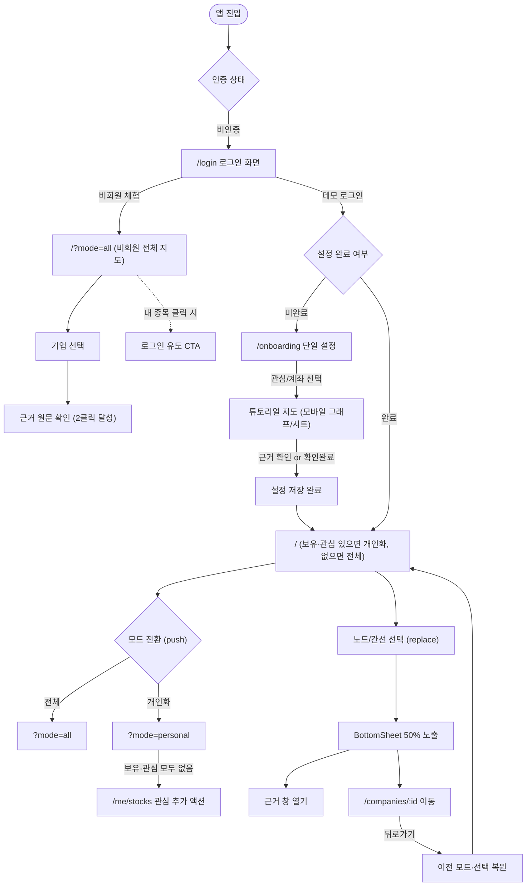

# 줍(Zoop) 디자인 방향 및 명세서 v2.0 (+ v3 그래프·모션·메타 문구 개정)

> **v3 개정(2026-09-29)**: §4 그래프를 GraphDB 시각화(Neo4j Browser·Bloom) 관례로 다시 썼고, §4.5 모션(당근 SEED 값)과 §4.6 메타 문구·아이콘 규칙을 새로 두었습니다. 아래 v2 규칙 중 **'노드를 모양으로 구분'(기업 원·사건 육각형), `QuietValue`의 '준비 중' 표기, `SourceIndicator`의 출처 글자 표시는 폐기**합니다. 폐기한 문장은 이력으로 남기되 각 항목 옆에 `[v3 폐기]`를 붙였습니다.

| 항목 | 내용 |
|:---|:---|
| **작성일** | 2026-09-29 |
| **목적** | 줍(Zoop) 금융 지식 지도 프로토타입의 AI 슬롭 전면 제거, UX 흐름 혁신, 모바일(≤768px) UI 신설 및 토큰·컴포넌트·화면별 구현 명세 확정 |
| **대상 독자** | 프론트엔드 개발자(구현 담당 에이전트), 백엔드/BFF 개발자, 기획·PM |
| **적용 스택** | Vite + React + TypeScript, Tailwind CSS v4 (`@theme`), Radix Primitives, Cytoscape.js, `@sun-typeface/suit` |
| **토큰 소스** | `/Users/asqi/zoop/docs/design/tokens.json` (W3C DTCG 2025.10 포맷, 단일 원천. 색은 Main 확정 팔레트로 교체됨 — 아래 §2의 slate 계열 hex는 역사 기록) |
| **기준 뷰포트** | 모바일 우선 390×844px (CSS 뷰포트 폭 390px), 데스크톱 1440×900px |

---

## 1. v2 비주얼 방향: 근거를 보여주는 조용한 금융 지도

### 1.1 줍(Zoop)의 목소리와 표현 방식
줍(Zoop)은 "내 종목 주변 사건의 연결과 사실 근거를 차분하게 보여주는 금융 항해도"입니다. 핀테크 업계에 만연한 **AI 슬롭(Generic Fintech & AI Slop)** — 화려한 네온 글로우, 정체불명의 AI 상승 확률 수치, 무의미한 카드 중첩, 보라-민트 그라데이션, 그리고 모든 문장을 감싸는 알약 모양 배지 — 은 금융 사용자의 인지 피로를 극대화하고 서비스의 신뢰를 훼손합니다.

v2의 시각 언어는 **"조용한 신뢰(Quiet Confidence)와 정밀한 정보 구조"**입니다. 화면의 90% 이상을 차분하고 절제된 중성 회색(Neutral Grays)으로 채우고, 브랜드 컬러는 사용자의 단 하나의 주 행동(Primary CTA)과 현재 선택된 상태에만 제한적으로 사용합니다. 정보를 전달하는 주체는 장식적인 컨테이너가 아니라 **정돈된 행(Row), 명확한 타이포그래피 대비, 그리고 조작 가능한 선(Edge)**입니다.

### 1.2 v1에서 완전히 버리는 것 목록 (Discarded in v2)
1. **Pretendard 전면 단독 사용 탈피**: 웹 생태계에 획일화된 Pretendard를 제거하고, UI 본문 정렬과 GSUB 고정폭 숫자(`tnum`)를 완벽히 지원하는 `SUIT Variable` 단일 패밀리로 교체합니다.
2. **카드 중첩 (Cards inside Cards)**: 브리핑 카드 안에 이슈 카드, 패널 안에 카드, 모달 안에 카드가 들어가는 다중 박스 중첩을 전면 금지합니다.
3. **테두리와 그림자의 동시 사용 (Border + Shadow)**: 동일 컨테이너에 1px border와 drop shadow를 함께 주어 테두리가 두 번 정의되는 시각적 슬롭을 배제합니다.
4. **사이드 스트라이프 (Side-tab Accent Border)**: 카드나 인용문 좌측에 3~4px 두께로 긋던 유색 막대를 전면 제거합니다.
5. **아이콘 타일 (Icon Tiles)**: 아이콘을 둥근 사각형이나 원형 배경 상자에 가두어 장식화하는 패턴을 삭제하고, 텍스트 인라인 아이콘으로 환원합니다.
6. **장식 점/격자 배경 (Decorative Grid/Dots)**: 그래프 캔버스와 앱 배경의 무의미한 dot pattern 배경을 삭제하여 데이터 선과 노드의 가독성을 극대화합니다.
7. **네온 청록·민트 강조 및 포커스 글로우**: 다크 테마의 형광 민트(`#2DD4BF`)와 `rgba(..., 0.25)` 노드 후광(Glow) 효과를 전면 삭제하고 저채도 세이지 틸(`#47A189`)과 2px 플랫 링으로 대체합니다.
8. **보라색 합성 데이터 배지**: 합성 데이터를 강조하던 보라색(`#FAF5FF` / `#581C87`) 알약 칩을 제거하고, 조용한 중성 슬레이트 표지로 통일합니다. `[v3 개정]` 표지도 글자 없이 아이콘 버튼으로만(§4.6).
9. **대괄호 준비 중 알약 칩**: `[시세 준비 중]`, `[감성 준비 중]` 같은 칩을 전면 폐지합니다. `[v3 개정]` 회색 `QuietValue` 글자도 폐기 — 없는 값은 자리 자체를 그리지 않습니다(§4.6).
10. **모바일 가로 스크롤 (Horizontal Overflow)**: 390px 뷰포트에서 그래프 툴바(476px)와 디자인시스템(514px)이 넘치던 문제를 원천 차단하고 가로 스크롤을 0으로 강제합니다.
11. **헤딩 위 작은 알약 라벨 (Eyebrow Pill)**: `방식 1/2`, `온보딩 (1/2단계)` 등 제목 위의 불필요한 알약 칩을 제거하고 제목 자체에 의미를 병합합니다.
12. **시스템 내부 구현어 노출**: 사용자에게 `BFF`, `PoC`, `Mock`, `announced`, `no_personal_issues` 등의 개발 용어를 노출하던 것을 정제된 한국어 사용자 언어로 전면 매핑합니다.

---

## 2. 디자인 토큰 결정 및 명도 대비 계산표

모든 토큰은 W3C DTCG 2025.10 표준을 준수하며 `/Users/asqi/zoop/docs/design/tokens.json`에 정의되어 있습니다(색 값은 tokens.json이 우선).

### 2.1 토큰 결정 근거
1. **서체 (Typography)**:
   - npm 패키지 `@sun-typeface/suit@2.0.5`의 `SUIT-Variable.woff2`(OFL-1.1, wght 100~900, GSUB `tnum` 내장)를 채택합니다.
   - SUIT Variable은 KS X 1001 한글 완성형 2,668자만 포함하므로, 기사 본문의 외래어·미등록 글자가 깨지지 않도록 CSS font-family에 `"Apple SD Gothic Neo"`, `"Malgun Gothic"`, `system-ui`, `sans-serif`를 필수 폴백으로 정의합니다.
   - 글자 크기는 9단계에서 6단계(`sm`, `base`, `md`, `lg`, `xl`, `2xl`)로 대폭 압축했습니다. **본문 최소 15px**, **모바일 폼 입력 16px(iOS 사파리 자동 확대 방지)**, **13px 미만 사용 엄격 금지(법적 고지·데이터 출처 포함)**를 규칙화했습니다.
2. **형태 (Radius)**:
   - 스케일을 유효 3단계(`none: 0px`, `sm: 8px`, `lg: 16px`) + `full: 9999px`로 제한합니다.
   - 리스트 항목, 패널 내부 콘텐츠, 테이블, 캔버스는 모두 `radius-none(0px)`으로 평탄화합니다.
   - `sm(8px)`은 버튼, 입력창, 세그먼트 탭 선택자 등 인터랙티브 컨트롤에만 적용합니다.
   - `lg(16px)`는 바텀시트 상단, 다이얼로그 모달, 토스트 등 최상단에 떠 있는 오버레이 표면에만 적용합니다.
   - 당근 SEED의 동심원(Concentric Radius) 규칙에 따라 모달/시트($R=16px$) 내부의 컨트롤은 패딩을 제외한 $R=8px$을 자연스럽게 유지합니다.
3. **색상 (Color)**: Tailwind 기본 팔레트(slate·emerald 등)를 그대로 쓰지 않고 OKLCH에서 직접 만든 램프를 쓴다.
   - 중성: 브랜드 hue(170) 쪽으로 아주 약하게 기운 회색(채도 0.003~0.012). 라이트 `#F8FAF9` 캔버스·`#FFFFFF` 표면, 다크 `#0E1110` < `#161918`(패널) < `#1D2220`(시트) 순으로 높을수록 밝다.
   - 브랜드: 라이트 딥 스프루스 틸 `#0A5C48`, 다크 세이지 틸 `#47A189`(네온 민트 `#2DD4BF` 폐기). 주 행동 1개와 선택 상태에만 쓴다.
   - 의미 색은 상승·하락·경고·오류 4개뿐이다. 성공은 브랜드, 정보는 중성으로 대신한다. 약한 배경(bg-weak)과 유색 배지 토큰은 두지 않는다.
   - 간선은 선 모양으로 구분하고 색은 저채도로만 보조한다. 흐려진 노드는 라벨을 숨긴다.

### 2.2 기존 `tokens.json` 대비 변경 키 매핑표 (v1 → v2)

빌드 스크립트 `prototype/web/scripts/build-tokens.mjs`가 오류 없이 읽을 수 있도록 키 계층을 유지하면서 아래와 같이 정비되었습니다.

| v1 토큰 경로 | v2 토큰 경로 | 변경 유형 | 사유 및 대체 가이드 |
|:---|:---|:---:|:---|
| `typography.fontFamily.sans` | `typography.fontFamily.sans` | **수정** | Pretendard 제거, `SUIT Variable` + 한글 음절 폴백 스택 명세 |
| `typography.fontSize.2xs` (11px) | — | **삭제** | 13px 미만 사용 엄격 금지 규칙에 따라 삭제. `text-sm`(13px)으로 대체 |
| `typography.fontSize.xs` (12px) | — | **삭제** | 13px 미만 금지 규칙. `text-sm`(13px)으로 대체 |
| `typography.fontSize.base` (14px) | `typography.fontSize.base` (15px) | **수정** | 본문 가독성 하한선 15px로 상향 |
| `typography.fontSize.xl` (20px) | `typography.fontSize.xl` (22px) | **수정** | 제목/본문 대비 강화를 위해 22px로 조정 |
| `typography.fontSize.2xl` (24px) | `typography.fontSize.2xl` (28px) | **수정** | 대형 헤딩 크기 통일 |
| `typography.fontSize.3xl` (28px) | — | **삭제** | 스케일 단순화를 위해 `2xl`(28px)로 통합 삭제 |
| `radius.md` (8px) | `radius.sm` (8px) | **이름 변경** | 3단계 스케일 축소: 컨트롤용 반경을 `sm`으로 표준화 (`md`는 하위 호환 매핑) |
| `radius.xl` (16px) | `radius.lg` (16px) | **이름 변경** | 떠 있는 표면용 반경을 `lg`로 표준화 |
| `color.dark.brand.primary` (`#2DD4BF`) | `color.dark.brand.primary` (`#47A189`) | **값 교체** | 네온 민트 제거 |
| `color.neutral.*`, `color.dark.neutral.*` (Tailwind slate) | 같은 키 | **값 교체** | hue 170 저채도 중성 램프, `surface-selected`·`border-control` 추가 |
| `color.semantic.{up,down,warning,error}.{main,text,bg-weak,border}`, `semantic.{success,info}.*` | `color.semantic.{up,down,warning,error}` | **구조 단순화** | 의미 색당 1값, 성공·정보 삭제 |
| `color.badge.*`, `graph.focus.glow` | — | **삭제** | 유색 배지·글로우 폐지. 배지는 중성 1종 |
| `color.graph.edge.*` | 같은 키 | **값 교체** | 저채도 값, 모양(실선·파선·화살표·점선)이 1차 구분 수단 |

---

### 2.3 WCAG 2.2 AA 명도 대비 (tokens.json 값으로 계산)

WCAG 상대 휘도 공식으로 계산했다. 텍스트는 4.5:1, 선·입력 테두리 같은 UI 요소는 3:1이 기준이다. 모든 조합이 기준을 넘는다.

| 역할 | 전경 | 배경 | 라이트 | 다크 | 기준 |
|---|---|---|---|---|---|
| 본문 | `neutral.text-primary` | `neutral.surface-base` | `#19201D` / `#F8FAF9` **15.83** | `#ECEFEE` / `#0E1110` **16.4** | 4.5:1 |
| 본문(패널·시트) | `neutral.text-primary` | `neutral.surface-overlay` | `#19201D` / `#FFFFFF` **16.59** | `#ECEFEE` / `#1D2220` **13.94** | 4.5:1 |
| 보조 텍스트 | `neutral.text-secondary` | `neutral.surface-base` | `#474F4C` / `#F8FAF9` **8.04** | `#BABFBD` / `#0E1110` **10.19** | 4.5:1 |
| 각주·준비 중 | `neutral.text-tertiary` | `neutral.surface-overlay` | `#636B68` / `#FFFFFF` **5.48** | `#979D9A` / `#1D2220` **5.84** | 4.5:1 |
| 브랜드 버튼 글자 | `brand.primary-foreground` | `brand.primary` | `#FFFFFF` / `#0A5C48` **7.96** | `#0A1612` / `#47A189` **5.92** | 4.5:1 |
| 브랜드 링크 | `brand.primary` | `neutral.surface-base` | `#0A5C48` / `#F8FAF9` **7.6** | `#47A189` / `#0E1110` **6.08** | 4.5:1 |
| 상승 | `semantic.up` | `neutral.surface-base` | `#BE222A` / `#F8FAF9` **5.8** | `#EB827B` / `#0E1110` **7.24** | 4.5:1 |
| 하락 | `semantic.down` | `neutral.surface-base` | `#145EC1` / `#F8FAF9` **5.89** | `#79A6E9` / `#0E1110` **7.63** | 4.5:1 |
| 경고 | `semantic.warning` | `neutral.surface-base` | `#915C08` / `#F8FAF9` **5.36** | `#D9AF75` / `#0E1110` **9.35** | 4.5:1 |
| 오류 | `semantic.error` | `neutral.surface-base` | `#B21F41` / `#F8FAF9` **6.33** | `#EA808A` / `#0E1110` **7.19** | 4.5:1 |
| 입력 테두리(UI) | `neutral.border-control` | `neutral.surface-overlay` | `#818885` / `#FFFFFF` **3.62** | `#6B726F` / `#1D2220` **3.27** | 3:1 |
| 직접 관련 선 | `graph.edge.involves` | `neutral.surface-base` | `#2D6359` / `#F8FAF9` **6.59** | `#83AFA6` / `#0E1110` **7.82** | 3:1 |
| 구조적 관련 선 | `graph.edge.structurally-related` | `neutral.surface-base` | `#626B68` / `#F8FAF9` **5.24** | `#8D9491` / `#0E1110` **6.13** | 3:1 |
| 후속 사건 선 | `graph.edge.follows` | `neutral.surface-base` | `#895F34` / `#F8FAF9` **5.34** | `#C8A47A` / `#0E1110` **8.18** | 3:1 |
| 사건 공유(파생) 선 | `graph.edge.shares-issue` | `neutral.surface-base` | `#858B88` / `#F8FAF9` **3.31** | `#6D7371` / `#0E1110` **3.92** | 3:1 |

---

## 3. 컴포넌트 아키텍처 및 규칙

기존 `components/ui/*` 및 `components/domain/*`의 전수 감사 결과를 바탕으로 컴포넌트를 4가지(유지/재설계/삭제/신규)로 명확히 분류합니다.

### 3.1 컴포넌트 분류 총괄표

| 기존 컴포넌트 파일 | 분류 | v2 조치 및 대체 컴포넌트 |
|:---|:---:|:---|
| `components/ui/card.tsx` | **삭제** | 컨테이너 슬롭의 원인. 일반 컨테이너로서의 Card 사용 금지. `ListRow` 및 평탄 패널로 대체 |
| `components/domain/issue-card.tsx` | **삭제** | 중첩 카드의 주범. 평탄화된 사건 행 `EventRow`로 전면 대체 |
| `components/ui/button.tsx` | **유지/개선** | 최소 터치 영역 44×44px 보장, 불필요한 그림자 제거, `radius-sm`(8px) 적용 |
| `components/ui/input.tsx` | **유지/개선** | 모바일 16px 글자 크기 보장(iOS 확대 방지), 44px 높이 터치 보장 |
| `components/ui/dialog.tsx` | **유지/개선** | `radius-lg`(16px), 딤 오버레이, 취소 버튼 대신 `[닫기]` 버튼 표준화 |
| `components/ui/tabs.tsx` | **재설계** | 세그먼트 형태 전환(최대 4개), 44px 터치 타깃, 가로 스크롤 완전 차단 |
| `components/ui/badge.tsx` | **재설계** | 객체당 1~2개 제한, Weak 톤 기본, 클릭 금지, 상태 전달 전용으로 축소 |
| `components/ui/toast.tsx` | **재설계** | 일시 피드백(3초/5초), 하단 CTA 위 안전 영역 배치, 긴 설명 금지 |
| `components/ui/feedback.tsx` | **재설계** | 장식 원형 아이콘 타일 제거! SEED Result Section 기반(상황+이유+행동 3요소) 템플릿화 |
| `components/domain/briefing-card.tsx` | **재설계** | 회차 바깥 경계만 1개 유지, 내부 사건은 `EventRow` 행으로 평탄화 |
| `components/domain/company-header.tsx` | **재설계** | 시세 박스 제거, 제목/수치 굵기 대비 강화. `[v3]` 시세가 없으면 자리 없음 + 상징색 표지(`CompanyMark`) |
| `components/domain/relation-list.tsx` | **재설계** | 노드마다 감싸던 둥근 테두리 박스 전면 제거, 계층형 `ListRow` + 들여쓴 구분선 |
| `components/domain/graph-canvas.tsx` | **재설계** | 점 격자 배경 제거(플랫 캔버스), 모바일 툴바 폭(390px 내) 최적화. `[v3]` GraphDB식 색 원·간선 요약·fcose·LOD(§4) |
| `components/domain/graph-legend.tsx` | **재설계** | 2문단 장문 제거, 선 모양 중심 1줄 범례화, 파생 경로 설명은 간선 패널로 이동 |
| `components/domain/relation-type-tag.tsx` | **재설계** | `[v3]` 글자 태그(`RelationTypeTag`) 폐기, 선 견본 `EdgeGlyph`만 남김 |
| `components/domain/evidence.tsx` | **재설계** | 3px 좌선(side-tab) 제거, 구현 설명("창 닫으면 그대로") 삭제, 원문 인용 중심 |
| `components/domain/status-labels.tsx` | **재설계** | 대괄호 칩 폐지. `[v3]` `QuietValue` 삭제, `PriceChange(null)`은 렌더링 안 함 |
| `components/domain/ai.tsx` | **재설계** | AI 생성 표시 1회 유지, ①~④ 긴 생성 설명 및 중복 딱지 제거 |
| — | **신규 1** | `ListRow`: 좌/중/우 슬롯, 들여쓴 구분선, 44px 터치 보장 |
| — | **신규 2** | `SectionHeader`: 제목/설명/액션 3슬롯, 헤딩 위 알약 칩 제거 |
| — | **신규 3** | `BottomTabBar`: 모바일(≤768px) 3개 탭 (`지도` · `브리핑` · `내 종목`) |
| — | **신규 4** | `BottomSheet`: 모바일 전용 반응형 바텀시트 (스냅 포인트 50%/90%, 핸들) |
| — | **신규 5** | `AppBar`: 상단 1줄 고정 헤더 (화면 제목 + `SourceIndicator` + 계정) |
| — | **신규 6** | `SourceIndicator`: 전역 datasetKind 표지 + 설명 팝오버. `[v3]` 글자 없는 아이콘 버튼 |
| — | **신규 7** | ~~`QuietValue`: 준비 중 값을 조용한 인라인 텍스트로 표시~~ `[v3 폐기]` → `IconHint`(아이콘 + 툴팁·팝오버), `IconCount`(아이콘 + 숫자), `CompanyMark`(상징색 표지) |
| — | **신규 8** | `EventRow`: 기존 `IssueCard`를 대체하는 평탄화된 사건 행 컴포넌트 |

---

### 3.2 신규 핵심 컴포넌트 8종 상세 명세

#### 1. `ListRow` (리스트 행 컴포넌트)
- **목적**: 카드 중첩을 방지하고 행 기반의 밀도 높은 목록을 구현합니다.
- **슬롯 구조**:
  - `left` (Prefix): 24×24 아이콘, 기업 원형 마커, 또는 상태 도형
  - `contents` (Title + Detail): 메인 텍스트(15px text-base) + 보조 설명(13px text-sm text-secondary)
  - `right` (Suffix): 등락률 수치, 조용한 배지(최대 1개), 또는 화살표 아이콘
- **구분선 (`border`)**: `indented`(좌측 56px 들여쓴 1px 구분선, 기본값), `full`(전체 너비), `none`(연결감)
- **크기 및 패딩**: 상하 패딩 12px 또는 16px, 최소 높이 48px (44px 터치 영역 보장)
- **상태**: default(투명), hover(`surface-sunken`), active(`primary-subtle`), disabled(opacity 0.4)
- **접근성**: 키보드 포커스 시 2px 내부 아웃라인, 행 전체가 클릭 가능한 경우 `role="button"` 또는 링크

#### 2. `SectionHeader` (섹션 헤더 컴포넌트)
- **목적**: 헤딩 위의 불필요한 알약 칩(eyebrow pill)을 제거하고, 제목과 액션을 한 줄로 정렬합니다.
- **슬롯 구조**:
  - `title`: 섹션 메인 제목 (18px text-lg semibold)
  - `description`: 부가 설명 (13px text-sm text-secondary)
  - `action`: 우측 액션 링크 또는 필터 버튼 (예: `더보기 >`, `편집`)
- **비율**: TDS ListHeader 원칙에 따라 제목과 설명 영역이 너비의 66% 이상을 확보

#### 3. `BottomTabBar` (모바일 하단 탭바) `[v8 종목 메뉴 분리]`
- **목적**: 모바일(≤768px) 환경에서 핵심 화면 간의 즉각적인 전환과 AI 질문 진입을 제공합니다(팀 화면계획서 슬라이드 22·24의 그래프·브리핑·AI·MY 구조를 우리 용어로 수용).
- **탭 구성 (5개)**:
  1. `지도` (아이콘: Map)
  2. `종목` (아이콘: Building2)
  3. `브리핑` (아이콘: Newspaper)
  4. `AI` (아이콘: Sparkles) — 화면 이동이 아니라 **AI 질문 창(§5.6)을 연다**. `button` + `aria-haspopup="dialog"` + `aria-expanded`. 지금 화면이 알린 대상(기업 상세의 그 기업)을 질문 대상으로 넘긴다. 비회원은 창 안의 로그인 안내를 본다.
  5. `내 종목` (아이콘: Bookmark)
- **활성 표시**: 브랜드 색 + 굵은 글자(600) + 탭 위쪽 2px 표시선(색만으로 구분하지 않음). 화면 탭은 `aria-current="page"`. AI 질문 창이 열려 있는 동안은 `AI` 탭만 활성으로 보이고(화면 탭의 `aria-current`는 유지), 창을 닫으면 원래 화면 탭으로 돌아가며 포커스는 `AI` 탭으로 돌아온다. 화면 버튼([AI에게 묻기])으로 연 창도 같은 규칙이다.
- **데스크톱**: 헤더 메뉴는 `지도 · 종목 · 브리핑 · 내 종목`이다(AI는 화면마다 [AI에게 묻기]).
- **규격·선택 근거**: 높이 56px + 하단 기기 안전 영역. 390×844에서 5개 모두 **78×56px**, 글자 **13px**로 실측했다. 최장 `브리핑`·`내 종목` 라벨도 한 줄이며 가로 넘침은 없었다(`scrollWidth=390`). 지도 안 숨은 진입이나 내 종목에 합치는 안 대신 비회원도 열람할 수 있는 별도 카탈로그를 같은 1차 내비게이션에 둔다. 캡처 `v8/menus-390-light.png`, `v8/menus-390-dark.png`.
- **표현**: 플로팅 형태가 아닌 화면 하단 밀착 고정, 상단 1px `border-subtle`, 배경 `surface-raised`
- **배지**: 새 브리핑 업데이트 시 `브리핑` 탭 우상단에 4px 점(Red Bean)만 표기 (숫자 알약 금지)

#### 4. `BottomSheet` (모바일 바텀시트)
- **목적**: 모바일에서 노드 상세, 간선 정보, 필터를 화면 전환 없이 탐색합니다.
- **스냅 포인트 (2단계)**:
  - **50% (기본 스냅)**: 지도와 목록의 절반을 가리며 핵심 사건 2~3건을 확인
  - **90% (확장 스냅)**: 전체 사건 타임라인 및 상세 원문 근거 확인
- **형태**: 상단 모서리 `radius-lg`(16px), 가로 중앙 36×4px 둥근 드래그 핸들(Grabber), 배경 `surface-overlay`
- **닫기 인터랙션**: 핸들 아래로 스와이프, 배경 딤 터치, 또는 우상단 [닫기(X)] 버튼 (터치 타깃 44×44px)

#### 5. `AppBar` (상단 앱바)
- **목적**: 복잡한 2줄 모바일 헤더를 단일 48px 고정 바로 통합합니다.
- **슬롯 구조**:
  - `left`: 로고(`줍`) 또는 2-depth 화면의 뒤로가기 버튼(`<`)
  - `center`: 현재 화면 제목 또는 검색바
  - `right`: `SourceIndicator` (조용한 출처 표지) + 사용자 계정 아바타/메뉴
- **금지**: 디자인시스템 링크를 소비자 앱바에 노출하는 행위 금지 (계정 메뉴 안이나 푸터로 격리)

#### 6. `SourceIndicator` (전역 데이터 출처 표시기) `[v3 개정]`
- **목적**: 화면 곳곳에 반복되던 합성/승인 칩을 제거하고 전역 단 1곳에서 투명하게 출처를 밝힙니다.
- ~~표현: 조용한 인라인 텍스트 + 소형 아이콘 (예: `● 실제 기사 승인`, `○ 합성 미리보기`)~~ `[v3 폐기]`
- **v3 표현**: 글자 없는 44px 아이콘 버튼 하나. 실제 기사(검증 통과) `ShieldCheck`, 실제 기사 저장본 `Archive`, 합성 데이터 `FlaskConical`, 연결 끊김 `WifiOff`(오류색). 스크린리더 이름·툴팁은 `데이터 출처: 합성 데이터`처럼 읽히고, 누르면 한 문장 설명 팝오버가 열립니다. 노출 위치는 앱 헤더와 근거 창 머리 두 곳뿐입니다.

#### 7. ~~`QuietValue` (준비 중 조용한 텍스트)~~ `[v3 폐기]`
- ~~표현: `[시세 준비 중]` 칩 대신 회색 텍스트 `시세 준비 중` (`text-tertiary`, 13px)으로 인라인 렌더링~~
- **v3**: 컴포넌트를 삭제했습니다. 시세·AI 요약·재무 지표·평가금액처럼 데이터가 없는 값은 행·칸·글자 모두 그리지 않습니다(`PriceChange`는 `null`이면 아무것도 렌더링하지 않음). 대신 없는 값을 지어내지 않는다는 원칙은 그대로입니다.
#### 8. `EventRow` (사건 평탄화 행)
- **목적**: 기존 `IssueCard`의 둥근 테두리와 그림자를 제거하고, 사건을 깔끔한 행으로 평탄화합니다.
- **구성**:
  - 날짜/시각 (13px text-sm text-secondary) + 같은 줄 아이콘 메타(`IconCount`: 보도 기사 `Newspaper` N, 관계 유형이 섞인 목록이면 선 견본 아이콘 + 툴팁)
  - 사건 제목 (15px text-base regular, 본문)
  - 관련 기업 (조용한 텍스트 링크)
  - `[근거 N건 보기]` / `[AI에게 묻기]`
- **구분**: 하단 1px 구분선. `[v3]` "관계: 직접 관련" 같은 글자 태그와 `RelationTypeTag` 컴포넌트는 폐기했습니다.

---

## 4. 그래프 시각화 및 상호작용 규칙 v3 (GraphDB식)

참고한 관례: Neo4j Browser의 결과 그래프(라벨별 색 원, 관계 유형 글자를 선 위에, 결과 개요의 라벨·관계 유형 칩과 개수)와 Neo4j Bloom의 범례 패널(카테고리·관계 유형과 그 스타일 목록). 출처: [Neo4j Browser visual tour](https://neo4j.com/docs/browser-manual/current/visual-tour/), [Bloom legend panel](https://neo4j.com/docs/bloom-user-guide/current/bloom-visual-tour/legend-panel). 구조만 가져오고 Neo4j의 색·글꼴·레이아웃은 가져오지 않습니다.

### 4.1 노드: 모두 원, 구분은 색 `[v3]`
- ~~기업 원형 + 사건 육각형처럼 모양으로 구분~~ `[v3 폐기]`
- **기업**: 상징색(`brandColor`) 원, 기본 모델 크기는 데스크톱 64px·모바일 72px(중심 기업 +12px). 축소할 때 화면 최소 지름은 **의미 기반 확대** `[v6]`로 배율에 따라 줄어듭니다 — 배율 0.6 이상 44px, 0.25 이하 28px, 그 사이는 선형(28px도 WCAG 2.2 최소 대상 24px 이상). 넓게 볼 때 원끼리 덜 겹치고 이름 자리가 생기게 하려는 것입니다. 안에는 로고(`logoUrl`, 웹 `public/logos/`)를 한 가지 색 실루엣으로 칠해 넣습니다. 로고 색은 흰색(`#FFFFFF`)과 거의 검정(`#0E1110`) 중 상징색과 대비가 큰 쪽입니다. 로고가 없으면 같은 색 규칙의 이니셜(한글은 첫 음절, 로마자는 단어 첫 글자 두 개까지), 상징색이 없으면 `graph.company-fallback-1..8` 고정 팔레트에서 `company_id`의 FNV-1a 해시로 고른 색입니다(항상 같은 색, 흰 이니셜 4.9:1 이상).
- **사건**: 범주색 원 하나(`graph.node-issue`, 라이트 `#4B5652`·다크 `#7C8985`) + 번개(`Zap`) 아이콘. 크기 32px(모바일 36px). 기업이 여러 색이므로 사건은 채도 없는 한 색으로만 구분합니다.
- **캡션**: 기업은 이름 16자, 사건은 원문 대상(`target`) 또는 제목을 최대 두 줄로 줄입니다(한글 포함 시 줄당 12자, 그 외 24자). 단독 행동어(`action`)나 추측 번역은 쓰지 않으며 전체 제목은 상세에 보존합니다. 배경색(`surface-base` 92%) 받침을 깝니다. 보유·관심 기업은 이름 아래 둘째 줄에 `보유`·`관심`·`보유·관심`을 적습니다.
- **보유·관심** `[v5]`: 색이 아니라 테두리 **모양**과 **글자**로 구별합니다 — 보유 3px 실선, 관심 3px 점선, 둘 다 7px 이중선(모두 `graph.node-mark`) + 캡션 둘째 줄. 범례 칩은 `보유 N`·`관심 N`(칩 표지가 같은 실선·점선 고리 `MarkRing`), 읽는 법 팝오버에 이중선 뜻을 적습니다. 사이드바 행 끝에도 같은 고리를 둡니다. 전체 모드에서도 회원의 보유·관심 기업은 같은 표시를 받습니다.
- **낮은 대비 상징색**: 배경과 3:1이 안 되면(예: 다크 테마의 Apple `#000000`) 1.5px `border-control` 윤곽선을 자동으로 더합니다.
- 목록·패널·기업 상세도 같은 표지를 `CompanyMark`로 씁니다(CSS mask로 로고를 칠함).

### 4.2 선택·호버·포커스 (글로우 배제)
- **호버**: 선택이 없을 때 노드에 올리면 그 노드와 1차 이웃(노드·선)만 선명하고 나머지는 0.35로 옅어집니다. 이웃 선에는 요약 글자가 보입니다.
- **선택(탭·클릭)**: 3px 브랜드 외곽선(`graph.focus-ring`, 간격 3px), 이웃 외 요소는 `opacity 0.22`, 카메라가 대상 쪽으로 300ms 부드럽게 이동(모바일은 바텀시트를 피해 위쪽 가운데). 상세는 데스크톱 오른쪽 패널, 모바일 바텀시트.
- **사이드바 기업 선택** `[v5, v6 접기]`: 데스크톱 사이드바(보유·관심 목록)에서 지도에 있는 기업을 고르면 그 노드를 선택하고 포커스·경로를 풀어, 카메라를 그 기업 중심으로 옮기며 최소 1.3배까지 확대합니다(300ms, 동작 줄이기면 즉시). 같은 기업을 다시 골라도 다시 가운데로 옵니다. 지도에 없는 기업은 기업 상세로 이동합니다. 사이드바는 접을 수 있습니다(§4.9). 행 옆 별 버튼(`WatchToggle`)은 관심 등록·해제이며, 해제로 행이 사라지면 포커스는 같은 자리의 다음 행 별 버튼(없으면 위 행, 목록이 비면 `관심 종목 고르기`)으로 옮깁니다.
- **더블클릭·두 번 탭**: 대상과 이웃이 화면에 차도록 확대(최대 1.8배).
- **끌기**: 노드를 옮길 수 있고 옮긴 위치는 기억합니다. 빈 곳 끌기는 화면 이동, 두 손가락은 확대·축소.
- 네온 글로우는 쓰지 않습니다.

### 4.3 간선: 가운데 요약 + 선 모양 + 화살표 `[v3]`
- 모든 선 가운데에 BFF가 준 `summary`(예: `발표자`, `공급·생산`, `후속 사건`, `같은 사건 2건`)를 선을 따라 회전(`autorotate`)해 배경 받침과 함께 씁니다(`graph.edge-label`).
- 관계 유형은 선 모양으로 유지합니다: `INVOLVES` 2px 실선, `STRUCTURALLY_RELATED_TO` 2px 파선 `[6,3]`, `FOLLOWS` 1.5px 실선, `SHARES_ISSUE` 1.5px 점선 `[2,3]`. 방향이 있는 앞의 셋은 도착 쪽 화살표, 사건 공유(파생)는 방향 없음.
- **누를 수 있는 선** `[v6, 명세 D03·FS022·FS023]`: 사건 공유(기업–기업)와 후속 사건(사건–사건) 선만 눌러 연결선 상세를 엽니다. 사건–기업 선(`INVOLVES`·`STRUCTURALLY_RELATED_TO`)은 표시 전용입니다 — 올리면 요약은 보이지만 눌러도 아무것도 고르지 않습니다. 기업과 사건의 관계는 기업 상세 `직접 이슈`의 사건을 눌러 **영향 경로**(§4.10)로 봅니다. 후속 사건 선을 남긴 이유: FS022가 뺀 것은 이슈–기업 선뿐이고, 후속 사건 선은 사건 순서를 지도에서 확인하는 유일한 진입점입니다.
- 파생 경로가 직접 관계가 아니라는 문장은 **연결선 상세에서만** 보여줍니다.
- **연결선 상세** `[v5, 요구 23·24]`: 두 대상, 방향(`방향 없음` 또는 `A → B`), 공유 사건 수와 기간(시각을 아는 사건만), **확인 시점**을 보입니다. 확인 시점은 기준 관계의 검증 시각(`basis.verifiedAt`)이 있으면 그것, 없으면 검증을 통과한 자료의 기준 시각(`metadata.asOf`)이며 `Info` 팝오버로 구분합니다. 공급·고객 같은 관계 유형은 데이터에 없으므로 만들지 않습니다. 파생 선의 `근거 N건 보기`는 공유 사건마다 두 기업이 등장한 근거를 모아 엽니다.
- **근거 창** `[v5, 요구 24·40]`: 창 위에 `관계 확인 시점`, 문서마다 `발행 <시각>`을 따로 적어 섞이지 않게 합니다. 원문 링크가 없으면 `원문을 제공하지 않는 자료입니다`(`Link2Off`).
- **범례**: Neo4j식 라벨 칩(표지 + 이름 + 개수) 한 줄. 지도에 있는 종류만 보이며, 모바일에서는 가로로 민다. 데스크톱에서는 도구 막대 줄(사이드바 접기·모드·범례·읽는 법·조작 도움말)에 합친다. 읽는 법은 `Info` 팝오버, 키보드 기업·사건 선택은 `조작 도움말`에 둔다. 그래프/목록 전환은 없다.

### 4.4 배치·전체 연결·성능
- **데이터 범위**: `/api/graph`를 `depth`·`limit` 없이 부릅니다. 포커스에서 닿는 연결 요소 전체(전체 모드는 전부)를 서버 기본 한도 500개까지 받습니다. 한도를 넘으면 `노드가 많아 N개까지만 보여드려요` 경고를 둡니다. (v2의 depth=1·limit=20 예산 폐기)
- **배치**: force-directed `cytoscape-fcose`(연결 요소 묶음 배치, 라벨 크기 포함). `흐름 순으로 정렬`을 켜면 dagre(왼쪽→오른쪽). 배치 계산 때만 기업을 이름 자리까지 포함한 모델 크기 140으로 셉니다(300노드에서 이름 겹침 없이 보이는 기업 9 → 15곳).
- **배치 고정** `[v6, R4]`: fcose 난수 씨앗을 고정하고, 앱 실행 중에는 데이터별 전체 배치 좌표를 기억합니다. 새로고침·지도 복귀 뒤에도 노드가 같은 자리에 있습니다(실측 위치 차이 0).
- **라벨 LOD**: 화면 글자는 13px 아래로 작아지지 않도록 배율에 반비례해 키웁니다. 사건 캡션과 근거 수 배지는 배율 0.55 미만, 선 요약은 0.95 미만에서 숨깁니다. 선이 160개를 넘으면 확대해도 호버·선택으로 강조된 선의 요약만 보입니다. 강조된 대상의 라벨은 배율과 관계없이 보입니다. 요약은 삭제·말줄임하지 않고 줄바꿈하며 선 위쪽으로 띄워 놓습니다.
- **캡션 정리(디클러터)** `[v6, R1–R3]`: 화면이 멈춘 뒤 캡션끼리 또는 캡션과 다른 기업·묶음 원이 겹치면 우선순위가 낮은 캡션만 숨깁니다(`.label-cull`, 재배치·확대 없음). 우선순위: **선택·경로·포커스 중심**(항상 보임) > 선택의 이웃 기업 > 보유·관심 기업 > 연결 수가 많은 기업 > 묶음 > 사건(연결 수·근거 수 순). 숨긴 노드의 원·배지·선은 그대로이고, 확대·호버·선택하면 캡션이 다시 보입니다. 근거 배지는 정리 대상이 아닙니다.
- **성능**: 끌기·확대 중에는 직전 화면 텍스처를 재사용(`textureOnViewport`)하고, LOD 스타일 갱신과 캡션 정리는 카메라가 140ms 멈춘 뒤 한 번만 한다(기존 실측 프레임 p95 16.7ms). 목록 전환용 사건별 조회는 제거했다. 종목 카탈로그에서는 처음 20개 행만 표시·시세 조회하고 더 보기로 전체에 접근한다(결과 수 제한 아님).
- **캔버스**: 단색 `surface-base`, 점 격자 없음. 모바일 조작 도구는 오른쪽 아래 세로 원형 버튼(`+`·`−`·전체 보기·더보기).
- **모바일**: 지도는 그래프만 제공한다. 지도 페이지는 앱 바와 탭 바를 뺀 뷰포트 높이로 고정한다. 44px 조작 도구는 탭 바 위에 남는다. 종목 목록은 독립 `/companies` 페이지에서 문서 흐름대로 세로 스크롤한다.

### 4.5 모션 (당근 SEED 값) `[v3 신설]`
출처: [SEED Motion](https://seed-design.io/llms/foundations/motion.txt), [SEED Feedback/Scale](https://seed-design.io/llms/foundations/feedback/scale.txt). 값은 `tokens.json`의 `motion`에 옮겼습니다.

| 토큰 | 값 | 쓰는 곳 |
|:---|:---|:---|
| `duration.d1~d6` | 50·100·150·200·250·300ms | SEED 원 척도 |
| `duration.fast` (=d3) | 150ms | 호버·눌림 색 전환, 눌림 축소, 팝오버·툴팁 등장 |
| `duration.d4` | 200ms | 세그먼트 선택 표시 이동 |
| `duration.exit` (=d4) | 200ms | 시트·다이얼로그·토스트 퇴장(등장보다 짧게) |
| `duration.normal` (=d5) | 250ms | 화면 전환, 시트·다이얼로그·토스트 진입, 탭 밑줄 이동, 목록 첫 표시 |
| `duration.slow` (=d6) | 300ms | 데스크톱 오른쪽 시트 진입, 그래프 선택 카메라 이동 |
| `duration.graph-layout` | 600ms | 줍 확장: 그래프 초기 배치·모드 전환 재배치 |
| `duration.stagger` | 30ms | 줍 확장: 목록 행 사이 지연(8행까지) |
| `easing.standard` | `cubic-bezier(0.35,0,0.35,1)` | SEED easing. 제자리 이동, 색 전환, 그래프 카메라 |
| `easing.enter` | `cubic-bezier(0,0,0.15,1)` | 나타날 때, 눌림 축소(pressed-scale) |
| `easing.exit` | `cubic-bezier(0.35,0,1,1)` | 사라질 때 |
| `easing.enter-expressive` | `cubic-bezier(0.03,0.4,0.1,1)` | 그래프 노드가 퍼져 나오는 첫 배치 |

- **적용처**: 화면 전환(아래 8px에서 떠오름 + 페이드), 바텀시트·오른쪽 시트·다이얼로그 진입과 **퇴장**, 팝오버·메뉴·툴팁, 토스트(진입·퇴장·밀어서 닫기), 세그먼트 선택 표시 슬라이드, 탭 밑줄 슬라이드, 목록 첫 표시 스태거, 눌림 축소(`pressable`: 세로 2px, 44px 컨트롤 0.955·넓은 버튼 0.977), 그래프(첫 배치 때 가운데에서 퍼짐 + 새 노드 페이드, 선택 시 카메라 팬·줌, 모드 전환 때 남는 노드는 제자리에서 시작).
- transform·opacity(·scale·translate)만 움직입니다. 튀는 오버슈트(spring·elastic)는 쓰지 않습니다.
- **동작 줄이기**(`prefers-reduced-motion: reduce`): 모든 duration 토큰이 0ms가 되고 전역 규칙이 animation·transition을 즉시 끝냅니다. 그래프는 배치·카메라를 애니메이션 없이 바로 적용합니다. 눌림 축소도 사실상 사라집니다.
- 새 애니메이션 라이브러리는 쓰지 않습니다(CSS·Radix data-state·Cytoscape 내장 animate).

### 4.6 메타 문구 제거와 아이콘 `[v3 신설]`
- **글자로 쓰지 않는 것**: `합성 데이터`/`실제 기사` 출처 라벨(→ 아이콘 버튼), `준비 중` 값(→ 자리 자체 삭제), 화면 부제·섹션 설명문(예: 규칙 기반 미리보기 안내, 비중 기준 설명, 인용 구간 안내), `(미확정)`(→ `CalendarClock` 아이콘 + 툴팁), `인용 확인됨`(→ 체크 아이콘 + 툴팁·aria-label), 관계 유형 글자 태그(→ 선 견본 아이콘 또는 섹션 머리 `Info` 아이콘 팝오버).
- **남기는 것**: 투자 권유 아님 고지 1줄(브리핑·기업 상세 하단), AI 생성 답변 표시(`Sparkles` 아이콘 + aria-label, 입력창 아래 한 줄 고지), 파생 경로가 직접 관계가 아니라는 문장(연결선 상세에서만), 오류·빈 상태 문장, `원문 대조 필요` 경고.
- **아이콘**: lucide를 글자 옆에 그대로(상자에 가두지 않음). 내비·섹션 머리·행·버튼에 같은 뜻 같은 아이콘을 씁니다 — 지도 `Map`, 브리핑 `Newspaper`, 내 종목·개인화 모드 `Bookmark`, 시장 전체 `Globe`, 관심 `Star`, 보유 `Wallet`, 기업 `Building2`, 사건 `Zap`, 간접 이슈 `GitFork`, 연결 `Link2`, 근거 `FileText`, AI `Sparkles`, 설명 `Info`.
- **아이콘만 있는 컨트롤**: 반드시 `aria-label` + 툴팁(호버·포커스). 설명이 한 줄보다 길면 누르면 열리는 팝오버(`IconHint`)로 — 툴팁은 터치에서 보이지 않기 때문입니다.
- **기사 판정(FS021, 10-03 메인그래프 v2)**: `labels.ts` 한 곳에서 `긍정·부정·혼재·판단 보류` 표기를 관리한다(팀 최종 용어 확정 전). `SentimentLabel`은 **중성 글자 + CirclePlus·CircleMinus·Scale·CircleHelp**로 구분하고 `AiBadge`의 `AI 판정`을 병기한다. `up/down` 색과 ▲/▼는 관측된 주가 등락만 뜻하므로 판정에 재사용하지 않는다. 기사 내용의 긍정·부정을 상승·하락 신호로 읽는 혼동을 막기 위한 선택이며, 색만으로 뜻을 전달하지 않는다. 라벨을 누르면 판정 사유·원문 인용·KST 판정 시각·모델·프롬프트 버전이 팝오버로 열린다(Esc·바깥 누르기로 닫기, 트리거로 포커스 복귀). 판정이 `null`이면 아무것도 그리지 않고, 점수·확률은 표시하지 않는다.

### 4.7 두 기업 사이 경로·미니맵 `[v4 G6·G7]`
- **경로 진입**: 기업 상세의 `다른 기업과의 연결 보기`(`Route` 아이콘) → 지금 지도의 다른 기업 목록(검색, 표지·이름)에서 두 번째 기업을 고릅니다. 데스크톱은 버튼 아래 팝오버, 모바일은 바텀시트입니다. 키보드만으로 열기·검색·고르기가 됩니다.
- **경로 계산**: Cytoscape 내장 `aStar`, 선 가중치 1(단계 수 최소), **방향 무시**, 사건 공유(파생) 선 제외(실제 사건을 거치는 경로만), 묶음 노드 제외. 범례 필터와 관계없이 지도 데이터 전체에서 찾고, 범례로 끈 종류라도 경로 위의 요소는 보입니다.
- **경로 모드 화면**: 경로 노드·선만 선명하고 나머지는 `.dimmed`(숨기지 않음, 재배치 없음). 양 끝 기업은 선택과 같은 3px 외곽선, 경로 선은 4px에 요약 전체를 배율·선 수와 관계없이 항상 보입니다. 카메라는 경로에 맞춥니다(위는 경로 바 자리).
- **경로 바**: 포커스 바와 같은 떠 있는 한 줄 — `[표지] A ⇆ [표지] B · N단계 · [전체 보기]`. 모바일은 `전체 보기`가 아이콘이 되고 `경로 단계 보기`(`ListOrdered`) 버튼으로 단계 시트를 엽니다. 지도를 가리지 않도록 모바일 단계 시트는 자동으로 열지 않습니다.
- **상세 단계 목록**: 기업 행 → (선 견본 + 요약) → 사건 행(`EventRow`, 근거 열기) → (선 견본 + 요약) → 기업 …. 왼쪽 세로줄이 순서를 잇습니다. 경로를 찾는 방법은 섹션 머리 `Info` 팝오버에만 둡니다.
- **이어지지 않음**: 경로 바 없이 상세(모바일은 시트)에 `아직 두 기업을 잇는 사건이 없어요.`와 `다른 기업 고르기`만 보이고 지도는 바뀌지 않습니다.
- **주소·모드**: `?path=<기업A>,<기업B>`(push). `✕`·뒤로 가기로 해제, 새로고침하면 복원. 포커스 모드 중에 경로를 열면 포커스를 빠져나와 전체 배치에서 보이며, 포커스로 들어가면 경로가 풀립니다(두 모드는 함께 두지 않음). 모드 전환도 경로를 풉니다.
- **미니맵**: 데스크톱(>768px)에서 **보이는 노드가 60개를 넘을 때만** 캔버스 오른쪽 아래 192×128px(`cytoscape-navigator` 2.0.2, MIT). 도구 막대(왼쪽 아래)·범례(캔버스 위)·포커스/경로 바(왼쪽 위)와 겹치지 않습니다. 떠 있는 표면 규칙대로 `surface-raised` + `radius-lg` + 그림자(테두리 없음), 보이는 영역 사각형은 2px `brand-primary` 테두리 + 10% 채움입니다. 조망을 누르거나 사각형을 끌면 화면이 따라갑니다. 포커스 등으로 60개 이하가 되면 없애고, 모바일에서는 만들지 않습니다.
- **미니맵 접근성·성능**: 포인터 전용 보조 수단이라 `aria-hidden`이고, 키보드 대체 수단은 도구 막대(확대·축소·화면에 맞추기)입니다. 확장의 기본 동작(매 렌더마다 썸네일 PNG 재생성)은 끄고, 요소·위치·스타일·크기가 바뀐 뒤 화면 이동이 300ms 멈췄을 때만 썸네일을 다시 그립니다. 보이는 영역 사각형은 확대·이동 이벤트마다 CSS 위치만 바뀝니다.
- **경로 카메라** `[v6]`: 데스크톱에서 미니맵이 보이면 아래 여백을 미니맵 높이(128 + 12 + 간격 8 = 148px)로 넓혀 경로 끝 노드·캡션이 미니맵에 가리지 않게 합니다. 모바일에서 상세 시트(반 높이)가 열려 있으면 시트 위에 남은 캔버스 영역에 맞춥니다(영향 경로처럼 시트가 바로 열리는 경우).

### 4.8 그래프 모드: 전체 / 개인화 `[v5, 요구 6·14·17–19·51]`
- **두 모드**: `시장 전체`(`Globe`, BFF `mode=all`, 누구나) · `내 종목`(`Bookmark`, `mode=personal`, 회원만). v4의 시장 전체·관심 종목·내 자산 3모드는 폐기했습니다. 지금 모드는 세그먼트의 고른 칸과 화면 제목(스크린리더)으로 표시합니다.
- **개인화 범위**: 보유 종목 + 관심 종목을 함께 중심으로 둔 연결 요소입니다. 보유가 없으면 관심 종목만으로 만듭니다.
- **개인화 필터** `[v7, FS017·FS019·FS026, 9/30 팀 결정]`: 내 종목 모드에서만 모드 세그먼트 옆에 둘째 세그먼트 `전체 · [실선 고리] 보유 N · [점선 고리] 관심 M`(접근 이름 `내 종목 범위`, 모바일은 모드 세그먼트 아래 전체 폭)을 둡니다. 예전 `보유 N 관심 M 기준` 글줄을 대신합니다. 종목 수를 모르거나 받지 못했으면 숫자를 적지 않습니다. 캡처: [1440 라이트](v7/graph-filter-1440-light.png) · [1440 다크](v7/graph-filter-1440-dark.png) · [390 라이트](v7/graph-filter-390-light.png) · [390 다크](v7/graph-filter-390-dark.png).
  - **범위**: 전체 = 개인화 응답 그대로. 보유·관심 = 그 기준 기업 + 직접 이어진 사건 + 그 사건에 함께 나온 관련 기업 + 그 사건의 앞뒤 사건(기업은 더 끌어오지 않음)을 화면에서 거릅니다(`lib/personal-filter.ts`, 프로토타입 가정: 깊이 1단계 — 연결 요소 전체를 쓰면 실제 데이터에서 보유·관심이 같은 지도가 됩니다). 보유·관심 둘 다인 기업은 두 범위에 한 노드로 나옵니다. 범례 개수는 거른 지도 기준입니다. 범위가 바뀌면 기존 재배치 애니메이션(남은 노드는 제자리에서 이동)과 화면 맞춤을 따릅니다.
  - **범례의 보유·관심 칩**: 필터 세그먼트가 같은 실선·점선 고리를 보이므로 내 종목 모드에서는 범례의 `보유 N`·`관심 N` 칩을 빼고, 지도에 있는 보유·관심 기업 수는 `지도 읽는 법`(ⓘ)에 `이 지도에 보유 기업 N곳, 관심 기업 M곳이 있어요.`로 적습니다. 시장 전체 모드 범례는 그대로입니다.
  - **기억**: 기본 전체. 같은 탭 세션 동안 기억해 새로고침·모드 왕복에도 복원하고(`sessionStorage`), 새 탭·로그인·로그아웃이면 전체로 시작합니다. 주소에는 넣지 않습니다.
  - **빠진 대상**: 범위를 바꿔 지금 선택·포커스·경로·영향 경로가 지도에서 빠지면 풀고 `고른 대상이 보유 범위에 없어서 선택을 풀었어요.`를 띄웁니다. 개인화로 돌아올 때 복원하는 대상도 지금 범위 기준으로 거릅니다.
  - **빈 범위**: 오류가 아니라 빈 상태입니다. 0개면 `보유 종목이 없어요` + `[가상 계좌 연결하기]` / `관심 종목이 없어요` + `[관심 종목 고르기]`, 다른 범위에 종목이 있으면 `[관심으로 보기]`/`[보유로 보기]`, 그리고 `[전체로 보기]`. 기준 기업은 있으나 관계가 없으면 `보유 종목과 연결된 사건이 아직 없어요` + 기업 이름 + `[전체로 보기]`. 종목 목록을 받지 못했으면 `보유 종목을 불러오지 못했어요` + `[다시 시도]`.
  - **사이드바(FS026)**: 지금 범위에서 빠진 기업을 고르면 범위를 바꾸지 않고 `지금은 보유 종목만 보고 있어요. ○○ 기업은 전체로 볼 때 보여요.` + `[전체로 보기]`(누르면 전체로 바꾸고 그 기업을 골라 가운데로)를 지도 위 안내로 띄웁니다. 사이드바 행은 범위와 관계없이 지도에 있는 기업이면 누를 수 있습니다.
  - **도구 막대 줄 수(§4.9 지도 면적 우선)**: 범례와 키보드 도움말은 최소 27rem 한 묶음이다. 좁으면 묶음째 다음 줄로 내린다. 그래프·목록 전환은 제거했다. 2026-10-06 같은 회원·개인화 모드·전체 필터·1440×900에서 `[data-graph-canvas].getBoundingClientRect()`의 너비×높이÷뷰포트 면적으로 변경 전후를 측정했다. 사이드바 펼침 **1134×709, 0.620375 → 0.620375**, 접힘 **1390×749, 0.803326 → 0.803326**으로 줄지 않았다. 캡처 `v8/menus-map-before-1440-light.png`, `v8/menus-map-after-1440-light.png`. 패널은 기존처럼 겹치므로 캔버스 폭을 빼지 않는다.
- **기본 모드**: 주소에 `?mode=`가 없으면 회원 중 보유·관심이 하나라도 있으면 개인화, 아니면 전체로 엽니다(설정·계좌 조회가 끝난 뒤 결정). 비회원은 전체.
- **빈 개인화**: 보유·관심이 모두 없으면(`emptyReason: no_personal_stocks`) `아직 보유·관심 종목이 없어요` + `[관심 종목 고르기 → /me/stocks]` `[시장 전체 지도 보기]`.
- **비회원**: 개인화 칸에 자물쇠를 붙이고, 누르면 그 모드 주소(`?mode=personal`, push)로 가서 `로그인하면 내 종목 지도를 볼 수 있어요.` + `[로그인]` `[시장 전체 지도 보기]`. BFF는 비회원 403 `guest_forbidden`, 세션 없음 401.
- **기업 패널** `[v8, FS020]`: 기본 정보(표지·티커·업종·영문 별칭·보유/관심) → 시세(현재가·전일 대비·기준 시각·출처)·1개월 시세 추이·주요 지표·모의 보유 평가 → 직접/간접 이슈 → 관련 기업 → 뉴스·공시 순서이다. 재무 추이와 AI 요약은 생산자가 없어 자리 자체를 두지 않는다. 주요 지표·별칭은 접기, 직접/간접 이슈는 처음 3건과 더 보기로 밀도를 조절한다. 각 영역의 조회 실패는 해당 영역만 재시도한다(§5.4).
- **노드에서 AI 질문** `[요구 25]`: `AI에게 묻기`는 선택 대상과 기간·근거 수를 `질문에 연결할 대상` 체크 목록으로 넘깁니다. 기업·사건은 그 대상, 연결선은 선 자체(체크)와 양 끝(해제 상태로 추가 가능)입니다. 체크한 대상만 질문의 `contextIds`로 보냅니다(모두 해제해도 보낼 수 있고 서버가 되묻습니다). 보낸 질문 아래에 `연결한 대상`을 남깁니다. 창과 대화는 §5.6.

### 4.9 메인 지도 레이아웃: 지도 면적 우선 `[v6, 요구 6·FS026·FS044]`
캡처: [1440 전](v6/graph-1440-light-before.png) · [1440 후](v6/graph-1440-light.png) · [1920](v6/graph-1920-light.png) · [300노드](v6/graph-stress-1440.png). 실측은 [개선 계획 §10.1](graph-ux-improvement-plan.md#101-결과-2026-10-01-graphreadability).
- **목표**: 데스크톱 화면에서 지도(캔버스)가 차지하는 비율을 최대로 둡니다. 1440×900 기준 0.40 → 0.80(1280 0.80, 1920 사이드바 펼침 0.70).
- **페이지 폭**: 메인 지도는 페이지 최대 폭(1440)을 두지 않고 화면 폭을 모두 씁니다.
- **사이드바 접기**: 보유·관심 사이드바는 도구 막대 맨 왼쪽 `[내 종목]`(`PanelLeftOpen`/`PanelLeftClose`, 접근 이름 `내 종목 목록`, `aria-expanded`·`aria-controls`)으로 접고 폅니다. **1600px 이상은 펼침, 미만은 접힘이 기본**이고 사용자가 고른 값은 기억합니다(`zoop:sidebar-open`). 접힌 상태에서도 버튼은 늘 보이고 Tab 순서상 지도 영역의 첫 컨트롤입니다(앱 바 다음). 크기는 사용자가 누를 때만 바뀝니다 — FS026 기업 선택이나 FS027 관심 토글은 사이드바를 접거나 펴지 않습니다. 튜토리얼·회차 기준 지도·비회원 개인화 잠금·모바일에서는 사이드바가 없습니다.
- **상세 패널 겹침**: 데스크톱 상세 패널(폭 380px)은 고른 대상이 있을 때만 캔버스 오른쪽 위에 **겹쳐** 연다. 캔버스 크기는 패널과 관계없이 그대로이며 화면 맞춤·선택 카메라·미니맵은 패널에 덮이지 않은 왼쪽 영역을 쓴다(`occludeRight`). 독립 종목 목록에는 지도 패널을 두지 않고 행에서 기업 상세로 이동한다.
- **범례**: 도구 막대 한 줄(§4.3). 사이드바를 1600px 미만에서 펼치면 범례가 둘째 줄로 넘어갈 수 있습니다.
- **지도 복귀** `[FS044]`: 메인 지도를 떠날 때 주소(모드·선택·포커스·경로·영향 경로)·카메라(배율·위치)·범례 필터를 저장해, 뒤로 가기나 `[그래프로 돌아가기]`로 복원한다(`lib/graph-entry.ts`). 옛 `?view=list` 주소는 `/companies`로 `replace` 이동하며 `view` 파라미터와 지도 전용 선택 파라미터를 제거한다.

### 4.10 영향 경로 화면 `[v6, 명세 FS022·D03]`
캡처: [1440 라이트](v6/impact-path-1440-light.png) · [390 다크](v6/impact-path-390-dark.png).
- **진입**: 기업 패널 `직접 이슈`의 사건 제목을 누릅니다(`?impact=<기업>,<사건>`, push). 사건–기업 선은 누를 수 없으므로 이것이 기업과 사건의 관계를 보는 경로입니다. 지도에서 다른 대상을 고르거나 `✕`·뒤로 가기로 나갑니다. 포커스·두 기업 경로와 함께 두지 않습니다.
- **지도**: 선택 기업에서 사건까지 승인된 관계만 따라 가장 적은 단계로 이은 경로를 두 기업 경로와 같은 표현(경로 외 흐림, 경로 선 요약 항상 표시)으로 강조하고, 카메라를 경로에 맞춥니다(§4.7 경로 카메라).
- **패널 제목** `<기업> · 영향 경로`, 머리 줄 `직접 연결`(또는 단계 수) · `지도 기준 <시각>`, 동작 `[사건 상세 보기]` `[AI에게 묻기]`(사건과 기업을 대상으로 넘김).
- **확인된 연결**: 기업 → (선 견본 + 관계 유형 + 역할 + 보도 표현 + `근거 N건`) → 사건(시각·제목·`근거 N건 보기`). 역할은 사건 상세 조회로 채우며, 실패하면 경로는 그대로 두고 역할 영역만 `역할을 불러오지 못했어요` + 다시 시도.
- **함께 연결된 기업**: 같은 사건에 직접·구조적 관련으로 이어진 다른 기업(없으면 `이 사건에 함께 연결된 다른 기업이 없어요.`).
- **해석 한계**(항상 표시): 연결은 기사에 적힌 사실과 등록된 사업 관계이고 주가·실적 영향은 판단하지 않는다는 문장, 간접 연결이면 단계 사이 인과가 확인되지 않았다는 문장, 구조적 관련·발생이 아닌 보도 표현의 뜻.
- **경로 없음**: `이 기업과 사건을 잇는 승인된 연결이 없어요.` 지도에는 아무 선도 더하지 않습니다. 데이터에 없는 산업·제품 단계나 인과는 만들지 않습니다.

---

## 5. 화면별 상세 명세 (와이어프레임 & 상태 & 문구)

모든 화면은 데스크톱(1440px)과 모바일(390px)을 각각 명세합니다.

### 5.1 시작 화면 (`/login`)·이메일 회원가입 (`/signup`) `[v6, 요구 1–7·51·70]`

#### [와이어프레임: 데스크톱 1440px(가운데 한 열 max 384px) / 모바일 390px(같은 순서)]
```
┌──────────────────────────────────────┐
│  줍                                  │
│  내 종목 주변의 사건과 근거를 탐색해요  │
│  [안내 한 줄: 소셜 취소·실패·차단 시]   │ (role=alert, ?social= / ?notice=blocked)
│  이메일로 로그인 (h2)                 │
│  이메일 [ demo@zoop.local         ]   │ (항목별 오류: login_invalid details.fields)
│  비밀번호 [ ••••••••              ]   │ (401 → "올바르지 않아요. 다시 입력해 주세요.")
│  [→ 로그인                        ]   │ (Primary)
│  처음이거나 다른 방법으로 시작하기     │
│  [✉ 이메일로 회원가입              ]   │ (Secondary → /signup)
│  [👤 개발용 모의 로그인으로 계속     ]   │ (Secondary, <a> → BFF authorize)
│  개발용 모의 제공자예요. 실제 소셜 계정과 연결되지 않아요.
│  [👁 로그인 없이 둘러보기           ]   │ (Ghost → 확인 Dialog)
│  본 서비스는 투자 권유를 제공하지 않아요.│
└──────────────────────────────────────┘
[비회원 Dialog] "로그인 없이 둘러볼까요?" 시장 전체 지도·브리핑은 바로, 가상 계좌·관심 종목·내 종목 지도는
로그인 필요 → [둘러보기 시작] → 메인 지도(+튜토리얼)

[/signup] ← 시작 화면으로 / 이메일로 가입하기
  이메일 · 비밀번호(영문+숫자 8자 이상) · 표시 이름(20자) · 약관 동의 fieldset
  [ ] 모두 동의 / [ ] 서비스 이용약관(필수) [본문 보기 ▾ → "약관 본문 준비 중"] / [ ] 개인정보 수집·이용 동의(필수)
  [가입하고 시작하기] — 오류는 서버가 항목별로 한 번에 돌려준다(형식·필수·약관·이메일 중복), 첫 오류 칸으로 포커스
```
- **연동 API**: `POST /api/auth/login`·`/signup`·`/guest`·`/logout`, `GET /api/auth/terms`·`/social/providers`, `GET /api/auth/social/{provider}/authorize?returnTo=` → 제공자 동의 화면 → `GET …/callback`.
- **로그인 후 이동(요구 6)**: 가드(`RedirectIfSignedIn`)가 결정한다. 초기 설정 미완료 → `/onboarding`, 완료 → 로그인 전에 가려던 주소(`state.from`) 또는 `/`.
- **가입 후 이동(DEC01 미결정)**: 자동 로그인 → 초기 설정(`/onboarding`)으로 둔다. 결정되면 이 줄만 바꾼다.
- **소셜(요구 4·70)**: 실제 IdP·자격 증명이 없어 BFF의 개발용 모의 제공자(`mock`)를 쓴다. 동의 화면은 앱 셸 밖의 `/mock-idp`(“개발용 모의 로그인” 표기). `state`는 일회용·10분·브라우저 쿠키 바인딩으로 검증. 기존 회원(같은 제공자·subject) → 로그인, 처음 → 계정 생성 후 `/onboarding`. 취소 → `/login?social=cancelled`, 실패·위조 → `failed`, 이메일 가입자와 같은 주소 → `email_in_use`(자동 연결하지 않음).
- **로그아웃(요구 7)**: 서버 세션 삭제 + 개인 캐시(보유·관심·추천·대화) 제거 + 근거·AI 창 상태 초기화(OverlayProvider를 사용자별로 새로 만든다). 뒤로 가기는 가드가 `/login`으로 돌린다.
- **차단 회원**: 로그인 403 `member_blocked`는 인라인 안내, 열린 세션의 401 `member_blocked`는 로그아웃 후 `/login?notice=blocked` 안내.

---

### 5.2 초기 설정 (`/onboarding`)과 메인 지도 튜토리얼 `[v6, 요구 8–16]`

```
[1) 투자 여부(저장: settings.investor)]      [2) 가상 계좌(투자 중)]                 [3) 관심 종목]
지금 주식에 투자하고 계신가요?               ← 이전 단계                             ← 이전 단계
┌ 💼 지금 주식에 투자하고 있어요 ┐           ⚗ 실제 증권 계좌가 아니에요. 모의 데이터  관심 있는 종목을 골라 주세요
└ 🌱 아직 투자하지 않아요       ┘           🏛 연결할 가상 계좌 (ListRow 선택)        ☆ 고른 종목 N개 (제한 없음, 빼기 X)
 투자 중 → 2), 아니면 → 3)                  [선택한 가상 계좌 연결하기]             💡 승인된 사건이 많은 기업 (근거: "승인된 사건 N건")
                                             실패: 오류 + [다시 시도] [관심 종목 고르기로]  종목 검색(이름·티커, 결과 없음 안내)
                                             성공: 보유 종목(수량·평가·비중) +        [N개 종목으로 시작하기] / [고르지 않고 지도 보기]
                                               [이 계좌로 지도 보기] [관심 종목도 고르기]   저장 실패: 선택 유지 + [다시 시도]
                                             [건너뛰고 관심 종목 고르기]
```
- **관심 종목 무제한(요구 12)**: 0개여도 설정 완료 → 메인 지도는 시장 전체 모드(요구 14). 비회원에게는 선택 기능이 없고 로그인 안내만.
- **추천(요구 11)**: 만들 수 있는 근거는 활성 그래프의 승인 사건 수뿐이다(`GET /api/me/recommendations`). 산업·테마 추천은 생산자가 없어 만들지 않는다.
- **저장(요구 13·53)**: `PUT /api/me/settings`. 같은 내용 재전송은 버전이 낡아도 200(상태 변화 없음), 다른 내용의 낡은 버전은 409. 계좌 연결 재전송도 같은 연결을 200으로 돌려준다.
- **튜토리얼(요구 15·16, 명세 FS015)**: 온보딩이 아니라 실제 메인 지도 위에서 5단계 — ① 지도 움직이기(끌기·휠·[확대]·[축소]·[화면에 맞추기]) ② 기업·사건 고르기 ③ 영향 경로 보기(기업 상세 [직접 이슈]의 사건, 또는 기업 사이 사건 공유 선) ④ [근거 N건 보기] ⑤ [AI에게 묻기]. ③은 `[v6]` 명세가 허용한 조작만 안내한다 — 사건–기업 선은 누를 수 없으므로(FS022·D03) 누르라고 하지 않는다. **비회원의 ⑤**는 `AI에게 묻기(회원 기능)`: AI 질문이 회원 기능이라는 것과 [로그인]만 알리고 실행 권한은 주지 않는다(FS015 수용 기준 2). 해 보면 다음 단계로 넘어가고, [이전]·[다음]·[튜토리얼 건너뛰기]는 늘 있다. 패널은 데스크톱에서 왼쪽 ‘내 종목’ 목록 자리, 모바일에서 지도 위 문서 흐름 안에 놓여 대상·바텀시트를 덮지 않는다. 대상은 `.tutorial-target`(브랜드 점선 테두리)로만 가리키고 단계 문구는 `aria-live`로 읽힌다. 완료·건너뛰기는 `PUT /api/auth/tutorial`(회원은 계정, 비회원은 비회원 세션). 계정 메뉴 [튜토리얼 다시 보기] = `/?tour=1`.
- **모바일 상세 시트(v6.1)**: 시트가 열린 동안 같은 단계의 짧은 안내(번호·제목·한 줄 지시·[다음]/[튜토리얼 건너뛰기])를 시트 머리글 아래에 둔다(`GraphTutorialSheetBar`). 지도 위 패널은 시트 뒤(aria-hidden)로 가고 단계 알림을 끄며, 시트 안 안내가 한 번만 읽는다. 지도에서 해야 하는 단계(①–②)는 「…이 창을 닫아요」 지시와 [창 닫기]를 준다 — 시트를 자동으로 내리면 사용자가 보던 상세가 예고 없이 사라지므로 명시적 닫기를 택했다. ③ 영향 경로 단계는 시트 안 기업 상세의 [직접 이슈]에서 진행한다.

---

### 5.3 메인 지도 화면 (`/`)

#### [와이어프레임: 데스크톱 1440px vs 모바일 390px]
```
데스크톱: [줍 | 지도 · 종목 · 브리핑 · 내 종목 | 출처 · 테마 · 계정]
          [접을 수 있는 내 종목 사이드바] [모드 · 개인화 필터 · 범례 · 도움말]
                                       [관계 지도 / 선택 시 오른쪽 겹침 패널]
모바일:   [줍 | 출처 · 테마 · 계정]
          [모드 / 개인화 필터]
          [범례 · 도움말]
          [관계 지도 / 선택 시 바텀시트]
          [지도 · 종목 · 브리핑 · AI · 내 종목]
```

- **보기 분리** `[v8]`: 지도에는 그래프/목록 전환이 없다. 키보드로는 `조작 도움말`의 기업·사건 버튼에서 노드를 선택하며 선택 후 도움말을 닫는다. 튜토리얼도 같은 조작을 안내한다.
- **빈 상태(Empty State) 해결**: ~~관심 모드가 비어 있을 때~~ `[v5]` 개인화 모드에 보유·관심이 모두 없을 때 막다른 길을 방지하고 `[관심 종목 고르기]` 버튼을 직접 제공합니다(§4.8).
- **비회원 잠금 상태**: 개인화(`내 종목`) 칸을 누르면 `로그인하면 내 종목 지도를 볼 수 있어요.` 문구와 함께 `[로그인]` CTA를 명확히 제시합니다.

#### 종목 목록 (`/companies`) `[v8, FS037]`
- **범위·검색**: 시장 전체는 지원 기업 카탈로그 전체(관계가 없는 기업 포함), 내 종목은 실제 보유·관심 기업만 표시한다. 내 종목 안에서 전체·보유·관심 필터를 유지하며 지도와 같은 탭 세션 필터 기억을 사용한다. 관계 범례·노드 선택은 카탈로그 필터로 가져오지 않는다. 기업명·영문 별칭·티커 검색은 버튼/Enter로 실행하고 검색어는 `?q=`에 둔다. 검색 중 이전 검색어의 행을 이어 보이지 않는다.
- **행**: 표지·이름·티커·승인 사건 수·받은 현재가/등락·보유/관심 표지·관심 토글. 응답에 시장 필드가 없어 시장명은 만들지 않는다. 행 본문은 기업 상세, 옆 지도 아이콘은 해당 기업을 선택한 전체 지도로 이동한다. 관심 토글은 기존 `WatchToggle`을 쓰며 저장 성공 후 상태를 바꾼다. 비회원 체험에서도 목록·상세는 열람하고 관심 등록은 로그인 안내를 받는다.
- **수량·상태**: 20개씩 더 표시하며 모든 검색 결과에 접근할 수 있다. 목록·개인 범위 조회 실패, 불러오는 중, 검색 결과 없음, 보유/관심 없음은 구분한다. 시세가 없으면 숫자 칸 자체를 그리지 않는다.
- **관측**: 헤더와 모바일 하단 탭 왕복, 삼성/005930 검색, 회원 관심 등록·해제(원래 값 복원), 비회원 목록·상세 열람을 브라우저에서 확인했다. 캡처 `v8/menus-{1440,390}-{light,dark}.png`, `v8/menus-guest-1440-light.png`.

---

### 5.4 노드 및 간선 상세 패널 (모바일 바텀시트 / 데스크톱 우측 패널)

- **기업 순서(FS020, 10-03 `04-메인그래프-v2` 53행)**: 기본 정보 → 시세·지표·모의 보유 → 이슈 → 기업 → 뉴스·공시. 작은 차트는 상세와 같은 가격 시계열의 거래 종가만 연결하며 추가 상호작용·추정 데이터는 없다. AI 요약·재무 생산자가 없어 해당 자리는 생략한다.
- **독립 실패**: 기업 개요·시세·주요 지표·시세 추이·보유·문서를 독립 조회한다. 브라우저에서 삼성전자 `/quote`만 503으로 가로채자 `시세를 불러오지 못했어요`와 재시도만 나타났고 기본 정보·차트·보유·이슈·뉴스는 유지됐다. 캡처 `v8/company-panel-partial-failure-1440-light.png`.
- **조회 공유**: 상세와 기존 기업/시세/지표/가격/보유/문서 훅을 공유한다. 패널의 `asOf`·1개월 기간을 상세 URL에 전달한다. 같은 기업 패널 재열기는 가격 조회의 60초 캐시 범위에서 같은 종료 시각을 사용한다. 브라우저 패널 열기→상세 이동에서 성공 응답은 기업·시세·지표·가격·문서 각각 **1건**이었다(재시도/취소는 별도).
- **긍부정**: 뉴스 행과 사건을 뒷받침한 문서별로 `sentiment`가 있을 때만 공유 `SentimentLabel`을 표시한다. 문서의 판정을 사건 전체 판정으로 합치지 않는다. 근거 창에는 `companyId`를 전달한다. 회차 기준 지도에서는 문서 조회도 `round`별 발행본을 읽으며 옛 회차/null은 표시하지 않는다. 데모에 가짜 판정을 넣지 않는다.
- **캡처**: `v8/company-panel-{1440,390}-{light,dark}.png`, 주요 지표 펼침 `v8/company-panel-metrics-1440-light.png`, 뉴스 스크롤 `v8/company-panel-news-1440-light.png`. 390에서는 시트를 크게 펼쳐 확인했다. OMP 공유 브라우저 핸들 충돌로 Main 승인 아래 기존 Playwright 1.61을 `--offline`으로 재사용해 독립 Google Chrome 프로세스에서 최종 캡처했다(동작 줄이기, 네트워크 완료·폰트 준비 후). 실측·조회 기록은 `v8/menus-runtime-evidence.json`이다.
- **간선 상세 패널**: 사건–기업 선은 표시 전용(FS022·D03)이다. 기업–기업 사건 공유 선과 사건–사건 후속 선만 선택 가능하며, 파생 관계는 직접 거래를 뜻하지 않는다는 설명을 유지한다.

---

### 5.5 근거 창 (`Evidence Overlay`)

```
┌──────────────────────────────────────┐
│ 근거 문서 원문                  [X]   │
├──────────────────────────────────────┤
│ 기사: 한국경제 · 2026.09.28 09:15    │
│ 출처: 실제 기사 검증 통과 (text-sm)   │
├──────────────────────────────────────┤
│ "현대차는 오늘 남양연구소에서 차세대 │
│  전고체 배터리 합작 프로젝트를 공식  │ (원문 하이라이트 인용구)
│  발표하고 주요 부품 공급망을..."     │
├──────────────────────────────────────┤
│ 수집 당시 원문 인용 구간이에요.      │
│ [원문 기사 전문 확인 ↗]               │ (외부 링크)
└──────────────────────────────────────┘
```
- **슬롭 제거**: 3px 좌측 유색 강조선 삭제, "창을 닫아도 지도는 그대로 유지돼요" 구현 설명 삭제, 인용문 중심의 여백 확보.

#### 근거·원문 접근 상태 매트릭스 `[v7, 팀 화면계획서 슬라이드 39·40]`

화면: **지도** = 사건·연결선·영향 경로 패널의 `근거 N건 보기` → 근거 창(`features/overlays.tsx` EvidenceSheet) · **기업 상세** = 사건 상세의 근거 문서(`features/company-timeline.tsx` EventDetailPanel)와 `문서` 탭(`features/company-documents.tsx`) · **AI** = 답변의 근거 인용 카드(`features/chat-job-view.tsx` Citations)와 `근거 문서 열기` → 같은 근거 창. 파일 위치는 웹 `prototype/web/src/` 기준.

| 상태 | 화면 | 표시 | 근거 코드 | 반영 |
|:---|:---|:---|:---|:---|
| ① 원문 링크 있음 | 지도·기업 상세·AI | `원문 기사 보기`(AI 카드는 `원문 보기`) + `ExternalLink`, `target="_blank" rel="noreferrer"` + 스크린리더 `(새 창에서 열림)`. 새 창이라 지금 패널·근거 창·대화가 그대로 남는다. | `components/domain/evidence.tsx` EvidenceQuote, `components/domain/document-item.tsx` DocumentItem, `features/chat-job-view.tsx` Citations | 기존 |
| ② 원문 링크 없음 | 지도·기업 상세·AI | `Link2Off` + `원문을 제공하지 않는 자료입니다`. 출처·발행 시각·제목·인용은 저장한 값이라 그대로 둔다. | 위 세 컴포넌트의 `url` 없음 분기 | 기존. AI 카드만 `원문 링크가 없는 자료예요`였던 것을 v7에서 같은 문구·아이콘으로 통일 |
| ③ 원문 접근 실패 | — | **해당 없음.** BFF가 외부 원문 링크 접근을 검사하지 않으므로 앱이 알 수 있는 실패가 없다. 링크는 새 창에서 열리고 실패는 외부 사이트가 처리한다. 인용·출처는 원문 사이트와 무관하게 보인다. 접근 가능 여부를 주는 필드가 생기면 그때 상태를 더한다(FS050-01 외부 연동). | — | 지어내지 않음 |
| ④ 연결 자료 0건 | 지도·AI | 근거 수가 0이면 `근거 N건 보기`·`근거 문서 열기` 버튼 자체를 두지 않는다. 근거 창에 0건이 오면 오류 아이콘·`role="alert"` 없이 `EmptyState` `연결된 근거 문서가 없어요`. AI 답변에 인용이 0건이면 인용 영역을 그리지 않는다(답변 보류는 '근거 부족' 결과로 따로 구분). | `components/domain/event-row.tsx`(evidenceCount > 0), `features/node-panel.tsx`·`features/impact-panel.tsx`(evidenceIds.length > 0), `features/overlays.tsx` EvidenceSheet(ids.length === 0), `features/chat-job-view.tsx`(citations·sources 0건) | 기존 |
| ④ 연결 자료 0건 | 기업 상세 | 사건 상세: 중성 문장 `연결된 근거 문서가 없어요.` 문서 탭: `EmptyState` `이 기업 사건의 근거 문서가 없어요`. | `features/company-timeline.tsx` EventDetailPanel, `features/company-documents.tsx` | 기존 |
| ⑤ 근거 조회 실패(일시 장애·연결 끊김) | 지도·AI(근거 창) | `근거 N건 중 M건을 불러오지 못했어요` + 사유 + [다시 시도](실패한 근거만 다시 요청), 받은 근거는 아래에 그대로. 창 머리 설명(사건·관계 제목 또는 질문)은 유지. 사건 조회 자체가 실패하면 `사건 정보를 불러오지 못했어요` + [다시 시도]. AI 근거 재조회는 답변 재생성과 분리된다. | `features/overlays.tsx` EvidenceSheet | 기존(v7에서 404·403을 이 줄에서 뺌) |
| ⑤ 근거 조회 실패 | 기업 상세 | 사건 상세: `인용 일부를 불러오지 못했어요` + [다시 시도](실패한 인용만), 영향 경로·문서 제목·출처·관계는 사건 상세 값으로 그대로. 문서 탭: `근거 문서를 불러오지 못했어요` + [다시 시도](사건 탭은 그대로). | `features/company-timeline.tsx` EventDetailPanel, `features/company-documents.tsx` | 기존(v7에서 404·403을 뺌) |
| ⑤ 이전 대상의 늦은 응답 | 전부 | 근거는 근거 id(+브리핑 회차)마다 캐시 칸이 따로라 대상을 바꾸면 다른 칸을 읽는다. 늦게 온 이전 대상 응답은 이전 칸에만 들어가 지금 목록에 섞이지 않는다. 기업 상세 사건은 조회 범위마다 칸이 따로다. | `api/queries.ts` useEvidenceItems·useEventInRange | 기존 |
| ⑥ 삭제·비공개·권한 없음 | 지도·AI(근거 창) | BFF가 실제로 돌려주는 404(`evidence_not_found`, 브리핑 회차 기준 조회의 `briefing_*`)·403(`briefing_round_suspended`)만 해당. 오류·[다시 시도] 대신 `FileX` + `근거 N건은 삭제됐거나 지금 볼 수 없는 자료예요.`, 그 근거의 내용은 아무것도 그리지 않는다. 받은 근거는 그대로, 일시 장애가 함께 있으면 그것만 ⑤로. 사건 조회가 404·403이면 `EmptyState` `이 사건은 지금 볼 수 없어요` / `삭제됐거나 지금은 제공하지 않는 사건이에요.`(다시 시도 없음). | `components/domain/evidence.tsx` isEvidenceGone·UnavailableEvidenceNote, `features/overlays.tsx` EvidenceSheet | **v7 구현** |
| ⑥ 삭제·비공개·권한 없음 | 기업 상세 | 사건 상세: 같은 상태 줄, 문서 제목·출처는 사건 상세 값으로 남는다(인용만 빠진다). 문서 탭은 기업 단위 한 번의 응답이라 문서별 404가 없다(기업이 없으면 화면 전체 `기업을 찾을 수 없어요`). | `features/company-timeline.tsx` EventDetailPanel | **v7 구현** |
| ⑥ 삭제·비공개·권한 없음 | AI 카드 | 답변에 저장된 인용(출처·제목·인용·링크)은 답변 결과 값이라 그대로 보인다. `근거 문서 열기`로 연 근거 창에서 ⑥이 적용된다. | `features/chat-job-view.tsx` → `features/overlays.tsx` | v7(근거 창 경유) |

- 관측: `prototype/web/tests/evidence-access-states.test.tsx`(⑥ 404·403은 상태 줄만, ⑤ 503만 오류·재시도하고 404 근거는 다시 요청하지 않음, ② 문구), 캡처 `docs/design/v7/evidence-gone-390-dark.png`(기업 상세 사건 상세), `docs/design/v7/evidence-sheet-gone-390-dark.png`(AI `근거 문서 열기` → 근거 창, 근거 2건 404 + 1건 정상). 404는 브라우저에서 요청을 가로채 재현했다.

---

### 5.6 AI 질문 드로어 (`Chat Drawer`)

```
┌──────────────────────────────────────┐
│ AI 질문하기                     [X]   │
│ 현대차 관련 궁금한 점을 물어보세요   │
├──────────────────────────────────────┤
│ [추천 질문: 전고체 배터리 협력 영향은?]│
│                                      │
│ Q. 배터리 협력이 실적에 미치는 영향은?│
│                                      │
│ [AI 예시 답변]                       │ (조용한 중성 라벨)
│ 수집된 보도에 따르면 2027년 양산을   │
│ 목표로 하고 있으며...                │
│                                      │
│ 근거 문서: 한국경제 (2026.09.28) >   │
├──────────────────────────────────────┤
│ [ 질문을 입력해 주세요...         ] │
│ AI가 생성한 예시 답변이며 투자 권유가│
│ 아니에요.                            │
└──────────────────────────────────────┘
```
- **슬롭 제거**: `AI 예시 답변`과 `[예시 답변]` 이중 라벨 중복 제거, AI 생성 원리 ①~④ 장문 설명 삭제(도움말 아이콘으로 분리), 답변 불가 시 `수집된 기사에서 근거를 찾지 못해 답변을 보류했어요.`로 간결화.
- **진입** `[v7]`: 화면의 [AI에게 묻기](그 자리의 대상)와 모바일 하단 `AI` 탭(§3.2-3, 지금 화면이 알린 대상). 새 AI 화면은 없다.
- **v6 질문 작업 모델(FS045–FS053)**: 질문 하나는 서버가 저장하는 작업이다. 창은 앱 셸 안에서 계속 살아 있어 **닫아도 대화·처리 중 작업이 남고**(닫기 ≠ 취소·삭제), 다시 열면 서버의 가장 최근 대화를 찾아 저장된 답변을 그대로 보이고 처리 중이면 상태 확인을 이어 간다. 화면을 옮기거나 새로고침해도 같다.
  - **머리**: `새 대화`(이전 대화는 지우지 않는다, 아직 질문 전이면 비활성). 생성에 실패하면 지금 대화와 입력을 그대로 두고 이유를 알린다.
  - **로그인**: 비회원은 질문 창 대신 `AI 질문은 로그인한 뒤에 쓸 수 있어요` + [로그인하기]만 본다(서버도 403).
  - **연결 대상**: 지도·기업 상세에서 넘긴 대상을 체크 목록으로 보이고 해제할 수 있다. 이미 질문한 대화에 다른 화면에서 대상을 넘기면 대화의 대상을 덮어쓰지 않고 체크하지 않은 후보로만 더한다. 모두 해제해도 보낼 수 있고, 대상이 불명확하면 서버가 되묻는다.
  - **결과 종류**: 답변(인용·근거 문서·`적용 기업·사건·기간` 한 줄·`지도에서 보기` 대상) / **되묻기**(질문 + 고를 수 있는 기업 버튼, 고르면 같은 질문이 그 기업으로 새 작업) / **조건 안내**(`내 종목 설정하기`) / 근거 부족 / 실패(검증 실패는 `질문 고쳐서 새로 보내기`만, 일시 장애는 `같은 조건으로 다시 시도`, 저장 실패는 `저장만 다시 시도`) / 취소. 상태는 아이콘과 글자로 구분한다.
  - **처리 중**: 같은 대화의 새 질문 전송은 막고(입력은 유지) `질문 취소`를 둔다. 응답을 못 받은 전송은 새 질문으로 바꾸지 않고 접수 여부만 다시 확인한다(`다시 확인`).

---

### 5.7 브리핑 화면 (`/briefing`)

```
[데스크톱 1440px / 모바일 390px 공통 구조]
┌──────────────────────────────────────┐
│ 브리핑                                │
│ [발행일 ▾ 2026-09-30] [☀ 출근|🌙 퇴근]│ (발행·중단된 회차만 선택지)
├──────────────────────────────────────┤
│ 🌙 퇴근 브리핑  [✓ 발행]               │ (회차 1개 = 단일 외곽 경계, 상태 표지: 아이콘 + 글자)
│ 발행일 2026-09-30 · 예정 18:10 · 생성·발행 … KST · 데이터 기준 … KST │
│ (미준비·실패·제공 중단이면 안내 한 줄 + 사유) │
│ (회차 전체 정정이면 [정정] 블록)        │
│ 📈 주요 시장 지표                  (i) │
│ KOSPI        KOSDAQ       원/달러 [지연]│ (데스크톱 3열 · 모바일 3행)
│ 9월 30일 종가 …            9월 30일 18:00 기준 │
│ 9월 29일 종가 대비 …       9월 29일 15:30 대비 │
│ 6,715.41     822.18       1,383.98원   │
│ ▼ -2.56 (-0.04%) ▲ +6.20 …  ▲ +15.60원 … │
│ 핵심 이슈                             │
│ 1. 전기차 배터리 합작 발표            │ (EventRow, 최대 3개)
│    선정 이유 …                        │
│    ▌정정 시각 / 발행 원문 … / 정정 내용 / 사유 │ (이슈별 정정, 원문과 구분)
│ ⇄ 아침 이후 바뀐 내용 3건 [출근 브리핑 보기] │ (퇴근 회차만)
│ 00:00 [− 빠짐] 제목 / 17:00 [+ 신규] 제목 …  │ (시간순, 글자 표지)
├──────────────────────────────────────┤
│ 근거 문서 N                           │
└──────────────────────────────────────┘
```
- **회차 규칙**: 회차는 모두에게 같은 발행본이며 예정 시각은 출근 07:40·퇴근 18:10(KST). 데이터 기준 시점은 회차 데이터 창의 마감(= 예정 시각).
- **상태**: `published`만 본문을 그린다. 머리 제목 옆의 상태 표지는 `발행 전`(시계)·`생성 중`(도는 로더)·`발행`(체크)·`발행 실패`(경고, error 톤)·`제공 중단`(금지, error 톤)을 아이콘 + 글자로 구분한다. 아래 안내 한 줄은 `not_ready`·`generating`은 시계, `failed`는 경고 + 공통 문구, `suspended`는 금지 + 관리자 사유. 상태는 아이콘과 문구로 구분하고 색만 쓰지 않는다. 제공 중단·미발행 회차는 시장 지표도 그리지 않는다.
- **시각 표기(FS033)**: 발행일·예정 시각·생성 시각·발행 시각·데이터 기준 시점을 항상 둔다. 생성과 발행이 같은 분이면 `생성·발행` 한 칸으로 줄인다.
- **회차 판단(outlook)**: 발행된 회차 머리 아래에 발행 시 고정한 `outlook`이 있을 때만 `회차 판단` + `SentimentLabel` + 사유를 둔다. `issueIds` 중 본문에 실제 있는 핵심 이슈는 제목 링크로 이동하고 대상 행을 기존 `surface-selected` 배경으로 강조한다(주가·최신 그래프로 이동하지 않는다). `주가 전망이 아니에요.`는 이 영역에 한 번만, 기존 투자 권유 아님 고지는 화면 하단에 그대로 한 번 둔다. 핵심 이슈의 `documentSentiments`는 받은 문서×기업 판정만 기업명과 함께 표시하며 서로 합산·평균·추론하지 않는다. `outlook: null` 또는 판정 배열이 비면 영역 자체를 두지 않는다. 디자인시스템의 네 상태·회차 판단은 명시적인 예시이고 실제 데모 기사 판정으로 제시하지 않는다.
- **주요 시장 지표(FS031, 회차 안 `주요 시장 지표` 구역)**: KOSPI·KOSDAQ·원/달러 3개를 핵심 이슈 위에 둔다(시장 요약 서술문은 생산자가 없어 만들지 않는다). 한 칸 = 이름 · 기준(`10월 2일 종가` 또는 `10월 3일 06:15 기준`) · 비교 기준(`10월 1일 종가 대비`, 환율은 `10월 2일 15:30 대비`) · 값 · 변화(`PriceChange`: 색 + 부호 + ▲/▼ + 숫자, 지수는 포인트, 환율은 원). 변화는 관측한 두 값의 차이만이고 영향 해석·전망 문구는 두지 않는다(해석은 핵심 이슈 영역에서 분리). 값은 회차를 만들 때 받아 발행본에 고정한 것이라 발행 뒤 바뀌지 않고 다시 받지 않는다 — 그래서 `[다시 시도]`는 두지 않는다. 머리 오른쪽 `Info` 아이콘(`IconHint`)에 고정 사실·출처(Yahoo Finance, 비공식·지연 가능)·값을 받은 시각·지표별 출처 링크를 둔다. 지표마다 독립이다:
  - `지연`: 값·기준 시각을 그대로 보이되 이름 옆에 경고 톤 `지연` 표지(시계 아이콘 + 글자)와 이유 한 줄(`기준 시각보다 40분 앞선 값이에요.`). 휴장·주말로 앞선 날짜의 값은 지연이 아니라 값의 날짜(`9월 23일 종가`)로 밝힌다.
  - `아직 없어요`: 출처가 응답했지만 그 시점 값이 없다(시계 아이콘 + 글자 + 이유 한 줄). `불러오지 못했어요`: 요청 자체가 실패했다(경고 아이콘 + 글자 + `이 회차를 만들 때 출처에 연결하지 못했어요.`). 둘은 글자와 아이콘이 달라 구분된다.
  - 하나가 이렇게 되어도 나머지 칸과 핵심 이슈는 그대로다. 지표가 저장되기 전에 발행한 옛 회차는 구역 머리 아래에 `이 회차에는 시장 지표가 저장되지 않았어요.` 한 줄만 둔다.
- **아침 이후 바뀐 내용(M-BRF-01, 퇴근 회차만)**: 같은 날 **발행된** 출근 회차와 이슈 ID로 견준 목록을 핵심 이슈 아래에 시간순(이슈의 최신 기사 보도 시각 오름차순)으로 둔다. 머리: `아침 이후 바뀐 내용 N건` + `[출근 브리핑 보기]`. 행: **`보도` 시각** 칸(이슈 카드의 사건 날짜와 기준이 달라 앞에 `보도`를 붙인다 — 같은 날이면 `보도 17:00`, 다른 날이면 `보도 9월 16일` 아래 시각, 보도에 날짜만 있으면 `보도 9월 17일`만, 없으면 `보도 시각 미상`; 시각 없는 값을 `00:00`으로 그리지 않고 같은 날에서는 날짜만 아는 값이 시각을 아는 값 뒤, 시각 미상은 맨 뒤) · 글자 표지 `+ 신규`(아침 핵심 이슈에 없던 것) / `⟲ 이어짐`(아침에도 있던 것 — 창이 달력으로 이어져 아침 뒤 새 근거가 붙은 이슈만 해당, `근거 2건 → 3건`) / `− 빠짐`(아침에만 있던 것, `이번 회차 핵심 이슈에는 없어요`) · 제목(링크). 제목이 같은 이슈가 목록에 여럿이면(같은 기사에서 나온 서로 다른 이슈 ID) 그 행들만 둘째 줄에 이미 가진 구분 정보(`관련 기업`·`발생 시각`·근거 수)를 덧붙인다 — 합치거나 새 정보를 만들지 않으며, 그래도 같은 값이면 같게 보인다. 제목은 `신규`·`이어짐`이면 이 회차 기준 그래프로, `빠짐`이면 출근 회차 기준 그래프로 간다. 출근 회차가 없거나 발행되지 않았거나 제공 중단이면 구역 대신 이유 한 줄(`같은 날 출근 브리핑이 없어요.`)만 둔다. 출근 회차에는 이 구역이 없다.
- **정정**: 발행본은 바꾸지 않는다. 정정은 `[정정]` 표지와 회색 바탕 블록으로 원문 옆에 따로 두고, 이슈 정정이면 `발행 원문`을 함께 보여 준다.
- **슬롭 제거**: 브리핑 카드 안에 이슈 카드가 중첩되던 이중 카드 구조 완전 제거. 회차당 1개의 경계선, 내부는 `EventRow` 행으로 평탄화.
- **회차 기준 그래프(FS032, D03)**: 핵심 이슈마다 `[이 회차 관계 그래프에서 보기]`(`Network`), 핵심 이슈 머리 오른쪽에 `[이 회차 전체 관계 그래프]`가 메인 지도를 `/?round=<회차 id>[&focus=<이슈 id>&hops=1]`로 연다. 이슈 제목 클릭도 같다. 지도 위 한 줄(`BriefingGraphBasisBar`, `History` 아이콘)에 `2026-10-01 퇴근 브리핑 기준 그래프 · 발행 당시의 관계·근거 · 데이터 기준 시점`을 밝히고 `[현재 그래프로 보기]`(주소의 `round`만 풀고 선택·포커스는 유지, 뒤로 가기로 회차 기준 그래프에 돌아옴)·`[브리핑으로]`를 둔다. 이 지도는 전체 지도만이고 모드 전환·내 종목 목록·튜토리얼은 현재 자료라 쓰지 않는다. 노드·간선·사건·근거 조회는 모두 주소의 `round`를 따라 그 회차 자료를 쓴다. 클릭 규칙은 메인 지도와 같다(D03: 이슈–기업 간선은 직접 선택하지 않고 기업 패널의 관련 이슈로 영향 경로를 본다). 제공 중단·발행 전·기준 시점 자료 없음이면 지도 대신 사유 한 문단과 `[브리핑으로 돌아가기]`·`[현재 그래프 보기]`만 보이고 최신 그래프로 대신 보여주지 않는다. 정정이 있으면 지도 위 한 줄에 건수만 알리고 내용은 브리핑에서 본다.

---

### 5.8 내 종목 신규 화면 (`/me/stocks`)

```
┌──────────────────────────────────────┐
│ [AppBar] 내 종목 관리                 │
├──────────────────────────────────────┤
│ [SectionHeader] 보유 종목 (가상 계좌)│
│ • 현대차    10주 (매입가 기준 45%)   │ (ListRow)
│ • 삼성전자  20주 (매입가 기준 55%)   │
│ [계좌 연결 관리]                     │
├──────────────────────────────────────┤
│ [SectionHeader] 관심 종목 (N개, 제한 없음)│
│ • SK하이닉스                    [삭제]│
│ • 기아                          [삭제]│
│ ──────────────────────────────────── │
│ [ + 종목 검색하여 추가             ] │ (검색 모달 오픈)
└──────────────────────────────────────┘
```
- **신설 목적**: 기존에 관심 종목이 비어 있을 때 메인에서 탈출하지 못하던 막다른 길(Dead-end)을 해소하고, `PUT /api/me/settings`를 통해 관심 종목을 추가/삭제/편집할 수 있는 전용 관리 화면 제공.

---

### 5.9 관리자 패널 (`/admin`)

사용자 앱과 분리된 운영 화면이다(`src/admin/**`, `React.lazy`로 별도 청크). 같은 토큰·글꼴·`ui/*` 컴포넌트를 쓰되 셸·하단 탭은 쓰지 않는다.

```
[데스크톱 1440px, 최소 1024px]
┌────────────┬─────────────────────────────────────────────┐
│ 줍 관리자   │ 대시보드                                     │
│ ▣ 대시보드  │ 그래프 v3 · GraphDB ✓반영됨 · 후보 통과/보류/폐기 │
│ ⟳ 이슈 관제 │ 실행 중 작업 · 최근 실패 · AI 요청 · 브리핑 지연 │
│ ✦ AI 운영   │ ─────────────────────────────────────────── │
│ ▤ 브리핑 운영│ (표: tabular-nums, 시각 KST)                 │
│ ☰ 감사 로그 │                                             │
│ ─────────  │                                             │
│ 관리자 · 로그아웃 · 테마 │                                   │
└────────────┴─────────────────────────────────────────────┘
```
- **라우트**: `/admin/login`, `/admin`(대시보드, 요구 81), `/admin/pipeline`(후보·버전·작업 탭, 76), `/admin/ai`(77), `/admin/briefings`(79·80), `/admin/stats`(74), `/admin/feedback`(75), `/admin/members`(78), `/admin/audit`. 대시보드에는 7일 이용·선호도·회원 요약 카드가 있다.
- **세션**: 관리자 쿠키는 회원 쿠키와 분리. 세션이 없거나 만료·401이면 `/admin/login`으로 보내고 로그인 뒤 원래 경로(쿼리 포함)로 돌아온다. 회원 쿠키만 있으면 관리자 화면에 들어가지 못한다.
- **상태 표기**: 상태마다 아이콘 + 한국어 라벨을 함께 쓴다(`src/admin/labels.tsx` 한 곳에서 정의). 진행 중은 회전 아이콘.
- **주기 갱신**: 대시보드·관제 개요·AI 사용량 10초, 실행 중 작업·생성 중 브리핑 5초. 탭이 보이지 않으면 멈춘다(TanStack Query 기본).
- **변경 작업**: 모든 변경은 사유 입력 대화상자를 거치고 감사 로그에 남는다. 유료 모델 재처리는 모델 호출 상한(기본 50, 최대 서버 값)과 유료 호출 안내를 보여 주고 확인 체크 후에만 실행한다. GraphDB 반영 재시도는 `무료`로 표시한다. 다른 작업이 실행 중이면 실행 버튼을 끄고 사유를 보여 준다.
- **브리핑 운영**: 회차별 예정 시각·데이터 창·단계 상태·실패 사유를 표로 보고, 미발행 회차 재처리, 정정 등록(발행 원문과 정정을 나란히), 제공 중단·재개를 한다.
- **이용 통계 `/admin/stats`(74)**: [요약 | 종목 순위] 탭과 기간(7일·30일·전체, KST 달력일). 요약은 지표 표(지표·값·산식·**정의 문장**)를 서비스 이용·브리핑 관심도·AI 질문으로 나누고 일별 추이(표 + 가는 막대)와 회차별 조회를 보여 준다. **분모가 5 미만인 비율은 숨기고**(`표본 부족` 라벨 + 눈 가림 아이콘) 건수와 기준을 같은 줄에 적는다. 종목 순위의 기업을 누르면 `/admin/stats/companies/:id`(노드 조회·간선/사건 선택·AI 질문 일별 추이, 관심 등록·가상 보유는 현재 값만). 개인을 알 수 있는 값은 없다.
- **선호도 `/admin/feedback`(75)**: [요약 | 싫어요 사유 | AI 대화록] 탭. 기능별(챗봇 답변·브리핑 회차·핵심 이슈) 좋아요·싫어요·비율(표 5개 미만이면 건수만)과 일별 추이, 뉴스 요약은 평가 대상이 없다는 한 줄. 대화록 목록의 [열람]은 `/admin/feedback/transcripts/:id`: **개인정보를 가린 사본**임·가린 항목 수·감사 기록 안내를 맨 위에 두고, 질문·답변·연결 대상·평가(사유 포함)를 순서대로 보여 준다. 사용자는 가명 id.
- **회원 관리 `/admin/members`(78)**: 상태(전체·정상·차단됨) 분할 컨트롤 + 검색(가명 id·가린 이메일), 표(가명 id·가린 이메일·가입 방식·가입·최근 활동·세션·그래프 선택·AI 질문·브리핑 조회·상태). 상세 `/admin/members/:id`에서 [차단]/[차단 해제] → 사유 필수 확인 대화상자(대상·결과 안내) → 감사 로그. 차단 이력 표. 사용자 쪽은 차단 즉시 열린 탭의 다음 요청에서 로그아웃되고 `/login?notice=blocked` 안내가 나온다.
- **사용자 화면 계측·평가**: `src/lib/track.ts`가 이벤트를 모아 2초 또는 숨김·이탈 때 `sendBeacon`으로 보내고 실패는 무시한다(메인·브리핑 선택 핸들러에 한 줄씩). 챗봇 답변 아래, 브리핑 핵심 이슈 아래와 회차 끝에 `ThumbsUp`/`ThumbsDown` 아이콘 버튼(`aria-pressed`, 이름 `"이 답변: 도움이 됐어요"`, 선택 시 채운 아이콘 + 글자)을 둔다. 눌린 것을 다시 누르면 취소, 싫어요는 이유 입력(선택)이 열린다.

---

### 5.10 기업 상세 (`/companies/:id`) `[v8, FS038–044·FS0??·NFS002·NFS011]`

- **배치**: 페이지 최대 폭은 1800px이다. 1024px부터 좌측 272px 기업 전환 목록과 본문을 나누고, 1400px부터 본문 오른쪽에 360px 관계 요약을 둔다(1536px부터 420px). 1440px에서는 목록·읽기 영역·그래프를 함께 본다. 1280px에서는 값·기간 도구가 좁아지거나 그래프와 겹치지 않도록 그래프를 본문 아래에 두고, 1920px에서는 본문이 늘어난다. 모바일에서는 상단 `다른 기업 보기` 시트와 본문 아래 그래프를 쓴다. 기존 SUIT·평면 행·시세 등락·기업 로고·간선 규칙을 그대로 쓴다.
- **기업 전환**: 기존 명시적 검색(검색 버튼·Enter)을 재사용한다. 보유·관심·최근 본 기업·현재 시점 그래프에 연결된 기업을 구분하고, 각 행에 출처에서 받은 현재가·등락률만 표시한다. 보유·관심은 회원에게만 보이고 실패는 독립 재시도다. 최근 본 기업은 탭 세션에서 최대 8개를 기억한다(**프로토타입 가정**). 없는 시세는 만들지 않으며 행 선택은 가능하다. 검색·좌측 목록·관계 그래프·사건 경로의 다른 기업 선택은 같은 전환 함수를 사용한다.
- **영역 독립(FS038)**: 개요·현재 시세·지표·모의 보유·가격·타임라인·문서·시점 관계 그래프를 각자 조회한다. 한 영역의 실패는 다른 정상 영역을 막지 않는다. 기업·기간·시점별 캐시 키와 요청 취소로 이전 기업·시점의 늦은 응답을 현재 화면에 붙이지 않는다. 유효하지 않은 기업은 `기업을 찾을 수 없어요`와 다른 기업 탐색 행동을 제공한다.
- **기간·시점(FS040)**: 기본 1개월, 1일/1주/1개월/1년을 제공하고 각각 5분/시간/일/ISO 주로 묶는다. 거래소 현지 당일 경계(KRX=서울, TSE=도쿄, 미국 거래소=뉴욕)를 사용한다. 휴장 구간의 가격·사건을 생성하지 않는다. 1주 범위는 현지 날짜 7일 전부터 확보된 거래 바만 사용하는 **프로토타입 가정**이며 거래소별 휴장일 달력은 없다. 기본 `asOf`는 첫 조회 시각을 주소에 고정하고 `최신 시점`은 조회 시각을 다시 잡는다(**프로토타입 가정**, Main 승인). 차트 캡션에는 출처가 준 `마지막 시세`의 실제 바 시각을 별도로 표시한다. FS040의 「최신 제공 시점」이 가격 마지막 바를 뜻하는지 자료 조회 시각을 뜻하는지는 **팀 확인 필요**이며 조회 시각을 거래 시각이라고 표현하지 않는다.
- **장중 지원 확인**: Yahoo 공개 endpoint에 1일 5분·1주 시간 자료를 실제 요청한 결과로 버튼을 활성/비활성화한다. 2026-10-06 삼성전자(005930.KS) BFF 실제 요청에서 1일 `interval=5m`·1주 `interval=1h` 제공을 확인했다. 직접 URL reader는 HTTP429였으나 BFF 공급 요청은 성공했으며 다른 거래소 전체의 지원으로 일반화하지 않는다. 미지원·구간 자료 없음·미연결이면 비활성 사유, 일시 장애는 조회 실패로 구분한다. Yahoo가 덧붙인 불규칙 현재가 표본은 5분/시간 봉으로 쓰지 않는다. 토스 문서상 1분/일봉에는 5분·시간 조회가 없어 해당 버튼을 비활성화한다. 1년 Yahoo는 주봉, 토스는 실제 일봉을 ISO 주 OHLC로 집계한다.
- **차트**: 확보된 종가 선·최고/최저·처음 대비 등락·실제 출처를 표시한다. 사건 버킷마다 이슈 수(문서 수 아님) 표식이 있고 가까운 표식은 눌러 한 번에 펼칠 수 있다. 선택 버킷/사건은 실선·채운 번개·`aria-current`로 강조한다. 분/시간 자료에서 일자만 아는 사건은 임의 시각에 찍지 않는다. 차트 클릭으로 실제 바의 시점을 고른다. 키보드로는 차트에 포커스해 화살표/Home/End로 이동하고 Enter/Space로 확정하거나 `표로 보기`의 날짜 버튼을 쓴다. 시점 선택은 URL의 `asOf`를 바꿔 타임라인·그래프를 같은 시점으로 갱신한다.
- **동일 버킷(FS041)**: 사건 1건이면 자동 선택하고, 복수면 각각의 카드를 펼친다. 같은 버킷에서 이미 고른 사건은 유지하며, 다른 버킷으로 옮기면 상세 선택을 비운다. 복수 사건을 합치거나 자동으로 하나를 확정하지 않는다. 선택 버킷의 모든 사건을 관계 그래프에서 함께 강조하고 사건 선택이 있으면 그 사건을 우선 강조한다. 발생일을 모르는 사건은 별도 목록이며 차트 버킷을 강조하지 않는다.
- **시점 관계 그래프(FS0??)**: `/api/companies/{id}/graph?asOf=&depth=1|2` 독립 조회다. 기본 1단계, 최대 실제 간선 2-hop으로 제한한다. 지도와 같은 `GraphCanvas` 포커스 방사형·기업/사건 노드·선 모양·범례를 재사용한다. 구조적 관련은 파선, 직접 이슈 관련은 실선이며 없는 제품/기업 관계 유형은 만들지 않는다. 기업 노드는 상세 전환, 사건 노드는 타임라인 선택과 차트 강조로 연결한다. 사건이 현재 기간보다 오래되면 들어가는 더 넓은 제공 기간으로 전환한다. 사건–기업 간선은 누를 수 없다. 키보드·보조기술 사용자는 같은 노드의 `관계 목록` 버튼을 쓴다. 관계 0건은 중심 기업과 빈 안내, 실패는 이 영역만 재시도다.
- **2단계 연동**: 관계 깊이를 2단계로 바꾸면 타임라인도 같은 공개 2-hop 사건 범위(`/api/events?depth=2`)를 조회한다. 다른 연결 기업의 간접 사건을 고르면 그 카드·근거가 열리며 이를 현재 기업의 직접 영향이라고 표현하지 않는다(`사건 연결 기업`). 발생일이 현재 기간 밖이면 들어가는 더 넓은 기간, 발생일이 미상인 그래프 사건은 1년 범위로 넓힌다. 기간을 넓히면 이전 펼침은 해제한다. 문서 판정은 해당 문서에 실제 연결된 기업 맥락일 때만 요청한다.
- **작은 그래프의 여백**: 상세 `GraphCanvas.compactFocus`는 지도 툴바의 상단·좌우 여백 대신 요약 캔버스의 실제 공간을 사용한다. 미전달인 메인 지도는 기존 포커스 여백·배치·선택을 유지한다. 많은 사건은 기존 LOD로 캡션을 줄이며 확대·노드 선택·관계 목록에서 확인한다.
- **과거 공개 필터의 한계**: 스냅샷에는 기사 공개 시각과 구조 근거의 검증·유효 시작/종료가 있으나 이슈의 최초 시스템 공개 이력은 없다. **프로토타입 가정**으로 최신 연결 문서 공개 시각까지 해당 이슈 전체를 보수적으로 숨기고, 시각 없는 문서는 과거 조회에서 제외한다. 구조 근거는 `verifiedAt ≤ asOf`, `validFrom ≤ asOf < validUntil`(값이 있을 때)을 검사한다. 근거 없는 관계는 넣지 않고 종료 미정 관계를 새 사건 때문에 자동 삭제하지 않는다. 과거 시점의 최신 기사 내용이 앞서 노출되지 않지만 최초 공개 당시의 제목·이슈 버전을 재현하는 역사 버전 조회는 아니다. 구조 관계 시각 입력과 공개 이력 구축은 팀 확인이 필요하다.
- **사건 상세·문서(FS043)**: 사건의 실제 영향 경로와 연결 근거(문서 수·제목·출처·발행·저장 인용·원문 링크)를 유지한다. 일반 문서 목록은 현재 기간의 공개일로 필터링하며 같은 공개 시각은 문서 ID 순이다. 사건 근거는 일반 목록 기간 밖이어도 공개 시각을 표시하고 유지한다. `DocumentItem.sentiment`가 있을 때만 공통 글자+아이콘 판정을 표시하고 근거 팝오버를 제공한다(null은 렌더링 없음). 삭제·권한 없음 인용은 제공 불가 안내이며 일시 장애만 재시도한다. 링크가 없으면 `원문을 제공하지 않는 자료입니다`. 현재 문서 규모에서는 전체 결과를 한 번에 조회하므로 더보기·페이지 크기는 미정이다.
- **인과 아님 고지**: 차트 캡션 아래 `차트와 사건의 시점이 겹쳐도 인과관계를 뜻하지는 않아요.`를 한 번 표시한다. 하단 투자 권유 아님 고지는 별도로 유지한다.
- **가상 보유(FS039·FS054)**: 가상 계좌를 연결한 회원이 이 기업을 모의로 보유할 때만 보유 수량·평균 매입가·평가 금액·자산 비중·(같은 통화일 때만) 평가 손익. 비회원·미연결·미보유·관심만이면 영역을 그리지 않는다(0주로 바꾸지 않음). 계좌 조회 실패는 미보유로 보지 않고 이 영역만 오류와 [다시 시도]. 값은 BFF `/api/portfolio` 계산 그대로다: 평가 금액 = 모의 수량 × 계산 시점 시세(시세 통화), 자산 비중 = 평가 금액 ÷ 현금을 뺀 주식 평가 금액 합계. 시세가 없으면 평가 금액 `미제공`, 주가 누락·통화 혼재(환산 없음)·합계 0이면 비중 `계산 불가`(0%로 쓰지 않음)와 사유 한 줄. 영역 아래에 `모의 정보 기준 … · 평가 계산 …`으로 두 기준 시점을 나눠 적는다. 출처·시세 시각·손익 미표시 이유는 `Info` 팝오버. 평균 매입가는 통화를 알 때만 단위를 붙인다. 로그아웃하면 누르는 즉시 개인 캐시를 지워 사라지고, 늦게 온 이전 회원 응답은 세션 세대가 다른 칸에만 들어가 표시되지 않는다(FS007).
- **주요 지표(요구 39 중 출처가 주는 범위)** `[v6]`: 시세 지표 바로 아래 별도 영역. 첫 줄 `주요 지표 · 네이버 증권 · 기준 YYYY-MM-DD HH:mm KST` + 출처 `Info`, 그 아래 2열(데스크톱 4열) 정의 목록으로 시가총액·PER·EPS·PBR·BPS·배당수익률·주당배당금·외국인 소진율(국내만) 중 **출처가 준 것만**, 값은 출처 표기 그대로(`1,606조 2,650억`, `12.33배`)이고 옆에 `(2026.06. 기준)`처럼 출처의 기준 기간을 작게 붙인다. 계산·환산·추정하지 않는다. 토스증권 시세에 시가총액(계산값)이 있으면 그 값을 시세 지표에 두고 이 영역의 시가총액은 숨긴다. 일시 장애는 이 영역만 `주요 지표를 불러오지 못했어요` + [다시 시도](시세는 그대로), 미지원·형식 변경은 사유 한 줄. 매출·영업이익 추이 같은 재무제표는 출처에 없어 자리를 두지 않는다.
- **기업 정보**: 카탈로그 값(종목 코드·시장·다른 이름·업종)만. 재무제표·실적 추이·AI 요약은 생산자가 없어 자리를 두지 않는다.
- **주소와 복귀(FS044)**: 정식 주소 상태는 `?period=1d|1w|1m|1y&asOf=<offset ISO>&tab=events|documents|info&issue=<id>`이다. 탭·기간·시점은 push, 사건·버킷·펼침(`bucket/open`)은 replace다. 기업 전환은 기간·시점·탭·깊이를 유지하고 기업별 `issue/bucket/open`만 해제한다. 새로고침·뒤로 가기·지도 복귀도 같은 기준 시점을 다시 조회한다. 새 범위에 없는 사건은 목록 성공 뒤 선택만 해제하고 알린다(실패는 없음으로 판단하지 않음). `지도에서 보기`는 `/?mode=all&focus=<기업>&hops=&asOf=&select=node:<사건>`과 기존 `returnTo`를 전달하고, 진입 지도 복귀는 원래 카메라·범례·모드 계약을 유지한다. 직접 상세 진입의 지도 복귀는 해당 기업 포커스이다. 재무제표 기간은 생산자가 없어 두지 않는다.

---

## 6. UX 흐름 v2 및 내비게이션 규칙

### 6.1 첫 진입→첫 근거 확인 클릭 수 전후 비교

아래는 v2 설계 당시의 비교이며 현재 측정값이 아니다. 모바일 목록 기본으로 근거 진입을 줄이던 안은 폐기했다. 현재 지도·종목 분리와 실제 관측은 §5.3·§5.4를 따른다.

| 사용자 유형 | 기존 v1 흐름 (클릭 수) | v2 개선 흐름 (클릭 수) | 개선 효과 및 단축 사유 |
|:---|:---|:---|:---|
| **비회원 (Guest)** | `/login` 체험 클릭(1) → 지도 노드 선택(2) → 패널 근거 클릭(3) = **총 3클릭** | `/login` 체험 클릭(1) → 첫 사건 `[근거 2건]` 즉시 클릭(2) = **총 2클릭** | 모바일 목록 기본 뷰에서 대표 사건의 근거 링크를 1단계 노출하여 1클릭 단축 |
| **회원 (신규 진입)** | 로그인(1) → 계좌 시작(2) → 튜토리얼 노드 선택(3) → 시트 닫기(4) → 완료(5) → 지도 노드(6) → 근거(7) = **총 7클릭** | 로그인(1) → 온보딩 선택 & 시작(2) → 튜토리얼 근거 확인 클릭(3) = **총 3클릭** | 온보딩 단일화 + 패널 닫기 강제 단계 제거 + 튜토리얼 내 직접 근거 확인 연계 |

### 6.2 튜토리얼 완료 조건 정의
- **기존 문제**: 노드 상세 패널이 뜨기만 해도 `everSelected=true`가 되어 사용자가 내용을 보기도 전에 완료 처리됨.
- **v2 규칙(폐지)**: [근거 확인]·[확인했어요]로만 완료하던 방식은 v6에서 §5.2의 메인 지도 5단계 튜토리얼로 바뀌었다.
- **v6 규칙**: 각 단계는 사용자가 실제로 해 보면(조작·선택·근거 창·AI 창 열기) 넘어가고, 마지막 단계 완료·[마치기]·[튜토리얼 건너뛰기]가 `PUT /api/auth/tutorial`로 완료를 저장한다. 패널을 열거나 보기만 해서는 단계가 넘어가지 않는다.

### 6.3 라우트 표 및 브라우저 이력 (History) 관리 규칙

| 라우트 경로 | 화면 명칭 | 뒤로가기(Back) 동작 규칙 | 히스토리 조작 방식 |
|:---|:---|:---|:---|
| `/login` | 로그인 화면 | 앱 외부 또는 진입 전 페이지 | `replace` (인증 완료 후) |
| `/onboarding` | 온보딩/튜토리얼 | 비회원 체험 또는 로그인 화면 | `push` |
| `/?mode=all` | 시장 전체 지도 | 이전 모드 또는 이전 화면 | **`push`** (모드 전환은 이력 보존) |
| `/?mode=personal` | 내 종목(개인화) 지도 | 이전 모드 (`?mode=all`) | **`push`** |
| `/` (mode 없음) | 회원은 보유·관심이 있으면 개인화, 아니면 전체 (§4.8) | 이전 화면 | — |
| `/?mode=...&select=node:...` | 노드/간선 선택 상태 | 선택 닫기 (선택 해제) | **`replace`** (이력 오염 방지) |
| `/companies[?q=...&mode=personal]` | 종목 목록·검색 | 이전 메뉴·검색 조건 | 메뉴·검색·모드 `push`, 옛 지도 `?view=list` 이동은 `replace` |
| `/companies/:id` | 기업 상세 화면 | 진입 종목 목록의 검색 조건 또는 이전 지도 모드·선택으로 복귀 | `push` (진입), 목록에서 온 `state.from`·지도에서 온 보존 쿼리 구분. 탭·기간·기준 시점 `push`, 선택 사건·펼친 묶음 `replace`(§5.10) |
| `/briefing` | 브리핑 화면 | 이전 방문 탭 | `push` |
| `/me/stocks` | 내 종목 관리 화면 | 이전 방문 탭 | `push` |

### 6.4 UX 전체 흐름도 (Mermaid Flowchart)



---

## 7. 문구 전수 교체표 (감사 문서 비-유지 38개 전수)

감사 문서(`slop-audit.md`)의 '문구 전수 분류표'에서 '삭제/축약/이동/표현 간소화'로 판정된 **38개 항목 전수**에 대한 1:1 교체 원문입니다.

| 순번 | 파일 및 기존 위치 | 기존 문구 | v2 교체 문구 (또는 삭제) | 조치 사유 및 근거 |
|:---:|:---|:---|:---|:---|
| 1 | `pages/login-page.tsx:47-49` | 비회원 체험 시 기본 예시 지도…브라우저를 닫으면 관심 설정 초기화 | **[삭제]** | 내부 저장소 수명 설명 불필요, 첫 행동 방해 |
| 2 | `pages/login-page.tsx:39-45` | 가입 없이 둘러보거나 데모 계정으로… | `로그인 또는 체험으로 시작하기` | 제목·CTA와 중복되는 설명 축약 |
| 3 | `pages/login-page.tsx:43-45` | 데모 체험 시작하기 (로그인 없이 둘러보기) | `로그인 없이 둘러보기` | 괄호 부연 설명 제거, 간결화 |
| 4 | `pages/login-page.tsx:66-77` | 데모 계정: 이메일/비밀번호 힌트 | **[위치 이동]** 입력창 하단 조용한 안내 또는 개발 툴팁으로 이동 | 비밀번호 상시 노출 방지 |
| 5 | `pages/login-page.tsx:82` | 투자 자문 아님·학습 데모 | `본 서비스는 투자 권유를 제공하지 않아요.` | 법적 고지 명확화 및 축약 유지 |
| 6 | `pages/onboarding-page.tsx:49,127,208`| 온보딩 (1/2단계), 방식 1/2 | **[삭제/축약]** `방식 1/2` 삭제, 제목에 `관심 종목을 골라주세요` 표기 | 헤딩 위 알약 칩 슬롭 제거 |
| 7 | `pages/onboarding-page.tsx:130-132` | 실제 계좌가 아닌 가상(mock) 계좌… | `가상 모의 계좌를 연결해 탐색해요.` | `mock` 기술 구현어 제거 |
| 8 | `pages/onboarding-page.tsx:140-152` | 모의 투자 프로필 선택/가상 계좌 (BFF 기본 예시) | `가상 계좌 예시` | `BFF` 기술 구현어 제거 |
| 9 | `pages/onboarding-page.tsx:190-194` | 처음에는 집중적인 분석을 위해 최대 3개… | `최대 3개까지 선택할 수 있어요.` | 불필요한 훈계성 문장(잡초) 삭제 |
| 10 | `pages/onboarding-page.tsx:51-56,320-324` | 지도 사용법 문장·3개의 튜토리얼 세부 단계 | `기업을 눌러 연결된 사건과 근거를 확인해 보세요.` | 장문 설명 축약, 핵심 1개 제시 |
| 11 | `pages/onboarding-page.tsx:359-363` | 지도에서 원/육각형…키보드라면 목록에서 Enter | **[위치 이동]** 원/육각형 강의 삭제, 키보드 단축키 모달로 이동 | 화면 지면 낭비 방지 |
| 12 | `components/domain/relation-list.tsx:69-70` | 지도 목록 ↑/↓, Enter, Esc 안내 | **[위치 이동]** 모바일 상시 노출 삭제, 데스크톱 키보드 도움말로 이동 | 모바일 상하 여백 확보 |
| 13 | `pages/main-page.tsx:189-193` | 비회원은 시장 전체만…로그인하면… | `로그인하면 내 종목 지도를 볼 수 있어요.` + `[로그인]` | 헤더 중복 설명 제거, 명확한 행동 유도 |
| 14 | `pages/main-page.tsx:228-231` | 종목을 누르면 지도에서 선택…없는 종목은 상세 | **[삭제]** | 당연한 화면 전환 구현 설명 삭제 |
| 15 | `components/domain/graph-legend.tsx:36-38` | 노드 크기·거리·선 굵기는 위험도/인과 크기 아님 | `노드 크기와 거리는 인과 관계나 중요도를 뜻하지 않아요.` | 금융 오인 방지 핵심 문장 축약 상시 유지 |
| 16 | `components/domain/graph-legend.tsx:39-43` | 기업-기업 점선은 직접 거래 아님…선 누르면 실제 근거 | **[위치 이동]** 전체 범례에서 삭제, 파생 점선 간선 패널로 이동 | 범례 지면 압축 |
| 17 | `components/domain/status-labels.tsx:38-45`| 시세·감성 분석 데이터 연동을 준비… | `시세 준비 중` / `감성 분석 준비 중` (QuietValue) | 기술 사유 설명 삭제, 인라인 축약 |
| 18 | `pages/company-page.tsx:50-52` | 현재 실시간 시세 연동 준비 중…사건 흐름 먼저… | `시세 준비 중` (제목 우측 조용한 텍스트) | 상단 중복 설명 삭제 |
| 19 | `pages/company-page.tsx:68-70` | 바닥 시세/재무 차트 준비 중 + 투자권유 아님 | `본 정보는 참고용이며 투자 권유가 아니에요.` | 바닥 중복 박스 제거, 고지 1회 축약 |
| 20 | `pages/briefing-page.tsx:27-30` | 사건과 근거 문서의 시각을 함께 확인해 보세요 | **[삭제]** | 브리핑 기본 동작의 훈계성 설명 삭제 |
| 21 | `pages/briefing-page.tsx:26-30` | 보관 승인 사건을 규칙으로 묶은 예시…실시간/당일 아님 | `규칙 기반으로 편성한 브리핑 미리보기예요.` | 실시간 오인 방지 핵심만 1줄 축약 |
| 22 | `pages/briefing-page.tsx:55-59,100-107`| 시장 사례를 표시해요 / 내 종목 사건을 먼저 골랐어요 | `시장 주요 사건` / `내 종목 관련 사건` | 섹션 제목으로 단순화 |
| 23 | `components/domain/briefing-card.tsx:43-51`| 회차 날짜/예정 발행 시각/발행 시각 미확정 | `예정 07:30 (미확정)` / `예정 18:30 (미확정)` | 시간 불확실성 유지하며 간결화 |
| 24 | `components/domain/briefing-card.tsx:63-65`| 참고 문서 총 {n}건과 투자 고지 | `근거 문서 {n}건` | 중복 고지 제거, 수치 간소화 |
| 25 | `features/overlays.tsx:103-105` | 인용구는 수집 원문…창 닫으면 지도·선택 그대로 | `수집 당시 원문 인용 구간이에요.` | "창을 닫으면..." 구현 설명 삭제 |
| 26 | `components/domain/evidence.tsx:48-49` | 원문 본문이 없어 자동 대조 못함… | `원문 본문 미제공` | 내부 자동 대조 과정 설명 생략 |
| 27 | `components/domain/evidence.tsx:62-65` | 원문 기사 링크 접근 불가…수집 당시 인용문 | `원문 링크를 열 수 없어 수집 당시 인용문을 표시해요.` | 한 문장으로 명확화 |
| 28 | `features/chat-drawer.tsx:103-107` | AI가 기사/공시 바탕으로 답변 + 프로토타입 예시 답변 | `AI 예시 답변 (수집 기사 기반)` | 중복 표현 단일화 |
| 29 | `features/chat-drawer.tsx:168-172` | AI 예시 답변 + [예시 답변] 본 기능은… | `AI가 생성한 예시 답변이에요.` (하단 1회) | 카드 속 중복 배지 제거 |
| 30 | `features/chat-drawer.tsx:151-163` | 근거 부족 답변 보류와 긴 추측 부인 | `수집된 기사에서 근거를 찾지 못해 답변을 보류했어요.` | 보류 상태 및 이유 간결화 |
| 31 | `components/domain/ai.tsx:23-24,43-71` | AI 브리핑/요약 긴 고지·①~④ 생성 설명 | `AI 요약 (원문 대체 불가)` | 생성 상세 설명은 도움말 팝오버로 분리 |
| 32 | `lib/labels.ts:15-19` | 사건 기사에 기업 직접 등장 / 같은 사건에 함께 다뤄짐 등 | `직접 관련` / `구조적 관련` / `후속 사건` / `사건 공유` | 간결한 2~3단어 표준 라벨화 |
| 33 | `lib/labels.ts:22-31` | `PoC 검증 정책을 통과…` 데이터 설명 | `실제 기사 검증 통과` / `검증 데이터 스냅샷` / `합성 데이터 미리보기` | `PoC` 용어 제거, 출처 명확화 |
| 34 | `lib/labels.ts:77-99` | 서버가 알려준 사유: {reason} | `일시적인 연결 문제예요. 잠시 후 다시 시도해 주세요.` | 원시 코드 노출 차단, 해결책 제시 |
| 35 | `components/ui/feedback.tsx:81-112` | BFF가 켜져 있는지/데이터 원천(PoC) 장애/오류 코드 | `서버에 연결할 수 없어요. 잠시 후 다시 시도해 주세요.` | `BFF`, `PoC` 기술 진단어 제거 (코드는 상세보기에 격리) |
| 36 | `features/node-panel.tsx:130-194,330-366` | '보기/닫기' 같은 패널 상세와 반복된 관계 설명 | 1행 1설명으로 축약, 중복 문단 삭제 | 패널 정보 밀도 개선 |
| 37 | `pages/design-system-page.tsx:50-136,286-930` | 디자인시스템 `토큰 v`, 코드 경로, Tailwind/GraphCanvas 사양 | **[위치 이동]** 일반 소비자 헤더에서 제거, 개발자 푸터/계정 메뉴로 이동 | 소비자 탐색 혼선 방지 |
| 38 | `features/node-panel.tsx:373-376` | 보도 표현 `announced` 등 원시 영문 값 | `보도 언급` | 원시 DB 코드값을 한국어 라벨로 매핑 |

---

## 8. 디자인시스템 페이지 v2 구성 명세

디자인시스템 문서 화면(`/design-system`) 또한 서비스의 일부이므로 **AI 슬롭이 없어야 합니다.**

1. **소비자 내비게이션 격리**: 상단 `AppBar` 내비게이션에서 `/design-system` 링크를 제거하고, 사용자 계정 드롭다운 메뉴 또는 최하단 푸터의 `[개발자 디자인시스템]` 링크로 이동시킵니다.
2. **모바일 가로 스크롤 완전 제거 (`scrollWidth <= 390px`)**:
   - v1에서 514px로 넘치던 토큰 표와 컬러 칩 그리드를 전면 재설계합니다.
   - 색상 표: 카드 중첩을 버리고 `이름 | 라이트 Hex | 다크 Hex | 대비비` 형태의 순수 HTML 반응형 테이블로 전환, 모바일에서는 좌우 스크롤 컨테이너(`overflow-x: auto`)로 감쌉니다.
   - 긴 코드 경로(`prototype/web/src/...`)와 토큰 키는 `break-all` 및 줄바꿈을 허용하여 뷰포트 밖 돌출을 원천 차단합니다.
3. **컴포넌트 예시의 카드 중첩 배제**: 컴포넌트 샘플을 보여줄 때 `Card` 안에 `Card`를 넣는 방식 대신, 1px의 가벼운 외곽 프레임 내부에서 실제 `ListRow`, `Button`, `EventRow`를 단독 렌더링합니다.

---

## 9. 팀 확인 필요 미해결 항목 및 프로토타입 기본값

| 미해결 항목 | 쟁점 및 질문 | 프로토타입 v2 채택 기본값 | 확정 시 영향 층 |
|:---|:---|:---|:---|
| **브리핑 발행 시각** | 아침 07:30 / 저녁 18:30 고정 여부 | `예정 07:30` 옆 `CalendarClock` 아이콘(툴팁·aria-label `발행 시각 미확정`)으로 표기 `[v3]` | 프론트엔드 브리핑 뷰 |
| **가상 계좌 변경 시 관심종목** | 가상 계좌 연결 해제 시 관심종목 자동 삭제 여부 | 계좌를 해제해도 수동 등록한 관심 종목은 보존 (관심종목 0개일 때만 경고) | BFF `/api/me/settings` |
| **비회원 AI 대화 수명** | 비회원 AI 세션의 브라우저 유지 기간 | 세션 쿠키 수명에 따르며 새로고침 시 유지, 브라우저 완전 종료 시 자동 만료 | BFF 세션 스토리지 |
| **기업–기업 파생 경로** | 파생 간선의 노출 개수 상한선 | 동일 사건당 최대 3개 기업까지만 파생 점선 연결 (과밀 방지) | Cytoscape 그래프 쿼리 |
