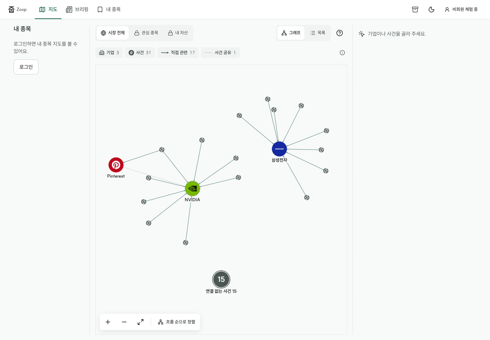
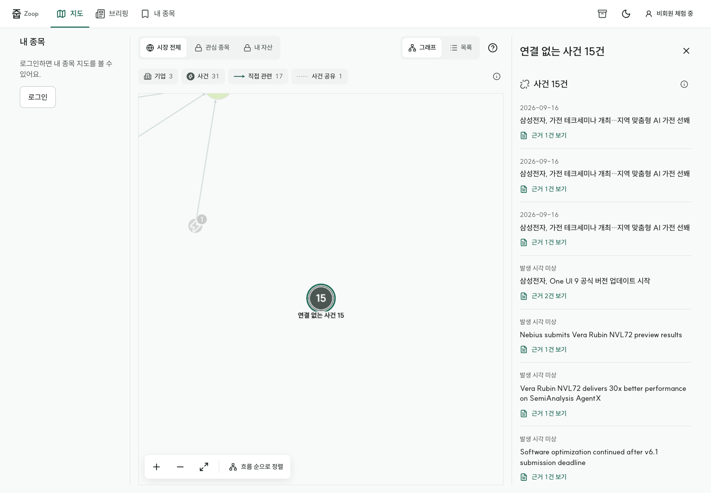
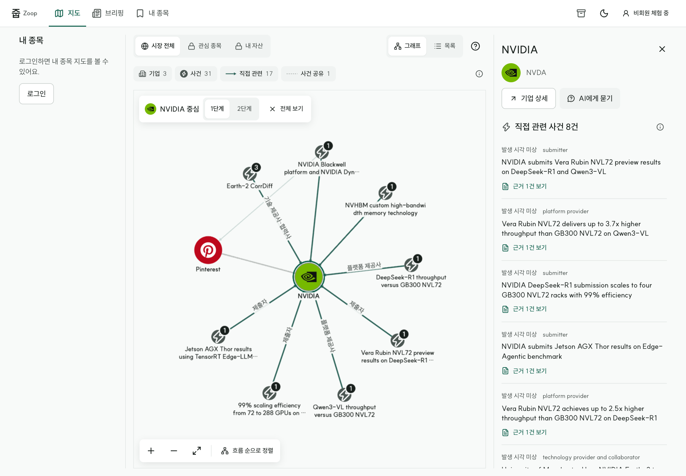
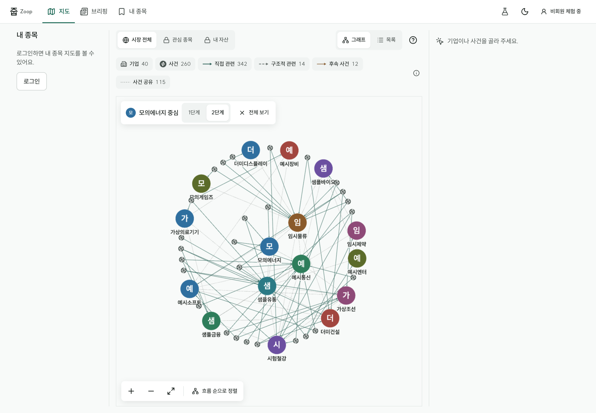
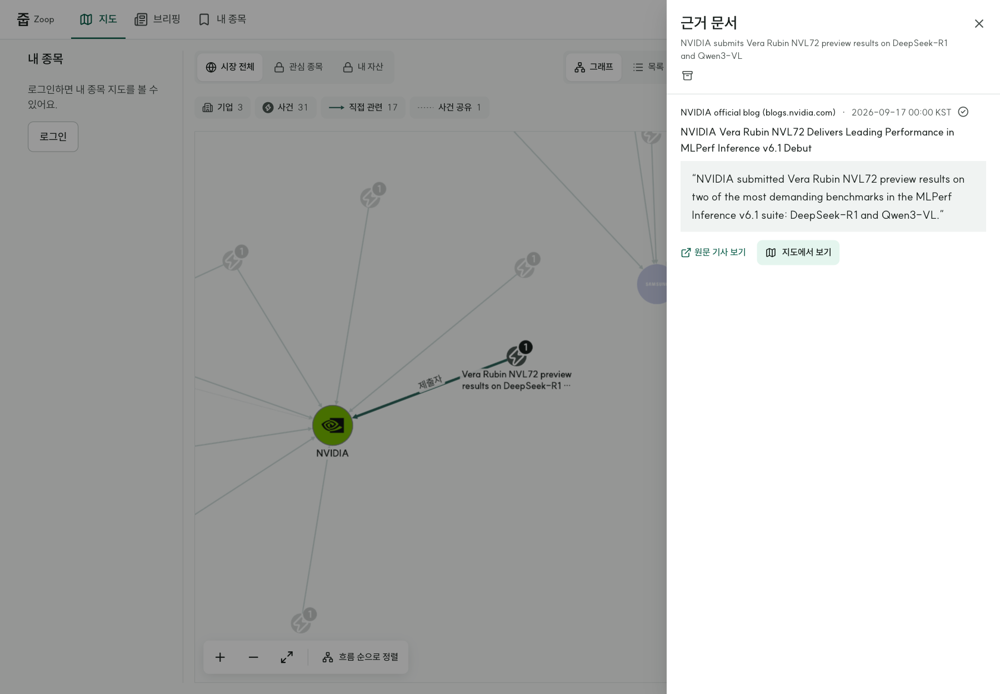
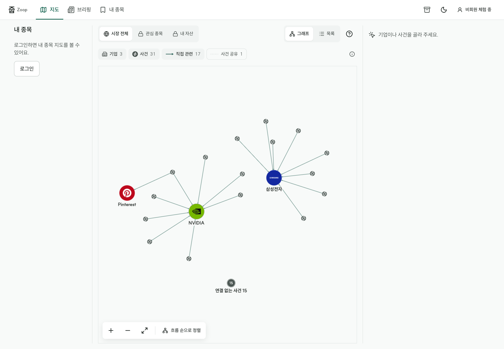
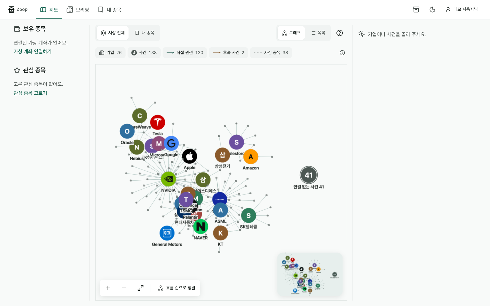
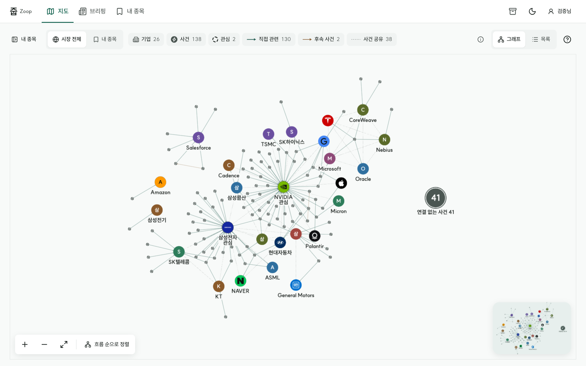
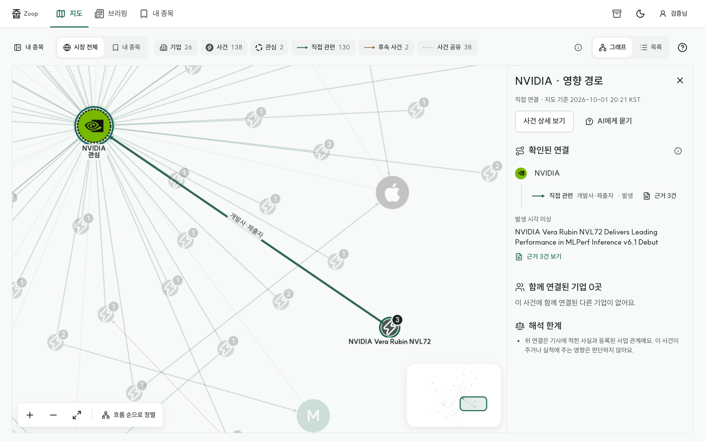

# 관계 그래프 개선: 임시 기본값과 고민할 점

- 작성: 2026-09-30 · 회의 자료
- 관련 문서: [레퍼런스 조사 보고서](../research/graph-ux-report.md), [개선 계획](graph-ux-improvement-plan.md)
- 이 문서의 목적: 회의 전에 **임시 기본값으로 먼저 구현**했습니다. 각 결정마다 **왜 이렇게 했는지, 다른 선택지는 무엇인지, 어떻게 판단하면 좋을지**를 적었습니다. 회의에서 바꾸기로 하면 “바꾸려면” 항목에 적은 곳만 고치면 됩니다.
- **팀 검토 결과:** 문서 공유 후 팀 의견이 현재 기본값 유지로 모였고, 미니맵 등 필요한 새 의존성 추가도 승인됐습니다. 아래 표의 “상태”에 반영했습니다.

## 한눈에 보기

| # | 질문 | 기본값 | 상태 |
|:-:|---|---|---|
| 1 | 연결 없는 사건을 어떻게 보여줄까 | 묶음 노드 하나로 모음 | 확정·구현 |
| 2 | 포커스 모드는 어떻게 들어가고, 몇 단계까지 볼까 | 상세에서 “중심으로 보기”를 눌러 진입, 1단계 기본·2단계 선택 | 확정·구현 |
| 3 | 그래프 응답에 근거 정보를 넣을까 | 사건별 근거 수, 연결선별 근거 ID를 추가 | 확정·구현 |
| 4 | 시간축은 무엇을 기준으로 할까 | 기사 보도 시각 기준(발생 시각은 있으면 병기) | 확정, 구현은 수집 기간 2주 이상일 때 |
| 5 | 미니맵을 넣을까 | `cytoscape-navigator` 추가, 노드 60개 초과 시 데스크톱에 표시 | 확정·구현 |
| 6 | 브리핑을 그래프와 결합할까 | 현재 목록 유지 | 확정(MVP 이후 재검토) |
| 7 | 지도 면적을 어떻게 늘릴까 | 사이드바 접기(1600px 이상 펼침 기본), 상세 패널을 지도 위에 겹침 | **임시 기본값 · 팀 확인 필요** |
| 8 | 넓게 볼 때 기업 원 크기 | 화면 최소 지름 44px → 28px(배율 0.6 → 0.25) | **임시 기본값 · 팀 확인 필요** |
| 9 | 기업–사건 관계를 어디서 볼까 | 사건–기업 선은 누를 수 없고, 기업 상세 [직접 이슈] → 영향 경로 | 명세(D03·FS022) 반영 · **문구 팀 확인 필요** |

함께 정한 세부 규칙(선 라벨 최대 6개, 범례 필터 방식)은 마지막 절에 따로 적었습니다. 7–9는 2026-10-01 가독성 작업에서 정한 임시 기본값입니다(§7).

---

## 1. 연결 없는 사건 → 묶음 노드

**지금 모습:** 기업과 연결이 없는 사건들은 그래프에 개별 점으로 그리지 않고, 가장자리의 원 하나(“연결 없는 사건 N”)로 모았습니다. 이 원은 화면을 축소해도 기업 노드처럼 최소 크기(약 48px)를 유지합니다. 누르면 상세 패널에 해당 사건 목록이 최신순으로 나오고, 각 사건의 근거를 열 수 있습니다. 목록 보기에서는 모든 사건이 그대로 보입니다.

| 실제 데이터 전체 보기 | 묶음을 눌렀을 때 |
|---|---|
|  |  |

**왜:** 현재 데이터에서 사건 31개 중 15개(48%)가 고립 사건이라, 첫 화면의 절반이 의미 없는 점 격자였습니다. 묶으면 첫 화면은 “기업 주변의 연결”에 집중하면서도, 연결되지 않은 사건이 몇 건인지는 숫자로 정직하게 드러납니다.

**다른 선택지**

| 선택지 | 좋은 점 | 아쉬운 점 |
|---|---|---|
| **묶음 노드(현재)** | 첫 화면이 깔끔하고, 개수는 그대로 보임 | 한 번 더 눌러야 사건이 보임 |
| 숨기기 | 가장 깔끔함 | 데이터가 적다는 사실이 가려져, 시연·검수 때 오해 소지 |
| 격자 유지(이전) | 모든 사건이 한눈에 보임 | 노드가 늘면 잡음이 커짐(300노드 기준 39개가 격자로 깔림) |
| 별도 영역(그래프 옆 목록) | 그래프와 목록을 동시에 봄 | 화면 폭을 차지해 모바일에서 불리 |

**어떻게 판단하면 좋을까**
- 사용자가 첫 화면에서 알아야 할 것이 “연결된 관계”인가, “수집된 사건 전체”인가?
- 고립 사건 비율이 수집 확대 후 줄어들까? 비율이 10% 아래로 떨어지면 격자 유지도 괜찮아집니다.
- 고립 사건이 “아직 분석이 덜 된 사건”이라면, 묶음 노드는 데이터 품질을 보여주는 지표 역할도 합니다.

**바꾸려면:** 묶음 생성 로직과 묶음 상세 표시만 바꾸면 됩니다(프론트엔드 그래프 요소 생성부와 상세 패널). API는 바뀌지 않습니다.

---

## 2. 포커스 모드 → 상세에서 진입, 1단계 기본

**지금 모습:** 노드를 선택하면 지금처럼 주변만 밝게 강조됩니다. 상세 패널의 “이 노드 중심으로 보기”를 누르면 그래프 위에 포커스 바가 나타나고, 선택한 노드와 직접 이어진 것만 남습니다(1단계). 남은 노드는 선택 노드를 가운데 두고 둥글게 다시 배치되어, 휴대폰에서도 사건 이름과 근거 배지가 보이는 크기로 확대됩니다. 포커스 바에서 2단계(“기업 → 사건 → 다른 기업”까지)로 넓힐 수 있고, `전체 보기`나 브라우저 뒤로 가기로 빠져나오면 원래 배치로 돌아갑니다.

| 실제 데이터 NVIDIA 1단계 | 300노드 합성 데이터 2단계 |
|---|---|
|  |  |

**왜**
- **진입 방식:** 선택하자마자 나머지를 숨기면, 사용자가 “다른 게 어디 갔지?” 하고 길을 잃기 쉽습니다. Palantir Quiver처럼 **명시적으로 들어가고 명시적으로 나오는** 방식이 예측하기 쉽습니다.
- **1단계 기본:** 현재 데이터에서 NVIDIA 1단계는 노드 10개(자신·사건 8·Pinterest)로 한 화면에 읽힙니다. 300노드 합성 데이터에서 한 기업 기준 1단계는 8개, 2단계는 43개로 다섯 배 넘게 늘어납니다. 2단계는 기본값으로 쓰기엔 많습니다.

**다른 선택지**

| 선택지 | 좋은 점 | 아쉬운 점 |
|---|---|---|
| **상세에서 진입 + 1단계(현재)** | 예측 가능, 기본 화면이 가벼움 | 한 번 더 눌러야 함 |
| 선택 즉시 포커스 | 빠름 | 전체 맥락을 잃기 쉬움, 실수로 누르면 화면이 크게 바뀜 |
| 2단계 기본 | 간접 연결(공급사의 공급사 등)이 바로 보임 | 데이터가 늘면 금방 과밀 |
| 더블클릭으로 진입 | 전문 도구(Neo4j Bloom 등)에서 익숙 | 모바일·키보드에서 발견하기 어려움 |

**어떻게 판단하면 좋을까**
- 줍의 핵심 질문이 “이 종목과 **직접** 엮인 사건은?”인지, “이 종목과 **간접적으로** 엮인 다른 종목은?”인지. 후자가 중요하면 2단계를 기본으로 두는 것을 검토합니다.
- 튜토리얼(WBS 5.5, T5)에서 포커스를 가르칠지. 가르친다면 진입 버튼을 튜토리얼 단계에 넣으면 됩니다.

**바꾸려면:** 기본 단계 값과 진입 동작 위치만 바꾸면 됩니다. 주소 형식(`focus=…&hops=1|2`)은 그대로 둘 수 있습니다.

---

## 3. 그래프 응답에 근거 정보 추가

**지금 모습:** 그래프 API(`GET /api/graph`) 응답에 두 필드를 추가했습니다.
- 사건 노드 `evidenceCount`: 그 사건의 근거 수 → 사건 노드 모서리 배지
- 연결선 `evidenceIds`: 그 연결을 뒷받침하는 근거 ID → 근거 창에서 인용을 고르면 해당 연결선을 강조

| 인용 “지도에서 보기” | 범례에서 “사건 공유” 끄기 |
|---|---|
|  |  |

기존 필드는 그대로라서, 새 필드를 모르는 화면도 그대로 동작합니다.

**왜:** 줍의 차별점은 “모든 연결에 원문 근거가 있다”는 점인데, 지금까지는 상세를 열어야만 근거가 보였습니다. 배지를 그리려고 사건마다 상세 API를 따로 부르면 사건 수만큼 요청이 생깁니다(300노드면 260번). 그래프 응답에 숫자와 ID만 넣으면 한 번의 요청으로 끝납니다.

**다른 선택지**

| 선택지 | 좋은 점 | 아쉬운 점 |
|---|---|---|
| **그래프 응답에 추가(현재)** | 요청 1번, 화면 구현이 단순 | 응답 크기가 늘어남(300노드 기준 근거 ID 531개) |
| 상세 API로만 조회 | API 계약 변경 없음 | 배지를 그리려면 요청이 사건 수만큼 필요 |
| 근거 수만 추가, ID는 상세에서 | 응답이 작음 | 인용↔연결선 강조에 요청이 한 번 더 필요 |

**어떻게 판단하면 좋을까**
- 팀 API 계약(WBS 1.3, 담당 B4)에 그래프 응답 크기 상한이 있는지.
- 실제 서비스에서 근거가 사건당 수십 개로 늘어나면 ID 목록 대신 개수만 두는 편이 낫습니다.

**바꾸려면:** BFF 그래프 응답 스키마와 테스트, 웹의 배지·강조 부분. 두 필드는 서로 독립이라 하나만 남길 수도 있습니다.

---

## 4. 시간축 기준 → 보도 시각 (구현 보류)

**임시 기본값:** 시간축을 만든다면 **기사 보도 시각**을 기준으로 하고, 사건 발생 시각이 있으면 함께 표시합니다.

**왜 보류했나:** 현재 실제 데이터의 보도 시각이 9월 14~17일 4일에 몰려 있어, 시간축을 붙여도 막대 네 개짜리 그래프가 됩니다. 계획의 진행 조건(수집 기간 2주 이상)을 충족할 때 구현합니다. 300노드 합성 데이터는 3개월에 걸쳐 있어 조건이 충족되면 바로 시연할 수 있습니다.

**왜 보도 시각인가:** 사건 발생 시각은 사건 언급 32개 중 11개만 있고, 나머지는 “시각 미상”입니다. 보도 시각은 모든 기사에 있습니다.

| 선택지 | 좋은 점 | 아쉬운 점 |
|---|---|---|
| **보도 시각(기본값)** | 모든 사건에 값이 있음 | “언제 일어났나”가 아니라 “언제 알려졌나” |
| 발생 시각 | 의미상 정확 | 3분의 2가 비어 시간축에서 빠짐 |
| 둘 다(두 줄 축) | 차이를 보여줄 수 있음 | 화면이 복잡, 비전공 사용자에게 설명 필요 |

**어떻게 판단하면 좋을까**
- 출퇴근 브리핑의 “어제 이후 달라진 것”은 보도 시각 기준이 자연스럽습니다.
- 공시·실적 일정처럼 발생 시각이 중요한 사건이 많아지면 발생 시각 비중을 높입니다.

---

## 5. 미니맵 → 보류

**왜 보류했나:** 미니맵에는 새 패키지(`cytoscape-navigator`)가 필요하고, 새 의존성은 팀 확인 후 넣기로 했습니다. 또 현재 실제 데이터는 34노드라 미니맵 없이도 한 화면에 들어옵니다.

**대안:** 패키지를 쓰지 않고 직접 만들 수도 있지만(현재 화면을 축소 이미지로 그리고 보이는 영역 사각형 표시), 유지보수 부담이 생깁니다.

**판단 기준:** 실제 데이터가 60노드를 넘기 시작하면 다시 검토합니다.

---

## 6. 브리핑 형식 → 현재 목록 유지

**왜:** 브리핑을 단계형 이야기(LittleSis Oligrapher 방식)로 바꾸는 것은 브리핑 편성 규칙이 정해진 뒤에야 의미가 있습니다. 편성 규칙은 아직 팀 결정 전입니다(브리핑 시각·선정 기준 등).

**판단 기준:** 튜토리얼과 메인 그래프가 M3(11/03)까지 안정되면, MVP 이후 과제로 다시 봅니다.

---

## 7. 가독성 개편: 지도 면적·캡션 정리·영향 경로 (2026-10-01, 임시 기본값)

실측과 전후 비교는 [개선 계획 §10.1](graph-ux-improvement-plan.md#101-결과-2026-10-01-graphreadability), 화면 규칙은 [design-direction §4.9·§4.10](design-direction.md#49-메인-지도-레이아웃-지도-면적-우선-v6-요구-6fs026fs044).

| 1440 전 | 1440 후 | 영향 경로 |
|---|---|---|
|  |  |  |

### 7-1. 사이드바 기본 펼침 기준 1600px
- **지금 모습:** 1600px 이상은 펼침, 미만은 접힘이 기본입니다. 도구 막대 맨 왼쪽 `[내 종목]`으로 접고 펴며 고른 값은 기억합니다. 1440에서 지도 면적 0.40 → 0.80.
- **왜:** 1440에서 사이드바(240px)를 펴면 범례가 두 줄로 넘어가고 지도가 1/6 줄어듭니다. 1600px 이상이면 펴도 지도 면적이 0.67 이상 남습니다.
- **고민할 점:** 접힌 상태에서는 FS026(사이드바 기업 선택)·FS027(관심 토글)이 버튼 한 번 뒤에 있습니다. 버튼은 늘 보이고 키보드로 바로 닿지만(앱 바 다음 첫 Tab), 처음 쓰는 사람이 찾는지는 사용자 테스트로 확인해야 합니다. 같은 기능은 기업 노드 상세의 [관심 종목] 버튼과 `/me/stocks`에도 있습니다.
- **바꾸려면:** `pages/main-page.tsx`의 `useMediaQuery("(min-width: 1600px)")`.

### 7-2. 상세 패널을 지도 위에 겹침
- **지금 모습:** 고른 대상이 있을 때만 380px 패널이 지도 오른쪽 위에 겹칩니다. 지도 크기는 그대로이고 카메라·미니맵이 패널에 덮이지 않은 쪽을 씁니다.
- **왜:** 패널 자리를 늘 비워 두면 아무것도 고르지 않았을 때도 지도가 380px 좁습니다. 패널을 열고 닫을 때 지도 크기가 바뀌면 다시 맞추느라 보던 자리를 잃습니다(이전 규칙).
- **다른 선택지:** 패널 자리 고정(면적 손해), 패널 열 때 지도 축소(화면 흔들림).
- **바꾸려면:** `features/graph-explorer.tsx`의 `panelOverCanvas`.

### 7-3. 넓게 볼 때 기업 원 28px
- **지금 모습:** 배율 0.6 이상에서는 44px, 0.25 이하에서는 28px, 사이는 선형입니다. 배치 계산 때 기업 크기는 140(이름 자리 포함).
- **왜:** 300노드 전체 보기에서 44px 원끼리 62쌍이 겹쳤고 이름을 놓을 자리가 없었습니다(후 12쌍, 이름 겹침 0). 28px도 WCAG 2.2 최소 대상 크기 24px 이상입니다.
- **고민할 점:** 로고·이니셜이 작아집니다. 28px에서 기업을 알아보기 충분한지는 사용자 테스트나 팀 눈으로 확인이 필요합니다(캡처 [1440](v6/graph-1440-light.png), [300노드](v6/graph-stress-1440.png)).
- **바꾸려면:** `components/domain/graph-style.ts`의 `companyMinScreen`.

### 7-4. 영향 경로 화면 문구
- **지금 모습:** 기업 상세 [직접 이슈]에서 사건을 누르면 `<기업> · 영향 경로` 패널이 열립니다. `확인된 연결`(관계 유형·역할·보도 표현·근거), `함께 연결된 기업`, `해석 한계`(주가·실적 영향은 판단하지 않음, 단계 사이 인과 미확인), `지도 기준 <시각>`.
- **왜:** 명세 FS022는 이슈–기업 선을 누르지 않고 기업 패널에서 경로를 보게 합니다. ‘영향’이라는 말이 주가 영향을 뜻하는 것처럼 읽힐 수 있어 `해석 한계`를 늘 보입니다.
- **고민할 점:** 제목 `영향 경로`가 명세 용어이지만 사용자는 ‘주가에 미치는 영향’으로 오해할 수 있습니다. `연결 경로`·`관계 경로` 같은 대안을 팀이 정해 주세요. 데이터에 없는 산업·제품 단계는 만들지 않습니다.
- **바꾸려면:** `features/impact-panel.tsx`, `features/graph-explorer.tsx`의 패널 제목.

---

## 함께 정한 세부 규칙

| 규칙 | 기본값 | 이유 | 다른 선택지 |
|---|---|---|---|
| 선택 시 보이는 선 라벨 | 최대 6개(연결된 사건의 최신순), 나머지는 선에 마우스를 올리거나 누를 때 | 기업 하나에 연결이 8개 이상이면 라벨이 겹침 | 전부 표시(겹침), 전혀 표시 안 함(선 의미를 알기 어려움) |
| 긴 선 라벨 | 12자에서 말줄임, 선을 가리키면 전체 | 라벨이 선보다 길어지는 것을 막음 | 두 줄 표시 |
| 범례 필터 | 범례 칩을 눌러 종류별로 켜고 끔, 최소 하나는 켜진 상태 유지, 끈 항목도 개수는 표시 | Linkurious 방식. 숨긴 것이 몇 개인지 알 수 있음 | 별도 필터 패널(화면 차지), 필터 없음 |
| 범례 필터와 배치 | 켜고 꺼도 노드 위치는 그대로 | 위치가 바뀌면 방금 보던 것을 잃음 | 끌 때마다 다시 배치(빈 공간은 줄지만 혼란) |
| “선택 관계만 남기기” 버튼 | 삭제하고 포커스 모드로 대체 | 같은 역할의 기능이 두 개 있으면 헷갈림 | 둘 다 유지 |

## 알려진 한계 (구현 후 확인)

아래 가독성 문제는 [개선 계획 §10 차후 연구 과제](graph-ux-improvement-plan.md#10-차후-연구-과제-그래프-가독성)(R1–R5)로 등록했고, 2026-10-01~02 작업으로 R1·R4·R5는 해결, R2·R3은 개선했습니다(남은 확인은 §10 표).

- ~~휴대폰 폭의 1단계 포커스에서는 사건 이름끼리 일부 겹칩니다.~~ 캡션 정리로 겹침 0(R1).
- 300노드 합성 데이터의 전체 보기 배율은 약 0.19입니다. 이름이 겹치지는 않지만 40곳 중 14곳만 이름이 보여, 수백 노드에서 첫 화면을 전체 보기로 둘지는 여전히 판단이 필요합니다(R2, 결정 1·2와 연결).
- ~~전체 배치는 실행할 때마다 모양이 조금씩 달라집니다.~~ 난수 씨앗 고정(R4).
- ~~상세 패널의 역할 표시가 영어 원문으로 나옵니다.~~ 코드형 영어 0건. 고유명사·서술형 원문 51건은 그대로 둡니다(R5).
- 실제 데이터에 같은 제목의 사건이 3건 따로 있습니다. 화면 문제가 아니라 PoC 사건 중복 판별 결과입니다.

## 회의에서 이렇게 진행하면 좋겠습니다

1. 프로토타입 화면을 켜고 결정 1·2를 직접 눌러 봅니다(10분).
2. 결정 1·2·3에 대해 “유지 / 바꿈”만 정합니다. 바꾸면 선택지 표에서 고릅니다.
3. 결정 4·5·6은 “언제 다시 볼지” 조건만 확인합니다(수집 기간 2주, 60노드, M3 이후).
4. 결과를 이 문서의 표 “상태” 칸에 적습니다.
