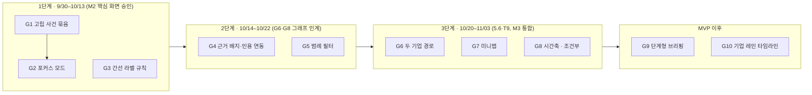

# 관계 그래프 UI/UX 개선 계획

- 작성: 2026-09-30 · 근거: [레퍼런스 조사 보고서](../research/graph-ux-report.md), [레퍼런스 상세](../research/graph-refs/README.md)
- 대상 코드: `prototype/web`(Cytoscape.js + fcose), `prototype/bff`
- 기준 데이터: 검수한 실제 기사 저장본(`prototype/bff/fixtures/poc-real-inspect.json`)
- **진행 현황:** 1·2단계(G1–G5)와 준비 작업(그래프 코드 분리, 300노드 합성 데이터)을 구현했고, 팀이 기본값을 확정했습니다([기본값과 고민할 점](graph-ux-decisions.md)). 새 의존성이 승인되어 3단계 중 G6(경로)·G7(미니맵)도 구현했습니다. G8(시간축)은 수집 기간 2주 이상일 때 시작합니다.

## 1. 목표와 범위

**목표:** 줍의 관계 그래프를 “노드가 흩어진 그림”에서 **질문에 답하는 탐색 도구**로 바꿉니다. 사용자가 첫 화면에서 핵심 연결을 바로 보고, 한 기업을 골라 주변만 파고들고, 연결마다 원문 근거가 있다는 것을 그래프에서 알 수 있어야 합니다.

**이번 계획에 포함:** 메인 지도(`/`) 그래프·범례·상세 패널·근거 창, 모바일 그래프, 이에 필요한 BFF 그래프 응답의 작은 필드 추가.

**포함하지 않음:** 라이브러리 교체(Cytoscape.js 유지), 간선 번들링, 시세·감성·AI 요약 같은 새 데이터 생산, 로그인·온보딩·내 종목 화면 재설계. 시간축은 데이터 조건을 만족할 때만 진행합니다(§4 G8).

**프로토타입과 팀 제품의 관계:** 이 계획은 프로토타입에서 먼저 구현해 **동작하는 설계 기준**으로 씁니다. 팀 제품의 프론트엔드 기술 스택은 명세에서 아직 정해지지 않았으므로, 팀은 각 항목의 “완료 기준”을 화면 요구사항으로 가져가면 됩니다.

## 2. 현재 상태 (2026-09-30 측정)

| 항목 | 값 | 근거 |
|---|---|---|
| 사건 / 기업 | 31 / 3 | `/api/graph` 시장 전체 |
| 연결 없는 사건 | **15 (48%)** | 저장본 관계 집계 |
| 직접 관련 연결 | 17 (삼성전자 8, NVIDIA 8, Pinterest 1) | 저장본 관계 집계 |
| 강조·격리 범위 | 선택 노드의 **1단계 이웃만** | `graph-canvas.tsx:105-110,445-455,506-522` |
| 고립 노드 처리 | 없음(fcose `tile`로 격자 배치만) | `graph-canvas.tsx:372-397` |
| 간선 라벨 | 배율 0.95 이상·간선 160개 이하일 때, 강조 시 전부 표시 | `graph-canvas.tsx:43-64,141-144` |
| 범례 | 개수 표시만, 누를 수 없음 | `graph-legend.tsx:28-57` |
| 근거 표시 | 상세 패널·근거 창에만. 그래프 노드에 근거 수 없음, 인용↔간선 연동 없음 | `overlays.tsx:43-97`, `schemas.py:179-207` |
| 시간 정보 | 그래프 응답에 `eventTime` 있음(캡션에만 사용). 사건 언급 32개 중 11개만 발생 시각 있음, 기사 발행 시각은 31건 모두 있음(9/14~9/17) | `schemas.py:179-207`, 저장본 |
| 설치된 확장 | `cytoscape-fcose`, `cytoscape-dagre` | `package.json:29-31` |

## 3. 일정과 WBS 연결

| 단계 | 기간 | 맞물리는 WBS | 결과물 |
|---|---|---|---|
| 1 | 9/30–10/13 | 2.1 와이어프레임(9/30–10/7), 2.5 개인화 메인·반응형 설계(10/8–13), **M2 10/13** | G1–G3 동작하는 프로토타입 → M2 화면 검토 자료 |
| 2 | 10/14–10/22 | G6 클릭형 그래프·노드 상세(10/15–21), G8 기초 그래프 인계(10/19–22) | G4–G5, 그래프 인계 시연에 포함 |
| 3 | 10/20–11/03 | 5.6 개인화 메인(10/20–30), T9 메인 관심종목 그래프(10/29–11/3), **M3 11/03** | G6–G7, 조건 충족 시 G8 |
| 4 | 11/04 이후 | 7.3 반응형·접근성 점검(11/2–4)과 병행 검토 | G9–G10은 MVP 이후 후보 |

## 4. 작업 항목

각 항목은 **문제 → 바꿀 것 → 완료 기준**으로 적었습니다. 완료 기준은 브라우저에서 실제로 확인할 수 있는 조건입니다.

### 1단계 (M2까지)

#### G1. 연결 없는 사건 묶음

- **문제:** 첫 화면의 절반이 고립 사건 15개의 점 격자입니다.
- **바꿀 것:** 그래프에서 연결이 0인 사건을 **묶음 노드 하나**(“연결 없는 사건 15”)로 모아 그래프 가장자리에 둡니다. 누르면 상세 패널(모바일은 시트)에 해당 사건 목록을 날짜순으로 보여주고, 각 사건에서 근거를 열 수 있게 합니다. 목록 보기(`RelationList`)는 지금처럼 모든 사건을 그대로 보여줍니다.
- **코드:** `graph-canvas.tsx`(요소 생성·스타일), `graph-explorer.tsx`·`node-panel.tsx`(묶음 상세). BFF 변경 없음(연결 수는 화면에서 계산).
- **완료 기준:** 시장 전체 첫 화면에 사건 노드 16개 + 묶음 1개가 보이고, 묶음 상세에 15건이 모두 나온다. 묶음 노드는 키보드로 선택할 수 있고 스크린리더 이름에 개수가 들어간다. 연결 없는 사건이 0개면 묶음 노드가 생기지 않는다.

#### G2. 포커스 모드

- **문제:** “선택 관계만 남기기”가 툴바 안에 숨어 있고 1단계 이웃만 남깁니다. 돌아가는 방법도 눈에 띄지 않습니다.
- **바꿀 것:** 기업을 선택하면 그래프 위에 **포커스 바**가 나타납니다: `[로고] NVIDIA 중심 · 1단계 | 2단계 · ✕ 전체 보기`. 2단계는 “기업 → 사건 → 다른 기업”까지입니다. 포커스 상태는 주소(`?focus=ID&hops=1`)에 남기고 브라우저 뒤로 가기로 빠져나올 수 있게 합니다(지도 모드 전환과 같은 이력 규칙). 기존 격리 버튼은 포커스 바로 대체합니다.
- **코드:** `graph-canvas.tsx`(n단계 이웃 계산, 숨김·배치), `main-page.tsx`(주소 상태), 새 `FocusBar` 컴포넌트. BFF 변경 없음.
- **완료 기준:** NVIDIA 선택 → 포커스 바 표시. 1단계에서는 NVIDIA와 직접 이어진 노드만 남는다(현재 데이터: 사건 8개 + 파생 경로로 이어진 Pinterest). 2단계는 그 노드들의 이웃까지 넓힌다. 현재 실제 데이터에서는 2단계로 늘어나는 노드가 없으므로 300노드 합성 데이터(§7)로 확인한다. `✕`와 뒤로 가기 모두 전체 보기로 복귀하며 카메라가 부드럽게 이동한다(동작 줄이기 설정에서는 즉시). 모바일에서는 포커스 바가 상단 한 줄로 들어간다.

#### G3. 간선 라벨 규칙

- **문제:** 연결 8개짜리 기업을 선택하면 라벨이 한꺼번에 나와 겹칩니다.
- **바꿀 것:** 선택 시 라벨은 **최대 6개**(최신 사건 순)만 보이고, 나머지는 선에 마우스를 올리거나 눌렀을 때 보입니다. 같은 두 노드 사이의 여러 선은 곡선 간격을 넓힙니다. 라벨이 12자를 넘으면 말줄임하고 전체는 툴팁으로 보여줍니다.
- **코드:** `graph-canvas.tsx`(LOD·강조 스타일).
- **완료 기준:** 1440px에서 NVIDIA 선택 시 보이는 간선 라벨의 경계 상자가 서로 겹치지 않는다(브라우저에서 Cytoscape 렌더 좌표로 측정). 390px에서도 동일.

### 2단계 (그래프 인계까지)

#### G4. 근거 배지와 인용↔간선 연동

- **문제:** 줍의 강점인 “모든 연결에 원문 근거”가 그래프에서는 보이지 않습니다.
- **바꿀 것:**
  1. 사건 노드 오른쪽 위에 **근거 수 배지**(작은 원 + 숫자)를 붙입니다. 확대 배율이 낮으면 숨깁니다.
  2. 근거 창에서 인용을 누르면 그 인용이 뒷받침하는 **연결선이 그래프에서 강조**됩니다. 근거 창을 닫으면 강조가 풀립니다.
- **코드:** BFF `GraphNode`에 사건 노드의 `evidenceCount` 추가(`graph.py`, `schemas.py`, 테스트 1개). 웹 `graph-canvas.tsx`(배지를 노드 배경 이미지 층으로), `overlays.tsx`·`graph-explorer.tsx`(인용 선택 → 강조할 관계 ID 전달).
- **API 변경:** 그래프 응답에 필드 1개 추가(하위 호환). WBS 1.3 화면/API 계약 담당(B4)에게 공유가 필요합니다.
- **완료 기준:** 모든 사건 노드의 배지 숫자가 사건 상세의 근거 수와 같다. 인용 선택 시 해당 관계선만 강조된다. 배지 글자 대비 4.5:1 이상.

#### G5. 범례로 거르기

- **문제:** 범례에 개수가 있지만 누를 수 없습니다.
- **바꿀 것:** 범례 칩을 **토글 버튼**으로 바꿔 관계 유형·노드 종류별로 켜고 끕니다(Linkurious 방식). 꺼진 항목은 칩이 흐려지고 개수는 유지합니다.
- **코드:** `graph-legend.tsx`, `graph-canvas.tsx`(표시 필터).
- **완료 기준:** “사건 공유” 끄기 → 파생 점선 1개가 사라지고 다시 켜면 돌아온다. 칩은 `aria-pressed`를 가진다. 모든 항목을 끄지는 못한다(최소 1개 유지).

### 3단계 (M3까지)

#### G6. 두 기업 사이 경로

- **문제:** “이 두 기업은 왜 엮였나?”에 답하려면 사용자가 선을 직접 따라가야 합니다.
- **바꿀 것:** 기업 상세 패널에 `다른 기업과의 연결 보기` 동작을 두고, 두 번째 기업을 고르면 최단 경로를 강조하고 패널에 “삼성전자 → 사건 A → NVIDIA” 형식의 문장 목록으로 보여줍니다. Cytoscape 내장 최단 경로 알고리즘을 씁니다.
- **완료 기준:** 연결된 두 기업은 경로가 강조되고 문장 목록이 나온다. 연결이 없으면 “아직 연결된 사건이 없어요”를 보여준다.

#### G7. 미니맵

- **바꿀 것:** 데스크톱에서 노드가 60개를 넘을 때만 오른쪽 아래에 전체 조망 + 현재 보는 영역 사각형을 보여줍니다(`cytoscape-navigator` 추가 검토, 새 의존성은 팀 확인 후).
- **완료 기준:** 300노드 테스트 데이터에서 미니맵 사각형을 끌면 화면이 따라 움직인다. 60개 이하에서는 보이지 않는다.
- **구현 결과:** 조작 중에는 썸네일을 다시 그리지 않고 끝난 뒤 한 번만 갱신합니다(패키지 기본값은 조작 중 약 14회 생성). 미니맵이 있을 때와 없을 때 프레임 간격 p95가 58.3ms로 같았습니다(headless 측정이라 편차가 큼). 알려진 한계: 1배 PNG라 고해상도 화면에서 흐리고, 화면 맞춤 시 오른쪽 아래 노드가 미니맵에 가려질 수 있습니다.

#### G8. 시간축 (조건부)

- **진행 조건:** 수집 기간이 **2주 이상**이고 팀이 시간축 기준(§5 결정 1)을 정했을 때.
- **바꿀 것:** 그래프 아래에 날짜별 사건 수 막대 + 기간 선택 + 재생 버튼. 기간 밖 사건은 흐리게 처리하고(숨기지 않음) 기업은 유지합니다.
- **코드:** 새 `TimeBar` 컴포넌트, `graph-canvas.tsx`(기간 표시 필터). 발행 시각을 쓰면 그래프 응답에 사건별 대표 발행 시각 필드가 필요합니다(BFF 변경).
- **완료 기준:** 기간을 좁히면 그래프와 목록이 함께 바뀌고, 재생 시 날짜가 순서대로 진행된다. 동작 줄이기 설정에서는 재생 대신 단계 이동 버튼만 제공한다.

### MVP 이후 후보

- **G9. 단계형 브리핑:** 브리핑의 사건을 “다음”으로 넘기면 옆의 작은 지도가 그 사건과 연결 기업을 강조합니다(LittleSis Oligrapher 방식).
- **G10. 기업 레인 타임라인:** 기업 상세 타임라인을 기업별 가로줄 위에 사건을 시각 순으로 놓는 형태로 확장합니다(yFiles Event Timeline 방식).

## 5. 팀 결정

임시 기본값을 문서로 공유했고, 팀 의견이 기본값 유지로 모였습니다. 새 의존성(미니맵 등) 추가도 승인됐습니다. 이유·대안은 [graph-ux-decisions.md](graph-ux-decisions.md)에 있습니다.

| # | 질문 | 선택지 | 결정 | 상태 |
|:-:|---|---|---|---|
| 1 | 시간축 기준 | 사건 발생 시각 / 기사 보도 시각 | 보도 시각 기준, 발생 시각이 있으면 함께 표시 | 확정, 구현은 수집 기간 2주 이상일 때(G8) |
| 2 | 고립 사건 표시 | 숨김 / 묶음 노드 / 격자 유지 | 묶음 노드 | 확정·구현 |
| 3 | 포커스 진입·범위 | 선택 즉시 / 상세에서 진입, 1단계 / 2단계 | 상세에서 진입, 1단계 기본·2단계 선택 | 확정·구현 |
| 4 | 그래프 응답 필드 추가 | 추가 / 상세 조회로만 | 사건 `evidenceCount`, 간선 `evidenceIds` 추가(하위 호환) | 확정·구현 |
| 5 | 미니맵용 새 의존성 | `cytoscape-navigator` 추가 / 직접 구현 | `cytoscape-navigator` 추가 | 확정·구현(G7) |
| 6 | 브리핑 형식 | 현재 목록 / 단계형 이야기 | 현재 목록 유지 | 확정(MVP 이후 재검토) |

## 6. 공통 품질 기준

모든 항목은 기존 규칙(`prototype/web/DESIGN.md`)을 따르고, 끝낼 때 아래를 확인합니다.

- 1440×1000, 390×844 × 라이트·다크 4조합에서 화면 확인과 axe(WCAG 2.2 AA) 위반 0건.
- 390px 가로 넘침 없음, 터치 대상 44px 이상, 키보드만으로 선택·포커스 해제·근거 열기 가능.
- 그래프로 가능한 모든 동작은 목록 보기에서도 가능(그래프 대체 수단 유지).
- 모션은 SEED 기준 시간·곡선을 쓰고, 동작 줄이기 설정에서는 생략.
- `pnpm typecheck`, `pnpm build`, `pnpm dlx impeccable@4.1.0 detect src/` 0건, BFF 변경 시 `uv run pytest`.
- 없는 데이터를 만들지 않음. 묶음·포커스·필터는 표시 방식만 바꾸고 데이터를 지우지 않음.

## 7. 성능 준비

지금은 34노드지만 수집이 늘면 수백 개가 됩니다. 1단계에서 **300노드 합성 스냅샷**(`fixtures/` 아래, 합성 표시 유지)을 만들어 G1–G3을 그 데이터에서도 확인합니다. 기준: 첫 배치 2초 이내, 확대·이동 중 프레임 저하가 눈에 띄지 않을 것(브라우저 성능 프로파일로 측정).

## 8. 위험과 대응

| 위험 | 영향 | 대응 |
|---|---|---|
| 데이터가 두 기업에 몰려 있음(삼성전자·NVIDIA 각 8) | 경로(G6)·포커스 2단계의 시연 효과가 약함 | 300노드 합성 스냅샷으로 기능 시연, 실제 데이터는 수집 확대(N1–N8) 후 재확인 |
| 시간 범위가 4일 | 시간축(G8) 효과 없음 | 조건부로 두고, 조건 미충족 시 3단계에서 제외 |
| 완화 승인 정책의 오승인 | 잘못된 연결이 포커스·경로에서 더 눈에 띔 | 근거 배지(G4)로 근거 확인을 쉽게 하고, 검수 제외 기록 절차 유지 |
| 그래프 응답 필드 추가 | 팀 API 계약(1.3)과 어긋날 수 있음 | 하위 호환 추가만, B4 검토 후 반영 |
| 한 파일(`graph-canvas.tsx`)에 기능 집중 | 여러 사람이 동시에 고치면 충돌 | 1단계 착수 전에 레이아웃·스타일·상호작용을 파일로 나누는 정리 작업을 먼저 한다 |

## 9. 바로 다음 할 일

1. ~~그래프 코드 분리, 300노드 합성 스냅샷, G1–G5 구현~~ (2026-09-30 완료, 임시 기본값)
2. ~~회의에서 [임시 기본값](graph-ux-decisions.md) 1–3 유지 여부 결정~~ (팀 의견: 기본값 유지, 새 의존성 승인)
3. ~~G6 두 기업 경로, G7 미니맵~~ (구현 완료. 실제 데이터 NVIDIA→Pinterest 2단계, 300노드 데이터에서 사건 3개를 거치는 6단계 경로 확인)
4. 10/13 M2 검토에 동작하는 화면으로 가져간다.
5. G8 시간축은 수집 기간이 2주 이상이 되면 시작한다.

## 10. 차후 연구 과제: 그래프 가독성

G1–G5 구현 후 확인된 가독성 문제입니다. 당장 고치기보다 방법을 조사·실험한 뒤 정할 과제로 둡니다(2026-09-30 등록, 팀 의견 대기 중).

| # | 문제 | 관찰 | 조사할 방향 | 확인 방법 |
|:-:|---|---|---|---|
| R1 | 휴대폰 포커스 화면에서 사건 이름끼리 겹침 | 390px NVIDIA 1단계에서 캡션 일부 겹침(노드끼리는 겹치지 않음) | 라벨 배치 알고리즘(겹침 회피), 선택 노드 주변만 캡션 표시, 모바일은 캡션 대신 번호 + 목록 | 390px 포커스에서 캡션 경계 상자 겹침 0 |
| R2 | 노드가 수백 개일 때 전체 보기가 읽히지 않음 | 300노드 합성 데이터 전체 보기 배율 약 0.1 | 첫 화면 전략(전체 대신 대표 기업 포커스·클러스터 요약), 기업 묶음(콤보), 의미 기반 확대(배율별 표시 내용 변경) | 300노드 첫 화면에서 기업 이름이 읽히는지 |
| R3 | 맞춤 배율에서 사건 이름과 근거 배지가 숨겨짐 | 실제 데이터 전체 보기 배율 0.4~0.65, 배지는 0.8 미만에서 숨김 | 13px 글자 하한과 표시량의 균형, 배지를 캡션보다 먼저 보이게 하는 우선순위 규칙 | 전체 보기에서 기업 주변 사건 식별 가능 여부(사용자 테스트) |
| R4 | 배치가 실행할 때마다 달라짐 | fcose 결과가 매번 조금씩 다름 | 난수 고정, 이전 배치 좌표 저장·재사용 | 새로고침 전후 노드 위치 차이 |
| R5 | 상세 패널의 역할 표시가 영어 원문 | `submitter`, `platform provider` 등 | BFF의 역할 한국어 매핑을 상세 응답에도 적용 | 상세 패널에 영어 역할 코드 0건 |

참고 자료: [레퍼런스 조사 보고서](../research/graph-ux-report.md)의 해법 5(라벨 절제), [patterns.md](../research/graph-refs/patterns.md) §3(LOD·대규모 그래프), §5(모바일).
