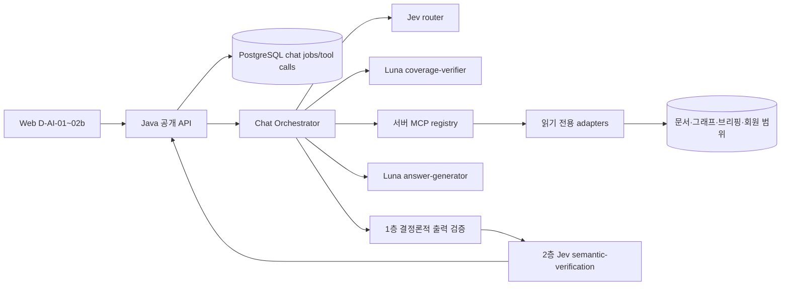

# ZOOP AI 챗봇 구현 준비·개발 계획

기준일: 2026년 10월 21일

기준 정책: `ZOOP-AIG-001 v0.8`

화면 추적: `D-AI-01`, `D-AI-01b`, `D-AI-02`, `D-AI-02b`

관련 문서:

- [AI 챗봇 설계 요약](../design/ai-chatbot-design-summary.md)
- [AI 거버넌스 정책](../ZOOP_AI_거버넌스_정책.md)
- [공개 목표 API](../api/openapi.yaml)
- [ERD v6](../erd/zoop-core-erd-v6.md)
- [AI 챗봇 화면 상태 계약](../wireframe/ai-chatbot-state-contract.md)
- [현재 AI 내부 HTTP 계약](../api/internal-ai-openapi.yaml)

## 1. 현재 진행 상태

| 영역 | 현재 확인된 상태 | 구현 판단 |
| --- | --- | --- |
| 공개 챗봇 계약 | 세션 생성·조회, 최신 대화 복원, 질문 job 접수·조회·재시도·취소와 `ChatResult`/`ChatFailure`가 목표 OpenAPI에 있음 | 골격 사용 가능. 10-17 검토에서 입력 상한, 범용 선택지, `answerBasis`, `budget_exceeded`를, 10-20 검토에서 확인 답 `resolves`, `limitations`, `sections`, `phase`, `ChatFailure.reason` 코드, `Citation.sourceKind`를 보완함 |
| ERD | `chat_sessions`, `chat_jobs` 목표 설계는 있으나 실제 Flyway migration은 없음 | 새 migration부터 필요. 라우팅 요약과 도구 호출 관측을 추가함 |
| 프로토타입 BFF | `prototype/bff`에 규칙 기반 질문 해석, 기간 처리, 세션·job·복구·save_only와 테스트가 있음 | 상태 머신·불변식의 참고 구현. 운영 AI 답변 엔진으로 승격하지 않음 |
| 본개발 Java API | `api/src/main/java`에 공개 챗봇 controller/service/repository가 없음. 인증 설정만 `/api/v1/chat/**`를 보호함 | 공개 API producer 전체 구현 필요 |
| 루트 웹 | `AiChatDrawer`와 Zustand UI 상태만 있고 질문 전송·polling·결과 렌더링은 “준비 중” | D-AI-01~02b 상태 계약에 따라 query 계층과 UI 구현 필요 |
| AI worker | 네이티브 Jev는 S1 `semantic-verification` 고정 claim 판정에만 사용 | 챗봇 router를 별도 kind/stage·스키마·평가로 추가해야 함 |
| AI 내부 서비스 | S1 분석 HTTP와 S2/S3 그래프·추출 관련 경계가 있으나 챗봇 오케스트레이션 endpoint는 없음 | 현재 생성 OpenAPI를 손으로 바꾸지 말고 서비스 코드에 endpoint를 구현한 뒤 재생성해야 함 |
| 데이터 기반 | 기업·문서 등록·S1 분석·evidence·그래프 버전·관심 종목·포트폴리오 migration은 일부 존재 | Q03/Q04/Q07의 기반은 부분 존재. 이슈·브리핑·선정 규칙·철회 전파 종단은 추가 구현 필요 |
| 와이어프레임 | 네 정적 화면은 질문·되묻기·회수·조회 오류의 시각 기준을 제공하지만 동작 상태를 증명하지 않음 | 별도 상태 계약으로 로딩·오류·근거 수준·복구를 고정함 |

결론적으로 “채팅 UI가 있으니 모델만 연결하면 되는 상태”가 아니다. 재사용할 수 있는 것은 공개 DTO 골격, 프로토타입의 job 불변식, 기존 인증·문서·그래프 일부 기반이다. 본개발의 저장·공개 API·라우터·오케스트레이터·MCP 레지스트리·Luna 생성·검증·웹 연결은 아직 구현 대상이다.

## 2. 구현 경계와 소유권

- 웹은 분류·도구 선택·인용 유효성을 결정하지 않는다.
- Java API는 인증·소유권·멱등성·상태 전이·내구 저장·공개 DTO의 권위자다.
- 챗봇 오케스트레이터는 typed 요구 분해·라우팅·계획·호출 조정·생성·검증을 담당하지만 회원 권한을 발급하지 않는다.
- MCP 레지스트리는 논리 기능을 실제 읽기 도구로 매핑한다. 모델 출력 문자열을 직접 실행하지 않는다.
- 문서·그래프·브리핑 서비스는 공개·철회·버전 경계를 자신의 조회 시점에도 검사한다.

## 3. 권장 구현 순서

### 단계 0 — 계약 고정과 fixture

1. `ChatResult.answerBasis`, `ChatChoice.kind`, 확인 질문 답 `resolves`(`ChatClarificationReply`), 답하지 않은 요구 `limitations`(`ChatLimitation`), 근거 수준별 `sections`, 진행 단계 `phase`, 입력·조회 상한과 `transient`·`budget_exceeded`의 `reason` 코드, `Citation.sourceKind`(`article`·`zoop_doc`)를 Java DTO·웹 타입·프로토타입 호환 fixture에 반영한다.
2. 내부 `ChatRouteSummary v1`, `ChatToolRequest v1`, `ChatToolResult v1` JSON Schema를 만든다.
3. Q01~Q08, 논리 capability, MCP registry group을 코드 enum/registry로 한 곳에서 버전 관리한다.
4. 실제 모델 없이도 전체 상태 머신을 시험할 deterministic fake router·coverage·tool·generator를 만든다.

완료 조건: 공개 OpenAPI 검사 통과, schema fixture round-trip, 예전 BFF와 목표 API의 의도된 차이 목록 갱신.

### 단계 1 — 저장과 공개 job 수명주기

1. 새 Flyway migration으로 `chat_sessions`, `chat_jobs`, `chat_tool_calls` 및 부분 UNIQUE·CHECK·인덱스를 만든다.
2. Java에 chat controller/service/repository와 멱등성·소유권·대화당 활성 job 하나 제약을 구현한다. `resolves`가 있으면 원 작업의 같은 대화·clarification·choice 존재를 같은 트랜잭션에서 검사하고 원 고정 문맥을 복사한다. 확인 질문 사슬 깊이(`clarification_depth`, 원 작업 + 1, 최대 2)를 함께 고정한다.
3. `queued → running → completed|failed|cancelled`, lease/owner token(lease = 시작 시각 + 실행 기한 + 여유), 늦은 완료 차단, lease 만료 회수(모델 요청을 보낸 실행은 `response_unknown`·retry 없음, 보내기 전이면 `deadline_guard`·rerun 가능), recovery artifact와 `save_only`, 작업당 실행 3회 상한(`runs` ≤ 3, 이후 `retry=null`, 모델을 호출하지 않는 `save_only`는 횟수에서 제외)을 구현한다.
4. `getCurrentConversation`은 최신 저장 대화만 복원하고 모델을 호출하지 않게 한다.

완료 조건: 동시 접수 한 건만 성공, 다른 회원 접근 차단, 같은 jobId 같은 본문 재전송은 같은 작업 반환, 다른 본문은 409, save_only 모델 호출 0회, 깊이 2 작업의 clarification 저장 0건.

### 단계 2 — 오케스트레이터 골격

1. 입력 정규화와 `requirementId` 분해를 구현한다. 질문에 명시된 대상·기간은 선택 문맥보다 우선한다. 명시적 요구가 6개를 넘으면 모델 라우팅·MCP 호출 전에 `clarification`으로 범위를 나눈다.
2. `route_summary`를 단계별로 쓰되 자유 형식 chain-of-thought는 저장하지 않는다.
3. 계획 검증 전에는 도구 호출을 예약하지 않고, 확정 계획은 `chat_tool_calls(status=reserved)`로 원자 저장한다.
4. 의존 실행은 `stages[]`와 `checkpoint`로 선언하고, 단계가 끝날 때마다 서버가 개수 조건을 평가해 진행·`clarification`(초과)·제한 답변(미달)·없음 답변(0개, 잘림 없음)·근거 부족(0개, 오류 없이 잘림)으로 나눈다. 단계의 도구 호출이 timeout·장애·권한 오류로 끝나면 개수 조건을 평가하지 않고 해당 `ChatFailure`로 먼저 종료한다. 체크포인트에서 멈추면 남은 예약 호출을 취소하고 생성 stage를 호출하지 않는다.
5. 단계별 시간 상한(라우터 4초, 커버리지 회당 6초, MCP 단계 10초·개별 3초, 생성 25초, 의미 검증 6초, 서버 처리 3초)과 계획 경로별 실행 기한(실행할 단계 상한의 합, 최대 60초), 동시 4개, 최대 12회, 의존 3단계·fan-out 5개와 보충 1라운드를 서버에서 강제한다. 모델 단계 시작 전 잔여 기한이 그 단계와 이후 남은 필수 단계 상한의 합보다 적으면 호출하지 않고 `transient`(`deadline_guard`)로 끝낸다. 커버리지 재확인도 이 조건을 만족할 때만 실행한다. 실행 단계마다 `phase`를 owner token 조건부로 갱신한다. 예산은 체크포인트 조건의 최악의 경우로 계산한다.

완료 조건: 예산 초과 계획은 도구 호출 0회와 clarification, 체크포인트 초과 시 다음 단계 호출 0회·생성 호출 0회와 실제 결과 기반 choices, 취소·lease 만료 뒤 신규 호출 0회, 병렬 호출도 최대 4개.

### 단계 3 — Jev router와 Luna coverage-verifier

1. 기존 S1 `semantic-verification`과 분리된 Jev router schema·prompt·kind를 추가한다.
2. 명시적 요구는 `required=true`; `p>=0.70` 자동 후보, `0.35<=p<0.70` 검토 후보로 적용한다.
3. Luna `coverage-verifier`는 허용 capability ID만 반환하고 최초 1회+보완 뒤 재확인 1회로 제한한다.
4. route·coverage 모델 호출은 `ai_executions(feature=chatbot)`에 서로 다른 stage와 영수증으로 기록한다. 단계 5의 answer-generator·semantic-verification도 같은 방식으로 분리 기록한다.

완료 조건: multi-label macro F1·유형별 recall 기준, 명시적 필수 요구 누락 0건, 미등록 capability·인자 실행 0건.

### 단계 4 — MCP 레지스트리와 읽기 어댑터

레지스트리를 한 번에 모두 구현하지 말고 아래 수직 순서로 연동한다.

| 순서 | 유형 | 최초 구현 도구 | 현재 기반·추가 작업 |
| ---: | --- | --- | --- |
| 1 | Q02 일반 개념 | 도구 없음 | Luna 제한 답변을 `general_knowledge` 구간으로 저장, 서버 고정 안내·근거 없음·정책 검사, Jev `prohibitedAdvice` 판정 |
| 2 | Q01 서비스 안내 | `help.search`, `screenSpec.read`, `zoopPolicy.read` | 승인된 제품 문서 registry와 버전·철회 상태가 필요. 인용은 `Citation.sourceKind=zoop_doc`(docId·docVersion·code point 구간)으로 만들고 결정적 인용 ID를 발급 |
| 3 | Q03 기업·사건 | `company.read`, `document.search`, `issue.read`, `evidence.resolve` | 기업·문서·evidence 기반 일부 존재. 공개 이슈 조회와 철회 전파 보완 |
| 4 | Q04 관계·경로 | `graph.path.read` | 앱 `PublicGraphReader`(버전 고정·스냅샷·asOf·공개 제외 결정) 재사용. 그 위에 기업 간 관계 hop 기준 최대 3-hop 경로 탐색·노드/간선 50개 절단을 추가하고 간선별 evidence 종단 검증 필요. Neo4j·AI 내부 그래프 API는 호출하지 않음 |
| 5 | Q05 기간 비교 | `period.compare`, `graph.version.diff` | 두 `graph_versions` 스냅샷을 `PublicGraphReader`로 각각 읽어 서버가 diff 계산. 버전 diff 계약·어댑터 추가 필요 |
| 6 | Q06 브리핑 | `briefing.read`, `briefing.evidence` | briefing migration·발행 조회·회차 고정 구현 필요 |
| 7 | Q07 내 종목 | `portfolio.scope.read` + Q03/Q04 | watchlist·portfolio 기반 존재. 인증 서버 문맥 주입과 범위 전파 필요 |
| 8 | Q08 선정 근거 | `selectionRule.read` + evidence | 실제 적용 rule revision·입력 요인 조회 구현 필요 |

모든 어댑터는 공통 요청·결과 봉투를 사용하고 `dataVersion`, `evidenceIds`, `truncated`, `nextAllowed`, 실제 오류를 반환한다. 회원 ID는 모델이나 사용자 입력에서 받지 않고 Java 인증 문맥에서 주입한다.

첫 도구 계층은 레지스트리 `chat-tools/v1`에 `company.read`·`issue.read`·`evidence.resolve`를 앱 공개 그래프 읽기 경로(`PublicGraphReader`) 위의 내부 어댑터로 등록한다. 그래프 버전·asOf는 계획이 아니라 작업의 고정 문맥에서 주입하고, 근거 ID는 공개 근거 조회가 지금 읽을 수 있는 것만 상한(20개) 안에서 전달한다. 상한 때문에 읽지 않은 근거가 있으면 `truncated=true`이며, 근거 상태를 확인할 수 없으면 빈 결과가 아니라 호출 실패(`tool_unavailable`)다. 단계 실행기는 등록되지 않은 기능이 하나라도 있으면 아무것도 예약하지 않고, 시도당 12회·동시 4개·개별 3초·단계 10초(실행 기한 이내)를 강제한다.

### 단계 5 — Luna 답변 생성과 출력 검증

1. `BranchContext`는 요구 ID별로 도구 결과·근거·버전·제한을 구조화하며 원문 전문을 무제한 합치지 않는다.
2. Luna `answer-generator`는 1회만 호출하고 출력은 typed schema로 받는다.
3. 서버 검증기는 요구 커버리지, citation offset·문서 버전·철회, 수치·통화·날짜, graph endpoint·hop, 회원 범위, 투자 판단, `answerBasis`를 검사한다. 요구 커버리지는 모든 필수 요구가 본문 답변과 `limitations` 항목 중 정확히 하나에 속하는지로 판정하고, `limitations`는 gate·체크포인트·`truncated`·citation 부재에서 서버가 만들며 `message`는 `kind`별 템플릿을 쓴다. 본문은 근거 수준별 `sections`로 받고, 서버가 `general_knowledge` 구간에 고정 안내를 붙이고 구간 text를 이어 `answer`를 만들며 `answerBasis`를 구간 basis에서 계산한다. 일반 개념 구간의 최신 사실·근거 연결, 근거 구간의 구간 밖 인용, `citations`에 없는 `evidenceIds`는 검증 실패다.
4. 3의 검사는 [설계 요약 8.2절](../design/ai-chatbot-design-summary.md)의 1층 결정론적 검사 표를 check ID 단위로 구현한다. 하나라도 실패하면 Jev를 호출하지 않는다.
5. 1층을 통과하면 Jev `semantic-verification` stage를 1회 호출한다. 챗봇 전용 질문 집합(근거 구간 claim별 Choice와 Noul `prohibitedAdvice`·`unsupportedCausality`, `general_knowledge` 구간별 Noul `prohibitedAdvice`만)과 정책 버전을 쓰고, S1 어댑터의 엄격한 응답 검사·영수증 선저장·무재시도 원칙을 재사용한다. 일반 개념 구간의 판정은 사실 검증 통과로 기록하지 않는다.
6. 판정 처리: `contradicted` 또는 Noul 예 → 전체 `validation_failed`; hold → 해당 요구 구간 제외와 `evidence_insufficient` limitation, 남은 요구가 없으면 `insufficient_evidence`; Jev 송신 전 장애·응답을 받은 확정 실패 → `transient`(`provider_error`, retry=`rerun`), 송신 후 timeout·연결 끊김으로 응답 불명 → `transient`(`response_unknown`, retry=null, 호출 `unknown`·운영자 정산). 구간 제외 뒤 `answer`·`answerBasis`·`citations`를 서버가 다시 계산한다.
7. 검증 실패는 `validation_failed`; 자동 재생성·부분 답변·근거 부족 성공으로 바꾸지 않는다.

완료 조건: 모든 중요 사실 주장에 유효 근거와 Jev supported 판정, 1층 실패 시 Jev 호출 0회, 일반 개념 구간의 Choice 판정 0건과 `prohibitedAdvice` 판정 100%, Q02 최신 사실 우회 0건, 철회 근거 노출 0건, 다른 회원 종목 노출 0건.

### 단계 6 — 웹 연결

1. 목표 OpenAPI에서 웹 타입을 생성할 전용 seam을 만든다. 현재 `prototype/web/src/api/schema.d.ts`는 BFF 관측본이므로 루트 웹에 그대로 복사하지 않는다.
2. 세션 생성·최신 대화 복원·job 접수·polling·취소·허용 재시도를 query 계층에 구현한다. polling 중 `phase`로 진행 단계를 표시한다.
3. [화면 상태 계약](../wireframe/ai-chatbot-state-contract.md)에 따라 D-AI-01~02b를 구현한다.
4. `answerBasis`, 구간별 `sections` 배지·인용, citations, applied 범위, `limitations`, clarification choices, guidance action, failure retry를 각각 렌더링한다.
5. 로그아웃·회원 변경 시 query cache와 late response를 폐기한다.

완료 조건: 새로고침 복구, GET 재확인이 모델을 재호출하지 않음, 키보드·aria-live, 모바일 동일 정보, 401/403에서 질문 미전송.

### 단계 7 — 평가·관측·점진 출시

1. 단일 Q 유형보다 복합·모호·공격·장애 질문을 먼저 고정 평가에 포함한다.
2. `chat_tool_calls`로 호출 수·중복·지연·오류·추가 라운드를, `ai_executions`로 모델 호출·토큰·비용을 분리 집계한다.
3. Q02 → Q01 → Q03 → Q04/Q07 → Q05/Q06/Q08 순으로 feature flag를 연다. 준비되지 않은 유형을 일반 LLM으로 우회하지 않는다. Q02 단독 답변도 Jev `prohibitedAdvice` 판정을 쓰므로 Q02를 포함한 모든 유형은 Jev 의미 검증 연결과 임계값 보정이 선행 조건이다. Q02에 필요한 것은 Noul 하나뿐이라 가장 먼저 보정할 수 있다.
4. 고정 평가와 보안 시험을 통과한 registry/model/prompt/policy 조합만 활성화한다.

## 4. 내부 챗봇 계약에 필요한 최소 스키마

현재 `internal-ai-openapi.yaml`은 서비스 코드에서 생성되는 구현 계약이므로 손으로 수정하지 않는다. 챗봇 endpoint를 추가할 때 다음 의미를 코드의 Pydantic/Java DTO와 JSON Schema로 먼저 구현하고 생성 문서를 갱신한다.

| 계약 | 필수 내용 |
| --- | --- |
| `ChatOrchestrationSubmit` | schemaVersion, jobId, attemptNo, question, frozenContext, requirements, policyVersion, registryVersion, budget, server-issued principal scope reference |
| `ChatRouteDecision` | requirementId별 Q type·probability·required, capability 후보, model/prompt version, typed validation result |
| `ChatCoverageDecision` | coveredRequirements, missingRequirements, unnecessaryCapabilities, requiresClarification, reasons as short machine codes |
| `ChatToolPlan` | planRevision, stages(순서·의존 단계), stage별 calls·parallelGroup, checkpoint(sourceStage, cardinality, onZero, onUnder, onExcess), capabilityId, registry tool binding, 최악의 경우 reserved budget |
| `ChatCheckpointResult` | stage, observed count, truncated, decision(continue/clarify/limit/none_found/insufficient), 생성한 choice id |
| `ChatToolResult` | toolCallId, capabilityId, dataVersion, items, evidenceIds, truncated, nextAllowed, error |
| `ChatGeneratedAnswer` | requirementId별 answer/limitation/insufficient, 근거 수준별 sections(basis·text·claims·citation refs·소속 requirementId 하나, 통합 구간은 관련 requirementId 목록), graph targets. answerBasis는 제안하지 않고 서버가 계산 |
| `ChatSemanticVerification` | schemaVersion, model, policyVersion, 근거 구간 claim별 claimId·sectionId·requirementId·Choice 분포·confidence·Noul 확률·판정(supported/contradicted/insufficient/hold), `general_knowledge` 구간별 sectionId·`prohibitedAdvice` 확률·판정, receipt artifact ID |
| `ChatValidationReport` | deterministic check IDs·pass/fail, failing requirement/claim/citation, semantic verification 요약(호출 여부·전체 판정·hold로 제외한 requirementId), requirementId별 answered/limited 판정과 limitation 결정 근거, final answerBasis, final limitations, policyVersion |

내부 응답에는 provider 원문 응답·비밀·자유 형식 추론을 넣지 않는다. 앱 completed는 AI 서비스가 ready를 반환한 시점이 아니라 Java가 artifact·영수증·도구 호출·검증 결과를 확인하고 DB에 원자 저장한 뒤에만 전이한다.

## 5. 첫 구현 PR 권장 범위

첫 PR은 외부 모델 연결보다 상태·저장 경계를 만드는 것이 안전하다.

1. 공개 Chat DTO와 목표 OpenAPI 반영
2. `chat_sessions`, `chat_jobs`, `chat_tool_calls` migration
3. repository/service의 소유권·멱등성·활성 job 하나·상태 전이
4. deterministic fake orchestrator로 Q02 answered, clarification, failed, cancel, save_only 경로
5. D-AI-01~02b API 연결의 최소 세로 기능
6. Java 통합 테스트, 웹 Vitest, migration/PostgreSQL 동시성 테스트

이 PR에서 Jev·Luna·실제 MCP까지 동시에 붙이지 않는다. 먼저 계약과 상태 머신이 고정돼야 이후 모델·도구 오류가 데이터 손상이나 중복 과금으로 번지지 않는다.

## 6. 필수 테스트 목록

| 구분 | 필수 사례 |
| --- | --- |
| 인증 | 비회원 401/403, 타인 세션·job 접근 차단, Q07 서버 범위 주입 |
| 멱등성 | 같은 키·본문 재전송, 같은 키·다른 본문 충돌, 처리 중 재전송 |
| 동시성 | 대화당 활성 job 하나, 취소와 늦은 완료 경합, lease 만료 회수 |
| 라우팅 | 8유형 단일·복합, 명시 요구 보존, 4개 이상 유형, 낮은 확률 필수 요구 |
| 계획 | 미등록 도구, 중복 제거, 의존·병렬 순서, 12회·4동시·3단계·fan-out 5·보충 1라운드 한도 |
| 체크포인트 | `exactly(2)`에 0개(잘림 없음 → 없음 답변, 잘림 → 근거 부족, 도구 오류 → 개수 평가 없이 failed)·1개·2개·3개 이상, 조합 6개 초과 시 자유 입력, 초과 시 다음 단계·생성 호출 0회, 선택 후 새 job이 같은 asOf로 같은 결과 재현, fan-out 상한 초과 |
| 데이터 | graphVersion 고정, 문서 철회, citation offset, 브리핑 회차, 기간 경계 |
| 그래프 | 챗봇 경로가 같은 graphVersion의 `/api/v1/graph` 결과와 일치, 공개 제외 결정 반영 후 철회 간선 미노출, 공개 활성화 이력이 없는 버전·사용 불가 버전 거부, 이전 공개 버전은 현재 공개 제외 결정을 적용해 조회(Q05), 기업 간 hop 1·2·3과 4 거부, 노드·간선 50개 절단 시 `truncated`, graphTargets가 지도에서 열림, Neo4j·AI 내부 그래프 API 호출 0회 |
| 결과 | answerBasis를 sections에서 계산(단일·mixed·none), `zoop_documented` 구간의 `zoop_doc` 인용과 `evidence_grounded` 구간의 `article` 인용 교차 사용 거부, 이어 붙인 answer 12,000자 초과 거부, Q02 단독은 general_knowledge 구간 하나와 빈 sources·citations, Q02+Q03은 mixed와 구간별 인용, 일반 개념 구간의 근거 연결·최신 사실 거부, 고정 안내 중복 없음, clarification 새 job, no PARTIAL |
| 제한 | 투자 판단 혼합 질문의 `investment_advice`, 체크포인트 미달 `precondition_unmet`, 문서 20개 잘림 `results_truncated`, 한 요구만 근거 부족, 요구 누락·중복 소속·본문의 제한 요구 답변 시 `validation_failed`, 모델이 근거 없이 제안한 제한 거부, 도구 timeout이 limitation이 아닌 failed, answered 외 outcome의 빈 배열 |
| 확인 답 | 선택지 답·자유 입력 답, 없는 choiceId·clarification 아닌 원 작업·다른 대화 원 작업 422/404, resolves+context 422, 원 고정 문맥 복사, 원 작업 불변, 같은 확인 질문 재답변, 깊이 2 작업의 모호·체크포인트 초과는 `guidance`와 다음 단계·생성 호출 0회, 깊이 2에서 모호함이 해소되면 `answered`·도구 장애는 `failed`(guidance로 바꾸지 않음), 확인 답의 답이 루트 질문과 사슬의 답을 순서대로 합쳐 재실행 |
| 의미 검증 | 1층 실패 시 Jev 0회, 일반 개념 구간은 Choice 없이 `prohibitedAdvice`만 판정하고 예이면 전체 실패, 전부 supported 통과, contradicted·prohibitedAdvice 예 전체 실패, 한 요구 hold 시 그 구간·통합 구간 제외와 limitation 및 answer·answerBasis·citations 재계산, 모든 요구 hold 시 insufficient_evidence, 응답 형식 오류 시 영수증 저장 후 transient |
| 장애 | Jev/Luna/MCP timeout, unknown 호출, 저장 실패, result_lost, save_only |
| 기한·한도 | 경로별 기한 계산(Q02 단독 44초·단순 조회 54초·복합 60초), 모든 경로 합 60초 이하, MCP 상한 초과 `tool_timeout`(rerun), 모델 송신 전 연결 실패 `provider_error`(rerun), 모델 송신 후 상한 초과·연결 끊김 `response_unknown`(retry null, 호출 `unknown`, 자동·수동 재전송 0회), 남은 필수 단계 합보다 기한이 부족하면 모델 호출 0회와 `deadline_guard`(생성 뒤 의미 검증 직전 중단 없음), 커버리지 재확인 생략 조건, 요구 7개 질문의 계획 시점 clarification, `save_only`가 실행 횟수에 포함되지 않음, 입력 24k 초과 `budget_exceeded`·`context_too_large`(retry null), 출력 상한 도달 `output_limit`, 실행 3회 뒤 retry null, lease 만료 뒤 늦은 완료 거부, `phase` 전이와 종료 시 null |
| UI | 새로고침 복구, 조회 오류 재확인, late response 폐기, 접근성·모바일 |
| 관측 | 모델·도구 호출 중복 집계 없음, 미보고 비용 NULL, 요청 ID 연계 |
