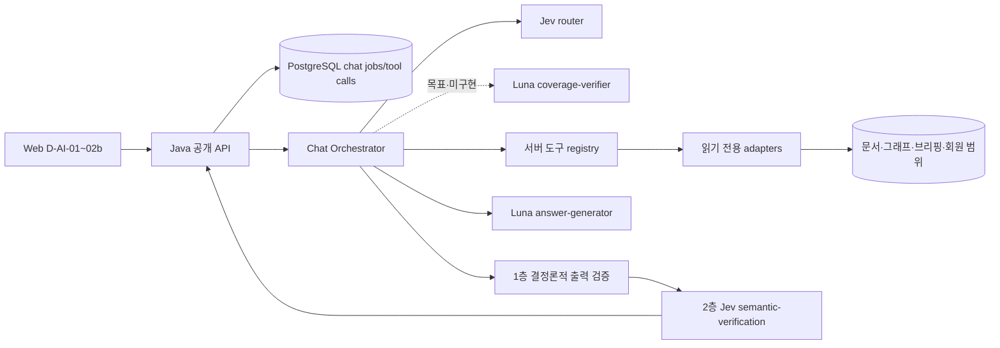

# ZOOP AI 챗봇 구현 준비·개발 계획

최초 기준일: 2026년 10월 21일 / 구현 상태 갱신: 2026년 10월 25일

기준 정책: `ZOOP-AIG-001 v0.9`

화면 추적: `D-AI-01`, `D-AI-01b`, `D-AI-02`, `D-AI-02b`

관련 문서:

- [AI 챗봇 설계 요약](../design/ai-chatbot-design-summary.md)
- [AI 챗봇 고정 평가 세트](ai-chatbot-eval-set.md)
- [AI 거버넌스 정책](../ZOOP_AI_거버넌스_정책.md)
- [공개 목표 API](../api/openapi.yaml)
- [ERD v6](../erd/zoop-core-erd-v6.md)
- [AI 챗봇 화면 상태 계약](../wireframe/ai-chatbot-state-contract.md)
- [현재 AI 내부 HTTP 계약](../api/internal-ai-openapi.yaml)

## 1. 현재 진행 상태

| 영역 | 현재 확인된 상태 | 구현 판단 |
| --- | --- | --- |
| 공개 챗봇 계약 | 목표 OpenAPI에 더해 Spring `ChatController`가 세션 생성·조회, 최신 대화 복원, 질문 job 접수·조회·재시도·취소를 구현함 | 공개 producer 구현됨. 배포 활성화는 별도 |
| ERD | `V20261021120000__create_chat_jobs.sql`이 `chat_sessions`, `chat_jobs`, `chat_tool_calls`와 `ai_executions.chat_job_id` FK를 생성함 | 저장·제약·동시성 시험 구현됨. 적용된 migration은 수정하지 않음 |
| 프로토타입 BFF | `prototype/bff`에 규칙 기반 질문 해석, 기간 처리, 세션·job·복구·save_only와 테스트가 있음 | 상태 머신·불변식의 참고 구현. 운영 AI 답변 엔진으로 승격하지 않음 |
| 본개발 Java API | controller/service/repository, 고정 문맥, 작업 executor, 오케스트레이터, 모델 단계 adapter와 읽기 도구 실행기가 있음 | 백엔드 수직 경로 구현됨. recovery artifact·`save_only` 저장 복구는 미구현 |
| 루트 웹 | `web/src/apis/chat`, `use-chat-conversation`, `AiChatDrawer`·`ChatJobCard`가 대화 생성·복원, 질문 접수·polling·취소·재시도와 답변·인용·확인 질문·실패 렌더링을 구현함(Vitest) | 구현됨. 타입은 손으로 쓴 `web/src/types/ai`이고 실제 백엔드·모델 종단 시험은 없음 |
| AI worker | `zoop-ai-chat`이 `chat-router`(Jev), `chat-answer`(Luna), `chat-verification`(Jev)을 별도 계약·원장·grant·live gate로 실행함 | 구현됨, 기본 비활성. 임계값 보정과 실제 승인 호출은 별도 |
| AI 내부 서비스 | `/internal/v1/chat-stages/{stage}`가 인증된 synchronous stage door로 구현되고 생성 OpenAPI에 포함됨 | 구현됨. 앱은 `HttpChatStageClient`로만 호출 |
| 데이터 기반 | 기업·문서·evidence·공개 그래프 버전과 현재 권리 재검사 경로가 있고 `company.read`·`issue.read`·`evidence.resolve`·`graph.path.read`·`zoopPolicy.read`가 연결됨(`company.read`는 기업 카탈로그 개요를 `company_profile` 인용으로, `zoopPolicy.read`는 승인 약관을 `zoop_doc` 인용으로 전달) | Q01(정책 문서만)·Q03/Q04 일부 구현. Q01 도움말·화면 명세, Q05·Q06·Q07·Q08 도구와 종단 공개 시험은 추가 필요 |
| 와이어프레임 | 네 정적 화면은 질문·되묻기·회수·조회 오류의 시각 기준을 제공하지만 동작 상태를 증명하지 않음 | 별도 상태 계약으로 로딩·오류·근거 수준·복구를 고정함 |

결론적으로 백엔드의 저장·공개 API·작업 실행기·라우터·오케스트레이터·도구 레지스트리·Luna 생성·Jev 검증과 웹 D-AI-01~02b 연결은 구현돼 있다. 다만 분리된 coverage-verifier, claim 단위 `unsupportedCausality`, 24k/2k token guard, recovery artifact·`save_only`, 미연결 Q 유형 도구, 평가 보정과 출시 증명은 남아 있다. 기능 플래그와 live gate는 기본적으로 꺼져 있으므로 “코드가 있음”은 “출시됨”이나 “실제 모델 호출 승인됨”을 뜻하지 않는다.

## 2. 구현 경계와 소유권

- 웹은 분류·도구 선택·인용 유효성을 결정하지 않는다.
- Java API는 인증·소유권·멱등성·상태 전이·내구 저장·공개 DTO의 권위자다.
- 챗봇 오케스트레이터는 typed 요구 분해·라우팅·계획·호출 조정·생성·검증을 담당하지만 회원 권한을 발급하지 않는다.
- 도구 레지스트리는 논리 기능을 실제 읽기 도구로 매핑한다. 모델 출력 문자열을 직접 실행하지 않는다.
- 문서·그래프·브리핑 서비스는 공개·철회·버전 경계를 자신의 조회 시점에도 검사한다.

## 3. 권장 구현 순서와 현재 상태

| 단계 | 2026-10-25 main 상태 | 남은 핵심 |
| --- | --- | --- |
| 0 계약·fixture | 부분 구현 | 목표 내부 schema 전체와 고정 평가 fixture 정리 |
| 1 저장·job 수명주기 | 부분 구현 | recovery artifact와 실제 `save_only` 복구 |
| 2 오케스트레이터 | 부분 구현 | 경로별 동적 deadline, 보충 라운드와 coverage 재확인 |
| 3 router·coverage | 부분 구현 | Jev router는 구현, Luna coverage-verifier는 미구현 |
| 4 읽기 도구 | 부분 구현 | Q03 일부, Q04 경로, Q05 지도 버전 비교(`graph.version.diff`), Q07 내 종목(`portfolio.scope.read`) 구현, Q01 일부·Q06·Q08 미연결 |
| 5 생성·출력 검증 | 부분 구현 | 구간 단위 생성·검증은 구현, claim 단위 검증·token guard 미구현 |
| 6 웹 | 구현 | OpenAPI 타입 생성 seam, 실제 백엔드와의 종단 확인 |
| 7 평가·출시 | 부분 구현 | 고정 평가 세트 v1(대본 실행)만 있음. 실제 모델·데이터 평가와 임계값 보정, 보안·종단·배포 증명 |

### 단계 0 — 계약 고정과 fixture

1. `ChatResult.answerBasis`, `ChatChoice.kind`, 확인 질문 답 `resolves`(`ChatClarificationReply`), 답하지 않은 요구 `limitations`(`ChatLimitation`), 근거 수준별 `sections`, 진행 단계 `phase`, 입력·조회 상한과 `transient`·`budget_exceeded`의 `reason` 코드, `Citation.sourceKind`(`article`·`zoop_doc`)를 Java DTO·웹 타입·프로토타입 호환 fixture에 반영한다.
2. 내부 `ChatRouteSummary v1`, `ChatToolRequest v1`, `ChatToolResult v1` JSON Schema를 만든다.
3. Q01~Q08, 논리 capability, 도구 registry group을 코드 enum/registry로 한 곳에서 버전 관리한다.
4. 실제 모델 없이도 전체 상태 머신을 시험할 deterministic fake router·coverage·tool·generator를 만든다.

완료 조건: 공개 OpenAPI 검사 통과, schema fixture round-trip, 예전 BFF와 목표 API의 의도된 차이 목록 갱신.

### 단계 1 — 저장과 공개 job 수명주기

1. 새 Flyway migration으로 `chat_sessions`, `chat_jobs`, `chat_tool_calls` 및 부분 UNIQUE·CHECK·인덱스를 만든다.
2. Java에 chat controller/service/repository와 멱등성·소유권·대화당 활성 job 하나 제약을 구현한다. `resolves`가 있으면 원 작업의 같은 대화·clarification·choice 존재를 같은 트랜잭션에서 검사하고 원 고정 문맥을 복사한다. 확인 질문 사슬 깊이(`clarification_depth`, 원 작업 + 1, 최대 2)를 함께 고정한다.
3. `queued → running → completed|failed|cancelled`, lease/owner token(lease = 시작 시각 + 실행 기한 + 여유), 늦은 완료 차단, lease 만료 회수(모델 요청을 보낸 실행은 `response_unknown`·retry 없음, 보내기 전이면 `deadline_guard`·rerun 가능), recovery artifact와 `save_only`, 작업당 실행 3회 상한(`runs` ≤ 3, 이후 `retry=null`, 모델을 호출하지 않는 `save_only`는 횟수에서 제외)을 구현한다.
4. `getCurrentConversation`은 최신 저장 대화만 복원하고 모델을 호출하지 않게 한다.

완료 조건: 동시 접수 한 건만 성공, 다른 회원 접근 차단, 같은 jobId 같은 본문 재전송은 같은 작업 반환, 다른 본문은 409, save_only 모델 호출 0회, 깊이 2 작업의 clarification 저장 0건.

현재 상태: migration, 공개 API, 멱등성·소유권, 단일 활성 job, lease/owner fence, 취소·만료 회수와 최대 3회 rerun은 구현됐다. recovery artifact 저장소가 없어 `save_only` 시도는 현재 `result_lost`로 닫히므로 이 단계의 완료 조건 전체를 충족한 것은 아니다.

### 단계 2 — 오케스트레이터 골격

1. 입력 정규화와 `requirementId` 분해를 구현한다. 질문에 명시된 대상·기간은 선택 문맥보다 우선한다. 명시적 요구가 6개를 넘으면 모델 라우팅·도구 호출 전에 `clarification`으로 범위를 나눈다.
2. `route_summary`를 단계별로 쓰되 자유 형식 chain-of-thought는 저장하지 않는다.
3. 계획 검증 전에는 도구 호출을 예약하지 않고, 확정 계획은 `chat_tool_calls(status=reserved)`로 원자 저장한다.
4. 의존 실행은 `stages[]`와 `checkpoint`로 선언하고, 단계가 끝날 때마다 서버가 개수 조건을 평가해 진행·`clarification`(초과)·제한 답변(미달)·없음 답변(0개, 잘림 없음)·근거 부족(0개, 오류 없이 잘림)으로 나눈다. 단계의 도구 호출이 timeout·장애·권한 오류로 끝나면 개수 조건을 평가하지 않고 해당 `ChatFailure`로 먼저 종료한다. 체크포인트에서 멈추면 남은 예약 호출을 취소하고 생성 stage를 호출하지 않는다.
5. 단계별 시간 상한(라우터 4초, 커버리지 회당 6초, 도구 단계 10초·개별 3초, 생성 25초, 의미 검증 6초, 서버 처리 3초)과 계획 경로별 실행 기한(실행할 단계 상한의 합, 최대 60초), 동시 4개, 최대 12회, 의존 3단계·fan-out 5개와 보충 1라운드를 서버에서 강제한다. 모델 단계 시작 전 잔여 기한이 그 단계와 이후 남은 필수 단계 상한의 합보다 적으면 호출하지 않고 `transient`(`deadline_guard`)로 끝낸다. 커버리지 재확인도 이 조건을 만족할 때만 실행한다. 실행 단계마다 `phase`를 owner token 조건부로 갱신한다. 예산은 체크포인트 조건의 최악의 경우로 계산한다.

완료 조건: 예산 초과 계획은 도구 호출 0회와 clarification, 체크포인트 초과 시 다음 단계 호출 0회·생성 호출 0회와 실제 결과 기반 choices, 취소·lease 만료 뒤 신규 호출 0회, 병렬 호출도 최대 4개.

현재 오케스트레이터(`com.zoop.chat.orchestrator`)는 모델 단계를 typed port(라우터·생성·의미 검증)로만 두고 서버 결정을 구현한다. 확률은 `p >= 0.70`을 채택하고, 0.35 이상 검토 구간은 별도 coverage-verifier가 붙기 전까지 명시적 요구에 한해 최고 후보 하나만 쓴다. 투자 판단은 Noul `p > 0.10`(불확실 포함)이면 `investment_advice` limitation이다. 체크포인트는 앞 단계가 찾은 기업 수로 평가하고, 초과 선택지는 `exactly(n)` 조합이 6개 이하일 때만 만든다(이슈 결과는 기업 ID만 가지므로 현재 선택지 표시명은 ID다). 인용은 생성 결과가 아니라 근거 조회 결과로 서버가 만들고, 의미 검증 hold는 해당 요구와 그 요구를 잇는 구간을 함께 제외한다. 추론만 된 요구는 처리할 수 없으면 limitation 없이 뺀다. 일반 지식 구간은 Q02만 가진 요구에만 쓰고, Q02와 사실 유형이 섞인 요구는 조회가 없으면 `out_of_scope`이며 일반 구간에 금액·비율·가격·연도·날짜·‘최근’ 같은 현재 사실 표지가 있으면 1층 검사 실패다. 선택 문맥을 쓰는 요구는 회원이 좁힌 근거(`evidencePool`)만 읽고 인용하며 의존 단계도 그 범위를 이어받는다. 질문이 대상을 직접 지정하면 그 범위를 쓰지 않고 `applied.questionOverrodeContext`를 표시한다. 답변 전체 인용은 서로 다른 근거 20개 이하다(`citation_budget`). 모델 단계는 시작 전 기한 검사에 더해 단계 상한 안에서만 기다리고, 넘기면 중단하고 `response_unknown`이다. 실행 기한 뒤에 돌아온 결과는 실행기가 completed로 저장하지 않는다. 세 adapter는 `ZOOP_AI_CHAT_CLIENT_ENABLED=true`일 때 `ChatModelConfiguration`이 엔진과 함께 등록하며, 질문 접수는 별도 `ZOOP_CHAT_QUESTIONS_ENABLED=true`가 있어야 열린다.

### 단계 3 — Jev router와 Luna coverage-verifier

1. 기존 S1 `semantic-verification`과 분리된 Jev router schema·prompt·kind를 추가한다.
2. 명시적 요구는 `required=true`; `p>=0.70` 자동 후보, `0.35<=p<0.70` 검토 후보로 적용한다.
3. Luna `coverage-verifier`는 허용 capability ID만 반환하고 최초 1회+보완 뒤 재확인 1회로 제한한다.
4. route·coverage 모델 호출은 `ai_executions(feature=chatbot)`에 서로 다른 stage와 영수증으로 기록한다. 단계 5의 answer-generator·semantic-verification도 같은 방식으로 분리 기록한다.

완료 조건: multi-label macro F1·유형별 recall 기준, 명시적 필수 요구 누락 0건, 미등록 capability·인자 실행 0건.

현재 상태: Jev router와 단계별 `ai_executions(feature=chatbot)` 기록은 구현됐다. 별도 Luna coverage-verifier와 그 보완·재확인 라운드는 없으며, 0.70/0.35와 투자 판단 0.10은 평가 세트로 보정되지 않은 잠정값이다.

모델 연결의 잠정 결정(2026-10-22, 사용자 승인, 평가 세트로 보정 전): (1) 명시적 요구 분해는 규칙 기반(`?`·“그리고”·“~하고”·쉼표 등)이며 확실하지 않으면 질문 전체를 요구 하나로 둔다. (2) 질문에 적힌 기업 이름은 앱이 기업 카탈로그의 정확한 이름 일치로만 ID로 해석하고, 후보가 여럿이면 `clarification`이다. Jev는 이름을 해석하지 않는다. (3) 생성·검증에 보내는 인용문은 운영자 챗봇 grant(`model-send`·stage 목적·정확한 수신자)가 있을 때만 보내고 없으면 보내지 않고 실패한다. (4) 라우터·검증 Jev 질문 집합은 새로 작성하고 임계치는 S1 잠정값을 쓴다. 모델 단계 실행은 `ai/worker`의 `zoop-ai-chat`([AI 런타임 준비 §11](ai-runtime-setup.md))이 맡고 앱은 `ai/service`를 거쳐서만 부른다.

사건 지목의 잠정 결정(2026-10-27, 사용자 승인, 평가 세트로 보정 전): (5) 질문에 적힌 사건은 앱이 작업이 고정한 공개 그래프의 사건으로만 해석한다(`IssueNameResolver`). 공백과 라틴 대소문자를 무시하고 사건 제목 전체가 들어 있거나, 그 사건의 `target`과 `action`이 둘 다 들어 있으면 그 사건이다. 같은 말(같은 제목, 또는 같은 target·action)에 맞는 사건이 여럿이면 `clarification`(선택지 종류 `other`, 표시명은 제목과 사건 시점)이고, 제목이 적힌 사건은 target·action이 같은 다른 사건을 부르지 않는다. 질문 대상은 기업 다음에 사건 순이다. 기업 이름은 라우터 전에, 사건 이름은 라우터 뒤에 어떤 요구가 그래프를 읽는 바인딩된 능력을 허용하는 유형을 검토 구간(0.35) 이상으로 가질 때만 해석한다. Q02는 능력이 없고 Q01은 ZOOP 문서만 읽으므로 해당하지 않는다. 그래서 순수 개념 질문과 정책 문서만 읽는 Q01 질문은 활성 버전이 고정돼 있어도 고정 그래프를 읽지 않고 그래프 장애 중에도 답하며, 같은 말에 맞는 사건의 확인 질문은 라우터 호출 뒤에 나온다. 사건 해석에서 고정 그래프를 읽을 수 없으면 조회 장애(transient)로 끝난다. 이름 지목된 사건은 Q03일 때 `issue.read` 기본 조회를 받는다(기업의 `company.read` 기본 조회와 같은 규칙). (6) `issue.read`에 기업 ID를 주면 그 기업이 관여하거나 구조적으로 연결된 공개 사건을 최신순으로 돌려준다. 대상 읽기 한 번은 항목을 50개(생성 단계가 branch 하나에 받는 수)까지 돌려주고, 넘치면 `truncated=true`라 남은 사건을 "없음"으로 보지 않는다(`GraphTargetTool.MAX_ITEMS`). 도구 출력의 의미가 바뀌었으므로 레지스트리는 `chat-tools/v2`다.

Q05 기간 비교의 잠정 결정(2026-10-27, 사용자 승인, 평가 세트로 보정 전): (7) 비교 기준은 질문에 적힌 기간이다. 정해진 한국어 표현(오늘·어제·그제, 이번 주·지난주, 이번 달·지난달, N일·N주·N달 전, 최근 N일·N주, `YYYY-MM-DD`, `M월 D일`)만 서버가 KST로 결정론적으로 해석하고(`ChatPeriods`), 여러 표현은 가장 이른 시작부터 가장 늦은 끝까지 한 기간으로 묶는다. 기간 시작 시각(KST 자정)에 공개돼 있던 지도와 작업이 고정한 지도를 비교한다. 질문에 기간이 없으면 회원이 고른 기간, 그것도 없으면 고정 지도 직전에 공개됐던 지도와 비교한다. 해석한 기간은 결과의 `applied.period`(`basis=question`, `expression`)로 보인다. (8) `graph.version.diff`는 대상(기업·사건)을 지목하면 그와 관련된 변화만, 아니면 지도 전체 변화를 최대 40건 돌려주고, 추가된 항목만 지금 고정 지도의 근거를 싣는다. 비교할 이전 공개 지도가 없으면 "변화 없음"이 아니라 잘린 조회(`truncated`)다. 레지스트리는 `chat-tools/v3`다.

Q07 내 종목의 잠정 결정(2026-10-27, 사용자 승인, 평가 세트로 보정 전): (9) 범위는 연결된 모의 계좌의 보유 종목(계좌 표시 순) 다음 관심 종목(관심 목록 순)이며, 지도 "내 종목" 보기와 같은 원천(`PersonalCompanies`)이다. 회원은 작업의 인증 회원으로 서버가 조회 범위(`ChatToolScope.memberId`)에 넣고, `portfolio.scope.read`는 `member:self` 외의 대상을 받지 않는다. (10) 기업을 지목하지 않은 Q07 요구는 계획기가 서버 요구 `<id>-s`(`Origin.SCOPE`, 1단계 `portfolio.scope.read`)를 앞에 두고 원 요구를 `atLeast(1)` 의존 단계로 바꾼다. 범위 요구는 따로 답하지 않고 그 결과가 원 요구의 답변 입력에 함께 들어간다. 종목이 없으면 "없음"을 답하고(근거 없이 허용), 5개를 넘으면 앞 5개만 조회하고 `results_truncated` 안내를 답변 옆에 붙인다. 회원 본인 범위만 읽은 구간은 공개 근거가 없으므로 인용 없이 허용한다. 레지스트리는 `chat-tools/v4`다.

### 단계 4 — 도구 레지스트리와 읽기 어댑터

레지스트리를 한 번에 모두 구현하지 말고 아래 수직 순서로 연동한다.

| 순서 | 유형 | 최초 구현 도구 | 현재 기반·추가 작업 |
| ---: | --- | --- | --- |
| 1 | Q02 일반 개념 | 도구 없음 | Luna 제한 답변을 `general_knowledge` 구간으로 저장, 서버 고정 안내·근거 없음·정책 검사, Jev `prohibitedAdvice` 판정 |
| 2 | Q01 서비스 안내 | `help.search`, `screenSpec.read`, `zoopPolicy.read` | 승인된 제품 문서 registry와 버전·철회 상태가 필요. 인용은 `Citation.sourceKind=zoop_doc`(docId·docVersion·code point 구간)으로 만들고 결정적 인용 ID를 발급 |
| 3 | Q03 기업·사건 | `company.read`, `document.search`, `issue.read`, `evidence.resolve` | `company.read`·`issue.read`·`evidence.resolve` 구현. `document.search`와 검색형 기간 조건은 미구현 |
| 4 | Q04 관계·경로 | `graph.path.read` | `PublicGraphReader` 위 최대 3-hop·노드/간선 50개·현재 evidence 재검사를 구현. Neo4j·AI 내부 그래프 API는 호출하지 않음 |
| 5 | Q05 기간 비교 | `period.compare`, `graph.version.diff` | `graph.version.diff` 구현(2026-10-27): 고정 버전과 이전 공개 버전을 `PublicGraphReader`로 각각 읽어 서버가 추가·삭제된 기업·사건·관계를 계산. `period.compare`(문서 수 등 기간 비교)는 미구현 |
| 6 | Q06 브리핑 | `briefing.read`, `briefing.evidence` | briefing migration·발행 조회·회차 고정 구현 필요 |
| 7 | Q07 내 종목 | `portfolio.scope.read` + Q03/Q04 | 구현(2026-10-27): 서버가 주입한 작업 회원의 보유(모의 계좌)·관심 종목(`PersonalCompanies`)을 1단계로 읽고 나머지 조회를 그 종목에 2단계로 실행. 질문이 기업을 지목하면 그 기업을 그대로 읽고 본인 범위 여부는 아직 확인하지 않음 |
| 8 | Q08 선정 근거 | `selectionRule.read` + evidence | 실제 적용 rule revision·입력 요인 조회 구현 필요 |

웹 검색 대체 경로(`web.search`)는 위 순서와 별개로, 내부 도구로 답할 수 없는 Q03 요구에만 보충 라운드로 부르는 검색 API 직접 어댑터로 설계했다(MCP 미사용). 공급자·비용·개인정보 처리방침 개정이 결정되기 전에는 구현하지 않는다. [웹 검색 대체 경로 설계](../design/ai-chatbot-web-search.md)

근거가 일부만 있는 질문의 처리는 [부분 답변 분기와 근거 부족 안내 설계](../design/ai-chatbot-partial-answer.md)에 있다(2026-10-26 구현). 1부는 개념과 사실이 섞인 요구에서 서버가 개념 하위 요구 `<id>-c`를 나눠 개념은 답한다(`ChatPlanner.withConcepts`, 기능 플래그 없음). Q03 근거 0개일 때 일반 배경을 붙이는 2부는 동문서답 위험으로 채택하지 않았다. 대신 근거 부족 결과의 `reason`을 원인별 서버 문장과 다음에 해 볼 일로 나누고, `applied`에 실제로 확인한 대상을 담는다(`ChatResults.InsufficientCause`).

모든 어댑터는 공통 요청·결과 봉투를 사용하고 `dataVersion`, `evidenceIds`, `truncated`, `nextAllowed`, 실제 오류를 반환한다. 회원 ID는 모델이나 사용자 입력에서 받지 않고 Java 인증 문맥에서 주입한다.

첫 도구 계층은 레지스트리 `chat-tools/v1`(2026-10-27부터 `chat-tools/v2`·`v3`·`v4`, 결정 (6)·(8)·(10))에 `company.read`·`issue.read`·`evidence.resolve`를 앱 공개 그래프 읽기 경로(`PublicGraphReader`) 위의 내부 어댑터로 등록한다. 그래프 버전·asOf는 계획이 아니라 작업의 고정 문맥에서 주입하고, 근거 ID는 공개 근거 조회가 지금 읽을 수 있는 것만 상한(20개) 안에서 전달한다. 상한 때문에 읽지 않은 근거가 있으면 `truncated=true`이며, 근거 상태를 확인할 수 없으면 빈 결과가 아니라 호출 실패(`tool_unavailable`)다. 단계 실행기는 등록되지 않은 기능이 하나라도 있으면 아무것도 예약하지 않고, 시도당 12회·동시 4개·개별 3초·단계 10초(실행 기한 이내)를 강제한다.

Q04 `graph.path.read`(`GraphPathTool`, 경로 탐색 `GraphPathLookup`)를 같은 레지스트리에 추가했다(2026-10-23).
- 첫 대상에서 나머지 각 대상까지의 최단 경로를 같은 고정 버전·asOf·공개 제외의 표시 그래프에서 찾는다.
- hop은 지도 `depth`와 같은 기업 간 관계 hop(기업–사건–기업 = 1)이며 최대 3이다. 저장된 기업–사건 간선만 따라가고, 지도의 depth 읽기와 같이 사건 간 후속 관계와 파생 `SHARES_ISSUE`는 단계로 쓰지 않는다.
- 이웃은 id 순으로 방문해 결과가 결정적이다.
- 결과 구분:
  - 증명된 무연결은 비고 잘리지 않은 결과라서 "찾지 못함"이 된다.
  - 3 hop 안에서 판정하지 못한 경로와 노드·간선 50개 초과는 `truncated=true`이며, "없음"으로 말하지 않는다.
- 근거는 경로 간선의 근거를 먼저, 그다음 경로 위 사건의 근거를 지금 읽을 수 있는 것만 상한 안에서 전달한다.

Q01 `zoopPolicy.read`(`ZoopPolicyReadTool`, 문서 원천 `ChatZoopDocs`)를 같은 레지스트리에 추가했다(2026-10-25). `help.search`·`screenSpec.read`는 승인된 문서가 없어 연결하지 않았다. 초안과 승인 순서는 [도움말 초안](../help/README.md)에 있다.
- 원천: `term_versions`에 등록된 승인 약관(`policy.service` 서비스 이용약관, `policy.privacy` 개인정보 처리방침). 본문의 `##` 절 하나가 인용 하나이며 `Citation.sourceKind=zoop_doc`, `docId`·`docVersion`·code point `[start,end)`를 가진다.
  - 인용 ID는 `ev-` + SHA-256(문서 ID·버전·구간·본문)이라 결정적이다.
- 읽기 가능 판단: 버전은 run의 asOf(없으면 현재)에 시행 중인 것을 고르고, 그 버전이 **지금도** 시행 중일 때만 읽고 인용한다.
  - 새 버전으로 바뀌거나 약관이 폐지되면, 과거 asOf로 저장된 답변도 응답 guard가 숨긴다. 저장된 인용 본문을 새 버전 문장으로 바꾸지 않는다.
  - 등록을 읽지 못하면 빈 결과가 아니라 `tool_unavailable`이다.
- 인용 필드: 공개 계약대로 `zoop_doc` 인용의 `articleId`·`articleVersion`·`publisher`·`publishedAt`·`url`은 null이고 `articleTitle`이 문서 제목·절 제목이다.
- 대상: 질문·선택 대상이 아니라 서버가 고정한 두 문서를 한 번에 읽는다(라우터는 문서를 지목하지 않는다). 회원이 좁힌 근거 선택 범위는 같은 요구의 그래프 도구에만 적용하고 고정 정책 문서 읽기에는 적용하지 않는다. 그래프를 읽지 않으므로 문서만 읽는 요구는 고정 그래프가 없어도 실행된다. 그래프 도구와 함께면 기존처럼 `graph_unavailable`이다.
- 결정론 검사 `document_section`: `zoop_documented` 구간은 문서 도구가 전달한 근거만, `evidence_grounded` 구간은 그 밖의 근거만 인용한다. 인용 단계에서 구간 basis와 `sourceKind`가 어긋나면 `validation_failed`다.
- 모델 단계: 인용문은 grant 원천 `zoop-docs`로 보낸다. 운영자 챗봇 grant 파일에 이 원천의 `model-send` grant가 없으면 보내지 않고 실패한다. Luna 프롬프트(`zoop-chat-answer-2026-10-25-1`)가 `zoop_documented` 구간을 알고, Jev 검증은 일반 개념이 아닌 모든 구간에 지지 판정을 한다.
- 시험: 단위(`ChatZoopDocsTest`·`ZoopPolicyReadToolTest`·계획·검사·엔진·모델 단계), 실제 migration을 읽는 PostgreSQL 시험(`ChatZoopDocsPostgresTest`, 두 약관 19개 절). 실제 데이터 기반이지만 모델 호출 없는 검증이다.

### 단계 5 — Luna 답변 생성과 출력 검증

1. `BranchContext`는 요구 ID별로 도구 결과·근거·버전·제한을 구조화하며 원문 전문을 무제한 합치지 않는다.
2. Luna `answer-generator`는 1회만 호출하고 출력은 typed schema로 받는다.
3. 서버 검증기는 요구 커버리지, citation offset·문서 버전·철회, 수치·통화·날짜, graph endpoint·hop, 회원 범위, 투자 판단, `answerBasis`를 검사한다. 요구 커버리지는 모든 필수 요구가 본문 답변과 `limitations` 항목 중 정확히 하나에 속하는지로 판정하고, `limitations`는 gate·체크포인트·`truncated`·citation 부재에서 서버가 만들며 `message`는 `kind`별 템플릿을 쓴다. 본문은 근거 수준별 `sections`로 받고, 서버가 `general_knowledge` 구간에 고정 안내를 붙이고 구간 text를 이어 `answer`를 만들며 `answerBasis`를 구간 basis에서 계산한다. 일반 개념 구간의 최신 사실·근거 연결, 근거 구간의 구간 밖 인용, `citations`에 없는 `evidenceIds`는 검증 실패다.
4. 3의 검사는 [설계 요약 8.2절](../design/ai-chatbot-design-summary.md)의 1층 결정론적 검사 표를 check ID 단위로 구현한다. 하나라도 실패하면 Jev를 호출하지 않는다.
5. 1층을 통과하면 Jev `semantic-verification` stage를 1회 호출한다. 챗봇 전용 질문 집합(근거 구간 claim별 Choice와 Noul `prohibitedAdvice`·`unsupportedCausality`, `general_knowledge` 구간별 Noul `prohibitedAdvice`만)과 정책 버전을 쓰고, S1 어댑터의 엄격한 응답 검사·영수증 선저장·무재시도 원칙을 재사용한다. 일반 개념 구간의 판정은 사실 검증 통과로 기록하지 않는다.
6. 판정 처리: `contradicted` 또는 Noul 예 → 전체 `validation_failed`; hold → 해당 요구 구간 제외와 `evidence_insufficient` limitation, 남은 요구가 없으면 `insufficient_evidence`; Jev 송신 전 장애·응답을 받은 확정 실패 → `transient`(`provider_error`, retry=`rerun`), 송신 후 timeout·연결 끊김으로 응답 불명 → `transient`(`response_unknown`, retry=null, 호출 `unknown`·운영자 정산). 구간 제외 뒤 `answer`·`answerBasis`·`citations`를 서버가 다시 계산한다.
7. 검증 실패는 `validation_failed`; 자동 재생성·부분 답변·근거 부족 성공으로 바꾸지 않는다. 예외는 서버가 떼어 낸 개념 하위 요구의 일반 구간 하나다. 이 구간이 일반 구간 규칙(`general_section`)이나 대상 이름 금지(`general_names`)에 걸리면 그 구간만 빼고 route에 `droppedGeneral`로 남긴다. 투자 권유 문구는 이 구간에서도 전체 실패다([부분 답변 설계](../design/ai-chatbot-partial-answer.md) 3.1).

완료 조건: 모든 중요 사실 주장에 유효 근거와 Jev supported 판정, 1층 실패 시 Jev 호출 0회, 일반 개념 구간의 Choice 판정 0건과 `prohibitedAdvice` 판정 100%, Q02 최신 사실 우회 0건, 철회 근거 노출 0건, 다른 회원 종목 노출 0건.

현재 상태: `ChatModelStages`, `ChatAnswerCheck`, `OrchestratedChatEngine`이 생성, 서버 인용 구성, 결정론적 검사, 구간 단위 Jev 검증과 hold 제외를 구현한다. 아직 claim 분해·`unsupportedCausality`, 수치·날짜와 그래프 경로 의미의 독립 검증, Luna 입력 24,000·출력 2,000 token guard는 구현되지 않았다. 현재 verifier 결과는 section별 `support`와 `prohibitedAdvice`뿐이다.

### 단계 6 — 웹 연결

1. 목표 OpenAPI에서 웹 타입을 생성할 전용 seam을 만든다. 현재 `prototype/web/src/api/schema.d.ts`는 BFF 관측본이므로 루트 웹에 그대로 복사하지 않는다.
2. 세션 생성·최신 대화 복원·job 접수·polling·취소·허용 재시도를 query 계층에 구현한다. polling 중 `phase`로 진행 단계를 표시한다.
3. [화면 상태 계약](../wireframe/ai-chatbot-state-contract.md)에 따라 D-AI-01~02b를 구현한다.
4. `answerBasis`, 구간별 `sections` 배지·인용, citations, applied 범위, `limitations`, clarification choices, guidance action, failure retry를 각각 렌더링한다.
5. 로그아웃·회원 변경 시 query cache와 late response를 폐기한다.

완료 조건: 새로고침 복구, GET 재확인이 모델을 재호출하지 않음, 키보드·aria-live, 모바일 동일 정보, 401/403에서 질문 미전송.

현재 상태: 공개 Chat API client(`web/src/apis/chat`)와 대화 hook(`use-chat-conversation`)이 대화 생성·최신 대화 복원, 질문 접수·polling·취소·재시도를 하고, `ChatJobCard`가 답변·인용(`article`·`company_profile`)·확인 질문·실패를 렌더링한다(`web/tests/ai`). 타입은 목표 OpenAPI에서 생성하지 않고 `web/src/types/ai`에 손으로 썼으며, 실제 백엔드·모델과 함께 완료 조건 전체를 확인한 기록은 없다.

### 단계 7 — 평가·관측·점진 출시

1. 단일 Q 유형보다 복합·모호·공격·장애 질문을 먼저 고정 평가에 포함한다.
2. `chat_tool_calls`로 호출 수·중복·지연·오류·추가 라운드를, `ai_executions`로 모델 호출·토큰·비용을 분리 집계한다.
3. Q02 → Q01 → Q03 → Q04/Q07 → Q05/Q06/Q08 순으로 feature flag를 연다. 준비되지 않은 유형을 일반 LLM으로 우회하지 않는다. Q02 단독 답변도 Jev `prohibitedAdvice` 판정을 쓰므로 Q02를 포함한 모든 유형은 Jev 의미 검증 연결과 임계값 보정이 선행 조건이다. Q02에 필요한 것은 Noul 하나뿐이라 가장 먼저 보정할 수 있다.
4. 고정 평가와 보안 시험을 통과한 registry/model/prompt/policy 조합만 활성화한다.

현재 상태: 모델·도구 호출 원장과 다수의 단위·PostgreSQL 시험은 있다. 고정 평가 세트 `chat-eval-v1`(34문항: Q01~Q08·복합·투자 판단·공격·확인 질문·장애)은 질문 문장부터 실제 요구 분해·이름 해석·계획·읽기 도구·검사를 거치고 모델 세 단계만 대본으로 바꿔 기본 `test`에서 돈다([고정 평가 세트](ai-chatbot-eval-set.md)). 흐름 회귀만 확인하며, 실제 모델·데이터로 잰 챗봇 한국어 금융 평가 보정과 실제 배포·종단 출시 증명은 없다. live gate와 질문 접수 플래그는 기본 비활성이다.

## 4. 내부 챗봇 계약에 필요한 최소 스키마

`internal-ai-openapi.yaml`은 서비스 코드에서 생성되는 구현 계약이므로 손으로 수정하지 않는다. 현재 구현 계약은 stage별 `StageRequest`/`StageResult`이고, 아래 표는 coverage·claim 검증까지 포함한 목표 상위 계약이다. 표의 항목이 모두 현재 wire에 존재한다고 해석하지 않는다.

| 계약 | 필수 내용 |
| --- | --- |
| `ChatOrchestrationSubmit` | schemaVersion, jobId, attemptNo, question, frozenContext, requirements, policyVersion, registryVersion, budget, server-issued principal scope reference |
| `ChatRouteDecision` | requirementId별 Q type·probability·required, capability 후보, model/prompt version, typed validation result |
| `ChatCoverageDecision` | coveredRequirements, missingRequirements, unnecessaryCapabilities, requiresClarification, reasons as short machine codes |
| `ChatToolPlan` | planRevision, stages(순서·의존 단계), stage별 calls·parallelGroup, checkpoint(sourceStage, cardinality, onZero, onUnder, onExcess), capabilityId, registry tool binding, 최악의 경우 reserved budget |
| `ChatCheckpointResult` | stage, observed count, truncated, decision(continue/clarify/limit/none_found/insufficient), 생성한 choice id |
| `ChatToolResult` | toolCallId, capabilityId, dataVersion, items, evidenceIds, truncated, nextAllowed, error |
| `ChatGeneratedAnswer` | requirementId별 answer/limitation/insufficient, 근거 수준별 sections(basis·text·claims·citation refs·소속 requirementId 하나, 통합 구간은 관련 requirementId 목록), graph targets. answerBasis는 제안하지 않고 서버가 계산 |
| `ChatSemanticVerification` | schemaVersion, model, policyVersion, 근거 구간 claim별 claimId·sectionId·requirementId·Choice 분포·confidence·Noul 확률·판정(supported/contradicted/insufficient/hold), `general_knowledge` 구간별 sectionId·`prohibitedAdvice` 확률·판정, receipt artifact ID |
| `ChatValidationReport` | deterministic check IDs·pass/fail, failing requirement/claim/citation, semantic verification 요약(호출 여부·전체 판정·hold로 제외한 requirementId), requirementId별 answered/limited 판정과 limitation 결정 근거, final answerBasis, final limitations, policyVersion |

내부 응답에는 provider 원문 응답·비밀·자유 형식 추론을 넣지 않는다. 앱 completed는 AI 서비스가 ready를 반환한 시점이 아니라 Java가 artifact·영수증·도구 호출·검증 결과를 확인하고 DB에 원자 저장한 뒤에만 전이한다.

## 5. 초기 구현 기준점과 다음 PR 범위

초기 권장 범위 중 공개 DTO, migration, repository/service, 작업 executor와 Java/PostgreSQL 시험은 여러 PR에 걸쳐 구현됐다. 모델 단계, 첫 읽기 도구와 웹 D-AI-01~02b 연결도 뒤이어 구현됐다. 아직 남은 PR은 다음 경계를 한 번에 섞지 않는다.

1. coverage-verifier 또는 이를 대체하는 승인된 결정론적 coverage 계약
2. recovery artifact와 `save_only` 저장 복구
3. claim 단위 검증·token guard와 정책 버전 상승
4. Q01·Q05·Q06·Q07·Q08의 데이터 소유 도구를 각각 독립 수직 경로로 연결
5. 평가 보정, 실제 배포 환경 종단 시험과 기능 플래그 단계적 활성화

각 PR은 현재 저장·멱등·권한·호출 원장 경계를 유지하고, 준비되지 않은 유형을 일반 LLM 답변으로 우회하지 않는다.

## 6. 필수 테스트 목록

아래는 목표 완료 matrix다. 기존 테스트가 일부 행을 다루더라도 행 전체가 통과했다고 자동 선언하지 않는다.

| 구분 | 필수 사례 |
| --- | --- |
| 인증 | 비회원 401/403, 타인 세션·job 접근 차단, Q07 서버 범위 주입 |
| 멱등성 | 같은 키·본문 재전송, 같은 키·다른 본문 충돌, 처리 중 재전송 |
| 동시성 | 대화당 활성 job 하나, 취소와 늦은 완료 경합, lease 만료 회수 |
| 라우팅 | 8유형 단일·복합, 명시 요구 보존, 4개 이상 유형, 낮은 확률 필수 요구 |
| 계획 | 미등록 도구, 중복 제거, 의존·병렬 순서, 12회·4동시·3단계·fan-out 5·보충 1라운드 한도 |
| 체크포인트 | `exactly(2)`에 0개(잘림 없음 → 없음 답변, 잘림 → 근거 부족, 도구 오류 → 개수 평가 없이 failed)·1개·2개·3개 이상, 조합 6개 초과 시 자유 입력, 초과 시 다음 단계·생성 호출 0회, 선택 후 새 job이 같은 asOf로 같은 결과 재현, fan-out 상한 초과 |
| 데이터 | graphVersion 고정, 문서 철회, citation offset, 브리핑 회차, 기간 경계 |
| 그래프 | 챗봇 경로가 같은 graphVersion의 `/api/v1/graph` 결과와 일치, 공개 제외 결정 반영 후 철회 간선 미노출, 공개 활성화 이력이 없는 버전·사용 불가 버전 거부, 이전 공개 버전은 현재 공개 제외 결정을 적용해 조회(Q05), 기업 간 hop 1·2·3과 4 거부, 노드·간선 50개 절단 시 `truncated`, graphTargets가 지도에서 열림, Neo4j·AI 내부 그래프 API 호출 0회 |
| 결과 | answerBasis를 sections에서 계산(단일·mixed·none), `zoop_documented` 구간의 `zoop_doc` 인용과 `evidence_grounded` 구간의 `article` 인용 교차 사용 거부, 이어 붙인 answer 12,000자 초과 거부, Q02 단독은 general_knowledge 구간 하나와 빈 sources·citations, Q02+Q03은 mixed와 구간별 인용, 일반 개념 구간의 근거 연결·최신 사실 거부, 고정 안내 중복 없음, clarification 새 job, no PARTIAL |
| 제한 | 투자 판단 혼합 질문의 `investment_advice`, 체크포인트 미달 `precondition_unmet`, 문서 20개 잘림 `results_truncated`, 한 요구만 근거 부족, 요구 누락·중복 소속·본문의 제한 요구 답변 시 `validation_failed`, 모델이 근거 없이 제안한 제한 거부, 도구 timeout이 limitation이 아닌 failed, answered 외 outcome의 빈 배열 |
| 확인 답 | 선택지 답·자유 입력 답, 없는 choiceId·clarification 아닌 원 작업·다른 대화 원 작업 422/404, resolves+context 422, 원 고정 문맥 복사, 원 작업 불변, 같은 확인 질문 재답변, 깊이 2 작업의 모호·체크포인트 초과는 `guidance`와 다음 단계·생성 호출 0회, 깊이 2에서 모호함이 해소되면 `answered`·도구 장애는 `failed`(guidance로 바꾸지 않음), 확인 답의 답이 루트 질문과 사슬의 답을 순서대로 합쳐 재실행 |
| 의미 검증 | 1층 실패 시 Jev 0회, 일반 개념 구간은 Choice 없이 `prohibitedAdvice`만 판정하고 예이면 전체 실패, 전부 supported 통과, contradicted·prohibitedAdvice 예 전체 실패, 한 요구 hold 시 그 구간·통합 구간 제외와 limitation 및 answer·answerBasis·citations 재계산, 모든 요구 hold 시 insufficient_evidence, 응답 형식 오류 시 영수증 저장 후 transient |
| 장애 | Jev/Luna/도구 timeout, unknown 호출, 저장 실패, result_lost, save_only |
| 기한·한도 | 경로별 기한 계산(Q02 단독 44초·단순 조회 54초·복합 60초), 모든 경로 합 60초 이하, 도구 상한 초과 `tool_timeout`(rerun), 모델 송신 전 연결 실패 `provider_error`(rerun), 모델 송신 후 상한 초과·연결 끊김 `response_unknown`(retry null, 호출 `unknown`, 자동·수동 재전송 0회), 남은 필수 단계 합보다 기한이 부족하면 모델 호출 0회와 `deadline_guard`(생성 뒤 의미 검증 직전 중단 없음), 커버리지 재확인 생략 조건, 요구 7개 질문의 계획 시점 clarification, `save_only`가 실행 횟수에 포함되지 않음, 입력 24k 초과 `budget_exceeded`·`context_too_large`(retry null), 출력 상한 도달 `output_limit`, 실행 3회 뒤 retry null, lease 만료 뒤 늦은 완료 거부, `phase` 전이와 종료 시 null |
| UI | 새로고침 복구, 조회 오류 재확인, late response 폐기, 접근성·모바일 |
| 관측 | 모델·도구 호출 중복 집계 없음, 미보고 비용 NULL, 요청 ID 연계 |
