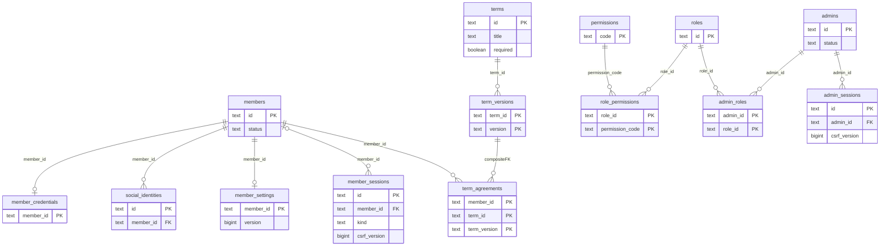
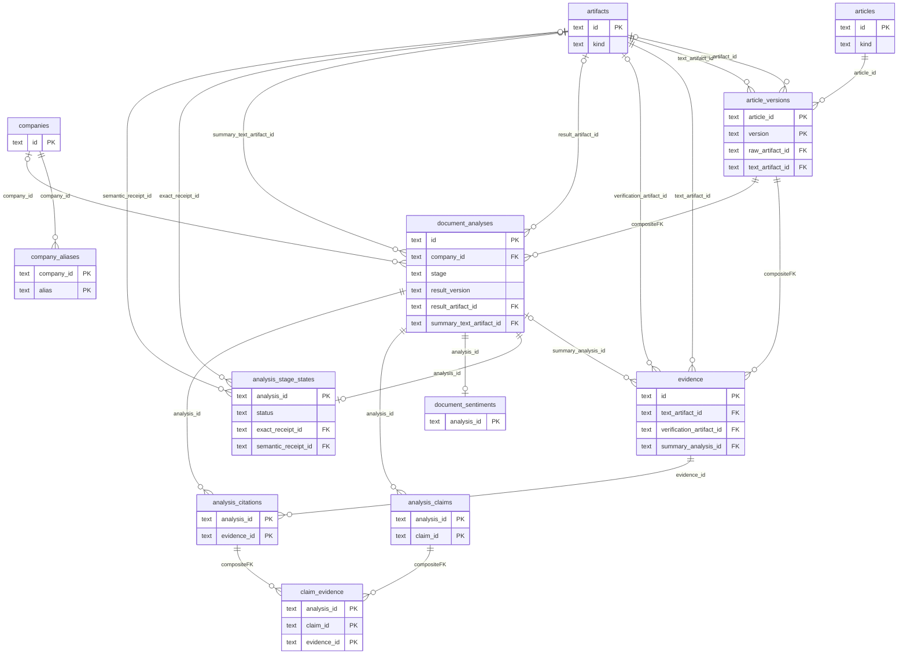
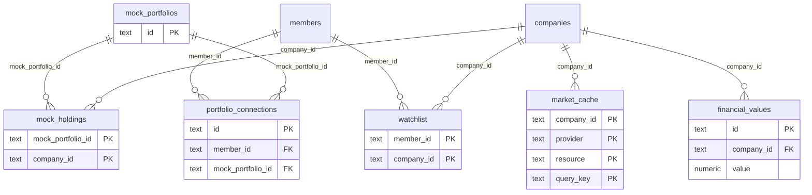
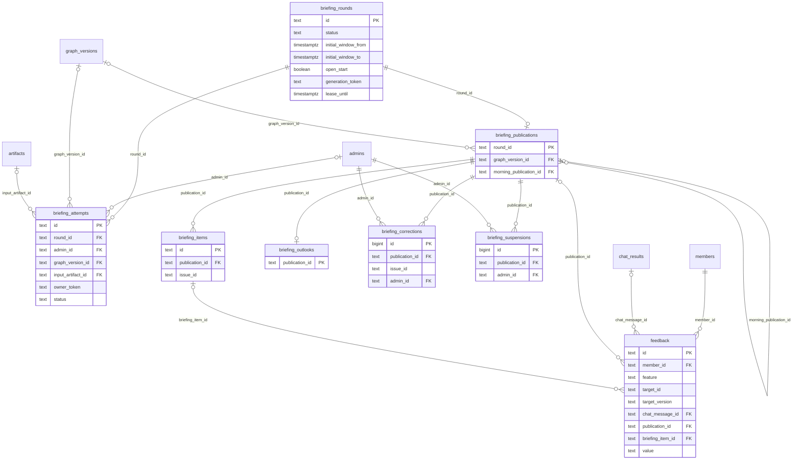
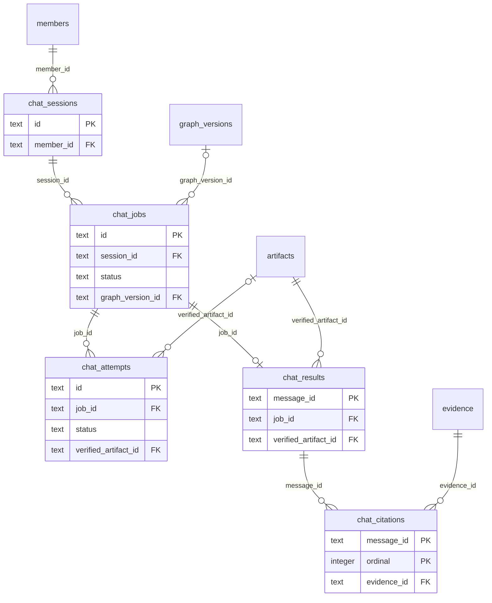
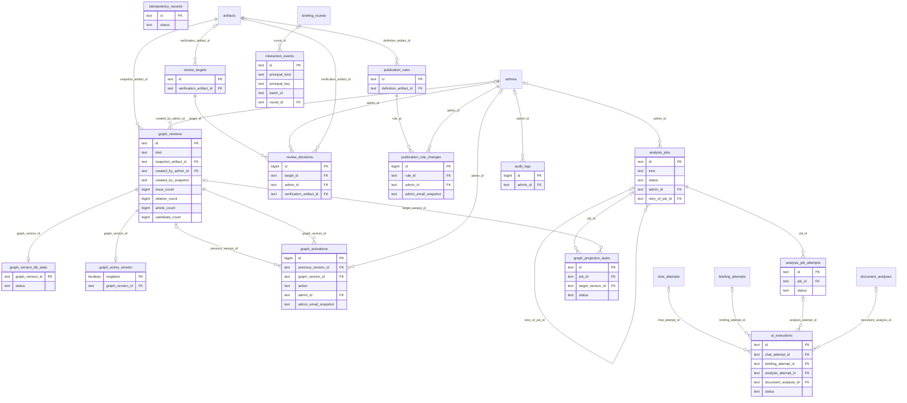

# Zoop 핵심 ERD v3.5 — 신규 API 정합본 보완 최종본

- 작성: Codex / 2026-10-12 / ERD-API-FIX-003.
- 직접 기준: 사용자 제공 shared/sources/2026-10-12/zoop-core-erd-v3.2-api-aligned.md (SHA-256 a297a78dccf7d6ee1d3d0d57d30cbf276f96defb33239726b0da66613bf4cc17).
- 보완 근거: shared/reports/codex/2026-10-12-ERD-API-REVIEW-002-review.md의 R1~R5 및 사용자 전체 보완 요청. 기존 v3/v3.1/v3.2와 사용자 신규 원본은 보존한다.
- 최신 수정: ERD-FEEDBACK-005 사용자 수정안의 Muse 검토 수신·통합 완료, 반영 정합성에 반박 없음. 평가 단위·API 요청 문맥 전달은 구현 전 필수 결정 사항이다.
- 이전 통합 상태: Muse 검토에서 R1~R5·기존 10항목·운영 가드 반영 확인, 반박 없음. G1/G5 제약 보완과 G2~G4 이력/미결을 통합해 문서 마무리 완료. 실제 API/DB 실행 검증은 별도다.
- 최신 통합 기록: shared/reports/codex/2026-10-12-ERD-FEEDBACK-005-finalize.md. 이전 통합: shared/reports/codex/2026-10-12-ERD-API-FIX-003-finalize.md.
- 변경/검증 기록: shared/reports/codex/2026-10-12-ERD-API-FIX-003-changes.md.
- 요청/응답 매핑 보완: shared/contracts/erd-v3.3-api-mapping.md. 기존 FeedbackVote 필드를 유지하고 targetId 원문 저장 및 서버 요청 문맥 기반 대상 검증을 적용한다. 기존 v3.2 feedbackTargetId 추가 계약은 이 버전에 적용하지 않는다.
- 기준 API: zoop-api-spec_final_261012.md (정본 openapi.yaml)
- 범위: ERD/문서 계약 수정. 실행 SQL·실제 OpenAPI/서버/프론트 코드 수정·DB/API 실행·배포 결과가 아니다.

API DTO와 DB 컬럼은 1:1을 요구하지 않는다. 공개 입력의 대상 해석은 계약으로 명시하고, 내부 FK·유일성·권한·불변 이력은 별도로 보장한다. ERD는 공개 targetId의 인코딩 형식을 정의하지 않는다. 요청 문맥 전달 방식은 실제 API 계약으로 확인한다.

## v3에서 채택한 설계

1. **PostgreSQL**은 회원·인증·기업 카탈로그·문서 버전/인용·분석 결과·MockData·채팅·발행본·평가·운영 기록을 저장한다.
2. **Neo4j 담당 영역**은 Issue, 기업↔Issue 관계, Issue↔Issue 관계, Issue↔문서/근거 연결, 공개 버전별 그래프 조회다. PostgreSQL에는 Issue/Relation 원본 테이블과 이를 향한 가짜 SQL FK를 만들지 않는다. Company의 동일 ID는 두 저장소에서 공유한다.
3. **문서/파일 저장소**는 불변 원문·추출 텍스트·검증 영수증·분석 결과·그래프 스냅샷·채팅 복구 결과를 보관한다. PostgreSQL의 artifacts가 URI/hash/크기를 관리한다. 외부 조회 경로는 동일 백엔드의 모듈로 구현할 수 있으며 MSA를 요구하지 않는다.
4. **MockHolding 직접 참조**를 채택한다. 연결별 Holding 복제 테이블은 제거하고, MockPortfolio/MockHolding 원본을 불변으로 유지한다. 바뀐 샘플은 새 프로필 ID로 배포한다.
5. **운영 회차와 발행 원문 분리:** briefing_rounds는 상태가 바뀌며 briefing_publications/items/outlooks는 발행 후 불변이다. 정정·중단은 별도 이력에 기록한다.
6. **문서 분석**은 버전별 분석·주장·인용을 정규화하고 원본 결과 파일도 보관한다. **채팅/브리핑 응답**은 당시 화면 재현이 중요하므로 검증된 JSON 스냅샷을 사용한다. 같은 내용을 모든 필드별 테이블로 분해하지 않는다.
7. **비회원 튜토리얼은 서버 세션 저장**을 유지한다. 이번 요청 29번 및 현재 API 기준이다. 향후 sessionStorage만 쓰기로 변경하면 API 계약과 함께 바꾼다. guest 채팅은 허용하지 않는다.
8. **API `eventId` ↔ 외부 `issue_id`**를 변환한다. 공개 경로와 필드명은 임의 변경하지 않는다. 선택 노드 없이 채팅 진입 가능하며 질문 context는 선택이다.

60개 테이블은 사용자 요청에 포함된 인증·분석·운영·감사·통계를 모두 상세화한 범위다. 엔티티 수 자체가 API 요구는 아니다. market_cache는 캐시 선택 시, financial_values는 내부 재무 보관 시, graph_projection_tasks는 비동기 그래프 반영 예약 시 사용하는 선택 구조다. 운영 기록을 외부 저장소가 맡으면 해당 테이블 대신 동일 조회 계약을 문서화할 수 있다.

## 공통 물리 설계 규칙

- ID는 기존 문자열 API ID를 보존하기 위해 기본 `text`. audit/correction/decision 등 숫자 ID API는 `bigint GENERATED ALWAYS AS IDENTITY`. 외부 issue/relation ID는 `text`이며 SQL FK가 아니다.
- 정확 시각은 `timestamptz`; 회차 일자는 KST 기준 `date`. 일부 날짜만 아는 사건은 GraphDB의 원문 문자열과 timePrecision을 스냅샷으로 유지한다. 임의 자정 시각을 만들지 않는다.
- 금액·가격·수량은 `numeric`으로 제안한다. 고정 scale/precision은 종목·통화 공급 규격 확인 후 제한한다. NULL은 미제공이며 0으로 대체하지 않는다.
- 표의 NULL=불가 필드는 `NOT NULL`; PK 구성 필드 여러 개는 하나의 복합 PK다. PK/UNIQUE는 조회 인덱스도 제공한다. 선택값의 기본값은 NULL, 명시할 수 있는 단순 상태값 외에는 입력 시 서버가 값을 지정한다. 시각은 사건/공급자 관측시각과 서버 생성시각을 구분한다.
- 표에 명시한 FK는 모두 `ON UPDATE RESTRICT`. 삭제 정책은 표의 DELETE를 따른다. 복합 FK는 기본 `ON DELETE RESTRICT`. 인증/개인 설정의 종속 데이터만 명시적으로 CASCADE한다. 증거·발행·대화·감사 이력을 회원 삭제로 연쇄 삭제하지 않는다. 회원 탈퇴/보존기간은 별도 정책에 따라 비식별화·정리하며 CASCADE로 우회하지 않는다.
- **인덱스 기본:** 모든 FK 컬럼 묶음에 같은 순서의 B-tree 인덱스를 둔다. 해당 컬럼들이 기존 PK/UNIQUE/복합 인덱스의 선두와 같으면 중복 생성하지 않는다. 표의 추가 인덱스는 실제 API 조회를 위한 것이다. 외부 ID도 목록 조회가 필요한 경우 별도 인덱스를 둔다. JSON 전체 GIN은 기본 생성하지 않고 실제 조건 검색이 있는 경우만 추가한다.
- 문자열 enum은 표에 기재한 허용값의 CHECK로 구현한다. 교차 행/테이블 조건은 일반 CHECK로 해결한다고 가정하지 않고 FK·조건부 UNIQUE·트랜잭션·필요한 트리거로 보장한다.
- JSON은 해당 API 스키마 버전으로 저장 전에 검증한다. 배열/객체 타입을 검사하며 미제공과 빈 배열의 의미를 구분한다. JSON이라는 이유로 무구조 임의 데이터 저장을 허용하지 않는다.
- 불변/append-only 테이블은 애플리케이션 DB 역할의 UPDATE/DELETE 권한을 제한하고, 허용된 상태 전이만 전용 트랜잭션으로 수행한다. 최초 발행 전 prepared 데이터를 임의로 공개하지 않는다.
- expires_at 기반 정리 대상은 세션·캐시·멱등성 기록이다. 보존기간 수치는 현재 API에서 미정이므로 임의 일수를 계약으로 고정하지 않는다.
- 원문 접근권한/철회는 저장 무결성과 별개로 응답 시 재확인한다. 불변 스냅샷이 있다는 이유만으로 삭제·비공개 원문을 노출하지 않는다.

## 저장소 간 참조 규칙

| 값 | 원천 | PostgreSQL에서의 표현 |
| --- | --- | --- |
| company_id | RDB 기업 카탈로그 + 동일 ID의 Neo4j 노드 | 로컬 companies FK 가능 |
| issue_id / relation_id | Neo4j/그래프 담당 저장소 | 외부 text ID. 버전과 함께 의미를 확인 |
| candidate external_id | 분석 후보 저장소 | review_targets 등록부 + 원천 검증 |
| evidence_id / article version | RDB evidence/article_versions | 실제 로컬 FK |
| graph_version_id | 그래프 담당의 불변 버전 | 로컬 graph_versions 메타데이터 FK. 내용은 snapshot artifact와 그래프 담당 조회 |
| artifact_id | 파일 저장소와 RDB 등록부 | artifacts FK; URI·hash를 통해 실제 파일 확인 |

기업↔사건의 INVOLVES/STRUCTURALLY_RELATED_TO, 사건 간 FOLLOWS, 기업 간 SHARES_ISSUE 조회는 그래프 담당이 처리한다. 기업 간 공유 관계와 경로는 조회 시 계산 가능하다. relationTypes는 요청 회사와 사건 사이의 승인된 실제 간선만 반환하고 간접 2-hop 전용 사건은 빈 배열이다. PostgreSQL에 별도 사건/간선 원본을 추가하지 않는다. GraphDB의 근거 ID와 RDB evidence가 동일 ID를 사용하도록 입력 검증 및 투영 점검을 한다.

## 도면 읽는 법

영역별 Mermaid ERD는 물리 FK를 표시한다. 키 컬럼 중심 도면이며 전체 컬럼·NULL·삭제 정책은 뒤의 표가 정본이다. 외부 Issue/Relation을 물리 FK 선으로 그리지 않는다. 도면에서 타 영역 테이블이 작은 참조 대상으로 다시 나타날 수 있다. 분석 스냅샷 내부의 외부 ID는 JSON 스키마와 저장소 간 검증으로 관리한다.

## 회원·인증·약관

다른 영역의 테이블은 참조 대상으로 함께 표시한다. 도면은 키·관계 중심이고 전체 필드는 아래 표를 따른다.

### members — 회원

| 필드 | PostgreSQL 자료형 | NULL | 키·참조·설명 |
| --- | --- | --- | --- |
| `id` | `text` | 불가 | PK 구성 |
| `analytics_key` | `text` | 불가 | UNIQUE; 서버 발급 무작위 통계 가명 키, 이메일/회원 ID 해시 아님 |
| `email` | `text` | 불가 | — |
| `email_key` | `text` | 불가 | UNIQUE |
| `display_name` | `text` | 불가 | — |
| `signup_method` | `text` | 불가 | — |
| `status` | `text` | 불가 | — |
| `created_at` | `timestamptz` | 불가 | — |
| `blocked_at` | `timestamptz` | 허용 | — |

**제약·처리:** signup_method=email/google/kakao; status=active/blocked. 최종 API `UserInfo.email`이 필수이므로 모든 회원은 회원 생성 완료 전에 email/email_key를 확보해야 한다. 이메일을 확보하지 못한 소셜 인증은 회원 생성을 완료하지 않는다. 차단은 활성 세션 폐기와 함께 처리. analytics_key는 회원 생성 시 서버가 발급하며 공개 응답에 노출하지 않는다. 탈퇴 시 연결을 제거할 수 있도록 식별 정보와 통계의 수명을 분리한다.

**추가 인덱스:** PK·UNIQUE 및 공통 FK 선두 인덱스 정책 적용.

### member_credentials — 이메일 인증 자격

| 필드 | PostgreSQL 자료형 | NULL | 키·참조·설명 |
| --- | --- | --- | --- |
| `member_id` | `text` | 불가 | PK 구성; FK → members.id / DELETE CASCADE |
| `password_hash` | `text` | 불가 | — |
| `updated_at` | `timestamptz` | 불가 | — |

**제약·처리:** 비밀번호는 해시만 보관. 이메일 가입 회원에 필수, 소셜 전용 회원에는 행이 없어도 됨.

**추가 인덱스:** PK·UNIQUE 및 공통 FK 선두 인덱스 정책 적용.

### social_identities — 소셜 계정

| 필드 | PostgreSQL 자료형 | NULL | 키·참조·설명 |
| --- | --- | --- | --- |
| `id` | `text` | 불가 | PK 구성 |
| `member_id` | `text` | 불가 | FK → members.id / DELETE CASCADE |
| `provider` | `text` | 불가 | — |
| `provider_subject` | `text` | 불가 | — |
| `linked_at` | `timestamptz` | 불가 | — |

**제약·처리:** UNIQUE(provider, provider_subject); provider=google/kakao. 이메일 일치만으로 자동 연결하지 않음.

**추가 인덱스:** PK·UNIQUE 및 공통 FK 선두 인덱스 정책 적용.

### member_settings — 회원 설정

| 필드 | PostgreSQL 자료형 | NULL | 키·참조·설명 |
| --- | --- | --- | --- |
| `member_id` | `text` | 불가 | PK 구성; FK → members.id / DELETE CASCADE |
| `mode` | `text` | 불가 | — |
| `investor` | `boolean` | 허용 | null=온보딩 질문 미응답, true/false=응답값 |
| `completed` | `boolean` | 불가 | — |
| `tutorial_completed` | `boolean` | 불가 | — |
| `version` | `bigint` | 불가 | — |
| `updated_at` | `timestamptz` | 불가 | — |

**제약·처리:** mode=assets/watchlist; version>=1. UPDATE 시 expectedVersion 검사 후 증가.

**추가 인덱스:** PK·UNIQUE 및 공통 FK 선두 인덱스 정책 적용.

### member_sessions — 회원·비회원 인증 세션

| 필드 | PostgreSQL 자료형 | NULL | 키·참조·설명 |
| --- | --- | --- | --- |
| `id` | `text` | 불가 | PK 구성 |
| `member_id` | `text` | 허용 | FK → members.id / DELETE CASCADE |
| `kind` | `text` | 불가 | — |
| `analytics_key` | `text` | 허용 | guest 통계 가명 키; member 세션은 NULL |
| `token_hash` | `text` | 불가 | UNIQUE |
| `csrf_key_id` | `text` | 불가 | 서버 CSRF 비밀 키 버전 식별자. 키 자체 아님 |
| `csrf_version` | `bigint` | 불가 | CSRF 파생 버전; 1 이상 |
| `tutorial_completed` | `boolean` | 불가 | — |
| `created_at` | `timestamptz` | 불가 | — |
| `expires_at` | `timestamptz` | 불가 | — |
| `revoked_at` | `timestamptz` | 허용 | — |

**제약·처리:** CHECK((kind='member' AND member_id IS NOT NULL) OR (kind='guest' AND member_id IS NULL)). csrf_key_id와 csrf_version>=1을 저장하고 아래 CSRF 파생 규칙을 따른다. 두 값은 서로 다른 키 선택/세션 회전 의미다. guest 튜토리얼은 여기, 회원은 member_settings에서 관리. 추가 CHECK: kind=guest이면 analytics_key NOT NULL, kind=member이면 NULL. guest 키는 세션 생성 시 무작위 발급하며 토큰·세션 ID를 통계 키로 사용하지 않는다. 회원 이벤트는 members.analytics_key를 사용한다.

**추가 인덱스:** INDEX(member_id, expires_at) WHERE revoked_at IS NULL; INDEX(expires_at)

### terms — 약관 마스터

| 필드 | PostgreSQL 자료형 | NULL | 키·참조·설명 |
| --- | --- | --- | --- |
| `id` | `text` | 불가 | PK 구성 |
| `title` | `text` | 불가 | API TermOut.title |
| `required` | `boolean` | 불가 | API TermOut.required |
| `created_at` | `timestamptz` | 불가 | — |
| `retired_at` | `timestamptz` | 허용 | 약관 항목 자체의 제공 종료 |

**제약·처리:** 약관 항목은 승인 본문이 아직 없어도 존재할 수 있다. 조회는 기준시각 t에서 terms.created_at<=t AND (terms.retired_at IS NULL OR t<terms.retired_at)인 마스터를 대상으로 한다. term_versions는 approved_at NOT NULL 및 `approved_at<=t AND effective_at<=t AND (retired_at IS NULL OR t<retired_at)`를 JOIN ON 조건으로 검사하는 LEFT JOIN이다. 목록 응답/가입 검증은 각각 한 요청/트랜잭션 안에서 같은 t를 사용한다. 현재 시점에 유효한 승인 `term_versions`가 없으면 API는 `version=null`, `body=null`, `bodyAvailable=false`를 반환한다. 필수 약관의 본문/버전이 제공되지 않으면 가입을 완료하지 않는다. 승인 버전 제공 시 마스터 title/required와 버전의 승인 스냅샷이 일치해야 한다. 승인 본문에 연결된 표시명/필수 정책 변경은 새 승인 버전과 원자적으로 전환하며 과거 버전/동의 기록을 수정하지 않는다.

**추가 인덱스:** INDEX(required, retired_at)

### term_versions — 버전별 약관 본문

| 필드 | PostgreSQL 자료형 | NULL | 키·참조·설명 |
| --- | --- | --- | --- |
| `term_id` | `text` | 불가 | PK 구성; FK → terms.id / DELETE RESTRICT |
| `version` | `text` | 불가 | PK 구성 |
| `title_snapshot` | `text` | 불가 | 승인 당시 약관 제목 |
| `required_snapshot` | `boolean` | 불가 | 승인 당시 필수 여부 |
| `body` | `text` | 불가 | 승인된 본문 |
| `approved_at` | `timestamptz` | 불가 | 승인 시각 |
| `effective_at` | `timestamptz` | 불가 | 제공 시작 |
| `retired_at` | `timestamptz` | 허용 | 제공 종료 |

**제약·처리:** PK(term_id, version). 승인된 body/version은 불변. 현재 TermOut.title/required는 terms에서, 과거 승인/동의 맥락은 title_snapshot/required_snapshot에서 복원한다. 현재 제공 버전은 `approved_at<=t AND effective_at<=t AND (retired_at IS NULL OR t<retired_at)`를 만족해야 한다. 같은 term_id의 유효 승인 구간 중복 금지.

**추가 인덱스:** INDEX(term_id, effective_at DESC)

### term_agreements — 약관 동의

| 필드 | PostgreSQL 자료형 | NULL | 키·참조·설명 |
| --- | --- | --- | --- |
| `member_id` | `text` | 불가 | PK 구성; FK → members.id / DELETE RESTRICT |
| `term_id` | `text` | 불가 | PK 구성 |
| `term_version` | `text` | 불가 | PK 구성 |
| `accepted` | `boolean` | 불가 | — |
| `accepted_at` | `timestamptz` | 불가 | — |

**제약·처리:** FK(term_id, term_version) → term_versions(term_id, version) ON DELETE RESTRICT. 승인된 버전에만 동의 가능. 가입 필수약관 확인은 서비스 트랜잭션에서 검사.

**추가 인덱스:** PK·UNIQUE 및 공통 FK 선두 인덱스 정책 적용.

### admins — 관리자 인증 계정

| 필드 | PostgreSQL 자료형 | NULL | 키·참조·설명 |
| --- | --- | --- | --- |
| `id` | `text` | 불가 | PK 구성 |
| `email` | `text` | 불가 | — |
| `email_key` | `text` | 불가 | UNIQUE |
| `display_name` | `text` | 불가 | — |
| `password_hash` | `text` | 허용 | — |
| `external_subject` | `text` | 허용 | UNIQUE |
| `status` | `text` | 불가 | — |
| `created_at` | `timestamptz` | 불가 | — |

**제약·처리:** status=active/disabled. 비밀번호 로그인은 password_hash 필수. 외부 인증 채택 시 external_subject 경로를 별도 확정; 회원 소셜과 자동 공유하지 않음.

**추가 인덱스:** PK·UNIQUE 및 공통 FK 선두 인덱스 정책 적용.

### roles — 관리자 역할

| 필드 | PostgreSQL 자료형 | NULL | 키·참조·설명 |
| --- | --- | --- | --- |
| `id` | `text` | 불가 | PK 구성 |
| `name` | `text` | 불가 | UNIQUE |

**제약·처리:** 복합 PK는 PK 표시 필드를 모두 묶는다. 공통 FK/삭제 정책 적용.

**추가 인덱스:** PK·UNIQUE 및 공통 FK 선두 인덱스 정책 적용.

### permissions — 권한 코드

| 필드 | PostgreSQL 자료형 | NULL | 키·참조·설명 |
| --- | --- | --- | --- |
| `code` | `text` | 불가 | PK 구성 |
| `description` | `text` | 불가 | — |

**제약·처리:** transcript:read를 포함. 나머지 운영 권한 코드는 팀 확정.

**추가 인덱스:** PK·UNIQUE 및 공통 FK 선두 인덱스 정책 적용.

### role_permissions — 역할별 권한

| 필드 | PostgreSQL 자료형 | NULL | 키·참조·설명 |
| --- | --- | --- | --- |
| `role_id` | `text` | 불가 | PK 구성; FK → roles.id / DELETE CASCADE |
| `permission_code` | `text` | 불가 | PK 구성; FK → permissions.code / DELETE CASCADE |

**제약·처리:** 복합 PK는 PK 표시 필드를 모두 묶는다. 공통 FK/삭제 정책 적용.

**추가 인덱스:** PK·UNIQUE 및 공통 FK 선두 인덱스 정책 적용.

### admin_roles — 관리자 역할 할당

| 필드 | PostgreSQL 자료형 | NULL | 키·참조·설명 |
| --- | --- | --- | --- |
| `admin_id` | `text` | 불가 | PK 구성; FK → admins.id / DELETE CASCADE |
| `role_id` | `text` | 불가 | PK 구성; FK → roles.id / DELETE RESTRICT |
| `assigned_at` | `timestamptz` | 불가 | — |

**제약·처리:** 복합 PK는 PK 표시 필드를 모두 묶는다. 공통 FK/삭제 정책 적용.

**추가 인덱스:** PK·UNIQUE 및 공통 FK 선두 인덱스 정책 적용.

### admin_sessions — 관리자 인증 세션

| 필드 | PostgreSQL 자료형 | NULL | 키·참조·설명 |
| --- | --- | --- | --- |
| `id` | `text` | 불가 | PK 구성 |
| `admin_id` | `text` | 불가 | FK → admins.id / DELETE CASCADE |
| `token_hash` | `text` | 불가 | UNIQUE |
| `csrf_key_id` | `text` | 불가 | 서버 CSRF 비밀 키 버전 식별자. 키 자체 아님 |
| `csrf_version` | `bigint` | 불가 | CSRF 파생 버전; 1 이상 |
| `created_at` | `timestamptz` | 불가 | — |
| `last_seen_at` | `timestamptz` | 불가 | — |
| `idle_expires_at` | `timestamptz` | 불가 | — |
| `absolute_expires_at` | `timestamptz` | 불가 | — |
| `revoked_at` | `timestamptz` | 허용 | — |

**제약·처리:** CHECK(idle_expires_at<=absolute_expires_at); csrf_version>=1. 관리자 csrfToken도 아래 admin 도메인 파생 규칙으로 재구성한다. DB에는 비밀 키/CSRF 원문을 저장하지 않는다. 회원 쿠키와 분리; 두 만료 중 먼저 도래한 값 적용.

**추가 인덱스:** INDEX(admin_id, absolute_expires_at) WHERE revoked_at IS NULL

### 세션 CSRF 토큰 파생 규칙

- csrf_key_id는 비밀 저장소의 키 선택자, csrf_version은 해당 세션의 강제 토큰 회전 카운터다. 신규 세션은 현재 키와 csrf_version=1을 저장한다.
- csrfToken = base64url_no_padding(HMAC-SHA256(K[csrf_key_id], UTF8(JSON(["zoop-csrf-v1", session_kind, session_id, csrf_version])))). JSON은 공백 없는 직렬화, 비ASCII 문자 그대로 UTF-8, csrf_version은 JSON 정수다. session_kind는 member/guest/admin이며 관리자와 회원 ID가 우연히 같아도 입력 도메인이 다르다. 비밀 키는 암호학적으로 안전하게 생성한 256비트 이상의 키이며 DB/응답/로그에 저장하지 않는다.
- 세션 조회는 인증 쿠키와 만료/폐기를 먼저 검증한 후 저장된 키/버전으로 같은 토큰을 재계산한다. 무세션/만료/폐기는 기존 csrfToken=null 응답 규칙을 따른다. 쓰기는 해당 세션 토큰과 상수 시간 비교하고 Origin 검증을 함께 적용한다.
- 키 회전 시 새 세션만 새 csrf_key_id를 사용한다. 기존 세션의 키는 유효 세션이 모두 만료/폐기될 때까지 보존한다. 키를 유지할 수 없거나 강제 폐기하면 해당 키의 세션도 폐기·재인증한다. 기존 세션의 키를 조용히 바꿔 이전 토큰을 무효화하지 않는다.
- 같은 세션의 강제 회전은 행 잠금 트랜잭션에서 csrf_version을 증가시킨다. 이후 이전 버전 토큰은 거절하며 클라이언트는 세션 조회로 현재 토큰을 받는다. 로그인/권한 전환 때는 새 세션 ID를 발급한다.
- 이전 csrf_hash만 있는 행은 원문 복원이 불가능하므로 전환 시 폐기·재인증한다. 이 신규 원본처럼 csrf_version만 있는 실제 배포 행이 있다면 기존 키 식별자를 근거로 연결하거나 재인증한다. 배포 데이터가 존재한다고 가정하지 않는다.

## 기업·문서·분석

다른 영역의 테이블은 참조 대상으로 함께 표시한다. 도면은 키·관계 중심이고 전체 필드는 아래 표를 따른다.

### companies — 기업 상세 카탈로그

| 필드 | PostgreSQL 자료형 | NULL | 키·참조·설명 |
| --- | --- | --- | --- |
| `id` | `text` | 불가 | PK 구성 |
| `name` | `text` | 불가 | — |
| `legal_name` | `text` | 허용 | — |
| `ticker` | `text` | 허용 | — |
| `market` | `text` | 허용 | — |
| `exchange_code` | `text` | 허용 | — |
| `country` | `text` | 허용 | — |
| `sector` | `text` | 허용 | — |
| `representative` | `text` | 허용 | — |
| `founded_date` | `date` | 허용 | — |
| `website_url` | `text` | 허용 | — |
| `brand_color` | `text` | 허용 | — |
| `logo_url` | `text` | 허용 | — |
| `source` | `text` | 허용 | — |
| `source_as_of` | `timestamptz` | 허용 | — |
| `updated_at` | `timestamptz` | 불가 | — |

**제약·처리:** 확인되지 않은 프로필은 NULL. 이름을 legal_name으로 복사하지 않음. 동일 id를 Neo4j 기업 노드가 사용. ticker 단독 UNIQUE 금지.

**추가 인덱스:** UNIQUE(exchange_code, ticker) WHERE exchange_code IS NOT NULL AND ticker IS NOT NULL; INDEX(name)

### company_aliases — 기업 별칭

| 필드 | PostgreSQL 자료형 | NULL | 키·참조·설명 |
| --- | --- | --- | --- |
| `company_id` | `text` | 불가 | PK 구성; FK → companies.id / DELETE CASCADE |
| `alias` | `text` | 불가 | PK 구성 |
| `alias_key` | `text` | 불가 | — |

**제약·처리:** 별칭은 여러 회사에서 중복 가능; 검색 우선순위는 API 정책.

**추가 인덱스:** INDEX(alias_key)

### artifacts — 불변 파일·원문·검증 결과

| 필드 | PostgreSQL 자료형 | NULL | 키·참조·설명 |
| --- | --- | --- | --- |
| `id` | `text` | 불가 | PK 구성 |
| `kind` | `text` | 불가 | — |
| `storage_uri` | `text` | 불가 | UNIQUE |
| `sha256` | `text` | 불가 | — |
| `bytes` | `bigint` | 불가 | — |
| `media_type` | `text` | 불가 | — |
| `created_at` | `timestamptz` | 불가 | — |

**제약·처리:** bytes>=0. 같은 URI 덮어쓰기 금지. 원문/추출 텍스트/분석 결과/검증 영수증/그래프 스냅샷/채팅 복구 결과를 kind로 구분. 자격증명 없는 내부 URI; API에 저장소 비밀 노출 금지.

**추가 인덱스:** PK·UNIQUE 및 공통 FK 선두 인덱스 정책 적용.

### articles — 뉴스·공시 메타데이터

| 필드 | PostgreSQL 자료형 | NULL | 키·참조·설명 |
| --- | --- | --- | --- |
| `id` | `text` | 불가 | PK 구성 |
| `kind` | `text` | 불가 | — |
| `provider` | `text` | 불가 | — |
| `provider_key` | `text` | 허용 | — |
| `lineage_key` | `text` | 허용 | — |
| `access_status` | `text` | 불가 | — |
| `created_at` | `timestamptz` | 불가 | — |

**제약·처리:** kind=news/disclosure; access_status=available/private/deleted. 메타데이터 수정은 article_versions 추가로 처리.

**추가 인덱스:** UNIQUE(provider, provider_key) WHERE provider_key IS NOT NULL

### article_versions — 불변 문서 버전

| 필드 | PostgreSQL 자료형 | NULL | 키·참조·설명 |
| --- | --- | --- | --- |
| `article_id` | `text` | 불가 | PK 구성; FK → articles.id / DELETE RESTRICT |
| `version` | `text` | 불가 | PK 구성 |
| `title` | `text` | 허용 | — |
| `publisher` | `text` | 허용 | — |
| `url` | `text` | 허용 | — |
| `published_at` | `timestamptz` | 허용 | — |
| `published_date` | `date` | 허용 | — |
| `publication_precision` | `text` | 불가 | — |
| `raw_artifact_id` | `text` | 허용 | FK → artifacts.id / DELETE RESTRICT |
| `text_artifact_id` | `text` | 불가 | FK → artifacts.id / DELETE RESTRICT |
| `collected_at` | `timestamptz` | 불가 | — |

**제약·처리:** PK(article_id, version); publication_precision=datetime/day/unknown. 날짜만 있으면 published_date만, 시각이 있으면 published_at만 사용. raw_artifact_id는 원본 확보 불가 시 NULL. text_artifact_id가 인용 기준 텍스트. 저장된 본문/메타데이터 불변.

**추가 인덱스:** INDEX(article_id, collected_at DESC); INDEX(published_at)

### evidence — 검증 가능한 원문 인용

| 필드 | PostgreSQL 자료형 | NULL | 키·참조·설명 |
| --- | --- | --- | --- |
| `id` | `text` | 불가 | PK 구성 |
| `article_id` | `text` | 불가 | — |
| `article_version` | `text` | 불가 | — |
| `text_artifact_id` | `text` | 불가 | FK → artifacts.id / DELETE RESTRICT |
| `summary_analysis_id` | `text` | 허용 | FK → document_analyses.id / DELETE RESTRICT; summary 인용의 요약 산출물 |
| `quote` | `text` | 불가 | — |
| `start_offset` | `bigint` | 불가 | — |
| `end_offset` | `bigint` | 불가 | — |
| `offset_unit` | `text` | 불가 | — |
| `input_kind` | `text` | 불가 | — |
| `raw_locator_ids` | `jsonb` | 불가 | — |
| `quote_verified` | `boolean` | 허용 | — |
| `verification_artifact_id` | `text` | 허용 | FK → artifacts.id / DELETE RESTRICT |
| `verified_at` | `timestamptz` | 허용 | — |
| `created_at` | `timestamptz` | 불가 | — |

**제약·처리:** FK(article_id, article_version) → article_versions(article_id, version) RESTRICT. 0<=start_offset<end_offset; offset_unit=unicode_code_point; end는 exclusive. input_kind=body/summary. raw_locator_ids는 문자열 배열. 저장 및 공개 검증에서 body는 summary_analysis_id=NULL이고 text_artifact_id가 해당 article_versions.text_artifact_id와 같아야 한다. summary는 summary_analysis_id NOT NULL이며 연결 분석의 stage=summary, 문서 ID/버전 일치, 생성 완료 및 summary_text_artifact_id 일치를 모두 검사한다. 두 경우 모두 0<=start_offset<end_offset<=텍스트 code point 길이 및 substring/quote 일치를 검증한다. 이 교차 테이블 조건은 임의 일반 CHECK가 아니라 전용 저장 트랜잭션/트리거로 강제한다. issue_id/relation_id SQL FK 없음; 연결은 그래프 스냅샷에서 조회.

**추가 인덱스:** PK·UNIQUE 및 공통 FK 선두 인덱스 정책 적용.

### document_analyses — 문서/기업별 분석 작업·산출물

| 필드 | PostgreSQL 자료형 | NULL | 키·참조·설명 |
| --- | --- | --- | --- |
| `id` | `text` | 불가 | PK 구성 |
| `article_id` | `text` | 불가 | — |
| `article_version` | `text` | 불가 | — |
| `company_id` | `text` | 허용 | FK → companies.id / DELETE RESTRICT |
| `stage` | `text` | 불가 | — |
| `summary_text` | `text` | 허용 | — |
| `limitations` | `jsonb` | 불가 | — |
| `schema_version` | `text` | 허용 | — |
| `result_version` | `text` | 허용 | — |
| `summary_text_artifact_id` | `text` | 허용 | FK → artifacts.id / DELETE RESTRICT; 요약 인용 기준 불변 텍스트 |
| `result_artifact_id` | `text` | 허용 | FK → artifacts.id / DELETE RESTRICT |
| `model` | `text` | 허용 | — |
| `reasoning_effort` | `text` | 허용 | — |
| `prompt_version` | `text` | 허용 | — |
| `source_kind` | `text` | 허용 | — |
| `execution_mode` | `text` | 허용 | — |
| `recording_kind` | `text` | 허용 | — |
| `produced_at` | `timestamptz` | 허용 | — |
| `created_at` | `timestamptz` | 불가 | — |

**제약·처리:** 복합 FK(article_id, article_version) → article_versions RESTRICT. stage=summary/sentiment. summary는 company_id NULL, sentiment는 NOT NULL. 완료 전에도 작업 행 생성. 완료 결과 불변. summary_text_artifact_id는 요약 생성 완료 및 summary_text와 불변 텍스트 일치 검증 후 기록하며 sentiment에서는 NULL이다. 요약 인용을 제공하지 않는 산출물은 NULL을 허용하되 그 결과의 summary 근거 등록은 거절한다. limitations는 문자열 배열. source_kind=synthetic/actual, execution_mode=replay/live, recording_kind=authored-test/provider; 산출물 없으면 NULL.

**추가 인덱스:** UNIQUE(article_id, article_version, stage, result_version) WHERE company_id IS NULL AND result_version IS NOT NULL; UNIQUE(article_id, article_version, company_id, stage, result_version) WHERE company_id IS NOT NULL AND result_version IS NOT NULL; INDEX(article_id, article_version, stage, produced_at DESC)

### analysis_stage_states — 분석 처리·공개 가능 상태

| 필드 | PostgreSQL 자료형 | NULL | 키·참조·설명 |
| --- | --- | --- | --- |
| `analysis_id` | `text` | 불가 | PK 구성; FK → document_analyses.id / DELETE RESTRICT |
| `status` | `text` | 불가 | — |
| `reason` | `text` | 허용 | — |
| `exact_receipt_id` | `text` | 허용 | FK → artifacts.id / DELETE RESTRICT |
| `semantic_receipt_id` | `text` | 허용 | FK → artifacts.id / DELETE RESTRICT |
| `grant_reference` | `text` | 허용 | — |
| `grant_checked_at` | `timestamptz` | 허용 | — |
| `revoked_at` | `timestamptz` | 허용 | — |
| `updated_at` | `timestamptz` | 불가 | — |

**제약·처리:** status=not_requested/pending/failed/withheld/available. available 공개 시 현재 버전·접근권한·철회·검증 영수증을 확인. DB의 available만으로 권한 확인을 대체하지 않음.

**추가 인덱스:** PK·UNIQUE 및 공통 FK 선두 인덱스 정책 적용.

### document_sentiments — 문서×기업 판정 결과

| 필드 | PostgreSQL 자료형 | NULL | 키·참조·설명 |
| --- | --- | --- | --- |
| `analysis_id` | `text` | 불가 | PK 구성; FK → document_analyses.id / DELETE RESTRICT |
| `label` | `text` | 불가 | — |
| `rationale` | `text` | 불가 | — |
| `quotes` | `jsonb` | 불가 | — |
| `judged_at` | `timestamptz` | 불가 | — |

**제약·처리:** label=positive/negative/mixed/undetermined. sentiment stage 분석만 연결; company/model/prompt/result_version은 부모에서 복원. quotes는 원문 인용 배열. 수정 대신 새 분석 결과 생성.

**추가 인덱스:** PK·UNIQUE 및 공통 FK 선두 인덱스 정책 적용.

### analysis_claims — 분석의 개별 주장

| 필드 | PostgreSQL 자료형 | NULL | 키·참조·설명 |
| --- | --- | --- | --- |
| `analysis_id` | `text` | 불가 | PK 구성; FK → document_analyses.id / DELETE RESTRICT |
| `claim_id` | `text` | 불가 | PK 구성 |
| `text` | `text` | 불가 | — |
| `assertion_kind` | `text` | 불가 | — |

**제약·처리:** assertion_kind=fact/interpretation/limitation. 전체 limitations는 document_analyses에 있음.

**추가 인덱스:** PK·UNIQUE 및 공통 FK 선두 인덱스 정책 적용.

### analysis_citations — 분석 전체 인용 집합

| 필드 | PostgreSQL 자료형 | NULL | 키·참조·설명 |
| --- | --- | --- | --- |
| `analysis_id` | `text` | 불가 | PK 구성; FK → document_analyses.id / DELETE RESTRICT |
| `evidence_id` | `text` | 불가 | PK 구성; FK → evidence.id / DELETE RESTRICT |
| `ordinal` | `integer` | 불가 | — |

**제약·처리:** UNIQUE(analysis_id, ordinal); ordinal>=1. documentVersion/textArtifactId/offset/quote/inputKind/rawLocatorIds는 불변 evidence에서 복원.

**추가 인덱스:** PK·UNIQUE 및 공통 FK 선두 인덱스 정책 적용.

### claim_evidence — 주장과 인용 N:M

| 필드 | PostgreSQL 자료형 | NULL | 키·참조·설명 |
| --- | --- | --- | --- |
| `analysis_id` | `text` | 불가 | PK 구성 |
| `claim_id` | `text` | 불가 | PK 구성 |
| `evidence_id` | `text` | 불가 | PK 구성 |

**제약·처리:** 복합 FK(analysis_id, claim_id) → analysis_claims RESTRICT; 복합 FK(analysis_id, evidence_id) → analysis_citations RESTRICT. 같은 분석의 인용만 주장에 연결.

**추가 인덱스:** PK·UNIQUE 및 공통 FK 선두 인덱스 정책 적용.

## 모의 포트폴리오·시장 데이터

다른 영역의 테이블은 참조 대상으로 함께 표시한다. 도면은 키·관계 중심이고 전체 필드는 아래 표를 따른다.

### watchlist — 관심 기업

| 필드 | PostgreSQL 자료형 | NULL | 키·참조·설명 |
| --- | --- | --- | --- |
| `member_id` | `text` | 불가 | PK 구성; FK → members.id / DELETE CASCADE |
| `company_id` | `text` | 불가 | PK 구성; FK → companies.id / DELETE RESTRICT |
| `created_at` | `timestamptz` | 불가 | — |

**제약·처리:** 복합 PK는 PK 표시 필드를 모두 묶는다. 공통 FK/삭제 정책 적용.

**추가 인덱스:** PK·UNIQUE 및 공통 FK 선두 인덱스 정책 적용.

### mock_portfolios — 가상 계좌 프로필 원본

| 필드 | PostgreSQL 자료형 | NULL | 키·참조·설명 |
| --- | --- | --- | --- |
| `id` | `text` | 불가 | PK 구성 |
| `label` | `text` | 불가 | — |
| `account_id` | `text` | 불가 | — |
| `cash_amount` | `numeric` | 허용 | — |
| `cash_currency` | `text` | 허용 | — |
| `as_of` | `timestamptz` | 허용 | — |
| `active` | `boolean` | 불가 | — |

**제약·처리:** 현금 amount/currency는 모두 NULL 또는 모두 NOT NULL. NULL은 미제공, 0은 실제 0. 제공 중인 프로필 원본은 불변; 변경 필요 시 새 프로필 ID.

**추가 인덱스:** PK·UNIQUE 및 공통 FK 선두 인덱스 정책 적용.

### mock_holdings — 프로필 보유 종목 원본

| 필드 | PostgreSQL 자료형 | NULL | 키·참조·설명 |
| --- | --- | --- | --- |
| `mock_portfolio_id` | `text` | 불가 | PK 구성; FK → mock_portfolios.id / DELETE RESTRICT |
| `company_id` | `text` | 불가 | PK 구성; FK → companies.id / DELETE RESTRICT |
| `quantity` | `numeric` | 불가 | — |
| `avg_price` | `numeric` | 불가 | — |
| `avg_price_currency` | `text` | 허용 | — |

**제약·처리:** quantity>=0; avg_price>=0. 프로필별 회사 한 행. 부모 프로필과 함께 불변.

**추가 인덱스:** PK·UNIQUE 및 공통 FK 선두 인덱스 정책 적용.

### portfolio_connections — 회원 연결 이력

| 필드 | PostgreSQL 자료형 | NULL | 키·참조·설명 |
| --- | --- | --- | --- |
| `id` | `text` | 불가 | PK 구성 |
| `member_id` | `text` | 불가 | FK → members.id / DELETE RESTRICT |
| `mock_portfolio_id` | `text` | 불가 | FK → mock_portfolios.id / DELETE RESTRICT |
| `connected_at` | `timestamptz` | 불가 | — |
| `disconnected_at` | `timestamptz` | 허용 | — |

**제약·처리:** 상태는 disconnected_at으로 계산. Holding 복제 테이블 없음. 프로필 원본을 참조해 label/accountId/cash/mockAsOf/holdings 반환.

**추가 인덱스:** UNIQUE(member_id) WHERE disconnected_at IS NULL; INDEX(member_id, connected_at DESC)

### market_cache — 선택적 시장 응답 캐시

| 필드 | PostgreSQL 자료형 | NULL | 키·참조·설명 |
| --- | --- | --- | --- |
| `company_id` | `text` | 불가 | PK 구성; FK → companies.id / DELETE RESTRICT |
| `provider` | `text` | 불가 | PK 구성 |
| `resource` | `text` | 불가 | PK 구성 |
| `query_key` | `text` | 불가 | PK 구성 |
| `payload` | `jsonb` | 불가 | — |
| `observed_at` | `timestamptz` | 허용 | — |
| `fetched_at` | `timestamptz` | 불가 | — |
| `expires_at` | `timestamptz` | 불가 | — |

**제약·처리:** 선택 테이블. resource=quote/prices/metrics. quote query_key=latest; prices는 기간·from/to·interval 등 응답 영향 조건을 정규화. 오류를 정상 0 또는 성공 캐시로 기록하지 않음.

**추가 인덱스:** INDEX(expires_at)

### financial_values — 보고 기간별 재무값

| 필드 | PostgreSQL 자료형 | NULL | 키·참조·설명 |
| --- | --- | --- | --- |
| `id` | `text` | 불가 | PK 구성 |
| `company_id` | `text` | 불가 | FK → companies.id / DELETE RESTRICT |
| `metric` | `text` | 불가 | — |
| `value` | `numeric` | 허용 | — |
| `unit` | `text` | 불가 | — |
| `period` | `text` | 불가 | — |
| `accounting_basis` | `text` | 허용 | — |
| `source` | `text` | 불가 | — |
| `as_of` | `timestamptz` | 불가 | — |
| `unavailable_reason` | `text` | 허용 | — |

**제약·처리:** value NULL은 미제공/계산 불가이며 사유 보존. 추정 0 금지. 외부 조회만 하는 배치에서는 이 테이블 사용을 생략 가능.

**추가 인덱스:** INDEX(company_id, period, metric, as_of DESC)

## 브리핑·평가

다른 영역의 테이블은 참조 대상으로 함께 표시한다. 도면은 키·관계 중심이고 전체 필드는 아래 표를 따른다.

### briefing_rounds — 변경 가능한 회차 운영 상태

| 필드 | PostgreSQL 자료형 | NULL | 키·참조·설명 |
| --- | --- | --- | --- |
| `id` | `text` | 불가 | PK 구성 |
| `round_date` | `date` | 불가 | — |
| `edition` | `text` | 불가 | — |
| `scheduled_at` | `timestamptz` | 불가 | — |
| `initial_window_from` | `timestamptz` | 허용 | API DataWindow.start; 서비스 첫 회차는 NULL |
| `initial_window_to` | `timestamptz` | 불가 | API DataWindow.end |
| `open_start` | `boolean` | 불가 | API DataWindow.openStart |
| `status` | `text` | 불가 | — |
| `generation_token` | `text` | 허용 | 현재 생성 실행권의 무작위 토큰; 외부 공개 금지 |
| `lease_until` | `timestamptz` | 허용 | 현재 생성 실행권의 만료시각 |
| `stages` | `jsonb` | 불가 | — |
| `failure_reason` | `text` | 허용 | — |
| `revision` | `bigint` | 불가 | — |
| `created_at` | `timestamptz` | 불가 | — |
| `updated_at` | `timestamptz` | 불가 | — |

**제약·처리:** UNIQUE(round_date, edition); edition=morning/evening. status=scheduled/missing/generating/verifying/published/failed/suspended. CHECK((open_start AND initial_window_from IS NULL) OR (NOT open_start AND initial_window_from IS NOT NULL)); CHECK(initial_window_from IS NULL OR initial_window_from < initial_window_to). open_start는 NOT NULL이며 두 표현의 불일치는 DB가 거절한다. 최초 자료 구간은 회차 INSERT 시 확정하며 이후 불변이다. 서비스 첫 회차는 하한 없이 `open_start=true`로 저장한다. 첫 시도·재시도는 이를 그대로 사용한다. revision>=1. generation_token/lease_until은 둘 다 NULL 또는 둘 다 NOT NULL. generating/verifying이면 둘 다 필수이고 그 외에는 둘 다 NULL이다. 실행권·상태·revision 검증은 아래 생성 프로토콜을 따른다.

**추가 인덱스:** INDEX(status, scheduled_at)

### briefing_attempts — 회차 생성·검증 시도

| 필드 | PostgreSQL 자료형 | NULL | 키·참조·설명 |
| --- | --- | --- | --- |
| `id` | `text` | 불가 | PK 구성 |
| `round_id` | `text` | 불가 | FK → briefing_rounds.id / DELETE RESTRICT |
| `attempt_no` | `integer` | 불가 | — |
| `owner_token` | `text` | 불가 | UNIQUE; 해당 시도의 실행권 토큰 |
| `trigger` | `text` | 불가 | — |
| `admin_id` | `text` | 허용 | FK → admins.id / DELETE RESTRICT |
| `graph_version_id` | `text` | 허용 | FK → graph_versions.id / DELETE RESTRICT |
| `input_artifact_id` | `text` | 허용 | FK → artifacts.id / DELETE RESTRICT |
| `status` | `text` | 불가 | — |
| `failed_stage` | `text` | 허용 | — |
| `stages` | `jsonb` | 불가 | — |
| `error` | `jsonb` | 허용 | — |
| `started_at` | `timestamptz` | 불가 | — |
| `finished_at` | `timestamptz` | 허용 | — |

**제약·처리:** UNIQUE(round_id, attempt_no); attempt_no>=1; trigger=scheduler/admin; 관리자 요청이면 admin_id 필수. status=queued/running/verifying/completed/failed/cancelled. 재처리는 같은 최초 구간 사용. 새 시도 번호는 회차 행 잠금 안에서 할당하며 실행권 확보·시도 INSERT를 같은 트랜잭션으로 처리한다. 각 시도의 실제 입력 버전/자료는 input artifact에 보존.

**추가 인덱스:** UNIQUE(round_id) WHERE status IN ('queued','running','verifying'); 공통 FK 선두 인덱스 정책 적용.

### briefing_publications — 불변 발행 원본

| 필드 | PostgreSQL 자료형 | NULL | 키·참조·설명 |
| --- | --- | --- | --- |
| `round_id` | `text` | 불가 | PK 구성; FK → briefing_rounds.id / DELETE RESTRICT |
| `published_at` | `timestamptz` | 불가 | — |
| `generated_at` | `timestamptz` | 불가 | — |
| `data_as_of` | `timestamptz` | 불가 | — |
| `graph_version_id` | `text` | 허용 | FK → graph_versions.id / DELETE RESTRICT; API BriefingPayload.graphVersion nullable |
| `review_revision` | `bigint` | 불가 | — |
| `rule_revision` | `bigint` | 허용 | — |
| `payload` | `jsonb` | 불가 | — |
| `payload_sha256` | `text` | 불가 | — |
| `morning_publication_id` | `text` | 허용 | FK → briefing_publications.round_id / DELETE RESTRICT |
| `comparison_snapshot` | `jsonb` | 허용 | — |

**제약·처리:** 회차당 발행본 하나. 발행 후 UPDATE/DELETE 금지. graph_version_id가 NULL인 발행본도 API 계약상 표현 가능하며, 값이 있으면 실제 사용한 불변 공개 버전과 일치해야 한다. DB 컬럼은 nullable을 유지하되 신규 정상 발행은 service layer에서 graph_version_id 필수 및 실제 사용한 버전과 payload의 graphVersion 일치를 검사하고, 누락/불일치 시 발행 저장을 거절한다. 정상 발행 INSERT를 수행하는 모든 서비스 경로에 동일 가드를 적용한다. NULL 데이터의 구체적 허용 상태/이행 정책은 별도 확인하며, 현재 활성 버전을 소급 대입하지 않는다. 저녁 비교가 가능하면 같은 KST 날짜 출근 발행본만 연결, 아침은 NULL. 자기 참조 금지. 비교 기준 없으면 NULL+API 부재 정책 적용; 다음 날 새 발행본으로 바꾸지 않음.

**추가 인덱스:** PK·UNIQUE 및 공통 FK 선두 인덱스 정책 적용.

### briefing_items — 발행본 내 개별 이슈

| 필드 | PostgreSQL 자료형 | NULL | 키·참조·설명 |
| --- | --- | --- | --- |
| `id` | `text` | 불가 | PK 구성 |
| `publication_id` | `text` | 불가 | FK → briefing_publications.round_id / DELETE RESTRICT |
| `issue_id` | `text` | 불가 | — |
| `rank` | `integer` | 불가 | — |
| `snapshot` | `jsonb` | 불가 | — |

**제약·처리:** UNIQUE(publication_id, issue_id); UNIQUE(publication_id, rank); CHECK(rank BETWEEN 1 AND 3). 검증된 발행 항목은 0~3개이며 부족하면 임의로 채우지 않는다. 현재 전달 API의 최대 3개 기준이며 최신 정본 확인 시 정책 차이를 재검토한다. issue_id는 Neo4j 외부 ID. snapshot은 발행 당시 BriefingItem 전체이며 불변. API의 eventId로 매핑.

**추가 인덱스:** PK·UNIQUE 및 공통 FK 선두 인덱스 정책 적용.

### briefing_outlooks — 발행 당시 회차 전망 0..1

| 필드 | PostgreSQL 자료형 | NULL | 키·참조·설명 |
| --- | --- | --- | --- |
| `publication_id` | `text` | 불가 | PK 구성; FK → briefing_publications.round_id / DELETE RESTRICT |
| `label` | `text` | 불가 | — |
| `rationale` | `text` | 불가 | — |
| `issue_ids` | `jsonb` | 불가 | — |
| `judged_at` | `timestamptz` | 불가 | — |
| `model` | `text` | 불가 | — |
| `prompt_version` | `text` | 불가 | — |

**제약·처리:** 행 없음=outlook null. label=positive/negative/mixed/undetermined. issue_ids는 해당 발행본의 판단 대상 ID 배열. 불변; payload.outlook과 일치 검증.

**추가 인덱스:** PK·UNIQUE 및 공통 FK 선두 인덱스 정책 적용.

### briefing_corrections — 원문 밖 정정

| 필드 | PostgreSQL 자료형 | NULL | 키·참조·설명 |
| --- | --- | --- | --- |
| `id` | `bigint` | 불가 | PK 구성 |
| `publication_id` | `text` | 불가 | FK → briefing_publications.round_id / DELETE RESTRICT |
| `seq` | `integer` | 불가 | — |
| `issue_id` | `text` | 허용 | — |
| `original_text` | `text` | 허용 | — |
| `corrected_text` | `text` | 불가 | — |
| `reason` | `text` | 불가 | — |
| `admin_id` | `text` | 불가 | FK → admins.id / DELETE RESTRICT |
| `admin_email_snapshot` | `text` | 불가 | — |
| `created_at` | `timestamptz` | 불가 | — |

**제약·처리:** UNIQUE(publication_id, seq); seq>=1. issue_id는 외부 ID이며 항목 정정 시 해당 발행본 소속 검사. 원문은 발행본에서 복사. 추가만 허용; id는 GENERATED ALWAYS AS IDENTITY.

**추가 인덱스:** PK·UNIQUE 및 공통 FK 선두 인덱스 정책 적용.

### briefing_suspensions — 제공 중단·재개 이력

| 필드 | PostgreSQL 자료형 | NULL | 키·참조·설명 |
| --- | --- | --- | --- |
| `id` | `bigint` | 불가 | PK 구성 |
| `publication_id` | `text` | 불가 | FK → briefing_publications.round_id / DELETE RESTRICT |
| `seq` | `integer` | 불가 | — |
| `action` | `text` | 불가 | — |
| `reason` | `text` | 불가 | — |
| `admin_id` | `text` | 불가 | FK → admins.id / DELETE RESTRICT |
| `admin_email_snapshot` | `text` | 불가 | — |
| `created_at` | `timestamptz` | 불가 | — |

**제약·처리:** UNIQUE(publication_id, seq); action=suspend/resume; seq>=1; 최신 행으로 제공 상태 판정. round 상태와 원자적으로 변경. 추가만 허용; id identity.

**추가 인덱스:** PK·UNIQUE 및 공통 FK 선두 인덱스 정책 적용.

### feedback — 회원별 현재 유효 평가

| 필드 | PostgreSQL 자료형 | NULL | 키·참조·설명 |
| --- | --- | --- | --- |
| `id` | `text` | 불가 | PK 구성 |
| `member_id` | `text` | 불가 | FK → members.id / DELETE RESTRICT |
| `feature` | `text` | 불가 | chatbot_answer/briefing_round/briefing_issue |
| `target_id` | `text` | 불가 | API FeedbackVote.targetId를 원문 그대로 저장 |
| `chat_message_id` | `text` | 허용 | FK → chat_results.message_id / DELETE RESTRICT; 내부 검증된 대상 |
| `publication_id` | `text` | 허용 | FK → briefing_publications.round_id / DELETE RESTRICT; 회차 평가 대상 |
| `briefing_item_id` | `text` | 허용 | FK → briefing_items.id / DELETE RESTRICT; 이슈 평가 대상 |
| `target_version` | `text` | 허용 | API FeedbackVote.targetVersion; chatbot_answer는 NULL |
| `value` | `text` | 불가 | up/down/none |
| `reason` | `text` | 허용 | down일 때만 허용 |
| `created_at` | `timestamptz` | 불가 | — |
| `updated_at` | `timestamptz` | 불가 | — |

**제약·처리:** feature별 대상 FK가 정확히 하나만 NOT NULL인 XOR CHECK를 적용한다. chatbot_answer는 chat_message_id만, briefing_round는 publication_id만, briefing_issue는 briefing_item_id만 사용한다. 공개 target_id와 내부 참조의 일치는 아래 대상 해석 트랜잭션에서 검사하고 이후 임의 변경을 금지한다. targetVersion은 유일 키가 아니며 대상의 식별을 대체하지 않는다. value=none은 행 유지+취소값, 집계 제외. reason은 down일 때만 허용. 동일 value/reason 재전송 및 target_version만 갱신되는 경우 updated_at을 바꾸지 않는다. 실제 평가 값/사유 변경 때만 갱신한다.

**추가 인덱스:** UNIQUE(member_id, feature, target_id); INDEX(feature, target_id); INDEX(member_id, updated_at DESC)

## AI 채팅

다른 영역의 테이블은 참조 대상으로 함께 표시한다. 도면은 키·관계 중심이고 전체 필드는 아래 표를 따른다.

### chat_sessions — 회원 대화

| 필드 | PostgreSQL 자료형 | NULL | 키·참조·설명 |
| --- | --- | --- | --- |
| `id` | `text` | 불가 | PK 구성 |
| `member_id` | `text` | 불가 | FK → members.id / DELETE RESTRICT |
| `created_at` | `timestamptz` | 불가 | — |
| `updated_at` | `timestamptz` | 불가 | — |
| `closed_at` | `timestamptz` | 허용 | — |

**제약·처리:** id는 API 클라이언트 발급 대화 ID. 상태/결과 조회 시 소유권 재검증.

**추가 인덱스:** INDEX(member_id, updated_at DESC)

### chat_jobs — 질문 접수 및 현재 상태

| 필드 | PostgreSQL 자료형 | NULL | 키·참조·설명 |
| --- | --- | --- | --- |
| `id` | `text` | 불가 | PK 구성 |
| `session_id` | `text` | 불가 | FK → chat_sessions.id / DELETE RESTRICT |
| `seq` | `integer` | 불가 | — |
| `question` | `text` | 불가 | — |
| `request_hash` | `text` | 불가 | — |
| `status` | `text` | 불가 | — |
| `outcome` | `text` | 허용 | — |
| `frozen_context` | `jsonb` | 불가 | — |
| `graph_version_id` | `text` | 허용 | FK → graph_versions.id / DELETE RESTRICT |
| `asked_at` | `timestamptz` | 불가 | — |
| `runs` | `integer` | 불가 | — |
| `failure` | `jsonb` | 허용 | — |
| `retry_mode` | `text` | 허용 | — |
| `created_at` | `timestamptz` | 불가 | — |
| `updated_at` | `timestamptz` | 불가 | — |
| `finished_at` | `timestamptz` | 허용 | — |

**제약·처리:** UNIQUE(session_id, seq); seq>=1; runs>=0; status=queued/running/completed/failed/cancelled. outcome=answered/clarification/guidance/insufficient_evidence 또는 NULL. retry_mode=rerun/save_only/NULL. frozen_context 불변; 선택 없이 items=[] 허용. 같은 작업 ID에 다른 request_hash는 409.

**추가 인덱스:** UNIQUE(session_id) WHERE status IN ('queued','running'); INDEX(session_id, seq)

### chat_attempts — 질문 실행·저장 복구 이력

| 필드 | PostgreSQL 자료형 | NULL | 키·참조·설명 |
| --- | --- | --- | --- |
| `id` | `text` | 불가 | PK 구성 |
| `job_id` | `text` | 불가 | FK → chat_jobs.id / DELETE RESTRICT |
| `attempt_no` | `integer` | 불가 | — |
| `mode` | `text` | 불가 | — |
| `status` | `text` | 불가 | — |
| `recovery_key` | `text` | 불가 | UNIQUE |
| `verified_artifact_id` | `text` | 허용 | FK → artifacts.id / DELETE RESTRICT |
| `error` | `jsonb` | 허용 | — |
| `started_at` | `timestamptz` | 불가 | — |
| `finished_at` | `timestamptz` | 허용 | — |

**제약·처리:** UNIQUE(job_id, attempt_no); mode=generate/save_only; attempt_no>=1. recovery_key는 실행 전 확정하는 파일 저장소 키. 검증 결과가 존재/검증될 때만 save_only 허용.

**추가 인덱스:** PK·UNIQUE 및 공통 FK 선두 인덱스 정책 적용.

### chat_results — 저장 완료된 전체 답변

| 필드 | PostgreSQL 자료형 | NULL | 키·참조·설명 |
| --- | --- | --- | --- |
| `message_id` | `text` | 불가 | PK 구성 |
| `job_id` | `text` | 불가 | UNIQUE; FK → chat_jobs.id / DELETE RESTRICT |
| `payload` | `jsonb` | 불가 | — |
| `result_sha256` | `text` | 불가 | — |
| `verified_artifact_id` | `text` | 불가 | FK → artifacts.id / DELETE RESTRICT |
| `saved_at` | `timestamptz` | 불가 | — |

**제약·처리:** payload는 ChatResult 전체. 불변; messageId=PK, outcome=chat_jobs.outcome 검증. 결과 저장과 job completed를 한 트랜잭션으로 처리.

**추가 인덱스:** PK·UNIQUE 및 공통 FK 선두 인덱스 정책 적용.

### chat_citations — 답변 인용 스냅샷

| 필드 | PostgreSQL 자료형 | NULL | 키·참조·설명 |
| --- | --- | --- | --- |
| `message_id` | `text` | 불가 | PK 구성; FK → chat_results.message_id / DELETE RESTRICT |
| `ordinal` | `integer` | 불가 | PK 구성 |
| `evidence_id` | `text` | 불가 | FK → evidence.id / DELETE RESTRICT |
| `snapshot` | `jsonb` | 불가 | — |

**제약·처리:** ordinal>=1. Citation 전체 snapshot(articleVersion/start/end/quote/제목/출처/발행시각/URL) 불변. payload.citations와 일치. 삭제·비공개 근거는 반환 시 접근 검증.

**추가 인덱스:** PK·UNIQUE 및 공통 FK 선두 인덱스 정책 적용.

## 검수·그래프 연계·운영

다른 영역의 테이블은 참조 대상으로 함께 표시한다. 도면은 키·관계 중심이고 전체 필드는 아래 표를 따른다.

### graph_versions — 불변 공개 그래프 파일 메타데이터

| 필드 | PostgreSQL 자료형 | NULL | 키·참조·설명 |
| --- | --- | --- | --- |
| `id` | `text` | 불가 | PK 구성 |
| `sequence` | `bigint` | 불가 | UNIQUE |
| `kind` | `text` | 불가 | — |
| `snapshot_artifact_id` | `text` | 불가 | FK → artifacts.id / DELETE RESTRICT |
| `source_label` | `text` | 불가 | — |
| `policy_version` | `text` | 허용 | API GraphVersionOut.policyVersion nullable |
| `review_revision` | `bigint` | 불가 | — |
| `rule_revision` | `bigint` | 허용 | — |
| `created_by_admin_id` | `text` | 허용 | FK → admins.id / DELETE RESTRICT |
| `created_by_snapshot` | `text` | 불가 | API GraphVersionOut.createdBy 재현값; admin/system 모두 표현 |
| `reason` | `text` | 허용 | API GraphVersionOut.reason nullable |
| `issue_count` | `bigint` | 불가 | API GraphVersionOut.issueCount |
| `relation_count` | `bigint` | 불가 | API GraphVersionOut.relationCount |
| `article_count` | `bigint` | 불가 | API GraphVersionOut.articleCount |
| `candidate_count` | `bigint` | 허용 | API GraphVersionOut.candidateCount |
| `created_at` | `timestamptz` | 불가 | — |
| `published_at` | `timestamptz` | 허용 | — |

**제약·처리:** kind=seed/ledger. 실제 그래프 원본/버전별 조회는 Neo4j 담당. 스냅샷 파일 위치/sha256/bytes는 artifacts에서 조회하며 GraphVersionOut의 해당 필드로 매핑한다. issue/relation/article/candidate 건수는 버전 생성 시점 메타데이터로 고정한다. 건수는 0 이상, candidate_count는 미제공 시 NULL. created_by_snapshot은 항상 API `createdBy`를 재현할 수 있어야 한다. 버전 내용 불변. published_at은 최초 발행 전까지 NULL; active/activatedAt은 graph_active_version/graph_activations에서 조립한다.

**추가 인덱스:** PK·UNIQUE 및 공통 FK 선두 인덱스 정책 적용.

### graph_version_db_state — 버전별 GraphDB 반영 상태

| 필드 | PostgreSQL 자료형 | NULL | 키·참조·설명 |
| --- | --- | --- | --- |
| `graph_version_id` | `text` | 불가 | PK 구성; FK → graph_versions.id / DELETE RESTRICT |
| `status` | `text` | 불가 | reflected/pending/unknown; API GraphDbVersionState.status |
| `pending_jobs_at_creation` | `bigint` | 허용 | API GraphDbVersionState.pendingJobsAtCreation |
| `note` | `text` | 허용 | API GraphDbVersionState.note |
| `updated_at` | `timestamptz` | 불가 | 마지막 반영 상태 확인 시각 |

**제약·처리:** graph_versions의 불변 메타데이터와 분리된 1:0..1 가변 상태다. status=reflected/pending/unknown. pending_jobs_at_creation은 버전 생성 당시 값이므로 최초 기록 후 변경하지 않는다. UPDATE 트리거는 NEW.pending_jobs_at_creation IS DISTINCT FROM OLD.pending_jobs_at_creation이면 거절한다(NULL↔값 전환도 포함). graph_version_id 변경도 거절한다. 상태 작업자 역할에는 테이블 전체 UPDATE/DELETE를 부여하지 않고 status/note/updated_at 컬럼 UPDATE만 허용하며, 행 삭제·재삽입으로 생성 당시 값을 바꾸는 우회도 금지한다. 전용 등록 경로에서만 INSERT하고 최초 ON CONFLICT 갱신도 status/note/updated_at만 대상으로 한다. 늦게 상태 행을 만드는 경우 생성 당시 관측 근거로만 pending_jobs_at_creation을 채우며 근거 없으면 NULL이다. 현재 pending 작업 수를 과거 생성 시점 값으로 추정하지 않는다. status/note는 projection 완료·장애 확인에 따라 갱신할 수 있다. 상태 행이 아직 없으면 API에서는 `unknown` 상태 객체를 조립한다.

**추가 인덱스:** INDEX(status, updated_at)

### graph_active_version — 활성 버전 단일 포인터

| 필드 | PostgreSQL 자료형 | NULL | 키·참조·설명 |
| --- | --- | --- | --- |
| `singleton` | `boolean` | 불가 | PK 구성 |
| `graph_version_id` | `text` | 불가 | FK → graph_versions.id / DELETE RESTRICT |
| `revision` | `bigint` | 불가 | — |
| `updated_at` | `timestamptz` | 불가 | — |

**제약·처리:** CHECK(singleton=true). 최대 1행. 활성 버전 없을 때 행 없음. 검증 완료된 발행 버전만 지정.

**추가 인덱스:** PK·UNIQUE 및 공통 FK 선두 인덱스 정책 적용.

### graph_activations — 그래프 활성화 이력

| 필드 | PostgreSQL 자료형 | NULL | 키·참조·설명 |
| --- | --- | --- | --- |
| `id` | `bigint` | 불가 | PK 구성 |
| `previous_version_id` | `text` | 허용 | FK → graph_versions.id / DELETE RESTRICT |
| `graph_version_id` | `text` | 불가 | FK → graph_versions.id / DELETE RESTRICT |
| `pointer_changed` | `boolean` | 불가 | 실제 활성 포인터 변경 여부 |
| `action` | `text` | 불가 | publish/activate/seed; API ActivationOut.action |
| `actor_kind` | `text` | 불가 | admin/system |
| `admin_id` | `text` | 허용 | FK → admins.id / DELETE RESTRICT |
| `admin_email_snapshot` | `text` | 불가 | API ActivationOut.adminEmail 재현용 당시 행위자 문자열 |
| `reason` | `text` | 허용 | API ActivationOut.reason nullable |
| `created_at` | `timestamptz` | 불가 | API ActivationOut.at |

**제약·처리:** id identity; action=publish/activate/seed; actor_kind=admin/system. actor_kind=admin이면 admin_id 필수, system이면 admin_id=NULL이다. action=seed는 작업 종류이며 생성자/행위자 종류가 아니므로 관리자 seed 작업의 admin_id를 생략하지 않는다. admin_email_snapshot은 관리자 당시 이메일 또는 시스템 표식 system을 항상 저장한다. system은 이메일 형식 검증/메일 링크 대상이 아니다. publish/seed는 등록만 수행한 경우에도 이력을 남기되 pointer_changed=false다. activate 및 활성 포인터를 실제 바꾼 publish/seed만 true를 기록한다. previous_version_id는 잠금 안에서 읽은 작업 직전 활성 버전, 최초는 NULL이다. active는 현재 포인터에서, activatedAt은 해당 버전의 마지막 pointer_changed=true 이력 시각에서 복원한다. 한 번도 활성화하지 않았으면 NULL, 이후 다른 버전 활성화로 active=false가 돼도 마지막 시각은 유지한다. 포인터 변경·이력·감사는 같은 RDB 트랜잭션. Neo4j에서 버전 읽기 가능함을 확인 후 활성화.

**추가 인덱스:** PK·UNIQUE 및 공통 FK 선두 인덱스 정책 적용.

### review_targets — 외부 후보·관계의 검수 식별자

| 필드 | PostgreSQL 자료형 | NULL | 키·참조·설명 |
| --- | --- | --- | --- |
| `id` | `text` | 불가 | PK 구성 |
| `target_type` | `text` | 불가 | — |
| `external_id` | `text` | 불가 | — |
| `current_revision` | `bigint` | 불가 | — |
| `current_state` | `text` | 불가 | CHECK(current_state IN ('ALLOW','HOLD','REJECT')) |
| `verification_artifact_id` | `text` | 허용 | FK → artifacts.id / DELETE RESTRICT |
| `updated_at` | `timestamptz` | 불가 | — |

**제약·처리:** UNIQUE(target_type, external_id); target_type=candidate/relation. Neo4j/분석 후보 저장소 ID를 등록. SQL FK가 외부 실재를 보장하지 않으므로 등록/처리 시 해당 원천 확인. 승인 검수 레코드는 그래프 간선 원본이 아님.

**추가 인덱스:** PK·UNIQUE 및 공통 FK 선두 인덱스 정책 적용.

### review_decisions — 검수 결정 이력

| 필드 | PostgreSQL 자료형 | NULL | 키·참조·설명 |
| --- | --- | --- | --- |
| `id` | `bigint` | 불가 | PK 구성 |
| `target_id` | `text` | 불가 | FK → review_targets.id / DELETE RESTRICT |
| `revision` | `bigint` | 불가 | — |
| `decision` | `text` | 불가 | — |
| `reason` | `text` | 불가 | — |
| `origin` | `text` | 불가 | — |
| `admin_id` | `text` | 허용 | FK → admins.id / DELETE RESTRICT |
| `admin_email_snapshot` | `text` | 불가 | — |
| `verification_artifact_id` | `text` | 허용 | FK → artifacts.id / DELETE RESTRICT |
| `decided_at` | `timestamptz` | 불가 | — |

**제약·처리:** UNIQUE(target_id, revision); decision=allow/reject; origin=admin/snapshot-migration. admin origin이면 admin_id 필수. expectedRevision CAS 후 이력 기록. allow는 재검증 대상 전환이며 공개 승인과 구분. id identity.

**추가 인덱스:** PK·UNIQUE 및 공통 FK 선두 인덱스 정책 적용.

### publication_rules — 공개 검증 규칙의 현재 스위치

| 필드 | PostgreSQL 자료형 | NULL | 키·참조·설명 |
| --- | --- | --- | --- |
| `id` | `text` | 불가 | PK 구성 |
| `title` | `text` | 불가 | — |
| `summary` | `text` | 불가 | — |
| `definition_artifact_id` | `text` | 불가 | FK → artifacts.id / DELETE RESTRICT |
| `default_enabled` | `boolean` | 불가 | — |
| `enabled` | `boolean` | 불가 | — |
| `revision` | `bigint` | 불가 | — |
| `updated_at` | `timestamptz` | 불가 | — |

**제약·처리:** id에 규칙 버전 포함. 규칙 본문 불변; 스위치 변경만 허용.

**추가 인덱스:** PK·UNIQUE 및 공통 FK 선두 인덱스 정책 적용.

### publication_rule_changes — 공개 규칙 변경 이력

| 필드 | PostgreSQL 자료형 | NULL | 키·참조·설명 |
| --- | --- | --- | --- |
| `id` | `bigint` | 불가 | PK 구성 |
| `rule_id` | `text` | 불가 | FK → publication_rules.id / DELETE RESTRICT |
| `revision` | `bigint` | 불가 | — |
| `log_revision` | `bigint` | 불가 | UNIQUE |
| `enabled` | `boolean` | 불가 | — |
| `reason` | `text` | 불가 | — |
| `admin_id` | `text` | 불가 | FK → admins.id / DELETE RESTRICT |
| `admin_email_snapshot` | `text` | 불가 | API RuleChangeOut.adminEmail 재현용 |
| `created_at` | `timestamptz` | 불가 | API RuleChangeOut.changedAt |

**제약·처리:** UNIQUE(rule_id, revision); id identity. admin_email_snapshot은 변경 시점 관리자 이메일을 고정하여 계정 정보 변경 뒤에도 RuleChangeOut을 재현한다. log_revision은 전역 단조 증가; 규칙 상태·변경 로그·감사 동시 저장. 브리핑/그래프 rule_revision은 이 로그 시점.

**추가 인덱스:** PK·UNIQUE 및 공통 FK 선두 인덱스 정책 적용.

### analysis_jobs — 수집·재검증·투영 작업

| 필드 | PostgreSQL 자료형 | NULL | 키·참조·설명 |
| --- | --- | --- | --- |
| `id` | `text` | 불가 | PK 구성 |
| `kind` | `text` | 불가 | — |
| `label` | `text` | 불가 | — |
| `status` | `text` | 불가 | — |
| `reason` | `text` | 불가 | — |
| `admin_id` | `text` | 허용 | FK → admins.id / DELETE RESTRICT |
| `requested_by` | `text` | 불가 | — |
| `parameters` | `jsonb` | 불가 | — |
| `retry_of_job_id` | `text` | 허용 | FK → analysis_jobs.id / DELETE RESTRICT |
| `cancel_requested` | `boolean` | 불가 | — |
| `recovered` | `boolean` | 불가 | — |
| `checkpoint` | `jsonb` | 허용 | — |
| `report` | `jsonb` | 허용 | — |
| `error` | `jsonb` | 허용 | — |
| `requested_at` | `timestamptz` | 불가 | — |
| `started_at` | `timestamptz` | 허용 | — |
| `finished_at` | `timestamptz` | 허용 | — |

**제약·처리:** kind=ingest/revalidate/project; status=queued/running/succeeded/failed/cancelled. checkpoint에는 source/cursor/lastCommittedOffset/dedupKey 등을 기록. report는 JobOut ingest/report/flush/ledgerBefore/After/retry 상세. 결과 반영 후 체크포인트 진전; 재수집은 공급자 키로 중복 방지.

**추가 인덱스:** INDEX(status, requested_at); INDEX(kind, requested_at DESC)

### analysis_job_attempts — 백그라운드 실행 시도

| 필드 | PostgreSQL 자료형 | NULL | 키·참조·설명 |
| --- | --- | --- | --- |
| `id` | `text` | 불가 | PK 구성 |
| `job_id` | `text` | 불가 | FK → analysis_jobs.id / DELETE RESTRICT |
| `attempt_no` | `integer` | 불가 | — |
| `status` | `text` | 불가 | — |
| `checkpoint_before` | `jsonb` | 허용 | — |
| `checkpoint_after` | `jsonb` | 허용 | — |
| `report` | `jsonb` | 허용 | — |
| `error` | `jsonb` | 허용 | — |
| `started_at` | `timestamptz` | 불가 | — |
| `finished_at` | `timestamptz` | 허용 | — |

**제약·처리:** UNIQUE(job_id, attempt_no); attempt_no>=1.

**추가 인덱스:** PK·UNIQUE 및 공통 FK 선두 인덱스 정책 적용.

### graph_projection_tasks — 그래프 반영 예약·복구

| 필드 | PostgreSQL 자료형 | NULL | 키·참조·설명 |
| --- | --- | --- | --- |
| `id` | `text` | 불가 | PK 구성 |
| `job_id` | `text` | 허용 | FK → analysis_jobs.id / DELETE RESTRICT |
| `target_version_id` | `text` | 허용 | FK → graph_versions.id / DELETE RESTRICT |
| `command_key` | `text` | 불가 | UNIQUE |
| `payload` | `jsonb` | 불가 | — |
| `status` | `text` | 불가 | — |
| `attempts` | `integer` | 불가 | — |
| `last_error` | `jsonb` | 허용 | — |
| `next_attempt_at` | `timestamptz` | 허용 | — |
| `created_at` | `timestamptz` | 불가 | — |
| `finished_at` | `timestamptz` | 허용 | — |

**제약·처리:** 선택 구현. 필요한 승인/버전 변경과 같은 RDB 트랜잭션으로 반영 예약. worker는 command_key로 중복 적용 방지; 성공 전 활성화 금지. 이 테이블이 durable 전달 역할을 하므로 별도 outbox 불필요.

**추가 인덱스:** INDEX(status, next_attempt_at)

### ai_executions — AI 호출·재사용·저장복구 관측

| 필드 | PostgreSQL 자료형 | NULL | 키·참조·설명 |
| --- | --- | --- | --- |
| `id` | `text` | 불가 | PK 구성 |
| `feature` | `text` | 불가 | — |
| `execution_mode` | `text` | 불가 | — |
| `chat_attempt_id` | `text` | 허용 | FK → chat_attempts.id / DELETE RESTRICT |
| `briefing_attempt_id` | `text` | 허용 | FK → briefing_attempts.id / DELETE RESTRICT |
| `analysis_attempt_id` | `text` | 허용 | FK → analysis_job_attempts.id / DELETE RESTRICT |
| `document_analysis_id` | `text` | 허용 | FK → document_analyses.id / DELETE RESTRICT |
| `provider` | `text` | 허용 | — |
| `model` | `text` | 허용 | — |
| `reasoning_effort` | `text` | 허용 | — |
| `prompt_version` | `text` | 허용 | — |
| `status` | `text` | 불가 | — |
| `input_tokens` | `bigint` | 허용 | — |
| `output_tokens` | `bigint` | 허용 | — |
| `estimated_cost` | `numeric` | 허용 | — |
| `actual_cost` | `numeric` | 허용 | — |
| `currency` | `text` | 허용 | — |
| `error_code` | `text` | 허용 | — |
| `started_at` | `timestamptz` | 불가 | — |
| `finished_at` | `timestamptz` | 허용 | — |

**제약·처리:** execution_mode=live/replay/save_only. 단일 실행 문맥을 주 연결로 사용; 서로 다른 작업 ID 연결을 무조건 모두 필수로 하지 않음. 비용 미제공=NULL; 토큰/비용>=0. live만 모델 호출 수, replay/save_only 별도 집계.

**추가 인덱스:** INDEX(feature, started_at); INDEX(status, started_at)

### interaction_events — 사용 통계 원천

| 필드 | PostgreSQL 자료형 | NULL | 키·참조·설명 |
| --- | --- | --- | --- |
| `id` | `text` | 불가 | PK 구성 |
| `principal_kind` | `text` | 불가 | member/guest |
| `principal_key` | `text` | 불가 | 서버가 확인한 통계 가명 키; SQL FK 아님 |
| `batch_id` | `text` | 불가 | 수집 시 서버 발급 배치 ID; 만료 멱등성 행에 대한 SQL FK 아님 |
| `batch_index` | `integer` | 불가 | — |
| `event_type` | `text` | 불가 | — |
| `screen` | `text` | 허용 | — |
| `target_id` | `text` | 허용 | — |
| `round_id` | `text` | 허용 | FK → briefing_rounds.id / DELETE RESTRICT |
| `view_id` | `text` | 허용 | — |
| `received_at` | `timestamptz` | 불가 | — |

**제약·처리:** UNIQUE(batch_id, batch_index); batch_index>=0. principal_kind=member/guest이며 principal_key는 NOT NULL. 주체는 인증 세션에서 서버가 결정하고 원본 회원/세션 ID를 이벤트에 저장하지 않는다. 기존 두 nullable FK의 XOR는 제거한다. 배치 ID·가명 키는 인증/멱등성 기록의 물리 삭제 이후에도 보존 가능한 통계 식별자다. 가명 키가 남는 것은 완전 익명화 완료를 뜻하지 않는다. type=screen_view/graph_node_select/graph_edge_select/briefing_view/briefing_issue_open. payload에 이메일/자유 텍스트 금지.

**추가 인덱스:** INDEX(event_type, received_at); INDEX(target_id, received_at); INDEX(principal_kind, principal_key, received_at)

### idempotency_records — POST 멱등성

| 필드 | PostgreSQL 자료형 | NULL | 키·참조·설명 |
| --- | --- | --- | --- |
| `id` | `text` | 불가 | PK 구성 |
| `principal_kind` | `text` | 불가 | — |
| `principal_id` | `text` | 불가 | — |
| `method` | `text` | 불가 | — |
| `path` | `text` | 불가 | — |
| `idem_key` | `text` | 불가 | — |
| `request_hash` | `text` | 불가 | — |
| `status` | `text` | 불가 | — |
| `owner_token` | `text` | 허용 | processing 소유권; 완료/실패 시 NULL |
| `lease_until` | `timestamptz` | 허용 | processing 임대 만료; 완료/실패 시 NULL |
| `resource_type` | `text` | 허용 | — |
| `resource_id` | `text` | 허용 | — |
| `response_status` | `integer` | 허용 | — |
| `response_body` | `jsonb` | 허용 | — |
| `created_at` | `timestamptz` | 불가 | — |
| `expires_at` | `timestamptz` | 허용 | — |

**제약·처리:** UNIQUE(principal_kind, principal_id, method, path, idem_key). status=processing/completed/failed. 같은 키 다른 해시=409. 보존기간 미정은 expires_at NULL로 유지. 세션 생성/소셜 인증/로그아웃 제외. processing이면 owner_token/lease_until 필수, 완료·실패이면 둘 다 NULL. 같은 키의 경합 패자는 기존 행을 재조회하고 별도 부작용을 실행하지 않는다. 상세 상태별 처리는 아래 멱등성 프로토콜을 따른다.

**추가 인덱스:** INDEX(expires_at)

### audit_logs — 변경·열람 감사

| 필드 | PostgreSQL 자료형 | NULL | 키·참조·설명 |
| --- | --- | --- | --- |
| `id` | `bigint` | 불가 | PK 구성 |
| `actor_kind` | `text` | 불가 | — |
| `admin_id` | `text` | 허용 | FK → admins.id / DELETE RESTRICT |
| `actor_id` | `text` | 불가 | — |
| `actor_email_snapshot` | `text` | 허용 | — |
| `action` | `text` | 불가 | — |
| `target_type` | `text` | 불가 | — |
| `target_id` | `text` | 허용 | — |
| `outcome` | `text` | 불가 | — |
| `purpose` | `text` | 허용 | — |
| `reason` | `text` | 허용 | — |
| `request_id` | `text` | 불가 | — |
| `detail` | `jsonb` | 불가 | — |
| `occurred_at` | `timestamptz` | 불가 | — |

**제약·처리:** id identity; actor_kind=admin/system; outcome=ok/denied/failed. 대화록 열람은 purpose 필수, 권한/마스킹/감사 저장 성공 후 반환. 추가만 허용; 비밀번호·토큰·민감 대화 원문 저장 금지.

**추가 인덱스:** INDEX(occurred_at DESC, id); INDEX(target_type, target_id, occurred_at DESC)

## 응답 스냅샷·상태 전이 상세

### 평가 대상과 중복 방지

기존 FeedbackVote의 feature/targetId/value/targetVersion/reason 필드는 유지한다. 새 feedbackTargetId 응답 필드를 요구하지 않으며 ERD 자체의 공개 ID 인코딩 규칙을 두지 않는다.

- target_id는 API에서 받은 targetId 문자열을 검증 후 원문 그대로 저장하고 FeedbackItem.targetId로 반환한다. trim·정규화·재인코딩하여 다른 키로 저장하지 않는다. 허용 형식은 API 계약에 따른다.
- chatbot_answer: 서버는 요청의 대상과 실제 chat_results.message_id를 대조하고 message→job→chat_session 소유 member_id가 인증된 회원과 같은지 저장 트랜잭션에서 검사한다. 존재만 검사하거나 요청의 memberId를 신뢰하지 않는다. 검증된 chat_message_id만 연결한다.
- briefing_round: API 대상과 실제 발행본을 대조하고 존재·접근 가능 상태를 검사한 뒤 publication_id에 연결한다.
- briefing_issue: 서버는 API 요청 문맥의 발행본/회차 및 대상 항목 정보를 실제 briefing_publications/briefing_items와 대조한다. 항목이 해당 발행본에 속하고 요청 대상과 일치하며 접근 가능한지 검증한 뒤 briefing_item_id에 연결한다. 필요한 문맥이 없거나 여러 항목으로 해석되면 저장을 거절한다. 최신 회차 추정·현재 활성 graphVersion으로 회차 추정·targetId 문자열 임의 분해는 하지 않는다. 문맥이 어느 API 경로/필드로 전달되는지는 API 정본에서 확정하며 ERD가 새 공개 필드를 임의 추가하지 않는다.
- briefing 계열의 targetVersion은 제공된 경우 검증한 불변 발행본.graph_version_id와 비교하며 불일치는 기존 409 규약으로 거절한다. 발행본 버전 NULL에 non-NULL targetVersion도 불일치다. 현재 활성 버전과 비교하지 않는다. briefing_issue는 연결 항목의 publication_id로 발행본을 조회한다. chatbot_answer의 targetVersion은 이 계약에서 NULL이다.
- 입력 해석·권한·상태·버전·내부 FK 검증과 UPSERT는 하나의 트랜잭션에서 수행한다. member_id는 인증 주체에서 결정한다. 중복 방지는 UNIQUE(member_id, feature, target_id)로 적용하며 feature별 내부 FK XOR CHECK를 유지한다. 동일 키 재전송은 기존 내부 FK와 일치하는지 먼저 검사하고 다른 항목/발행본으로의 재연결은 거절한다. 경합 시에도 같은 불일치 검사를 적용해 기존 대상을 덮어쓰지 않는다.
- 같은 회원/feature에서 서로 다른 회차가 같은 targetId를 사용하면 위 UNIQUE로 두 평가를 별도 저장할 수 없다. 이 경우 충돌 처리하며 회차별 독립 평가를 보장한다고 주장하지 않는다. 독립 평가가 필요하면 실제 API의 대상 ID 유일성 범위 또는 키 정책을 먼저 확정한다. graphVersion은 대상 식별을 대체하지 않는다. 내부 FK별 추가 UNIQUE는 이번 수정안에 포함하지 않으므로 서로 다른 targetId가 같은 내부 항목을 가리키는 별칭의 중복 제거도 자동 보장하지 않는다.
- value=none은 DELETE가 아닌 행 유지+평가 취소 상태이며 집계에서 제외한다. 동일 value/reason 재전송 및 targetVersion만 변경될 때 updated_at 유지 규칙을 따른다.
- 과거 평가에 실제 발행 문맥이 없으면 최신 회차로 임의 이행하지 않는다. 근거를 확보하거나 미해결 이행 대상으로 분리한다.

### 이슈 평가 구현 전 필수 확인 — Muse 검토 통합

- **평가 단위:** 이슈 자체에 대한 평가인지, 특정 회차의 항목에 대한 평가인지 팀에서 결정한다. 출근/퇴근에 같은 이슈가 반복될 수 있으므로 같은 targetId 충돌은 실제 사용자 흐름에 영향을 준다. 현 구조는 briefing_item_id를 한 발행 항목에 고정하고 동일 targetId의 다른 항목 재연결을 거절하므로, 이슈 단위로 결정했다는 이유만으로 회차 간 공유 평가가 자동 지원되지는 않는다. 사용자 지정 UNIQUE를 유지한 상태에서 회차별 독립 평가를 하려면 API targetId가 항목 인스턴스를 구분해야 한다. 내부 FK별 UNIQUE를 추가하는 것만으로 기존 targetId UNIQUE 충돌이 해소되지는 않는다.
- **검증 가능한 요청 문맥:** 발행본/항목을 유일하게 찾을 문맥은 실제 서버 요청에 포함되거나 API에서 정의한 targetId 조회로 검증 가능해야 한다. 클라이언트가 현재 보고 있는 화면·세션의 최근 조회·현재 활성 버전은 회차 근거로 사용하지 않는다. 실제 API 경로/필드 또는 검증 가능한 대상 조회 계약을 정본에서 확인해야 하며, 문맥 없는 순수 이슈 ID만으로 여러 회차 중 하나를 선택하지 않는다. 필요한 계약이 없다면 briefing_issue 평가는 구현 완료/사용 가능으로 판단하지 않는다. 문맥 없거나 모호한 요청은 기존 API 오류 계약으로 거절한다.
- 위 두 항목은 문서 구조 반영 완료와 구분되는 기능 구현 선행 조건이다. 이 문서로 임의의 API 경로/필드·인코딩·유일 키를 새로 확정하지 않는다.

### 브리핑 발행과 비교

1. 운영 회차 생성 시 최초 조회 구간을 결정해 회차 INSERT와 동시에 고정한다. 서비스 첫 회차는 `initial_window_from=NULL, open_start=true`로 저장한다. 브리핑 생성/재시도는 같은 회차와 구간을 사용한다. 시도마다 실제 사용한 그래프 버전·문서 버전·규칙·입력 자료 artifact를 기록한다.
2. 생성 실행권은 아래 회차 잠금·토큰·임대 프로토콜로 먼저 획득한다. 생성/검증 단계 기록은 briefing_attempts에 남긴다. failures/attemptsLog는 여기서 조립한다. 지연 여부·시도 횟수는 일정/기록으로 계산한다.
3. 검증을 통과하면 회차 행을 잠그고 status=verifying, 활성 attempt/owner_token 일치 및 유효 임대를 검사한 뒤 publication/items/outlook을 한 트랜잭션으로 INSERT하고 round를 published로 변경한다. 성공 시 attempt를 completed로 만들고 실행권을 해제한다. 가드 실패 또는 INSERT 실패는 전체 롤백한다. 같은 round_id 발행 UNIQUE로 이중 발행을 방지한다. 실패하면 공개 원본이 없는 상태를 유지한다.
4. `briefing_publications.payload`에는 **BriefingPayload 전체**를 저장한다: 회차/일자/edition, scheduledAt/generatedAt, dataWindow, graphVersion, reviewRevision/ruleRevision, references, selectedFrom/emptyReason, marketVariables, items, outlook, 당시 metadata. 재조회 requestId 같은 전송 정보는 현재 응답 계층에서 제공하고 당시 데이터 값은 덮어쓰지 않는다.
5. `briefing_items.snapshot`에는 **BriefingItem 전체**를 저장한다: title/eventId/eventTime/timePrecision, 기업 ID·이름·표시 정보, evidenceCount/evidenceIds/sourceSupport, rank/reason/summary, reportedAt, documentSentiments 및 모델/프롬프트·인용·판정시각. 기업이 개명하거나 감성이 재판정돼도 최신값으로 치환하지 않는다.
6. payload.items와 items.snapshot, payload.outlook과 outlooks는 동일 트랜잭션에서 검증한다. payload는 전체 원본, 개별 테이블은 평가 대상 식별·조회용 불변 추출본이다. 과거 v2의 BriefingItemSentiment는 item snapshot에 통합했으며 의미를 제거한 것이 아니다.
7. 저녁 발행 시 같은 날짜의 출근 **발행본**을 morning_publication_id로 고정한다. sinceMorning에는 기준 회차 ID·publishedAt/dataAsOf와 new/continuing/dropped 결과를 comparison_snapshot으로 보존한다. 같은 사건의 존재 여부뿐 아니라 근거 변화도 당시 자료로 판정한다. 출근 발행본이 없으면 연결 NULL과 비교 불가를 반환하며 다른 날짜/최신 회차로 대체하지 않는다. 비교 불가 응답의 구체적인 status 표현은 해당 API 어댑터에서 확정하되 저장 원본을 꾸며 만들지 않는다.
8. 정정은 해당 briefing_rounds 행을 잠근 상태에서 seq를 할당하고 원문을 유지한다. 중단·재개도 seq와 이유/관리자를 추가 기록한다. active 제공 상태는 최신 이력으로 계산하고 round 상태·revision·감사를 같은 트랜잭션으로 바꾼다. 중단/재개 역시 동일 회차 행 잠금과 상태 가드를 사용한다. 이미 suspended에 suspend, published에 resume 요청은 새 이력을 추가하지 않는 자연 멱등 처리로 두되 기존 API 응답 계약에 맞춘다.
9. Outlook 행 없음은 null, label=undetermined는 존재하는 유효 판정이다. 판단 대상 issue_ids는 해당 발행본의 이슈 ID를 확인한다. 정정이 원본 outlook을 수정하지 않는다.

### 채팅 맥락·결과·장애 복구

- frozen_context는 ChatFrozenContext(items/evidenceCount/period/asOf/graphVersion)에 근거 재현용 evidence ID/버전 참조를 더한 내부 객체다. 질문의 명시 조건을 우선하여 확정한 뒤 불변으로 둔다. 선택 노드 없는 질문도 정상 입력이다.
- ChatJob.failure는 kind/reason/message/retry를 보존한다. retry_mode와 failure.retry를 일치시킨다. validation_failed는 임의 재생성하지 않고, result_lost는 저장 복구를 제공하지 않는다. 문서에 없는 재시도 정책을 무조건 허용하지 않는다.
- 같은 대화의 동시 접수는 부분 UNIQUE로 막는다. 같은 작업 ID/키/요청 내용은 기존 작업으로 반환하고 다른 내용이면 409. 상태 조회는 신규 접수와 구분한다. queued/running에서도 기존 결과 회수 경로를 막지 않는다.
- 실행 시작 전에 chat_attempts.recovery_key와 attempt를 먼저 커밋한다. AI 출력 검증 후 **DB와 독립된 파일 저장소의 그 키**에 불변 검증 결과+checksum+검증 기록을 내구적으로 쓴다. write 성공 확인 후 artifacts 등록, chat_results 저장, job completed를 처리한다.
- 결과 파일 저장 후 PostgreSQL 저장에 실패하면 recovery_key로 파일을 찾고 hash/소유/요청/검증 상태를 확인하여 save_only로 저장을 재시도한다. 모델을 재호출하지 않는다. DB 장애 때문에 artifacts 메타데이터가 아직 없어도 복구 키로 파일을 찾아 재등록할 수 있어야 한다.
- 파일 자체가 없거나 손상되어 검증 결과를 확인할 수 없으면 save_only를 허용하지 않는다. 동시에 DB와 파일 저장소 모두에 내구 기록이 없는 상태를 복구 가능하다고 표시하지 않는다. 실제 내구성 수준은 파일 저장소 운영 정책으로 검증한다.
- chat_results.payload는 ChatResult 전체(outcome/messageId/answer/reason/sources/citations/graphTargets/applied/choices/action/metadata)를 보존한다. citations는 동일 버전의 인용을 snapshot으로 추가 기록한다. 상태 완료와 결과 저장은 한 RDB 트랜잭션이다.

### 문서·인용·분석

- Article는 논리 문서 ID, article_versions는 정확한 원문 버전. file URI 대신 내부 artifact ID를 공개 API의 artifactId로 매핑하며 textArtifactId는 인용 기준 텍스트를 가리킨다.
- evidence.article_version, article_versions.version, 새 documentVersion은 본 v3에서 같은 불변 문서 버전 네임스페이스로 **매핑하는 설계안**이다. 공급자 별도 버전을 그대로 쓰는 경우 변환표를 둔다. API 명세의 두 이름(articleVersion/documentVersion) 의미를 담당자와 동기화한다.
- AnalysisCitation의 documentId/documentVersion/textArtifactId/start/end/quote/inputKind/rawLocatorIds는 evidence에서 복원한다. body/summary의 소속 검사에는 evidence의 제약을 적용한다. summary 근거는 별도 완료 요약 분석을 참조하며 자신의 결과 요약을 자기 주장 검증 근거로 등록하는 순환 인용은 거절한다. offset은 Unicode code point와 exclusive end로 고정; Java/JavaScript UTF-16 인덱스와 변환 없이 혼용하지 않는다.
- DocumentAnalysisSummary의 artifactId=result_artifact_id, text=summary_text, limitations=limitations. 주장/인용 배열은 analysis_claims/analysis_citations/claim_evidence에서 조립한다. schemaVersion/resultVersion/producedAt/provenance도 부모 분석에서 복원한다.
- summary 분석은 문서 버전 기준, sentiment 분석은 문서 버전×회사 기준. 각 산출물의 result_version을 독립 유지한다. 응답의 최상위 resultVersion은 요약 제공 시 요약 버전, 판정만 제공 시 판정 버전이다.
- 상태는 각 stage의 가장 최근 요청에 대응하며, result_version은 실제 결과에 대응한다. status와 판정 label을 섞지 않는다. 산출물이 아직 없는 not_requested/pending 작업도 상태 행을 가진다.
- 원문 정확 인용, 별도 의미 검증 영수증, 현재 버전, grant, 철회 여부를 모두 확인한 경우만 공개한다. GET은 저장된 결과만 조회하며 모델 호출을 수행하지 않는다. grant의 발급/회수 주체 및 검증 영수증 상세 형식은 AI 담당자와 연결할 인터페이스이며 API만으로 새 규격을 확정하지 않았다.
- 하나의 evidence를 여러 사건/관계가 사용할 수 있다. 해당 N:M 연결은 Neo4j의 버전별 연결에서 조회하여 eventIds를 반환한다. Evidence에 단일 issue_id/relation_id FK를 강제하지 않는다.

### 검수·규칙·그래프 활성화

- ReviewTarget은 후보/관계 참조 등록부다. 외부 대상의 실제 존재·버전은 원천 저장소에서 검증한다. ReviewDecision은 이 등록부의 실제 FK를 갖는다.
- expectedRevision과 current_revision을 조건부 UPDATE로 검사한 뒤 결정 이력·자동 검증 artifact 참조·감사·필요한 그래프 반영 예약을 함께 기록한다. CAS 실패는 409다.
- 검수 allow는 공개 완료가 아니다. 자동 검증 통과와 버전 생성, 그래프 투영 성공, 활성화는 별도 단계다.
- 활성 포인터는 최대 한 행이고 활성화 이력은 append-only다. 규칙 변경·그래프 발행/활성화는 아래 공통 규칙 잠금과 실제 이전 포인터 검증을 따른다. 원본 snapshot URI/hash는 artifacts에 있으므로 활성 전환으로 원문이 바뀌지 않는다. 공개 규칙의 전체 로그 revision을 그래프/발행본에 고정한다.
- 비동기 투영을 쓰면 예약은 승인과 같은 RDB 커밋에 넣는다. worker 실패는 그래프 활성화를 진행하지 않고 동일 command_key로 재시도한다. Neo4j의 버전 스냅샷 재현 API가 없으면 PostgreSQL의 버전 ID만으로 이를 대신할 수 없다.

### 시세·차트·재무

| API | 원천·보관 정책 |
| --- | --- |
| getCompanyQuote | 공급자가 제공한 최신값. optional market_cache에 QuoteValues+QuoteSourceOut 전체 응답 저장 가능. previousClose/change/changeRate/dayHigh/dayLow/volume/52주 고저/marketCap/sharesOutstanding/derived까지 누락 없이 보존. 자료 없음은 NULL/정상 unavailable, 장애는 503. observed_at은 공급자 시각 또는 NULL. asOf/graphVersion 요청은 422. |
| getCompanyPrices | 외부 가격 봉 조회가 기본. 필요 시 응답 캐시. period/interval은 1d=5m, 1w=1h, 1m=1d, 1y=1wk. 공급자에 없으면 200 no_data; 다른 해상도를 집계·보간해 채우지 않음. 캐시 키는 모든 응답 영향 조건을 포함. |
| getCompanyMetrics | 외부 지표+자료 기준시각. 없는 값 0 대체 금지. 그래프/asOf 조건 적용 여부 등 실제 요청 계약과 일치하는 조회 키 사용. |
| getCompanyFinancials | 공급자의 보고 기간별 값. 내부 이력이 필요하면 financial_values. source/period/accountingBasis/asOf 보존; 정정된 공시는 새 관측으로 기록. |

공급자는 TOSS로 고정하지 않는다. 허용 공급자·항목·보고 기간은 아직 미정인 정책이며 특정 공급자의 실제 지원을 이 ERD에서 보장하지 않는다. 공급자 토큰은 DB 응답 캐시에 저장하지 않는다. 주요 시세 화면은 그래프 활성 상태와 독립적으로 조회한다.

### 통계·중복 방지·AI 사용량·감사

- 이벤트 배치의 Idempotency-Key와 request_hash로 전송 재시도를 판별한다. 같은 배치 재전송은 기존 처리 결과를 반환하고 `(batch_id,batch_index)`로 중복 적재를 막는다. 다른 키로 다시 전송한 이벤트까지 완전 중복 제거할 수는 없다. 현재 API에 개별 eventId가 없으므로 시간/target만으로 실제 반복 클릭을 임의 삭제하지 않는다. viewId는 API가 정한 집계 단위에만 사용한다.
- 화면/클릭 통계는 interaction_events로 산출하고 필요 시 집계 뷰를 추가한다. 처음부터 모든 집계마다 테이블을 만들지 않는다. principal_kind/principal_key는 서버가 인증 세션과 통계 가명 키에서 결정하며 클라이언트가 임의 주체를 지정하지 않는다. 인증 세션·회원·멱등성 기록에 대한 통계 FK는 두지 않는다.
- ai_executions는 실호출/재사용/저장복구를 구분한다. 재시도 attempt와 실행을 연결하고 feature별 호출·토큰·실패·비용을 계산한다. 가격 정책 미정/미제공 비용은 NULL이며 0으로 꾸미지 않는다.
- Audit에는 성공/거절/실패, 목적·사유·대상·requestId·당시 actor를 보관한다. 대화록은 transcript:read 및 목적 검사→마스킹→감사 저장 성공 후 반환한다. 감사 실패는 원문 반환으로 우회하지 않는다.

## v3.2 보완 운영 프로토콜

### 통계·세션·멱등성 정리와 탈퇴

인증용 member/session ID는 통계 이벤트에 FK로 남기지 않고 서버 발급 가명 키만 보존한다.
배치 ID는 전송 중 idempotency_records.id와 동일 값으로 발급할 수 있으나 물리 FK는 없다.
통계 INSERT와 멱등성 완료 응답 저장은 같은 RDB 트랜잭션으로 커밋한다. 재전송은 보존 창 안에서 같은 배치 ID를 사용한다.
멱등성 보존 창이 끝난 뒤 같은 키를 보내면 새 배치로 처리될 수 있다는 한계를 문서화하고,
기록된 계약 보존 창 내 중복 방지만 보장한다. 전체 이벤트 무기한 중복 방지를 주장하지 않는다.

1. 캐시·종료 세션·terminal 멱등성 기록은 각 보존 정책과 만료 조건을 만족할 때 독립 정리한다.
2. processing 멱등성 기록은 expires_at만 보고 삭제하지 않는다. 미완료 작업/임대 회수를 먼저 판정한다.
3. 회원 탈퇴 시 analytics_key 연결과 직접 식별 정보를 정책에 맞춰 제거/교체한다. members 행을 유지하는 경우 analytics_key는 NOT NULL이므로 기존 이벤트 키와 연결되지 않는 새 무작위 값으로 교체한다. 정책상 이벤트 삭제가 필요하면 교체 전에 기존 키로 대상 이벤트를 처리한다. 다른 이력 테이블의 RESTRICT는 별도 보존·비식별화 절차로 처리하며 모든 회원 행의 즉시 삭제를 보장하지 않는다.
4. 세션 삭제는 세션과 guest 가명 키의 연결을 제거하며 이벤트는 통계 보존 정책에 따라 별도 정리한다. 키 유지 자체를 법적 익명화 완료라고 선언하지 않는다.
5. 통계 원천의 보존기간 종료 시 집계에 필요한 결과를 저장한 후 원천을 정리할지 결정한다. 삭제 정책이 이벤트 삭제를 요구하는 경우 식별 연결이 있는 동안 대상 키를 확보해 처리한다. 수치·정책 확정은 아래 구현 전 동기화할 계약의 미결 항목이다.

### 브리핑 실행권·시도 번호·장애 회수

- 회차 생성은 (round_date,edition) 충돌 시 기존 회차를 조회한다. 다른 초기 구간으로 조용히 덮어쓰지 않는다.
- 짧은 접수 트랜잭션에서 해당 회차 행을 잠그고 published/suspended 또는 활성 임대가 있으면 신규 실행을 거절/기존 작업 반환한다. API 동작은 기존 오류/상태 계약에 매핑한다.
- scheduled/missing/재시도 허용 failed 상태에서만 실행권을 얻는다. 그 잠금 안에서 attempt_no를 증가시키고 새 owner_token, lease_until, 활성 attempt, round.generating 및 revision 증가를 함께 저장한다.
- 실행권 획득 시 `briefing_rounds.generation_token = briefing_attempts.owner_token`으로 **동일한 새 무작위 토큰 값**을 저장한다. generating/verifying 회차에는 같은 round_id와 이 토큰을 가진 활성 attempt가 정확히 하나여야 한다. 획득·단계 전이·회수는 회차 잠금 트랜잭션에서 이 관계를 유지하며, heartbeat·진행·실패·발행 쓰기는 두 토큰의 일치와 임대를 검사한다. 발행/실패로 실행권을 해제할 때 round 토큰·임대는 NULL로 바꾸고 attempt의 owner_token은 이력으로 보존한다. 이 관계는 단일 테이블 CHECK만으로 보장하지 않고 전용 저장 경로/트리거로 강제한다.
- 모델 호출 동안 DB 트랜잭션/행 잠금을 유지하지 않는다. heartbeat는 현재 토큰·활성 상태·미만료 임대 일치 조건으로 임대를 연장한다. 만료 임대의 임의 부활은 허용하지 않고 회수 프로토콜을 사용한다. 임대 길이와 갱신 간격은 운영 설정이며 임의 시간값을 계약으로 확정하지 않는다.
- 만료 회수는 회차를 잠그고 기존 활성 attempt를 failed로 종결한 뒤 같은 트랜잭션에서 새 토큰·시도를 부여한다. 임대 만료가 외부 모델 호출을 취소하는 것은 아니므로 장애 시 모델 중복 호출을 완전히 없앤다고 보장하지 않는다.
- 모든 진행/실패/완료 쓰기는 회차 현재 토큰·해당 attempt·허용 상태를 검사한다. 회수된 worker는 시도 로그 보완 외 회차 상태·발행본을 변경할 수 없다. 오래된 토큰의 heartbeat와 발행은 거절한다.
- generating→verifying→published와 실패 전이는 조건부 상태/토큰 검사·revision 증가를 사용한다. 원자적 발행 후 재생성하지 않는다. 저장 실패는 발행 트랜잭션을 롤백하고 기존 공개본을 덮어쓰지 않는다.

### 공개 규칙·발행·활성화 동시 변경

- 전용 규칙/활성화 서비스는 공통 트랜잭션 advisory lock 식별자 하나를 사용한다. 모든 규칙 쓰기·그 규칙 snapshot을 고정하는 그래프 발행·활성화 경로가 같은 잠금을 지켜야 한다. 일반 사용자 조회를 장기 차단하는 잠금이 아니다.
- 규칙 변경은 공통 잠금 → 해당 rule 행 잠금 순서로 수행한다. 실제 current revision을 읽고 새 revision/log_revision을 할당하며 enabled·변경 로그·감사를 한 커밋에 저장한다. log_revision은 공통 잠금 안에서 기존 최댓값+1로 할당하여 뒤늦은 커밋이 과거 로그 시점에 끼어들지 않게 한다. 초기 규칙 상태도 불변 정의/초기 로그에 남긴다.
- 그래프 발행은 같은 잠금 안에서 적용 규칙 상태·log_revision을 불변 artifact/버전에 고정한다. 외부 검증/투영은 잠금 밖에서 완료하고, 커밋 때 해당 불변 버전·규칙 snapshot의 유효성을 재확인한다.
- 활성화는 공통 잠금 → singleton 포인터 행 잠금 순서로 실제 previous_version을 읽는다. 최초 포인터 생성도 공통 잠금으로 직렬화한다. 포인터·revision 증가·실제 previous_version 이력·감사를 같은 커밋에 기록한다.
- API가 expectedRevision을 이미 받으면 잠금 후 비교해 충돌을 거절한다. 없는 API는 서버 직렬화를 적용하고 새 HTTP 필드를 임의로 추가하지 않는다. 같은 버전 재활성화는 무변경 처리하되 기존 API의 감사/응답 계약을 따른다.

### 멱등성 processing·failed 응답 및 복구

- 동일 주체/경로/키는 하나의 행만 소유한다. request_hash가 다르면 기존 409 계약으로 거절한다.
- completed는 저장 응답을 재생하며 failed도 보존된 종료 응답을 재생한다. 같은 키의 재전송만으로 실패 작업을 새로 실행하지 않는다. 재실행은 해당 API가 명시한 retry 경로/정책을 따른다.
- processing이고 임대가 유효하면 기존 작업 ID로 상태를 확인하게 하고 별도 실행하지 않는다. 작업 ID가 없는 동기 API는 짧은 제한 대기 후 기존 API의 진행 중 응답 계약으로 매핑한다. 지원 응답이 없다면 API 동기화 과제로 남기며 임의 성공을 반환하지 않는다.
- 임대 만료만으로 부작용을 다시 실행하지 않는다. 해당 operation ID/작업 ledger로 커밋 여부를 조회한다. 이미 반영됐으면 저장 응답을 복원하고, 미실행이 확인된 경우에만 행 잠금·새 owner_token으로 회수한다. 결과가 불명확하면 재실행을 차단하고 운영 확인 대상으로 남긴다.
- 완료/실패 갱신은 owner_token 조건을 사용하며 오래된 실행자의 쓰기를 거절한다. 원자적 처리가 가능한 POST는 부작용과 멱등성 완료 기록을 같은 트랜잭션으로 커밋한다.

## 수정 요청 1~30 대응표

| 번호 | 반영 위치 |
| --- | --- |
| 1–2 Feedback/평가 대상 | 기존 feature+targetId 원문 유지, 요청 문맥 검증·내부 FK·소유권 및 취소 상태 |
| 3–4 운영/불변 원문·스냅샷 | briefing_rounds / briefing_publications / briefing_items 분리, 전체 payload 정의 |
| 5 생성 이력·구간 | rounds.initial_window_from NULL/open_start 지원 및 불변 구간, briefing_attempts의 입력 artifact·단계·오류 |
| 6 정정·중단 | briefing_corrections / briefing_suspensions, 회차별 seq·원문·이유·행위자 |
| 7 출퇴근 비교 | morning_publication_id 및 comparison_snapshot |
| 8·30 문서/근거 | articles.kind, article_versions, artifacts, evidence의 위치·검증 |
| 9–10 약관·동의 | terms 마스터 + term_versions 복합 PK + term_agreements 복합 FK; 미승인 본문 상태 지원 |
| 11 인증 | member_credentials.password_hash, admins.password_hash, social_identities, API 필수 email, HMAC 파생 CSRF |
| 12 별칭 | company_aliases |
| 13 Portfolio | 불변 mock 원본 직접 참조, 연결 이력, 활성 연결 부분 UNIQUE |
| 14 시세·재무 | 공급자 독립 market_cache 및 외부 조회 정책, financial_values |
| 15 외부 그래프 | Issue/Relation SQL 원본 제거, 외부 ID 규칙 명시 |
| 16–18 채팅 | jobs 고정 context·부분 UNIQUE, attempts/recovery_key, results 전체 payload, citations 스냅샷 |
| 19 문서 분석 | analyses·states·sentiments·claims·citations·claim_evidence 및 artifact 연결 |
| 20 검수 | review_targets / decisions, CAS revision·검증 artifact |
| 21 공개 규칙/버전 | publication_rules/changes 관리자 이메일 스냅샷, GraphVersion 건수/nullable/createdBy + graph_version_db_state, activation action/actor snapshot, artifact URI/hash |
| 22 AnalysisJob | retry_of/checkpoint/report 및 job_attempts |
| 23 AI 사용량 | ai_executions |
| 24 통계 | interaction_events 및 배치 멱등성; API의 개별 이벤트 중복 식별 한계 명시 |
| 25 관리자 권한 | roles/permissions/role_permissions/admin_roles |
| 26 Audit | outcome/purpose/actor snapshot 및 응답 전 감사 저장 |
| 27 도면 정합성 | 실제 nullable FK로 생성한 영역별 도면, MockHolding 포함, 외부 그래프 가짜 FK 없음 |
| 28 물리 설계 | 전 필드 type/NULL/PK/FK/delete, enum/check/unique/조회 인덱스 정책 |
| 29 비회원 | member_sessions의 kind/member_id CHECK와 tutorial_completed |

## 구현 전 동기화할 계약

양측 검토에서 선택한 저장 구조·운영 프로토콜은 본문에 통합했다. 다음 항목은 ERD 문서 최종화와 별개로 구현 전 담당자 간 확정해야 한다. 미결 API 문맥 전달·대상 ID 정책을 이 문서만으로 공개 계약에 적용하지 않는다.

- Neo4j의 버전별 Issue/Relation/근거 연결 조회, 불변 스냅샷 입출력과 외부 ID 일치 확인.
- articleVersion/documentVersion 네임스페이스, AI 검증 영수증·grant의 전달/철회 확인 계약.
- 시세/재무 공급자·기간·항목, 세션/멱등성/로그/원문/통계 보존기간, 가명 키 연결 제거·회원 탈퇴·통계 정리 정책. 본 정합본은 기간 수치를 확정하지 않았다.
- briefing_issue의 발행본/항목 요청 문맥 전달 방식과 targetId의 유일성 범위를 API 정본에서 확정해야 한다. ERD 자체 인코딩이나 새 feedbackTargetId 필드는 요구하지 않는다. 같은 targetId의 회차 간 재사용 충돌 및 별칭 중복 정책을 확인한다.
- 임대 길이/갱신 간격·미완료 멱등성 응답 매핑·공통 잠금 구현·요약 인용용 artifact 전달 계약.
- 이번 Muse 검토를 수신해 추가 의견을 통합했다(R1~R5 반영·반박 없음, G1/G5 보완). 외부 공급자·보존기간·GraphDB 연계 등 운영 정책 확인은 남아 있다.

본 산출물은 ERD/물리 설계 문서이며 실행 SQL 마이그레이션은 아니다. 기존 v3의 구조 검토를 바탕으로 수정했으며 정적 검사 결과는 동봉 변경 보고서를 따른다. 실제 PostgreSQL에서 제약·트랜잭션을 실행 검증한 결과로 해석하지 않는다.

## 회차 상태 전이표

| 시작 상태 | 허용 전이 | 조건 |
|---|---|---|
| scheduled / missing | generating | 최초 구간 확정, 회차 잠금, 활성 실행권 없음, 새 attempt/토큰 원자 저장 |
| failed | generating | 기존 실패가 재시도 허용, 발행본 없음, 동일 최초 구간, 이전 attempt 종료 |
| generating | verifying | 현재 attempt/토큰·미만료 임대 일치, 입력/생성 단계 완료 |
| generating / verifying | failed | 현재 실행권의 실패 기록 또는 잠금 안의 만료 회수. 오래된 worker는 round 수정 금지 |
| verifying | published | 현재 실행권·미만료 임대·검증 통과, 원자적 발행과 실행권 해제 |
| published | suspended | 발행본 존재, 회차 잠금, 이력/감사/round revision 원자 변경 |
| suspended | published | 동일 원본의 제공 재개. 새 발행본 생성 아님 |
| published / suspended | generating | 금지. 정정은 원문 밖 이력으로 처리 |

만료 후 generating/verifying에서 새 generating으로 회수할 때는 기존 attempt를 failed로 종결하고 새 attempt/토큰을 같은 잠금 트랜잭션에 기록한다.
missing은 운영 회차가 있는 미생성 상태를 뜻한다. 실제 회차 행이 없으면 먼저 원자적으로 생성한다.
실제 API의 상태명/오류 응답은 최신 계약과 맞추며 내부 전이표를 이유로 공개 enum을 임의 변경하지 않는다.

## 구현 전 데이터 이행·연계 주의

구현 시 기준 API인 zoop-api-spec_final_261012.md (정본 openapi.yaml)에 따라 targetId 설명, null graphVersion 발행 조건, 소셜 이메일 확보 흐름을 적용한다. API/기획 정책 미결 사항은 별도로 확정한다. 투자 응답 text→boolean, 회원 이메일 NOT NULL, 승인 약관 snapshot은 실제 데이터로 이행하며 알 수 없는 값을 임의 추정하지 않는다. 소셜 이메일 미제공 시 회원을 먼저 만들지 않고 만료·브라우저 결합·일회성 소비·중복 완료 방지가 있는 OAuth pending 상태를 구현 단계에서 마련한다. 새 실행 테이블을 이번 작업에서 임의로 추가하지 않는다.

## 팀 공유할 결정 변경 이력

이전 공개 대상 ID 설계 선택은 사용자 수정안으로 대체했다. 현재 기준은 targetId 원문 저장·서버 요청 문맥 검증·내부 FK 연결이며 ERD 자체 인코딩을 정의하지 않는다. 과거 선택과 근거는 기존 변경/검토 보고서에 이력으로 보존한다. 실제 운영 데이터가 없다고 단정하지 않으며 회차 근거 없는 기존 평가를 임의 이행하지 않는다.

발행본 graph_version_id=NULL을 어떤 공개 상태에서 허용할지는 기준 API인 zoop-api-spec_final_261012.md (정본 openapi.yaml)를 기준으로 확인하고, 명시되지 않은 정책은 별도로 확정한다. 현재 문서의 NULL 허용 및 non-NULL targetVersion 불일치 409 규칙은 유지하며, 특정 공개 상태의 허용 정책이 확정됐다고 주장하지 않는다.
