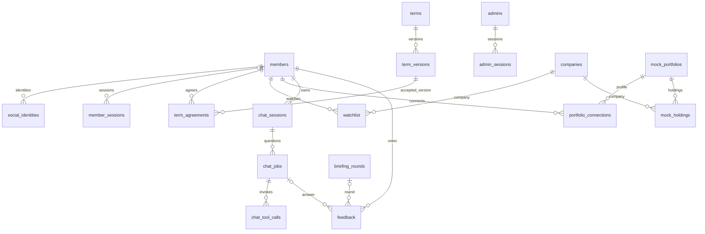
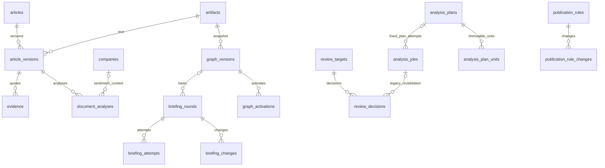

# Zoop ERD v6 — API 기준 데이터 설계

작성일: 2026-10-13

회원·기업·문서 분석·브리핑·채팅·관리자 API를 위한 PostgreSQL 저장 구조와 무결성 규칙을 정의한다.

## 1. 결정 요약

**PostgreSQL 42개 테이블.** 함께 저장하고 읽는 결과는 JSON으로 통합하고 독립 조회·집계·무결성에 필요한 관계는 테이블로 유지한다. v0.7 챗봇 오케스트레이션의 실제 도구 호출은 독립 관측·예산 집계를 위해 `chat_tool_calls`로 분리하고, 고정 계획의 여러 앱 시도가 공유하는 실행 참조는 `analysis_plans`·`analysis_plan_units`로 정규화한다.

기존 설계는 회원과 1:1인 비밀번호·설정, 분석 결과 내부의 주장·인용, 발행본 내부 항목·판정, 응답과 함께 읽는 채팅 인용까지 분리했다. API가 독립 수정·검색을 요구하지 않는 구성 요소에도 별도 테이블을 배정한 것이 개수 증가의 큰 원인이다. 재시도·정정·감사 등 명세가 실제로 요구하는 기능도 개수에 영향을 준다.

이번 기준은 다음과 같다.

- **검색·소유권·집계·독립 변경에 쓰는 값은 컬럼과 FK로 남긴다.**
- **함께 생성하고 함께 반환하는 결과는 버전이 있는 JSONB로 저장한다.** 문서 분석, 브리핑 발행 원문, 채팅 응답이 해당한다.
- **약관 동의·공개 버전·정정·검수·통계·감사는 유지한다.** 테이블을 줄여도 API의 과거 기록 조회 의무가 없어지지는 않는다.
- **권한 정의는 코드 설정, 시세·재무는 공급자 어댑터, 집계 응답은 SQL 조회로 처리한다.** 별도 관리 API가 없는 항목에 관리 테이블을 미리 만들지 않는다.
- **범용 `entities`/`events` 테이블 하나로 모든 도메인을 합치지 않는다.** 채팅·브리핑·분석 작업은 각 상태와 소유권이 다르므로 구분한다.

| 영역 | 테이블 수 | 설계 방향 |
| --- | ---: | --- |
| 회원·인증·약관 | 8 | 회원 자격·설정 통합, 관리자 역할은 코드 매핑 |
| 기업·관심·모의 계좌 | 5 | 별칭은 배열, 보유내역은 기업 FK가 있는 별도 테이블 |
| 문서·근거·분석 | 5 | 분석 내부 주장·인용·긍부정을 한 결과에 저장 |
| 브리핑 | 3 | 회차에 발행 원문 보관, 정정·중단은 한 이력 테이블 |
| 채팅 | 3 | 작업에 결과·인용·라우팅 요약을 포함하고 실제 도구 호출은 독립 기록 |
| 그래프·검수·공개 규칙·공개 제외 | 10 | 실제 조회 이력 유지, 버전 상태·활성 포인터 통합, 버전별 적용 규칙, 버전별 공개 제외 이력·명령 기록 |
| 평가·작업·통계·감사 | 8 | 독립 집계·조회가 필요한 기록, 계획 등록·단위별 실행 원장 유지 |
| **합계** | **42** | Neo4j 노드·관계 및 파일 저장소는 이 개수에 포함하지 않음 |

42개는 이 설계안의 선택이지 API가 강제하는 최소 개수가 아니다. 개발 일정과 인력 배분은 이 ERD의 범위에서 제외한다.

## 2. 저장소와 공통 규칙

PostgreSQL은 회원·카탈로그·문서·결과·이력을 저장한다. Neo4j는 Issue와 기업/Issue/근거 연결 및 버전별 그래프 조회를 담당한다. 원문·추출 텍스트·검증 영수증·그래프 스냅샷·채팅 복구 결과는 파일 저장소에 두고 `artifacts`로 식별한다. 이 구조는 단일 백엔드와 worker로 구현할 수 있으며 별도 마이크로서비스를 요구하지 않는다.

아래 컬럼 표기는 `?`가 NULL 허용, 생략하면 NOT NULL이다. 문자열 ID는 `text`, 시각은 `timestamptz`, 날짜는 `date`, 금액·수량·비용은 `numeric`, 이력의 숫자 ID는 `bigint identity`다. `jsonb`는 적힌 내부 스키마/공개 DTO로 검증한다. 컬럼 목록은 마이그레이션 작성 기준이며 인덱스·교차 검증을 함께 적용한다.

- FK는 기본 ON UPDATE/DELETE RESTRICT. 세션·소셜 연결·관심 목록 같은 종속 데이터만 명시적 정리 또는 CASCADE 가능. 회원 삭제로 증거·발행·대화를 연쇄 삭제하지 않는다.
- PK/UNIQUE와 중복되지 않는 FK 조회 인덱스를 둔다. 목록은 정렬 시각과 ID를 묶어 커서를 만든다. JSON 전체 GIN 인덱스는 기본 생성하지 않는다.
- API enum은 문자열 CHECK로 제한한다. JSON 배열 안 ID에는 SQL FK가 없으므로 저장 트랜잭션에서 존재·소유권·버전 일치를 검사한다. 참조하는 불변 자료는 임의 삭제하지 않는다.
- JSON과 별도 컬럼에 같은 값이 있으면 컬럼은 검색용이며 저장 시 일치를 강제한다. 임의로 서로 다른 값을 수정하는 경로를 만들지 않는다.
- 현재 접근 권한·원문 철회 여부는 응답 시 다시 검사한다. 과거 스냅샷은 철회된 원문을 공개할 권한을 주지 않는다.
- 세션/멱등성/로그 보존기간은 명세가 미정이므로 숫자를 새로 확정하지 않는다.

### 앱 작업·AI 작업·입력 버전 연결 규칙

- 공개 관리자 API의 `jobId`는 `analysis_jobs.id`다. 내부 AI 서비스의 `jobId`는 별도 식별자이며 한 앱 작업에 여러 AI 작업을 허용한다. 기존 작업의 `checkpoint.aiUnits[]` 계약과 이력은 유지한다. 새 `analyze_plan`의 정본은 `analysis_plan_units`이며, 계획의 검증된 순서·고정 S2/S3 명령·단계 관측을 앱 재시도 사이에서 공유한다. 매 poll마다 전체 manifest나 단위 배열을 복사하지 않는다. `document_analyses.ai_job_id`·`briefing_attempts.stages`는 각 소비 기능의 계약을 따른다.
- 내부 submit은 저장된 AI ID를 `body.jobId`와 `Idempotency-Key`에 동일하게 쓴다. poll·recover·응답 유실 조정에도 새 ID를 만들지 않는다. 관리자 retry는 새 `analysis_jobs` 행이지만 `analyze_plan`은 같은 계획의 고정 S2/S3 ID를 이어서 처리한다. 새 모델 실행은 별도로 준비한 새 계획이며 앱이 nonce나 ID를 만들어 대신하지 않는다.
- AI 서비스 호출 영수증의 `jobId`/`attemptId`는 `ai_executions.ai_job_id`/`ai_attempt_id`에 그대로 저장한다. 영수증 본문은 `receipt_artifact_id`의 불변 파일에 저장한다. 같은 `(ai_job_id, ai_attempt_id)`를 다시 수집하면 기존 실행 행을 반환해 호출·토큰·비용을 중복 집계하지 않는다. 작업 수준 `inputDigest`와 개별 호출의 `inputDigest`는 다른 값일 수 있으므로 각각 해당 원본과 대조한다. 이 식별자 관계는 `ai_executions.id`의 문자열 형식에 의존하지 않는다.
- 문서 입력 `article_version`, 분석의 `result_version`, 검수 원천의 `source_version`/`source_revision`, 관리자 결정 `revision`은 서로 독립적이다. 문서 분석은 문서 버전·단계·회사 맥락·`request_no`별로 고정하고, 새 분석은 새 `request_no`와 성공 시 새 `result_version`을 갖는다. 그래프와 브리핑은 사용한 분석 ID·결과 버전·검수 revision을 생성 시점에 고정한다.
- 검수 대상별 `review_targets.current_revision` 및 전역 `review_decisions.global_revision`은 앱의 결정 revision이다. AI 후보의 `review_targets.source_revision`은 원천 revision이다. 앱 결정 때만 앱 revision을 증가시키고, AI 원천 변경만으로 앱 revision을 증가시키지 않는다. 결정 당시의 원천 버전·revision은 같은 트랜잭션의 `audit_logs.detail`에 `reviewDecisionId`와 함께 고정하고, 해당 감사 행은 결정 이력이 남아 있는 동안 보존한다. 원천 버전·revision이 현재 값과 다른 과거 결정은 새 원천의 승인 근거로 쓰지 않는다. 그래프·브리핑의 `review_revision`은 발행 시점 앱 전역 revision이며 AI 원천 revision이 아니다.

## 3. 테이블 정의

### 01. members — 회원·자격·설정

```text
id text PK; email text; email_key text UNIQUE; display_name text
password_hash text?; signup_method text; status text
analytics_key text UNIQUE
mode text?; investor boolean?; completed boolean; tutorial_completed boolean
settings_version bigint; created_at timestamptz; updated_at timestamptz; blocked_at timestamptz?
```

`member_credentials`, `member_settings`를 합친다. 이메일 가입은 password_hash 필수, 소셜 전용은 NULL 가능. 가입 완료 시 이메일은 필수다. 비밀번호 해시를 일반 회원 응답 DTO에 포함하지 않는다. `investor=NULL`은 미응답이다.

가입 시 displayName 생략은 허용한다. 저장 정책은 생략 시 서버 기본 표시명 `회원`을 저장하는 것이다. 이메일/실명을 추정하지 않고 중복 표시명을 허용한다. 명시적으로 보낸 이름은 별도 이름 정책으로 검증한다. 이 기본값은 API 확정 사실이 아닌 구현 제안이다. 가입 직후 온보딩 방식을 선택하지 않았다면 `mode=NULL`, `completed=false`로 저장한다. `mode`는 관심·보유 기업의 존재 여부가 아닌 선택한 방식이며, 선택 후에만 `assets` 또는 `watchlist`로 설정한다. 두 목록이 모두 비어 있는 상태는 각 관계/연결 행이 없는 것으로 표현한다. members.id는 이메일/전화번호에서 유도하지 않는 암호학적 난수 기반 불투명 가명 ID로 발급하고 MemberRow.id와 TranscriptSummary.user에 사용한다. `M-3FA9C2D1` 같은 짧은 예시는 고정 형식이나 충분한 엔트로피의 근거가 아니다. analytics_key는 별도로 발급하며 공개하지 않는다.

설정 PUT은 요청의 지정 필드와 관심 목록을 현재 상태와 비교한다. 무변경 재전송이면 현재 응답을 반환한다. 실제 변경이면 `settings_version` 일치를 검사하고 관심 목록 변경과 함께 증가시킨다. 차단은 상태 변경과 회원 세션 폐기를 한 트랜잭션으로 수행한다.

### 02. social_identities — 소셜 계정 연결

```text
id text PK; member_id text FK members; provider text; provider_subject text; linked_at timestamptz
UNIQUE(provider, provider_subject)
```

회원 한 명의 여러 제공자 연결과 provider subject의 유일성을 유지한다. 이메일 일치만으로 다른 계정과 자동 연결하지 않는다. OAuth state·브라우저 결합·PKCE/일회성 소비·만료 정보는 `member_sessions.auth_flow`의 세션 전용 내부 상태로 처리한다. 소셜 제공 이메일이 없으면 가입 완료를 차단하며 보완 흐름은 API 담당자와 확정한다.

### 03. member_sessions — 회원·비회원 세션

```text
id text PK; kind text; member_id text? FK members; token_hash text UNIQUE
analytics_key text?; tutorial_completed boolean
csrf_key_id text; csrf_version bigint; auth_flow jsonb?
created_at timestamptz; expires_at timestamptz; revoked_at timestamptz?
```

kind는 member/guest/oauth_pending이다. CHECK는 member이면 member_id NOT NULL·analytics_key NULL·auth_flow NULL, guest이면 member_id NULL·analytics_key NOT NULL·auth_flow NULL·tutorial_completed=false, oauth_pending이면 member_id/analytics_key NULL·auth_flow NOT NULL·tutorial_completed=false를 강제한다. guest의 tutorial_completed 컬럼은 스키마 공통 필드이며 항상 false다. 튜토리얼 진행·완료·건너뛰기 상태는 저장하지 않는다. 회원과 비회원 세션은 모두 `zoop_session` 쿠키를 사용하며 guest도 12시간 절대 만료를 적용한다. OAuth 시작은 별도의 HttpOnly·Secure 단명 쿠키 `zoop_oauth_pending`에만 결합하고 기존 member/guest 쿠키를 바꾸지 않는다. 기존 연결 로그인 성공 시 pending을 일회성 소비·폐기하고 새 회원 세션을 발급한다. 신규 가입은 약관 동의 완료 시점까지 별도 pending 단계로 진행한다.

`zoop_oauth_pending`은 OAuth 왕복의 브라우저 결합만을 위한 내부 보조 쿠키로 정의한다. 회원/관리자 인증 쿠키를 추가하는 것이 아니며 API 인증 주체로 사용하지 않는다. Secure·HttpOnly·SameSite=Lax, Domain 미설정(host-only), Path=/api/v1/auth/social, Max-Age는 pending 만료와 동일하게 설정한다. 단, `ZOOP_AUTH_SOCIAL_ALLOW_INSECURE_LOCALHOST=true`인 개발 프로세스는 localhost HTTP redirect에 한해 Secure를 생략한다. state는 난수로 발급하고 DB에는 hash를 보관하며 쿠키·state·provider·등록 redirect URI·PKCE를 검증한 후 원자적으로 소비한다. 해당 브라우저의 새 authorize는 이전 pending을 폐기해 살아 있는 흐름 하나만 유지한다. 신규 가입 동의 대기로 넘어갈 때만 쿠키를 회전하고, 로그인·가입·연결 완료 또는 실패·만료 시 같은 Path로 쿠키를 삭제한다. 이 보조 쿠키의 Set-Cookie와 수명 규칙은 OAuth API 문서의 구현 계약에도 명시해야 하며 공개 SessionResponse enum은 변경하지 않는다.

이슈 #30의 [소셜 인증 구현 정책](../development/social-auth-policy-2026-10-15.md)은 OAuth 코드 callback 소비와 회원가입 완료를 구분한다. 최초 소셜 계정에 같은 이메일의 회원이 없으면 callback의 검증된 subject·이메일을 단명 `auth_flow`의 `consent_pending` 단계로 전환하고 pending 쿠키를 회전한다. 필수 약관 동의가 완료될 때까지 회원·social_identities·회원 세션을 만들지 않는다. 동일 이메일의 기존 회원이 있으면 pending을 폐기하고 기존 회원 로그인 후 명시적 연결을 다시 시작한다. 연결 시작은 활성 회원 세션 ID·회원 ID와 `intent=link`를 pending에 결합하며 callback에서 그 **동일 세션**과 제공자 결과를 확인한다. 코드 callback과 가입 완료는 각각 일회성으로 소비하고 만료·취소 시 해당 pending을 정리한다.

`auth_flow`는 JSON 객체이며 `schemaVersion=1`, `phase`(authorization_pending/callback_processing/identity_verified/consent_pending), `provider`(google/kakao), SHA-256 hex `stateHash`를 필수로 한다. PKCE verifier·nonce 비교값·허용 복귀 경로와 단계별 link 주체 또는 검증된 신규 가입 identity는 해당 흐름에만 보관한다. callback 검증이 끝나면 provider subject와 검증 이메일만 짧게 보관하고 인가 코드·access token·ID token·PKCE verifier는 제거한다. application service는 전체 JSON 스키마를 검사하며 DB CHECK는 객체 형식·버전·단계·제공자·state hash 형식을 강제한다. 쿠키 해시(`token_hash`)와 state hash는 서로 독립적으로 비교한다.

authorize는 DB INSERT와 제공자 호출 전에 IP 및 검증 가능한 브라우저 결합 키 기준 속도 제한을 적용한다. 무쿠키 요청도 IP 제한 대상이다. 임계값은 운영 설정으로 관리하고 초과하면 RATE_LIMITED/429로 처리한다. 만료는 서버 시각으로 검사하고 TTL 설정을 필수로 둔다. 소비된 행은 즉시 정리 가능하며 만료 행은 expires_at 인덱스 기반 주기 작업으로 제거한다. 쿠키 폐기만으로 DB 정리가 완료됐다고 보지 않는다.

oauth_pending은 로그인/guest 권한·튜토리얼·telemetry를 부여하지 않는다. 공개 SessionResponse.kind에는 이 내부 값을 추가하지 않는다. 기존 유효 member/guest 쿠키가 없으면 anonymous로 응답한다. DashboardMembers.activeGuestSessions는 `kind='guest' AND revoked_at IS NULL AND expires_at>now()`만 센다. 회원 통계는 members.analytics_key를 사용한다. 인덱스: `(member_id, created_at)`, `(member_id, expires_at)` 활성 행, `expires_at`.

회원 세션은 인증 만료와 통계 보존을 분리한다. 만료/폐기 즉시 인증을 거절하되 MemberActivity.sessions의 집계 기간에 속한 kind=member 행은 유지하고 created_at으로 센다. oauth_pending/guest는 이 수에서 제외한다. 조회가 전체 기간을 요구하면 회원 존속 중 세션 메타데이터를 삭제하지 않는다. 기간 제한 또는 보존 만료를 도입할 때는 API 조회 기간도 함께 확정하며 삭제 후 전체 기간 수치를 반환하지 않는다. OAuth pending은 소비/만료 후 정리 가능하고 guest 정리는 통계 이벤트 보존과 독립적이다. 탈퇴 시 세션 정리·통계 가명 키 연결 제거 정책을 적용한다. 구체 보존 일수는 미정이다.

### 04. terms — 약관 항목

```text
id text PK; title text; required boolean; created_at timestamptz; retired_at timestamptz?
```

승인 본문이 없어도 약관 항목을 반환해야 하므로 마스터를 유지한다. 본문이 없을 때 body/version=NULL, bodyAvailable=false다.

### 05. term_versions — 승인된 약관 본문

```text
term_id text FK terms; version text; title_snapshot text; required_snapshot boolean
body text; approved_at timestamptz; effective_at timestamptz; retired_at timestamptz?
PK(term_id, version)
```

본문·승인 당시 제목·필수 여부는 불변. 같은 약관의 유효 기간 중복 금지. 현재 마스터와 승인 버전의 표시 정책 변경은 같은 트랜잭션에서 전환한다. 유효 승인 본문 없는 필수 약관은 가입을 완료시키지 않는다.

DB에서 `CHECK(retired_at IS NULL OR retired_at > effective_at)`과 `EXCLUDE USING gist (term_id WITH =, tstzrange(effective_at, retired_at, '[)') WITH &&)`를 적용한다. text 동등 비교를 위해 btree_gist 확장이 필요하다. retired_at=NULL은 상한 무한대이며 인접한 두 구간은 겹치지 않는다. `approved_at <= effective_at`을 보장하고 소급 승인으로 유효 구간 의미를 바꾸지 않는다. 종료 시각 조정과 새 버전 추가는 같은 트랜잭션에서 처리한다.

### 06. term_agreements — 회원 약관 동의

```text
member_id text FK members; term_id text; term_version text; accepted boolean; accepted_at timestamptz
PK(member_id, term_id, term_version)
FK(term_id, term_version) -> term_versions(term_id, version)
```

가입 검증과 동의 기록을 같은 트랜잭션에서 처리한다. 현재 약관만 저장하고 과거 동의 본문을 잃는 방식은 사용하지 않는다.

### 07. admins — 관리자 계정

```text
id text PK; email text; email_key text UNIQUE; display_name text
password_hash text?; external_subject text? UNIQUE; role text; status text; created_at timestamptz
```

`roles`, `permissions`, `role_permissions`, `admin_roles`를 코드의 role→permissions 매핑으로 대체한다. API에는 역할/권한 편집 엔드포인트가 없고 AdminInfo는 단일 role을 반환한다. 작업별 권한과 `transcript:read` 검증은 유지한다. 허용 role 목록은 코드에서 검증하며 초기 계정은 관리 스크립트로 설정한다. 기존 다중 역할을 이행한다면 임의로 하나를 고르지 않고 같은 권한 집합의 역할을 정의해야 한다.

### 08. admin_sessions — 관리자 세션

```text
id text PK; admin_id text FK admins; token_hash text UNIQUE
csrf_key_id text; csrf_version bigint
created_at timestamptz; last_seen_at timestamptz; idle_expires_at timestamptz
expires_at timestamptz; revoked_at timestamptz?
CHECK(idle_expires_at <= expires_at)
```

회원과 별도 쿠키·세션 검증 및 유휴/절대 만료를 유지한다. 회원·관리자 로그아웃은 해당 세션의 Origin/CSRF를 검사하고 폐기한다. 만료/무효 세션은 해당 쿠키만 제거한다.

**회원·비회원·관리자 공통 CSRF 파생:** `csrfToken = base64url_no_padding(HMAC-SHA256(K[csrf_key_id], UTF8(JSON(["zoop-csrf-v1", session_kind, session_id, csrf_version]))))`. JSON은 공백 없이 비ASCII 문자를 그대로 UTF-8로 직렬화하고 csrf_version은 1 이상의 JSON 정수다. session_kind는 member/guest/admin으로 도메인을 분리한다. 키는 비밀 저장소의 256비트 이상 난수이며 DB/응답/로그에 저장하지 않는다. 유효 세션만 토큰을 재계산하고 쓰기 요청은 상수 시간 비교와 Origin 검증을 함께 한다. 신규 세션은 version=1, 강제 회전은 행 잠금으로 증가시킨다. 이전 키는 해당 세션 만료/폐기까지 유지하며 유지 불가 시 재인증한다. oauth_pending에는 이 공개 CSRF 토큰을 발급하지 않고 state·브라우저 쿠키 결합·PKCE·콜백 일회성 소비로 검증한다. pending 행의 csrf 필드는 예약값이며 인증으로 해석하지 않는다.

### 09. companies — 기업 카탈로그

```text
id text PK; ticker text?; exchange_code text?; name text; name_key text; market text?
aliases text[]; search_text text; brand_color text?; logo_url text?; brand_source text?; profile jsonb
created_at timestamptz; updated_at timestamptz
UNIQUE(exchange_code, ticker) WHERE exchange_code IS NOT NULL AND ticker IS NOT NULL
```

`brand_source`는 `brand_color`·`logo_url`에 사용한 색상·로고의 출처 URL을 보관하는 선택 필드다. 기업 상세 API의 공식 홈페이지 주소(`websiteUrl`)와 구분하며, 공개 기업 API 응답에는 포함하지 않는다. 출처를 확인할 수 없으면 NULL로 둔다.

별칭 테이블을 배열로 합친다. ticker 단독 UNIQUE는 두지 않고 거래소와 묶는다. q는 id/name/alias/ticker를 검색한다. id 정확 일치와 ticker 정확 일치를 최상위 정확 식별자 그룹으로 합치고, 그다음 이름 정확 일치→부분 일치, 동률은 name/id로 안정 정렬한다. id 정확 일치는 PK B-tree를 사용하며 다른 검색 분기 결과와 기업 ID로 중복 제거한다. 동일 ticker의 다른 거래소 기업도 각각 반환한다. 별칭은 회사 간 중복 가능하다.

ticker와 name_key에는 B-tree, search_text에는 `pg_trgm`의 `GIN(search_text gin_trgm_ops)`를 둔다. search_text는 정규화된 name과 aliases를 구분자로 결합한 검색용 파생 컬럼이며 INSERT/변경 시 DB 트리거로 함께 갱신한다. 검색은 이 컬럼으로 후보를 좁힌 뒤 실제 이름/개별 별칭 부분 일치를 재확인해 경계 오탐을 제거한다. aliases 배열에 trigram 인덱스가 자동 적용된다고 가정하지 않는다. 짧은 검색어도 결과 상한으로 버리지 않는다. 과거 기업 정보는 graph snapshot에 고정한다.

id/ticker 부분 일치도 별도 분기로 포함한다. 3자 미만의 부분 일치 패턴은 유효한 trigram을 추출하지 못해 인덱스 이득이 없을 수 있으므로 작은 카탈로그의 순차 검색을 허용한다. 정확 일치 분기는 계속 B-tree를 사용하며 짧은 검색어를 거절하거나 결과를 자르지 않는다.

### 10. watchlist — 관심 기업

```text
member_id text FK members; company_id text FK companies; created_at timestamptz
PK(member_id, company_id)
```

독립 PUT과 개인화 그래프·기업별 집계에 쓰이므로 JSON으로 합치지 않는다. 설정 전체 저장과 개별 관심 기업 변경은 회원 행 잠금과 같은 설정 버전 규칙을 사용한다.

### 11. mock_portfolios — 불변 모의 계좌 프로필

```text
id text PK; label text; account_id text; description text?; as_of timestamptz?
cash_amount numeric?; cash_currency text?; active boolean; created_at timestamptz
```

API label/accountId에 각각 label/account_id를 반환한다. 현금 두 컬럼은 모두 NULL 또는 모두 NOT NULL이라는 CHECK를 둔다. 둘 다 NULL이면 cash=null, 제공되면 MockCash를 조합한다. 실제 0을 미제공으로 바꾸지 않는다. active는 신규 선택/연결 가능 여부이며 기존 연결의 프로필 읽기를 차단하지 않는다. 계좌·현금·기준 시각·보유 원본은 불변이고 변경 시 새 프로필 ID를 발급한다. active만 전용 경로로 변경한다. holdingsCount는 mock_holdings 행 수로 구한다.

### 12. mock_holdings — 모의 계좌 보유 종목

```text
mock_portfolio_id text FK mock_portfolios; company_id text FK companies
quantity numeric; avg_price numeric; avg_price_currency text?
PK(mock_portfolio_id, company_id)
CHECK(quantity>=0 AND avg_price>=0)
```

v3.5의 테이블을 복원한다. 프로필과 함께 불변이며 연결별 복제는 하지 않는다. MockHoldingOut에 holding ID가 없으므로 공개 holding ID를 신설하지 않는다. API name은 companies.name에서 조합한다. `(company_id, mock_portfolio_id)` 인덱스를 두고 활성 portfolio_connections와 조인해 holdingMembers를 DISTINCT member_id로 센다. holding 플래그·personalFilter=holdings·개인화의 보유 기업도 같은 조인을 사용한다. 실제 보유 여부는 quantity>0 기준이며 API 집계 정의와 맞춘다.

### 13. portfolio_connections — 모의 계좌 연결 이력

```text
id text PK; member_id text FK members; mock_portfolio_id text FK mock_portfolios
connected_at timestamptz; disconnected_at timestamptz?
UNIQUE(member_id) WHERE disconnected_at IS NULL
```

연결 해제 API가 connection ID를 받으므로 독립 테이블을 유지한다. 포트폴리오 평가는 프로필 보유내역과 공급자 시세를 조합하며 공급 실패를 0으로 바꾸지 않는다.

### 14. artifacts — 불변 파일 등록부

```text
id text PK; kind text; storage_uri text UNIQUE; sha256 text; bytes bigint
media_type text; created_at timestamptz
```

원문·인용 기준 텍스트·모델 결과·검증 영수증·AI submit/내용 없는 호출 영수증·그래프 스냅샷·복구 결과를 보관한다. URI 덮어쓰기 금지, bytes>=0. 저장소 비밀 값은 응답에 노출하지 않는다. 공개 AnalysisCitation.textArtifactId와 DocumentAnalysisSummary.artifactId를 지원하므로 유지한다. `ai_call_receipt`는 제공자 요청·응답 본문이나 원문을 넣지 않는 사용량 메타데이터이고, 검증 통과의 증거로 사용하지 않는다.

### 15. articles — 문서 식별·접근 상태

```text
id text PK; kind text; provider text; provider_key text?; lineage_key text?
current_version text?; access_status text; created_at timestamptz
UNIQUE(provider, provider_key) WHERE provider_key IS NOT NULL
```

kind=news/disclosure. 접근 상태와 현재 버전 포인터만 가변이다. `(id, current_version)`은 article_versions 복합 FK로 연결하고 최초 적재 트랜잭션에서 버전을 추가한 후 지정한다. 내용이 바뀌면 새 버전을 저장한다.

### 16. article_versions — 문서 버전

```text
article_id text FK articles; version text; title text?; publisher text?; url text?
published_at timestamptz?; published_date date?; publication_precision text
raw_artifact_id text? FK artifacts; text_artifact_id text FK artifacts; collected_at timestamptz
PK(article_id, version)
```

원문과 인용의 기준이므로 별도 유지한다. 날짜만 있으면 published_date에 저장하고 자정 시각을 만들지 않는다. 인덱스: `(article_id, collected_at DESC)`, `published_at`.

### 17. evidence — 독립 조회 가능한 근거

```text
id text PK; article_id text; article_version text; text_artifact_id text FK artifacts
summary_analysis_id text? FK document_analyses
quote text; start_offset bigint; end_offset bigint; offset_unit text; input_kind text
raw_locator_ids jsonb; quote_verified boolean?; verification_artifact_id text? FK artifacts
verified_at timestamptz?; created_at timestamptz
FK(article_id, article_version) -> article_versions(article_id, version)
```

`getEvidence`와 여러 결과의 공유 참조 때문에 유지한다. `0<=start<end`, Unicode code point 기준, end exclusive. body는 문서 텍스트 artifact, summary는 완료된 동일 문서 버전의 summary 분석 텍스트 artifact에 연결한다. 실제 부분 문자열과 quote 일치는 저장 경로에서 검사한다. Issue/Relation 연결은 Neo4j에 있다.

### 18. document_analyses — 단계별 분석 상태와 결과

```text
id text PK; article_id text; article_version text; stage text; company_id text? FK companies
request_no bigint; status text; reason text?; result_version text?; result jsonb?
summary_text_artifact_id text? FK artifacts; result_artifact_id text? FK artifacts
exact_receipt_id text? FK artifacts; semantic_receipt_id text? FK artifacts
grant_reference text?; grant_revision text?; grant_checked_at timestamptz?; revoked_at timestamptz?
model text?; prompt_version text?; reasoning_effort text?
analysis_job_id text? FK analysis_jobs; ai_job_id text? UNIQUE; owner_token text?; lease_until timestamptz?
created_at timestamptz; produced_at timestamptz?; updated_at timestamptz
FK(article_id, article_version) -> article_versions(article_id, version)
UNIQUE(article_id, article_version, stage) WHERE company_id IS NULL AND status='pending'
UNIQUE(article_id, article_version, stage, company_id) WHERE company_id IS NOT NULL AND status='pending'
```

stage=summary는 company_id=NULL, sentiment는 필수. result는 각각 `DocumentAnalysisSummary` 또는 `DocumentSentiment` 전체다. claims/citations/quotes/limitations/provenance를 포함한다. `analysis_stage_states`, `document_sentiments`, `analysis_claims`, `analysis_citations`, `claim_evidence`를 합친다.

상태는 not_requested/pending/failed/withheld/available. 행 부재는 not_requested로 응답할 수 있다. 같은 범위(article_id/article_version/stage 및 sentiment의 company_id)에 pending이 있으면 기존 행을 반환하고 모델을 다시 호출하지 않는다. 이전 요청이 failed/withheld/available로 끝난 후 명시적 재요청만 새 request_no의 행을 만든다. 명시적 not_requested 행을 저장한 경우 최초 요청은 그 행을 pending으로 전이한다. 문서 행 잠금 아래 검사하고 두 부분 UNIQUE로 경합을 방어한다. 결과 완성 후 result/result_version/산출물은 불변이고 접근·철회 상태만 별도로 변경할 수 있다. request_no는 문서 행 잠금 안에서 범위별 증가시킨다. company_id NULL/NOT NULL별 부분 UNIQUE로 `(article_id, article_version, stage, [company_id,] request_no)`와 non-NULL result_version 유일성을 보장한다.

pending의 worker 실행권은 owner_token/lease_until로 관리한다. 아직 접수만 된 pending은 둘 다 NULL일 수 있지만 실행 시작 시 둘 다 설정하고 완료 쓰기는 현재 토큰과 미만료 임대를 검사한다. 중단된 worker의 만료 임대를 회수할 때 문서·분석 행을 잠그고 failed로 종결한 후 새 요청을 허용한다. 단순 조회나 동일 요청 재전송은 새 실행을 만들지 않는다. analysis_job_id는 이 분석을 최초 접수한 작업이며 중복 요청이 이를 다시 연결하지 않는다.

`ai_job_id`는 내부 submit 전에 한 번 발급·저장하고 이후 변경하지 않는다. `article_version`과 결과 `result_version`은 서로 다른 버전이며 새 요청 행에 이전 결과 버전을 복사하지 않는다. exact/semantic 영수증은 각각 별도 artifact다. 두 영수증은 이 분석 ID·문서 버전·입력 digest·정책 버전과 직접 또는 dependency ref를 통해 summary 결과 버전에 결합해야 하며, summary 공개는 exact 통과와 semantic supported가 함께 확인될 때만 가능하다. `grant_reference`는 실행 당시의 grant ID, `grant_revision`과 `grant_checked_at`은 그때 확인한 버전·시각으로 고정한다. `revoked_at`은 철회를 관측한 이력 시각일 뿐 현재 허용 여부의 권위값이 아니다.

현재 상태 조회는 같은 범위에서 가장 최신 request_no를 선택한다. 새 요청이 pending인데 과거 available 결과를 최신인 것처럼 반환하지 않는다. 고정 그래프·회차는 snapshot에 저장한 analysis ID/resultVersion을 사용한다. GET은 모델 호출을 하지 않는다. summary 공개에는 exact/semantic 영수증, 현재 버전 및 grant/철회 검사가 필요하다. 과거 자료의 분석 공개 정책과 current-version gate가 충돌하면 최신 분석으로 대체하지 않고 API의 null/withheld 규칙을 적용한다.

저장된 `status=available`은 결과 생성·검증 완료 이력이며 현재 공개 허가를 뜻하지 않는다. 조회 시 현재 source grant registry와 `articles.access_status`를 다시 확인하고, 허가가 없으면 result나 생성 상태를 수정하지 않고 API에는 withheld/null을 반환한다. 저장 `withheld`는 결과 수입 당시 권리·검증 gate 때문에 결과를 사용하지 못한 종료 상태에만 쓴다. 철회·grant 개정·만료·허용 목적/수신자 변경은 `revoked_at` 유무와 무관하게 현재 권리 검사에 반영한다. 새 모델 전송과 결과 수입·공개도 같은 검사를 통과해야 한다.

### 19. briefing_rounds — 운영 회차와 발행 원문

```text
id text PK; round_date date; edition text; scheduled_at timestamptz
window_from timestamptz?; window_to timestamptz; open_start boolean
status text; revision bigint; stages jsonb; failure_reason text?
attempt_no integer; generation_token text?; lease_until timestamptz?
graph_version_id text? FK graph_versions; review_revision bigint?; rule_revision bigint?
published_payload jsonb?; public_snapshot jsonb?; schema_version text?; payload_sha256 text?
morning_round_id text? FK briefing_rounds; comparison_snapshot jsonb?
generated_at timestamptz?; published_at timestamptz?; created_at timestamptz
UNIQUE(round_date, edition)
CHECK((open_start AND window_from IS NULL) OR (NOT open_start AND window_from IS NOT NULL))
CHECK(window_from IS NULL OR window_from < window_to)
CHECK(morning_round_id IS NULL OR morning_round_id <> id)
CHECK(published_at IS NULL OR (review_revision IS NOT NULL AND published_payload IS NOT NULL AND public_snapshot IS NOT NULL AND generated_at IS NOT NULL))
```

`briefing_publications`, `briefing_items`, `briefing_outlooks`를 합친다. published_payload는 `BriefingPayload` 전체로 항목·원문 인용·기업별 판정·outlook·발행 당시 시장값을 포함한다. public_snapshot은 공개 응답의 marketSummary 등 published_payload만으로 복원되지 않는 값을 보관한다. comparison_snapshot은 `SinceMorning`/`Unavailable`, morning_round_id는 실제 비교한 아침 회차다. 요청 시각의 requestId 등 전송 메타데이터는 새 응답에 붙인다.

발행은 한 번만 가능하다. published_at이 설정된 이후 payload/두 snapshot/비교 회차/그래프·검수·규칙 버전/생성 시각/입력 구간을 변경하거나 삭제하지 못하도록 DB 트리거와 저장 권한을 제한한다. status·운영 revision만 허용 경로로 변경한다. JSON 통합을 이유로 정정 시 원문을 덮어쓰지 않는다. JSON 내부 항목은 eventId/rank와 실제 항목 키를 검증하며 같은 발행본 안에서 API 대상으로 식별할 수 있어야 한다.

개인화는 고정 항목과 회원의 관심/보유 기업을 교차해 matchedCompanyIds를 채운다. 사용자별 발행 테이블이나 새 AI 생성을 추가하지 않는다. 인덱스: `(round_date DESC, edition, id)`, `(status, scheduled_at)`.

**발행 JSON 저장 검증:** items는 0~3개, rank는 정수 1~3이며 회차 안에서 rank와 eventId 각각 중복 금지. 자료가 부족하면 3개로 채우지 않는다. 발행 전용 트랜잭션/트리거가 JSON 구조·기업/근거 참조·이 제약을 확인한 뒤 원문을 고정한다. window_from/window_to/open_start는 회차 생성 때 확정하고 재시도에도 변경하지 않는다. generating/verifying에서는 generation_token과 lease_until이 모두 필수이고 다른 상태에서는 둘 다 NULL이라는 CHECK를 둔다.

morning_round_id는 evening 회차에서만 허용하며 같은 KST round_date의 edition=morning, published_at NOT NULL인 불변 발행본을 가리켜야 한다. 자기 참조는 CHECK, 대상 날짜·종류·발행 여부는 참조 회차 잠금 및 전용 저장 트리거로 검증한다. 비교할 발행본이 없으면 NULL과 comparison_snapshot의 Unavailable 사유를 저장한다. 중단 회차 공개 여부는 현재 접근 정책도 확인한다.

review_revision은 발행 트랜잭션에서 공통 publication_state 잠금 아래 읽은 `COALESCE(MAX(review_decisions.global_revision),0)`를 고정한다. 생성 입력이 사용한 revision과 달라졌으면 오래된 결과에 새 revision만 붙이지 않고 재검증/발행 재시도를 요구한다. 모델 호출 중 잠금을 유지하지 않는다. rule_revision은 별도 규칙 카운터다. 발행 후 두 값은 바꾸지 않는다. review_revision=0도 유효하다. published/suspended 상태이면 published_at 필수라는 CHECK도 둔다.

BriefingResponse.status 매핑: scheduled/missing→not_ready, generating/verifying→generating, published→published, failed→failed, suspended→suspended. 관리자 RoundOut/Detail은 내부 상태를 그대로 반환한다. 공개 전 items는 발행 원문이 없으므로 빈 배열로 반환하고 notice는 해당 공개 상태 계약을 따른다.

### 20. briefing_attempts — 브리핑 생성 시도

```text
id text PK; round_id text FK briefing_rounds; attempt_no integer
request_key text UNIQUE; purpose text; lease_until timestamptz
trigger text; admin_id text? FK admins; admin_email_snapshot text?
owner_token text UNIQUE; status text; stages jsonb; input_artifact_id text? FK artifacts
failure_reason text?; started_at timestamptz; finished_at timestamptz?
UNIQUE(round_id, attempt_no)
UNIQUE(round_id) WHERE status IN ('queued', 'running', 'verifying')
```

RoundDetail.attemptsLog와 실행 이력·AI 사용량 연결에 사용한다. 브리핑은 API가 시도 목록을 직접 반환하고 worker가 단계 상태를 기록하므로 별도 유지한다. 한 회차 실행권과 토큰을 짧은 트랜잭션에서 획득하며 모델 호출 중 잠금을 유지하지 않는다. 만료 worker는 현재 owner_token 검사로 발행을 차단한다.

실행권 획득 시 `briefing_rounds.generation_token = briefing_attempts.owner_token`으로 동일한 새 난수 토큰을 기록한다. generating/verifying 회차에는 해당 토큰·회차의 활성 시도가 정확히 하나 있어야 한다. 회차 잠금 아래 시도 INSERT와 회차 전이를 같은 트랜잭션으로 수행하며 교차 테이블 관계는 전용 저장 경로/지연 제약 트리거로 강제한다. heartbeat/단계 변경/발행은 토큰 일치와 미만료 임대를 검사한다. 만료 회수는 기존 시도를 failed로 끝내고 새 토큰·시도 번호를 부여한다. 종료 시 회차 토큰/임대만 NULL로 해제하고 시도 토큰은 이력으로 보존한다.

FS068 producer 구현은 `request_key`로 동일 접수의 멱등성을 보장하고 `stages.inputSha256`으로 고정 입력을 결속한다. `purpose=generation`은 위 회차 토큰 규칙을 적용한다. `purpose=outlook`은 이미 발행된 회차에도 추가 접수할 수 있으며 자체 attempt 임대만 갱신하고 발행본·회차 상태는 바꾸지 않는다. 두 purpose를 합해 한 회차의 활성 시도는 최대 하나다. 종료 시도는 불변이며 재처리는 새 request_key·시도 번호로 접수한다. `completed`는 producer 처리 종료이고, 검증 보류는 `stages.outcome=withheld`, 실제 발행 여부는 `briefing_rounds.published_at`으로 구분한다. 상세: [producer 원장 계약](../../api/docs/BRIEFING_USAGE_LEDGER.md).

### 21. briefing_changes — 정정·중단·재개 이력

```text
id bigint identity PK; round_id text FK briefing_rounds; kind text; seq integer
event_id text?; original text?; corrected text?; suspended boolean?; reason text
admin_id text FK admins; admin_email_snapshot text; created_at timestamptz
UNIQUE(round_id, kind, seq)
```

kind=correction/suspension. suspended로 중단/재개를 구분한다. correction이면 corrected 필수, suspended=NULL. suspension이면 suspended 필수, corrected/event_id/original=NULL. 회차 행 잠금으로 종류별 seq를 증가시킨다. 원문은 서버가 발행본에서 추출한다. API의 숫자 correction ID를 그대로 지원한다. 현재 suspension은 마지막 suspension 이력에서 얻는다. 상태 변경·이력·감사를 함께 커밋한다.

### 22. chat_sessions — 대화

```text
id text PK; member_id text FK members; created_at timestamptz; updated_at timestamptz
```

클라이언트 지정 ID로 PUT 생성한다. 기존 ID가 다른 소유자이면 재사용하지 않는다. 최신 대화 인덱스: `(member_id, updated_at DESC, id)`.

### 23. chat_jobs — 질문·작업·검증된 응답

```text
id text PK; session_id text FK chat_sessions; seq integer
question text; request_hash text; asked_at timestamptz; frozen_context jsonb; frozen_selection jsonb; context_company_ids text[]
graph_version_id text? FK graph_versions; status text; phase text?; outcome text?
deadline_at timestamptz?
resolves_job_id text? FK chat_jobs; resolves_choice_id text?; clarification_depth integer
message_id text? UNIQUE; result jsonb?; result_schema_version text?; failure jsonb?
route_schema_version text?; route_summary jsonb?
runs integer; attempts jsonb; owner_token text?; lease_until timestamptz?
recovery_artifact_id text? FK artifacts; recovery_key text? UNIQUE; cancel_requested boolean
created_at timestamptz; updated_at timestamptz; finished_at timestamptz?
UNIQUE(session_id, seq)
UNIQUE(session_id) WHERE status IN ('queued', 'running')
CHECK(resolves_choice_id IS NULL OR resolves_job_id IS NOT NULL)
CHECK(clarification_depth BETWEEN 0 AND 2)
CHECK((resolves_job_id IS NULL) = (clarification_depth = 0))
CHECK(clarification_depth < 2 OR outcome IS DISTINCT FROM 'clarification')
```

`phase`는 API `ChatJob.phase`(planning/retrieving/writing/verifying)이며 running에서만 값을 갖고 queued·종료 상태에서는 NULL이다. 실행 중인 attempt의 owner token 조건부 UPDATE로만 갱신한다. `deadline_at`은 현재 실행의 기한(시작 시각 + 계획 경로별 단계 상한 합, 최대 60초)이며 lease_until은 이보다 여유 시간만큼 뒤다. 모델 단계 시작 전 잔여 기한 검사의 기준이고 rerun마다 새로 정한다. runs는 모델을 호출한 실행(최초·rerun)만 세며 3을 넘지 않는다. save_only 시도는 attempts에는 기록하지만 runs에 더하지 않는다.

`resolves_job_id`/`resolves_choice_id`는 확인 질문(clarification)에 대한 답을 원 작업과 연결하며 API `ChatJob.resolves`(`ChatClarificationReply`)와 같은 값이다. 둘 다 최초 접수 때 고정하고 request_hash에 포함한다. 접수 트랜잭션에서 원 작업이 같은 session_id이고 status=completed·outcome=clarification인지, resolves_choice_id가 원 작업 `result.choices[].id`에 있는지 검사한다(JSON 항목 FK 대체). choice가 NULL이면 question이 자유 입력 답이다. 새 작업의 frozen_context·context_company_ids·graph_version_id는 요청 context가 아니라 원 작업에서 복사한다. 같은 원 작업에 여러 답 작업을 허용하므로 resolves_job_id에 UNIQUE를 두지 않고, 원 작업 조회용 인덱스 `(resolves_job_id) WHERE resolves_job_id IS NOT NULL`을 둔다. `clarification_depth`는 확인 질문 사슬 깊이다. 루트 질문은 0이고 확인 답은 접수 트랜잭션에서 원 작업 값 + 1로 고정하며 최대 2다. 깊이 2 작업은 `clarification` 결과를 저장할 수 없고 그 상황은 `guidance`로 끝낸다(정책 6.3.4절). API에는 노출하지 않는다.

`chat_results`, `chat_citations`, `chat_attempts`를 합친다. result는 `ChatResult` 전체로 sections/citations/sources/applied/choices/action/limitations/metadata를 포함한다. SQL message_id는 result.messageId와 일치해야 한다. frozen_context는 최초 `ChatFrozenContext`로 불변이다. frozen_selection은 공개 문맥이 표시하지 않는 범위를 재현하기 위한 내부 불변 값 `{contextIds, evidenceIds, evidencePool}`이다: 요청의 contextIds·evidenceIds를 그대로, evidencePool은 고정 그래프 버전에서 선택 대상이 가진 가시 근거(둘 다 오면 evidenceIds로 좁힌 결과)를 담는다. 확인 답 작업은 원 작업의 값을 복사한다. 저장된 문맥·결과는 반환할 때마다 현재 근거 접근 권한으로 다시 확인하며, 읽을 수 없는 내용은 응답에서만 가리고 저장 값은 바꾸지 않는다(OpenAPI getQuestionJob). 같은 jobId로 다른 질문/요청이 오면 409. 세션 잠금으로 seq를 부여한다.

`route_summary`는 사용자에게 노출하지 않는 버전 고정 내부 계약이다. 명시적 `requirementId`, Q01~Q08 multi-label 결과, 논리 기능, 커버리지 판정, 선택·제외 이유, 계획 revision, 단계·체크포인트 선언과 판정 결과(관측 개수·잘림 여부·결정·중단 단계), 예약·사용 예산, `answerBasis`, 최종 계획·출력 검증 상태(결정론적 check ID별 결과, 의미 검증 호출 여부·전체 판정·hold로 제외한 요구)를 저장한다. claim별 Jev 분포와 원문 응답은 `ai_executions`의 영수증 artifact에 둔다. 자유 형식 추론 원문은 저장하지 않는다. `route_schema_version` 없이 값을 저장하지 않으며 완료 뒤에는 불변이다. 실패 작업은 마지막으로 확정된 단계까지만 저장하고 완료한 것처럼 채우지 않는다.

attempts는 내부 스키마의 `{n, mode, requestKey, queuedAt, ownerToken, recoveryKey, recoveryArtifactId, sourceAttemptNo, startedAt, finishedAt, status, failure}` 배열이다. 원소는 실행 요청을 접수할 때 만든다: 최초 접수는 `mode=run`·`requestKey`=jobId, 허용된 재시도는 `mode`=`ChatFailure.retry`·`requestKey`=그 요청의 Idempotency-Key이며 둘 다 `status=queued`로 시작한다. 같은 작업에서 이미 기록된 `requestKey`의 재시도는 새 원소를 만들지 않고 현재 작업을 반환한다. status는 queued/running/succeeded/failed/cancelled/unknown이고, 취소는 활성 원소를 cancelled로 닫는다. 실행기가 집으면 원소는 running이 되고 `ownerToken`·`startedAt`을 갖는다. 엔진이 첫 모델 요청을 보내기 직전에 `modelCalled=true`·`modelCalledAt`을 기록하고 그때 `runs`를 1 올린다(같은 실행의 이후 모델 호출은 다시 세지 않음). lease가 만료된 running 작업은 회수 시 failed가 되며, `modelCalled`이면 `transient`/`response_unknown`(retry null, 원소 unknown), 아니면 `transient`/`deadline_guard`(runs < 3이면 rerun, 원소 failed)다. 회수 뒤 늦게 끝난 실행의 쓰기는 owner token·lease 조건으로 거절된다. n은 작업 안에서 유일하고 잠금 아래 증가시킨다. 새 생성 시도의 recoveryKey는 `chat/{jobId}/attempt/{n}/verified-result`처럼 작업+시도 번호로 결정하며 URI 경로 값은 안전하게 인코딩한다. 각 생성 시도의 키는 전역 유일하고 파일 덮어쓰기를 금지한다. DB 저장 전에 시도와 키를 먼저 커밋해 장애 뒤에도 찾을 수 있게 한다. job의 recovery_key/artifact는 현재 복구 대상 포인터이며 최초 실행 전 NULL이다.

save_only 시도는 sourceAttemptNo로 원래 검증된 산출물을 읽으며 같은 URI에 새 결과를 쓰지 않는다. rerun은 새 번호·새 키를 사용한다. 완료된 배열 원소는 불변, 활성 원소만 해당 토큰으로 종료한다. JSON 전체 교체는 행 잠금/조건부 UPDATE 경로에서만 허용한다. URI UNIQUE는 artifacts에서 보장하며 배열 내부 키·시도 중복도 저장 시 검증한다. AI 토큰·비용은 ai_executions로 집계한다.

context_company_ids는 최초 접수 때 고정 문맥에서 해석한 중복 없는 기업 ID 배열이다. frozen_context와 함께 불변으로 저장하고 회사 존재를 검증한다. GIN(context_company_ids)와 asked_at 인덱스로 기업별 aiQuestions를 집계해 원문 JSON 전체 스캔을 피한다. 한 job을 기업당 한 번만 세고 retry를 새 질문으로 세지 않는다. issue/edge에서 기업을 포함하는 범위는 API 통계 산식과 일치시켜 고정하며 뒤의 활성 그래프로 다시 해석하지 않는다. 선택 문맥이 없는 질문에 기업을 임의 배정하지 않는다.

검증된 결과를 예측 가능한 recovery_key의 파일에 먼저 내구 저장한 뒤 result 저장과 completed 전이를 같은 트랜잭션에서 한다. DB 저장 실패 후 파일을 다시 찾아 저장만 복구할 수 있어야 한다. API result는 completed 전까지 NULL. completed 결과/최초 문맥은 변경 금지. 취소·늦은 worker 완료는 상태와 실행 토큰을 확인한다. 재시도 시에도 대화당 활성 작업 하나 제약을 다시 적용한다.

### 24. graph_versions — 공개 버전·투영 상태·활성 여부

```text
id text PK; sequence bigint UNIQUE; kind text; created_at timestamptz; published_at timestamptz?
created_by text; reason text?; source_label text; policy_version text?
issue_count bigint; relation_count bigint; article_count bigint; candidate_count bigint?
snapshot_artifact_id text FK artifacts; review_revision bigint; rule_revision bigint?
graph_db_state jsonb; active boolean
UNIQUE(active) WHERE active=true
```

`graph_version_db_state`, `graph_active_version`를 합친다. 파일 hash/bytes는 artifacts에서 반환한다. graph_db_state는 GraphDbVersionState 및 내부 투영 상태를 보관하며 snapshot 내용은 불변이다. snapshot에는 그래프뿐 아니라 사용한 문서 버전·분석 결과 ID·기업 정보·공개 규칙 상태를 고정한다.

`graph_db_state.pendingJobsAtCreation`은 생성 시 관측한 정수 또는 NULL로 고정한다. JSON 키의 누락/삭제, NULL↔숫자 전환까지 포함하여 UPDATE 전후 `IS DISTINCT FROM` 비교로 변경을 거절하는 트리거를 둔다. worker는 현재 status/note만 갱신할 수 있다. DTO의 pendingJobsAtCreation과 내부 표기 pending_jobs_at_creation은 같은 값이다.

활성화는 공통 DB advisory lock 안에서 기존 active=false, 대상 active=true, graph_activations INSERT, 감사 기록을 한 트랜잭션으로 수행한다. 읽는 쪽은 요청 시작에 버전 하나를 고정한다. 투영 성공과 검증 통과 전에는 활성화하지 않는다. 버전 없는 최신 그래프로 fallback하지 않는다.

review_revision(`COALESCE(MAX(review_decisions.global_revision),0)`)과 rule_revision(`COALESCE(MAX(publication_rule_changes.log_revision),0)`)은 인계 묶음 수입 트랜잭션이 켜진 규칙과 함께 **한 SQL 문장**으로 읽어 snapshot과 함께 고정한다. 수입은 정기 회차(30분)마다 돌므로 공통 publication_state 잠금을 잡지 않는다. 두 카운터는 그 잠금 아래 MAX+1로 할당되고 잠금이 커밋까지 유지되므로, 한 문장은 각각의 커밋된 앞부분을 보고 그때의 규칙 상태와 어긋나지 않는다. 읽은 뒤 커밋된 결정·규칙 전환은 다음 회차 버전에 반영한다. 이후 새 결정이 생겨도 고정값을 수정하지 않는다. 규칙 이전에 수입된 버전은 rule_revision NULL이며 규칙을 적용하지 않았다.

```text
graph_version_rules: graph_version_id text FK graph_versions ON DELETE CASCADE; rule_id text FK publication_rules
PRIMARY KEY(graph_version_id, rule_id)
```

graph_version_rules는 그 버전 snapshot을 거른 규칙(수입 시점에 켜져 있던 규칙)이다. 같은 고정값으로 다시 수입하면 지금 켜진 규칙이 아니라 이 규칙으로 다시 계산해 비교한다. 행은 버전과 함께 쓰고 UPDATE를 거절한다. `published*`는 receipt와 이 규칙으로 언제든 같은 판정 함수로 다시 계산할 수 있어 따로 저장하지 않는다.

activated_at 컬럼은 제거한다. GraphVersionOut.activatedAt은 graph_activations에서 이 버전의 pointer_changed=true인 마지막 시각으로 계산한다. active 컬럼은 현재 포인터의 권위값이며 그 변경·동일 변경 이력·감사는 공통 잠금 아래 하나의 트랜잭션에서만 기록한다. 일반 UPDATE 권한으로 active를 수정하지 못하게 한다. 이력을 현재 active와 경쟁하는 별도 쓰기 경로로 사용하지 않는다.

### 25. graph_activations — 활성화 이력

```text
id bigint identity PK; version_id text FK graph_versions
previous_version_id text? FK graph_versions; action text; actor_kind text; pointer_changed boolean
admin_id text? FK admins; admin_email_snapshot text; reason text?; activated_at timestamptz
```

action=publish/activate/seed. `GraphVersionList.activations`와 과거 시점 버전 선택 근거이므로 유지한다. 과거 asOf의 버전 선택은 API의 '공개 시각' 정의에 맞춰 published_at 또는 활성화 이력을 사용한다. 재활성화가 과거 발행 시각을 덮어쓰지 않는다. 인덱스: `(activated_at DESC, id)`.

actor_kind=admin이면 admin_id 필수 및 당시 관리자 이메일을 저장하고, system이면 admin_id=NULL·admin_email_snapshot='system'으로 CHECK한다. ActivationOut.adminEmail은 항상 string이다. system 표식은 이메일 링크 대상이 아니다. seed는 작업 종류이며 관리자 seed를 시스템 행위로 바꾸지 않는다. 등록만 한 publish/seed는 pointer_changed=false, 실제 활성 변경은 true다. 이전 버전은 잠금 안에서 읽는다. GraphVersionOut.activatedAt은 마지막 pointer_changed=true 시각이고 한 번도 활성화하지 않았으면 NULL이다. 현재 active=false여도 마지막 활성화 시각은 유지한다.

### 26. review_targets — 검수 대상 등록부·목록 투영

```text
id text PK; target_type text; source_job_id text; external_id text; source_version text
candidate_id text; current_revision bigint; status text; active boolean; is_current boolean
company_ids text[]; relation_types text[]; source_revision text; source_updated_at timestamptz?
verification_artifact_id text? FK artifacts; updated_at timestamptz
issue_id text?; title text?; action text?; target text?; event_time text?; evidence_count integer?
companies jsonb?; reasons text[]?; operator_approved boolean?
UNIQUE(target_type, source_job_id, external_id, source_version)
UNIQUE(source_job_id, candidate_id) WHERE target_type='candidate' AND is_current=true
UNIQUE(source_job_id, candidate_id, external_id) WHERE target_type='relation' AND is_current=true
```

`source_job_id`는 후보를 만든 내부 S3 job이다(AI 담당 합의 2026-10-22). AI 후보 ID는 그 job과 고정 입력 안에서만 안정하므로 앱의 대상 키는 job ID와 후보 ID를 함께 쓰고, 결정은 그 job의 review 경로로 보낸다. 서로 다른 job의 같은 후보 ID는 서로를 대체하지 않는다. 그래서 동기화의 is_current 전환은 같은 `(source_job_id, candidate_id)`(relation은 `external_id`까지) 안에서만 일어나고, 다른 job의 행은 건드리지 않는다. 대상 행의 신원(`id`, `target_type`, `source_job_id`, `external_id`, `source_version`, `candidate_id`)은 DB trigger로 변경을 막고, `current_revision`은 결정과 함께 1씩만 증가한다.

detail JSON 복제를 제거한다. 근거·관계·검증 상세는 source_version/source_revision으로 고정한 분석 후보 원천에서 조회하고 RDB 결정 이력을 조합한다. RDB의 status/active/company_ids/relation_types는 목록 필터용 투영이며 권위 원천이 아니다. 원천 revision이 달라지면 동기화 후 반환하거나 명시적으로 실패 처리하며 오래된 투영과 새 상세를 섞지 않는다. 목록 커서도 source revision에 결합하고 원천이 그 snapshot을 지원하지 않으면 커서를 무효화한다.

**목록 표시용 투영 (2026-10-26, #132).** 후보 목록이 행마다 AI 원천을 부르지 않고 SQL로 검색·페이지를 나누도록, 후보 행에 짧은 표시값 `issue_id`·`title`·`action`·`target`·`event_time`·`evidence_count`·`companies`(`[{sourceId, name, role}]`, AI 원천 기업 ID)·`reasons`(AI 판정 사유 코드)를 둔다. 동기화가 analyze-plan unit의 hash로 고정한 S2 결과와 S3 결과에서 함께 쓰며, 이것도 투영이고 권위 원천이 아니다. relation 행의 `operator_approved`는 AI eligibility의 `approvalBasis.kind=operator-final-approval` 투영이며, 후보 상세 `graphDb=pending`(운영자 승인 뒤 다음 인계·수입 대기)과 자동 통과를 구분하는 데만 쓴다. 인용문·관계 상세·검증 결과 같은 긴 내용은 복제하지 않는다. 사건이 없는 관계 후보와 relation 행은 `issue_id`·`title`·`action`·`target`·`event_time`이 NULL이다. 목록 커서는 원천 revision 대신 행의 `updated_at`(동기화 시각)과 `id`에 결합한다. 페이지를 넘기는 동안 동기화로 갱신된 행은 첫 페이지 쪽으로 옮겨 가며 이후 페이지에는 나오지 않는다.

candidateId의 현재 후보 행은 부분 UNIQUE로 한 개만 허용한다. 과거 버전 행은 이력 FK를 위해 유지하며 is_current 전환과 관련 relation 등록을 한 트랜잭션으로 처리한다. API 결정은 현재 후보와 원천 revision을 다시 확인한다. 원천 ID 존재를 SQL FK로 위장하지 않는다. company_ids/relation_types에는 필요한 배열 GIN 인덱스를 둔다.

`source_version`은 대상 행을 만든 뒤 변경하지 않는다. 같은 버전 안에서 AI 원천 revision이 갱신되면 `source_revision` 투영만 갱신하며, 과거 결정이 가리킨 revision은 해당 결정과 함께 저장한 감사 상세에서 보존한다.

`verification_artifact_id`는 이 대상의 정확한 `source_version`/`source_revision`에 대한 자동 검증 결과만 가리킨다. 원천 revision이 바뀌면 이전 검증 artifact를 새 원천의 통과 근거로 재사용하지 않고 재검증 후 포인터를 교체한다. 문서 분석의 exact/semantic 영수증과는 별개다.

### 27. review_decisions — 검수 결정 이력

```text
id bigint identity PK; target_id text FK review_targets; decision text; reason text
admin_id text? FK admins; admin_email_snapshot text; verification_artifact_id text? FK artifacts
decided_at timestamptz; revision bigint; global_revision bigint UNIQUE; origin text; job_id text? FK analysis_jobs
UNIQUE(target_id, revision)
CHECK(revision >= 1 AND global_revision >= 1)
CHECK(origin <> 'admin' OR (admin_id IS NOT NULL AND admin_email_snapshot IS NOT NULL))
```

결정 이력은 추가만 허용한다(UPDATE·DELETE는 DB trigger가 거절).

AI 원천에 결정을 보내기 전에 앱은 별도의 짧은 트랜잭션으로 멱등 키(processing)와 결정 의도 `review_decision_intents`를 먼저 저장한다. 의도는 AI operation id(관리자·method·path·멱등 키 전체 범위에서 만든 값), 대상 행, 요청(결정·사유·기대값 3개), 관리자 email snapshot을 고정하고, 상태는 pending에서 applied(정산한 결정 행), refused(원천이 아무것도 기록하지 않은 확정 거절), blocked(계약 불일치, operation 조회로만 정산)로만 바뀐다. AI가 결정을 적용했다면 응답 유실·앱 중단·DB 실패가 있어도 의도만으로 결정·감사·멱등 응답을 정산한다. 이때 현재 투영이 여전히 HOLD인지나 같은 행이 current인지는 묻지 않는다(권위는 AI 원천). 확정 거절만 의도를 닫고 같은 키가 그 오류를 재생한다. 일시 불가·미확인 응답은 의도를 열어 두어 같은 키가 같은 요청을 다시 보내고, 정산 작업은 `GET …/reviews/{operationId}`로 기록된 operation을 정산하며 원천이 모르는 operation은 관리자를 대신해 보내지 않는다. 의도 행은 삭제하지 않는다.

candidate와 relation 결정을 모두 보존한다. revision은 결정 대상별 값이며 current_revision은 최초 0이다. relationId가 없으면 candidate 대상, 있으면 해당 후보에 속하는 relation 대상을 해석하고 expectedRevision을 그 대상의 current_revision과 비교한다. 공개 응답의 decision/history에 대상별 revision을 제공해 클라이언트가 같은 대상의 값을 보내도록 한다. 공통 publication_state advisory lock→대상 행 잠금 순으로 획득하고 `current_revision=expectedRevision` 조건부 UPDATE로 +1한 값과 동일 revision의 결정을 INSERT한다. UPDATE 0건 또는 UNIQUE(target_id,revision) 충돌은 REVISION_CONFLICT/409다. origin=admin이면 admin_id 필수, verification_artifact_id는 실제 자동 검증 결과가 있을 때만 채운다. decision=allow는 2026-10-21 사용자 정책에 따라 현재 HOLD인 대상에 대한 운영자 최종 승인이며(DecisionResponse.decision=approved) 재검증 접수가 아니다. 결정·감사·멱등성 완료 기록만 저장하고 analysis_jobs(kind=revalidate) 행이나 모델·검증 호출을 만들지 않는다. DecisionResponse는 publicChanged=false를 반환하며 jobId는 없다(승인은 그래프 투영·활성화가 아니다). 스키마·endpoint·정확한 인용·현재 원천 권리 검사는 사람이 덮어쓸 수 없고, 이전 자동 판정과 claim 분포는 AI 원천에서 불변으로 남는다. `job_id`는 이전 계약이 allow로 접수한 재검증 job의 이력 링크로 nullable을 유지한다. 신규 approved와 reject는 항상 NULL이다. 이전 allow 행과 그 재검증 job은 삭제·이관하지 않으며 신규 승인으로 재해석하지 않는다. 현재 승인 여부는 최신 원천 revision에 대해 AI 원천이 반환하는 approvalBasis(kind=operator-final-approval)로만 판단하고 review_decisions 행만으로 추정하지 않는다. 다른 관리자 작업이 running이어도 결정 접수에는 영향이 없으며 결정 API에 JOB_IN_PROGRESS를 추가하지 않는다. 동일 멱등성 요청은 기존 결정 응답을 재생한다.

관리자 allow/reject는 자동 검증 판정과 독립적인 이력이다. `verification_artifact_id`를 채운 결정은 그 결정 시점에 실제 참조한 후보 검증 artifact만 가리키며, 사후 생성된 검증 결과를 과거 결정 행에 덧붙이지 않는다. 결과와 영수증 artifact ID는 공개 결정 응답에 추가하지 않고 내부 감사·재현에 사용한다.

결정과 동일 트랜잭션에 저장하는 감사 상세에 `reviewDecisionId`, `sourceVersion`, `sourceRevision`을 넣고 변경하지 않는다. 최신 원천 버전·revision과 일치하지 않는 과거 결정은 history에 남기되 현재 승인·공개 근거로 사용하지 않는다. 결정 API는 상세 응답의 대상별 `sourceVersion`/`sourceRevision`을 `expectedSourceVersion`/`expectedSourceRevision`으로 받는다. `expectedRevision`과 두 원천 기대값을 잠근 검수 대상 및 권위 AI 원천과 비교하고, 하나라도 다르면 REVISION_CONFLICT/409로 거절하며 결정을 만들지 않는다. relation 결정이면 후보가 아닌 해당 relation의 세 기대값을 비교한다.

global_revision은 대상 전체에 걸친 전역 검수 revision이다. 공통 잠금 아래 `COALESCE(MAX(global_revision),0)+1`로 할당하고 커밋까지 잠금을 유지한다. 전용 DB sequence를 사용하지 않는다. 모든 결정 쓰기·이행 경로가 같은 잠금을 사용하며 이력은 append-only다. READ COMMITTED 트랜잭션에서 잠금 획득 후 별도 SELECT로 MAX를 읽어 대기 전 snapshot을 재사용하지 않는다. 규칙 변경·그래프 생성/활성화·브리핑 발행도 동일 publication_state 잠금을 공유하며 외부 호출은 잠금 밖에서 수행한다.

현재 운영 값인 Dashboard.graph.reviewRevision, Overview.review.revision, RuleSwitchResponse.reviewRevision은 응답 기준 시점의 `COALESCE(MAX(global_revision),0)`다. 여러 집계를 조합할 때는 한 DB snapshot으로 읽는다. BriefingPayload.reviewRevision과 그래프 버전/회차에 저장된 값은 현재 MAX가 아니라 생성·발행 시 고정한 값이다. 대상별 revision과 전역 global_revision, 규칙 log_revision은 서로 대체하지 않는다.

### 28. publication_rules — 공개 검증 규칙 상태

```text
id text PK; title text; summary text; definition jsonb
default_enabled boolean; enabled boolean; revision bigint; updated_at timestamptz
```

rule ID의 버전을 유지한다. 규칙은 앱 공개 정책으로, 이미 공개 적격인 내용을 공개에서 빼는 방향으로만 작동하며 HOLD를 공개하거나 AI 판정 입력을 바꾸지 않는다(AI 담당 2026-10-22). eligible은 활성 버전이 참조하는 원천 job 범위에서 현재 규칙에 해당하는 HOLD 수(정보용 현재 대기 건수, 공개 수 아님)로, review_targets·원천 revision에서 조회할 때 계산하며 그 투영이 없으면 null이다. publishedCandidates/publishedEvents는 활성 그래프 버전에서 규칙 적용 후 공개 상태로 남은 수로, 버전을 만들 때 세어 버전과 함께 고정한다(규칙 변경은 다음 버전부터 반영, 고정 값이 없으면 null). 버전 고정 당시 통계와 현재 대기 건수를 구분한다. 규칙 정의는 불변 버전으로 관리하고 enabled 상태만 수정한다.

### 29. publication_rule_changes — 규칙 변경 이력

```text
id bigint identity PK; rule_id text FK publication_rules; revision bigint; log_revision bigint UNIQUE
enabled boolean; reason text; admin_id text FK admins; admin_email_snapshot text; changed_at timestamptz
UNIQUE(rule_id, revision)
```

ReviewRuleOut.history와 발행 당시 규칙 재현을 지원하므로 유지한다. 규칙 변경·공개 snapshot 고정·그래프 활성화는 같은 짧은 advisory lock을 사용한다. 전체 log_revision은 잠금 아래 증가시켜 커밋 순서가 역전되지 않게 한다. 초기 규칙 상태도 snapshot으로 재현 가능해야 한다.

### 30. feedback — 유효 평가 상태

```text
id text PK; member_id text FK members; feature text; target_id text; target_version text?
chat_job_id text? FK chat_jobs; round_id text? FK briefing_rounds; item_key text?
value text; reason text?; created_at timestamptz; updated_at timestamptz
UNIQUE(member_id, feature, target_id)
```

feature별 CHECK: chatbot_answer는 chat_job_id만, briefing_round는 round_id만, briefing_issue는 round_id+item_key만 설정한다. chat은 result.messageId와 targetId를 대조하고 대화 소유권을 검사한다. briefing은 발행 원문에 해당 항목이 실제 존재하는지 같은 저장 트랜잭션에서 검사한다. JSON 항목 FK를 대체하는 검증이며 발행 원문 불변 제약과 함께 사용한다.

target_id 원문을 그대로 보존한다. value=none은 취소 상태로 유지하고 집계 제외. 동일 value/reason 요청은 updated_at을 바꾸지 않는다. version 불일치는 409. 브리핑 targetVersion은 현재 활성 그래프가 아닌 해당 회차의 graph_version_id와 비교한다. **briefing_issue의 회차 식별 문맥은 현재 요청 스키마만으로 명확하지 않다. 아래 미결 계약을 먼저 해결해야 한다.**

### 31. analysis_jobs — 수집·재검증·투영·계획 분석 작업

```text
id text PK; kind text; scope text; label text; status text; reason text; requested_by text
requested_at timestamptz; started_at timestamptz?; finished_at timestamptz?
retry_of text? FK analysis_jobs; command_key text UNIQUE; input jsonb; checkpoint jsonb?
plan_id text? FK analysis_plans
target_version_id text? FK graph_versions; cancel_requested boolean; recovered boolean
report jsonb?; ingest jsonb?; flush jsonb?; error jsonb?; ledger_before jsonb?; ledger_after jsonb?
attempts jsonb; owner_token text?; lease_until timestamptz?; next_attempt_at timestamptz?
UNIQUE(scope) WHERE scope='admin' AND status='running'
```

kind=ingest/revalidate/project/analyze_plan, scope=admin/internal_projection, status=queued/running/succeeded/failed/cancelled. 기존 행은 변경하지 않는다. internal_projection이면 여전히 kind=project다. plan_id는 analyze_plan일 때만 필수이며 scope=admin을 요구한다. 새 종류의 input은 `{schemaVersion:"zoop-app-analyze-plan-1",planId,planDigest}`와 정확히 일치하고 최초 등록 참조와 대조한다. 최초 명령·plan_id는 불변이다. 새 종류의 report/ingest/flush/ledgerBefore/ledgerAfter/target_version_id는 NULL이며 기존 종류의 응답에는 planRun을 추가하지 않는다.

자동 graph project 작업은 원인 변경과 같은 RDB 트랜잭션에서 queued로 생성하는 outbox 역할을 한다. JobList.items/active, JobLock, RetryState.other_running, Dashboard.jobs, Overview.jobs의 running/queued/failed24h 모두 scope=admin만 대상으로 한다. failed24h는 해당 scope의 failed 행 중 finished_at이 응답 기준 시각 직전 24시간에 속한 수다. 관리자의 job 단건 조회/재시도/취소에서 internal_projection은 RESOURCE_NOT_FOUND로 처리하고 내부 worker만 회수한다. 내부 작업 상태는 pipeline.graphDb.pendingJobs 등 그래프 운영 상태에 반영한다. ai_executions 비용은 scope와 무관하게 실제 실행을 집계하므로 누락하지 않는다.

관리자 작업은 queued를 여러 개 허용하고 running만 최대 하나로 제한한다. 접수는 queued INSERT로 끝나며 실행권 확보를 기다리지 않는다. 동일 요청은 멱등성/command_key로 기존 job을 반환한다. 내부 투영은 이 실행 제약에서 제외하고 command_key로 중복을 막는다. 대기열 인덱스는 `(requested_at, id) WHERE scope='admin' AND status='queued'`로 둔다.

worker는 짧은 실행권 획득 트랜잭션에서 관리자 실행 advisory lock을 잡고 running이 없을 때 실행 가능한 queued를 requested_at, id 순서로 선택한다. 아직 next_attempt_at이 되지 않은 행과 취소된 행은 제외한다. 선택한 행을 잠근 뒤 queued 상태를 재확인하고 running 전이·새 owner_token·lease_until·시도 기록을 함께 커밋한 다음 외부 작업을 실행한다. 부분 UNIQUE 경합은 worker의 실행권 획득 실패로 처리해 롤백 후 대기시키며, 이미 완료한 접수에 오류를 전파하지 않는다. 종료 시 토큰 조건으로 상태를 확정하고 다음 대기 작업을 실행한다. 임대 만료 회수는 기존 실행을 안전하게 종결/회수하고 오래된 worker의 쓰기를 차단한 뒤 같은 단일 running 제약 아래 수행한다.

JobList.items는 대기·실행·종료 작업을 모두 포함한다. JobList.active는 scope=admin이면서 running인 작업 하나 또는 NULL이다. JobLock은 같은 running 행이 있을 때만 locked=true와 해당 jobId를 반환하며, queued만 있으면 locked=false, jobId=null이다. 이 잠금은 실행권 상태를 뜻하며 새 작업 접수를 막지 않는다. Dashboard.jobs/Overview.jobs는 queued를 대기 행 수, running을 0 또는 1로 집계한다. 재시도는 기존 실패 종류·superseded·중복 재시도 검증을 유지하되 다른 작업의 running만으로 접수를 거절하지 않고 허용된 재시도 작업을 queued로 저장한다. RetryState.other_running은 기존 enum에 남기되 이 대기열 정책에서는 다른 실행이 있다는 이유만으로 반환하지 않는다.

`analyze_plan`만 실제 create와 실행기에 연결된다. 기존 ingest/revalidate/project 요청 형태는 그대로지만 새 create는 실행기 미연결로 503 SOURCE_UNAVAILABLE(retryable=false), retry는 worker_unavailable로 거절하며 inert 행을 만들지 않는다. 멱등성 완료 응답은 현재 기능 활성화 여부보다 먼저 확인하여 당시 응답을 재생한다. 서로 다른 키로 같은 참조를 접수하면 최초 root 작업을 반환한다. retry는 같은 plan_id를 가진 새 앱 시도이며 이전 종결 요약을 바꾸지 않는다.

계획 분석의 잠금 순서는 관리자 실행 advisory lock → 앱 job → plan → unit이다. create 중복 판정은 별도의 계획별 advisory lock과 잠금 없는 root 조회를 사용해 plan → job 역순 잠금을 만들지 않는다. 모든 worker 쓰기는 같은 owner_token·running·실제 미만료 lease·취소 상태로 fence한다. 행/plan/unit 잠금 대기 뒤 현재 시간을 새로 읽으며 PostgreSQL now()의 트랜잭션 시작 시각을 승인 근거로 쓰지 않는다. HTTP 동안 DB transaction이나 행 잠금을 유지하지 않는다. internal_projection과 발행 잠금 영역은 변경하지 않는다.

#### 31A. analysis_plans — 불변 계획 등록과 접수

```text
plan_id text PK; plan_digest text; service_binding text; expected_principal text
registered_at timestamptz; registered_by text; admission_intent_at timestamptz?
admission_id text? UNIQUE; accepted_at timestamptz?; policy_revision bigint?; policy_digest text?
receipt_sha256 text?; manifest_digest text?; manifest jsonb?
last_authority_state text?; last_authority_reason text?; authority_observed_at timestamptz?; last_admission_code text?
```

참조·서비스 endpoint/주체 결속·최초 등록 메타데이터는 불변이다. 같은 plan_id를 다른 digest나 service binding으로 재결속하지 않는다. 접수 identity/pin/완전한 manifest는 처음에 모두 NULL이며 검증된 접수 후 한 번에 기록하고 이후 변경·삭제하지 않는다. 현재 authority 관측만 갱신한다. active 관측은 원천 권리·모델 비용·공개 권한을 부여하지 않는다. NULL authority는 미관측이며 inactive와 구별한다.

#### 31B. analysis_plan_units — 정규화된 S2/S3 실행 원장

```text
plan_id text FK analysis_plans; ordinal integer >= 1; unit_key text
s2_job_id text UNIQUE; s2_approved_request_digest text; s2_input_digest text
s3_job_id text UNIQUE; s2_submit jsonb; s3_submit jsonb; s3_input_digest text?
s2_checkpoint jsonb; s3_checkpoint jsonb
PRIMARY KEY(plan_id,ordinal); UNIQUE(plan_id,unit_key); CHECK(unit_key=s2_job_id)
```

검증된 manifest 순서의 모든 단위와 접수 tuple을 한 transaction으로 저장한다. 지연 제약 trigger는 누락·추가·불일치 단위를 거절하므로 prefix를 실행할 수 없다. ordinal·ID·digest·정확한 참조 전용 submit은 불변이며 삭제하지 않는다. S3 runtime input digest는 처음 유효한 상태에서 한 번 고정한다.

단계 checkpoint `zoop-app-analyze-plan-stage-1`은 state, intentAt, acceptedObservedAt, 완전한 typed 내용 없는 lastStatus, resultObservedAt, 정확한 UTF-8 결과 문자열의 SHA-256, 내용 없는 receipts, 실패 분류/코드와 유한 실패·recover 횟수를 저장한다. 원문·후보 payload는 저장하지 않는다. READY 상태만으로 완료하지 않으며 결과 envelope 자체의 identity와 AVAILABLE을 관측해야 result_observed가 된다. 완료 관측·최초 accepted 시각은 불변이다.

job checkpoint `zoop-app-analyze-plan-checkpoint-1`은 phase, activeOrdinal, terminalSummary, lastFailureCategory만 포함한다. 종결 시 PlanRunOut 전체를 고정하여 후속 retry·검수 활동이 과거 결과를 바꾸지 못한다. succeeded는 모든 단위 쌍의 처리 인계이며 수집 baseline·review_targets·ai_executions·그래프·공개 활성화를 변경하지 않는다. 후속 소비자는 새로 결과를 조회하고 현재 권리를 검증해야 한다.


관리자 접수/재시도 잠금과 내부 투영 스케줄러 잠금은 별개다. 실제 Neo4j 쓰기는 scope와 무관하게 대상 버전별 공유 잠금으로 직렬화해 관리자 project와 내부 project 충돌을 방지한다. 최종 활성화는 기존 공통 활성화 잠금을 유지한다. Neo4j 반영은 command_key로 중복 실행을 견디고 실제 투영 성공 후 완료한다. 버전 간 자료를 동시에 수정하는 투영 구현이면 쓰기 잠금 범위를 그래프 전체로 넓힌다.

### 32. ai_executions — AI 호출·재사용·복구 관측

FS068/getAiUsage 집계 원천, null 규칙, 합성 기대값은 [관리자 AI 사용량 집계 기준](../../api/docs/AI_USAGE_AGGREGATION.md)을 참고한다.

```text
id text PK; feature text; execution_mode text; status text
chat_job_id text? FK chat_jobs; briefing_attempt_id text? FK briefing_attempts
analysis_job_id text? FK analysis_jobs; document_analysis_id text? FK document_analyses
ai_job_id text?; ai_attempt_id text?; stage text?; receipt_artifact_id text? FK artifacts
grant_id text?; grant_revision text?; grant_checked_at timestamptz?; grant_scope jsonb?
attempt_no integer?; provider_send_state text?; provider_revision text?; receipt_execution_mode text?
provider_sent_at timestamptz?; provider_received_at timestamptz?; provider text?; model text?; prompt_version text?; reasoning_effort text?
input_tokens bigint?; output_tokens bigint?; estimated_cost numeric?; actual_cost numeric?; currency text?
error_code text?; error_message text?; started_at timestamptz; finished_at timestamptz?
transmission_confirmed boolean?; retry_unit_id text?; cost_basis jsonb?
UNIQUE(ai_job_id, ai_attempt_id) WHERE ai_job_id IS NOT NULL AND ai_attempt_id IS NOT NULL
```

feature별 시간·오류·비용 집계가 필요하므로 개별 행을 유지한다. 네 소유/문맥 FK 중 적어도 하나가 NOT NULL이어야 한다. chat_job_id·briefing_attempt_id·analysis_job_id 세 실행 소유 FK는 최대 하나만 허용하고 document_analysis_id는 독립 또는 실행 소유 FK와 함께 허용한다. 문서 분석과 analysis_job이 함께 있으면 document_analyses.analysis_job_id와 일치해야 한다. 다른 실행 소유와 문서 분석을 함께 기록하면 고정 입력에 해당 분석 ID가 실제 포함됐는지 저장 경로에서 검사한다. 이것은 실행 한 건의 추가 문맥이며 중복 실행 행을 만들지 않는다.

컬럼 CHECK는 `num_nonnulls(chat_job_id, briefing_attempt_id, analysis_job_id, document_analysis_id)>=1` 및 `num_nonnulls(chat_job_id, briefing_attempt_id, analysis_job_id)<=1`이다. 교차 행 관계는 저장 트랜잭션/트리거로 검증한다. chat/analysis 작업에 연결된 attempt_no는 그 소유 작업의 실제 시도 번호이고, briefing_attempt_id는 자체로 시도를 식별한다. 문서 분석만 연결된 실행은 attempt_no=NULL을 허용한다. 집계는 실행 id를 기준으로 한 번만 센다.

chatbot 실행은 `chat_job_id`와 실제 `chat_jobs.attempts[].n`에 해당하는 `attempt_no`를 함께 저장한다. `provider_send_state`는 `sent`/`not_sent`/`unknown`으로 요청 전송 여부를 보존하며, 과거 행은 NULL(미확인)이다. 이 값과 `status`는 서로 다른 축이다. 챗봇 attempt 재시도 수는 작업 단위 `chat_jobs.attempts`를 기준으로 세며 개별 모델 단계 연결에는 이 쌍을 쓴다.

execution_mode는 live/replay/save_only로 통일한다. replay는 저장 산출물 재사용이고 save_only는 검증 결과 저장 복구로 모델 실호출 수에 넣지 않는다. 문서 provenance의 replay/live와 같은 용어를 쓰되 save_only를 해당 공개 enum에 추가하지 않는다. 미제공 비용은 NULL. 인덱스: `(feature, started_at)`, `(status, started_at)`.

AI 서비스 호출 영수증으로 만든 행은 `ai_job_id`/`ai_attempt_id`를 함께 채우고 `receipt_artifact_id`에 내용 없는 원본 영수증을 보존한다. 같은 AI 시도는 한 행만 허용한다. 실행 소유 FK가 문서 분석이면 `document_analyses.ai_job_id`와 일치시키고, 관리자·브리핑이면 각 checkpoint/stages의 AI 작업 ID와 일치시킨다. 앱의 replay/save_only 기록은 AI 시도 ID 없이 남길 수 있다. 영수증의 `stage`·모델 설정·호출 입력 digest는 artifact에서 검증하며 작업 수준 입력 digest와 같은 값으로 가정하지 않는다.

`grant_id`/`grant_revision`/`grant_checked_at`과 `grant_scope`의 sourceId·requiredOperations·requiredPurposes·requiredRecipients는 이 시도 직전에 확인한 권리 스냅샷이다. 실행 시점의 허가를 입증하지만 현재 공개 권한을 부여하지 않는다. 현재 권리는 원천 grant registry에서 매번 재평가한다. `status=unknown`은 제공자 결과·과금 여부가 불명확한 시도로, failed나 비용 0으로 바꾸지 않고 operator_reconcile 대상으로 남긴다. `actual_cost`는 실제 확인된 청구 자료가 있을 때만, `estimated_cost`는 추정 가능한 경우에만 채우며 미보고 토큰·금액은 NULL로 보존한다.

브리핑 producer는 `transmission_confirmed=true/false/NULL`로 전송 확인/미전송 확인/불명확을 구분한다. 같은 재시도에서 생성·검증 호출이 여러 번 발생해도 `retry_unit_id`를 DISTINCT로 한 번만 센다. replay/save_only는 AI 시도 ID·토큰·비용·retry_unit_id 없이 기록한다. 직접 제공자 호출의 ID는 `briefing-direct:<briefing_attempt_id>`/호출 요청 digest이며 AI 서비스 ID나 제공자 응답 ID로 가장하지 않는다. 알려진 입력/출력 토큰은 독립적으로 보존한다. 추정치를 기록할 때는 `currency`와 단가·가격 버전이 있는 `cost_basis`를 함께 남기며, 청구 자료 없는 actual_cost는 NULL이다. 서로 다른 호스트의 시계 차로 종료 시각이 시작보다 빠르면 원래 종료 시각은 영수증에 보존하고 행의 finished_at은 NULL로 두어 가짜 지연 시간을 만들지 않는다.

**AI 사용량 산식:** `getAiUsage.features[].requests`는 `analysis_jobs` 전체 행 수가 아니다. chatbot은 접수된 `chat_jobs`, news-analysis는 `stage=summary`의 `document_analyses`, document-sentiment는 `stage=sentiment`의 `document_analyses`, briefing은 `briefing_attempts`, briefing-outlook은 각 시도의 outlook 단계 접수 건수를 센다. 멱등 재전송은 새 요청이 아니다. `succeeded`/`failed`는 같은 요청 모집단의 종결 결과이며 pending/withheld를 임의로 성공·모델 실패에 넣지 않는다. briefing과 briefing-outlook의 요청 수는 포함 관계가 있으므로 기능 간 합계로 전체 요청 수를 만들지 않는다.

`modelCalls`는 실제 외부 모델 전송이 확인된 live 시도 수다. `semantic-verification`은 news-analysis에, 기업 문서 판정은 document-sentiment에, 브리핑 전망 판정은 briefing-outlook에 귀속한다. briefing 생성의 다른 모델 단계만 briefing에 귀속해 동일 영수증을 두 기능에 세지 않는다. `replayCalls`는 저장된 판정 재사용 수, `retries`는 최초 실행 뒤 새 앱/도메인 시도 또는 추가 모델 호출을 동반한 재시도 수이며 한 재시도 단위는 한 번만 센다. 동일 키 submit 재전송·poll·모델 재호출 없는 recover·save_only는 retries에 넣지 않고, replayCalls는 실제 저장 판정 재사용이 있을 때만 늘린다. 전송 여부를 모르는 `unknown`/미영수증 시도가 집계 구간에 있으면 `modelCalls`·불완전한 토큰 합계는 API의 nullable 값을 사용하고 note에 이유를 밝힌다. 비용 미보고를 0으로 만들지 않는다.

권리 철회·개정·만료 뒤에는 새 모델 전송 및 결과 수입·반환·공개를 막는다. 기존 호출·사용량·내용 없는 영수증과 실행 당시 grant 스냅샷은 발생 이력으로 유지하고 값을 소급 수정하지 않는다. 원문·AI 결과·인용이 들어 있는 artifact의 보존·삭제는 소스 권리 계약과 별도 보존 정책에 따르며, 사용량 영수증 보존을 근거로 본문 보존이나 공개를 허용하지 않는다.

### 33. interaction_events — 사용자 행동 통계 원천

```text
id text PK; principal_kind text; principal_key text; batch_id text; batch_index integer
event_type text; screen text?; target_id text?; round_id text? FK briefing_rounds; view_id text?
received_at timestamptz
UNIQUE(batch_id, batch_index)
```

TelemetryEvent가 허용한 필드만 수신한다. 주체·시간·batch는 서버가 부여한다. principal_key는 세션 토큰/이메일이 아닌 가명 키이고 회원/세션에 FK를 걸지 않는다. batch_id도 만료되는 멱등성 행에 FK를 걸지 않는다. 동일 배치 재전송의 중복 적재를 방지한다. 다른 키로 온 동일 행동까지 제거할 수 있다고 주장하지 않는다.

집계 인덱스: `(event_type, received_at)`, `(target_id, received_at)`, `(round_id, received_at)`, `(principal_key, received_at)`. 기업별 활동은 해당 이벤트의 실제 대상과 고정 그래프 문맥을 통해 계산한다. viewId 집계 단위는 API 산식을 따른다.

### 34. idempotency_records — POST 재전송 처리

```text
id text PK; principal_kind text; principal_id text; method text; path text; idem_key text
request_hash text; status text; resource_type text?; resource_id text?
owner_token text?; lease_until timestamptz?; response_status integer?; response_body jsonb?
created_at timestamptz; expires_at timestamptz?
UNIQUE(principal_kind, principal_id, method, path, idem_key)
```

내용 불일치 409. 종료된 응답은 재생하고 처리 중이면 같은 작업을 반환한다. 리소스 생성과 완료 응답 기록은 가능한 같은 DB 트랜잭션에서 처리한다. 세션 생성·소셜 인증·로그아웃은 명세의 예외를 적용한다. 가입처럼 인증 전 멱등성을 요구하는 경로는 회원 ID를 가정하지 않고 안정된 익명 요청 주체 식별 규칙을 확정한다.

임대 만료만으로 부작용을 다시 실행하지 않는다. resource/작업 기록으로 반영 여부를 확인하고 불명확하면 재실행을 막는다. 처리 중 응답 형태·보존기간은 API의 미결 사항을 따른다.

### 35. audit_logs — 변경·열람 감사

```text
id bigint identity PK; actor_kind text; admin_id text? FK admins; actor_id text
actor_email_snapshot text?; action text; target_type text; target_id text?
outcome text; purpose text?; reason text?; request_id text; detail jsonb; occurred_at timestamptz
```

성공·거절·실패와 당시 행위자 정보를 기록한다. 중요한 상태 변경과 성공 감사는 같은 트랜잭션에 저장한다. 롤백된 실패 감사는 별도 기록 경로가 필요하다. 대화록은 권한+목적 확인→마스킹→감사 저장 성공 후 반환한다. 감사/마스킹 실패 시 원문을 반환하지 않는다. 인덱스: `(occurred_at DESC, id)`, `(target_type, target_id, occurred_at)`.

### 36. chat_tool_calls — 챗봇 읽기 도구 호출·예산 관측

```text
id text PK; chat_job_id text FK chat_jobs; attempt_no integer; plan_revision integer; call_index integer
tool_call_id text; registry_version text; registry_group text; capability_id text; tool_id text; schema_version text
input_digest text; request_meta jsonb; request_artifact_id text? FK artifacts; response_artifact_id text? FK artifacts
data_version text?; evidence_ids text[]; truncated boolean?; next_allowed boolean?; result jsonb?
status text; error_code text?; started_at timestamptz; finished_at timestamptz?
UNIQUE(chat_job_id, attempt_no, tool_call_id)
UNIQUE(chat_job_id, attempt_no, call_index)
```

읽기 전용 도구(서버 내부 어댑터) 호출을 한 행씩 기록한다. `call_index`는 계획의 안정된 순서이며 실제 병렬 완료 순서를 뜻하지 않는다. `registry_group`, `capability_id`, `tool_id`, `schema_version`은 호출 시점 레지스트리의 값을 고정한다. 모델이 만든 자유 문자열 도구명은 저장·실행하지 않는다. `request_meta`는 대상 ID·기간·asOf·graphVersion·limit처럼 허용된 구조만 포함하고 회원 ID·질문 원문·인증 토큰·개인 포트폴리오 전문을 넣지 않는다. 전체 요청·응답을 보존해야 할 때만 접근 통제와 보존 정책을 충족한 불변 artifact를 연결한다.

상태는 `reserved`, `running`, `succeeded`, `failed`, `cancelled`, `unknown`이다. 계획 확정 시 호출 예산을 `reserved`로 먼저 기록하고 소유 토큰을 확인한 실행만 전이한다. timeout 등으로 외부 완료 여부를 모르면 `unknown`을 실패나 호출 0회로 바꾸지 않는다. 같은 논리 조회를 재사용한 경우 새 성공 호출을 만들지 않고 원 호출 ID를 `route_summary`에 참조한다. 추가 조회 라운드는 `plan_revision`을 증가시키며 최대 횟수는 정책 버전과 함께 검증한다.

`tool_call_id`는 시도 안의 계획 순서로 `tc-<call_index>`를 쓴다. 앱 내부 읽기 어댑터(`tool_id` `app:<capabilityId>`)는 같은 프로세스의 읽기 전용 조회이므로 개별 3초·단계 10초 상한을 넘긴 호출은 결과를 버리고 `failed`(`error_code=tool_timeout`)로 닫는다. 단계 상한 안에 시작하지 못한 호출은 `reserved`로 남고, 시작 기록이 단계 상한 뒤에 끝난 호출은 실행하지 않는다. 상한을 넘긴 읽기는 중단 신호를 받으며, 실제로 끝날 때까지 앱 전체 동시 읽기 한도(16)를 계속 차지한다. 예약·시작·종료 기록은 작업 실행 기한 안에서만 잠금·DB를 기다리고(`statement_timeout`), 기록하지 못하면 결과를 쓰지 않고 실행을 멈춰 lease 회수로 끝낸다. 작업이 완료·실패·취소·lease 만료 회수로 끝나면 그 작업의 `reserved` 호출은 `cancelled`, `running` 호출은 `unknown`으로 함께 닫는다. `error_code`는 `tool_timeout`, `tool_unavailable`(고정 그래프 없음, 버전·스냅샷·근거 상태 확인 불가), `tool_failed`(어댑터 오류·결과 형식 위반)이며, 실패한 호출을 빈 결과나 “없음”으로 바꾸지 않는다.

`result`는 챗봇 MCP 경로(`request_meta.via = "mcp"`)의 성공 호출만 가지는 정규화 결과 봉투(`chat-tool/v1`의 items·evidenceIds·paths·truncated 등, 256 KiB 이하)다. 모델이 공급자 쪽에서 받은 것과 같은 결과를 남겨, 앱이 최종 답의 인용·지도 대상을 바로 그 결과로 결정론 검사한다. 성공 종료 기록과 같은 fenced 갱신에서만 쓰며, 서버 계획(direct) 호출은 남기지 않는다. 작업과 같은 보존·삭제 정책을 따른다(2026-10-28).

`evidence_ids`는 성공 응답에서 답변 후보에 전달한 근거 ID이며 저장 시 현재 공개 문서 버전과 일치하는지 검사한다. 응답의 `data_version`, `truncated`, `next_allowed`와 artifact가 있으면 그 내용이 일치해야 한다. 기본 인덱스는 `(chat_job_id, attempt_no, call_index)`, `(tool_id, started_at)`, `(status, started_at)`이다. 요청당 호출 수·지연·오류·중복 제거율은 이 테이블에서 집계하고 모델 호출·토큰·비용은 `ai_executions`에서 별도로 집계한다.

### 37–39. disclosure_exclusion_changes, disclosure_exclusion_targets, disclosure_exclusion_requests — 공개 제외(FS081)

```text
disclosure_exclusion_changes: revision bigint PK; action text(exclude|lift); cause text(source-change|relation-retraction|operator)
  report_sha256 text?(exclude만); reason text; operator text; changed_at timestamptz
disclosure_exclusion_targets: revision FK; graph_version_id FK graph_versions ON DELETE CASCADE
  target_kind text(issue|relation|evidence|article); target_id text; article_version text(article만, 아니면 '')
  PRIMARY KEY(revision, graph_version_id, target_kind, target_id, article_version)
disclosure_exclusion_requests: request_id text PK; request_sha256 text; action text(exclude|lift)
  revision bigint(명령이 남긴 제외 revision); result jsonb(결과 문서); recorded_at timestamptz
```

공개된 버전의 내용을 **그 버전에서만** 공개 조회에서 뺀다(권리 철회, 관계 오연결). 생산자가 정정한 새 인계 묶음에서 같은 이슈·간선 ID를 다시 쓸 수 있어서 전역 집합으로 두지 않는다. snapshot은 바꾸지 않고, 읽을 때 현재 제외를 overlay로 적용한다. 변경 하나는 운영자 명령 하나(AI 영향 조회 보고서의 `exclude`, 또는 사유를 적은 `lift`)이며, 대상의 현재 상태는 그 대상의 마지막 변경이다. 빈 보고서나 이전보다 작은 보고서로는 해제하지 않는다. `revision`은 앱 전체 제외 카운터(`DisclosureExclusions.revision`)로, 공통 publication_state 잠금 아래 MAX+1로 할당하고 커밋까지 잠금을 유지한다. 읽는 쪽(공개 조회·활성화 사전 검사)은 잠금 없이 한 문장으로 읽는다. 결과(`applied`·`unchanged`)에 이른 명령은 같은 트랜잭션에서 `disclosure_exclusion_requests`에 명령 ID·요청 hash·결과를 남긴다. 같은 ID의 재실행(결과 유실·커밋 결과 불명)은 저장한 결과만 돌려주고 아무것도 바꾸지 않으며, 같은 ID의 다른 요청은 거절한다. 해제(`lift`)는 운영자가 본 제외 revision(`expectedRevision`)을 함께 보내고, 그 뒤에 바뀐 대상이 있으면 거절한다. 세 테이블은 UPDATE·DELETE를 거절하며, 대상 행만 버전 삭제와 함께 지워진다. 기사(`article`) 대상은 그래프 밖 소비자(기업 문서 목록·S1·브리핑·채팅·캐시·Neo4j)를 위해 기록만 하고, 그래프 조회는 이슈·관계·근거를 적용한다.

## 4. 핵심 관계도

선은 실제 SQL FK의 주요 관계만 표시한다. JSON 내부 참조와 Neo4j 외부 ID는 FK 선으로 표시하지 않는다. 아래 그림은 전체 컬럼 도면이 아니며 제3절이 저장 구조의 기준이다.





## 5. v3.5의 60개 테이블 처리표

| 기존 테이블 | 새 저장 위치 | 판단 |
| --- | --- | --- |
| members, member_credentials, member_settings | members | 3→1, 1:1 자격·설정 통합 |
| social_identities | social_identities | 유지 |
| member_sessions | member_sessions | 유지 |
| terms, term_versions, term_agreements | 동일 3개 | 동의 본문과 미승인 상태 때문에 유지 |
| admins, roles, permissions, role_permissions, admin_roles | admins + 코드 권한 매핑 | 5→1, 권한 검사는 유지 |
| admin_sessions | admin_sessions | 별도 관리자 세션 유지 |
| companies, company_aliases | companies.aliases | 2→1 |
| artifacts, articles, article_versions, evidence | 동일 4개 | 독립 ID·버전·인용 계약 유지 |
| document_analyses, analysis_stage_states, document_sentiments, analysis_claims, analysis_citations, claim_evidence | document_analyses | 6→1, 결과 DTO와 공개 상태 저장 |
| watchlist | watchlist | 개별 변경·기업 FK 유지 |
| mock_portfolios, mock_holdings | 동일 2개 | 보유 FK·집계 조회를 위해 mock_holdings 복원 |
| portfolio_connections | portfolio_connections | 연결 ID·해제 이력 유지 |
| market_cache | 공급자 어댑터, 필요 시 프로세스 캐시 | 1→0, DB 영속 캐시 생략 |
| financial_values | 재무 공급자 어댑터 | 1→0, 재무 API 유지 |
| briefing_rounds, briefing_publications, briefing_items, briefing_outlooks | briefing_rounds | 4→1, 불변 발행 컬럼 보호 |
| briefing_attempts | briefing_attempts | API가 시도 목록 반환 |
| briefing_corrections, briefing_suspensions | briefing_changes | 2→1, 종류별 이력 |
| feedback | feedback | 유효 평가·취소·집계 유지 |
| chat_sessions | chat_sessions | 대화 소유권 유지 |
| chat_jobs, chat_attempts, chat_results, chat_citations | chat_jobs + chat_tool_calls | 질문·결과·계획 요약은 작업에 통합하고 실제 읽기 도구 호출은 독립 관측 |
| graph_versions, graph_version_db_state, graph_active_version | graph_versions + graph_version_rules | 3→1, 활성 버전 유일성 유지. 버전별 적용 규칙은 규칙 FK가 필요해 하위 테이블 |
| graph_activations | graph_activations | 버전 활성화 이력 유지 |
| review_targets, review_decisions | 동일 2개 | 대상과 결정 이력 유지 |
| publication_rules, publication_rule_changes | 동일 2개 | 규칙 API의 history 유지 |
| analysis_jobs, analysis_job_attempts, graph_projection_tasks | analysis_jobs | 3→1, project 작업을 outbox로 사용 |
| ai_executions, interaction_events, idempotency_records, audit_logs | 동일 4개 | 조회·집계·중복 방지·감사 유지 |

삭제된 DB 테이블의 기능이 모두 없어지는 것은 아니다. 공급자 어댑터, JSON 검증, 코드 권한 매핑, 불변 컬럼 보호가 그 역할을 담당한다. 특히 JSON으로 옮긴 자식 관계의 무결성은 저장 경로에서 구현해야 한다.

## 6. JSON 계약과 변경 단위

| 컬럼 | 저장 내용 | 갱신 규칙 |
| --- | --- | --- |
| companies.aliases | 별칭 문자열 배열 | 기업 카탈로그 갱신 시 교체 |
| mock_portfolios / mock_holdings | JSON 통합 해제, 현금·보유 컬럼에서 DTO 조합 | 원본 불변, active만 변경 가능 |
| document_analyses.result | DocumentAnalysisSummary 또는 DocumentSentiment 전체 | 결과 확정 후 불변, 새 요청은 새 행 |
| briefing_rounds.published_payload | BriefingPayload 전체 | 최초 발행만 쓰기 |
| briefing_rounds.public_snapshot/comparison_snapshot | 공개 요약·시장 정보 및 아침 비교 결과 | 최초 발행만 쓰기 |
| chat_jobs.frozen_context/result | ChatFrozenContext / ChatResult 전체 | 최초 문맥과 completed 결과 불변 |
| chat_jobs.route_summary | ChatRouteSummary v1: 요구·Q 유형·기능·커버리지·계획·예산·검증 요약 | 실행 중 소유 토큰으로 단계별 갱신, completed 뒤 불변 |
| chat_jobs.attempts, analysis_jobs.attempts | 내부 시도 이력 | 완료 원소 불변, 활성 원소만 토큰 검사 후 종료 |
| analysis_plans.manifest | 검증된 완전한 참조 전용 manifest | 접수 identity/pin/모든 단위와 함께 write-once |
| analysis_plan_units.s2_checkpoint/s3_checkpoint | 내용 없는 typed 상태·의도·결과 해시·receipt·실패 분류 | 현재 job owner/lease fence, 완료 관측 불변 |
| analysis_jobs.checkpoint (analyze_plan) | phase·activeOrdinal·terminalSummary·lastFailureCategory | 종결 요약과 상태/시각 불변 |
| chat_tool_calls.request_meta | 허용된 대상·기간·버전·limit만 포함한 호출 메타데이터 | 예약 후 허용 필드만 기록, 원문·비밀·개인 전문 금지 |
| review_targets 목록 투영 | 상세 JSON 없음, 원천 상세를 version/revision으로 조회 | 필터용 컬럼만 revision 단위 동기화 |
| graph_versions.graph_db_state | GraphDbVersionState 및 투영 상태 | 투영 worker가 상태 갱신 |

API DTO를 그대로 노출하는 DB 엔티티로 만들지는 않는다. 저장 JSON에 포함된 버전과 실제 FK/컬럼을 검증하고 응답 DTO를 구성한다. 비밀·내부 실행 토큰·자격 정보는 별도 필드로 관리한다.

## 7. API에서 요구하는 동작의 구현 위치

아래 API별 대응표의 저장 위치 외에도 인증·권한·CSRF·오류·요청 ID·멱등성 공통 처리를 적용한다. 대시보드나 통계 DTO마다 테이블을 추가하지 않고 원천 테이블에서 SQL 집계한다. 공급자/그래프 응답은 해당 어댑터에서 얻는다.

시세·가격·재무의 최신값은 공급자 응답을 사용한다. 공급자에 없는 자료는 unavailable, 실제 장애는 명세의 오류/failed로 구분한다. 브리핑에서 사용하는 시장 수치는 발행 snapshot에 고정한다. 외부 공급자의 기간·해상도 지원 여부는 별도 확인이 필요하다.

| operationId | 저장·조회 위치 | 적용 사항 |
| --- | --- | --- |
| `getMemberSession`, `logIn`, `startGuestSession`, `logOut`, `setTutorialState` | members, member_sessions | 회원/guest 구분, 폐기·CSRF·튜토리얼 |
| `listTerms`, `signUp` | terms, term_versions, term_agreements, members | 승인 약관 검증과 회원·동의 생성의 원자 처리 |
| `listSocialProviders`, `authorizeSocialLogin`, `completeSocialLogin` | 코드의 제공자 설정, member_sessions.auth_flow, social_identities, members | state/만료/일회성 소비와 계정 연결 검증 |
| `getMySettings`, `updateMySettings`, `setWatchlistCompany` | members, watchlist | 설정 버전·무변경 재전송·동일 트랜잭션 |
| `listRecommendations` | 활성 사용 유보 계약 | 명세의 기존 범위 예외를 보존. 더미 응답/삭제로 대체하지 않음 |
| `listVirtualAccountProfiles`, `getVirtualAccountProfile` | mock_portfolios, mock_holdings, companies | 계좌·현금·보유 DTO 조합 |
| `connectVirtualAccount`, `getMyPortfolio`, `disconnectVirtualAccount` | portfolio_connections, mock_portfolios, mock_holdings, companies, 시세 어댑터 | 활성 연결 하나, 소유권, 금액 계산 |
| `getGraph`, `getCompanyRelation`, `listEvents`, `getEvent`, `getCompanyIssueImpact`, `getCompanyGraphAsOf` | graph_versions, graph_activations, Neo4j/불변 snapshot | 버전/asOf/round 고정, 개인화는 watchlist·보유 기업 사용 |
| `searchCompanies`, `getCompany` | companies, Neo4j/고정 snapshot, document_analyses | 검색 순서 및 고정 버전 자료 조합 |
| `getCompanyQuote`, `getCompanyMetrics`, `getCompanyPrices`, `getCompanyFinancials` | 외부 공급자 어댑터 | 전용 RDB 테이블 없음. 재무·시세 기능은 유지 |
| `listCompanyDocuments`, `getEvidence` | articles, article_versions, evidence, document_analyses, artifacts, Neo4j | 기업 맥락·기간·문서 버전·분석 상태·권한 확인 |
| `getBriefing`, `listBriefingRounds`, `getBriefingGraphBasis` | briefing_rounds, briefing_changes, graph_versions | 불변 발행 원문+정정/중단 상태 조합 |
| `getPersonalizedBriefing` | briefing_rounds, watchlist, portfolio_connections, mock_portfolios, mock_holdings | 기존 회차의 항목 필터와 matchedCompanyIds |
| `createConversation`, `getConversation`, `getCurrentConversation` | chat_sessions, chat_jobs | 대화 ID 멱등성 및 소유권 |
| `submitQuestion`, `getQuestionJob`, `retryQuestionJob`, `cancelQuestionJob` | chat_jobs, chat_tool_calls, artifacts, idempotency_records, ai_executions | frozen context, 동적 읽기 계획·예산, 대화당 동시 작업 하나, 저장만 복구 |
| `getAdminSession`, `logInAdmin`, `logOutAdmin` | admins, admin_sessions, 코드 권한 매핑 | 별도 쿠키와 유휴/절대 만료 |
| `getAdminDashboard`, `getPipelineOverview` | 회원·후보·작업·브리핑·그래프·AI·감사 원천의 집계, Neo4j 상태 | 별도 dashboard 테이블 없음. 외부 상태 조회 실패를 실제로 표현 |
| `listAuditRecords` | audit_logs | 필터·커서로 조회 |
| `listAnalysisCandidates`, `getAnalysisCandidate`, `decideAnalysisCandidate` | review_targets, 분석 후보 원천, review_decisions, review_decision_intents, audit_logs (이전 계약 이력 조회 시 analysis_jobs) | revision·원천 CAS, allow는 HOLD 최종 승인이며 job·모델 호출 없음 |
| `listPublicationRules`, `setPublicationRule` | publication_rules, publication_rule_changes, review_targets, graph_versions | 현재 상태·history·집계와 변경 직렬화 |
| `listGraphVersions`, `publishGraphVersion`, `activateGraphVersion` | graph_versions, graph_activations, artifacts, analysis_jobs, audit_logs | 검증된 snapshot·투영 성공·활성화 이력 |
| `listAnalysisJobs`, `createAnalysisJob`, `getAnalysisJob`, `retryAnalysisJob`, `cancelAnalysisJob` | analysis_jobs, analysis_plans, analysis_plan_units, audit_logs, idempotency_records | analyze_plan의 고정 계획 처리·내용 없는 인계; 기존 종류 이력·취소 유지 |
| `getAiUsage` | ai_executions, document_analyses, analysis_jobs, briefing_attempts, chat_jobs | 기능별 접수 단위와 실제 호출·재사용·복구 구분, 기간별 비용·오류·pastRuns |
| `listAdminBriefingRounds`, `getAdminBriefingRound`, `reprocessBriefingRound` | briefing_rounds, briefing_attempts, briefing_changes, audit_logs | 미발행만 재처리, stages·attemptsLog 보존 |
| `appendBriefingCorrection`, `setBriefingSuspension` | briefing_changes, briefing_rounds, audit_logs, idempotency_records | 원문 불변, 이력 추가와 상태 변경 원자 처리 |
| `recordInteractionEvents` | interaction_events, idempotency_records | 동일 배치 중복 적재 방지 |
| `getMyFeedback`, `setFeedback` | feedback, chat_jobs, chat_sessions, briefing_rounds | 소유권·대상 버전·취소 상태. briefing_issue 문맥 미결 |
| `getInsightsOverview`, `getInsightsSummary`, `listCompanyInsights`, `getCompanyInsights` | interaction_events, members, feedback, chat_jobs.context_company_ids, companies, briefing_rounds, 그래프 대상 해석 | API 산식에 따른 SQL 집계. 영구 집계 테이블 없음 |
| `getFeedbackSummary`, `listDislikedResults` | feedback, chat_jobs, briefing_rounds | 현재 up/down만 집계, none 제외 |
| `listMaskedTranscripts`, `getMaskedTranscript` | chat_sessions, chat_jobs, feedback, audit_logs | transcript:read+목적+마스킹+응답 전 감사 |
| `listMembers`, `getMemberActivity`, `blockMember`, `unblockMember` | members, member_sessions, interaction_events, chat_sessions, chat_jobs, feedback, audit_logs | 활동 조회·차단 시 세션 회수 |

## 8. 테이블을 합쳐도 남는 계약 미결 사항

1. **briefing_issue 평가 대상:** FeedbackVote와 getMyFeedback에는 feature/targetId/targetVersion만 있고 회차를 명시하는 필드가 없다. 같은 eventId가 여러 회차에 포함될 때 어느 항목인지 단정할 수 없다. targetVersion=graphVersion도 회차 식별자가 아니다. targetId가 전역 항목 ID인지, 회차+이슈 문맥을 계약에 추가할지 결정해야 한다. 현 설계는 내부 round_id+item_key를 마련했지만 공개 요청의 모호함을 해결한 것은 아니다. 문맥 없는 요청을 최신 회차로 연결하지 않는다.
2. **공개 graphVersion NULL:** BriefingPayload는 NULL을 허용하지만 metadata 설명은 공개 데이터에 실제 버전을 요구한다. 새 공개 발행의 기본 설계는 사용 가능한 버전을 요구하고, 과거/미발행/unavailable 응답의 NULL 정책은 API 정본에서 정리한다.
3. **버전별 원천 제공:** Neo4j/파일 snapshot이 과거 그래프·문서/분석 ID를 실제로 재현해야 한다. RDB에 버전 번호만 저장해도 과거 조회가 되는 것은 아니다. asOf에서 발행 시각과 활성화 시각 중 어느 것을 기준으로 선택하는지 재활성화 사례까지 맞춘다.
4. **외부 계약:** 시세·재무 공급자, 원문/요약 인용 네임스페이스, 검증 영수증/grant 발급·회수, 보존기간, OAuth 이메일 미제공 처리, 관리 권한 매핑을 담당자와 맞춘다. DB를 나누는 것만으로 해결되지 않는 항목이다.
5. **실행 정책:** 실패별 retry 허용, 임대 길이, 처리 중 멱등성 응답, 관리자 작업 내부의 동시 실행 범위는 명세와 동기화한다(내부 투영 제외 결정은 analysis_jobs 정의 참조). 새 성공 응답이나 무조건 재실행 정책을 만들지 않는다.

이 항목들은 설계안의 미결 사항이다. API 필드를 추가하거나 기능을 임의 유보한 완료본으로 해석하지 않는다.

## 9. 구현·이행 시 확인할 항목

- 회원 통합 시 password_hash가 일반 조회 DTO/로그에 섞이지 않는지 확인한다.
- 기존 분석의 주장·인용 순서·evidence 연결·결과 버전이 JSON 변환 후 보존되는지 확인한다.
- 브리핑 발행 원문과 정정/중단 이력이 분리되고, 발행 후 immutable 컬럼 UPDATE/DELETE가 차단되는지 확인한다.
- 같은 대화 동시 접수는 한 건만 성공하고, save_only가 모델을 호출하지 않는지 확인한다.
- route_summary가 모든 명시적 requirementId를 보존하고 `answerBasis`·검증 상태가 공개 ChatResult와 일치하는지 확인한다.
- 요청당 `chat_tool_calls`가 최대 12개, 동시 실행 최대 4개, 추가 plan revision 최대 1회인지 확인하고 timeout을 근거 없음으로 바꾸지 않는다.
- 그래프 활성화/규칙 변경/발행 snapshot의 revision과 커밋 순서가 맞는지 확인한다.
- 기존 평가에 회차 근거가 없으면 임의 이행하지 않는다. 원본을 보존하고 대상 식별을 해결한다.
- 영속 캐시를 없애도 시세·재무·브리핑 응답의 기준 시각과 실패 구분이 유지되는지 확인한다.
- 전용 자식 테이블이 사라진 JSON 필드는 실제 검증 실패가 저장을 중단하도록 구현한다.


## 10. enum·저장 검증 명세

다음은 SQL CHECK 및 내부 JSON 스키마에 사용할 허용값이다. API에 있는 enum은 그대로 사용하고, 내부 값은 DTO 변환 시 밖으로 누출하지 않는다. 변경이 필요한 내부 enum은 마이그레이션과 저장 스키마 버전을 함께 변경한다.

| 위치 | 허용값 또는 규칙 |
| --- | --- |
| members.signup_method / status / mode | email, google, kakao / active, blocked / NULL(온보딩 방식 미선택), assets, watchlist |
| social_identities.provider | google, kakao |
| member_sessions.kind | member, guest, oauth_pending; pending은 내부 전용 |
| admins.status / role | active, disabled / 배포 시 확정한 코드 role registry의 값; 일반 문자열 무제한 허용 금지 |
| artifacts.kind | raw_document, extracted_text, summary_text, analysis_result, exact_receipt, semantic_receipt, verification_receipt, ai_submit, ai_call_receipt, graph_snapshot, briefing_input, chat_recovery. 내부 분류이며 이전 kind는 내용에 따라 명시적으로 이행 |
| articles.kind / access_status | news, disclosure / available, private, deleted |
| article_versions.publication_precision | datetime, day, unknown; 각각 published_at만 값 / published_date만 값 / 둘 다 NULL |
| evidence.offset_unit / input_kind | unicode_code_point / body, summary |
| document_analyses.stage / status | summary, sentiment / not_requested, pending, failed, withheld, available |
| sentiment.label / outlook.label | positive, negative, mixed, undetermined; NULL과 undetermined 구분 |
| 분석 result.provenance | sourceKind=synthetic,actual; executionMode=replay,live; recordingKind=authored-test,provider |
| briefing_rounds.edition / status | morning, evening / scheduled, missing, generating, verifying, published, failed, suspended |
| briefing_attempts.trigger / status | scheduler, admin / queued, running, verifying, completed, failed, cancelled |
| briefing_changes.kind | correction, suspension; suspended boolean의 NULL 조건은 테이블 정의 참조 |
| chat_jobs.status / outcome | queued, running, completed, failed, cancelled / answered, clarification, guidance, insufficient_evidence 또는 NULL |
| chat_jobs.failure | ChatFailure: kind=validation_failed, save_failed, result_lost, transient, budget_exceeded, permission_denied, internal; retry=rerun, save_only 또는 NULL |
| chat_jobs.attempts | 내부 mode=initial,rerun,save_only; status=running,completed,failed,cancelled; n>=1, 단일 활성 원소 |
| chat_tool_calls.status | reserved, running, succeeded, failed, cancelled, unknown; unknown은 전송·완료 불명이며 실패나 미호출로 단정하지 않음 |
| graph_versions.kind / graph_db_state.status | seed, ledger / reflected, pending, unknown; 실제 조회 장애는 API 오류로 별도 표현 |
| graph_activations.action / actor_kind | publish, activate, seed / admin, system |
| review_targets.target_type / status | candidate, relation / ALLOW, HOLD, REJECT; status는 원천의 목록 투영값 |
| review_decisions.decision / origin | allow, reject / admin, snapshot-migration |
| feedback.feature / value | chatbot_answer, briefing_round, briefing_issue / up, down, none |
| analysis_jobs.kind / scope / status | ingest, revalidate, project, analyze_plan / admin, internal_projection / queued, running, succeeded, failed, cancelled |
| analysis_jobs.attempts | 내부 status=running,succeeded,failed,cancelled; 시도 번호 유일, 단일 활성 원소, 완료 원소 불변 |
| ai_executions.feature | chatbot, news-analysis, briefing, document-sentiment, briefing-outlook |
| ai_executions.execution_mode / status | live, replay, save_only / running, succeeded, failed, cancelled, unknown. unknown은 제공자 결과·과금 미확정이며 API 집계에서 0/failed로 단정하지 않음 |
| interaction_events.principal_kind / event_type / screen | member, guest / screen_view, graph_node_select, graph_edge_select, briefing_view, briefing_issue_open / main, briefing 또는 NULL |
| idempotency_records.status / method | processing, completed, failed / POST |
| idempotency_records.principal_kind | member, guest, admin, anonymous; anonymous 주체 결합 방식은 인증 전 API 계약으로 확정 |
| audit_logs.actor_kind / outcome | admin, system / ok, denied, failed |

provider, model, prompt_version, currency, market, exchange_code, media_type, source_revision, reason, 오류 코드 등 외부 공급/버전 식별자는 임의 폐쇄 enum을 만들지 않는다. 설정 registry·형식·허용 길이로 검증한다. JSON stages/report/input의 내부 enum은 각 AI/작업 DTO 스키마와 결합해 검증하며 API status와 같은 이름이라는 이유로 공유하지 않는다.

추가 저장 규칙: settings_version/request_no와 결정 revision/global_revision>=1. review_targets.current_revision은 최초 0, 발행 review_revision은 0 이상이며 미발행 회차만 NULL을 허용한다. 기타 운영 revision은 1 이상이다. 시도 번호>=1, runs/attempt_no와 집계 건수>=0, artifacts.bytes>=0. briefing_attempts.trigger=admin이면 admin_id 필수. ai_executions는 32번 테이블 정의의 소유 FK/추가 문맥 규칙과 참조 시도 존재 검사를 적용한다. `ai_job_id`와 `ai_attempt_id`는 함께 NULL이거나 함께 값이 있어야 하며, `grant_scope`는 sourceId·requiredOperations·requiredPurposes·requiredRecipients 배열을 검증한다. 통화·금액의 부재는 NULL로 보존한다.

TranscriptSummary.userKind는 현 인증 계약에서 항상 member다. guest와 oauth_pending의 채팅 접수를 금지하므로 새로운 guest 대화 행을 만들지 않는다. API enum의 guest는 현재 도달 불가한 허용값으로 문서화하고 API 정본의 축소 여부는 별도 결정한다. 과거 guest 자료가 실제 발견되면 원천·권한·이행 정책을 먼저 확인하며 회원으로 임의 변환하지 않는다.
