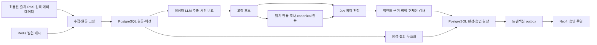

# PoC
notion_id: 3dffef49-d8d5-804b-a40f-cbdcac4396e3
last_edited_time: 2026-09-18T15:41:06.231000+09:00
source_url: https://www.notion.so/3dffef49d8d5804ba40fcbdcac4396e3
database: 🤡회의록

<details><summary>PoC</summary>

  **# InvestMate 기초 기술검증(PoC) 결과보고서**
  **## 근거 추적형 뉴스 사건·기업 관계 파이프라인**
  | 문서 관리 항목 | 내용 |
|---|---|
| 문서 번호 | IM-POC-001 |
| 문서 버전 | 1.0 |
| 작성 기준일 | 2026년 9월 18일, 한국 표준시(KST) |
| 대상 프로젝트 | InvestMate 부트캠프 프로젝트 |
| 문서 목적 | 기초 기술검증 결과, 기술 선택 근거 및 프로토타입 전환 조건의 정리 |
| 대상 구현 | Python CLI 기반 PoC, 프로젝트 패키지 버전 0.1.0 |
| 실행 전제 | 참여자별 개인 기기에서 수행하는 비상업적 실험; 중앙 재배포 서비스 아님 |
| 작성 근거 | 소스 코드, 고정 데이터, 실제 API 응답, 로컬 서비스 검증 및 회귀 테스트 산출물 |
| 검토 성격 | AI 보조 작성 및 원문 기반 분석; 사람 정답셋에 의한 정확도 인증 문서가 아님 |

---
  **## 초록**
  본 PoC는 뉴스·공시·기업 발표에서 구체적인 사건을 추출하고, 사건과 기업의 관계를 원문 근거까지 추적하면서 검증된 결과만 그래프에 반영할 수 있는지 확인하기 위해 수행하였다. 검증 대상은 수집, 사건 언급 추출, 후보 검색·비교, 의미 검증, 승인 원장 및 그래프 투영의 연결 가능성과 통제 가능성이다. 투자 추천과 주가 예측은 대상에서 제외하였다.

구현은 Python CLI, PostgreSQL·pgvector, Neo4j 및 제한적인 Redis 발견 캐시로 구성하였다. 범용 생성형 LLM은 추출·사건 비교·자료 조사에 사용하고, TypeSafe Jev는 고정된 주장에 대한 구조화된 의미 판정에 사용하였다. 인용 위치, 버전, 권한, 관계 끝점 및 승인 조건은 모델이 아니라 백엔드가 검사하도록 분리하였다.

실제 자료 19건을 고정했으며, 전체 원문 입력 18건 중 17건에서 사건 언급 96개를 추출하였다. 해당 실행에서는 후보 92개가 HOLD로 저장되었다. 이후 이 후보 92개에 새 질문 계약으로 Jev를 한 번씩 호출하고, 동일 응답에 판정 기준을 달리 적용하였다. 최초 수치 검사에서는 81개 응답이 처리되었고, 부동소수점 동률 및 제한된 확률합 결함을 보수적으로 격리한 뒤 90개 응답을 대상별로 처리할 수 있었다. 처리 가능성 증가는 승인 정확도의 향상을 의미하지 않는다.

보고서 작성 직전에는 기사 관계의 의미를 명확히 하는 최소 수정을 수행하였다. 기존의 ‘기사의 주된 뉴스’ 조건을 ‘본문에서 실제로 보도한 현재 사건과 구체적 세부 사건’으로 정리하고, 원문·웹 검증 질문에 동일한 사건 핵심과 출처 식별 문맥을 제공하였다. 사전 선택한 문제 사례 6건에 구·신 질문을 각각 단회 호출하고 실험 프로파일(지지 하한 0.65, 반박 상한 0.10, 실험 confidence 하한 0.30)로 집계한 결과, 기사 관계 단독 통과는 1건에서 5건으로, 사건까지 함께 통과한 기사 연결은 0건에서 3건으로 증가하였다. 제품 기본 보수 정책에서는 이 사례들의 사건 판정이 통과하지 않는다. 이는 작은 문제 사례 집합에 대한 진단 결과이며, 일반적인 정확도 개선율이나 개별 수정 요소의 인과 효과로 해석할 수 없다.

최종 회귀 테스트 699개와 실제 로컬 저장소 검증을 통해 기술적 연결 및 승인 통제의 구현 가능성을 확인하였다. 그러나 사람 정답셋, 범용 LLM과 Jev의 동일 조건 정확도 비교, 금액 기준 비용 평가 및 대표성 있는 대규모 실험은 미완료이다. 따라서 본 결과는 운영 서비스의 자동 사실 검증을 승인하는 근거가 아니라, 근거 확인과 사람 검토를 중심으로 한 로컬 프로토타입으로 전환할 수 있는 기초 기술 근거로 판단한다.
  - *주제어:**
  뉴스 사건 추출, 근거 추적, 기업 관계 그래프, 구조화된 모델 판정, 선택적 승인, PoC

---
  **## 목차**
  1. [서론](#1-서론)
2. [범위와 검증 원칙](#2-범위와-검증-원칙)
3. [시스템 구성과 데이터 계약](#3-시스템-구성과-데이터-계약)
4. [기술 선택 및 변경 근거](#4-기술-선택-및-변경-근거)
5. [범용 생성형 LLM과 Jev 비교](#5-범용-생성형-llm과-jev-비교)
6. [실험 설계 및 평가 방법](#6-실험-설계-및-평가-방법)
7. [실험 결과](#7-실험-결과)
8. [한계와 위험](#8-한계와-위험)
9. [결론 및 프로토타입 전환 조건](#9-결론-및-프로토타입-전환-조건)
10. [참고문헌 및 근거 자료](#10-참고문헌-및-근거-자료)

부록 A. [재현 및 운영 경계](#부록-a-재현-및-운영-경계)  
부록 B. [주요 용어와 지표 정의](#부록-b-주요-용어와-지표-정의)  
부록 C. [산출물과 추적성](#부록-c-산출물과-추적성)
  **### 표 및 그림 목록**
  - 표 1. 검증 질문과 확인 수준
- 표 2. 포함·제외 범위
- 표 3. 구현 환경과 구성요소
- 표 4. 주요 기술 선택 및 변경 이력
- 표 5. 범용 생성형 LLM 검증과 Jev 판정의 비교
- 표 6. 실험 데이터 구분
- 표 7. 실험 단위와 해석 범위
- 표 8. 실제 자료 처리 단계별 결과
- 표 9. 동일 실응답의 판정 기준별 비교
- 표 10. 보고서 전 최소 수정의 대응 비교
- 표 11. 대응 비교의 사례별 결과
- 표 12. 주요 위험과 프로토타입 전환 조건
- 그림 1. 처리 흐름 및 저장 권한 경계

---
  **## 1. 서론**
  **### 1.1 배경**
  뉴스 기반 기업 정보 탐색에서는 유사한 단어의 출현과 실제 사건의 동일성, 기업명 언급과 직접 참여, 사업 구조상의 관련성과 실제 사건의 적용성을 구분해야 한다. 이 구분 없이 기사 유사도나 모델의 설명을 곧바로 그래프 간선으로 저장하면, 다른 사건의 혼합과 근거 없는 기업 연결이 발생할 수 있다.

InvestMate의 초기 논의에는 기사 군집화와 사건 추출의 순서, Event와 Issue의 구분, 검증 AI 및 사람 검수의 역할 등 여러 대안이 있었다. 본 PoC에서는 이를 모두 확정된 팀 합의로 간주하지 않고, 구현과 실험에 필요한 최소 계약을 선택하였다. 초기 대안과 선택의 근거는 기존 명세에 기록되어 있다.[R1, §§1–3]
  **### 1.2 목적**
  본 PoC의 목적은 다음 세 문제를 분리하여 검증하는 데 있다.

1.
  - *검색:**
  비교할 만한 사건 후보를 찾을 수 있는가?
2.
  - *판별:**
  동일 사건·별개 사건·후속 사건 및 기업의 참여 관계를 구분할 수 있는가?
3.
  - *반영:**
  검증되지 않았거나 근거가 바뀐 결과가 유효한 그래프에 섞이지 않도록 통제할 수 있는가?

본 보고서는 구현 가능성, 실험 관측, 설계 판단 및 아직 확인하지 못한 품질을 구분하여 기술한다.
  - *표 1. 검증 질문과 확인 수준**
  | 검증 질문 | 현재 근거 | 판단 |
|---|---|---|
| 원문에서 사건 언급을 구조화하고 인용에 연결할 수 있는가? | 합성 및 실제 입력의 추출·인용 위치 검사 | 연결 가능성 확인; 실제 추출 정확도는 미확정 |
| 표현이 다른 동일 사건과 유사한 별개 사건을 구분할 수 있는가? | 합성 시나리오의 통합·분리·후속 관계 검사 | 제한된 합성 조건 확인; 실제 뉴스 정답셋 평가 미완료 |
| 승인·보류·오류를 구분하고 구버전·철회 결과를 차단할 수 있는가? | PostgreSQL·Neo4j 통합 검증, 수치 오류 격리, 정정·철회 시나리오 | 구현된 경계의 동작 확인 |
| 구조화된 판정으로 보류 원인과 정책 변경 효과를 추적할 수 있는가? | 질문별 trace, 저장 응답 재평가, 대응 실호출 | 추적 가능성 확인; 판정의 진실성 보장은 아님 |
| 검토 중심 프로토타입으로 넘어갈 수 있는가? | 실행 가능한 백엔드와 고정 자료·검토 산출물 확보 | 가능; 운영용 자동승인 전환과는 구분 |
  **### 1.3 보고서의 증거 기준**
  -
  - *관측 사실:**
  실행 JSON, 응답 원문, 코드 또는 테스트 결과로 확인한 사항이다.
-
  - *설계 판단:**
  요구와 관측을 바탕으로 선택한 구조이며, 대안 대비 성능 우위가 자동으로 입증된 것은 아니다.
-
  - *미측정 사항:**
  사람 정답 기반 정확도, 금액 비용 등 현재 근거가 없는 항목이다.

테스트 통과 수, API 응답 처리 수, 자동 판정 통과 수 및 정확도는 서로 다른 지표로 취급한다.
  **## 2. 범위와 검증 원칙**
  **### 2.1 적용 범위**
  - *표 2. 포함·제외 범위**
  | 구분 | 내용 |
|---|---|
| 포함 | 제한된 뉴스·공시 발견, 허용된 원문 수집, 원문 버전 고정, 사건 언급 추출, 후보 검색·비교, 근거 검증, 승인 원장, 그래프 투영, 반복·재개, 오프라인 검토 |
| 제외 | 투자 추천, 매매 판단, 목표가·주가 방향 예측, 뉴스와 주가의 인과관계 인증 |
| 미구현 제품 영역 | 회원·인증·포트폴리오·알림·관리자 화면, 일반 사용자를 위한 그래프 UI |
| 운영 범위 밖 | 대규모 분산 처리, 고가용성, 전체 공급망 구축, 무제한 웹 조사, 운영 SLA |

초기에는 삼성전자 중심의 한국어 반도체 기사와 더 큰 평가셋을 제안하였다. 실제 기초 실험에서는 삼성전자·SK hynix·NVIDIA와 관련 규제 자료로 범위를 넓히되, 먼저 본문 확보와 처리 경계를 확인할 수 있는 19건을 고정하였다. 초기 제안의 약 100건 검수 기사·200쌍 비교 목표를 달성했다고 보고하지 않는다.[R1, §2; R5]
  **### 2.2 개인 기기별 실행과 외부 처리**
  프로젝트는 참여자별 개인 기기에서 직접 실행하는 비상업 부트캠프 실험을 전제로 한다. PostgreSQL·Neo4j·Redis는 로컬 서비스로 구성하였고, 중앙 재배포 서비스를 만들지 않았다.

그러나 프로그램이 개인 기기에서 실행된다고 해서 모델 처리까지 로컬인 것은 아니다. DeepSeek 계열 모델과 Jev 호출은 외부 API 처리이다. 원문 저장·모델 전송·재배포 권한을 구분하며, RSS 접근 허용을 본문이나 외부 모델 전송 허용으로 자동 확대하지 않는다. 연합뉴스 RSS는 확인된 개인별 비상업 이용 범위에서 메타데이터 발견에만 활성화하였다.[R10, R14]
  **### 2.3 사실과 근거의 해석**
  본 시스템의 검증은 우선
  - *제공된 원문이 특정 주장을 지지하는가**
  를 다룬다. 기업의 공식 발표를 정확하게 인용했다는 사실만으로 발표 내용의 독립적 진실성이 인증되는 것은 아니다.

같은 모델의 대화를 나누거나 다른 모델을 호출하는 것은 실행 문맥을 분리하는 방법이다. 모델 오류가 통계적으로 독립적임을 보장하지 않는다. 원문과 canonical 웹 인용이 같은 게시자의 같은 발표에서 왔다면 독립 출처 두 개로 세지 않는다.
  **## 3. 시스템 구성과 데이터 계약**
  **### 3.1 구성**
  - *표 3. 구현 환경과 구성요소**
  | 구성요소 | 구현·설정 | 역할 및 경계 |
|---|---|---|
| 실행 | Python 3.13 환경, uv, `poc` CLI | 프로젝트 선언은 Python 3.12 이상; 실제 검증 환경은 macOS ARM64 |
| 계약 | Pydantic 2.x, JSON | 타입·필드·앵커 검증; JSON 문법 자체를 사실 검증으로 보지 않음 |
| 기준 저장소 | `pgvector/pgvector:pg17` | 기사 버전·후보·판정·체크포인트·작업 임대·outbox의 기준 |
| 그래프 | `neo4j:5.26-community` | 현재 승인된 결과의 재생 가능한 투영 |
| 발견 캐시 | `redis:8.2-alpine`, 128MB, `noeviction` | 메타데이터 TTL 캐시·공유 갱신 조정; 원장 대체 아님 |
| 원문 처리 | lxml, pypdf, Pillow, newspaper4k 0.9.6 | 허용 범위·크기·형식 검사를 거친 제한 추출 |
| 생성형 모델 | OpenAI 호환 경로의 `deepseek-v4.1-flash` | 추출·비교·읽기 전용 조사; 초기 검증 접근에도 사용 |
| 구조화 판정 | TypeSafe `jev-1.13.0` | 고정 주장에 대한 Choice 판정; 실행·저장 권한 없음 |

환경은 선언된 패키지와 Compose 이미지 태그를 기준으로 기록하였다. 태그만으로 미래의 이미지 바이트가 동일하다고 보장하지 않는다. 정확한 Python 의존성은 `uv.lock`으로 관리한다.[R2]


  - *그림 1. 처리 흐름 및 저장 권한 경계.**
  모델의 판단과 데이터 반영을 분리하며, Neo4j나 Redis를 승인 권위로 사용하지 않는다.[R1, §§4, 15, 17–18]
  **### 3.2 핵심 데이터 계약**
  - `Article`과 원문 버전은 수집 시점의 자료를 식별한다. 같은 URL의 정정 본문은 다른 버전이다.
- `Mention`은 기사에서 추출한 사건 언급이며, 승인된 사실이나 통합 이슈와 동일하지 않다.
- `Issue`는 구체적 사건 단위이다. 장기 주제 묶음과 혼용하지 않는다.
- `Candidate`는 주장·근거·기사 소속·관계를 고정한 검증 대상이다.
- `Validation`은 해당 후보 버전에 대한 판정이며, 절대적 사실 인증서가 아니다.
- `WebDossier`는 canonical 문서·정확한 인용·권한·버전을 고정한 서버 첨부 자료이다.

보고서 작성 직전 정리한 관계 의미는 다음과 같다.

- `REPORTS`: 해당 원문이 현재 또는 새롭게 보고하는 구체적 사건을 보도한다. 주된 사건뿐 아니라 실제로 보고된 구체적 세부 사건도 포함한다.
- `PROVIDES_BACKGROUND`: 원문 서술에서 다른 사건의 배경으로 사용한 구체적 과거 사건이다. 오늘의 날짜나 수집 시각만으로 배경 여부를 정하지 않는다.
- `INVOLVES`: 명시된 기업의 직접 참여 관계이다. 기업명 등장만으로 만들지 않는다.
- `FOLLOWS`: 원문 근거가 있는 후속 사건 방향이다. 단순 날짜 순서나 유사성으로 만들지 않는다.
- `STRUCTURALLY_RELATED_TO`: 승인된 사업·제품 관계와 사건 적용 근거를 함께 요구하는 제한된 구조적 관련성이다.
  **### 3.3 승인과 부분 게시**
  인용의 실제 일치, 문서 해시, 원문 현재성, 권한, 관계 끝점 및 기준 경로는 결정론적 검사로 처리한다. Jev가 이를 확률로 다시 승인하도록 하지 않는다.

의미 판정에서는 핵심 사건과 개별 관계, 그리고 구조화된 날짜·기간·국가를 구분한다. 미승인 부가 값은 게시 언급에서 제외하되 감사 원본은 보존한다. 해당 필드가 필요한 후속·구조적 관계도 보류한다. 제목·행위 등 핵심 문장에 포함된 날짜나 수치는 계속 핵심 검증 대상이다.

승인 정책이나 질문 계약이 바뀌면 새 식별로 구분한다. 과거 HOLD를 통과할 때까지 반복 호출하거나, 오래된 응답을 새 질문의 결과로 다시 표시하지 않는다.
  **## 4. 기술 선택 및 변경 근거**
  아래 표는 초기 검토 대안, 실제 구현 중 변경 및 실험적 선택을 구분한다. 검토 대안이 모두 한때 구현되어 있었다는 뜻은 아니다.
  - *표 4. 주요 기술 선택 및 변경 이력**
  | 영역 | 기존 안·접근 | 현재 선택 또는 변경 | 이유와 남은 조건 |
|---|---|---|---|
| PoC 구현 형식 | 운영 서비스 구조를 먼저 확장하는 접근 | Python CLI와 외부 연동·JSON 계약 분리 | 핵심 흐름을 작게 실행·관찰하기 위한 선택이다. 후속 프레임워크 선택을 완료한 것은 아니다. |
| 사건 모델 | 기사 군집 선행, Event–Issue 이중 계층 등 초기 대안 | 기사별 사건 언급 추출 후 비교·통합; 사건 단위 Issue | 한 기사 안의 여러 사건과 서로 다른 시점·계약을 보존한다. |
| 저장 권위 | 그래프를 곧 최신 사실 상태로 취급할 위험 | PostgreSQL 원장 + Neo4j 투영 | 정정·철회·구버전 차단과 재실행 정합성을 한 곳에서 통제한다. |
| 벡터 저장 | 별도 벡터 저장소 도입 가능성 | PostgreSQL 내 pgvector | PoC의 저장소 수와 정합성 경계를 줄인다. 실제 검색 정확도 우위는 미측정이다. |
| 검증 역할 | 생성형 LLM이 최종 판정과 설명을 반환 | 생성형 LLM의 추출·조사 역할 유지, Jev의 고정 질문 판정 결합 | 역할을 대체하기보다 분리한다. Jev의 정확도 우월성을 입증해 선택한 것은 아니다. |
| 구조화 출력 | 제공자 `json_schema` 요청 | 지원 경로에서는 `json_object` + 애플리케이션 strict 검사 | 실제 경로의 schema 형식 미지원에 대응하였다. JSON 파싱 성공을 승인으로 간주하지 않는다. |
| 승인 수치 | confidence 0.85 일괄 하한 | 지지·반박 확률의 명시적 정책과 필드별 판정 | 분포 요약값인 confidence와 정답률을 구분한다. 수치 기준은 아직 보정되지 않았다. |
| 수치 결함 | 작은 최댓값 차이·합계 결함으로 응답 전체 실패 | 끝자리 동률 허용, 제한된 합계 결함은 해당 질문 HOLD | 원시 값을 유지하고 정상적인 다른 판단을 보존한다. 임의 정규화는 하지 않는다. |
| 부가 속성 | 부가 필드가 핵심 사건 전체의 보류로 이어지는 구조 | 날짜·기간·국가를 별도 검증·부분 게시 | 모르는 부가 값을 빼고도 확인된 핵심을 다룰 수 있게 한다. |
| 기사 관계 | 검증 질문에 ‘주된 뉴스’ 조건 사용 | 본문에서 보고한 현재·구체적 세부 사건까지 REPORTS에 포함 | 한 기사–여러 사건이라는 목적과 질문의 단위를 맞춘다. 과거 배경·일반 언급은 구분한다. |
| 관계 질문 문맥 | 웹 관계 질문에서 사건·출처가 간접적으로만 연결 | 원문·웹 질문에 동일한 출처 식별과 사건 핵심을 명시 | 불투명한 ID 해석 부담과 선택적 필드의 재개입을 줄이려는 수정이다. 메타데이터는 증거로 승격하지 않는다. |
| 본문 추출 | trafilatura 일반 추출 fallback | XPath·의미 영역 우선, newspaper4k 파서 fallback | 한국어 추출을 확인하되 휴리스틱 결과를 검증된 전체 본문으로 자동 승격하지 않는다. |
| 발견 제공자 | 단일 검색 경로에 의존할 가능성 | Naver API HUB·Exa·등록 RSS와 제한적 추가 제공자 | 검색 메타데이터와 원문 권한을 분리한다. 공급자별 가용성·품질은 별도다. |
| 캐시·동시성 | 매번 같은 발견 요청 수행 | Redis TTL 캐시·토큰 소유권 갱신 조정 | 같은 기기 내 중복 부하를 줄인다. 원문 캐시나 승인 큐로 확대하지 않았다. |

선정의 핵심은 모델이나 저장소 하나에 더 많은 권한을 주는 것이 아니라,
  - *생성·판정·검증·반영의 책임을 나누고 각 단계의 오류를 관찰할 수 있게 하는 것**
  이다.[R1, R6–R11]
  **## 5. 범용 생성형 LLM과 Jev 비교**
  **### 5.1 비교 대상의 정의**
  Jev도 모델이다. 본 보고서의 ‘LLM 대 Jev’는 AI와 비AI의 비교가 아니라,
  - *범용 생성형 모델에 판정 JSON을 생성시키는 접근과 고정된 질문에 구조화된 판정 분포를 받는 접근의 비교**
  이다.

범용 모델의 실제 식별자는 `deepseek-v4.1-flash`이고, Jev 실험은 `jev-1.13.0`을 고정하였다. OpenCode Go는 모델 접근 서비스 이름이며 Go 프로그래밍 언어를 뜻하지 않는다.
  - *표 5. 범용 생성형 LLM 검증과 Jev 판정의 비교**
  | 비교 항목 | 범용 생성형 LLM 기반 검증 | Jev 구조화 판정 |
|---|---|---|
| 주된 활용 | 추출, 사건 비교, 도구 선택·조사, 판정 JSON 생성 | 고정 후보의 좁은 의미 질문에 대한 판정 |
| 출력 형태 | 스키마에 맞춘 JSON 및 서술형 사유 | 선택지, 확률분포, confidence; 백엔드의 판정 집계 |
| 구조 보장 | JSON 모드는 JSON 문법을 돕지만 스키마·근거·식별자를 별도 검사해야 함 | 구조화된 API이지만 관측된 수치 계약 결함도 별도 검사해야 함 |
| 판정 대상 연결 | 모델이 반환하는 대상·버전 등을 엄격히 대조 | 백엔드가 질문 키와 대상의 연결을 구성·검사 |
| 설명 | 서술형 이유를 제공할 수 있으나 이유의 정확성이 별도로 보장되지는 않음 | 내부 이유를 서술하지 않으므로 질문·근거·분포·프로그램 사유로 설명 |
| 기준 재평가 | 최종 판정만 저장하면 새 수치 정책 비교에 한계 | 동일한 질문 응답을 저장하면 새 호출 없이 판정식 비교 가능 |
| 불확실성 | 임의 자기평가 점수와 실제 정확도의 관계를 별도 검증해야 함 | confidence는 분포의 요약이며 정답률이 아님; 반환 확률도 도메인 평가 필요 |
| 실행 권한 | 조사 역할에만 제한된 읽기 도구; 쓰기·승인 권한 없음 | 도구·DB·후보 수정 권한 없음 |
| 확인된 장점 | 소규모 합성 흐름에서 추출·통합·승인 경로를 수행; 실제 도구 조사 가능 | 질문 단위 진단과 동일 응답 정책 비교 가능 |
| 확인된 한계 | 초기 대상 문자열 계약 오류, 긴 응답·시간 제한, 추출 세분화·역할 어휘 문제 | 높은 보류율, 응답 수치 결함, 질문 문맥·단위에 따른 판정 변동 |

DeepSeek의 JSON Output 문서는 유효 JSON 출력을 설명하며, 빈 응답 가능성도 안내한다. TypeSafe 문서는 Choice의 확률분포와 분포에서 유도된 confidence를 구분한다. 어느 쪽도 본 프로젝트의 사실 판단 정확도를 자동 보장하지 않는다.[R12, R13]
  **### 5.2 실제 관측과 선택 이유**
  초기 생성형 검증 연동에서는 21회 API 시도 후 승인 이슈가 없었으며, `target`에 리터럴 `"issue"` 대신 실제 이슈 ID를 반환한 계약 문제가 확인되었다. 이 문제는 프롬프트와 요청별 스키마를 보완해 처리했다. 당시 요약 파일의 ‘수정 후 실호출 미실시’는 그 연동 단계의 상태이다.[R3]

이후 역할별 계약을 보완한 별도 실행에서는 합성 기사 3건을 대상으로 채팅·임베딩 합계 12회 호출 안에서 후보 3개를 승인하고 이슈 2개·관계 8개를 구성하였다. 따라서 초기 실패만으로 생성형 검증기가 작동하지 않는다고 결론 내릴 수 없다.[R4]

Jev 도입 후에도 범용 LLM을 제거하지 않았다. 추출·비교·조사는 생성형 모델의 역할로 유지하고, 최종 의미 판정에는 선택지와 분포를 직접 다룰 수 있는 구조를 채택하였다. 이는
  - *책임 분리와 운영 통제에 관한 설계 선택**
  이다.
  **### 5.3 현재 할 수 없는 우열 주장**
  동일한 실제 후보·동일한 정보·대응되는 질문·사람 정답을 갖춘 LLM–Jev 직접 비교 실험은 없다. 따라서 다음은 주장하지 않는다.

- Jev가 생성형 LLM보다 정확하거나 오승인이 적다는 주장
- 서로 다른 작업의 지연을 나눈 배수 성능 비교
- 보고된 토큰만으로 계산한 실제 과금액 또는 비용 우위
- 생성형 모델의 합성 승인 3건과 Jev 실제 후보의 보류 수를 비교한 정확도 순위

Jev의 단일 판정 왕복 시간과 생성형 모델의 추출·도구 조사·전체 처리 시간은 측정 단위가 다르다. 후속 비교에서는 같은 실제 평가셋과 사람 정답, 동일한 정보 제공 범위, 작업별 호출·토큰·시간을 통제해야 한다.
  **## 6. 실험 설계 및 평가 방법**
  **### 6.1 데이터 구분**
  - *표 6. 실험 데이터 구분**
  | 구분 | 구성 | 해석 범위 |
|---|---|---|
| 합성 흐름 자료 | 계약·실적 등 제한된 가상 기사와 기대 관계 | 코드·계약·통합 흐름 확인; 실제 뉴스 정확도 아님 |
| 실제 고정 자료 | 삼성 뉴스룸 7, NVIDIA 7, SK hynix 2, OpenDART 1, BIS 2: 총 19건 | 실제 본문·공시 처리와 후보 생성 실험 |
| 처리 가능한 전체 원문 입력 | 18건; 부분 원문 1건 제외 | 처리 시도 범위이며 성공 건수와 다름 |
| 실제 저장 후보 | 추출 성공 기사 17건의 언급 96개 중 판정 저장 후보 92개 | 후보·질문 단위 비교; 독립적인 기사 92건이 아님 |
| 보고서 전 대응 사례 | 기존 보류 문제 사례 6건 | 의도적으로 선택한 문제 진단 표본; 무작위 성능 표본 아님 |
| 사람 정답 | 실제 자료의 확정 라벨 없음 | 정확도·오승인율·보정 적합성은 미측정 |

고정 자료의 SHA-256은 부록 C에 제시하였다. 수집 시각보다 미래인 게시자 선언 RSS 시각 3건은 원래 값을 보존하고 한계로 기록하였다. 게시 시각을 사건 발생 시각으로 자동 치환하지 않았다.[R5]
  **### 6.2 평가 단위와 집계 원칙**
  1. API 시도, 정상 HTTP 응답, 파싱·계약 처리 가능 응답, 의미 판정 통과 및 실제 게시를 구분한다.
2. 사건·관계·질문 수를 섞지 않는다. 관계 단독 ALLOW가 있어도 소유 사건이 HOLD이면 연결 가능 관계로 세지 않는다.
3. 금액을 반환받지 못한 경우 미측정으로 표기한다. 토큰은 보고 사용량이며 청구서가 아니다.
4. 같은 응답으로 기준을 비교할 때와, 질문을 바꾸어 새 응답을 받을 때를 구분한다.
5. 의미적 HOLD를 승인될 때까지 반복하지 않는다. 진단 호출은 사전 상한과 재시도 금지 조건으로 실행한다.
6. 수치적으로 판단 불가인 질문은 정책 평가에서 HOLD로 남기되 확률 품질 평가에서는 제외한다.
  - *표 7. 실험 단위와 해석 범위**
  | 실험 | 방법 | 주요 제한 |
|---|---|---|
| 초기 LLM 연동 및 후속 흐름 | 실제 서비스 호출, 합성 입력, 고정 호출 상한 | 초기 실패와 후속 성공은 서로 다른 단계 |
| Jev 도입 경계 검사 | 합성 9종 첫 실행·반복 실행 | 사람 뉴스 정답 평가 아님; 반복 변동 존재 |
| 실제 자료 종단 처리 | 원문 고정 후 추출·조사·Jev·원장 연결 | 많은 단계의 호출이 합산됨; 승인 정확도 없음 |
| 실제 92후보 판정식 비교 | 후보별 Jev 단회 호출 후 같은 응답 재집계 | 실패 응답을 별도 집계; 선택된 저장 후보 모집단 |
| 수치 수정 재평가 | 저장된 92개 요청·응답을 그대로 재사용 | 새 질문이나 새 모델 결과로 재표시하지 않음 |
| 최소 수정 대응 비교 | 6사례 × 구·신 질문 각 1회 = 최대 12회; 실행 순서 교대 | 정의와 문맥을 함께 바꾼 진단; 요소별 효과·정확도 추정 불가 |
  **### 6.3 보고서 전 최소 수정의 통제 조건**
  대응 비교는 같은 후보, 원문, canonical 인용, 기업 식별 사전 및 질문 대상 연결을 유지하였다. 구 질문은 원래 동결된 요청을 그대로 사용하고, 신 질문은 수정 코드에서 생성하였다. 양쪽 모두 새 응답을 한 번씩 받았으며 현재의 동일 수치 처리 규칙으로 집계하였다.

모델은 `jev-1.13.0`, 판정 프로파일은 지지 하한 0.65·반박 상한 0.10·반려 기준 0.90·실험 confidence 하한 0.30으로 고정하였다. 모델 응답을 보기 전에 사례와 순서를 고정했고, 자동 재시도·다른 모델 대체·원장 쓰기는 하지 않았다. 실제로 보낸 요청의 의미 식별과 수치 집계에 사용한 코드 식별을 구분하였다.[R9]
  **## 7. 실험 결과**
  **### 7.1 생성형 LLM 및 Jev 도입 관측**
  생성형 LLM 후속 합성 흐름에서는 12회 호출, 약 153.4초, 보고 입력 26,053토큰·출력 31,036토큰으로 후보 3개가 승인되었다. 예산 때문에 미완료인 언급 1개는 HOLD로 세지 않았다.[R4]

Jev의 별도 합성 경계 검사에서는 최초 9/9, 반복 8/9가 기대 조건에 맞았다. 같은 구조적 관계 양성 사례의 confidence가 0.86에서 0.84로 변하여 당시 하한 0.85를 넘나들었다. 검증 전용 18회 왕복 시간은 최소 0.255초, 중앙값 0.337초, 최대 0.981초였다. 이는 작은 합성 표본의 판정 호출 지연이지 서비스 SLA나 LLM 대비 속도 배수가 아니다.[R7]
  **### 7.2 실제 자료 종단 처리**
  - *표 8. 실제 자료 처리 단계별 결과**
  | 단계 | 관측 |
|---|---:|
| 고정 자료 | 19건 |
| 전체 원문 입력으로 처리 시도 | 18건 |
| 추출 성공 기사 | 17건 |
| 추출 언급 | 96개 |
| 판정이 저장된 후보 | 92개, 모두 HOLD |
| 판정 저장 전 실패 | 언급 4개 |
| 별도 추출 실패 | 기사 1건, 인용문 불일치 |
| 기존 실제 원장 승인 | 0개 |

해당 종단 실험의 실행 합계는 모델 호출 691회, 보고 입력 11,862,242토큰·출력 725,892토큰, source HTTP 요청 911회였다. 이 값은 추출·조사·최종 판정 등의 복합 실행 합계이며 Jev 단독 호출 수가 아니다. 초기 진단 실패와 재개도 포함한다. 완료 결과와 오류를 재사용한 마지막 재실행은 모델·source HTTP 모두 0회였다.[R6]
  **### 7.3 실제 92후보의 판정식 및 수치 처리 비교**
  새 분리 질문 계약으로 실제 92후보를 각각 한 번씩 호출하였다. 요청 질문은 1,722개였고, 모든 응답의 실제 모델 식별자는 `jev-1.13.0`이었다. 보고 입력은 1,872,490토큰, 출력은 86,563토큰이며, 92회 왕복의 평균은 약 0.424초였다.[R8]

최초 파서는 응답 81개를 처리하고 11개를 계약 오류로 분류했다. 이후 저장 응답의 원시 값과 요청을 유지하면서 다음 수치 처리를 적용하였다.

- `1e-12` 이하의 양의 최댓값 차이는 부동소수점 동률로 취급한다.
- 확률합은 기존 `1e-6` 허용 오차로 검사한다.
- 소수 둘째 자리 격자에 해당하는 값들의 제한된 합계 편차는 해당 질문의 수치적 HOLD로 격리한다. 확률을 정규화하거나 승인값으로 고치지 않는다.
- 유의미한 최댓값 불일치, 큰 합계 오류, 잘못된 키·타입·범위는 계속 차단한다.

그 결과 응답 전체 실패 없이 대상별로 처리할 수 있는 응답은 90개가 되었다. 합계 결함 질문 9개는 여전히 HOLD이며, 최댓값 끝자리 동률 진단은 1개였다. 남은 응답 전체 오류 2개는 유의미한 최댓값 불일치다. 따라서 90개가 모두 정상적인 확률분포였다는 뜻은 아니다.[R11]
  - *표 9. 동일 실응답의 판정 기준별 비교 — 수치 수정 후 90개 처리 응답**
  | 프로파일 | 지지 하한 | 반박 상한 | 실험 confidence 하한 | 사건 후보 ALLOW | 관계 단독 ALLOW | 사건·관계 동시 통과 연결 | 회사 참여 연결 |
|---|---:|---:|---:|---:|---:|---:|---:|
| 보수 | 0.90 | 0.05 | 없음 | 0 | 6 | 0 | 0 |
| 보수+하한 대조 | 0.90 | 0.05 | 0.30 | 0 | 6 | 0 | 0 |
| 완화 | 0.70 | 0.10 | 0.30 | 8 | 41 | 7 | 4 |
| 확대 | 0.65 | 0.10 | 0.30 | 12 | 58 | 12 | 6 |

모든 프로파일의 반려 기준은 반박 확률 0.90이다. 수치 수정 전에는 처리 응답 81개에서 관계 단독 ALLOW가 각각 6·6·37·51개였다. 수치 수정으로 대상별 처리가 가능해졌지만 사건·관계 동시 통과 연결 수는 바뀌지 않았다.

이 프로파일들은 운영 정확도를 검증한 기준이 아니다. 현재 제품의 기본 확률 정책, 과거 실제 원장의 scalar 정책, confidence 하한을 포함한 실험 프로파일을 구분한다. 이번 작업에서 실험 프로파일을 실제 원장에 활성화하지 않았다.

이전에 저장 응답을 내보낸 질문 수 1,605개와 여기의 1,722개는 분모가 다르다. 동결 입력을 대조한 결과, 차이 117개는 별도로 추가한 웹 날짜 52개·기간 20개·국가 45개 질문이다. 두 질문 계약의 결과를 같은 질문 집합의 정확도로 합치지 않는다.
  **### 7.4 보고서 전 최소 수정의 대응 실험**
  기존의 주된 뉴스 조건과 기사 관계 문맥을 정리한 뒤 문제 사례 6건을 대응 비교하였다. 12회 모두 HTTP 응답과 수치 처리를 완료하여 비교 가능한 쌍은 6개였다. 보고 입력은 248,978토큰, 출력은 11,240토큰이며, 호출 왕복 합은 약 6.52초였다. 과금액은 측정하지 않았다.[R9]

집계는 §6.3의 실험 프로파일을 사용하였다. 같은 응답을 제품 기본 보수 정책으로 집계하면 이 6사례의 사건 판정은 구·신 모두 통과하지 않으므로, 아래 대비는 해당 실험 기준에서만 성립한다.
  - *표 10. 보고서 전 최소 수정의 대응 비교 — 같은 6사례, 양쪽 모두 새 응답, 실험 프로파일 지지 0.65·반박 상한 0.10·confidence 하한 0.30**
  | 지표 | 구 질문 | 신 질문 |
|---|---:|---:|
| 처리 가능한 호출 | 6/6 | 6/6 |
| 사건 후보 ALLOW | 4 | 4 |
| 기사 관계 단독 ALLOW | 1 | 5 |
| 사건과 함께 통과한 기사 연결 | 0 | 3 |
| 사건과 함께 통과한 전체 관계 | 3 | 6 |
  - *표 11. 대응 비교의 사례별 결과**
  | 사례 | 구: 사건 / 기사 관계 | 신: 사건 / 기사 관계 | 관측 해석 |
|---|---|---|---|
| BIS의 MGX 수출허가 우호적 심사 계획 | ALLOW / HOLD | ALLOW / ALLOW | 기사 안의 구체적 추가 계획을 보도 관계로 연결 |
| 삼성전자·DH플러스 업무협약 | ALLOW / HOLD | HOLD / ALLOW | 기사 관계는 통과했으나 사건 대상의 지지가 0.62여서 게시 연결은 보류 |
| 삼성전자 기후산업국제박람회 | ALLOW / HOLD | ALLOW / ALLOW | 직접적인 행사 보도 연결이 통과 |
| One UI의 Scam Detection 지원 국가 확대 | HOLD / HOLD | ALLOW / ALLOW | 기능 목록 속 구체적 세부 사건 연결이 통과 |
| SK hynix의 미확정 계획 해명 | ALLOW / HOLD | ALLOW / HOLD | 신 질문 지지 0.84이나 반박 0.11이 상한 0.10을 넘음 |
| 맨체스터대 학습데이터·워크플로 공개 계획 | HOLD / ALLOW | HOLD / ALLOW | 참여자 역할 지지가 0.60/0.62로 낮아 사건 자체는 계속 보류 |

이 결과는 관계 의미와 문맥을 명확히 하는 최소 수정이 선택된 문제 사례에서 연결을 개선했다는 관측이다. 모든 보류를 없애지는 않았고, 수정하지 않은 핵심 질문의 결과도 반복 호출에서 달라질 수 있었다. 정의 변경·문맥 명시·추론 변동 중 각 요소의 기여를 분리한 실험은 아니다. 과거 전체 92후보의 결과를 이 6건의 결과로 대체하지 않았다.
  **### 7.5 수집·캐시·실행 통제**
  - Exa는 인증 후 뉴스·범용 검색에서 각각 3건의 메타데이터를 확인하였다. Naver는 초기 API HUB 프로브 7회가 HTTP 400·`errorCode 500`으로 차단된 뒤, 동일 키·엔드포인트를 사용한 이후 실행에서 메타데이터 3건을 받았다. 초기 차단의 근본 원인은 확정하지 못했으므로 영구 장애나 키 무효로 결론하지 않는다. GDELT는 공유 간격·대기를 구현했으나 실서버 429가 관측되어 정상 결과 반환을 보장하지 못했다.
- 전자신문·한국경제·연합뉴스 RSS를 메타데이터 발견에 사용한다. 원문·모델 전송 권한은 별도이며, 연합뉴스 실제 조회에서는 발견 성공과 본문 권한 차단이 함께 확인되었다.
- 실제 Redis와 두 OS 프로세스, 합성 외부 응답을 사용한 동시 요청 검증에서는 같은 발견 요청이 외부 호출 1회로 합쳐졌다. 실제 RSS의 다른 CLI 프로세스 재조회에서도 HTTP 0회 캐시 사용을 확인하였다.
- Redis 장애 때 무조정 외부 호출을 숨겨 수행하지 않는다. Redis는 원문 본문·모델 판정·승인 원장을 대체하지 않는다.
- 정정·철회와 부분 게시의 저장소 동작은 실제 로컬 서비스로 확인하였다. 통제된 입력·합성 응답·롤백 검증과 실제 게시자의 정정 실측은 구분한다.[R10–R11]
  **### 7.6 구현 검증**
  최종 코드에서 Ruff와 PostgreSQL·Neo4j·Redis 통합을 포함한 회귀 테스트
  - *699개가 통과**
  하였다. newspaper4k의 선택적 NLTK 기능 경고 1건은 남아 있다. 보고서 전 최소 수정에는 새 관계 유형이나 수치 하향을 넣지 않았으며, 기존 검사를 약화해 통과시키지 않았다.

실제 격리 PostgreSQL smoke에서는 핵심 ALLOW와 수치 오류 날짜 HOLD의 공존, 게시 날짜 제외, 감사 원본 보존, 위조한 진단·필드 승인 거절을 확인하였다. 이 검증은 합성 응답을 사용한 저장 경계 검증이다.

기존 실제 뉴스 원장은 후보 92개·활성 92개·승인 0개 상태와 정책·후보 해시를 유지하였다. 대응 실험 재실행 시 추가 호출은 0회였다. 코드상 새 계약은 존재하지만 기존 원장을 자동으로 새 정책으로 전환하지 않았다.
  **## 8. 한계와 위험**
  **### 8.1 추론 품질과 표본**
  실제 자료의 사람 확정 라벨은 없다. 따라서 정확도, precision, 오승인율, Brier 기반 품질 및 임계값 보정 완료를 주장하지 않는다. 사건 통과 수가 늘었다는 사실은 자료 활용 범위의 변화이지 정답 수 증가의 증명이 아니다.

자료 19건은 기업 공식 발표·공시·규제 자료 중심이다. 실제 한국어 뉴스 시장이나 모든 기업 관계를 대표하지 않는다. 단일 기사에서 여러 후보가 나왔으므로 후보를 독립 표본처럼 취급하지 않는다. 최종 대응 사례 6건은 보류 문제를 보고 선택했으므로 선택 편향이 있다.
  **### 8.2 제공자·권한·비용**
  OpenCode Go 문서는 코딩 에이전트와 유사한 요청을 위한 서비스임을 안내한다. 세션 헤더와 자체 User-Agent를 맞추었다는 사실만으로 일반 뉴스 처리 용도나 장기 서비스 이용이 승인되었다고 볼 수 없다. 후속 프로토타입에서는 제공자의 허용 용도를 확인하고, 필요하면 목적에 맞는 일반 모델 API를 선택해야 한다. 클라이언트를 다른 프로그램으로 가장하는 방식은 사용하지 않는다.[R13]

외부 API의 요금표가 존재하더라도 캐시·실패·시간대·계정 조건을 대조하지 않은 토큰 합계는 실제 청구액이 아니다. 본 보고서는 금액 비용을 미측정으로 남긴다. 호출 횟수 상한은 금액 예산이나 여러 참여자가 공유하는 계정의 총쿼터를 자동 보장하지 않는다.

연합뉴스의 개인·비상업 RSS 범위, 다른 게시자의 본문 저장·전송 범위, GDELT·KIND 등의 실제 접근 가능성을 서로 구분해야 한다. 프로젝트가 상업화되거나 중앙 재배포 방식으로 바뀌면 권한을 다시 확인해야 한다.
  **### 8.3 운영 및 이식성**
  검증은 로컬 macOS ARM64 환경과 제한된 서비스 구성에서 수행하였다. Windows 등 다른 환경의 전체 동작, 다중 기기 간 조정, 장시간 부하, 고가용성 및 장애 복구 SLA를 검증한 것은 아니다. GDELT의 POSIX 공유 게이트와 Redis 조정 결과를 여러 개인 기기 전체의 분산 제어로 해석하지 않는다.
  **### 8.4 해석상 금지할 결론**
  - 테스트 699개 통과를 모델 정확도 100%로 바꾸어 쓰지 않는다.
- 후보 90개 처리 가능을 90개 사실 승인으로 해석하지 않는다.
- 0.65 프로파일을 보정된 운영 기준으로 선언하지 않는다.
- 공식 출처 등급이나 같은 원문 재확보를 독립적인 사실 확인으로 세지 않는다.
- 이번 최소 수정 후 기사 관계 5/6을 일반 뉴스 정확도 83.3%로 표현하지 않는다.
- 서로 다른 실험·요약 파일의 호출 수를 중복 여부 확인 없이 프로젝트 전체 비용으로 합산하지 않는다.
  **## 9. 결론 및 프로토타입 전환 조건**
  **### 9.1 결론**
  본 PoC는 근거를 고정한 사건 처리와 구조화된 의미 판정, 승인 원장 및 그래프 투영을 연결할 수 있음을 보여주었다. 오류·보류·구버전·철회를 분리해 다루는 구현 경계도 확인하였다.

모델 선택의 결론은 범용 LLM을 Jev로 전면 대체하는 것이 아니다. 범용 모델의 생성·조사 기능과 Jev의 고정 질문 판정, 백엔드의 결정론적 검사를 결합하는 구조가 현재 목적에 적합하다는 설계 판단이다. 어느 모델이 더 정확한지는 별도의 공정 비교가 필요하다.

수치 결함의 국소화와 기사 관계의 최소 정리를 완료하였으므로, 모든 품질 문제를 해결할 때까지 백엔드 실험만 지속하기보다
  - *근거 확인과 사람 검토를 지원하는 로컬 프로토타입**
  으로 전환하는 것이 타당하다. 다만 자동 투자 판단이나 검증 완료 사실 서비스로 운영할 준비가 되었다는 결론은 아니다.
  **### 9.2 전환 조건**
  - *표 12. 주요 위험과 프로토타입 전환 조건**
  | 항목 | 현재 상태 | 전환 시 요구 조건 |
|---|---|---|
| 관계 의미 | REPORTS·배경 계약 최소 정리 완료 | 화면에서도 현재 보도·과거 배경·직접 참여를 구분 |
| 보류·오류 | 독립 판정과 수치 진단 제공 | HOLD를 거짓으로 표시하지 않고 수치 오류와 근거 부족을 구분 |
| 부가 정보 | 미승인 필드 게시 제외 | 누락 값을 추정해 채우지 않고 보류 상태를 설명 |
| 데이터 활용 | 고정 실제 자료와 비교 산출물 확보 | 실험 미리보기와 승인 그래프를 명확히 분리 |
| 정책 적용 | 실제 원장 정책은 자동 변경하지 않음 | 선택한 계약·기준을 명시적 버전으로 활성화 |
| 사람 평가 | 확정 라벨 미구축 | 원문 확인·수정·판정 기록을 모아 개발/평가 자료를 분리 |
| 제공자 이용 | 실제 연동 가능, 일부 가용성·용도 제약 존재 | 사용 목적·권한·계정 한도 확인 후 반복 수집·모델 호출 |
| 운영 확장 | 소규모 로컬 검증 | 대규모 부하나 중앙 배포는 별도 검증 후 결정 |

첫 프로토타입의 질문은 다음으로 한정하는 것이 적절하다.

> 사용자가 기사에서 추출된 사건과 기업 관계를 이해하고, 원문 근거와 보류 이유를 확인하며, 필요한 수정·검토를 기록할 수 있는가?

이 흐름에서 얻은 사람 검토 자료를 바탕으로 추출 단위, 관계 정의 및 판정 기준을 개선한다. 데이터가 많아 보이는 것을 목표로 근거 없는 간선을 추가하지 않는다.
  **## 10. 참고문헌 및 근거 자료**
  로컬 경로는 저장소 루트 기준이다. 외부 문서는 2026년 9월 18일(KST) 기준으로 참조한 공식 문서이며, 서비스 조건과 제공 모델은 이후 달라질 수 있다.

-
  - *[R1]**
  [InvestMate 핵심 백엔드 PoC 명세](POC_SPEC.md). 요구·도메인·설계·단계별 실험 및 변경 기록.
-
  - *[R2]**
  [프로젝트 정의](pyproject.toml), [의존성 잠금](uv.lock), [로컬 서비스 구성](compose.yaml).
-
  - *[R3]**
  [초기 생성형 모델 연동 요약](runtime/llm-go-integration-summary.json), [검증기 계약 진단](runtime/llm-validation-diagnostic.json).
-
  - *[R4]**
  [생성형 모델 역할별 실행](runtime/llm-workflow-run.json), [원장 상태](runtime/llm-workflow-state.json).
-
  - *[R5]**
  [실제 자료 manifest](runtime/real-news-batch-v1/manifest.json), [독립 입력 확인](runtime/real-news-batch-v1/main-validation.json), [고정 자료](runtime/real-news-batch-v1/dataset.jsonl).
-
  - *[R6]**
  [실제 자료 종단 처리 요약](runtime/end-to-end-integration-summary.json), [읽기 전용 조사기 실측](runtime/fact-check-measurement-v1/summary.json).
-
  - *[R7]**
  [Jev 도입·경계 실험 요약](runtime/jev-live-summary.json).
-
  - *[R8]**
  [92후보 실호출 요약](runtime/decision-live-compare-v1/summary.json), [분모·수치 오류·연결성 분석](runtime/decision-live-compare-v1/analysis.json).
-
  - *[R9]**
  [최소 수정의 구·신 질문 대응 결과](runtime/report-minfix-v1/summary.json), [고정 대응 입력](runtime/report-minfix-v1/prepared/snapshot.json).
-
  - *[R10]**
  [출처 확장 확인](runtime/source-expansion-verification-summary.json), [인증 출처 확인](runtime/authenticated-source-verification-summary.json), [Naver API HUB 초기 차단 기록](runtime/naver-api-hub-verification-summary.json), [Naver 수집 비교와 이후 성공](runtime/naver-collector-comparison-summary.json), [Exa 인증 후 확인](runtime/exa-authenticated-verification-summary.json), [GDELT·Exa 확인](runtime/gdelt-exa-verification-summary.json), [파서 확인](runtime/newspaper4k-verification-summary.json), [Redis 프로세스 검증](runtime/redis-source-smoke/result.json), [연합뉴스 조회](runtime/decision-policy-v1/yonhap-first.json).
-
  - *[R11]**
  [수치 수정 최종 재평가](runtime/numeric-review-v1/verified.json), [수치 수정 요약](runtime/numeric-review-v1/summary.json), [기사 연결 검토](runtime/numeric-review-v1/case-review.json), [실제 PostgreSQL 경계 smoke](runtime/numeric-review-v1/authority-smoke.json), [오프라인 사람 검토 양식](runtime/decision-policy-v1/human-judgments.json).
-
  - *[R12]**
  TypeSafe. [HTTP API](https://docs.typesafe.ai/api.md), [Confidence](https://docs.typesafe.ai/confidence.md), [Citation checking](https://docs.typesafe.ai/cookbooks/citation_check.md).
-
  - *[R13]**
  DeepSeek. [JSON Output](https://api-docs.deepseek.com/guides/json_mode). OpenCode. [Go 서비스 안내](https://opencode.ai/docs/go/).
-
  - *[R14]**
  연합뉴스. [RSS 이용 안내](https://www.yna.co.kr/rss/). 프로젝트의 현재 출처 설정: [verification-sources.json](examples/verification-sources.json), [domestic-rss.json](examples/domestic-rss.json).
  **## 부록 A. 재현 및 운영 경계**
  **### A.1 기본 실행 환경**
  ```bash
uv sync --locked
```

로컬 DB·Redis 서비스는 `compose.yaml`을 기준으로 기동한다. 인증키는 `.env` 등 로컬 환경에서만 관리하며 보고서나 명령행 인수에 기재하지 않는다. 실제 모델 호출은 제공자 이용 범위와 호출 상한을 확인한 뒤 명시적 live 모드에서만 수행한다.
  **### A.2 오프라인 검토**
  ```bash
uv run poc review-compare \
  --review runtime/decision-policy-v1/review.json \
  --profiles examples/decision-profiles.json \
  --judgments runtime/decision-policy-v1/human-judgments.json \
  --output runtime/report-review-comparison.json
```

위 명령은 과거 계약으로 내보낸 질문 1,605개 번들에 대한 판정식 비교 예시이며, `examples/decision-profiles.json`에는 confidence 하한이 없는 세 프로파일만 있다. 따라서 이 명령은 표 9를 재현하지 않는다. 표 9의 수치는 같은 요청·응답을 재평가한 `runtime/numeric-review-v1/verified.json`의 프로파일 집계이다. 두 경로 모두 새 질문의 추론 효과를 재현하거나 실제 승인을 변경하지 않으며, 사람 판정이 없는 양식에서 정확도를 계산하지 않는다.
  **### A.3 회귀 검사**
  ```bash
uv run ruff check src tests
uv run pytest -q --tb=short
```

전체 통합 결과를 재현하려면 별도의 테스트용 PostgreSQL DSN, Neo4j 연결 및 Redis 테스트 URL 환경변수를 지정해야 한다. 설정 없이 실행한 테스트의 skip 결과를 본 보고서의 전체 통합 통과와 동일하게 취급하지 않는다. 운영 DB를 테스트 DSN으로 사용하지 않는다.
  **### A.4 동결 실험 산출물**
  `runtime/`은 Git 제외 경로이며 로컬 증거 자료이다. 보고서 공유만으로 해당 원문·응답 파일이 자동 배포되는 것은 아니다. 타 기기 재현 시에는 이용 권한과 데이터 전달 범위를 확인해야 한다.

저장된 실험의 입력·응답·코드 지문은 해당 실행의 의미를 고정한다. 코드가 바뀐 뒤 원래 실험의 해시 검사를 무력화해 다시 실행하지 않는다. 새 실험 디렉터리와 명시적인 계약 식별을 사용한다. 호출 완료 슬롯을 지우고 무제한 재실행하는 것을 재현 절차로 간주하지 않는다.
  **## 부록 B. 주요 용어와 지표 정의**
  | 용어·지표 | 본 보고서의 의미 |
|---|---|
| 처리 가능 응답 | 계약 검사 또는 명시적 수치 오류 격리를 거쳐 대상별 판정이 가능한 응답. 모든 질문의 확률분포가 정상이라는 뜻은 아님 |
| ALLOW | 해당 정책과 근거 조건을 통과한 주장. 독립적 진실성의 보증 아님 |
| HOLD | 근거·판정·수치 등의 이유로 자동 채택하지 않은 상태. 거짓이라는 의미 아님 |
| REJECT | 반박·무효 근거 또는 승인 경계 위반에 따른 반려. 실행 오류와 별도 |
| 연결 가능 관계 | 실험에서 소유 사건과 해당 관계가 모두 ALLOW인 경우. 실제 원장 커밋·그래프 게시와 별도 |
| confidence | Jev 확률분포의 요약값. 정답률이나 별도의 독립 증거 아님 |
| 판정식 비교 | 같은 저장 응답에 기준만 바꾸어 적용한 계산 |
| 구·신 질문 대응 비교 | ... (2KB 남음)

</details>
