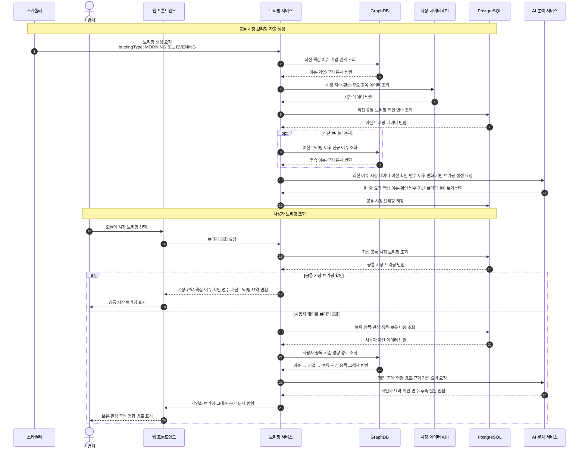

# 시퀀스 다이어그램
notion_id: 3e9fef49-d8d5-80f5-9abf-f85aeb19fc00
last_edited_time: 2026-10-02T16:53:41.289000+09:00
source_url: https://www.notion.so/3e9fef49d8d580f59abff85aeb19fc00
database: 🤡회의록

---
### **출퇴근 브리핑 -임현**
작성자 : 임현
[image] Untitled diagram-2026-09-28-115516.png attachment:80c475c4-eb89-4ba9-afa7-af9742a9eb1b:Untitled_diagram-2026-09-28-115516.png

후속 질문 반환 :
AI가 브리핑 내용을 바탕으로 사용자에게 보여줄 추천 질문 버튼 목록
- graphDB, vectorDB, RDB 각각 무엇을 저장할건지
  | 저장소 | 저장하는 것 | 사용 목적 |
  | RDB | 사용자·포트폴리오·원문·이슈 후보·검증 상태 | 정확한 원본·서비스 데이터 관리 |
  | VectorDB | 기사·공시 청크 임베딩, 이슈 후보 임베딩 | 유사 기사·유사 이슈 후보 검색 |
  | GraphDB | 기업·제품·이슈·문서의 확정 관계 | 관계 경로 탐색·그래프 UI |
  **정해야 할 사항**
  | 결정할 것 | 선택지 | 추천 |
  | 공통 시장 브리핑 생성 방식 | 요청 시 생성 / 정해진 시간 자동 생성 | **아침·퇴근 시간 자동 생성** |
  | 개인화 브리핑 생성 | 모든 사용자 자동 생성 / 요청 시 생성 | **MVP는 요청 시 생성** |
  | 개인화 브리핑 대상 | 보유 종목만 / 보유+관심 종목 | **보유+관심 종목, 단 결과 구분** |
  | 과거 개인화 브리핑 | 현재 종목으로 재분석 / 당시 기준 복원 | **당시 포트폴리오 스냅샷 기준 복원** |
  | 이전 브리핑 평가 문구 | 예측 성공·실패 / 이후 변화 확인 | **이후 변화 확인·추가 변수 확인** |
<details><summary>출퇴근브리핑 -정세빈</summary>

  ### **① 정기 브리핑 생성**
  ```mermaid
  sequenceDiagram
      autonumber
      participant scheduler as 스케줄러
      participant briefing as 브리핑 서비스
      participant marketData as 뉴스·시장 데이터
      participant issueEngine as 핵심 이슈 선정
      participant graph as 관계 그래프
      participant analysis as 분석·요약 엔진
      participant store as 브리핑 저장소
  
      %% 실행 시간 가정: 한국 시간 07:30 / 18:00
      scheduler->>briefing: 출근 또는 퇴근 브리핑 생성 요청
      briefing->>store: 직전 브리핑 기준 시점 및 예측 조회
      store-->>briefing: 직전 기준 시점·예측·평가 대상 기간
  
      alt 출근 브리핑
          briefing->>marketData: 직전 퇴근 기준 시점부터 현재까지 데이터 조회
          marketData-->>briefing: 미 증시·국제정세·국내 주요 뉴스 및 시장 지표
      else 퇴근 브리핑
          briefing->>marketData: 직전 출근 기준 시점부터 현재까지 데이터 조회
          marketData-->>briefing: 당일 국내 증시 주요 뉴스·종목별 사건·시장 지표
      end
  
      briefing->>issueEngine: 수집 데이터 기반 핵심 이슈 선정 요청
      issueEngine->>issueEngine: 뉴스 중복 제거 및 동일 이슈 묶기
  
      %% 거래대금은 비교 가능한 거래 세션 기준으로 집계
      %% 이슈별 관련 기업 거래대금 집계 방식과 정규화 방식은 정책 확정 필요
      issueEngine->>issueEngine: 관련 종목의 전일 대비 거래대금 배율 산출
      issueEngine->>issueEngine: 거래량·거래대금 증가율 및 급증 종목 산출
      issueEngine->>issueEngine: 이슈별 뉴스 수 집계
      issueEngine->>issueEngine: 점수 = 거래대금 배율 정규화값 × 0.2 + 뉴스 수 정규화값 × 0.8
      issueEngine->>issueEngine: 점수 상위 핵심 이슈 최대 5개 선정
  
      issueEngine->>graph: 핵심 이슈별 영향 기업 경로 조회
      graph-->>issueEngine: 이슈 → 관련 기업 경로·연결 근거
      issueEngine-->>briefing: 핵심 이슈·영향 기업·점수·근거
  
      alt 직전 예측이 있고 평가 시점이 도래함
          briefing->>analysis: 직전 예측과 평가 기간의 실제 시장 결과 비교
          analysis-->>briefing: 예측 평가·차이·근거
      else 직전 예측이 없거나 평가 시점 미도래
          briefing->>briefing: 평가 없음 또는 평가 대기로 표시
      end
  
      briefing->>analysis: 핵심 이슈·기업 경로·시장 지표 기반 브리핑 작성
      analysis-->>briefing: 리포트 한 줄 요약·시장 분석·관련 종목 간략 예측
      briefing->>store: 브리핑·예측·평가·근거·데이터 기준 시점 저장
      store-->>briefing: 저장 완료
      briefing-->>scheduler: 브리핑 생성 완료
  ```
  [image] mermaid-diagram (1).png attachment:550aaf5c-2b8f-4b60-9b07-499ae182f890:mermaid-diagram_(1).png
  ### ② 사용자 조회 및 개인화 브리핑
  ```mermaid
  sequenceDiagram
      autonumber
      actor user as 사용자
      participant ui as 브리핑 화면
      participant briefing as 브리핑 서비스
      participant store as 브리핑 저장소
      participant portfolio as 보유·관심 종목 서비스
      participant graph as 관계 그래프
      participant analysis as 분석·요약 엔진
  
      %% 로그인 및 온보딩을 마친 사용자를 기준으로 작성
      user->>ui: 메인 화면에서 출퇴근 브리핑 선택
      ui-->>user: 출근·퇴근 및 전체 시장·개인화 선택 제공
      user->>ui: 브리핑 종류 선택
      ui->>briefing: 선택한 회차의 브리핑 조회
      briefing->>store: 브리핑 및 데이터 기준 시점 조회
      store-->>briefing: 브리핑 또는 미생성 상태
  
      alt 해당 회차 브리핑이 아직 없음
          briefing-->>ui: 브리핑 준비 중
          ui-->>user: 준비 중 안내
      else 브리핑 조회 가능
          alt 전체 시장 브리핑 선택
              briefing-->>ui: 한 줄 요약·핵심 이슈·기업 경로·예측·직전 예측 평가
              ui-->>user: 전체 시장 브리핑 표시
          else 개인화 브리핑 선택
              briefing->>portfolio: 사용자 보유 종목·비중·관심 종목 조회
              portfolio-->>briefing: 보유 종목 및 관심 종목 목록
  
              alt 보유 종목 존재
                  %% 중요도 산정 기준은 별도 정책으로 확정
                  briefing->>briefing: 중요도 기준 보유 종목 최대 5개 선정
                  briefing->>briefing: 선정 보유 종목과 관심 종목을 분석 대상으로 구성
              else 보유 종목 없이 관심 종목만 존재
                  briefing->>briefing: 관심 종목 최대 3개를 분석 대상으로 구성
              else 보유·관심 종목 모두 없음
                  briefing-->>ui: 개인화 분석 대상 없음
                  ui-->>user: 계좌 연결 또는 관심 종목 등록 안내
              end
  
              opt 분석 대상 종목 존재
                  %% 시장 상위 5개 이슈 외에도 대상 종목의 직접·간접 이슈 조회
                  briefing->>graph: 동일 기준 시점의 대상 종목 관련 이슈·영향 경로 조회
                  graph-->>briefing: 이슈 → 관련 기업 → 보유·관심 종목 경로 및 근거
  
                  briefing->>store: 대상 종목의 직전 예측 및 평가 조회
                  store-->>briefing: 예측·평가 또는 평가 대기 상태
  
                  briefing->>analysis: 시장 브리핑·종목별 경로·비중·직전 평가 전달
                  alt 출근 브리핑
                      analysis->>analysis: 야간 이슈의 종목별 영향과 오늘 주목할 점 분석
                  else 퇴근 브리핑
                      analysis->>analysis: 당일 국내 시장 및 대상 종목의 이슈·사건 정리
                  end
                  analysis-->>briefing: 개인화 한 줄 요약·영향 분석·종목별 간략 예측
  
                  briefing->>store: 개인화 브리핑·예측·대상 종목·기준 시점 저장
                  store-->>briefing: 저장 완료
                  briefing-->>ui: 개인화 브리핑·영향 경로·근거·직전 예측 평가
                  ui-->>user: 보유·관심 종목 중심 브리핑 표시
              end
          end
  
          opt 사용자가 이슈·기업·연결 관계 선택
              user->>ui: 이슈·기업 노드 또는 간선 선택
              ui->>briefing: 선택 대상 상세 정보 요청
              briefing->>graph: 브리핑 기준 시점의 상세 정보·연결 근거 조회
              graph-->>briefing: 관련 이슈·기업·연결 이유·뉴스 원문 링크
              briefing-->>ui: 상세 정보 및 근거
              ui-->>user: 상세 패널 표시
          end
  
          user->>ui: 메인 화면으로 이동
          ui-->>user: 메인 화면 표시
      end
  ```
  [image] mermaid-diagram (1).png attachment:b6a6787d-3a22-4431-b45f-0f200755952a:mermaid-diagram_(1).png

</details>
<details><summary>로그인/튜토리얼 - 통합 박주형/안재현</summary>

  [image] 로그인 튜토리얼 시퀀스다이어그램 통합 수정본.png attachment:dce6214d-cea6-4d1a-bde8-d41225bd7e49:로그인_튜토리얼_시퀀스다이어그램_통합_수정본.png
  **수정사항**
  4-A 계좌 연동과 4-B 관심종목 선택이 독립된 단계로 이어집니다. 계좌 연동을 마친 투자자도 4-B를 거치는 것처럼 읽힙니다. ->계좌 연동 성공 시 보유종목 확인, 그 외에는 관심종목 선택으로 하나의 분기에서 처리하세요.
  온보딩 완료 회원도 이후 튜토리얼을 매번 시작하는 흐름입니다.->저장된 튜토리얼 완료 여부를 확인해, 완료했다면 메인 그래프로 바로 보내세요.
  로그인 실패 처리와 회원가입 절차가 빠졌음 -> 로그인 이메일과 비밀번호가 일치하지 않으면 입력화면 유지, 아이디 또는 비밀번호가 틀렸습니다 표시, 재입력 가능 / 회원가입 클릭 - 회원가입 페이지 표시- 가입정보 입력 및 약관동의 -> 입력값, 아이디 중복 검증 및 계정 생성 - 가입 성공시 자동 로그인, 가입 실패시 오류항목 표시 및 정보수정요청

</details>
<details><summary>로그인/튜토리얼 - mermaid</summary>

  ```mermaid
  ---
  config:
    theme: mc
  ---
  sequenceDiagram
      autonumber
  
      actor U as 사용자
      participant FE as InvestMate 웹/앱
      participant BE as 백엔드 서버 API
      participant DB as 데이터베이스 DB
      participant EXT as 외부 서비스<br/>소셜 로그인 / 증권사 API
  
      %% =========================
      %% 1. 서비스 진입
      %% =========================
      rect rgb(239,246,255)
          Note over U,EXT: 1. 서비스 진입 / 시작 방식 선택
  
          U->>FE: InvestMate 접속
          FE-->>U: 시작 화면 표시<br/>로그인 / 회원가입 / 로그인 없이 둘러보기
  
          alt 로그인 또는 회원가입
              U->>FE: 로그인/회원가입 선택
  
              alt 이메일 로그인
                  FE->>BE: 이메일 + 비밀번호 로그인 요청
                  BE->>DB: 사용자 정보 조회
                  DB-->>BE: 사용자 정보 반환
                  BE-->>FE: 인증 성공 + 토큰 발급
                  FE-->>U: 로그인 완료
  
              else 소셜 로그인
                  FE->>BE: 소셜 로그인 요청
                  BE->>EXT: OAuth 인증 요청
                  EXT-->>BE: 인증 결과 + 사용자 정보
                  BE->>DB: 회원 조회 또는 신규 생성
                  DB-->>BE: 회원 정보
                  BE-->>FE: 인증 성공 + 토큰 발급
                  FE-->>U: 로그인 완료
              end
  
          else 로그인 없이 둘러보기
              U->>FE: 게스트로 시작
              FE-->>U: 관심종목 선택 화면으로 이동
          end
      end
  
  
      %% =========================
      %% 2. 회원 온보딩
      %% =========================
      rect rgb(245,243,255)
          Note over U,DB: 2. 회원 최초 이용 판단 / 투자 여부 선택
  
          opt 로그인 사용자
              FE->>BE: 온보딩 상태 조회
              BE->>DB: 온보딩 완료 여부 조회
              DB-->>BE: 사용자 설정 정보
              BE-->>FE: 온보딩 상태 반환
  
              alt 온보딩 미완료
                  FE-->>U: "주식을 하고 있나요?" 질문
                  U->>FE: 투자 여부 선택
                  FE->>BE: 투자 여부 저장<br/>INVESTOR / NON_INVESTOR
                  BE->>DB: 사용자 설정 저장
                  DB-->>BE: 저장 완료
                  BE-->>FE: 다음 단계 안내
              else 온보딩 완료
                  BE-->>FE: 기존 사용자 설정 반환
              end
          end
      end
  
  
      %% =========================
      %% 3-A. 투자자 계좌 연동
      %% =========================
      rect rgb(255,241,242)
          Note over U,EXT: 3-A. 투자자 - 증권계좌 연동
  
          opt 로그인한 사용자가 투자자인 경우
              FE-->>U: 증권사 선택 화면 표시
              U->>FE: 증권사 선택 + 계좌 연동 시작
              FE->>BE: 계좌 연동 요청
  
              BE->>EXT: 증권사 인증 요청
              EXT-->>U: 본인 인증 / 정보 제공 동의
              U-->>EXT: 인증 및 동의 완료
  
              EXT-->>BE: 계좌 정보 + 보유종목 목록
              BE->>DB: 계좌 및 보유종목 저장
              DB-->>BE: 저장 완료
  
              BE-->>FE: 계좌 연동 완료<br/>보유종목 목록
              FE-->>U: 보유종목 확인 화면 표시
          end
      end
  
  
      %% =========================
      %% 3-B. 비회원 / 비투자자
      %% =========================
      rect rgb(255,251,235)
          Note over U,DB: 3-B. 비회원 / 비투자자 - 기준 종목(관심종목) 선택
  
          alt 비회원
              FE-->>U: 관심종목 선택 화면 표시
          else 로그인 회원이지만 계좌 미연동/비투자자
              FE-->>U: 관심종목 선택 화면 표시
          end
  
          FE-->>U: 종목 검색 + 추천 종목/산업/테마 표시
          U->>FE: 관심종목 검색
          FE->>BE: 종목 검색 요청
          BE->>DB: 종목 정보 조회
          DB-->>BE: 종목 검색 결과
          BE-->>FE: 검색 결과 반환
          FE-->>U: 종목 목록 표시
  
          U->>FE: 관심종목 선택<br/>최소 1개 ~ 최대 3개
  
          alt 선택 종목 0개
              FE-->>U: "종목을 1개 이상 선택해주세요"
              FE-->>U: 다음 버튼 비활성화
          else 1개 이상 선택
              FE->>BE: 선택 관심종목 저장 요청
  
              alt 로그인 회원
                  BE->>DB: 사용자 관심종목 저장
                  DB-->>BE: 저장 완료
              else 비회원
                  BE-->>FE: 게스트용 임시 상태 생성
                  Note over FE,BE: 세션 또는 로컬 저장 방식 사용 가능
              end
  
              BE-->>FE: 관심종목 선택 완료
              FE-->>U: 다음 단계 이동 가능
          end
      end
  
  
      %% =========================
      %% 4. 개인화 데이터
      %% =========================
      rect rgb(239,246,255)
          Note over U,DB: 4. 개인화 초기 데이터 생성
  
          FE->>BE: 개인화 데이터 생성 요청
  
          alt 계좌 연동 사용자
              BE->>DB: 보유종목 기반 데이터 조회
          else 관심종목 사용자
              BE->>DB: 관심종목 기반 데이터 조회
          end
  
          DB-->>BE: 종목 관련 데이터 반환
  
          BE->>BE: 관련 기업 / 주요 이슈 / 산업 / 제품 관계 구성
          BE-->>FE: 초기 개인화 그래프 데이터 반환
  
          Note over FE,BE: 비회원도 관심종목을 기준으로 동일한 개인화 흐름 제공
      end
  
  
      %% =========================
      %% 5. 튜토리얼
      %% =========================
      rect rgb(245,243,255)
          Note over U,DB: 5. 관계 그래프 튜토리얼
  
          FE-->>U: 튜토리얼 시작
  
          FE-->>U: ① 종목 노드 설명<br/>기본 정보 / 보유·관심 표시
          U->>FE: 다음
  
          FE-->>U: ② Event/Issue 설명<br/>날짜별 주요 시장 사건
          U->>FE: 다음
  
          FE-->>U: ③ 영향 경로 설명<br/>Event → 기업 → 관련 기업
          U->>FE: 다음
  
          FE-->>U: ④ 근거 확인 방법<br/>뉴스 / 공시 / 공식자료
          U->>FE: 다음
  
          FE-->>U: ⑤ AI 질문 방법<br/>예시 질문 + 답변 방식
          U->>FE: 튜토리얼 완료
  
          opt 로그인 회원
              FE->>BE: 튜토리얼 완료 상태 저장
              BE->>DB: 완료 상태 저장
              DB-->>BE: 저장 완료
              BE-->>FE: 완료
          end
      end
  
  
      %% =========================
      %% 6. 메인 관계 그래프
      %% =========================
      rect rgb(236,253,245)
          Note over U,DB: 6. 개인화 메인 관계 그래프 진입
  
          FE->>BE: 메인 관계 그래프 요청
  
          alt 투자자
              BE->>DB: 보유종목 중심 그래프 데이터 조회
          else 비투자자 또는 비회원
              BE->>DB: 관심종목 중심 그래프 데이터 조회
          end
  
          DB-->>BE: Graph 구성 데이터 반환
  
          BE-->>FE: 노드 / 간선 / 이슈 / 근거 데이터 반환
  
          FE-->>U: 메인 관계 그래프 표시<br/>기업 · 이슈 · 산업 · 제품 관계
  
          Note over U,FE: 비회원은 보유종목 대신<br/>선택한 관심종목을 중심으로 그래프를 탐색
  
          FE-->>U: 기업/이슈 노드 클릭 가능<br/>근거 확인 가능<br/>AI 질문 가능
      end
  ```

</details>
<details><summary>홍정현 AI챗봇</summary>

  <details><summary>축약</summary>

    ```mermaid
    %%{init: {
      "theme": "base",
      "themeVariables": {
        "fontFamily": "Pretendard, Noto Sans KR, sans-serif",
        "actorBkg": "#F2EFFF",
        "actorBorder": "#7C67E8",
        "actorTextColor": "#1F2740",
        "signalColor": "#6654C7",
        "signalTextColor": "#3F357C",
        "noteBkgColor": "#FFF7EA",
        "noteBorderColor": "#E8B968"
      }
    }}%%
    
    sequenceDiagram
        title Zoop AI 챗봇 · 핵심 흐름 요약
    
        actor U as 사용자
        participant W as 줍 웹앱
        participant A as AI 질문 서비스
        participant D as 데이터 서비스
        participant L as AI 모델
    
        Note over D: 관계 그래프·뉴스·공시·포트폴리오 조회 역할을 묶어 표현
    
        U->>W: 챗봇 열기·질문 입력·전송
        W->>A: 질문·대상·기간·대화 ID·작업 식별자
        A->>A: 입력·권한·대화 소유권·작업 내용 검증
    
        break 검증 실패 또는 실행 불가
            A-->>W: 사유·필요한 조치 안내
            W-->>U: 입력 유지·안내 표시
        end
    
        A->>A: 작업 상태 확인·중복 실행 방지
    
        break 동일 작업이 처리 중 또는 완료
            A-->>W: 처리 중 상태 또는 기존 결과
            W-->>U: 해당 질문에 상태·결과 표시
        end
    
        A->>L: 질문 유형·대상·기간 해석
        L-->>A: 해석 결과·부족한 정보
    
        alt 필요한 정보가 불명확
            A->>A: 원래 질문·대화 맥락 기록
            A-->>W: 추가 확인 질문
            W-->>U: 기업·이슈·기간 되묻기
            Note over U,A: 추가 입력은 같은 대화·새 작업으로 처리
        else 필요한 정보가 명확
            opt 개인 포트폴리오 질문
                A->>D: 권한이 확인된 보유·관심 종목 조회
                D-->>A: 종목 정보 또는 조회 불가 상태
                break 권한 또는 종목 정보 부족
                    A-->>W: 로그인·종목 설정 안내
                    W-->>U: 필요한 조건 표시
                end
            end
    
            A->>D: 대상·기간에 맞는 관계·원문 근거 조회
            D-->>A: 관계 데이터·출처·인용 구간
    
            alt 근거 부족
                A-->>W: 판단 보류·추가 확인 사항
                W-->>U: 근거 부족 안내
            else 근거 확보
                A->>L: 질문·필요한 맥락·근거로 답변 생성
                L-->>A: 사실·영향 가설·불확실성·인용 정보
                A->>A: 응답 형식·출처·인용 구간·관련 ID 검증
    
                alt 검증 통과
                    A-->>W: 답변·근거·대화 및 작업 식별자
                    W-->>U: 해당 질문에 답변·근거 표시
                else 검증 실패
                    A-->>W: 답변 제공 보류
                    W-->>U: 검증 실패 안내
                end
            end
        end
    
        Note over U,L: 검증 통과는 정확성 전체를 보장하지 않음
    
        opt 답변 후 추가 행동
            U->>W: 근거 보기·관련 대상 탐색·후속 질문·새 대화
            Note over W,A: 후속 질문은 같은 대화·새 작업<br/>새 대화는 이전 맥락 초기화<br/>응답은 해당 대화·작업에만 연결
        end
    
        opt 처리 중 장애 또는 결과 미수신
            W-->>U: 입력 유지·실패 또는 응답 지연 안내
            U->>W: 다시 시도
            W->>A: 동일 작업 식별자·동일 내용 재전송
            Note over W,A: 권한·내용 재검증 후 상태 확인<br/>처리 중이면 대기·완료면 기존 결과<br/>미등록 또는 재실행 가능 실패만 실행
        end
    ```

  </details>
  ```mermaid
  %%{init: {
    "theme": "base",
    "themeVariables": {
      "fontFamily": "Pretendard, Noto Sans KR, sans-serif",
      "primaryColor": "#F2EFFF",
      "primaryBorderColor": "#7C67E8",
      "primaryTextColor": "#1F2740",
      "lineColor": "#6E5BD4",
      "actorBkg": "#F2EFFF",
      "actorBorder": "#7C67E8",
      "actorTextColor": "#1F2740",
      "signalColor": "#6654C7",
      "signalTextColor": "#3F357C",
      "noteBkgColor": "#FFF7EA",
      "noteBorderColor": "#E8B968",
      "noteTextColor": "#765426",
      "activationBkgColor": "#E6E0FF",
      "activationBorderColor": "#7C67E8"
    }
  }}%%
  
  sequenceDiagram
      title Zoop AI 챗봇 이용 시퀀스 · 목표 설계안
  
      actor U as 사용자
      participant W as 줍 웹앱
      participant A as AI 질문 서비스
      participant G as 그래프 조회 API
      participant K as GraphDB
      participant E as 뉴스·공시 근거 저장소
      participant P as 포트폴리오 서비스
      participant L as AI 응답 모델
  
      Note over U,L: 01 챗봇 진입 · 일반 질문과 선택 대상 질문 구분
      alt 전역 AI 챗봇 메뉴 선택
          U->>W: AI 챗봇 열기
          W-->>U: 일반 질문창 · 추천 질문 표시
      else 기업·이슈·관계·브리핑에서 AI 질문 선택
          U->>W: 선택한 대상에 대해 AI 질문하기
          W-->>U: 대상·기간이 표시된 질문창 · 추천 질문 표시
      end
  
      Note over U,L: 02 질문 입력 · 전송 · 서버 권한 확인
      U->>W: 직접 질문 입력 또는 추천 질문 선택
      W-->>U: 질문 문구를 입력창에 반영
      U->>W: 전송 클릭
      break 빈 입력·길이 초과·중복 전송
          W-->>U: 입력 안내 또는 처리 중 표시 · 새 요청 보내지 않음
      end
      W->>A: 질문 · 대화 ID · 선택 대상 ID · 기간 · 요청 ID
      A->>A: 서버 세션 기준 사용자 식별 · 이용 권한·한도 확인
      break 이용 권한 없음 또는 사용 한도 초과
          A-->>W: 제한 사유 · 다시 이용할 수 있는 조건
          W-->>U: 이용 조건 안내 · 입력 내용 유지
      end
      Note over W,A: 비회원 AI 허용 여부·이용 한도는 정책 확정 필요
      A->>A: 입력·대화 소유권·선택 대상 유효성 재검증
      break 잘못된 입력 또는 유효하지 않은 대화·대상
          A-->>W: 요청 수정 안내 · 다른 대상으로 임의 대체 금지
          W-->>U: 질문 또는 선택 대상 수정 요청
      end
      W-->>U: 내 질문 · 답변 준비 중 표시 · 중복 전송 방지
  
      Note over U,L: 03 질문 해석 · 부족한 정보 확인
      A->>L: 질문 유형·대상·기간 해석 요청
      L-->>A: 관계 탐색 / 정보 요약 / 개인 포트폴리오 질문 · 누락 정보
      break 답변에 필요한 대상·기간이 불명확함
          A-->>W: 추가 확인 질문 · 필요한 정보
          W-->>U: 어느 기업·기간을 의미하는지 확인
          U->>W: 추가 정보 입력
          Note over U,A: 추가 입력은 현재 맥락을 유지한 새 요청으로 02부터 처리
      end
  
      Note over A,P: 04 질문에 필요한 근거 조회
      opt 개인 포트폴리오 질문
          A->>P: 서버에서 확인한 사용자 기준 개인화 데이터 요청
          P->>P: 해당 사용자의 접근 권한 재확인
          P-->>A: 허용된 보유·관심 종목 정보 또는 조회 불가 상태
          break 권한 없음 또는 개인화에 필요한 정보 없음
              A-->>W: 로그인·종목 설정 등 필요한 조건 안내
              W-->>U: 개인화 답변 불가 사유 표시 · 타인 정보 사용 금지
          end
      end
      A->>G: 질문 대상·기간에 맞는 관계와 근거 조회
      G->>K: 관련 기업·이슈·간선·영향 경로 조회
      K-->>G: 노드·간선 ID · 관계 속성 · 기준 시점
      G->>E: 관계·질문에 관련된 뉴스·공시 근거 조회
      E-->>G: 문서 ID · 출처 · 공개일 · 인용 구간 · 원문 링크
      G-->>A: 그래프 맥락 · 근거 문서 · 조회 상태
      Note over A,L: 조회·모델 호출 실패 시 아래 정상 경로를 중단하고 09의 예외 처리 적용
  
      Note over U,L: 05 근거 기반 답변 생성·검증
      alt 답변에 필요한 근거 부족
          A-->>W: 판단 보류 · 확인 가능한 범위 · 추가 확인 사항
          W-->>U: 근거 부족 안내 · 없는 출처나 결론 생성 금지
      else 답변에 필요한 근거 확보
          A->>L: 질문·최소 필요 맥락·조회된 근거로 답변 생성 요청
          Note over A,L: 계좌번호·인증 토큰 등 불필요한 개인정보는 모델에 전달하지 않음
          L-->>A: 사실·영향 가설·불확실성 · 인용 문서 ID · 관련 대상 ID
          A->>A: 응답 형식 · 인용 ID·원문 구간 · 그래프 ID 검증
          alt 검증 실패
              A-->>W: 확인되지 않은 답변 제공 보류 · 검증 실패 안내
              W-->>U: 검증되지 않은 내용을 확정 답변으로 표시하지 않음
          else 검증 통과
              A-->>W: 근거 기반 답변 · 출처 링크 · 유효한 관련 대상
              W-->>U: 답변과 근거 목록 표시
              opt 관계 탐색형 질문이며 그래프 강조 기능을 제공하는 경우
                  W-->>U: 검증된 노드·간선만 강조 · 새로운 관계 임의 추가 금지
              end
          end
      end
      Note over U,W: 긍정·부정·혼재는 근거에 따른 영향 해석이며 주가 상승·하락 확률이 아님
  
      Note over U,E: 06 근거 확인 · 관련 화면 탐색
      opt 근거 보기 선택
          U->>W: 근거 보기 클릭
          W-->>U: 제공받은 출처·공개일·인용 구간 표시
          U->>W: 원문 보기 클릭
          W-->>U: 원문 링크 열기 · 접근 불가 시 확보된 근거로 복귀
      end
      opt 관련 기업·이슈 선택
          U->>W: 관련 대상 클릭
          W->>G: 선택 대상의 상세·관계 그래프 요청
          G-->>W: 대상 데이터 또는 조회 불가 상태
          W-->>U: 동일 대상의 상세·그래프 표시 또는 실패 안내
      end
  
      Note over U,A: 07 후속 질문
      opt 대화를 이어가는 경우
          U->>W: 후속 질문 입력 또는 추천 질문 선택
          W-->>U: 현재 적용 대상·기간 확인
          U->>W: 전송 클릭
          Note over W,A: 같은 대화 ID와 필요한 맥락을 유지해 02부터 반복 · 매 요청 권한 재검증
      end
  
      Note over U,A: 08 새 대화 시작
      opt 새 대화 선택
          U->>W: 새 대화 클릭
          W->>W: 이전 응답의 새 대화 반영 차단 · 대화·질문 맥락 초기화
          W-->>U: 새로운 질문창 표시 · 이전 기업·이슈 자동 반영 안 함
          Note over W,A: 다음 전송부터 새 대화로 처리 · 과거 기록 보관·삭제는 별도 정책
      end
  
      Note over U,L: 09 공통 예외 처리 · 실패가 발생한 경우에만 해당 요청에 적용
      opt 근거 조회·모델 호출 실패 또는 시간초과
          A-->>W: 오류 종류 · 재시도 가능 여부
          W-->>U: 입력 유지 · 실패 안내 · 미완성 답변을 완료 답변과 구분
          U->>W: 다시 시도 클릭
          Note over W,A: 재시도는 02부터 새 요청으로 처리 · 자동 무한 재시도 금지
      end
  
  ```

</details>
<details><summary>홍정현 수정 </summary>

  <details><summary>축약</summary>


  </details>
  <details><summary>ai챗봇 긴버전</summary>

    ```mermaid
    %%{init: {
      "theme": "base",
      "themeVariables": {
        "fontFamily": "Pretendard, Noto Sans KR, sans-serif",
        "primaryColor": "#F2EFFF",
        "primaryBorderColor": "#7C67E8",
        "primaryTextColor": "#1F2740",
        "lineColor": "#6E5BD4",
        "actorBkg": "#F2EFFF",
        "actorBorder": "#7C67E8",
        "actorTextColor": "#1F2740",
        "signalColor": "#6654C7",
        "signalTextColor": "#3F357C",
        "noteBkgColor": "#FFF7EA",
        "noteBorderColor": "#E8B968",
        "noteTextColor": "#765426"
      }
    }}%%
    
    sequenceDiagram
        title Zoop AI 챗봇 이용 시퀀스 · 설계 기준 v1
    
        actor U as 사용자
        participant W as 줍 웹앱
        participant A as AI 질문 서비스
        participant G as 그래프 조회 API
        participant K as GraphDB
        participant E as 뉴스·공시 근거 저장소
        participant P as 포트폴리오 서비스
        participant L as AI 응답 모델
    
        Note over U,L: 01 챗봇 진입
    
        alt AI 챗봇 메뉴에서 진입
            U->>W: AI 챗봇 열기
            W-->>U: 일반 질문창·추천 질문 표시
        else 기업·이슈·관계·브리핑에서 진입
            U->>W: 선택 대상에 대해 AI 질문하기
            W-->>U: 선택 대상·기간이 표시된 질문창 제공
        end
    
        Note over U,L: 02 질문 전송·권한 확인·중복 작업 확인
    
        U->>W: 직접 입력 또는 추천 질문 선택
        W-->>U: 입력창에 질문 반영
        U->>W: 전송 클릭
        W->>W: 입력 검사·중복 전송 확인
    
        break 빈 입력·길이 초과·동일 작업 전송 진행 중
            W-->>U: 수정 안내 또는 처리 중 안내
        end
    
        W->>W: 새 질문 작업의 식별자 생성
        W-->>U: 내 질문·답변 준비 중 표시
    
        Note over W,A: 작업 식별자는 동일 작업의 중복 방지 키<br/>개별 통신 추적 ID와 구분
        W->>A: 질문·대화 ID·대상 ID·기간·작업 식별자
    
        A->>A: 사용자 식별·접근 권한·대화 소유권 확인
        A->>A: 서버 입력 검사·대상 유효성·작업 내용 일치 확인
    
        break 접근 불가·잘못된 입력·동일 키의 내용 불일치
            A-->>W: 제한 사유·수정 사항 또는 충돌 안내
            W-->>U: 입력 유지·필요한 조치 안내
        end
    
        A->>A: 작업 식별자로 기존 작업 상태 확인
    
        break 기존 작업이 처리 중 또는 완료
            A-->>W: 처리 중 상태 또는 기존 완료 결과
            W-->>U: 해당 작업에 상태·결과 표시
        end
    
        A->>A: 실행 가능 여부·이용 한도 확인
    
        break 현재 조건에서 실행 불가
            A-->>W: 실행 불가 사유·다시 이용할 조건
            W-->>U: 입력 유지·이용 조건 안내
        end
    
        A->>A: 중복 실행되지 않도록 작업 등록·실행 권한 확보
    
        Note over W,A: 미등록 또는 재실행 가능한 실패만 실행<br/>동시 요청도 같은 작업을 중복 실행하지 않음
        Note over W,A: 비회원 AI 허용 여부·이용 한도는 별도 정책
    
        Note over U,L: 03 질문 해석·되묻기
    
        A->>L: 질문 유형·대상·기간 해석 요청
        L-->>A: 해석 결과·부족한 정보
    
        alt 답변에 필요한 정보가 불명확
            A->>A: 대화에 원래 질문·맥락·미확인 항목 기록
            A-->>W: 추가 확인 질문 반환
            W-->>U: 어느 기업·이슈·기간인지 확인
            Note over U,A: 현재 작업은 되묻기 응답으로 종료<br/>추가 입력은 같은 대화 ID·새 작업 식별자로 02부터 처리
        else 답변에 필요한 정보가 명확
    
            Note over A,P: 04 질문에 필요한 자료 조회
    
            opt 개인 포트폴리오 질문
                A->>P: 서버에서 확인한 사용자 기준 종목 조회
                P->>P: 접근 권한 확인
                P-->>A: 허용된 보유·관심 종목 또는 조회 불가 상태
    
                break 접근 불가 또는 필요한 종목 정보 없음
                    A-->>W: 로그인·종목 설정 등 필요한 조건
                    W-->>U: 개인화 답변 불가 사유 안내
                end
            end
    
            Note over A,E: 보유 종목을 알아야 하는 질문은 종목 조회 후 진행
    
            A->>G: 확정된 대상·기간의 관계와 근거 요청
            G->>K: 기업·이슈·관계·영향 경로 조회
            K-->>G: 노드·간선 ID·관계 속성·기준 시점
            G->>E: 관련 뉴스·공시 근거 조회
            E-->>G: 문서 ID·출처·공개일·인용 구간·원문 링크
            G-->>A: 관계 데이터·근거 문서·조회 상태
    
            Note over U,L: 05 답변 생성·검증·결과 제공
    
            alt 답변에 필요한 근거 부족
                A-->>W: 판단 보류·확인 가능한 범위·추가 확인 사항
                W-->>U: 근거 부족 안내
            else 필요한 근거 확보
                A->>L: 질문·최소 필요 맥락·확보한 근거 전달
                Note over A,L: 계좌번호·인증 토큰 등 불필요한 민감 정보 제외
    
                L-->>A: 사실·영향 가설·불확실성·인용 ID·관련 대상 ID
                A->>A: 응답 형식·인용 ID·원문 구간·그래프 ID 검증
    
                alt 검증 항목 불일치
                    A-->>W: 답변 제공 보류·검증 실패 안내
                    W-->>U: 확인되지 않은 답변을 확정 답변으로 표시하지 않음
                else 검증 항목 통과
                    A-->>W: 답변·근거·관련 대상·대화 ID·작업 식별자
                    W->>W: 응답을 해당 대화·작업에 연결
                    W-->>U: 해당 질문 영역에 답변과 근거 표시
    
                    opt 그래프 강조 기능을 제공하는 경우
                        W-->>U: 검증된 노드·간선만 강조
                    end
                end
            end
        end
    
        Note over A,L: 검증 통과는 사실·인과관계의 완전한 보장이 아님<br/>모델 내부 자동 보정 재시도는 v1에서 확정하지 않음
        Note over U,W: 긍정·부정·혼재는 근거에 따른 영향 해석<br/>주가 상승·하락 확률이 아님
    
        Note over U,E: 06 근거 확인·관련 화면 탐색
    
        opt 제공된 근거 보기 선택
            U->>W: 근거 보기 클릭
            W-->>U: 출처·공개일·인용 구간 표시
            U->>W: 원문 보기 클릭
            W-->>U: 원문 링크 열기·접근 불가 시 확보된 근거 안내
        end
    
        opt 관련 기업·이슈 선택
            U->>W: 관련 대상 클릭
            W->>G: 대상 상세·관계 그래프 요청
            G->>G: 해당 요청의 접근 권한 확인
            G-->>W: 대상 데이터 또는 조회 불가 상태
            W-->>U: 해당 대상 화면 또는 실패 안내
        end
    
        Note over U,A: 07 후속 질문
    
        opt 대화를 이어가는 경우
            U->>W: 후속 질문 입력 또는 추천 질문 선택
            W-->>U: 현재 적용 대상·기간 표시
            U->>W: 전송 클릭
            Note over W,A: 같은 대화 ID·새 작업 식별자로 02부터 처리<br/>매 요청 권한·내용 재검증
        end
    
        Note over U,A: 08 새 대화·응답 격리
    
        opt 새 대화 선택
            U->>W: 새 대화 클릭
            W->>W: 새 대화 상태 생성·현재 질문 맥락 초기화
            W-->>U: 이전 대상이 자동 적용되지 않은 질문창
        end
    
        Note over W,A: 모든 응답은 해당 대화·작업에만 연결<br/>늦은 응답이 다른 질문의 답변을 덮어쓰지 않음<br/>이전 결과 보관·삭제는 별도 정책
    
        Note over U,L: 09 공통 예외 처리<br/>02~07의 처리 중 실패하면 해당 정상 경로를 중단하고 적용
    
        opt 처리 중 장애 또는 결과 미수신
            alt 웹앱이 응답을 받지 못함
                W-->>U: 연결·응답 지연 안내·입력 유지
                Note over W,A: 웹앱의 결과 미수신은 서버 작업 실패 확정이 아님
            else 서버가 실패 응답을 반환
                A-->>W: 실패 사유·재시도 가능 여부
                W-->>U: 실패 안내·입력 유지
            end
    
            opt 사용자가 다시 시도 선택
                U->>W: 다시 시도 클릭
                W->>A: 동일 작업 식별자·동일 요청 내용 재전송
                Note over W,A: 02의 권한·대화 소유권·내용 검증을 다시 수행<br/>처리 중이면 상태 안내·완료면 기존 결과 반환<br/>미등록·재실행 가능 실패만 중복 방지 규칙에 따라 실행<br/>자동 무한 재시도 없음
            end
        end
    ```

  </details>
  <details><summary>출퇴근 브리핑 분</summary>

    <details><summary>브리핑 자동 생성</summary>

      ```mermaid
      sequenceDiagram
          autonumber
          title 공통 출퇴근 브리핑 생성
      
          participant S as 스케줄러
          participant B as 브리핑 서비스
          participant R as 브리핑 저장소
          participant E as 뉴스·공시 저장소
          participant M as 시장 데이터 서비스
          participant I as 이슈 선정 모듈
          participant G as GraphDB
          participant A as AI 분석 서비스
      
          S->>B: 출근 또는 퇴근 브리핑 생성 요청
          B->>B: 대상 날짜·회차·데이터 기준 시점 확정
          B->>R: 직전 브리핑·확인 항목·후속 확인 결과 조회
          R-->>B: 이전 원본·확인 결과·미확인 항목 반환
      
          Note over B,G: 기준 시점까지 수집·처리 완료된 데이터 사용
      
          B->>E: 직전 기준 시점 이후 신규·후속 뉴스와 공시 조회
          E-->>B: 사건·근거 문서·발행 시각 반환
      
          alt 출근 브리핑
              B->>M: 야간 해외시장·주요 시장 변수 조회
              M-->>B: 해외시장 관측값·기준 시각 반환
          else 퇴근 브리핑
              B->>M: 국내 장 마감·당일 주요 시장 변수 조회
              M-->>B: 당일 시장 관측값·기준 시각 반환
          end
      
          B->>I: 현재 자료·이전 이슈·미확인 항목 전달
          I->>I: 동일 사건 묶기·신규 및 후속 사건 구분
          I->>I: 새로움·시장 관련성·근거 수준으로 중요도 산정
          I->>I: 핵심 이슈 선정·기존 추적 항목 유지
          I-->>B: 핵심 이슈·변경 사항·선정 이유 반환
      
          B->>G: 선정 사건의 기준 시점 기업 연결 경로 조회
          G-->>B: 관계 경로·관계 상태·근거 참조·버전 반환
          B->>E: 경로별 근거 문서와 근거 구간 조회
          E-->>B: 근거 내용·출처·원문 링크 반환
      
          opt 일부 이슈의 연결 근거 미확보
              B->>B: 해당 이슈에 연결 근거 미확보 표시
          end
      
          alt 출근 브리핑
              B->>A: 밤사이 변화·기업 연결 경로·이전 확인 결과 전달
              A-->>B: 한줄 요약·주요 변화·오늘 확인할 항목 반환
          else 퇴근 브리핑
              B->>A: 당일 시장 관측·아침 이후 변화·후속 확인 결과 전달
              A-->>B: 한줄 요약·당일 전개·다음 거래일 확인 항목 반환
          end
      
          Note over B,A: 사실·시장 관측·AI 해석을 구분하고 근거 연결
          Note over B,A: 이전 브리핑이 없으면 비교·돌아보기 생략
      
          B->>B: 설명·수치·근거·기준 시점 검증
      
          alt 검증 통과
              B->>B: 확인 항목별 대상·조건·기한·필요 자료 확정
              B->>R: 브리핑·확인 항목·이전 브리핑 연결 정보 저장
              B->>R: 사건·관계·근거 스냅샷과 기준 시점 저장
              R-->>B: 저장 완료·브리핑 ID·버전 반환
              B->>R: 해당 버전을 발행 상태로 변경
              R-->>B: 발행 완료
              B-->>S: 브리핑 생성 완료
          else 근거 불일치 또는 필수 자료 부족
              B->>R: 생성 보류 상태와 사유 기록
              R-->>B: 기록 완료
              B-->>S: 생성 보류 결과 반환
          end
      ```

    </details>
    <details><summary>이전 브리핑 평가</summary>

      ```mermaid
      sequenceDiagram
          autonumber
          title 이전 브리핑 후속 확인
      
          participant S as 확인 스케줄러
          participant B as 브리핑 서비스
          participant R as 브리핑 저장소
          participant E as 뉴스·공시 저장소
          participant M as 시장 데이터 서비스
          participant A as AI 분석 서비스
      
          S->>B: 확인 시점이 도래한 항목 처리 요청
          B->>R: 미확인 또는 재확인 예정 항목 조회
          R-->>B: 원본 버전·대상 주장·확인 조건·기한 반환
      
          alt 확인 대상 존재
              loop 확인 항목별 처리
                  B->>E: 대상 사건·기업의 후속 뉴스와 공시 조회
                  E-->>B: 후속 근거·출처·발행 시각 반환
      
                  opt 확인 조건에 시장 관측값 필요
                      B->>M: 지정된 기간의 시장 변수 조회
                      M-->>B: 지수·종목·시장 변수와 기준 시각 반환
                  end
      
                  B->>B: 근거 충분성·대상 일치·확인 조건 검토
      
                  alt 근거 부족 또는 확인 기한 미도래로 판정 불가
                      B->>R: 보류 상태·사유·재확인 시점 별도 저장
                      R-->>B: 저장 완료
                  else 판정 가능한 근거 확보
                      alt 확인 변수
                          B->>B: 사전 조건의 충족·미충족 판정
                      else 영향 가설
                          B->>B: 후속 근거의 지지·상충·판단 불가 구분
                      end
      
                      Note over B: 주가 등락만으로 인과관계나 가설 적중 판정 금지
      
                      B->>A: 당시 주장·판정 결과·후속 근거 전달
                      A-->>B: 변화 설명·확인 근거·해석의 한계 반환
                      B->>B: 설명과 판정 및 근거의 일치 검증
      
                      alt 설명 검증 통과
                          B->>R: 확인 결과·설명·근거·확인 시점 별도 저장
                          R-->>B: 저장 완료
                      else 설명 검증 실패
                          B->>R: 설명 검증 실패·재처리 상태 기록
                          R-->>B: 기록 완료
                      end
                  end
              end
      
              Note over B,R: 과거 브리핑 원본은 변경하지 않음
              Note over B,R: 다음 브리핑 생성과 사용자 조회에서 결과 활용
              B-->>S: 후속 확인 처리 결과 반환
          else 확인 대상 없음
              B-->>S: 확인 대기 대상 없음
          end
      ```

    </details>
    <details><summary>사용자 브리핑 조회</summary>

      ```mermaid
      sequenceDiagram
          autonumber
          title 브리핑 조회
      
          actor U as 사용자
          participant W as 웹 프론트엔드
          participant B as 브리핑 서비스
          participant R as 브리핑 저장소
      
          U->>W: 날짜·출근 또는 퇴근 회차 선택
          W->>B: 선택 회차의 공통 브리핑 조회 요청
          B->>R: 발행된 브리핑·관계 및 근거 스냅샷 조회
          R-->>B: 브리핑 또는 미생성·보류 상태 반환
      
          alt 발행된 브리핑 존재
              B->>R: 이전 브리핑 돌아보기·현재 확인 항목의 최신 상태 조회
              R-->>B: 후속 확인 결과·보류 항목·갱신 시각 반환
      
              Note over B,R: 본문·관계도·근거는 생성 당시 버전 유지
              Note over B,R: 생성 이후 확인 결과는 별도 영역과 갱신 시각으로 표시
      
              B-->>W: 요약·사건·관계도·확인 항목·후속 확인 결과 반환
              W-->>U: 브리핑과 데이터 기준 시점 표시
      
              opt 관계도 또는 문장 요약으로 전환
                  U->>W: 표현 방식 변경
                  W->>W: 동일 사건·관계·근거 데이터로 표현 전환
                  W-->>U: 선택한 표현 방식으로 표시
              end
      
              opt 내 종목 브리핑 선택
                  U->>W: 내 종목 기준으로 보기
                  Note over U,R: 내 종목 브리핑 생성·조회 시퀀스로 연결
              end
      
              opt 이슈 또는 관계선 선택
                  U->>W: 선택 대상의 상세와 근거 확인
                  Note over U,R: 브리핑 관계·근거 상세 조회 시퀀스로 연결
              end
          else 미생성 또는 생성 보류
              B->>R: 최근 발행된 브리핑 정보 조회
              R-->>B: 최근 발행 회차 또는 없음 반환
              B-->>W: 선택 회차의 상태·사유·최근 발행 정보 반환
              W-->>U: 상태 안내와 조회 가능한 회차 표시
          end
      ```

    </details>
    <details><summary>내 종목 브리핑 생성·조회</summary>

      ```mermaid
      sequenceDiagram
          autonumber
          title 내 종목 브리핑 생성·조회
      
          actor U as 사용자
          participant W as 웹 프론트엔드
          participant B as 브리핑 서비스
          participant P as 사용자 종목 저장소
          participant R as 브리핑 저장소
          participant G as GraphDB
          participant E as 뉴스·공시 저장소
          participant A as AI 분석 서비스
      
          U->>W: 내 종목 브리핑 선택
          W->>B: 공통 브리핑 ID·버전과 개인화 조회 요청
          B->>B: 로그인 및 사용자 접근 권한 확인
      
          alt 비회원
              B-->>W: 공통 브리핑 유지·로그인 안내 반환
              W-->>U: 공통 브리핑과 로그인 안내 표시
          else 로그인 사용자
              B->>P: 본인의 보유·관심 종목 조회
              P-->>B: 종목 목록·설정 버전 반환
      
              alt 등록 종목 없음
                  B-->>W: 공통 브리핑 유지·종목 설정 안내 반환
                  W-->>U: 공통 브리핑과 종목 설정 안내 표시
              else 등록 종목 존재
                  B->>R: 사용자·브리핑 버전·종목 설정 버전으로 기존 결과 조회
                  R-->>B: 저장된 개인화 결과 또는 없음 반환
      
                  alt 저장된 개인화 결과 존재
                      B-->>W: 개인화 결과·관계 및 근거 스냅샷 반환
                      W-->>U: 내 종목 브리핑 표시
                  else 신규 생성 필요
                      B->>R: 공통 브리핑·대상 기간·데이터 기준 시점 조회
                      R-->>B: 공통 요약·사건·기간·기준 시점 반환
      
                      B->>G: 해당 기간·기준 시점의 사용자 종목 관련 사건과 경로 조회
                      Note over B,G: 공통 핵심 이슈에 포함되지 않은 관련 사건도 탐색
                      G-->>B: 관련 사건·관계·근거 참조·버전 반환
      
                      alt 관련 경로 존재
                          B->>E: 해당 버전의 근거 문서와 구간 조회
                          E-->>B: 근거 내용·출처·원문 링크 반환
      
                          B->>A: 공통 브리핑·사용자 종목·관련 사건·경로·근거 전달
                          A-->>B: 내 종목 요약·종목별 연결 설명·확인 사항 반환
                          B->>B: 설명·대상 종목·근거 일치 검증
      
                          alt 검증 통과
                              B->>R: 개인화 결과·종목 설정 버전·관계 및 근거 스냅샷 저장
                              R-->>B: 개인화 결과 ID·버전 반환
                              B-->>W: 개인화 요약·관계도·근거·확인 사항 반환
                              W-->>U: 내 종목 브리핑 표시
                          else 근거 부족 또는 검증 실패
                              B-->>W: 개인화 생성 보류 사유·공통 브리핑 반환
                              W-->>U: 공통 브리핑과 개인화 보류 안내 표시
                          end
                      else 관련 경로 없음
                          B-->>W: 공통 브리핑·확인된 종목 연결 근거 없음 반환
                          W-->>U: 공통 브리핑과 연결 근거 미확보 안내 표시
                      end
                  end
              end
          end
      ```

    </details>
    <details><summary>브리핑 관계·근거 상세 조회</summary>

      ```mermaid
      sequenceDiagram
          autonumber
          title 브리핑 관계·근거 상세 조회
      
          actor U as 사용자
          participant W as 웹 프론트엔드
          participant B as 브리핑 서비스
          participant R as 브리핑 저장소
          participant E as 뉴스·공시 저장소
      
          U->>W: 브리핑의 이슈 또는 관계선 선택
          W->>B: 결과 ID·버전·선택 대상 ID로 상세 조회 요청
      
          Note over W,B: 결과 ID는 공통 또는 개인화 브리핑을 식별
      
          B->>B: 결과 접근 권한 확인
      
          alt 접근 허용
              B->>R: 해당 결과 버전의 선택 대상과 스냅샷 조회
              R-->>B: 관련 노드·간선·저장된 설명·근거 참조 반환
      
              alt 선택 대상 존재
                  B->>E: 지정된 근거 버전의 문서와 구간 조회
                  E-->>B: 문서 정보·근거 구간·출처·원문 링크 반환
      
                  Note over B,E: 현재 그래프로 과거 관계를 다시 구성하지 않음
                  Note over B,E: 해당 브리핑에 사용한 관계와 근거 버전 유지
      
                  B-->>W: 상세 관계·관계 상태·설명·근거·기준 시점 반환
                  W-->>U: 상세 그래프·근거 구간·원문 링크 표시
      
                  opt 원문 확인
                      U->>W: 원문 링크 선택
                      W-->>U: 해당 출처의 원문 페이지 열기
                  end
              else 선택 대상 없음
                  B-->>W: 해당 버전에서 대상을 찾을 수 없음 반환
                  W-->>U: 안내 표시·브리핑 새로고침 제공
              end
          else 접근 불가
              B-->>W: 접근 불가 결과 반환
              W-->>U: 접근 권한 안내 표시
          end
      ```

    </details>

  </details>

</details>
 
<details><summary>수정전 긴 버전</summary>

  ```mermaid
  %%{init: {
    "theme": "base",
    "themeVariables": {
      "fontFamily": "Pretendard, Noto Sans KR, sans-serif",
      "primaryColor": "#F2EFFF",
      "primaryBorderColor": "#7C67E8",
      "primaryTextColor": "#1F2740",
      "lineColor": "#6E5BD4",
      "actorBkg": "#F2EFFF",
      "actorBorder": "#7C67E8",
      "actorTextColor": "#1F2740",
      "signalColor": "#6654C7",
      "signalTextColor": "#3F357C",
      "noteBkgColor": "#FFF7EA",
      "noteBorderColor": "#E8B968",
      "noteTextColor": "#765426"
    }
  }}%%
  
  sequenceDiagram
      autonumber
      title Zoop 기업 상세페이지 · 시퀀스 다이어그램 초안
  
      actor U as 사용자
      participant W as 기업 상세 화면
      participant B as 기업 상세 조회 API
      participant M as 기업·시세·재무 저장소
      participant E as 뉴스·공시·사건 저장소
      participant P as 보유·관심 종목 서비스
      participant G as 관계 그래프 화면·API
      participant C as AI 챗봇
  
      Note over U,C: 01 기업 상세페이지 진입
      Note over W,B: 상세 조회 API는 논리적 역할이며 별도 서버 구축을 뜻하지 않음
  
      U->>G: 기업 노드 선택 후 상세 페이지 보기 클릭
      G->>W: 기업 ID·복귀할 그래프 상태 전달
      W->>W: 이전 그래프 모드·선택·탐색 위치 보관
      W-->>U: 기업 상세 화면·불러오는 중 표시
      W->>B: 기업 ID·초기 조회 기간 전달
  
      B->>B: 요청·기업 ID·접근 권한 확인
  
      break 유효하지 않거나 조회할 수 없는 기업
          B-->>W: 조회 불가 사유
          W-->>U: 안내·메인 그래프로 돌아가기 제공
      end
  
      Note over U,P: 02 기본 정보와 개인화 정보 조회
  
      par 기업 기본 정보
          B->>M: 기업명·종목코드·산업·사업 정보 조회
          M-->>B: 기업 기본 정보·기준 시점 또는 조회 상태
      and 시세·차트·재무 정보
          B->>M: 현재가·등락률·기간별 가격·재무·실적 조회
          M-->>B: 시장·재무 데이터·각 기준 시점 또는 조회 상태
      and 뉴스·공시·사건
          B->>E: 기업 관련 뉴스·공시·기간 내 사건 조회
          E-->>B: 사건 ID·시각·제목·출처·근거 또는 조회 상태
      end
  
      opt 로그인 상태이며 개인화 정보 조회 허용
          B->>P: 인증된 사용자의 해당 기업 보유·관심 정보 조회
          P->>P: 사용자 접근 권한 확인
          P-->>B: 보유 여부·수량·평단가·비중·관심 여부 또는 조회 상태
      end
  
      Note over B,P: 실제 또는 가상 보유 데이터의 제공 방식은 별도 결정<br/>이 화면에서는 계좌 생성·보유 종목 편집을 수행하지 않음
  
      B-->>W: 기업 정보·차트·재무·사건·개인화 정보·영역별 조회 상태
      W-->>U: 기업 개요·차트·사건 타임라인·재무·뉴스 표시
  
      alt 허용된 보유 정보가 존재
          W-->>U: 내 보유 수량·평단가·비중 등 제공 가능한 항목 표시
      else 비회원 또는 보유 정보 없음
          W-->>U: 공개 기업 정보 중심으로 표시
      end
  
      Note over W,B: 데이터 없음·조회 실패·접근 제한을 구분<br/>일부 영역 실패가 정상 조회된 다른 정보까지 가리지 않도록 처리
      Note over U,W: 시세·재무·뉴스의 기준 시점을 구분해 표시<br/>실시간 제공 여부는 데이터 제공 정책에 따름
  
      Note over U,E: 03 차트·타임라인 기간 변경
  
      U->>W: 조회 기간 선택
      W->>W: 선택 기간과 현재 조회 식별자 갱신
      W->>B: 기업 ID·기간·조회 식별자
  
      par 선택 기간의 차트
          B->>M: 해당 기간 가격 데이터 조회
          M-->>B: 가격 데이터·기준 시점 또는 조회 상태
      and 선택 기간의 사건
          B->>E: 해당 기간 기업 관련 사건 조회
          E-->>B: 사건 목록·사건 시각·근거 또는 조회 상태
      end
  
      B-->>W: 차트·사건 목록·기간·조회 식별자
      W->>W: 현재 기업·기간·조회 식별자와 응답 일치 확인
  
      alt 현재 선택과 일치
          W-->>U: 동일 기간의 차트·타임라인 갱신
      else 이전 기간 요청의 지연 응답
          W->>W: 현재 화면을 덮어쓰지 않음
      end
  
      Note over W,E: 사건 발생 시점과 기사 발행 시점을 구분<br/>발생 시점이 불명확하면 날짜를 임의 확정하지 않음
  
      Note over U,E: 04 같은 날짜의 사건 및 개별 사건 선택
  
      U->>W: 타임라인의 날짜 또는 사건 표시 선택
  
      alt 같은 날짜에 여러 사건 존재
          W-->>U: 해당 날짜의 사건 목록·건수 표시
          U->>W: 확인할 사건 하나 선택
      else 사건 하나 존재
          W->>W: 해당 사건 선택
      else 선택 기간에 사건 없음
          W-->>U: 확인된 사건 없음·기간 변경 안내
      end
  
      opt 사건이 선택됨
          W->>B: 기업 ID·사건 ID·조회 기간 전달
          B->>E: 사건 설명·관련 뉴스·공시·원문 근거 조회
          E-->>B: 사건 내용·출처·인용 구간·원문 링크 또는 조회 상태
          B-->>W: 사건 상세·근거·시점 정보
          W-->>U: 사건 상세 패널·관련 근거 표시
  
          opt 사건 시점을 차트에 표시할 수 있음
              W-->>U: 차트에서 해당 날짜 또는 구간 강조
          end
      end
  
      Note over U,W: 날짜가 같아도 서로 다른 사건은 별도 항목으로 유지<br/>사건과 가격 변동이 같은 시점이라는 이유만으로 인과관계를 확정하지 않음
  
      Note over U,M: 05 사업·재무·실적 확인
  
      U->>W: 사업·재무·실적 영역 선택
      W-->>U: 조회된 사업 설명·재무·실적·기준 기간 표시
  
      opt 제공 범위 내 다른 재무 기간 선택
          U->>W: 연도 또는 분기 선택
          W->>B: 기업 ID·재무 조회 기간
          B->>M: 해당 기간 재무·실적 조회
          M-->>B: 데이터·출처·기준 기간 또는 조회 상태
          B-->>W: 조회 결과
          W-->>U: 선택 기간 정보 또는 데이터 없음 안내
      end
  
      Note over U,E: 06 뉴스·공시와 원문 근거 확인
  
      U->>W: 뉴스·공시 또는 사건 근거 선택
      W-->>U: 제목·출처·발행 시각·확보된 인용 구간 표시
      U->>W: 원문 보기 클릭
      W-->>U: 외부 원문 링크 열기
  
      Note over U,W: 외부 원문 접근 여부는 매체·권한에 따라 달라질 수 있음<br/>상세페이지에는 확보된 출처·근거를 유지
  
      Note over U,G: 07 기업 관계 그래프 탐색
  
      opt 사용자가 관계 그래프 보기 선택
          U->>W: 기업 또는 선택 사건의 관계 그래프 보기 클릭
          W->>G: 기업 ID·선택 사건 ID·기간·복귀 상태 전달
          G->>G: 접근 권한 확인·해당 관계 데이터 조회
          G-->>U: 관련 기업·이슈·영향 경로 또는 조회 불가 안내
  
          opt 기업 상세로 돌아가기
              U->>G: 기업 상세로 돌아가기 선택
              G->>W: 기업·기간·선택 사건 상태 전달
              W-->>U: 기존 탐색 상태로 기업 상세 표시
          end
      end
  
      Note over U,C: 08 기업·사건 맥락으로 AI 질문
  
      opt 사용자가 AI 질문 선택
          U->>W: AI 질문하기 클릭
  
          alt 사건 상세에서 질문
              W->>C: 기업 ID·사건 ID·기간·근거 식별자 전달
          else 기업 전체에 대해 질문
              W->>C: 기업 ID·기간 전달
          end
  
          C-->>U: 적용 대상·기간이 표시된 질문창·추천 질문 제공
          Note over U,C: 이후 질문 전송·권한 확인·답변 검증·재시도는<br/>AI 챗봇 설계 기준 v1을 따름
      end
  
      Note over U,G: 09 메인 그래프로 복귀
  
      U->>W: 메인 그래프로 돌아가기 클릭
      W->>G: 진입 전 그래프 상태 전달
      G-->>U: 기존 모드·선택 기업·탐색 위치 복원
  
      Note over W,G: 복원할 상태가 없거나 유효하지 않으면<br/>해당 기업 중심 또는 기본 그래프로 안내
  
      Note over U,B: 10 공통 예외 처리·해당 조회 실패 시 적용
  
      opt 조회 실패 또는 응답 미수신
          alt 웹앱에서 연결 실패·응답 지연 감지
              W-->>U: 연결·응답 지연 안내
          else 서버에서 조회 실패 반환
              B-->>W: 실패 영역·사유·재시도 가능 여부
              W-->>U: 해당 영역에 실패 안내
          end
  
          W->>W: 선택 기업·기간·사건과 정상 조회된 정보 유지
  
          opt 사용자가 다시 시도 선택
              U->>W: 실패 영역 다시 시도
              W->>B: 현재 선택 조건으로 해당 영역 재조회
              B-->>W: 조회 결과 또는 실패 상태
              W->>W: 현재 조회 조건과 일치하는 응답만 반영
              W-->>U: 해당 영역 갱신
          end
      end
  ```

</details>
<details><summary>**1 .상세페이지 진입·기업 개요 조회**</summary>

  ```mermaid
  sequenceDiagram
      autonumber
      title 기업 상세 ① 진입·기업 개요 조회
  
      actor U as 사용자
      participant VG as 관계 그래프 화면
      participant W as 기업 상세 화면
      participant B as 기업 상세 조회 API
      participant M as 기업 정보·시세 저장소
  
      alt 관계 그래프에서 진입
          U->>VG: 기업 선택 후 상세 보기 클릭
          VG->>W: 기업 ID·복귀용 그래프 상태 전달
          W->>W: 그래프 모드·선택·탐색 위치 보관
      else 상세 URL로 직접 진입
          U->>W: 기업 상세 URL 접속
          W->>W: URL의 기업 ID 확인
      end
  
      W->>W: 현재 기업·초기 기간·영역별 조회 식별자 설정
      W-->>U: 상세 화면·영역별 로딩 표시
      W->>B: 기업 개요·시세 요청·조회 식별자
      B->>B: 입력·기업 ID·접근 권한 확인
  
      alt 조회 가능한 기업
          B->>M: 기업명·산업·사업 설명·시세 조회
          M-->>B: 기업 정보·시세·출처·기준 시점
          B-->>W: 조회 결과·기업 ID·조회 식별자
          W->>W: 현재 기업·개요 영역 최신 식별자 확인
          opt 현재 요청과 일치
              W-->>U: 기업 개요·시세·기준 시점 표시
          end
      else 유효하지 않거나 접근 불가
          B-->>W: 조회 불가 사유·조회 식별자
          W->>W: 현재 요청에 해당하는 안내인지 확인
          W-->>U: 조회 불가 안내·메인 그래프 이동 버튼
      end
  
      Note over W,B: 다른 정보는 영역별로 따로 조회<br/>차트·재무·사건·뉴스·보유 정보
      Note over W,B: 준비된 영역부터 표시<br/>한 영역이 실패해도 다른 영역은 유지
  ```

</details>
<details><summary>**2. 보유·관심 종목 정보 조회**</summary>

  ```mermaid
  sequenceDiagram
      autonumber
      title 기업 상세 ② 가상 보유·관심 정보 조회
  
      actor U as 사용자
      participant W as 기업 상세 화면
      participant B as 기업 상세 조회 API
      participant P as 보유·관심 종목 서비스
      participant D as 사용자·가상 보유 데이터 저장소
  
      Note over U,D: 사전 구성된 가상 계좌 프로필을 연결한 데이터 사용<br/>계좌 연결 단계의 Mock API 조회·저장은 별도 흐름
      Note over W,D: 상세페이지에서는 보유 정보를 조회만 함<br/>계좌 생성·보유 수량 직접 편집은 v1에서 제외
  
      alt 로그인 상태이며 개인화 조회 허용
          W->>W: 보유 정보 영역 최신 조회 식별자 생성
          W->>B: 기업 ID·조회 식별자
          B->>B: 서버 기준 사용자 식별·접근 권한 확인
          B->>P: 해당 사용자의 기업 보유·관심 정보 요청
          P->>D: 사용자에 연결된 가상 보유 정보·관심 여부 조회
          D-->>P: 연결 상태·보유 정보·관심 여부 또는 조회 상태
          P-->>B: 수량·평단가·제공 가능한 비중·데이터 기준 시점
          B-->>W: 결과·기업 ID·조회 식별자
          W->>W: 현재 사용자 상태·기업·영역 최신 식별자 확인
  
          alt 현재 요청과 일치하며 해당 기업 보유
              W-->>U: 가상 보유 정보 표시·관심 여부 표시
          else 현재 요청과 일치하며 미연결 또는 해당 기업 미보유
              W-->>U: 가상 계좌 미연결 또는 미보유 안내·관심 여부 표시
          else 현재 요청과 일치하며 조회 실패
              W-->>U: 개인화 영역 실패 안내·공개 기업 정보 유지
          else 이전 요청 또는 사용자 상태 변경
              W->>W: 반영 제외
          end
  
      else 비회원 또는 개인화 미허용
          W-->>U: 공개 기업 정보 중심으로 표시
      end
  
      Note over U,W: 가상 보유 데이터임을 명시<br/>제공되지 않은 비중은 0으로 표시하거나 임의로 계산하지 않음
  ```

</details>
<details><summary>**3. 차트·타임라인 조회 및 기간 변경**</summary>

  ```mermaid
  sequenceDiagram
      autonumber
      title 기업 상세 ③ 차트·타임라인 조회와 기간 변경
  
      actor U as 사용자
      participant W as 기업 상세 화면
      participant B as 기업 상세 조회 API
      participant M as 시세 저장소
      participant E as 사건 저장소
  
      alt 기업 상세 최초 진입
          W->>W: 초기 차트 기간 설정·선택 사건 없음
      else 사용자가 기간 변경
          U->>W: 차트·타임라인 조회 기간 선택
          W->>W: 기존 선택 사건 ID를 재선택 후보로 보관
          W->>W: 선택 기간 변경·이전 사건 상세 요청 무효화
          W->>W: 사건 선택·기존 상세 내용·차트 강조 해제
      end
  
      W->>W: 차트·타임라인 각각 최신 조회 식별자 갱신
      W-->>U: 선택 기간 표시·영역별 로딩 표시
  
      par 차트 독립 요청
          W->>B: 기업 ID·선택 기간·차트 조회 식별자
          B->>B: 입력·기업·접근 권한 확인
          B->>M: 해당 기간 가격 데이터 조회
          M-->>B: 가격 데이터·기준 시점 또는 조회 상태
          B-->>W: 차트 결과·기업 ID·기간·차트 조회 식별자
          W->>W: 현재 기업·기간·차트 최신 식별자 확인
  
          alt 현재 요청과 일치
              W-->>U: 해당 기간 차트 또는 조회 상태 표시
              opt 현재 선택 사건의 상세가 준비되고 시점이 차트 기간에 포함
                  W-->>U: 해당 사건 시점 강조
              end
          else 이전 요청 응답
              W->>W: 반영 제외
          end
  
      and 타임라인 독립 요청
          W->>B: 기업 ID·선택 기간·타임라인 조회 식별자
          B->>B: 입력·기업·접근 권한 확인
          B->>E: 해당 기간 기업 관련 사건 목록 조회
          E-->>B: 사건 ID·제목·발생 시점 또는 조회 상태
          B-->>W: 사건 목록·기업 ID·기간·타임라인 조회 식별자
          W->>W: 현재 기업·기간·타임라인 최신 식별자 확인
  
          alt 현재 요청과 일치하며 정상 조회
              W-->>U: 사건 타임라인 또는 사건 없음 표시
  
              alt 재선택 후보가 새 사건 목록에 존재
                  W->>W: 해당 사건을 다시 선택
                  Note over W,B: ④ 공통 사건 상세 조회로 연결<br/>새 조회 식별자로 사건 상세를 다시 요청
              else 재선택 후보가 없거나 새 목록에 없음
                  W->>W: 사건 미선택·상세 패널과 강조 해제 상태 유지
              end
  
          else 현재 요청과 일치하지만 조회 실패
              W-->>U: 타임라인 실패 안내·사건 상세와 강조는 해제 상태 유지
          else 이전 요청 응답
              W->>W: 반영 제외
          end
      end
  
      Note over W,B: 재선택 후보는 해당 기업·기간·타임라인 요청에 연결<br/>이전 기간의 응답으로 사건을 다시 선택하지 않음
      Note over U,W: 차트와 사건 상세 중 늦게 준비된 쪽에서 강조 조건을 다시 확인<br/>현재 기업·기간·선택 사건이 일치할 때만 강조
      Note over U,W: 차트 클릭으로 사건을 찾는 역방향 탐색은 v1에서 제외
  ```

</details>
<details><summary>**4. 날짜·사건 선택 및 상세 근거 조회**</summary>

  ```mermaid
  sequenceDiagram
      autonumber
      title 기업 상세 ④ 날짜·사건 선택과 상세 조회
  
      actor U as 사용자
      participant W as 기업 상세 화면
      participant B as 기업 상세 조회 API
      participant E as 사건·근거 저장소
  
      alt 개별 사건 직접 클릭
          U->>W: 사건 항목 클릭
          W->>W: 해당 사건을 조회 대상으로 선택
  
      else 타임라인 날짜 클릭
          U->>W: 날짜 선택
          W->>W: 이전 사건 요청 무효화
          W->>W: 이전 선택·상세 내용·차트 강조 해제
  
          alt 해당 날짜 사건 1건
              W->>W: 해당 사건 자동 선택
          else 해당 날짜 사건 여러 건
              W-->>U: 사건 목록·건수 표시
              U->>W: 사건 1건 선택
              W->>W: 해당 사건 선택
          else 해당 날짜 사건 없음
              W-->>U: 확인된 사건 없음 안내
          end
  
      else 기간 변경 후 기존 사건 재선택
          Note over W: ③에서 새 기간 사건 목록에 포함됨을 확인한 경우
          W->>W: 유지할 사건을 조회 대상으로 선택
      end
  
      opt 조회할 사건이 선택됨
          W->>W: 이전 사건 상세 요청 무효화
          W->>W: 기존 상세 내용·차트 강조 해제
          W->>W: 선택 사건 설정·사건 최신 조회 식별자 갱신
          W-->>U: 새로 선택한 사건 제목·상세 로딩 표시
  
          W->>B: 기업 ID·사건 ID·현재 기간·사건 조회 식별자
          B->>B: 입력·기업과 사건의 연결·접근 권한 확인
          B->>E: 사건 설명·관련 뉴스·공시·인용 구간 조회
          E-->>B: 사건 상세·문서 목록·근거·발생 시점 또는 조회 상태
          B-->>W: 결과·기업 ID·사건 ID·기간·조회 식별자
  
          W->>W: 현재 기업·기간·선택 사건·사건 최신 식별자 확인
  
          alt 현재 요청과 일치하며 상세 조회 성공
              W-->>U: 선택 사건의 설명·관련 문서·근거 표시
  
              opt 현재 기간 차트가 준비되고 사건 시점이 유효하며 범위에 포함
                  W-->>U: 해당 사건 시점 또는 구간 강조
              end
  
          else 현재 요청과 일치하지만 상세 없음 또는 조회 실패
              W-->>U: 해당 사건의 조회 상태·가능한 조치 안내
              W->>W: 이전 사건 상세·강조를 다시 표시하지 않음
  
          else 이전 선택 또는 무효화된 요청
              W->>W: 현재 상세 패널·차트에 반영하지 않음
          end
      end
  
      Note over U,E: 하나의 사건에 관련 뉴스·공시 여러 건 연결 가능<br/>같은 날짜라는 이유만으로 서로 다른 사건을 합치지 않음
      Note over U,W: 사건 발생 시각과 문서 발행 시각을 구분<br/>시점이 불명확하면 임의의 차트 강조를 만들지 않음<br/>가격 변동과 사건의 인과관계를 임의로 확정하지 않음
  ```

</details>
<details><summary>**5. 재무·실적 조회 및 기간 변경**</summary>

  ```mermaid
  sequenceDiagram
      autonumber
      title 기업 상세 ⑤ 재무·실적 조회
  
      actor U as 사용자
      participant W as 기업 상세 화면
      participant B as 기업 상세 조회 API
      participant M as 재무·실적 저장소
  
      alt 기업 상세 최초 진입
          W->>W: 초기 재무 조회 기간 설정
      else 사용자가 다른 기간 선택
          U->>W: 연도 또는 분기 선택
          W->>W: 재무 조회 기간 변경
      end
  
      W->>W: 재무 영역 최신 조회 식별자 갱신
      W->>B: 기업 ID·재무 기간·조회 식별자
      B->>B: 입력·대상·접근 권한 확인
      B->>M: 해당 기간 재무·실적 조회
      M-->>B: 재무·실적·출처·기준 기간·조회 상태
      B-->>W: 결과·기업 ID·재무 기간·조회 식별자
      W->>W: 현재 기업·재무 기간·최신 식별자 확인
  
      alt 현재 요청과 일치하며 데이터 존재
          W-->>U: 재무·실적·기준 기간 표시
      else 현재 요청과 일치하며 데이터 없음
          W-->>U: 해당 기간 자료 없음 안내
      else 현재 요청과 일치하며 조회 실패
          W-->>U: 재무 영역 실패 안내·재시도 제공
      else 이전 요청 응답
          W->>W: 반영 제외
      end
  
      Note over U,W: 차트 기간과 재무 조회 기간은 별도 관리<br/>사업 설명은 기업 개요에서 조회한 정보 사용
  ```

</details>
<details><summary>**6. 뉴스·공시 목록과 원문 확인**</summary>

  ```mermaid
  sequenceDiagram
      autonumber
      title 기업 상세 ⑥ 뉴스·공시와 원문 확인
  
      actor U as 사용자
      participant W as 기업 상세 화면
      participant B as 기업 상세 조회 API
      participant E as 뉴스·공시 저장소
      participant H as 브라우저
  
      W->>W: 뉴스 영역 조회 식별자 생성
      W->>B: 기업 ID·목록 조회 조건·조회 식별자
      B->>B: 입력·대상·접근 권한 확인
      B->>E: 기업 관련 뉴스·공시 목록 조회
      E-->>B: 문서 ID·제목·출처·발행 시각·원문 링크·조회 상태
      B-->>W: 목록·기업 ID·조회 조건·조회 식별자
      W->>W: 현재 기업·조회 조건·뉴스 최신 식별자 확인
  
      opt 현재 요청과 일치
          W-->>U: 뉴스·공시 목록 또는 조회 상태 표시
      end
  
      opt 사용자가 문서 또는 사건 근거 선택
          U->>W: 뉴스·공시 또는 근거 선택
          W-->>U: 확보된 제목·출처·발행 시각·인용 구간 표시
          U->>W: 원문 보기 클릭
          W->>H: 외부 원문 링크 열기
      end
  
      Note over U,W: 인용 구간은 확보된 경우에만 표시<br/>외부 원문 접근 여부와 관계없이 기존 출처·근거는 유지
  ```

</details>
<details><summary>**7. 관계 그래프·AI 연결 및 화면 복귀**</summary>

  ```mermaid
  sequenceDiagram
      autonumber
      title 기업 상세 ⑦ 관계 그래프·AI 패널·화면 복귀
  
      actor U as 사용자
      participant H as 브라우저
      participant W as 기업 상세 화면
      participant VG as 관계 그래프 화면
      participant GA as 그래프 조회 API
      participant C as AI 챗봇 패널
  
      Note over W,VG: 상세 복원 상태는 기업 ID·차트 기간·재무 기간·선택 사건·선택 탭<br/>진입 전 메인 그래프 상태는 별도로 보관
  
      alt 기업·사건 관계 그래프 보기
          U->>W: 관계 그래프 보기 클릭
          W->>W: 상세 복원 상태 저장
          W->>W: 상세 화면 이탈·영역별 진행 중 조회 무효화
          W->>VG: 기업 ID·선택 사건 ID·차트 기간·상세 복귀 상태 전달
          VG->>VG: 관계 조회 식별자 생성
          VG->>GA: 기업·사건·기간·관계 조회 식별자
          GA->>GA: 입력·접근 권한 확인·관계 조회
          GA-->>VG: 관계 데이터 또는 조회 상태·조회 식별자
          VG->>VG: 현재 탐색 조건·최신 조회 식별자 확인
  
          opt 현재 요청과 일치
              VG-->>U: 관계 그래프 또는 조회 상태 표시
          end
  
          opt 기업 상세 복귀 버튼 선택
              U->>VG: 기업 상세로 돌아가기 클릭
              VG->>W: 보관된 상세 복원 상태 전달
              W->>W: 기업·차트 기간·재무 기간·선택 탭 복원
              W->>W: 보관된 사건 ID는 재선택 후보로 설정
              W->>W: 새 영역별 조회 식별자로 필요한 정보 재조회
              Note over W: 사건 목록에서 후보 유효성 확인 후 ④ 상세 조회<br/>과거 진행 중 요청을 다시 활성화하지 않음
              W-->>U: 복원된 선택 조건·영역별 조회 결과 표시
          end
  
      else AI 질문하기
          U->>W: AI 질문하기 클릭
          W->>C: 기업 ID·차트 기간·선택 사건과 근거 ID가 있으면 전달
          C-->>U: 질문 대상·기간·추천 질문 표시
          Note over U,C: 넓은 화면은 우측 패널·좁은 화면은 화면을 덮는 패널<br/>질문 처리와 답변 검증은 AI 챗봇 설계 v1 적용
          Note over W,C: 패널 열기는 상세 화면 이탈이 아님<br/>상세 상태와 정상 진행 중 조회를 유지<br/>열린 대화의 대상을 상세 선택 변경으로 임의 교체하지 않음
  
          opt 패널 닫기
              U->>C: 닫기 클릭
              C->>W: 패널 닫기
              W-->>U: 기존 기업 상세 상태 유지
          end
  
      else 메인 그래프로 돌아가기 버튼
          U->>W: 메인 그래프로 돌아가기 클릭
          W->>W: 상세 상태 저장·진행 중 조회 무효화
          W->>VG: 진입 전 메인 그래프 상태 전달
  
          alt 복원할 그래프 상태 유효
              VG-->>U: 기존 모드·선택·탐색 위치 복원
          else 복원 상태 없음 또는 유효하지 않음
              VG-->>U: 해당 기업 중심 또는 기본 그래프 표시
          end
  
      else 브라우저 뒤로가기
          U->>H: 뒤로가기 실행
          H->>H: 기본 히스토리 동작 수행
  
          opt 상세 화면에서 실제 이탈
              W->>W: 상세 복원 상태 저장·진행 중 조회 무효화
          end
  
          opt 관계 그래프 화면으로 복귀
              H->>VG: 그래프 화면 활성화
              VG-->>U: 유효한 저장 상태 복원·없으면 기본 상태 표시
          end
  
          opt 기업 상세 화면으로 복귀
              H->>W: 상세 화면 활성화
              W->>W: 유효한 기업·차트 기간·재무 기간·탭 상태 복원
              W->>W: 사건은 목록 확인 후 재선택·필요한 영역 새로 조회
              W-->>U: 복원된 상세 화면 표시
          end
      end
  
      Note over U,H: 이전 방문 기록 부재·다른 화면 복귀는 브라우저 기본 동작 유지<br/>뒤로가기를 강제 메인 이동으로 바꾸지 않음
  ```

</details>
<details><summary>**8. 공통 오류 처리·영역별 재시도**</summary>

  ```mermaid
  sequenceDiagram
      autonumber
      title 기업 상세 ⑧ 공통 조회 오류·재시도
  
      actor U as 사용자
      participant W as 기업 상세 화면
      participant B as 기업 상세 조회 API
  
      Note over U,B: 상세페이지 각 영역의 조회 실패·응답 미수신 시 적용
  
      alt 웹앱이 연결 실패·응답 지연 감지
          W->>W: 해당 요청의 영역·조건·조회 식별자 확인
      else 서버가 조회 실패 반환
          B-->>W: 기업 ID·영역·조건·식별자·실패 사유·재시도 가능 여부
          W->>W: 응답의 영역·조건·조회 식별자 확인
      end
  
      alt 현재 기업·영역 조건·최신 식별자와 일치
          W-->>U: 해당 영역의 실패 또는 응답 지연 안내
          W->>W: 사용자 선택·정상 조회된 다른 영역 유지
  
          opt 재시도 가능하며 사용자가 선택
              U->>W: 실패 영역 다시 시도
              W->>W: 해당 영역 최신 조회 식별자 갱신
              W->>B: 현재 기업·영역 조건·새 조회 식별자
              B->>B: 입력·접근 권한 재확인·해당 영역 조회
              B-->>W: 조회 결과 또는 실패·조건·조회 식별자
              W->>W: 현재 기업·영역 조건·최신 식별자 재확인
  
              opt 현재 요청과 일치
                  W-->>U: 해당 영역의 결과 또는 실패 상태 갱신
              end
          end
  
      else 이전 요청의 오류
          W->>W: 현재 화면에 반영하지 않음
      end
  
      Note over U,W: 데이터 없음과 조회 실패는 구분<br/>이전 데이터를 유지할 경우 이전 조건의 자료임을 표시<br/>자동 무한 재시도 없음
  ```

</details>
<details><summary>메인 그래프 - 김도현——취소</summary>

  ```mermaid
  
  ```

</details>
<details><summary>메인 그래프 - 김도현</summary>

  ```mermaid
  ---
  config:
    theme: base
  ---
  %%{init: {
    "theme": "base",
    "themeVariables": {
      "fontFamily": "Pretendard, Noto Sans KR, sans-serif",
      "primaryColor": "#F2EFFF",
      "primaryBorderColor": "#7C67E8",
      "primaryTextColor": "#1F2740",
      "lineColor": "#6E5BD4",
      "actorBkg": "#F2EFFF",
      "actorBorder": "#7C67E8",
      "actorTextColor": "#1F2740",
      "signalColor": "#6654C7",
      "signalTextColor": "#3F357C",
      "noteBkgColor": "#FFF7EA",
      "noteBorderColor": "#E8B968",
      "noteTextColor": "#765426",
      "activationBkgColor": "#E6E0FF",
      "activationBorderColor": "#7C67E8"
    }
  }}%%
  
  sequenceDiagram
      title Zoop 메인 그래프 탐색 시퀀스
  
      actor U as 사용자
      participant W as 줍 웹앱
      participant G as 그래프 조회 API
      participant K as GraphDB
      participant P as 포트폴리오 서비스
      participant M as 시세·재무 저장소
      participant E as 뉴스·공시 근거 저장소
      participant A as AI 분석 서비스
  
      Note over U,A: 01 메인 화면 진입 · 사용자 기준 그래프 구성
      U->>W: 메인 탐색 화면 진입
      W->>P: 로그인 상태 · 보유종목 · 관심종목 조회
  
      alt 로그인 회원 · 보유종목 존재
          P-->>W: 사용자 ID · 보유종목 · 수량 · 평단가
          W->>G: 자산 기반 그래프 요청 · 보유종목 중심
      else 로그인 회원 · 보유종목 없음
          P-->>W: 관심종목 · 사용자 설정
          W->>G: 관심종목 그래프 요청 · 관심종목 중심
      else 비회원
          P-->>W: 임시 관심종목 · 저장 제한 상태
          W->>G: 관심종목 그래프 요청 · 세션 기준
      end
  
      G->>K: 중심 종목의 기업·이슈·관계 서브그래프 조회
      K-->>G: 노드 · 간선 · 관계 유형 · 관련도 · 신규 여부
  
      par 시세 정보 조회
          G->>M: 현재가 · 등락률 · 시가총액 조회
          M-->>G: 최신 시세 데이터
      and 개인화 정보 조회
          G->>P: 보유 비중 · 평가금액 · 평가손익 조회
          P-->>G: 종목별 포트폴리오 기여 데이터
      end
  
      G-->>W: 그래프 초기 데이터 · 범례 · 개인화 요약
      W-->>U: 내 주식 · 연관주식 · 이슈 그래프 표시
  
      Note over U,G: 02 그래프 모드 전환
      U->>W: 시장 전체 / 자산 기반 / 관심종목 모드 선택
  
      alt 시장 전체 그래프
          W->>G: 주요 산업·종목·이슈 그래프 요청
          G->>K: 시장 중요도 기준 서브그래프 조회
      else 자산 기반 그래프
          W->>G: 보유종목 중심 그래프 요청
          G->>K: 보유종목과 1~2홉 관계 조회
      else 관심종목 그래프
          W->>G: 관심종목 중심 그래프 요청
          G->>K: 관심종목과 1~2홉 관계 조회
      end
  
      K-->>G: 선택 모드의 노드·간선 집합
      G-->>W: 그래프 갱신 데이터
      W-->>U: 카메라 이동 · 노드 재배치 · 범례 갱신
  
      Note over U,A: 03 기업 노드 클릭 · 기업 중심 탐색
      U->>W: 기업 노드 선택
      W->>G: 기업 상세와 기업 중심 그래프 요청
      G->>K: 직접·간접 이슈 · 연관 기업 · 영향 경로 조회
      K-->>G: 관계 경로 · 관련도 · 신규 이슈 · 연결 유형
  
      par 기업·시세 정보 조회
          G->>M: 현재가 · 등락률 · 시가총액 · PER · PBR 조회
          M-->>G: 시장지표 · 대표 · 산업 분류 · 재무 데이터
      and 개인화 정보 조회
          G->>P: 보유 비중 · 평가금액 · 평가손익 · 수익 기여도 조회
          P-->>G: 보유 여부와 포트폴리오 기여 데이터
      and 뉴스·공시 타임라인 조회
          G->>E: 기업 관련 뉴스·공시 · 날짜별 사건 조회
          E-->>G: 제목 · 링크 · 발행시각 · 근거 구간 · 출처
      end
  
      G->>A: 재무·실적·배당 요약과 주가 변동 요인 생성 요청
      A-->>G: 근거 기반 요약 · 한줄 설명 · 불확실성 표시
      G-->>W: 기업 패널 데이터 · 중심 그래프 갱신 데이터
      W-->>U: 기업 정보 패널 표시 · 관련 이슈 노드 크기 조정
  
      opt 로그인 회원이며 해당 종목 보유
          W-->>U: 평가금액 · 평가손익 · 보유 비중 · 기여도 표시
      end
  
      opt 기업 상세 페이지 이동
          U->>W: 상세 페이지 보기 클릭
          W-->>U: 차트·사건 타임라인·재무·공시 상세 화면
      end
  
      Note over U,A: 04 이슈 노드 클릭 · 이슈의 근거와 영향 대상 탐색
      U->>W: 이슈 노드 선택
      W->>G: 이슈 상세와 영향 기업 그래프 요청
      G->>K: 이슈 유형 · 상위 테마 · 관련 기업 · 영향 경로 조회
      K-->>G: 직접·간접 연결 · 관련도 · 이슈 상태
      G->>E: 관련성 높은 뉴스·공시와 원문 근거 조회
      E-->>G: 뉴스 군집 · 요약 근거 · 원문 링크 · 발행시각
      G->>A: 뉴스 묶음 요약 · 긍정·부정·혼재 근거 분류 요청
      A-->>G: 이슈 요약 · 근거 분포 · 반대 근거 · 불확실성
      G-->>W: 이슈 패널 데이터 · 영향 기업 그래프
      W-->>U: 이슈 유형 · 요약 · 관련 뉴스 · 근거 원문 표시
  
      opt 영향 기업으로 그래프 확장
          U->>W: 이 이슈가 영향을 주는 기업으로 확대
          W->>G: 영향 기업 전체 조회
          G->>K: 이슈 중심 기업 관계 확장
          K-->>G: 기업 노드 · 영향 방향 · 연결 경로
          G-->>W: 확장 그래프 데이터
          W-->>U: 영향 기업 노드 추가 · 카메라 줌아웃
      end
  
      Note over U,E: 05 기업-기업 간선 클릭 · 사업 관계와 근거 확인
      U->>W: 기업-기업 간선 선택
      W->>G: 기업 관계 상세 요청
      G->>K: 관계 유형 · 방향 · 범위 · 상태 조회
      K-->>G: 거래·협력 / 경쟁 / 지분·계열 관계
      G->>E: 관계를 증명하는 공시·뉴스·보고서 조회
      E-->>G: 문서명 · 출처 · 발표일 · 근거 구간 · 원문 링크
      G-->>W: 관계 설명 · 확인 시점 · 근거 목록
      W-->>U: 기업 관계 패널 표시
  
      opt 현재 관계 상태가 확인되지 않음
          W-->>U: 과거 확인 관계 · 현재 지속 여부 추가 확인 필요 표시
      end
  
      Note over U,A: 06 이슈-기업 간선 클릭 · 영향 경로와 판단 근거 확인
      U->>W: 이슈-기업 간선 선택
      W->>G: 이슈와 기업의 관계 상세 요청
      G->>K: 관계 유형 · 직접성 · 영향 경로 · 관련도 조회
      K-->>G: 정책·수요·공급망·제품·거시 영향 경로
      G->>E: 관계를 지지하거나 제한하는 근거 조회
      E-->>G: 지지 근거 · 반대 근거 · 뉴스·공시 원문
      G->>A: 기업 영향 방향과 근거 분포 분석 요청
      A-->>G: 긍정·부정·혼재 신호 · 판단 이유 · 불확실성
      G-->>W: 관계 설명 · 관련도 · 영향 경로 · 근거 목록
      W-->>U: 이슈-기업 관계 패널 표시
  
      Note over U,W: 수치는 주가 상승·하락 확률이 아니라 수집된 근거의 분포로 표시
  
      Note over U,A: 07 선택한 노드·간선에서 AI 질문
      U->>W: AI에게 질문하기 클릭
      W-->>U: 선택 대상이 포함된 질문창 · 추천 질문 표시
      U->>W: 자연어 질문 입력
      W->>A: 질문 · 선택 노드/간선 · 사용자 권한 컨텍스트 전달
      A->>G: 질문 유형 분류 후 그래프 근거 조회
      G->>K: 관련 서브그래프와 영향 경로 조회
      K-->>G: 노드 · 간선 · 경로 · 관계 속성
      G->>E: 관련 뉴스·공시 원문 근거 조회
      E-->>G: 인용 가능한 근거와 링크
      G-->>A: 그래프 컨텍스트 · 근거 문서
  
      alt 관계 탐색형 질문
          A-->>W: 설명문 · 관계 그래프 데이터 · 근거 링크
          W-->>U: 답변과 함께 그래프 확대·강조
      else 정보 요약형 질문
          A-->>W: 근거 기반 텍스트 답변 · 출처 링크
          W-->>U: 요약 답변과 근거 목록
      else 개인 포트폴리오 질문
          A->>P: 보유정보와 포트폴리오 기여 데이터 조회
          P-->>A: 사용자에게 허용된 개인화 데이터
          A-->>W: 개인화 답변 · 관련 종목과 이슈
          W-->>U: 내 포트폴리오 기준 답변 표시
      end
  
      opt 새 세션 시작
          U->>W: 새 대화 클릭
          W-->>U: 그래프 선택 컨텍스트를 초기화한 새 세션
      end
  ```

</details>
<details><summary>기업 상세 - 안재현</summary>

  ```mermaid
  ---
  config:
    theme: base
  ---
  
  sequenceDiagram
      autonumber
  
      actor U as 사용자
      participant FE as InvestMate 웹/앱
      participant BE as 백엔드 서버(API)
      participant RDB as RDB<br/>기업/사용자/시세
      participant GDB as Graph DB<br/>기업/이슈/관계
      participant VDB as Vector DB<br/>뉴스/공시 근거
      participant AI as AI 서비스<br/>LLM + RAG
  
      %% =====================================
      %% 1. 기업 노드 선택
      %% =====================================
  
      rect rgba(230,240,255,0.35)
          Note over U,AI: 1. 기업 노드 선택
  
          U->>FE: 메인 관계 그래프에서 기업 노드 클릭<br/>(예: 삼성전자)
  
          FE->>BE: 기업 상세 조회 요청<br/>(기업 ID + 사용자/게스트 Context)
      end
  
  
      %% =====================================
      %% 2. 기업 상세 데이터 병렬 조회
      %% =====================================
  
      rect rgba(230,250,240,0.35)
          Note over U,AI: 2. 기업 상세 데이터 조회
  
          par 기업 기본 정보 조회
              BE->>RDB: 기업 기본 정보 조회<br/>(종목명 / 산업 / 주요 사업)
              RDB-->>BE: 기업 기본 정보 반환
  
          and 현재 시세 조회
              BE->>RDB: 최신 시세 조회<br/>(현재가 / 등락률 / 기준 시각)
              RDB-->>BE: 시세 데이터 반환
  
          and Graph 관계 조회
              BE->>GDB: 기업 중심 관계 조회<br/>(이슈 / 관련 기업 / 제품 / 산업)
              GDB-->>BE: 관계 및 주요 이슈 반환
  
          and 근거 문서 조회
              BE->>VDB: 기업 및 이슈 관련 근거 검색<br/>(뉴스 / 공시 / 공식자료)
              VDB-->>BE: 관련 문서 및 근거 데이터 반환
          end
      end
  
  
      %% =====================================
      %% 3. 사용자 유형별 개인화
      %% =====================================
  
      rect rgba(255,248,220,0.45)
          Note over U,AI: 3. 사용자 유형별 개인화 정보 조회
  
          alt 계좌 연동 투자자
              BE->>RDB: 해당 종목 보유정보 조회
              RDB-->>BE: 보유 여부 / 보유 비중 / 수익 정보
  
              BE->>BE: 포트폴리오 개인화 정보 구성
  
          else 비투자 회원
              BE->>RDB: 관심종목 여부 조회
              RDB-->>BE: 관심종목 상태 반환
  
          else 비회원 게스트
              BE->>BE: 게스트 관심종목 Context 확인
          end
      end
  
  
      %% =====================================
      %% 4. 기업 상세 데이터 통합
      %% =====================================
  
      rect rgba(240,235,255,0.35)
          Note over U,AI: 4. 기업 상세 정보 구성
  
          BE->>BE: 기업 정보 + 시세 + Graph 관계<br/>+ 근거 + 개인화 정보 통합
  
          BE-->>FE: 기업 상세 데이터 응답
  
          FE-->>U: 기업 상세 Drawer 표시
      end
  
  
      %% =====================================
      %% 5. 상세 Drawer
      %% =====================================
  
      rect rgba(255,235,240,0.35)
          Note over U,AI: 5. 기업 상세 패널 표시
  
          Note over U,FE: 기업 기본 정보<br/>현재가 / 등락률<br/>보유 또는 관심 상태<br/>주가와 함께 살펴볼 주요 이슈<br/>최근 달라진 연결<br/>관련 뉴스 / 공시 근거<br/>AI 질문 버튼<br/>기업 상세페이지 이동
      end
  
  
      %% =====================================
      %% 6. 주요 이슈 상세 확인
      %% =====================================
  
      rect rgba(255,248,220,0.4)
          Note over U,AI: 6. 기업과 연결된 주요 이슈 확인
  
          opt 사용자가 주요 이슈를 선택
              U->>FE: 기업 상세에서 주요 이슈 클릭
  
              FE->>BE: 기업-이슈 관계 상세 요청<br/>(기업 ID + Issue ID)
  
              par 관계 경로 조회
                  BE->>GDB: 기업 ↔ Issue 영향 경로 조회
                  GDB-->>BE: 관계 유형 / Event / 연결 경로
              and 근거 조회
                  BE->>VDB: 해당 관계의 뉴스·공시 근거 검색
                  VDB-->>BE: 관련 근거 및 출처
              end
  
              BE-->>FE: 이슈 관계 상세 정보 반환
  
              FE-->>U: 이슈 설명 + 관계 경로 + 근거 표시
          end
      end
  
  
      %% =====================================
      %% 7. 근거 원문 확인
      %% =====================================
  
      rect rgba(236,253,245,0.4)
          Note over U,AI: 7. 뉴스 / 공시 근거 확인
  
          opt 사용자가 근거를 확인
              U->>FE: 뉴스 또는 공시 선택
  
              FE->>BE: 근거 상세 조회 요청<br/>(Evidence ID)
  
              BE->>VDB: 근거 문서 정보 조회
              VDB-->>BE: 제목 / 출처 / 발행일<br/>근거 구간 / 원문 URL
  
              BE-->>FE: 근거 상세 응답
              FE-->>U: 출처 및 근거 표시<br/>원문 이동 제공
          end
      end
  
  
      %% =====================================
      %% 8. AI 질문
      %% =====================================
  
      rect rgba(225,248,250,0.4)
          Note over U,AI: 8. AI에게 기업 관련 질문
  
          opt 사용자가 AI 질문
              U->>FE: 질문 입력<br/>(예: 최근 삼성전자 주가와 함께<br/>살펴볼 주요 이슈는?)
  
              FE->>BE: AI 질문 요청<br/>(기업 ID + 질문 + 사용자 Context)
  
              BE->>BE: Intent Classification
  
              BE->>BE: Query Routing
  
              par Graph Context 조회
                  BE->>GDB: 관련 기업 / 이슈 / 관계 경로 조회
                  GDB-->>BE: Graph Context 반환
  
              and Evidence Context 조회
                  BE->>VDB: 관련 뉴스 / 공시 검색
                  VDB-->>BE: Evidence Context 반환
  
              and User Context 조회
                  BE->>RDB: 보유 / 관심 상태 조회
                  RDB-->>BE: User Context 반환
              end
  
              BE->>AI: 근거 기반 답변 생성 요청<br/>(Graph + Evidence + User Context)
  
              AI-->>BE: 답변 + 관계 경로 + 근거 목록
  
              BE-->>FE: AI 답변 반환
  
              FE-->>U: AI 답변 + 근거 + 관련 관계 표시
          end
      end
  
  
      %% =====================================
      %% 9. 관련 노드 탐색
      %% =====================================
  
      rect rgba(245,243,255,0.4)
          Note over U,AI: 9. 관련 노드 추가 탐색
  
          opt 사용자가 관련 기업 또는 이슈를 선택
              U->>FE: 관련 노드 클릭
  
              FE->>BE: Graph 확장 요청<br/>(Node ID + 탐색 깊이)
  
              BE->>GDB: 해당 노드 기준 관계 탐색
              GDB-->>BE: 인접 노드 / 간선 / 관계 정보
  
              BE-->>FE: 확장 Graph 데이터 반환
  
              FE-->>U: 선택 노드 중심으로 관계 그래프 확장
          end
      end
  
  
      %% =====================================
      %% 10. 기업 상세페이지 이동
      %% =====================================
  
      rect rgba(239,246,255,0.35)
          Note over U,AI: 10. 기업 상세페이지 이동
  
          opt 사용자가 더 자세한 정보를 선택
              U->>FE: 기업 상세페이지 이동 클릭
  
              FE->>BE: 기업 상세페이지 데이터 요청
  
              BE-->>FE: 시세 / 기업정보 / 이슈 / 관계 / 근거 데이터
  
              FE-->>U: 기업 상세페이지 표시
          end
      end
  ```

</details>
<details><summary>사용자 이용 시나리오</summary>

  [image] diagram (4).jpg attachment:40c3fcd6-39c2-47d4-9481-2519a356a911:diagram_(4).jpg

</details>
-기능 총정리, 
사용자  이용 시나리오 작성, 요구사항 명세서 작성 전, 기능 별 sequence diagram 작성중 
<details><summary>최종 sequence diagram</summary>

  <details><summary>로그인/튜토리얼</summary>

    <details><summary>서비스 진입 및 인증</summary>

      ```mermaid
      ---
      config:
        theme: mc
      ---
      sequenceDiagram
          autonumber
      
          actor U as 사용자
          participant FE as Zoop 웹/앱
          participant BE as 백엔드 서버 API
          participant DB as 데이터베이스 DB
          participant EXT as 외부 서비스<br/>소셜 로그인
      
          rect rgb(239,246,255)
              Note over U,EXT: 1. 서비스 진입 / 인증 방식 선택
      
              U->>FE: Zoop접속
              FE-->>U: 시작 화면 표시<br/>로그인 / 회원가입 / 로그인 없이 둘러보기
      
              alt 이메일 로그인
                  U->>FE: 이메일 + 비밀번호 입력<br/>로그인 요청
                  FE->>BE: 이메일 로그인 요청
                  BE->>DB: 사용자 정보 조회
                  DB-->>BE: 사용자 정보 + 인증 정보 반환
      
                  alt 인증 성공
                      BE-->>FE: 액세스 토큰 + 사용자 정보 반환
                      FE-->>U: 로그인 완료<br/>사용자 분기 화면 이동
                  else 인증 실패
                      BE-->>FE: 인증 실패 반환
                      FE-->>U: 이메일 또는 비밀번호 오류 안내<br/>입력 화면 유지
                  end
      
              else 이메일 회원가입
                  U->>FE: 가입 정보 입력 + 약관 동의<br/>회원가입 요청
                  FE->>BE: 회원가입 요청
                  BE->>DB: 이메일 중복 확인 + 계정 생성
      
                  alt 가입 성공
                      DB-->>BE: 신규 사용자 정보 반환
                      BE-->>FE: 가입 완료 + 액세스 토큰 반환
                      FE-->>U: 회원가입 완료<br/>로그인 페이지 이동
                  else 가입 실패
                      DB-->>BE: 중복 또는 입력 검증 오류 반환
                      BE-->>FE: 가입 실패 반환
                      FE-->>U: 오류 항목 안내<br/>가입 화면 유지
                  end
      
              else 소셜 로그인 / 회원가입
                  U->>FE: 소셜 로그인 선택
                  FE->>BE: OAuth 인증 요청
                  BE->>EXT: 소셜 인증 요청
                  EXT-->>U: 로그인 + 정보 제공 동의 화면
                  U->>EXT: 인증 및 동의 완료
                  EXT-->>BE: 인증 결과 + 사용자 정보 반환
                  BE->>DB: 사용자 조회 또는 신규 생성
                  DB-->>BE: 사용자 정보 반환
                  BE-->>FE: 액세스 토큰 + 사용자 정보 반환
                  FE-->>U: 로그인 완료<br/>사용자 분기 화면 이동
      
              else 로그인 없이 둘러보기
                  U->>FE: 로그인 없이 둘러보기 선택
                  FE-->>U: 가상계좌 연결·설정 동기화 제한 안내
                  U->>FE: 계속 진행
                  FE-->>U: 관심종목 선택 화면 이동
              end
          end
      
      ```

    </details>
    <details><summary>최초 이용 판단 및 투자 여부 설정</summary>

      ```mermaid
      ---
      config:
        theme: mc
      ---
      sequenceDiagram
          autonumber
      
          actor U as 사용자
          participant FE as Zoop 웹/앱
          participant BE as 백엔드 서버 API
          participant DB as 데이터베이스 DB
      
          rect rgb(245,243,255)
              Note over U,DB: 2. 회원 최초 이용 판단 / 투자 여부 설정
      
              FE->>BE: 사용자 분기 설정 상태 조회
              BE->>DB: 사용자 분기 설정 완료 여부 + 사용자 투자 설정 조회
              DB-->>BE: 사용자 분기 설정 상태 + 사용자 투자 설정 반환
              BE-->>FE: 사용자 분기 설정 상태 반환
      
              alt 사용자 분기 설정 미완료
                  FE-->>U: "현재 주식에 투자하고 있나요?" 질문
                  U->>FE: 투자 여부 선택
                  FE->>BE: 투자 여부 저장 요청<br/>INVESTOR / NON_INVESTOR
                  BE->>DB: 사용자 투자 설정 저장
                  DB-->>BE: 저장 완료
                  BE-->>FE: 저장 완료 + 다음 단계 반환
      
                  alt 투자자 선택
                      FE-->>U: 가상계좌 연결 화면 이동
                  else 비투자자 선택
                      FE-->>U: 관심종목 선택 화면 이동
                  end
      
              else 초기 설정 완료
                  BE-->>FE: 기존 설정 + 기준 종목 반환
                  FE-->>U: 개인화된 메인 화면 이동
              end
          end
      
      ```

    </details>
    <details><summary>투자자 가상계좌 연결</summary>

      ```mermaid
      ---
      config:
        theme: mc
      ---
      sequenceDiagram
          autonumber
      
          actor U as 사용자
          participant FE as InvestMate 웹/앱
          participant BE as 백엔드 서버 API
          participant DB as 데이터베이스 DB
          participant MOCK as 가상계좌 Mock API
      
          rect rgb(255,241,242)
              Note over U,MOCK: 3. 투자자 / 가상계좌 연결
      
              FE-->>U: 가상계좌 안내 + 선택 화면 표시
              Note over U,FE: 실제 증권사 계좌가 아닌 프로젝트용 모의 투자 데이터 사용
      
              alt 사용자가 가상계좌 연결 진행
                  U->>FE: 가상계좌 프로필 선택 + 연결 요청
                  FE->>BE: 선택 가상계좌 연결 요청
                  BE->>MOCK: 가상계좌 상세정보 조회
      
                  alt 가상계좌 조회 성공
                      MOCK-->>BE: 계좌 식별자 + 예수금 + 보유종목 목록 반환
                      BE->>DB: 사용자-가상계좌 매핑 + 보유종목 저장
                      DB-->>BE: 저장 완료
                      BE-->>FE: 가상계좌 연결 완료 + 보유종목 반환
                      FE-->>U: 모의 보유종목 확인 화면 표시
                  else 가상계좌 조회 실패
                      MOCK-->>BE: 가상계좌 없음 또는 조회 오류
                      BE-->>FE: 연결 실패 사유 반환
                      FE-->>U: 재시도 또는 관심종목으로 진행 안내
                  end
      
              else 사용자가 가상계좌 연결 건너뛰기
                  U->>FE: 가상계좌 연결 건너뛰기 선택
                  FE->>BE: 가상계좌 미연결 상태 유지 요청
                  BE->>DB: 사용자 연결 상태 저장
                  DB-->>BE: 저장 완료
                  BE-->>FE: 가상계좌 미연결 상태 반환
                  FE-->>U: 관심종목 선택 화면 이동
              end
          end
      
      ```

    </details>
    <details><summary>관심 종목 선택</summary>

      ```mermaid
      ---
      config:
        theme: mc
      ---
      sequenceDiagram
          autonumber
      
          actor U as 사용자
          participant FE as InvestMate 웹/앱
          participant BE as 백엔드 서버 API
          participant DB as 데이터베이스 DB
      
          rect rgb(255,251,235)
              Note over U,DB: 4. 비회원·비투자자·가상계좌 미연결 사용자 / 관심종목 선택
      
              FE-->>U: 관심종목 선택 화면 표시<br/>추천 종목·산업·테마 제공
              U->>FE: 종목명 또는 티커 검색
              FE->>BE: 종목 검색 요청
              BE->>DB: 종목 정보 조회
              DB-->>BE: 종목 검색 결과 반환
              BE-->>FE: 검색 결과 반환
              FE-->>U: 종목 목록 표시
              U->>FE: 관심종목 선택<br/>최소 1개 ~ 최대 3개
      
              alt 선택 종목 0개
                  FE-->>U: "종목을 1개 이상 선택해주세요"
                  FE-->>U: 다음 버튼 비활성화<br/>현재 화면 유지
      
              else 1개 이상 선택
                  FE->>BE: 선택 관심종목 저장 요청
      
                  alt 로그인 회원
                      BE->>DB: 사용자 관심종목 저장
                      DB-->>BE: 저장 완료
                  else 비회원
                      BE-->>FE: 게스트용 임시 상태 생성
                      Note over FE,BE: 세션 또는 로컬 저장소에 임시 보관
                  end
      
                  BE-->>FE: 관심종목 선택 완료
                  FE-->>U: 다음 버튼 활성화<br/>개인화 데이터 생성 단계 이동
              end
          end
      
      ```

    </details>
    <details><summary>개인화 초기 데이터 생성</summary>

      ```mermaid
      ---
      config:
        theme: mc
      ---
      sequenceDiagram
          autonumber
      
          actor U as 사용자
          participant FE as InvestMate 웹/앱
          participant BE as 백엔드 서버 API
          participant DB as 데이터베이스 DB
          participant GDB as GraphDB
      
          rect rgb(239,246,255)
              Note over U,GDB: 5. 기준 종목 기반 개인화 초기 데이터 생성
      
              FE->>BE: 개인화 초기 데이터 생성 요청
      
              alt 가상계좌 연결 사용자
                  BE->>DB: 가상계좌 보유종목 · 수량 · 평균 매입가 조회
                  DB-->>BE: 모의 보유종목 기준 데이터 반환
              else 관심종목 사용자
                  BE->>DB: 사용자 또는 세션 관심종목 조회
                  DB-->>BE: 관심종목 기준 데이터 반환
              end
      
              BE->>GDB: 기준 종목의 기업·이슈·산업·제품 관계 조회
              GDB-->>BE: 초기 노드 · 간선 · 영향 경로 반환
              BE-->>FE: 기준 종목 + 초기 개인화 그래프 반환
              FE-->>U: 개인화 준비 완료<br/>튜토리얼 시작 안내
      
              Note over FE,BE: 비회원 관심종목을 기준 동일한 그래프 탐색 흐름 제공
          end
      
      ```

    </details>
    <details><summary>관계 그래프 튜토리얼</summary>

      ---
      ```mermaid
      ---
      config:
        theme: mc
      ---
      sequenceDiagram
          autonumber
      
          actor U as 사용자
          participant FE as InvestMate 웹/앱
          participant BE as 백엔드 서버 API
          participant DB as 데이터베이스 DB
      
          rect rgb(245,243,255)
              Note over U,DB: 6. 선택 종목으로 배우는 관계 그래프 튜토리얼
      
              FE-->>U: 튜토리얼 시작 안내<br/>진행 / 건너뛰기 선택
      
             alt 사용자가 튜토리얼 진행
      		    FE-->>U: 선택한 관심종목을 중심으로 관계 그래프 생성 및 표시
      
      		    FE-->>U: ① 그래프 살펴보기<br/>선택한 종목과 연결된 기업·이슈 노드 안내
      			  FE-->>U: ② 종목 노드 클릭/터치 유도
      		    U->>FE: 종목 노드 클릭/터치
      		    FE-->>U: 오른쪽 정보창 표시<br/>주가 정보 · 관련 뉴스 · 다른 노드와의 연결관계
      		    FE-->>U: ③ 관계선 클릭/터치 유도
      		    U->>FE: 두 노드를 잇는 관계선 클릭/터치
      		    FE-->>U: 두 노드의 관계 요약 및 근거 표시<br/>관련 뉴스 · 공시 · 공식자료
      				FE-->>U: ④ AI 질문 방법 안내<br/>예시: "이 이슈가 내 관심종목에 어떤 영향을 주나요?"
      		    FE-->>U: 질문 입력 위치와 텍스트·그래프 답변 방식 설명
      		    U->>FE: 튜토리얼 완료
      
                  opt 로그인 회원
                      FE->>BE: 튜토리얼 완료 상태 저장 요청
                      BE->>DB: 완료 상태 저장
                      DB-->>BE: 저장 완료
                      BE-->>FE: 완료 상태 반환
                  end
      
                  FE-->>U: 개인화 메인 관계 그래프 이동
      
              else 사용자가 튜토리얼 건너뛰기
                  U->>FE: 건너뛰기 선택
                  FE-->>U: 메인 관계 그래프 이동
              end
          end
      
      ```

    </details>

  </details>
  <details><summary>이슈 추출 및 기업과 연결</summary>

    <details><summary>이슈 추출 - 김도현</summary>

      1. **군집별 반복을 명시하세요.** `군집별 상위 이슈 후보 생성`이라고 적었지만, 실제 다이어그램에서는 생성·검증·승인 분기가 한 번만 실행됩니다. 이 부분을 `loop 사건 군집별 처리`로 감싸야 합니다.
      ```mermaid
      sequenceDiagram
          autonumber
          title 뉴스 수집 및 검증된 이슈 생성
      
          participant S as 수집 스케줄러
          participant C as 뉴스 수집 서비스
          participant N as 뉴스 API·크롤러
          participant R as 뉴스·이슈 저장소
          participant E as 사건 추출 AI
          participant V as 유사도·군집화 엔진
          participant Q as 격리된 검증 AI
          participant H as 사람 검토 대기열
      
          S->>C: 신규 경제뉴스 수집 요청
          C->>N: 수집 정책에 맞는 기사 조회
          N-->>C: 기사 원문 · 제목 · 출처 · 발행시각 반환
          C->>R: 원문과 수집 메타데이터 저장
          R-->>C: 신규 기사 ID 목록 반환
      
          loop 신규 기사별 처리
              C->>E: 원문 기반 사건 후보 추출 요청
              E->>E: 사건 정의 템플릿에 맞춘 구조화 추출
              E-->>C: 사건 후보 · 엔티티 · 시점 · 근거 구간 반환
              C->>R: 사건 후보와 원문 근거 저장
          end
      
          C->>V: 사건 후보 군집화 요청
          V->>V: 임베딩 · 엔티티 · 키워드 · 시점 유사도 계산
          V->>V: 유사 후보 통합 및 중복 군집 구성
          V-->>C: 사건 군집 · 구성 후보 · 유사도 근거 반환
       loop 생성된 사건 군집별 처리
          C->>E: 군집별 상위 이슈 후보 생성 요청
          E-->>C: 표준 이슈명 · 설명 · 하위 사건 · 대표 근거 반환
          C->>Q: 상위 이슈와 하위 사건의 독립 검증 요청
          Q->>R: 원문과 근거 구간 조회
          R-->>Q: 검증용 원문 · 출처 · 시점 반환
          Q->>Q: 원문 일치 · 과장 여부 · 군집 일관성 검증
      
          alt 승인 기준 충족
              Q-->>C: 승인 · 신뢰도 · 검증 근거 반환
              C->>R: 검증된 이슈와 계층 관계 저장
              Note over C,R: 상위 이슈 - 하위 사건 - 근거 기사 연결
          else 판단 보류
              Q-->>C: 보류 · 불확실 사유 반환
              C->>H: 후보와 원문 근거를 사람 검토 대상으로 등록
              H-->>R: 검토 대기 상태 저장
          else 기각
              Q-->>C: 기각 · 오류 사유 반환
              C->>R: 후보 기각 상태와 사유 저장
          end
      end
          C-->>S: 이슈 생성 배치 완료
      
      
      ```

    </details>
    <details><summary>검증된 이슈와 기업간의 관계를 GraphDB반영</summary>

      ```mermaid
      sequenceDiagram
          autonumber
          title 검증된 이슈와 기업 관계의 GraphDB 반영
      
          participant S as 그래프 동기화 스케줄러
          participant B as 그래프 구축 서비스
          participant R as 뉴스·이슈 저장소
          participant M as 엔티티 매핑 모듈
          participant D as 기업·산업 기준 사전
          participant Q as 관계 검증 모듈
          participant H as 사람 검토 대기열
          participant G as GraphDB
      
          S->>B: GraphDB 동기화 작업 시작 요청
          B->>R: 승인됐지만 그래프에 미반영된 이슈 조회
          R-->>B: 이슈 · 하위 사건 · 근거 기사 반환
      
          loop 이슈별 처리
              B->>M: 이슈와 근거 기사의 엔티티 매핑 요청
              M->>D: 기업 별칭 · 제품 · 산업 정보 조회
              D-->>M: 표준 엔티티 ID와 기준 정보 반환
      
              M->>R: 근거 기사와 추출 엔티티 조회
              R-->>M: 기업 언급 · 제품 · 산업 · 근거 구간 반환
      
              M-->>B: 표준 엔티티 · 매핑 신뢰도 · 근거 반환
              B->>B: 이슈-기업 관계 후보와 관계 유형 생성
      
              loop 관계 후보별 처리
                  B->>Q: 관계 후보와 근거의 유효성 검증 요청
                  Q->>Q: 기업 식별 · 원문 근거 · 관계 유형 확인
      
                  alt 관계 승인
                      Q-->>B: 승인된 관계 유형 · 신뢰도 · 근거 반환
      
                      B->>G: 이슈 · 하위 사건 · 기업 · 기사 노드 MERGE
                      B->>G: 사건 포함 · 기사 근거 · 기업 관계 간선 MERGE
      
                      Note over B,G: 단순 관련은 RELATED_TO<br/>영향 근거가 확인된 경우에만 AFFECTS
      
                      G-->>B: 반영 결과와 그래프 버전 반환
                      B->>R: 해당 관계의 그래프 반영 완료 상태 저장
                      R-->>B: 상태 저장 완료
      
                  else 판단 보류
                      Q-->>B: 보류 사유 반환
                      B->>R: 해당 관계의 검토 대기 상태 저장
                      B->>H: 관계 후보와 근거를 사람 검토 대상으로 등록
      
                  else 관계 기각
                      Q-->>B: 기각 사유 반환
                      B->>R: 해당 관계의 기각 상태와 사유 저장
                  end
              end
          end
      
          B->>R: 배치 결과 저장<br/>반영 · 검토 대기 · 기각 건수
          R-->>B: 배치 결과 저장 완료
      
          B-->>S: GraphDB 동기화 완료<br/>배치 처리 결과 반환
      ```

    </details>

  </details>
  <details><summary>메인 그래프</summary>

    <details><summary>메인 그래프 초기 조회</summary>

      ```mermaid
      sequenceDiagram
          autonumber
          title 메인 그래프 초기 조회
      
          actor U as 사용자
          participant W as 웹 프론트엔드
          participant P as 포트폴리오 서비스
          participant G as 그래프 조회 API
          participant K as GraphDB
          participant M as 시세·재무 저장소
      
          U->>W: 메인 그래프 화면 진입
          W->>P: 사용자 기준 종목 조회
      
          alt 로그인 회원 · 보유종목 존재
              P-->>W: 보유종목 · 수량 · 평단가 반환
              W->>G: 보유종목 중심 그래프 요청
          else 로그인 회원 · 보유종목 없음
              P-->>W: 관심종목 · 사용자 설정 반환
              W->>G: 관심종목 중심 그래프 요청
          else 비회원
              P-->>W: 임시 관심종목 · 저장 제한 상태 반환
              W->>G: 세션 관심종목 중심 그래프 요청
          end
      
      
              G->>K: 중심 종목의 1~2홉 관계 그래프 조회
              K-->>G: 기업 · 이슈 · 간선 · 관련도 반환
         
          
      
          G-->>W: 그래프 반환
          W-->>U: 내 주식 · 연관주식 · 이슈 그래프 표시
      
      
      ```

    </details>
    <details><summary>기업 이슈 노드 상세 조회</summary>

      ```mermaid
      sequenceDiagram
          autonumber
          title 기업·이슈 노드 상세 조회
      
          actor U as 사용자
          participant W as 웹 프론트엔드
          participant G as 그래프 조회 API
          participant K as GraphDB
          participant M as 시세·재무 저장소
          participant P as 포트폴리오 서비스
          participant E as 뉴스·공시 저장소
          participant A as AI 분석 서비스
      
          U->>W: 그래프 노드 선택
          W->>G: 노드 유형과 ID 전달
      
          alt 기업 노드 선택
              G->>K: 관련 이슈 · 연관 기업 · 영향 경로 조회
              K-->>G: 직접·간접 이슈 · 관련도 · 신규 여부 반환
      
              par 기업 정보 조회
                  G->>M: 시세 · 기업 정보 · 재무 · 배당 조회
                  M-->>G: 현재가 · 시가총액 · PER · PBR · 재무정보 반환
              and 개인화 정보 조회
                  G->>P: 보유 비중 · 평가금액 · 평가손익 조회
                  P-->>G: 보유 여부 · 포트폴리오 기여도 반환
              and 근거 자료 조회
                  G->>E: 기업 뉴스 · 공시 · 사건 타임라인 조회
                  E-->>G: 제목 · 링크 · 발행시각 · 근거 반환
              end
      
              G->>A: 재무·실적·배당 요약과 변동 요인 생성 요청
              A-->>G: 근거 기반 요약 · 불확실성 반환
              G-->>W: 기업 패널 · 중심 그래프 데이터 반환
              W-->>U: 기업 정보 표시 · 관련 이슈 노드 크기 조정
      
          else 이슈 노드 선택
              G->>K: 이슈 유형 · 상위 테마 · 영향 기업 조회
              K-->>G: 직접·간접 관계 · 관련도 · 영향 경로 반환
              G->>E: 관련 뉴스·공시와 원문 근거 조회
              E-->>G: 뉴스 군집 · 원문 링크 · 근거 구간 반환
              G->>A: 이슈 요약과 영향 근거 분류 요청
              A-->>G: 이슈 요약 · 긍정·부정·혼재 근거 반환
              G-->>W: 이슈 패널 · 영향 기업 그래프 반환
              W-->>U: 이슈 정보 · 관련 뉴스 · 근거 원문 표시
          end
      
      
      ```

    </details>
    <details><summary>관계 간선 상세 조회</summary>

      ```mermaid
      sequenceDiagram
          autonumber
          title 관계 간선 상세 조회
      
          actor U as 사용자
          participant W as 웹 프론트엔드
          participant G as 그래프 조회 API
          participant K as GraphDB
          participant E as 뉴스·공시 저장소
          participant A as AI 분석 서비스
      
          U->>W: 그래프 간선 선택
          W->>G: 간선 유형과 양 끝 노드 ID 전달
      
          alt 기업-기업 간선
              G->>K: 관계 유형 · 방향 · 범위 · 상태 조회
              K-->>G: 거래·협력 / 경쟁 / 지분·계열 관계 반환
              G->>E: 관계를 뒷받침하는 공시·뉴스 조회
              E-->>G: 문서명 · 출처 · 발표일 · 근거 구간 반환
              G-->>W: 관계 설명 · 확인 시점 · 근거 목록 반환
              W-->>U: 기업 관계와 원문 링크 표시
      
          else 이슈-기업 간선
              G->>K: 관계 유형 · 직접성 · 관련도 · 영향 경로 조회
              K-->>G: 정책·수요·공급망·제품·거시 경로 반환
              G->>E: 관계의 지지 근거와 제한 근거 조회
              E-->>G: 뉴스·공시 · 반대 근거 · 원문 링크 반환
              G->>A: 기업 영향 방향과 근거 분포 분석 요청
              A-->>G: 긍정·부정·혼재 신호 · 불확실성 반환
              G-->>W: 관계 설명 · 영향 경로 · 근거 목록 반환
              W-->>U: 이슈-기업 관계 패널 표시
          end
      
      
      ```

    </details>
    <details><summary>그래프 기반 AI 질의 응답</summary>

      ```mermaid
      sequenceDiagram
          autonumber
          title 그래프 기반 AI 질의응답
      
          actor U as 사용자
          participant W as 웹 프론트엔드
          participant A as AI 질의 서비스
          participant G as 그래프 조회 API
          participant K as GraphDB
          participant E as 뉴스·공시 저장소
          participant P as 포트폴리오 서비스
      
          U->>W: 자연어 질문 입력
          W->>A: 질문 · 선택 노드/간선 · 사용자 권한 전달
          A->>A: 질문 유형 분류
      
          alt 관계 탐색형 질문
              A->>G: 관련 서브그래프와 경로 요청
              G->>K: 노드 · 간선 · 관계 경로 조회
              K-->>G: 관계 그래프 반환
              G->>E: 관계를 뒷받침하는 근거 조회
              E-->>G: 뉴스·공시 근거 반환
              G-->>A: 그래프 컨텍스트 · 근거 문서 반환
              A-->>W: 설명문 · 그래프 데이터 · 출처 반환
      
          else 정보 요약형 질문
              A->>E: 관련 뉴스·공시 근거 조회
              E-->>A: 요약 대상 문서와 원문 링크 반환
              A-->>W: 근거 기반 텍스트 답변 반환
      
          else 개인 포트폴리오 질문
              A->>P: 보유종목 · 비중 · 평가정보 조회
              P-->>A: 개인화 데이터 반환
              A->>G: 보유종목 관련 이슈와 경로 조회
              G-->>A: 개인화 그래프 컨텍스트 반환
              A-->>W: 포트폴리오 기반 답변 반환
          end
      
          W-->>U: 텍스트 또는 관계 그래프와 근거 표시
      
      
      ```

    </details>

  </details>
  <details><summary>출퇴근 브리핑</summary>

    <details><summary>브리핑 자동 생성</summary>

      ```mermaid
      sequenceDiagram
          autonumber
          title 출퇴근 브리핑 자동 생성
      
          participant S as 스케줄러
          participant B as 브리핑 서비스
          participant D as 뉴스·시장 데이터
          participant I as 핵심 이슈 선정
          participant G as GraphDB
          participant A as AI 분석 서비스
          participant R as 브리핑 저장소
      
          S->>B: 출근 또는 퇴근시 브리핑 요청
      
          alt 출근 브리핑
              B->>D: 퇴근 이후 담날 출근 전까지의 뉴스·해외시장 조회
              D-->>B: 미 증시 · 국제정세 · 주요 뉴스 반환
          else 퇴근 브리핑
              B->>D: 당일 출근 이후 뉴스·국내시장 조회
              D-->>B: 국내 증시 · 주요 뉴스 · 종목별 사건 반환
          end
          
          
          
      
          B->>I: 수집 데이터 기반 핵심 이슈 선정 요청
          I->>I: 중복 제거 · 중요도 산정 · 상위 이슈 선정
          I->>G: 선정 이슈의 영향 기업 경로 조회
          G-->>I: 이슈→기업 경로 · 관계 유형 · 근거 반환
          I-->>B: 핵심 이슈 · 영향 경로 · 선정 근거 반환
          
          B->>R: 직전 브리핑과 확인 변수 조회
          R-->>B: 이전 브리핑 데이터 반환
          
          opt 직전 브리핑 존재
              B->>D: 이전 브리핑 이후 신규 이슈 조회
              D-->>B: 후속 이슈·근거 문서 반환
          end
          
          B->>A: 시장 데이터 · 영향 경로 · 직전 브리핑 기반 브리핑 생성 요청
          A-->>B: 한줄 요약 · 시장 분석 · 이전 브리핑 평가 · 확인 변수 반환
          B->>R: 브리핑 · 근거 · 생성 기준 시점 저장
          R-->>B: 저장 완료
          B-->>S: 브리핑 생성 완료
      
      
      ```

    </details>
    <details><summary>~~이전 브리핑 평가 ~~</summary>

      ```mermaid
      sequenceDiagram
          autonumber
          title 이전 브리핑 평가
      
          participant S as 평가 스케줄러
          participant B as 브리핑 서비스
          participant R as 브리핑 저장소
          participant D as 시장 데이터
          participant A as AI 분석 서비스
      
          S->>B: 평가 대상 확인 요청
          B->>R: 평가 시점이 도래한 브리핑 조회
          R-->>B: 예측 · 확인 변수 · 평가 기간 반환
      
          alt 평가 대상 존재
              B->>D: 평가 기간의 실제 시장 결과 조회
              D-->>B: 지수 · 종목 · 시장 변수 결과 반환
              B->>B: 이전 판단과 실제 결과 비교
              B->>A: 일치·불일치 원인 요약 요청
              A-->>B: 평가 설명 · 확인된 근거 · 한계 반환
              B->>R: 평가 결과와 근거 저장
              R-->>B: 저장 완료
              B-->>S: 평가 완료
          else 평가 대상 없음
              B-->>S: 평가 대기 대상 없음
          end
      
      
      ```
      - 당일 출근 브리핑 예측에 대한 것만 검증 → 검증 안되면 묵살
      - 

    </details>
    <details><summary>사용자 브리핑 조회</summary>

      ```mermaid
      sequenceDiagram
          autonumber
          title 사용자 브리핑 조회
      
          actor U as 사용자
          participant W as 웹 프론트엔드
          participant B as 브리핑 서비스
          participant R as 브리핑 저장소
          participant G as GraphDB
          participant E as 뉴스·공시 저장소
      
          U->>W: 오늘의 시장 브리핑 선택
          W->>B: 최신 브리핑 조회 요청
          B->>R: 최신 출퇴근 브리핑 조회
          R-->>B: 시장 요약 · 핵심 이슈 · 그래프 참조 반환
          B->>G: 핵심 이슈의 영향 기업 경로 조회
          G-->>B: 이슈→기업 경로 · 관계 유형 반환
          B-->>W: 브리핑 화면 데이터 반환
          W-->>U: 시장 요약 · 핵심 이슈 · 영향 경로 표시
      
          opt 사용자가 이슈 또는 관계선을 선택함
              U->>W: 상세 대상 선택
              W->>B: 선택 대상의 관계와 근거 요청
              B->>G: 상세 관계 경로 조회
              G-->>B: 관련 노드 · 간선 · 근거 참조 반환
              B->>E: 근거 뉴스·공시 조회
              E-->>B: 문서 정보 · 근거 구간 · 원문 링크 반환
              B-->>W: 관계 설명과 근거 반환
              W-->>U: 상세 그래프 · 설명 · 원문 링크 표시
          end
      
      
      ```

    </details>

  </details>
  <details><summary>출퇴근 브리핑 가공 </summary>

    <details><summary>공통 출퇴근 브리핑 생성</summary>

      ```mermaid
      sequenceDiagram
          autonumber
          title 공통 출퇴근 브리핑 생성
      
          participant S as 스케줄러
          participant B as 브리핑 서비스
          participant R as 브리핑 저장소
          participant E as 뉴스·공시 저장소
          participant M as 시장 데이터 서비스
          participant I as 이슈 선정 모듈
          participant G as GraphDB
          participant A as AI 분석 서비스
      
          S->>B: 날짜·출근 또는 퇴근 회차의 생성 요청
          B->>R: 생성 식별키로 기존 상태 확인 및 실행 권한 확보
          Note over B,R: 상태 확인과 실행 권한 확보는 원자적으로 처리
          R-->>B: 기존 결과·진행 상태 또는 실행 권한 반환
      
          alt 이미 발행 완료
              B-->>S: 기존 브리핑 ID·버전 반환
          else 생성 중 또는 재시도 불가
              B-->>S: 기존 작업 상태·처리 사유 반환
          else 신규 또는 재시도 실행 권한 확보
              B->>R: 직전 발행 성공본·처리 커서·확인 항목·후속 결과 조회
              R-->>B: 이전 원본·직전 커서·확인 결과·미확인 항목 반환
      
              B->>E: 현재 사용 가능한 처리 완료 커서 확정 요청
              E-->>B: 현재 커서·데이터 기준 시점 반환
              Note over B,G: 사건·관계·근거는 확정된 데이터 버전으로 조회
      
              B->>E: 직전 커서 이후 현재 커서까지 신규·변경 자료 조회
              E-->>B: 사건·뉴스·공시·발행 및 처리 시각 반환
              Note over B,E: 늦게 수집된 기사와 정정 자료도 신규·변경 자료에 포함
              Note over B,E: 최초 생성은 사전에 정한 초기 조회 범위 사용
      
              alt 출근 브리핑
                  B->>M: 기준 시점에 사용 가능한 야간 해외시장·주요 변수 조회
                  M-->>B: 시장 관측값·관측 시각 반환
              else 퇴근 브리핑
                  B->>M: 기준 시점에 사용 가능한 국내 장 마감·주요 변수 조회
                  M-->>B: 시장 관측값·관측 시각 반환
              end
      
              B->>I: 현재 자료·이전 이슈·미확인 항목 전달
              I->>I: 동일 사건 묶기·신규 및 후속 사건 구분
              I->>I: 새로움·관련성·근거 수준으로 중요도 산정
              I->>I: 핵심 이슈 선정·기존 추적 항목 유지
              I-->>B: 핵심 이슈·이전 대비 변화·선정 이유 반환
      
              B->>G: 확정된 데이터 버전의 기업 연결 경로 조회
              G-->>B: 관계 경로·관계 상태·근거 참조·버전 반환
              B->>E: 해당 버전의 근거 문서와 구간 조회
              E-->>B: 근거 내용·출처·원문 링크 반환
      
              opt 정상 조회 결과 일부 연결 근거 없음
                  B->>B: 해당 이슈에 연결 근거 미확보 표시
              end
      
              alt 출근 브리핑
                  B->>A: 밤사이 변화·기업 연결 경로·이전 확인 결과 전달
                  A-->>B: 한줄 요약·주요 변화·오늘 확인할 항목 반환
              else 퇴근 브리핑
                  B->>A: 당일 시장 관측·아침 이후 변화·후속 확인 결과 전달
                  A-->>B: 한줄 요약·당일 전개·다음 거래일 확인 항목 반환
              end
      
              Note over B,A: 사실·시장 관측·AI 해석을 구분하고 근거 연결
              Note over B,A: 이전 원본이 없으면 비교·돌아보기 생략
      
              B->>B: 설명·수치·근거·기준 시점 검증
      
              alt 검증 통과
                  B->>B: 확인 항목별 대상·조건·확인 시점·최종 기한 확정
                  B->>R: 본문·확인 항목·관계 및 근거 스냅샷을 초안으로 저장
                  R-->>B: 저장 완료·브리핑 ID·버전 반환
                  B->>R: 실행 권한 검증 후 발행 확정·작업 완료·처리 커서 반영
                  Note over B,R: 발행 버전·작업 상태·커서는 일관되게 확정
                  R-->>B: 발행 완료
                  B-->>S: 브리핑 ID·버전·데이터 기준 시점 반환
              else 근거 부족 또는 검증 불일치
                  B->>R: 생성 보류 상태와 사유 기록
                  Note over B,R: 보류 시 직전 발행 성공본의 커서 유지
                  R-->>B: 기록 완료
                  B-->>S: 생성 보류 결과 반환
              end
          end
      
          Note over S,A: 기술적 실패는 공통 오류 규칙에 따라 처리 실패로 기록하고 재시도
      ```

    </details>
    <details><summary>이전 브리핑 후속 확인</summary>

      ```mermaid
      sequenceDiagram
          autonumber
          title 이전 브리핑 후속 확인
      
          participant S as 확인 스케줄러
          participant B as 브리핑 서비스
          participant R as 브리핑 저장소
          participant E as 뉴스·공시 저장소
          participant M as 시장 데이터 서비스
          participant A as AI 분석 서비스
      
          S->>B: 확인 시점이 도래한 항목 처리 요청
          B->>R: 발행 완료된 원본의 미확인·재확인·설명 재처리 항목 조회
          Note over B,R: 다음 실행 시점이 도래하고 종료되지 않은 항목만 조회
          R-->>B: 원본 버전·항목 ID·조건·최종 기한·처리 상태 반환
      
          alt 처리 대상 존재
              loop 항목별 처리
                  B->>R: 항목별 확인 작업 상태 확인 및 실행 권한 확보
                  R-->>B: 실행 권한 또는 처리 중·완료 상태 반환
      
                  alt 실행 권한 확보
                      alt 설명 재처리 항목
                          B->>R: 저장된 판정·사용 근거·설명 실패 사유 조회
                          R-->>B: 설명 재처리에 사용할 자료 반환
                      else 미확인 또는 재확인 항목
                          B->>E: 대상 사건·기업의 후속 뉴스와 공시 조회
                          E-->>B: 후속 근거·출처·발행 및 처리 시각 반환
      
                          opt 확인 조건에 시장 관측값 필요
                              B->>M: 지정된 기간의 시장 변수 조회
                              M-->>B: 관측값·관측 시각 반환
                          end
      
                          B->>B: 근거 충분성·대상 일치·확인 조건 검토
                      end
      
                      alt 판정 가능한 근거 확보 또는 설명 재처리
                          opt 신규 판정 필요
                              alt 확인 변수
                                  B->>B: 사전 조건의 충족·미충족 판정
                              else 영향 가설
                                  B->>B: 후속 근거의 지지·상충·판단 불가 구분
                              end
                          end
      
                          Note over B: 주가 등락만으로 인과관계나 가설 적중 판정 금지
      
                          B->>A: 당시 주장·판정 결과·후속 근거 전달
                          A-->>B: 변화 설명·확인 근거·해석의 한계 반환
                          B->>B: 설명과 판정 및 근거의 일치 검증
      
                          alt 설명 검증 통과
                              B->>R: 확인 결과·설명·근거·확인 시점 별도 저장
                              B->>R: 항목의 종료 또는 다음 확인 상태 기록
                          else 설명 검증 실패
                              B->>R: 판정·사용 근거 보존 및 설명 재처리 상태 기록
                          end
                      else 판정 불가이며 최종 확인 기한 이전
                          B->>R: 보류 사유·확보 근거·다음 확인 시점 저장
                      else 판정 불가이며 최종 확인 기한 도달
                          B->>R: 최종 판단 불가·사유·근거 저장 및 항목 종료
                      end
                  else 다른 작업이 처리 중이거나 이미 완료
                      B->>B: 해당 항목 중복 처리 생략
                  end
              end
      
              Note over B,R: 원본은 유지하고 후속 확인 이력을 별도로 누적
              Note over B,R: 다음 브리핑 생성과 사용자 조회에서 확인 결과 활용
              B-->>S: 처리 결과 반환
          else 처리 대상 없음
              B-->>S: 확인 대기 대상 없음
          end
      
          Note over S,A: 기술적 실패는 근거 부족으로 판정하지 않고 실패 복구 규칙 적용
      ```

    </details>
    <details><summary>브리핑 조회</summary>

      ```mermaid
      sequenceDiagram
          autonumber
          title 브리핑 조회
      
          actor U as 사용자
          participant W as 웹 프론트엔드
          participant B as 브리핑 서비스
          participant R as 브리핑 저장소
      
          U->>W: 날짜·출근 또는 퇴근 회차 선택
          W->>W: 조회 요청 ID 생성·현재 선택 조건 기록
          W->>B: 요청 ID·날짜·회차·공통 보기 조건 전달
          B->>R: 선택 회차의 발행된 브리핑과 스냅샷 조회
          R-->>B: 브리핑 또는 미생성·진행 중·보류 상태 반환
      
          alt 발행된 브리핑 존재
              B->>R: 이전 브리핑 돌아보기·현재 확인 항목의 최신 상태 조회
              R-->>B: 후속 확인 결과·보류 항목·갱신 시각 반환
      
              Note over B,R: 본문·관계도·근거는 생성 당시 버전 유지
              Note over B,R: 후속 확인 결과는 별도 영역과 갱신 시각으로 표시
      
              B-->>W: 요청 ID·선택 조건·결과 ID·버전·데이터 기준 시점 반환
              B-->>W: 요약·관계도·근거 참조·확인 항목·후속 확인 결과 반환
          else 미생성 또는 생성 중 또는 보류
              B->>R: 최근 발행된 브리핑 정보 조회
              R-->>B: 최근 발행 회차 또는 없음 반환
              B-->>W: 요청 ID·선택 조건·상태·사유·최근 발행 정보 반환
          end
      
          W->>W: 응답 요청 ID와 현재 날짜·회차·보기 유형 비교
      
          alt 현재 선택의 최신 요청과 일치
              W-->>U: 브리핑 또는 해당 회차의 상태 안내 표시
          else 이전 요청의 응답
              W->>W: 화면 반영 생략
          end
      
          opt 표시 중인 브리핑의 표현 방식 변경
              U->>W: 관계도 또는 문장 요약 선택
              W->>W: 동일 결과 ID·버전의 데이터로 표현 전환
              W-->>U: 선택한 표현 방식으로 표시
          end
      
          opt 내 종목 브리핑 선택
              U->>W: 내 종목 기준으로 보기
              Note over U,R: 공통 브리핑 ID·버전을 전달해 개인화 흐름 실행
          end
      
          opt 이슈 또는 관계선 선택
              U->>W: 선택 대상의 상세와 근거 확인
              Note over U,R: 결과 ID·버전·대상 ID를 전달해 상세 조회 실행
          end
      ```

    </details>
    <details><summary>내 종목 브리핑 생성·조회</summary>

      ```mermaid
      sequenceDiagram
          autonumber
          title 내 종목 브리핑 생성·조회
      
          actor U as 사용자
          participant W as 웹 프론트엔드
          participant B as 브리핑 서비스
          participant P as 사용자 종목 저장소
          participant R as 브리핑 저장소
          participant G as GraphDB
          participant E as 뉴스·공시 저장소
          participant A as AI 분석 서비스
      
          U->>W: 내 종목 브리핑 선택
          W->>W: 조회 요청 ID 생성·현재 선택 조건 기록
          W->>B: 요청 ID·공통 브리핑 ID·버전으로 개인화 요청
          B->>B: 로그인 및 사용자 접근 권한 확인
      
          alt 비회원
              B-->>W: 요청 ID·공통 브리핑 식별자·로그인 안내 반환
          else 로그인 사용자
              B->>P: 현재 보유·관심 종목 조회
              P-->>B: 종목 목록·설정 버전·설정 기준 시점 반환
      
              alt 등록 종목 없음
                  B-->>W: 요청 ID·공통 브리핑 식별자·종목 설정 안내 반환
              else 등록 종목 존재
                  B->>R: 지정한 공통 브리핑이 발행된 버전인지 확인
                  R-->>B: 발행 상태·공통 본문·자료 범위·데이터 버전 반환
      
                  alt 발행된 공통 버전 없음
                      B-->>W: 요청 ID·조회 불가 사유 반환
                  else 발행된 공통 버전 존재
                      B->>R: 개인화 식별키로 기존 상태 확인 및 실행 권한 확보
                      Note over B,R: 사용자 ID + 공통 브리핑 ID + 공통 버전 + 종목 설정 버전
                      R-->>B: 기존 결과·진행 상태 또는 실행 권한 반환
      
                      alt 기존 결과 존재
                          B-->>W: 요청 ID·기존 개인화 결과와 식별 정보 반환
                      else 생성 중 또는 재시도 불가
                          B-->>W: 요청 ID·작업 ID·진행 상태·사유 반환
                      else 신규 또는 재시도 실행 권한 확보
                          B->>G: 공통 브리핑 데이터 버전의 내 종목 관련 사건·경로 조회
                          Note over B,G: 공통 상위 이슈 밖의 관련 사건도 동일 자료 기준에서 탐색
                          G-->>B: 관련 사건·관계·근거 참조·버전 반환
      
                          alt 관련 경로 존재
                              B->>E: 해당 버전의 근거 문서와 구간 조회
                              E-->>B: 근거 내용·출처·원문 링크 반환
      
                              B->>A: 공통 브리핑·현재 종목 목록·관련 사건·경로·근거 전달
                              A-->>B: 내 종목 요약·연결 설명·참고 확인 사항 반환
                              B->>B: 설명·대상 종목·근거 일치 검증
      
                              alt 검증 통과
                                  B->>R: 실행 권한 검증 후 개인화 결과·설정 버전·스냅샷 저장
                                  R-->>B: 결과 ID·버전·저장 완료 반환
                                  B-->>W: 요청 ID·개인화 결과와 식별 정보 반환
                              else 근거 부족 또는 검증 불일치
                                  B->>R: 개인화 생성 보류·사유 기록
                                  B-->>W: 요청 ID·보류 사유·공통 브리핑 식별자 반환
                              end
                          else 정상 조회 결과 관련 경로 없음
                              B->>R: 연결 근거 미확보 결과와 적용 기준 저장
                              R-->>B: 결과 ID·버전 반환
                              B-->>W: 요청 ID·결과 식별자·연결 근거 미확보 안내 반환
                          end
                      end
                  end
              end
          end
      
          Note over B,W: 결과에 공통·개인화 ID와 버전, 자료 기준 시점, 종목 설정 기준 포함
          Note over B,R: 개인화에서 추가한 확인 사항은 참고 목록이며 자동 추적 대상에서 제외
      
          W->>W: 요청 ID·현재 공통 회차 및 버전·보기 유형·종목 설정 변경 여부 확인
      
          alt 현재 선택의 최신 요청과 일치
              W-->>U: 개인화 결과 또는 처리 상태·안내 표시
              Note over U,W: 브리핑 자료 기준과 적용한 종목 설정 기준을 구분해 표시
          else 이전 요청의 응답
              W->>W: 화면 반영 생략
          end
      
          Note over U,A: 기술적 실패는 연결 근거 없음과 구분하여 실패 상태 반환
      ```

    </details>
    <details><summary>브리핑 관계·근거 상세 조회</summary>

      ```mermaid
      sequenceDiagram
          autonumber
          title 브리핑 관계·근거 상세 조회
      
          actor U as 사용자
          participant W as 웹 프론트엔드
          participant B as 브리핑 서비스
          participant R as 브리핑 저장소
          participant E as 뉴스·공시 저장소
      
          U->>W: 브리핑의 이슈 또는 관계선 선택
          W->>W: 상세 요청 ID 생성·현재 결과와 선택 대상 기록
          W->>B: 요청 ID·결과 유형·결과 ID·버전·선택 대상 ID 전달
      
          Note over W,B: 결과 유형은 공통 브리핑 또는 내 종목 브리핑
      
          B->>B: 결과 접근 권한 확인
      
          alt 접근 허용
              B->>R: 지정한 결과 버전에 속한 선택 대상과 스냅샷 조회
              R-->>B: 관련 노드·간선·설명·근거 참조·자료 기준 시점 반환
      
              alt 선택 대상 존재
                  B->>E: 지정된 근거 버전의 문서와 구간 조회
                  E-->>B: 문서 정보·근거 구간·출처·원문 링크 반환
      
                  Note over B,E: 해당 결과에 사용한 관계·근거 버전 유지
                  Note over B,E: 현재 그래프로 과거 설명을 다시 구성하지 않음
      
                  B-->>W: 요청 ID·결과 유형·ID·버전·대상 ID 반환
                  B-->>W: 상세 관계·관계 상태·설명·근거·자료 기준 시점 반환
              else 선택 대상 없음
                  B-->>W: 요청 ID·결과 및 대상 식별자·대상 없음 반환
              end
          else 접근 불가
              B-->>W: 요청 ID·접근 불가 결과 반환
          end
      
          W->>W: 상세 요청 ID·현재 회차·보기 유형·결과 버전·선택 대상 비교
      
          alt 현재 선택의 최신 요청과 일치
              W-->>U: 상세 관계·근거 또는 조회 상태 안내 표시
          else 이전 요청의 응답
              W->>W: 화면 반영 생략
          end
      
          opt 표시된 근거의 원문 확인
              U->>W: 원문 링크 선택
              W-->>U: 해당 출처의 원문 페이지 열기
          end
      
          Note over U,E: 저장소 조회 실패는 대상 없음과 구분하여 처리 실패로 반환
      ```

    </details>

  </details>
  <details><summary>기업 상세 확인</summary>

    <details><summary>**1 .상세페이지 진입·기업 개요 조회**</summary>

      ```mermaid
      sequenceDiagram
          autonumber
          title 기업 상세 ① 진입·기업 개요 조회
      
          actor U as 사용자
          participant VG as 관계 그래프 화면
          participant W as 기업 상세 화면
          participant B as 기업 상세 조회 API
          participant M as 기업 정보·시세 저장소
      
          alt 관계 그래프에서 진입
              U->>VG: 기업 선택 후 상세 보기 클릭
              VG->>W: 기업 ID·복귀용 그래프 상태 전달
              W->>W: 그래프 모드·선택·탐색 위치 보관
          else 상세 URL로 직접 진입
              U->>W: 기업 상세 URL 접속
              W->>W: URL의 기업 ID 확인
          end
      
          W->>W: 현재 기업·초기 기간·영역별 조회 식별자 설정
          W-->>U: 상세 화면·영역별 로딩 표시
          W->>B: 기업 개요·시세 요청·조회 식별자
          B->>B: 입력·기업 ID·접근 권한 확인
      
          alt 조회 가능한 기업
              B->>M: 기업명·산업·사업 설명·시세 조회
              M-->>B: 기업 정보·시세·출처·기준 시점
              B-->>W: 조회 결과·기업 ID·조회 식별자
              W->>W: 현재 기업·개요 영역 최신 식별자 확인
              opt 현재 요청과 일치
                  W-->>U: 기업 개요·시세·기준 시점 표시
              end
          else 유효하지 않거나 접근 불가
              B-->>W: 조회 불가 사유·조회 식별자
              W->>W: 현재 요청에 해당하는 안내인지 확인
              W-->>U: 조회 불가 안내·메인 그래프 이동 버튼
          end
      
          Note over W,B: 다른 정보는 영역별로 따로 조회<br/>차트·재무·사건·뉴스·보유 정보
          Note over W,B: 준비된 영역부터 표시<br/>한 영역이 실패해도 다른 영역은 유지
      ```

    </details>
    <details><summary>**2. 보유·관심 종목 정보 조회**</summary>

      ```mermaid
      sequenceDiagram
          autonumber
          title 기업 상세 ② 가상 보유·관심 정보 조회
      
          actor U as 사용자
          participant W as 기업 상세 화면
          participant B as 기업 상세 조회 API
          participant P as 보유·관심 종목 서비스
          participant D as 사용자·가상 보유 데이터 저장소
      
          Note over U,D: 사전 구성된 가상 계좌 프로필을 연결한 데이터 사용<br/>계좌 연결 단계의 Mock API 조회·저장은 별도 흐름
          Note over W,D: 상세페이지에서는 보유 정보를 조회만 함<br/>계좌 생성·보유 수량 직접 편집은 v1에서 제외
      
          alt 로그인 상태이며 개인화 조회 허용
              W->>W: 보유 정보 영역 최신 조회 식별자 생성
              W->>B: 기업 ID·조회 식별자
              B->>B: 서버 기준 사용자 식별·접근 권한 확인
              B->>P: 해당 사용자의 기업 보유·관심 정보 요청
              P->>D: 사용자에 연결된 가상 보유 정보·관심 여부 조회
              D-->>P: 연결 상태·보유 정보·관심 여부 또는 조회 상태
              P-->>B: 수량·평단가·제공 가능한 비중·데이터 기준 시점
              B-->>W: 결과·기업 ID·조회 식별자
              W->>W: 현재 사용자 상태·기업·영역 최신 식별자 확인
      
              alt 현재 요청과 일치하며 해당 기업 보유
                  W-->>U: 가상 보유 정보 표시·관심 여부 표시
              else 현재 요청과 일치하며 미연결 또는 해당 기업 미보유
                  W-->>U: 가상 계좌 미연결 또는 미보유 안내·관심 여부 표시
              else 현재 요청과 일치하며 조회 실패
                  W-->>U: 개인화 영역 실패 안내·공개 기업 정보 유지
              else 이전 요청 또는 사용자 상태 변경
                  W->>W: 반영 제외
              end
      
          else 비회원 또는 개인화 미허용
              W-->>U: 공개 기업 정보 중심으로 표시
          end
      
          Note over U,W: 가상 보유 데이터임을 명시<br/>제공되지 않은 비중은 0으로 표시하거나 임의로 계산하지 않음
      ```

    </details>
    <details><summary>**3. 차트·타임라인 조회 및 기간 변경**</summary>

      ```mermaid
      sequenceDiagram
          autonumber
          title 기업 상세 ③ 차트·타임라인 조회와 기간 변경
      
          actor U as 사용자
          participant W as 기업 상세 화면
          participant B as 기업 상세 조회 API
          participant M as 시세 저장소
          participant E as 사건 저장소
      
          alt 기업 상세 최초 진입
              W->>W: 초기 차트 기간 설정·선택 사건 없음
          else 사용자가 기간 변경
              U->>W: 차트·타임라인 조회 기간 선택
              W->>W: 기존 선택 사건 ID를 재선택 후보로 보관
              W->>W: 선택 기간 변경·이전 사건 상세 요청 무효화
              W->>W: 사건 선택·기존 상세 내용·차트 강조 해제
          end
      
          W->>W: 차트·타임라인 각각 최신 조회 식별자 갱신
          W-->>U: 선택 기간 표시·영역별 로딩 표시
      
          par 차트 독립 요청
              W->>B: 기업 ID·선택 기간·차트 조회 식별자
              B->>B: 입력·기업·접근 권한 확인
              B->>M: 해당 기간 가격 데이터 조회
              M-->>B: 가격 데이터·기준 시점 또는 조회 상태
              B-->>W: 차트 결과·기업 ID·기간·차트 조회 식별자
              W->>W: 현재 기업·기간·차트 최신 식별자 확인
      
              alt 현재 요청과 일치
                  W-->>U: 해당 기간 차트 또는 조회 상태 표시
                  opt 현재 선택 사건의 상세가 준비되고 시점이 차트 기간에 포함
                      W-->>U: 해당 사건 시점 강조
                  end
              else 이전 요청 응답
                  W->>W: 반영 제외
              end
      
          and 타임라인 독립 요청
              W->>B: 기업 ID·선택 기간·타임라인 조회 식별자
              B->>B: 입력·기업·접근 권한 확인
              B->>E: 해당 기간 기업 관련 사건 목록 조회
              E-->>B: 사건 ID·제목·발생 시점 또는 조회 상태
              B-->>W: 사건 목록·기업 ID·기간·타임라인 조회 식별자
              W->>W: 현재 기업·기간·타임라인 최신 식별자 확인
      
              alt 현재 요청과 일치하며 정상 조회
                  W-->>U: 사건 타임라인 또는 사건 없음 표시
      
                  alt 재선택 후보가 새 사건 목록에 존재
                      W->>W: 해당 사건을 다시 선택
                      Note over W,B: ④ 공통 사건 상세 조회로 연결<br/>새 조회 식별자로 사건 상세를 다시 요청
                  else 재선택 후보가 없거나 새 목록에 없음
                      W->>W: 사건 미선택·상세 패널과 강조 해제 상태 유지
                  end
      
              else 현재 요청과 일치하지만 조회 실패
                  W-->>U: 타임라인 실패 안내·사건 상세와 강조는 해제 상태 유지
              else 이전 요청 응답
                  W->>W: 반영 제외
              end
          end
      
          Note over W,B: 재선택 후보는 해당 기업·기간·타임라인 요청에 연결<br/>이전 기간의 응답으로 사건을 다시 선택하지 않음
          Note over U,W: 차트와 사건 상세 중 늦게 준비된 쪽에서 강조 조건을 다시 확인<br/>현재 기업·기간·선택 사건이 일치할 때만 강조
          Note over U,W: 차트 클릭으로 사건을 찾는 역방향 탐색은 v1에서 제외
      ```

    </details>
    <details><summary>**4. 날짜·사건 선택 및 상세 근거 조회**</summary>

      ```mermaid
      sequenceDiagram
          autonumber
          title 기업 상세 ④ 날짜·사건 선택과 상세 조회
      
          actor U as 사용자
          participant W as 기업 상세 화면
          participant B as 기업 상세 조회 API
          participant E as 사건·근거 저장소
      
          alt 개별 사건 직접 클릭
              U->>W: 사건 항목 클릭
              W->>W: 해당 사건을 조회 대상으로 선택
      
          else 타임라인 날짜 클릭
              U->>W: 날짜 선택
              W->>W: 이전 사건 요청 무효화
              W->>W: 이전 선택·상세 내용·차트 강조 해제
      
              alt 해당 날짜 사건 1건
                  W->>W: 해당 사건 자동 선택
              else 해당 날짜 사건 여러 건
                  W-->>U: 사건 목록·건수 표시
                  U->>W: 사건 1건 선택
                  W->>W: 해당 사건 선택
              else 해당 날짜 사건 없음
                  W-->>U: 확인된 사건 없음 안내
              end
      
          else 기간 변경 후 기존 사건 재선택
              Note over W: ③에서 새 기간 사건 목록에 포함됨을 확인한 경우
              W->>W: 유지할 사건을 조회 대상으로 선택
          end
      
          opt 조회할 사건이 선택됨
              W->>W: 이전 사건 상세 요청 무효화
              W->>W: 기존 상세 내용·차트 강조 해제
              W->>W: 선택 사건 설정·사건 최신 조회 식별자 갱신
              W-->>U: 새로 선택한 사건 제목·상세 로딩 표시
      
              W->>B: 기업 ID·사건 ID·현재 기간·사건 조회 식별자
              B->>B: 입력·기업과 사건의 연결·접근 권한 확인
              B->>E: 사건 설명·관련 뉴스·공시·인용 구간 조회
              E-->>B: 사건 상세·문서 목록·근거·발생 시점 또는 조회 상태
              B-->>W: 결과·기업 ID·사건 ID·기간·조회 식별자
      
              W->>W: 현재 기업·기간·선택 사건·사건 최신 식별자 확인
      
              alt 현재 요청과 일치하며 상세 조회 성공
                  W-->>U: 선택 사건의 설명·관련 문서·근거 표시
      
                  opt 현재 기간 차트가 준비되고 사건 시점이 유효하며 범위에 포함
                      W-->>U: 해당 사건 시점 또는 구간 강조
                  end
      
              else 현재 요청과 일치하지만 상세 없음 또는 조회 실패
                  W-->>U: 해당 사건의 조회 상태·가능한 조치 안내
                  W->>W: 이전 사건 상세·강조를 다시 표시하지 않음
      
              else 이전 선택 또는 무효화된 요청
                  W->>W: 현재 상세 패널·차트에 반영하지 않음
              end
          end
      
          Note over U,E: 하나의 사건에 관련 뉴스·공시 여러 건 연결 가능<br/>같은 날짜라는 이유만으로 서로 다른 사건을 합치지 않음
          Note over U,W: 사건 발생 시각과 문서 발행 시각을 구분<br/>시점이 불명확하면 임의의 차트 강조를 만들지 않음<br/>가격 변동과 사건의 인과관계를 임의로 확정하지 않음
      ```

    </details>
    <details><summary>**5. 재무·실적 조회 및 기간 변경**</summary>

      ```mermaid
      sequenceDiagram
          autonumber
          title 기업 상세 ⑤ 재무·실적 조회
      
          actor U as 사용자
          participant W as 기업 상세 화면
          participant B as 기업 상세 조회 API
          participant M as 재무·실적 저장소
      
          alt 기업 상세 최초 진입
              W->>W: 초기 재무 조회 기간 설정
          else 사용자가 다른 기간 선택
              U->>W: 연도 또는 분기 선택
              W->>W: 재무 조회 기간 변경
          end
      
          W->>W: 재무 영역 최신 조회 식별자 갱신
          W->>B: 기업 ID·재무 기간·조회 식별자
          B->>B: 입력·대상·접근 권한 확인
          B->>M: 해당 기간 재무·실적 조회
          M-->>B: 재무·실적·출처·기준 기간·조회 상태
          B-->>W: 결과·기업 ID·재무 기간·조회 식별자
          W->>W: 현재 기업·재무 기간·최신 식별자 확인
      
          alt 현재 요청과 일치하며 데이터 존재
              W-->>U: 재무·실적·기준 기간 표시
          else 현재 요청과 일치하며 데이터 없음
              W-->>U: 해당 기간 자료 없음 안내
          else 현재 요청과 일치하며 조회 실패
              W-->>U: 재무 영역 실패 안내·재시도 제공
          else 이전 요청 응답
              W->>W: 반영 제외
          end
      
          Note over U,W: 차트 기간과 재무 조회 기간은 별도 관리<br/>사업 설명은 기업 개요에서 조회한 정보 사용
      ```

    </details>
    <details><summary>**6. 뉴스·공시 목록과 원문 확인**</summary>

      ```mermaid
      sequenceDiagram
          autonumber
          title 기업 상세 ⑥ 뉴스·공시와 원문 확인
      
          actor U as 사용자
          participant W as 기업 상세 화면
          participant B as 기업 상세 조회 API
          participant E as 뉴스·공시 저장소
          participant H as 브라우저
      
          W->>W: 뉴스 영역 조회 식별자 생성
          W->>B: 기업 ID·목록 조회 조건·조회 식별자
          B->>B: 입력·대상·접근 권한 확인
          B->>E: 기업 관련 뉴스·공시 목록 조회
          E-->>B: 문서 ID·제목·출처·발행 시각·원문 링크·조회 상태
          B-->>W: 목록·기업 ID·조회 조건·조회 식별자
          W->>W: 현재 기업·조회 조건·뉴스 최신 식별자 확인
      
          opt 현재 요청과 일치
              W-->>U: 뉴스·공시 목록 또는 조회 상태 표시
          end
      
          opt 사용자가 문서 또는 사건 근거 선택
              U->>W: 뉴스·공시 또는 근거 선택
              W-->>U: 확보된 제목·출처·발행 시각·인용 구간 표시
              U->>W: 원문 보기 클릭
              W->>H: 외부 원문 링크 열기
          end
      
          Note over U,W: 인용 구간은 확보된 경우에만 표시<br/>외부 원문 접근 여부와 관계없이 기존 출처·근거는 유지
      ```

    </details>
    <details><summary>**7. 관계 그래프·AI 연결 및 화면 복귀**</summary>

      ```mermaid
      sequenceDiagram
          autonumber
          title 기업 상세 ⑦ 관계 그래프·AI 패널·화면 복귀
      
          actor U as 사용자
          participant H as 브라우저
          participant W as 기업 상세 화면
          participant VG as 관계 그래프 화면
          participant GA as 그래프 조회 API
          participant C as AI 챗봇 패널
      
          Note over W,VG: 상세 복원 상태는 기업 ID·차트 기간·재무 기간·선택 사건·선택 탭<br/>진입 전 메인 그래프 상태는 별도로 보관
      
          alt 기업·사건 관계 그래프 보기
              U->>W: 관계 그래프 보기 클릭
              W->>W: 상세 복원 상태 저장
              W->>W: 상세 화면 이탈·영역별 진행 중 조회 무효화
              W->>VG: 기업 ID·선택 사건 ID·차트 기간·상세 복귀 상태 전달
              VG->>VG: 관계 조회 식별자 생성
              VG->>GA: 기업·사건·기간·관계 조회 식별자
              GA->>GA: 입력·접근 권한 확인·관계 조회
              GA-->>VG: 관계 데이터 또는 조회 상태·조회 식별자
              VG->>VG: 현재 탐색 조건·최신 조회 식별자 확인
      
              opt 현재 요청과 일치
                  VG-->>U: 관계 그래프 또는 조회 상태 표시
              end
      
              opt 기업 상세 복귀 버튼 선택
                  U->>VG: 기업 상세로 돌아가기 클릭
                  VG->>W: 보관된 상세 복원 상태 전달
                  W->>W: 기업·차트 기간·재무 기간·선택 탭 복원
                  W->>W: 보관된 사건 ID는 재선택 후보로 설정
                  W->>W: 새 영역별 조회 식별자로 필요한 정보 재조회
                  Note over W: 사건 목록에서 후보 유효성 확인 후 ④ 상세 조회<br/>과거 진행 중 요청을 다시 활성화하지 않음
                  W-->>U: 복원된 선택 조건·영역별 조회 결과 표시
              end
      
          else AI 질문하기
              U->>W: AI 질문하기 클릭
              W->>C: 기업 ID·차트 기간·선택 사건과 근거 ID가 있으면 전달
              C-->>U: 질문 대상·기간·추천 질문 표시
              Note over U,C: 넓은 화면은 우측 패널·좁은 화면은 화면을 덮는 패널<br/>질문 처리와 답변 검증은 AI 챗봇 설계 v1 적용
              Note over W,C: 패널 열기는 상세 화면 이탈이 아님<br/>상세 상태와 정상 진행 중 조회를 유지<br/>열린 대화의 대상을 상세 선택 변경으로 임의 교체하지 않음
      
              opt 패널 닫기
                  U->>C: 닫기 클릭
                  C->>W: 패널 닫기
                  W-->>U: 기존 기업 상세 상태 유지
              end
      
          else 메인 그래프로 돌아가기 버튼
              U->>W: 메인 그래프로 돌아가기 클릭
              W->>W: 상세 상태 저장·진행 중 조회 무효화
              W->>VG: 진입 전 메인 그래프 상태 전달
      
              alt 복원할 그래프 상태 유효
                  VG-->>U: 기존 모드·선택·탐색 위치 복원
              else 복원 상태 없음 또는 유효하지 않음
                  VG-->>U: 해당 기업 중심 또는 기본 그래프 표시
              end
      
          else 브라우저 뒤로가기
              U->>H: 뒤로가기 실행
              H->>H: 기본 히스토리 동작 수행
      
              opt 상세 화면에서 실제 이탈
                  W->>W: 상세 복원 상태 저장·진행 중 조회 무효화
              end
      
              opt 관계 그래프 화면으로 복귀
                  H->>VG: 그래프 화면 활성화
                  VG-->>U: 유효한 저장 상태 복원·없으면 기본 상태 표시
              end
      
              opt 기업 상세 화면으로 복귀
                  H->>W: 상세 화면 활성화
                  W->>W: 유효한 기업·차트 기간·재무 기간·탭 상태 복원
                  W->>W: 사건은 목록 확인 후 재선택·필요한 영역 새로 조회
                  W-->>U: 복원된 상세 화면 표시
              end
          end
      
          Note over U,H: 이전 방문 기록 부재·다른 화면 복귀는 브라우저 기본 동작 유지<br/>뒤로가기를 강제 메인 이동으로 바꾸지 않음
      ```

    </details>
    <details><summary>**8. 공통 오류 처리·영역별 재시도**</summary>

      ```mermaid
      sequenceDiagram
          autonumber
          title 기업 상세 ⑧ 공통 조회 오류·재시도
      
          actor U as 사용자
          participant W as 기업 상세 화면
          participant B as 기업 상세 조회 API
      
          Note over U,B: 상세페이지 각 영역의 조회 실패·응답 미수신 시 적용
      
          alt 웹앱이 연결 실패·응답 지연 감지
              W->>W: 해당 요청의 영역·조건·조회 식별자 확인
          else 서버가 조회 실패 반환
              B-->>W: 기업 ID·영역·조건·식별자·실패 사유·재시도 가능 여부
              W->>W: 응답의 영역·조건·조회 식별자 확인
          end
      
          alt 현재 기업·영역 조건·최신 식별자와 일치
              W-->>U: 해당 영역의 실패 또는 응답 지연 안내
              W->>W: 사용자 선택·정상 조회된 다른 영역 유지
      
              opt 재시도 가능하며 사용자가 선택
                  U->>W: 실패 영역 다시 시도
                  W->>W: 해당 영역 최신 조회 식별자 갱신
                  W->>B: 현재 기업·영역 조건·새 조회 식별자
                  B->>B: 입력·접근 권한 재확인·해당 영역 조회
                  B-->>W: 조회 결과 또는 실패·조건·조회 식별자
                  W->>W: 현재 기업·영역 조건·최신 식별자 재확인
      
                  opt 현재 요청과 일치
                      W-->>U: 해당 영역의 결과 또는 실패 상태 갱신
                  end
              end
      
          else 이전 요청의 오류
              W->>W: 현재 화면에 반영하지 않음
          end
      
          Note over U,W: 데이터 없음과 조회 실패는 구분<br/>이전 데이터를 유지할 경우 이전 조건의 자료임을 표시<br/>자동 무한 재시도 없음
      ```

    </details>

  </details>
  <details><summary>AI챗봇</summary>

    ### ① 챗봇 진입·질문 전송
    ```mermaid
    sequenceDiagram
        autonumber
        title AI 챗봇 ① 진입·질문 전송
    
        actor U as 사용자
        participant W as 줍 웹앱
        participant A as AI 질문 서비스
        
    
        alt 전역 AI 챗봇 메뉴
            U->>W: AI 챗봇 열기
            W-->>U: 선택 대상 없는 질문창·추천 질문 표시
        else 기업·이슈·관계·브리핑에서 진입
            U->>W: 선택 대상에 대해 AI 질문하기
            W->>W: 대상 ID·기간·근거 참조 ID 설정
            W-->>U: 적용 대상·기간·추천 질문 표시
        end
    
        Note over U,W: 기존 대화가 있다면 새 대상 적용 여부 안내<br/>화면 선택 변경만으로 대화 대상을 바꾸지 않음
        Note over U,W: 기업 상세에서는 내부 패널로 표시<br/>패널 열기는 상세 화면 이탈이 아님
    
        U->>W: 직접 입력 또는 추천 질문 선택
        W-->>U: 입력창에 질문 반영
        U->>W: 전송 클릭
        W->>W: 입력·현재 대화의 진행 중 작업 확인
    
        alt 빈 입력 또는 길이 초과
            W-->>U: 입력 수정 안내
        else 같은 대화에서 작업 처리 중
            W-->>U: 기존 작업 완료 후 전송 안내
        else 전송 가능한 입력
            W->>W: 새 작업 식별자 생성
            W-->>U: 내 질문·답변 준비 중 표시
            W->>A: 질문·대화 ID·대상·기간·근거 참조 ID·작업 식별자
            Note over W,A: ② 권한·작업 확인으로 연결
        end
    
        Note over W,A: 근거는 문서·브리핑 등의 참조 ID로 전달<br/>서버가 원문과 접근 가능 여부를 확인
        Note over U,W: 일반 질문은 대상 미선택 진입을 의미<br/>v1은 기업·이슈·관계·보유 종목 질문 중심
    ```
    ### ② 권한·작업 상태·중복 실행 확인 (내부로직)
    ```mermaid
    sequenceDiagram
        autonumber
        title AI 챗봇 ② 권한·작업 상태·중복 실행 확인
    
        actor U as 사용자
        participant W as 줍 웹앱
        participant A as AI 질문 서비스
        participant S as 대화·작업 저장소
        participant E as 근거 조회 서비스
    
        W->>A: 질문·대화·대상·기간·근거 참조·작업 식별자
        A->>A: 사용자 식별·입력·접근 권한 확인
        A->>S: 대화 소유권·동일 작업 조회
        S-->>A: 대화 상태·기존 작업 내용·상태
    
        opt 근거 참조가 포함됨
            A->>E: 근거 참조의 유효성·접근 가능 여부 확인
            E-->>A: 근거 정보 또는 조회 불가 상태
            A->>A: 질문 대상과 근거 참조의 연결 확인
        end
    
        alt 접근 불가·잘못된 입력·근거 참조 불일치
            A-->>W: 제한 사유·수정 안내
            W-->>U: 입력 유지·필요한 조치 표시
        else 기본 검증 통과
            A->>A: 동일 작업 키의 요청 내용 일치 확인
    
            alt 동일 키에 다른 요청 내용
                A-->>W: 작업 내용 충돌
                W-->>U: 변경한 질문은 새 작업으로 전송 안내
    
            else 동일 작업 처리 중
                A-->>W: 기존 작업 ID·처리 중 상태
                Note over W,A: ⑧ 상태 조회로 결과 회수
    
            else 동일 작업 완료
                A->>A: 저장 결과의 현재 접근 권한 확인
                A-->>W: 기존 결과·적용 조건·대화 ID·작업 ID
                W-->>U: 해당 질문에 기존 결과 표시
    
            else 동일 작업 실패·재실행 불가
                A-->>W: 저장된 실패 사유·조치 방법
                W-->>U: 실패 안내
    
            else 미등록 또는 재실행 가능한 실패
                A->>A: 이용 한도·실행 조건 확인
                A->>S: 대화 내 단일 실행·동일 작업 중복 방지 조건으로 실행 권한 요청
                S-->>A: 권한 확보 또는 기존 실행 상태
    
                alt 실행 권한 확보
                    A->>S: 실행 식별자·작업 시작 상태 기록
                    Note over A,S: ③ 질문 해석으로 연결
                else 같은 대화에서 다른 작업 처리 중
                    A-->>W: 진행 중 작업 안내·새 작업 실행 안 함
                    W-->>U: 기존 작업 완료 후 다시 전송 안내
                else 실행 제한 또는 동일 작업 선점
                    A-->>W: 제한 사유 또는 기존 작업 상태
                    W-->>U: 해당 상태 안내
                end
            end
        end
    
        Note over A,S: 같은 대화는 서버에서도 한 작업씩 실행<br/>작업 식별자는 통신 추적 ID와 구분
        Note over W,A: 비회원 허용 범위·이용 한도는 별도 정책
    ```
    ### ③ 질문 해석·되묻기·작업 맥락 저장 (AI 질문 처리 서비스와 대화·질문 처리 기록 저장소 사이의 작업)
    ```mermaid
    sequenceDiagram
        autonumber
        title AI 챗봇 ③ 질문 해석·작업 맥락 저장
    
        actor U as 사용자
        participant W as 줍 웹앱
        participant A as AI 질문 처리 서비스
        participant S as 대화·질문 처리 기록 저장소
        participant L as AI 응답 모델
    
        %%Note over A,S: ②에서 실행 권한을 확보한 작업
    
        A->>S: 이 질문을 처음 처리할 때 저장한 대화 정보·질문 이해 결과 확인
        S-->>A: 저장된 정보·질문 이해 결과 또는 저장된 내용 없음
    
        alt 처음 처리하며 관련 대화 정보가 저장되지 않음
            A->>S: 질문 처리를 시작 시점의 대화 맥락 조회
            S-->>A: 대화 버전·필요한 이전 질문·대상·기간 
            A->>S: 원래 질문·대화 시점·대상·기간·근거 참조 저장
            S-->>A: 작업 맥락 저장 완료
        else 동일 작업 재시도
            A->>A: 저장된 최초 작업 맥락 사용
            Note over A,S: 이후 추가된 대화 내용으로 대체하지 않음
        end
    
        alt 확정된 해석 결과가 이미 있음
            A->>A: 저장된 질문 유형·대상·기간 사용
        else 해석 결과 없음
            A->>L: 원래 질문·고정된 작업 맥락 해석 요청
            L-->>A: 질문 유형·대상·기간·부족한 정보
            A->>A: 형식·대상 유효성·질문과의 일치 확인
            A->>S: 해석 결과·실제 적용 조건 저장
        end
    
        Note over A,L: 사용자가 질문에 명시한 조건을 기존 기본 조건보다 우선<br/>모호하면 임의 선택하지 않고 되묻기
        Note over A,S: 오늘·어제(상대적날짜)등은 질문 처리를 시작한 날짜 기준으로 구체화<br/>재시도해도 기준 기간이 바뀌지 않음
    
        alt 서비스에서 답변할 수 없는 질문 
            A->>S: 범위 안내 결과 저장·작업 완료
            A-->>W: 지원 범위 안내·대화 ID·작업 ID
            W-->>U: 질문 가능한 범위 표시
    
        else 필요한 정보 불명확
            A->>S: 미확인 항목·되묻기 결과 저장·작업(요청처리) 완료
            A-->>W: 확인 질문·현재 해석 조건·대화 ID·작업 ID
            W-->>U: 어느 기업·이슈·기간인지 확인
            U->>W: 추가 정보 입력 후 전송
            Note over W,A: 같은 대화·새 작업으로 ①부터 처리
    
        else 필요한 정보 명확
            Note over A,L: ④ 개인화 조건·근거 조회로 연결
        end
    
        Note over A,L: AI 호출이나 저장에 실패하면 ⑧ 오류 처리 절차로 이동<br/>확인되지 않은 해석으로 다음 단계 진행하지 않음
    ```
    ### ④ 개인화 조건·관계 및 근거 조회
    ```mermaid
    sequenceDiagram
        autonumber
        title AI 챗봇 ④ 개인화 조건·근거 조회
    
        actor U as 사용자
        participant W as 줍 웹앱
        participant A as AI 질문 서비스
        participant S as 대화·작업 저장소
        participant P as 보유·관심 종목 서비스
        participant G as 그래프 조회 API
        participant E as 근거 조회 서비스
    
        A->>S: 작업의 확정 대상·기간·근거 참조·저장된 조회 맥락 확인
        S-->>A: 작업 맥락·기존 개인화 및 근거 참조
    
        opt 개인 포트폴리오 질문
            A->>P: 인증된 사용자의 개인화 접근 권한 확인
            P-->>A: 접근 가능 여부
    
            break 개인화 접근 불가
                A->>S: 조건 안내 결과 저장·작업 완료
                A-->>W: 로그인 등 필요한 조건
                W-->>U: 개인화 답변 불가 사유
            end
    
            alt 작업에 개인화 기준 정보가 저장됨
                A->>A: 저장된 종목·비중·기준 시점 사용
            else 개인화 기준 정보 미저장
                A->>P: 허용된 보유·관심 종목 조회
                P-->>A: 종목·제공 가능한 비중·기준 시점 또는 상태
    
                break 필요한 종목 정보 없음
                    A->>S: 종목 설정 안내 저장·작업 완료
                    A-->>W: 가상 계좌 연결·관심 종목 설정 안내
                    W-->>U: 필요한 조건 표시
                end
    
                A->>S: 작업에 사용한 최소 개인화 기준 정보 저장
            end
        end
    
        A->>G: 확정 대상·기간의 관계·영향 경로 요청
        G-->>A: 노드·간선 ID·관계 속성·기준 시점 또는 조회 상태
        A->>E: 선택 근거 참조·관련 관계·기간으로 근거 조회
        E-->>A: 문서 ID·버전·출처·인용 구간·원문 링크 또는 상태
        A->>A: 근거의 관련성·접근 권한·조회 상태 확인
    
        Note over A,E: 저장된 근거가 있으면 같은 참조·버전 사용<br/>없으면 고정된 작업 기준으로 조회 후 기록
        Note over A,E: 선택한 근거를 다른 자료로 조용히 대체하지 않음<br/>보충 근거는 선택 근거와 구분
    
        alt 필요한 근거 부족 또는 선택 자료 사용 불가
            A->>S: 판단 보류·조건 안내 결과 저장·작업 완료
            A-->>W: 확인 가능한 범위·추가 확인 사항
            W-->>U: 근거 부족 또는 자료 접근 안내
    
        else 필요한 근거 확보
            A->>S: 사용 근거 참조·버전·관계 ID·기준 시점 저장
            S-->>A: 저장 완료
            Note over A,S: ⑤ 답변 생성·검증으로 연결
        end
    
        Note over A,E: 기술적 조회 실패는 근거 없음과 구분<br/>정상 흐름 중단 후 ⑧ 적용
    ```
    ### ⑤ 답변 생성·검증·저장·전달
     **‘긍정적 영향’은 ‘주가 상승 확률이 높다’는 뜻이 아닙니다.** 사업이나 실적에 대한 영향 해석과 주가 예측을 혼동하지 않도록 표시해야 한다는 의미입니다.
    1. 서비스가 AI에게 답변 작성을 요청합니다
    1. AI가 답변을 만들어 서비스에 돌려줍니다.
    1. 서비스가 AI의 답변을 검사합니다.
    1. 검사에 실패하면 답변 제공을 멈춥니다.
    1. 검사에 통과하면 답변을 저장합니다.
    1. 저장 결과에 따라 처리합니다.
    1. 서비스가 저장된 답변을 웹앱에 보냅니다.
    1. 웹앱이 사용자가 보고 있는 화면을 확인합니다.
    | 검사 항목 | 확인하는 내용 |
    | 사실 | 자료에서 확인되는 내용. 예: “회사가 신규 투자를 발표했다.” |
    | 영향 가설 | 그 사실이 미칠 수 있는 영향. 예: “생산능력 확대에 도움이 될 수 있다.” |
    | 불확실성 | 아직 확인되지 않은 내용. 예: “실제 실적에 반영될 시점은 불명확하다.” |
    | 인용 ID | 답변에 사용한 근거 자료를 식별하는 번호. |
    | 관련 대상 ID | 답변과 연결할 기업·이슈·그래프 항목을 식별하는 번호. |
    ```mermaid
    sequenceDiagram
        autonumber
        title AI 챗봇 ⑤ 답변 생성·검증·저장
    
        actor U as 사용자
        participant W as 줍 웹앱
        participant A as AI 질문 서비스
        participant L as AI 응답 모델
        participant S as 대화·작업 저장소
    
        Note over A,S: ④에서 필요한 근거를 확보한 작업
    
        A->>L: 질문·실제 적용 조건·최소 필요 맥락·확보한 근거
        Note over A,L: 불필요한 계좌번호·인증 토큰 제외
    
        L-->>A: 사실·영향 가설·불확실성·인용 ID·관련 대상 ID
        A->>A: 형식·인용 ID·원문 구간·그래프 ID 검증
    
        alt 검증 항목 불일치
            A->>S: 현재 실행 유효성 확인 후 검증 실패 기록
            S-->>A: 기록 결과
            A-->>W: 답변 제공 보류·대화 ID·작업 ID
            W->>W: 해당 질문에 실패 상태 연결
            W-->>U: 검증되지 않은 답변 제공 보류 안내
    
        else 검증 항목 통과
            A->>S: 현재 실행이 유효한 경우에만 최종 결과·완료 상태 저장
            S-->>A: 저장 완료 또는 실행 무효·저장 실패
    
            alt 저장 완료
                A-->>W: 답변·근거·실제 적용 대상과 기간·대화 ID·작업 ID
                W->>W: 응답을 해당 대화·작업에 연결
    
                alt 해당 대화가 현재 표시 중
                    W-->>U: 해당 질문의 답변·적용 조건·근거 표시
                else 패널이 닫혔거나 다른 대화 표시 중
                    W->>W: 현재 화면을 덮어쓰지 않음
                end
    
            else 이전 실행으로 확인됨
                A->>A: 현재 작업 결과를 덮어쓰거나 확정 답변으로 전달하지 않음
    
            else 저장 실패
                Note over W,A: 완료 답변으로 표시하지 않고 ⑧ 적용
            end
        end
    
        Note over U,W: 검증 통과는 정확성 전체의 보장이 아님<br/>사실·영향 가설·불확실성을 구분
        Note over U,W: 긍정·부정·혼재는 영향 해석<br/>주가 상승·하락 확률이 아님
        Note over A,L: v1은 검증 실패 시 자동 보정 재생성 없음(검증실패 시 AI에게 재작성 없이 실패처리)
    ```
    ### ⑥ 근거 확인·관련 그래프 탐색
    ```mermaid
    sequenceDiagram
        autonumber
        title AI 챗봇 ⑥ 근거·관련 그래프 탐색
    
        actor U as 사용자
        participant W as 줍 웹앱
        participant H as 브라우저
        participant G as 그래프 조회 API
    
        Note over U,W: 답변에 제공된 근거·관련 대상이 있을 때 사용
    
        alt 근거 보기
            U->>W: 근거 보기 클릭
            W-->>U: 출처·공개일·확보된 인용 구간 표시
    
            opt 원문 보기
                U->>W: 원문 보기 클릭
                W->>H: 외부 원문 링크 열기
            end
    
        else 관련 기업·이슈 선택
            U->>W: 관련 대상 클릭
            W->>W: 대상·기간·조회 식별자 설정
            W->>G: 대상 ID·기간·조회 식별자
            G->>G: 입력·접근 권한 확인·관계 조회
            G-->>W: 관련 데이터 또는 조회 상태·조회 식별자
            W->>W: 현재 대상·기간·최신 식별자 확인
    
            opt 현재 요청과 일치
                W-->>U: 대상 상세·관계 그래프 또는 상태 안내
            end
    
        else 관계 강조 선택
            U->>W: 답변의 관련 관계 보기 클릭
            W->>W: 현재 그래프와 유효 노드·간선 확인
            W-->>U: 확인된 관계만 강조
        end
    
        Note over U,W: 원문 접근 불가 시 확보된 출처·근거 유지
        Note over U,W: 그래프 강조는 제공하는 경우에만 적용<br/>AI 답변으로 관계를 임의 추가하지 않음
    ```
    ### ⑦ 후속 질문·새 대화·패널 재진입
    ```mermaid
    sequenceDiagram
        autonumber
        title AI 챗봇 ⑦ 대화 유지·패널 재진입
    
        actor U as 사용자
        participant W as 줍 웹앱
        participant A as AI 질문 서비스
        participant S as 대화·작업 저장소
    
        alt 후속 질문
            U->>W: 질문 입력 또는 추천 질문 선택
            W-->>U: 현재 질문 대상·기간 표시
    
            alt 같은 대화에서 작업 처리 중
                W-->>U: 입력은 유지·완료 전 추가 전송 제한
            else 진행 중 작업 없음
                U->>W: 전송 클릭
                W->>W: 같은 대화 ID·새 작업 식별자 사용
                Note over W,A: ①~③의 입력·권한·맥락 처리 적용
            end
    
        else 새 대화
            U->>W: 새 대화 클릭
            W->>W: 새 대화 상태 생성·이전 질문 맥락 초기화
            W-->>U: 새 질문창 표시
            Note over W,A: 이전 대화와 작업은 별도로 유지<br/>전체 이용 한도는 계속 적용
    
        else 패널 닫기
            U->>W: 닫기 클릭
            W->>W: 현재 대화 ID·작업 연결 유지
            W-->>U: 기업 상세 화면 유지
            Note over W,A: 진행 중 작업 자동 취소 없음<br/>패널 닫기는 기록 삭제가 아님
    
        else 패널 다시 열기
            U->>W: AI 챗봇 패널 열기
            W->>A: 현재 대화·작업 상태 조회
            A->>A: 현재 사용자·대화 접근 권한 확인
            A->>S: 대화 기록·작업 상태 조회
            S-->>A: 기록·작업 상태 또는 조회 상태
            A-->>W: 허용된 기록·상태
    
            alt 완료된 작업
                W-->>U: 해당 질문의 저장된 결과 표시
            else 처리 중 작업
                W-->>U: 처리 중 표시
                Note over W,A: ⑧ 상태 조회로 결과 회수
            else 실패 또는 접근 불가
                W-->>U: 실패·접근 상태와 가능한 조치 안내
            end
        end
    
        opt 지연 응답 도착
            A-->>W: 결과·적용 조건·대화 ID·작업 ID
            W->>W: 해당 대화·질문에만 결과 연결
            Note over U,W: 다른 대화·다른 질문의 답변을 덮어쓰지 않음
        end
    
        Note over U,W: 상세페이지 선택 변경으로 열린 대화 대상을 바꾸지 않음<br/>질문에 명시한 새 조건은 해당 작업의 적용 조건으로 표시
        Note over A,S: 기록 보존 기간·삭제 정책은 별도 결정
    ```
    ### ⑧ 오류·상태 조회·결과 회수·재시도
    ```mermaid
    sequenceDiagram
        autonumber
        title AI 챗봇 ⑧ 오류·상태 조회·결과 회수
    
        actor U as 사용자
        participant W as 줍 웹앱
        participant A as AI 질문 서비스
        participant S as 대화·작업 저장소
    
        alt 웹앱이 결과를 받지 못함
            W-->>U: 연결·응답 지연 안내·입력 유지
            Note over W,A: 결과 미수신은 서버 실패 확정이 아님
        else 서버가 처리 실패 확인
            A->>S: 현재 실행이 유효한 경우 실패 상태 기록
            A-->>W: 실패 사유·재시도 가능 여부·대화 ID·작업 ID
            W-->>U: 해당 질문의 실패 안내
        else 기존 작업 처리 중 또는 패널 재진입
            W-->>U: 기존 작업 상태 확인 중 표시
        end
    
        opt 작업 상태 확인이 필요한 경우
            loop 조회를 계속할 조건이 충족된 동안
                W->>A: 동일 대화 ID·작업 ID로 상태 조회
                A->>A: 사용자·대화·작업 접근 권한 확인
                A->>S: 해당 작업 상태·저장 결과 조회
                S-->>A: 상태·결과 또는 조회 불가
    
                alt 작업 완료
                    A->>A: 저장 결과의 현재 접근 권한 확인
                    A-->>W: 결과 유형·내용·적용 조건·대화 ID·작업 ID
                    W->>W: 해당 질문에 결과 연결·상태 조회 종료
                    W-->>U: 저장된 결과 표시
    
                else 작업 처리 중
                    A-->>W: 처리 중 상태
                    W-->>U: 처리 중 안내 유지
    
                else 작업 실패
                    A-->>W: 실패 사유·재실행 가능 여부
                    W->>W: 상태 조회 종료
                    W-->>U: 실패 안내·허용된 경우 다시 시도 제공
    
                else 작업 미등록
                    A-->>W: 작업 미등록 확인
                    W->>W: 상태 조회 종료
                    W-->>U: 동일 작업 다시 전송 안내
    
                else 접근 불가 또는 상태 조회 불가
                    A-->>W: 접근 제한 또는 조회 불가 안내
                    W->>W: 자동 상태 조회 중단
                    W-->>U: 필요한 조치 안내
                end
            end
        end
    
        Note over W,A: 상태 조회 간격·최대 대기는 구현 정책으로 설정<br/>패널 닫힘·조회 한도 도달 시 자동 조회 중단
        Note over W,A: 조회 중단이 서버 작업 취소를 뜻하지 않음<br/>다시 열면 기존 작업 상태를 확인
    
        opt 사용자가 허용된 다시 시도 선택
            U->>W: 다시 시도 클릭
            W->>A: 동일 작업 식별자·원래 질문·대상·기간·근거 참조
            Note over W,A: ②에서 권한·내용·상태·실행 조건 재검증
    
            alt 재실행 권한 확보
                A->>S: 최초 작업 맥락·확정 대상·기간·근거 조회
                S-->>A: 저장된 작업 맥락
                Note over A,S: ③부터 저장된 맥락으로 처리<br/>최신 대화 맥락으로 바꾸지 않음
            else 기존 작업 처리 중 또는 완료
                Note over W,A: 재생성 없이 상태·기존 결과 회수
            else 재실행 불가
                A-->>W: 사유·필요한 조치
                W-->>U: 안내 표시
            end
        end
    
        Note over A,S: 상태 조회 실패를 미등록으로 취급하지 않음<br/>중단 작업은 실행 유효성 확인 후 별도 복구
        Note over A,S: 유효한 실행만 상태·결과 갱신 가능<br/>오래 걸린다는 이유만으로 중복 실행하지 않음
    ```

  </details>

</details>
