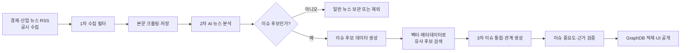
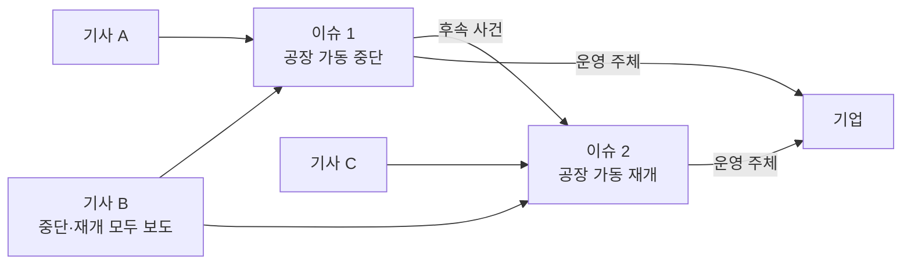
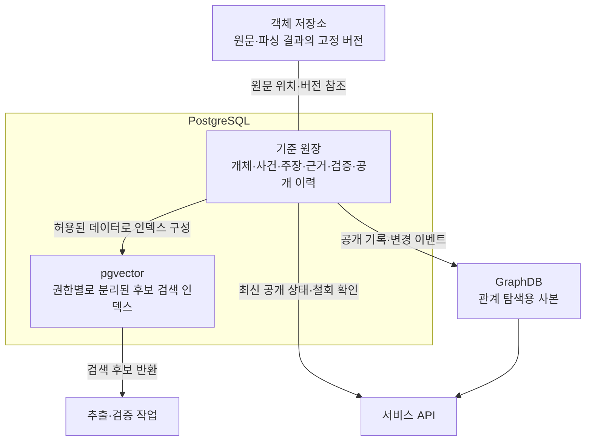
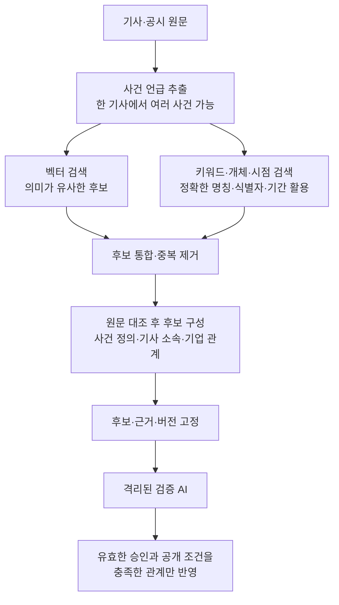
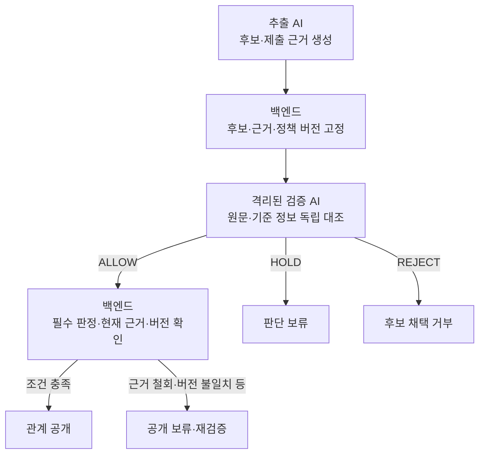
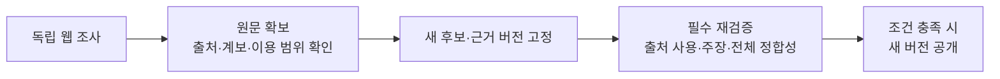

# 0916 데일리 스크럼 준비

- Notion ID: 3dcfef49-d8d5-8045-9170-cd4522c63c14
- Source: https://www.notion.so/3dcfef49d8d580459170cd4522c63c14
- Collected: 2026-10-10T16:50:38.619971+09:00
- Last edited (metadata only): 2026-09-16T16:29:42.075000+09:00

<!-- block: 3ddfef49-d8d5-80ea-973e-d9c15e5feb7c; type: page -->
- [](https://www.notion.so/3ddfef49d8d580ea973ed9c15e5feb7c)
<!-- block: 3ddfef49-d8d5-807b-8c0a-d46083993ba9; type: page -->
- [](https://www.notion.so/3ddfef49d8d5807b8c0ad46083993ba9)
<!-- block: 3ddfef49-d8d5-80d4-837e-ee11e402a771; type: page -->
- [](https://www.notion.so/3ddfef49d8d580d4837eee11e402a771)
<!-- block: 3ddfef49-d8d5-80b3-b940-e9884b9441f3; type: toggle -->
- 할일
<!-- block: 29faa2e1-67b9-4f5a-8c14-c2b9ed8dfca9; type: header -->
## 오늘의 목표

<!-- block: 45aa9141-8258-46d5-9930-ee7273c71e2a; type: quote -->
  뉴스에서 핵심 이슈를 추출하고, 이슈와 기업의 관계를 검증해 GraphDB에 저장하는 기준과 PoC 계획을 확정한다.

<!-- block: 4305df9e-31f3-4ae3-a331-7dbe9d2b9dba; type: divider -->

<!-- block: b7b2bd26-aa21-4302-b97b-7da8847d3194; type: sub_header -->
### 1. 이슈의 정의 확정

<!-- block: 88ff7fef-d448-4c02-852a-9f9cb9fb5351; type: text -->
  먼저 우리가 무엇을 이슈라고 부를지 합의합니다.

<!-- block: d3993a88-0ece-47a4-ae81-29da985b84d4; type: bulleted_list -->
  - 키워드, 산업, 제품과 이슈의 차이

<!-- block: ed83a6a3-8fe4-43f9-9df4-cc990fff2bb0; type: bulleted_list -->
  - 어느 정도로 구체적인 사건을 하나의 이슈로 볼 것인지

<!-- block: f2f024d8-3a74-4149-b67f-57dcaa08fbc8; type: bulleted_list -->
  - 같은 이슈가 시간에 따라 변할 때 하나로 유지할지 분리할지

<!-- block: fc4ed8cd-8948-42f3-bc4f-fc2be6e1a16b; type: bulleted_list -->
  - 이슈의 시작·업데이트·종료 기준

<!-- block: 716a2087-d290-4836-a010-95c19b3ff0e2; type: text -->
  예시:

<!-- block: d8c19bc3-0012-4457-9deb-baaa836414b7; type: code -->
```plain text
반도체 → 산업
HBM → 제품
수출 규제 → 주제
미국의 대중 반도체 수출 규제 강화 → 이슈
```

<!-- block: adb26380-e1dd-440c-b60a-13defee03282; type: text -->
  완료 조건:

<!-- block: b8bc2434-c2d8-455d-bcf6-accd2f4583ca; type: bulleted_list -->
  - 이슈 정의 1문장

<!-- block: f0c5b2d9-9bd0-43b0-b8b3-8281222bcbcb; type: bulleted_list -->
  - 이슈 예시 5개

<!-- block: 0cba6dd8-e62b-483e-a5d5-2e8ab8fd197c; type: bulleted_list -->
  - 이슈가 아닌 것의 예시 5개

<!-- block: fbd5cb7e-0488-4812-bb95-b3b79f664240; type: divider -->

<!-- block: 0a75faad-d2a1-4be5-a43e-34c43dafb0f5; type: sub_header -->
### 2. PoC 범위 확정

<!-- block: 2700f4ec-aa1e-4438-926b-160b144cbc9d; type: text -->
  이슈 추출과 검증을 시험할 데이터 범위를 정합니다.

<!-- block: e0d90c91-669d-4d24-b844-898de0c6a88f; type: text -->
  결정할 사항:

<!-- block: 1515ac5c-af14-4be8-9481-3d79908d883e; type: bulleted_list -->
  - 삼성전자 단일 종목으로 먼저 검증할지

<!-- block: 7a5aeca1-ee46-4a19-b327-45ab7b5c16bc; type: bulleted_list -->
  - 이후 확장할 핵심 종목 20개

<!-- block: 44599347-ec72-4f4d-a2e7-32f7bb20a4bb; type: bulleted_list -->
  - 반도체 등 우선 산업군

<!-- block: e296a309-5850-4f02-b7f7-b510f73a3d79; type: bulleted_list -->
  - 국내 뉴스와 해외 뉴스 포함 범위

<!-- block: f6d5ded8-6739-49e6-a112-b3fce278183b; type: bulleted_list -->
  - 수집 기간

<!-- block: 65949727-ab52-4c47-bd33-317a703bce70; type: bulleted_list -->
  - 검증에 사용할 기사 수

<!-- block: a71c5c1c-b87a-4499-9b80-21c9f4c57038; type: text -->
  추천안:

<!-- block: 158b32f8-73b9-498f-984b-30ba072a0903; type: code -->
```plain text
1차 PoC
- 중심 종목: 삼성전자
- 산업: 반도체
- 수집 기간: 최근 2~4주
- 기사 수: 중복 제거 전 300건 내외
- 검증 표본: 100건
```

<!-- block: c8e754f0-725c-4b30-a206-4593e7b2ead4; type: divider -->

<!-- block: ad796839-a125-44eb-9e21-36801eeeb948; type: sub_header -->
### 3. 뉴스 수집 전략 검증

<!-- block: 42e505b4-246e-421f-9042-3ca36c9cbaca; type: text -->
  두 방식을 비교한 뒤 하나를 선택합니다.

<!-- block: 66778df4-2a21-4977-ba7e-bd0a91be4001; type: sub_sub_header -->
#### A안: 기업 사전 기반 검색

<!-- block: 77b3ed39-24aa-43d2-9353-f5015e3f22f7; type: code -->
```plain text
삼성전자
+ HBM
+ DRAM
+ 파운드리
+ 엔비디아
+ 메모리 가격
+ 미국 수출 규제
```

<!-- block: b6428bb0-f6e6-46ed-95d6-feac86d68782; type: text -->
  장점은 관련 뉴스 비율이 높다는 것이고, 단점은 사전에 없는 새로운 이슈를 놓칠 수 있다는 것입니다.

<!-- block: 05e95e6b-3c79-4fc6-be70-098fde23078e; type: sub_sub_header -->
#### B안: 경제뉴스 전체 수집 후 필터링

<!-- block: a797aef2-d2f2-414c-afd5-d07f43f39abc; type: text -->
  장점은 예상하지 못한 이슈를 발견할 수 있다는 것이고, 단점은 비용과 노이즈가 많다는 것입니다.

<!-- block: 50710094-6a34-4774-b40b-a2de17db8220; type: sub_sub_header -->
#### 추천안: 혼합 방식

<!-- block: e5e66729-514f-49a1-8f6f-dadc0b8bdec8; type: bulleted_list -->
  - 핵심 종목과 기업 사전으로 관련 뉴스를 우선 수집

<!-- block: 10704954-a1ea-4c6b-9fed-16e0f1821ecd; type: bulleted_list -->
  - 산업·정책·거시경제 뉴스는 별도 피드로 보완

<!-- block: 79da96ed-a15c-4647-8022-715dbed51170; type: bulleted_list -->
  - 수집 후 의미 기반 관련성 필터 적용

<!-- block: 1a2c2bc1-bb52-404c-a09b-3c46c36b1e00; type: text -->
  완료 조건:

<!-- block: 28573b76-6e41-4274-8fba-52592ca5a53b; type: bulleted_list -->
  - 사용할 뉴스 API·RSS·크롤링 대상

<!-- block: 67358917-48fb-4443-a1f3-dcb8fce45a8d; type: bulleted_list -->
  - 검색 질의 구성 방법

<!-- block: 9fe838ef-7701-4875-8d8e-afead4c9a0e8; type: bulleted_list -->
  - 호출 주기

<!-- block: b472bf9f-7950-492d-86dd-96e1a350228d; type: bulleted_list -->
  - 하루 예상 기사량

<!-- block: 29b601c4-5de6-40e6-a627-547a7259462f; type: bulleted_list -->
  - 중복 기사 처리 방법

<!-- block: 6a864e0a-6e1c-4688-8545-e9a1a7245f14; type: text -->
  이 항목은 회의에서 확정만 하지 말고, 삼성전자 검색어 3~5개로 실제 기사를 수집해 검증해야 합니다.

<!-- block: a9a3af17-b32b-4148-b675-ac86c34b82f7; type: divider -->

<!-- block: edbe2d31-4c9c-4e0b-add6-ef62d5a1086c; type: sub_header -->
### 4. 뉴스 데이터 스키마 초안 작성

<!-- block: 48ae9ae1-9ac3-4aa9-96cc-1b8482f97821; type: text -->
  원문 데이터와 AI 분석 결과를 분리해서 저장합니다.

<!-- block: 94a3dd55-6ae7-4e13-8165-63d0751522b9; type: sub_sub_header -->
#### 원본 뉴스 데이터

<!-- block: 1fe074af-d8f0-4e2c-b810-fe6186fe9753; type: code -->
```plain text
{
  "newsId": "N001",
  "title": "...",
  "body": "...",
  "publisher": "...",
  "publishedAt": "...",
  "url": "...",
  "language": "ko"
}
```

<!-- block: a5f17909-c5ea-49f3-b094-559293d82f7b; type: sub_sub_header -->
#### AI 분석 데이터

<!-- block: 3be851bf-a38d-4f67-83e6-1be780933401; type: code -->
```plain text
{
  "summary": "...",
  "entities": [],
  "issueCandidates": [],
  "relatedCompanies": [],
  "evidenceSentences": [],
  "confidence": 0.87,
  "validationStatus": "PENDING"
}
```

<!-- block: 85d6b945-84ff-4f54-90e8-99ed077c4b42; type: text -->
  결정할 사항:

<!-- block: 3026a310-067e-41e2-84b5-6d28001b36fc; type: bulleted_list -->
  - 뉴스 원문 저장 여부

<!-- block: ae3e6a81-a969-4828-bdaa-ac2ea612cda2; type: bulleted_list -->
  - 요약문 길이

<!-- block: b6b12be9-0488-4d8e-9b35-acb855ab74b5; type: bulleted_list -->
  - 추출할 엔티티 유형

<!-- block: a312cee8-04f7-4c69-8f89-7f00319fbb28; type: bulleted_list -->
  - 근거 문장 저장 여부

<!-- block: 0105e4e8-206c-434d-9fef-8ec73b1795eb; type: bulleted_list -->
  - 분석 모델과 프롬프트 버전 저장 여부

<!-- block: e976512d-32b1-4482-9484-00ad9a2a7d86; type: bulleted_list -->
  - 승인·반려·검수 대기 상태

<!-- block: ea7814fc-8122-444d-8865-3eb6ba39d392; type: text -->
  완료 조건:

<!-- block: 956c14dd-78d1-4e29-bb1e-9b27efae3ef0; type: bulleted_list -->
  - 뉴스 JSON Schema 1차 버전

<!-- block: 41c541f2-b5f6-4fc3-89ad-c57e42aa094b; type: bulleted_list -->
  - 실제 기사 3건을 JSON으로 변환한 예시

<!-- block: 2af69dfd-23b8-40ca-806e-6b2445673d8e; type: divider -->

<!-- block: 1de0974d-1a77-4ece-ba00-ddd9c28bf851; type: sub_header -->
### 5. 기업 기준 사전 구축 범위 결정

<!-- block: ac082017-e629-4ede-a605-b7a65866d486; type: text -->
  뉴스와 기업을 연결하기 위한 기준 데이터를 정의합니다.

<!-- block: a520ad52-1b27-4b82-8dbf-680cf4671950; type: code -->
```plain text
{
  "ticker": "005930",
  "name": "삼성전자",
  "aliases": ["삼성전자", "삼전", "Samsung Electronics"],
  "products": ["HBM", "DRAM", "NAND", "파운드리"],
  "sectors": ["반도체", "전자"],
  "competitors": ["SK하이닉스", "마이크론", "TSMC"],
  "customers": ["엔비디아"],
  "countries": ["한국", "중국", "미국"],
  "policies": ["미국 반도체 수출 규제"]
}
```

<!-- block: e8879b18-1a18-43e1-85c4-3aa2fdd6b8c7; type: text -->
  특히 결정해야 할 부분:

<!-- block: 6515a7d7-aa26-4915-b8e3-dfea97d39b69; type: bulleted_list -->
  - 사람이 직접 구축할 데이터

<!-- block: 2e2e8503-202b-4a6a-ae68-22f38d31597e; type: bulleted_list -->
  - 공시나 외부 데이터에서 가져올 데이터

<!-- block: 2e78dc22-e24f-42bb-b0aa-e9160359cc11; type: bulleted_list -->
  - LLM이 후보로 제안할 데이터

<!-- block: 968c1ca9-e247-447d-bc46-44baadd2490c; type: bulleted_list -->
  - 관리자 검수 후 확정할 데이터

<!-- block: c4697d30-0463-46b8-ab25-262c50fca1c4; type: text -->
  기업 사전의 모든 관계에는 다음 정보가 필요합니다.

<!-- block: b934fd1f-b5a3-4cb9-a137-4edc7064b72a; type: code -->
```plain text
관계 유형
근거 출처
생성 일자
마지막 확인 일자
신뢰도
검증 상태
```

<!-- block: bd1f5f39-b11c-45a0-a5b9-b4780369317c; type: divider -->

<!-- block: e5262973-facc-4a44-9920-714d62b9556a; type: sub_header -->
### 6. 기사–기사 관계 및 핵심 이슈 추출 방식 결정

<!-- block: 83968a36-06fa-4f0b-bf1c-7290b7923873; type: text -->
  처리 흐름을 다음처럼 설계합니다.

<!-- block: b9ef1c63-df9b-46f9-983f-cb8f89bea8b3; type: code -->
```plain text
뉴스 수집
→ 중복 제거
→ 임베딩 생성
→ 유사 기사 후보 검색
→ 엔티티·시간·사건 비교
→ 기사 군집 생성
→ LLM이 군집 대표 이슈 추출
```

<!-- block: 8d186e90-c9c9-42b5-a831-d81bbce0dbd2; type: text -->
  군집화에 사용할 기준:

<!-- block: 268cd147-6920-4e83-a236-e5022cf8e0c2; type: bulleted_list -->
  - 제목 유사도

<!-- block: af83735a-6d4b-4446-8758-b7f17b5b1320; type: bulleted_list -->
  - 본문 임베딩 유사도

<!-- block: 4f5e175d-7e0c-44af-aec0-f0c5ce33e584; type: bulleted_list -->
  - 공통 기업·제품·국가·인물

<!-- block: f660c1f8-44a1-41be-8785-5b6e7552d438; type: bulleted_list -->
  - 발행 시각

<!-- block: 0f1cc6e6-a4f1-46ea-b886-e8aeb6701f46; type: bulleted_list -->
  - 사건의 주체·행동·대상

<!-- block: 8350892c-e776-449f-9e75-d78d163562ac; type: bulleted_list -->
  - 같은 공식 발표를 인용했는지

<!-- block: b23123fc-8b08-426e-9b2c-20cbfa02ad3f; type: text -->
  중요한 결정:

<!-- block: 53386c16-d0e6-49e4-8a51-457c1d7cb99a; type: quote -->
  GraphDB에 기사 간 모든 유사도 간선을 저장할 것인가?

<!-- block: b6a413ab-3992-47d1-9feb-9c30e2f69ae9; type: text -->
  추천안은 아닙니다. 기사 유사도 계산은 Vector DB나 배치 처리에서 수행하고, GraphDB에는 다음 관계만 저장하는 것이 적절합니다.

<!-- block: 9bd085c0-faee-4733-b028-f6991d6420c6; type: code -->
```plain text
(News)-[:MEMBER_OF]->(Issue)
```

<!-- block: 4d05b48a-4e7f-4d4b-9284-603d53cd2dcd; type: text -->
  완료 조건:

<!-- block: 6a0e7a48-e327-46f5-891e-5b16f28d1c13; type: bulleted_list -->
  - 기사 군집화 방법

<!-- block: 2f4f95f2-6e7d-4b53-9895-7cf401b21523; type: bulleted_list -->
  - 군집 분리·병합 기준

<!-- block: 5232c531-fefa-478b-841b-78e7d31625a3; type: bulleted_list -->
  - 하나의 군집을 이슈로 승격하는 조건

<!-- block: dcb3c142-a148-4dff-aefd-47cb4fca5efb; type: divider -->

<!-- block: 4c36a148-d056-4f4e-8e28-0dcf60abcb27; type: sub_header -->
### 7. 이슈 추출 결과 검증 방식 결정

<!-- block: 39d003b3-0fa0-4f51-9a8d-6adb3e5875f8; type: text -->
  이 부분이 오늘 회의의 가장 중요한 결론입니다.

<!-- block: 75e624d2-b4eb-4bc4-b62a-f5402360fb71; type: text -->
  검증 항목:

<!-- block: bd29042f-126a-467e-ba5e-4d2d9c981965; type: bulleted_list -->
  - 군집 내 기사들이 실제로 같은 사건을 다루는가

<!-- block: 4c8e778a-aa07-4b9a-bd12-63288346fcdb; type: bulleted_list -->
  - LLM이 만든 이슈명이 기사 내용을 대표하는가

<!-- block: 0764cfeb-672f-4127-a359-316298bf9db8; type: bulleted_list -->
  - 이슈의 주체·행동·대상이 기사에 존재하는가

<!-- block: 1720b0ea-56f6-4a98-a864-ec3372df542e; type: bulleted_list -->
  - 제시된 근거 문장이 실제 원문에 존재하는가

<!-- block: 1ba260a0-0a0b-4bf5-ae34-df7ae0fcd75b; type: bulleted_list -->
  - 독립된 출처가 충분한가

<!-- block: ef69d418-bc7c-4ed2-ba65-e34d5d1642a5; type: bulleted_list -->
  - 다른 이슈와 중복되지 않는가

<!-- block: 12f3c28a-56ea-4408-a366-f0182288eb0f; type: text -->
  추천 검증 상태:

<!-- block: 4de0ab8e-2230-4708-8b18-546f6a141588; type: code -->
```plain text
CANDIDATE       후보
AUTO_VALIDATED  자동 검증 통과
REVIEW_REQUIRED 사람 검수 필요
APPROVED        승인
REJECTED        반려
MERGED          기존 이슈에 병합
```

<!-- block: da4d9335-4c03-4ae2-956b-1f05a7920070; type: text -->
  추천 초기 기준:

<!-- block: d7f4dd76-3dfb-48f1-96cf-c0e6c2d2f857; type: bulleted_list -->
  - 독립 언론사 2곳 이상

<!-- block: 77140b56-3854-48f5-ace6-30a852375e1a; type: bulleted_list -->
  - 중복이 아닌 기사 3건 이상

<!-- block: d4c58b61-3211-4a82-84f2-b1decf362b04; type: bulleted_list -->
  - 핵심 엔티티와 사건 구조 일치

<!-- block: 936437c3-6a52-429b-9aab-8633fd875948; type: bulleted_list -->
  - 근거 문장 필수

<!-- block: a5355f5f-e0b3-40cc-b0f2-db8db979387a; type: bulleted_list -->
  - DART·정부·기업 공식 발표는 단일 출처 예외 허용

<!-- block: 52e968b8-f6f2-4eb3-aecf-7b0e77f497be; type: text -->
  완료 조건:

<!-- block: 26d70b00-dc3d-4ae1-8e82-51c72bc1a02b; type: bulleted_list -->
  - 자동 승인 기준

<!-- block: 41113db6-ddb5-42db-8b36-a862a1d14920; type: bulleted_list -->
  - 사람 검수 대상 기준

<!-- block: 7d79e7c4-37c9-49fa-9bc3-e54465975f94; type: bulleted_list -->
  - 반려·병합 기준

<!-- block: 9db1ea47-4762-4281-b0c1-cf2d5bdb85b2; type: bulleted_list -->
  - 정답 데이터 제작 방법

<!-- block: 341124b5-5f91-41d6-93ac-46be977029e8; type: divider -->

<!-- block: 73621b0b-de58-437a-a329-392a3f40b19a; type: sub_header -->
### 8. 기사·이슈–종목 연결 기준 정의

<!-- block: 4ca27ed3-b477-484d-8e61-79ab266275f1; type: text -->
  연결을 한 종류로 만들지 않고 세 수준으로 나눕니다.

<!-- block: b89bf4f7-8158-4645-90a1-817728e8a2ca; type: sub_sub_header -->
#### 직접 관계

<!-- block: afc8a646-28c6-4a12-91f3-8ae602f5f947; type: text -->
  기사에서 기업과 영향 관계가 직접 언급됨.

<!-- block: c311b755-9fe9-4126-a16a-93b4bd7a9ee4; type: code -->
```plain text
(Issue)-[:DIRECTLY_AFFECTS]->(Company)
```

<!-- block: 405c1706-f7c7-4911-b768-ab3a0fc613cd; type: sub_sub_header -->
#### 구조적 관계

<!-- block: 63f9a940-6f8c-4a9b-bff0-194a0ee87de0; type: text -->
  기사에는 기업이 없지만 제품·산업·공급망 관계를 통해 연결됨.

<!-- block: 42a855d5-c4d5-4e20-bc86-3dc3e0d1eda9; type: code -->
```plain text
(Issue)-[:RELATED_VIA_PRODUCT]->(Company)
(Issue)-[:RELATED_VIA_SUPPLY_CHAIN]->(Company)
```

<!-- block: bdc67438-f9bc-473d-bc76-321e937732e0; type: sub_sub_header -->
#### 추론 관계

<!-- block: 18ad249a-23fb-4086-8255-1a0483409e5c; type: text -->
  LLM이나 임베딩만으로 관련 가능성을 발견함.

<!-- block: 17d8f88f-e45e-4563-a556-30ae8485f2e8; type: code -->
```plain text
(Issue)-[:POSSIBLY_RELATED_TO]->(Company)
```

<!-- block: b6361153-144b-4e3b-ad0e-c5d432f35dbf; type: text -->
  각 관계에 저장할 값:

<!-- block: 2df48256-54cc-45cd-827c-c9d692591e7d; type: code -->
```plain text
{
  "relationType": "RELATED_VIA_PRODUCT",
  "direction": "NEGATIVE",
  "relevanceScore": 0.82,
  "confidence": 0.76,
  "evidenceNewsIds": ["N01", "N04"],
  "evidenceText": "...",
  "validationStatus": "REVIEW_REQUIRED"
}
```

<!-- block: 7a60795e-9ffd-4f1d-950f-9be690981d69; type: text -->
  완료 조건:

<!-- block: c4219e29-839c-4ee7-ac27-58dd7bddaadb; type: bulleted_list -->
  - 연결 관계 유형

<!-- block: 8ba7018a-5c3b-4d5b-9f93-f0320684129c; type: bulleted_list -->
  - 관련도 계산 기준

<!-- block: 3102a8b4-134c-4bbf-8f0f-d9456783e20a; type: bulleted_list -->
  - GraphDB 저장 최소 점수

<!-- block: 42ab7946-cd4e-4f2e-927c-0ebbdb7ea1d9; type: bulleted_list -->
  - 사용자 화면에 표시할 최소 점수

<!-- block: 93879633-423e-4390-8bd0-234d4af50e44; type: divider -->

<!-- block: 53734728-c44b-49dd-a550-2405c5180218; type: sub_header -->
### 9. 이슈의 다종목 전파 규칙 설계

<!-- block: 6bf37232-9583-473a-a209-18118812111c; type: text -->
  하나의 이슈가 다른 회사로 확산되는 경로를 정의합니다.

<!-- block: 89d04f7c-7267-4159-8f01-b807304e8535; type: code -->
```plain text
미국 수출 규제
→ 반도체 장비
→ 중국 생산시설
→ 삼성전자
→ 부품 공급망
→ 삼성전기
```

<!-- block: 1070d15f-1f45-436f-a249-c37f9ff0360f; type: text -->
  결정할 사항:

<!-- block: af38acd8-6f49-4b45-a69f-72d56a59a719; type: bulleted_list -->
  - 최대 몇 홉까지 탐색할지

<!-- block: a25c7e11-2064-48b8-b498-581e3ffc9150; type: bulleted_list -->
  - 같은 산업만으로 연결을 허용할지

<!-- block: 3ed087aa-b7b0-4b6a-bf5e-ebb657c1efd3; type: bulleted_list -->
  - 경쟁사·공급사·고객사 경로를 어떻게 구분할지

<!-- block: b0ec3a74-7284-47d2-b544-c22d512fa01d; type: bulleted_list -->
  - 직접 관계보다 간접 관계의 점수를 얼마나 낮출지

<!-- block: 8f7ccb46-42b3-43d2-9958-d30106d0f1e6; type: bulleted_list -->
  - 사용자 화면에서 간접 관계를 어떻게 표시할지

<!-- block: c43d5556-723d-4b92-8dba-21ba1f5fccbd; type: text -->
  추천안:

<!-- block: f93311a9-a900-4b3e-aec8-6871c04c502f; type: bulleted_list -->
  - 기본 화면: 최대 2홉

<!-- block: ebedcd50-68ae-4ff2-b2d4-1ee941c86474; type: bulleted_list -->
  - 상세 탐색: 최대 3홉

<!-- block: 58ddec9c-9968-425d-ac2f-ad8e00397ec9; type: bulleted_list -->
  - 같은 산업이라는 이유만으로는 영향 관계를 생성하지 않음

<!-- block: a8684ef8-9984-4f21-b674-824a84affe17; type: bulleted_list -->
  - 홉이 증가할수록 신뢰도 감쇠

<!-- block: 3033e50e-9ac4-47fd-87e6-05987df9acc6; type: bulleted_list -->
  - 모든 연결 경로에 근거 표시

<!-- block: 92db252b-e7f4-4ada-b49c-20fde2887441; type: divider -->

<!-- block: 04d4f878-e484-4563-838e-68bf5315d539; type: sub_header -->
### 10. GraphDB 온톨로지·스키마 확정

<!-- block: e1a8410a-f817-4439-837b-a8dea287bb62; type: text -->
  GraphDB 스키마는 앞의 실험 결과를 반영해 마지막에 확정하는 것이 좋습니다.

<!-- block: 62960558-1c43-49b4-8434-ac9644d489ac; type: text -->
  초기 노드 후보:

<!-- block: b6682b61-6347-4e6c-a0f2-ce64b529e7be; type: code -->
```plain text
Company
Stock
Issue
News
Product
Industry
Country
Policy
Technology
Commodity
```

<!-- block: afa46e7f-3907-408f-a08d-da4a49e35ff5; type: text -->
  초기 관계 후보:

<!-- block: a85f9a25-c979-4a95-a185-1e99349c76c0; type: code -->
```plain text
MEMBER_OF
MENTIONS
DIRECTLY_AFFECTS
POSSIBLY_AFFECTS
PRODUCES
SUPPLIES_TO
COMPETES_WITH
CUSTOMER_OF
BELONGS_TO
TARGETS
OPERATES_IN
```

<!-- block: 4c4d8677-ee07-4204-9ce2-8e71f86ec79f; type: text -->
  중요한 점은 오늘 완전히 고정하는 것이 아니라:

<!-- block: 2e652a1b-55b0-4ebb-b676-b58f74dd5c0a; type: code -->
```plain text
온톨로지 초안 작성
→ 실제 기사 100건 처리
→ 부족하거나 사용되지 않는 노드·관계 확인
→ 온톨로지 확정
```

<!-- block: 84393a85-c42b-424f-81e1-a76dff23cf19; type: text -->
  순서로 진행하는 것입니다.

<!-- block: 30e80ebe-c326-435a-b5d3-29f69688b67e; type: sub_header -->
### 오늘 회의에서 반드시 나와야 하는 결과

<!-- block: 48d9aa00-938a-41f5-9ff5-7c1ffbc3b1d7; type: text -->
  회의가 끝났을 때 최소한 아래 여섯 가지가 확정돼야 합니다.

<!-- block: 43385045-9cd8-47cb-9cb9-7805dfbf3037; type: numbered_list -->
  - 이슈의 정의

<!-- block: 0ad06717-4288-4ec1-83bf-db1757bfcd26; type: numbered_list -->
  - 삼성전자 중심 PoC 범위

<!-- block: 45c939c3-10b3-420b-aa19-f0f8710add2f; type: numbered_list -->
  - 뉴스 수집 방식과 테스트 방법

<!-- block: 01f8f776-12bf-4960-a1c8-c99c8536aa5b; type: numbered_list -->
  - 뉴스 및 이슈 JSON 스키마 초안

<!-- block: c7d66b62-62f8-4573-811f-b42bef5fff7e; type: numbered_list -->
  - 이슈 검증 기준과 사람 검수 조건

<!-- block: 23e72a18-1f13-4f9c-ba83-e22ff1f6a8f8; type: numbered_list -->
  - 이슈–기업 연결 유형과 신뢰도 기준

<!-- block: 3ddfef49-d8d5-800f-b8dd-e9ccc88d8d41; type: text -->


<!-- block: 3ddfef49-d8d5-8076-88be-c16e39e94c47; type: toggle -->
- 이슈 추출 방식
<!-- block: e8ef6dd0-4668-4f5c-9d3f-e65b4bb7c5a8; type: text -->
  이야기가 반복되는 이유는 ① 이슈가 제대로 만들어졌는가와 ② 그 이슈가 어떤 기업과 관련 있는가를 하나의 문제로 다루고 있기 때문입니다. 두 문제를 분리해서 각각 검증해야 합니다.

<!-- block: ec1bcd4a-1ed3-4cc6-8f0d-29e0d86e2542; type: text -->
  제가 추천하는 기본 구조는 다음과 같습니다.

<!-- block: 29b13a0b-0bf1-4190-81d8-68ba7d20716b; type: code -->
```plain text
경제뉴스 수집
→ 중복 기사 제거
→ 유사 기사 군집화
→ 기사 군집에서 이슈 후보 생성
→ 이슈 유효성 검증
→ 이슈와 기업의 관계 후보 생성
→ 관계 유효성 검증
→ GraphDB 적재
```

<!-- block: 5f455722-3b08-414d-a70d-7bfbbc89f440; type: text -->
  핵심은 LLM이 기사 한 건을 읽고 마음대로 이슈를 만드는 방식이 아니라, 서로 관련된 기사 묶음을 먼저 만들고 LLM은 그 묶음을 대표하는 이슈를 구조화하는 역할을 맡는 것입니다.

<!-- block: c25d7378-1181-4c7c-b7e8-21112c523372; type: sub_header -->
### 우리가 반드시 정해야 하는 사항

<!-- block: 5cfc6b41-50f3-4693-b55c-587d32396aa8; type: table -->
<!-- block: 78af7406-c2da-4f1c-90bf-d3ea2bce4298; type: table_row -->
| 순서 | 결정 사항 | 추천 방향 |

<!-- block: 36a67f8e-08ad-40f0-9d4c-546246269ec8; type: table_row -->
| 1 | 무엇을 이슈라고 부를 것인가 | 산업·제품 같은 고정 주제가 아니라, 일정 기간 발생한 구체적 사건이나 변화로 정의 |

<!-- block: f928323e-55dc-4af3-b261-dc82a103bd0a; type: table_row -->
| 2 | 뉴스 수집 범위 | 처음부터 모든 경제뉴스를 수집하지 말고, 반도체 등 1~2개 산업과 핵심 종목 20개 주변 뉴스로 제한 |

<!-- block: 92d0b041-f239-4bda-9230-c549ed4ff320; type: table_row -->
| 3 | 뉴스 중복 제거 기준 | 제목 유사도, 본문 유사도, 동일 인용문, 발행 시각을 사용해 재송고·복제 기사를 제거 |

<!-- block: 756d7213-aa23-47f4-bfb1-f77f93e60d5c; type: table_row -->
| 4 | 기사 간 연관성 계산 방식 | 임베딩 유사도뿐 아니라 등장 기업·제품·국가·정책·날짜가 얼마나 겹치는지 함께 사용 |

<!-- block: 1eb9cfa1-05ef-4f86-ac81-5914e15c183f; type: table_row -->
| 5 | 관련 기사 군집화 기준 | 같은 산업이라는 이유만으로 묶지 않고, 같은 사건·주체·행동·대상·기간을 공유하는 기사만 묶기 |

<!-- block: 4f88847f-fc1a-4c53-8544-e5f46df82a91; type: table_row -->
| 6 | 이슈 후보 생성 방식 | 기사 군집을 LLM에 전달해 이슈명, 핵심 사건, 주체, 대상, 시점, 근거 문장을 JSON으로 추출 |

<!-- block: 07b63b68-4980-4c3a-ac5a-a84edf6ed8a7; type: table_row -->
| 7 | 이슈가 제대로 추출됐는지 검증하는 기준 | 기사 간 일관성, 독립 출처 수, 근거 문장 존재 여부, 시간적 응집도, 군집 내 주제 일치도를 평가 |

<!-- block: 759a87b5-e74b-42bd-a5e6-0193d43f79cd; type: table_row -->
| 8 | 이슈와 기업을 연결하는 유형 | 직접 연결, 산업·제품을 통한 구조적 연결, 추론 연결을 구분 |

<!-- block: 99e9c81d-d53d-4a5a-92c2-ec84832c6a4b; type: table_row -->
| 9 | 기업 관계의 검증 기준 | 기사 안의 명시적 근거와 기존 기업 지식 그래프 경로를 분리하고 각각 신뢰도를 계산 |

<!-- block: 4f82e1c3-002d-4f5d-92f5-475799a0999b; type: table_row -->
| 10 | 자동 승인과 사람 검수의 경계 | 신뢰도 높은 직접 관계만 자동 반영하고, 간접 관계·영향도가 큰 관계는 관리자가 확인 |

<!-- block: e09a2dfc-1fcc-41a0-8f6c-3ab829c5c4d1; type: table_row -->
| 11 | GraphDB에 저장할 데이터 | 뉴스 전체 유사도 관계를 모두 저장하지 않고 기사→이슈→기업과 검증된 핵심 관계만 저장 |

<!-- block: e4dded70-6e3c-43d8-8ec5-87a8a56da0f8; type: table_row -->
| 12 | 사용자에게 불확실성을 어떻게 보여줄지 | 관련성을 확정 사실처럼 표현하지 않고 직접 근거, 구조적 연관, 추정 관계로 표시 |

<!-- block: df72120d-65a5-48ba-8744-4e7c162dd118; type: table_row -->
| 13 | PoC 평가 기준 | 사람이 만든 정답 데이터와 비교해 이슈 군집 정확도, 기업 연결 정확도, 잘못된 연결 비율을 측정 |


<!-- block: 38b5cb20-57c8-4dbf-933a-f4edf0a1a7af; type: sub_header -->
### 1. 이슈의 정의부터 확정해야 합니다

<!-- block: fdbb4517-151e-45f6-a919-a7e80faf1b9f; type: text -->
  이슈는 단순 키워드가 아닙니다.

<!-- block: 58cefd18-1b23-4c06-8ef2-a85e79adbb13; type: code -->
```plain text
반도체              → 산업
HBM                  → 제품
미국                 → 국가
수출 규제            → 주제
미국의 대중 반도체 수출 규제 강화 → 이슈
```

<!-- block: b10915f4-967d-4ff9-ab2f-b175f6d55677; type: text -->
  추천하는 이슈 스키마는 다음과 같습니다.

<!-- block: d63f2184-52fb-40ae-9685-1635ffb09669; type: code -->
```plain text
{
  "issueId": "ISSUE-20260915-001",
  "title": "미국의 대중 반도체 장비 수출 규제 강화",
  "eventType": "REGULATION",
  "actors": ["미국 정부"],
  "targets": ["중국 반도체 산업"],
  "products": ["반도체 장비", "메모리 반도체"],
  "countries": ["미국", "중국"],
  "startedAt": "2026-09-15",
  "summary": "...",
  "evidenceArticleIds": ["N101", "N105", "N112"],
  "sourceCount": 3,
  "confidence": 0.87
}
```

<!-- block: 8e3b57fc-662c-445f-b885-1b8b3f86ff2f; type: text -->
  LLM은 이 구조에 맞춰 이슈를 새로 상상하는 역할이 아니라, 기사 군집에 이미 존재하는 사건을 명명하고 구조화하는 역할만 해야 합니다.

<!-- block: d920366e-b5f3-4887-a673-58721c63fe6f; type: sub_header -->
### 2. 뉴스 간 그래프를 먼저 만드는 방향은 일부 맞습니다

<!-- block: 99582539-1425-4e84-88d1-77ecef452b35; type: text -->
  다만 모든 기사와 모든 기사의 유사도를 GraphDB 간선으로 저장하면 관계 수가 폭발합니다.

<!-- block: 2f4f39cf-df60-4a2c-beae-4ba9cf5b0d1b; type: text -->
  기사 10,000개만 있어도 모든 기사 쌍은 약 5천만 개입니다. 그래서 다음과 같이 역할을 나누는 것이 좋습니다.

<!-- block: ec88a2af-326d-4fc3-aade-5a38704fb0e4; type: code -->
```plain text
Vector DB
- 기사 임베딩 저장
- 유사 기사 검색
- 기사 군집화 후보 생성

GraphDB
- (Article)-[:MEMBER_OF]->(Issue)
- (Issue)-[:DIRECTLY_RELATED_TO]->(Company)
- (Issue)-[:STRUCTURALLY_RELATED_TO]->(Company)
- (Company)-[:PRODUCES]->(Product)
- (Company)-[:SUPPLIES_TO]->(Company)
- (Company)-[:OPERATES_IN]->(Country)
```

<!-- block: 364863eb-40c4-4a2f-8b8c-122816bfe6c3; type: text -->
  즉, 기사 간 연관도를 계산하는 용도는 Vector DB, 검증된 이슈와 기업 관계를 탐색하는 용도는 GraphDB가 적합합니다.

<!-- block: 58722170-340d-4488-af79-3ceda1046afd; type: text -->
  기사끼리 직접 연결하는 간선은 모든 유사 기사에 만들지 않고 다음과 같은 의미 있는 경우에만 만들면 됩니다.

<!-- block: 46cb3613-877a-41a0-b4e9-87f18e61c763; type: bulleted_list -->
  - 동일 사건의 후속 보도

<!-- block: 243af597-05d7-4a2a-988a-aca52b7299d5; type: bulleted_list -->
  - 정정 기사

<!-- block: 91d21b2c-c1c0-4e95-b4f3-8610183e590a; type: bulleted_list -->
  - 선행 보도와 후속 보도

<!-- block: 93e57bf7-2789-45bf-9753-c912a6fd3837; type: bulleted_list -->
  - 같은 공식 발표를 인용한 기사

<!-- block: 4616b513-87c0-49ea-a761-84ebaebe2dae; type: bulleted_list -->
  - 상반된 관점을 제시하는 기사

<!-- block: 868dd481-84d2-4f53-9116-cf453dd0e865; type: sub_header -->
### 3. 이슈 검증 기준

<!-- block: db6e3ac1-3f7f-4c25-9f3c-0a9778ddeee3; type: text -->
  하나의 이슈가 GraphDB에 들어가려면 최소한 다음 조건을 확인해야 합니다.

<!-- block: 1f36ee9c-3c38-45dd-b11a-6ac192cb431a; type: sub_sub_header -->
#### 일반 뉴스 기반 이슈

<!-- block: 363aee12-583c-4513-ab4a-ef98b31e2785; type: bulleted_list -->
  - 중복이 아닌 독립 기사 3건 이상

<!-- block: ab3a5ab8-ee37-4c8d-9e8a-97130ce6cadc; type: bulleted_list -->
  - 서로 다른 출처 2곳 이상

<!-- block: 1eec4640-8f71-45ad-8bed-17031ddb6744; type: bulleted_list -->
  - 동일하거나 매우 유사한 사건을 설명

<!-- block: a747f5da-5905-45b8-af89-2c8a4db10111; type: bulleted_list -->
  - 주체·행동·대상 중 최소 2개 이상 일치

<!-- block: 16d5c1f5-8d67-44b1-b1ea-ae3eed649dcc; type: bulleted_list -->
  - LLM이 제시한 근거 문장이 실제 기사에 존재

<!-- block: b7a3c316-1c7d-4782-9c43-21efc2ed2e59; type: bulleted_list -->
  - 기사들이 일정한 시간 범위 안에 발생

<!-- block: 0e9ec8dc-4c97-43e8-a2a0-256846e602b1; type: sub_sub_header -->
#### 단일 출처로도 인정할 수 있는 경우

<!-- block: 7280c6c1-80f8-4fe4-8331-ea6cd9d3734b; type: bulleted_list -->
  - DART 공시

<!-- block: 42e87565-7381-4611-96d1-c72febbf2bc1; type: bulleted_list -->
  - 정부·규제기관 발표

<!-- block: 1ee0b33e-537d-4d40-a73b-5859768d7662; type: bulleted_list -->
  - 기업 공식 발표

<!-- block: a85a937f-2269-41f2-b93d-8ff5526f1ef1; type: bulleted_list -->
  - 거래소 공시

<!-- block: db8c2673-0744-4435-b187-c650f28bc36e; type: bulleted_list -->
  - 법원 판결 또는 공식 통계

<!-- block: 8d1c2f82-7ae6-433b-880c-e6b2a6d22d4a; type: text -->
  이런 1차 자료는 기사 1건이라도 이슈로 인정할 수 있습니다.

<!-- block: 08a59e1c-ec47-445c-8542-b0ebdb79a39e; type: text -->
  결과적으로 이슈 상태를 다음처럼 나눌 수 있습니다.

<!-- block: 4992a17c-1d48-4e4b-9f90-b7604b537a1f; type: code -->
```plain text
후보 이슈
→ 자동 검증 완료
→ 사람 검수 대기
→ 승인된 이슈
→ 반려 또는 다른 이슈와 병합
```

<!-- block: fb77f171-b1ac-4797-9d07-3b837fbd9f3a; type: sub_header -->
### 4. 이슈와 기업을 연결하는 기준

<!-- block: 012fb26a-305a-4249-b4b8-2b27602cd3ec; type: text -->
  기업 연결은 세 단계로 구분하는 것이 좋습니다.

<!-- block: 5846e0fd-910c-4808-81b5-827c4c12ce5b; type: sub_sub_header -->
#### 1단계: 직접 연결

<!-- block: b5a900c9-d2bf-4231-9cdf-e7edb5aaf03a; type: text -->
  기사에서 기업이 직접 언급되고, 이슈와 기업의 관계를 설명하는 문장이 존재합니다.

<!-- block: 1516d7dd-25ac-4b76-957a-359495c1a7f4; type: code -->
```plain text
기사:
"미국의 규제 강화로 삼성전자의 중국 공장 장비 반입에
추가적인 허가가 필요할 가능성이 커졌다."
```

<!-- block: c20f9a00-0e8f-4a2e-a1f9-f1f7e89f2b99; type: code -->
```plain text
(수출 규제)-[:DIRECTLY_AFFECTS]->(삼성전자)
```

<!-- block: 899ed052-4ed7-4df7-aa6d-6965b92133ec; type: text -->
  가장 신뢰도가 높은 관계입니다.

<!-- block: 1a9a3efb-47cb-493f-a9e4-b0835bf59b41; type: sub_sub_header -->
#### 2단계: 구조적 연결

<!-- block: 6c94dd14-9b5b-4b1b-962d-09df031990e6; type: text -->
  기사에서 기업이 직접 언급되지 않았지만, 검증된 기업 지식 그래프를 통해 연결됩니다.

<!-- block: ef86015d-cdf7-42aa-8aaf-9f7c121c9f6f; type: code -->
```plain text
(삼성전자)-[:OPERATES_FACTORY_IN]->(중국)
(삼성전자)-[:PRODUCES]->(메모리반도체)
(수출규제)-[:TARGETS]->(중국)
(수출규제)-[:RESTRICTS]->(반도체장비)
```

<!-- block: d50fd238-4794-42dd-8fb5-be05924e6695; type: text -->
  이 경로를 근거로 삼성전자와의 구조적 관련성을 제안할 수 있습니다.

<!-- block: 00ba5e9c-ba24-4b06-a1c5-dc2349888103; type: code -->
```plain text
(수출 규제)-[:STRUCTURALLY_RELATED_TO]->(삼성전자)
```

<!-- block: af1591ee-35d8-4c8d-8ad2-35fac026cee8; type: text -->
  단, 직접적인 영향으로 확정하면 안 됩니다.

<!-- block: ad0e2da4-58eb-4697-b639-68dc0c7a173a; type: sub_sub_header -->
#### 3단계: 추론 연결

<!-- block: 0d748dff-b627-46a0-96f2-869d94be5397; type: text -->
  임베딩 유사도나 LLM 판단만으로 연결된 관계입니다.

<!-- block: b48d16f7-cf00-4581-9aee-077301a31802; type: code -->
```plain text
(수출 규제)-[:POSSIBLY_RELATED_TO]->(삼성전기)
```

<!-- block: 0e6babfa-c02b-4c76-9772-477249cee33a; type: text -->
  이 관계는 기본 그래프에서 숨기거나 검증 전 관계로 표시해야 합니다.

<!-- block: 5d00ffcc-6486-4d62-96d4-1322fc381daa; type: sub_header -->
### 5. 삼성전기 같은 다른 회사는 어떻게 연결하는가

<!-- block: 3bb0cd87-51ea-4ef5-b835-c95edbc91fa6; type: text -->
  “미국 수출 규제”라는 이슈가 발생했다고 해서 반도체 관련 기업 전체를 무조건 연결하면 안 됩니다.

<!-- block: a2660715-267e-4b72-9f4a-2dcedd8fedd1; type: text -->
  삼성전기를 연결하려면 다음 중 하나가 필요합니다.

<!-- block: d91a8835-3f1e-4a7a-a028-8fb0880da83c; type: bulleted_list -->
  - 기사에서 삼성전기를 직접 언급

<!-- block: f56bbf98-3077-4f33-a6d7-a3a95bb4bebb; type: bulleted_list -->
  - 삼성전기가 규제 대상 제품을 생산한다는 검증된 관계

<!-- block: 21d6087c-171c-4088-b4ec-35f23fbfcd2b; type: bulleted_list -->
  - 규제 대상 고객사에 납품한다는 공급망 관계

<!-- block: 15c8301b-5ef2-4040-8821-4fc7298d68dc; type: bulleted_list -->
  - 규제 대상 지역에 생산·판매 거점이 있다는 관계

<!-- block: 6340513e-194c-45d4-8cc5-2592090c7758; type: bulleted_list -->
  - 여러 기사에서 반복적으로 함께 등장

<!-- block: 071a0eec-2bd2-4007-814a-46bf65cc57ad; type: bulleted_list -->
  - 관리자가 확인한 산업 관계

<!-- block: 157dd4a4-34a6-4f81-b92a-0d039e992dfe; type: text -->
  즉, 그래프는 다음과 같은 경로를 설명할 수 있어야 합니다.

<!-- block: 13a6b8bb-26dc-4b5e-8f2e-dba375e67adf; type: code -->
```plain text
미국 수출 규제
→ 반도체 장비 수출 제한
→ 중국 생산시설 영향
→ 삼성전자 중국 공장
→ 삼성전자의 부품 조달 변화
→ 삼성전기
```

<!-- block: 67870ec2-5724-4755-9dfa-acf7018518a0; type: text -->
  경로가 존재하지 않는다면 단지 “같은 삼성 계열사”라는 이유로 연결하지 않는 것이 맞습니다.

<!-- block: b981906f-535b-406d-86ab-b2453beae37e; type: sub_header -->
### 최종적으로 정해야 할 핵심 7가지

<!-- block: 09ca74aa-9f76-4f6b-8b79-08659d4f6e8c; type: text -->
  오늘 회의에서는 아래 일곱 가지만 확정해도 방향이 잡힙니다.

<!-- block: 5a4f7466-c270-4b73-990f-684f486e40f3; type: numbered_list -->
  - 이슈를 키워드가 아니라 구체적 사건으로 정의할 것인가

<!-- block: 5567a9cf-6cc1-49f8-b595-e2cba41ade1c; type: numbered_list -->
  - 기사 군집을 만든 뒤 LLM이 이슈를 명명하는 방식으로 갈 것인가

<!-- block: ca2539fd-eabe-4780-bead-85bce746c2f1; type: numbered_list -->
  - 기사 군집화에 사용할 기준: 임베딩·엔티티·시간·사건 구조

<!-- block: 612388e4-a9fa-4636-93a9-1d71b6b84a45; type: numbered_list -->
  - 이슈 승인 조건: 기사 수·독립 출처 수·근거 문장·신뢰도

<!-- block: 2832fd01-11d2-4133-83dd-ae50c3921bd0; type: numbered_list -->
  - 이슈–기업 관계를 직접·구조적·추론 관계로 나눌 것인가

<!-- block: 6e372888-8477-402f-90bb-cdf9fa95b933; type: numbered_list -->
  - 고신뢰 관계만 자동 적재하고 나머지는 사람이 검수할 것인가

<!-- block: 884f2510-cb3d-40db-ac8d-72600a9a5e3a; type: numbered_list -->
  - 삼성전자 관련 뉴스 표본으로 정답 데이터를 만들어 정확도를 측정할 것인가

<!-- block: 30abeb7f-865b-4bed-a035-61d47b87e6ac; type: text -->
  제가 가장 추천하는 결론은 다음과 같습니다.

<!-- block: 96ae5b4d-0b1a-4900-ae59-e66843a121e3; type: quote -->
  기계가 뉴스 군집을 만들고, LLM이 이슈 후보와 관계 후보를 구조화하며, 규칙과 사람이 후보의 유효성을 검증한다. 검증된 결과만 GraphDB의 이슈 및 기업 관계로 승격한다.


<!-- block: 3ddfef49-d8d5-8018-8673-c8ff2a01aa2f; type: toggle -->
- 뉴스 데이터 가져오는 주기
<!-- block: 4b5367be-2a22-4de4-9bb4-c67c913f53f6; type: text -->
  하루 기준
국장 기준으로 내 포폴 중심

<!-- block: 909794ce-411d-46e4-8274-8966a1e288fb; type: numbered_list -->
  - 장 시작 30분전 (8시 30분 - 9시)
미국 정규장이 그 전날 오후 10시 30분에서 새벽 5시까지 임.
그와 관련된 미국 주식 주가 갱신 + 미장 뉴스 정보 수집 + 전날에 db화한 데이터
(미 증시는 국 증시에 큰영향을 주므로)
기반 그래프 업데이트

<!-- block: 65ec24e0-576a-46d4-b61d-7fe8c07f56d6; type: numbered_list -->
  - 애프터 마켓 전 (3시 30분 4시 사이)
오전에 업데이트 한 데이터+ 그사이 뉴스 데이터(미 증시 +한 증시) 기반 업데이트

<!-- block: 7de32cb7-dd88-4f13-89d9-7e998dc0b26d; type: bulleted_list -->
  - 1차 장마감이니 전날의 장마감과 비교해서 어떤걸 보여주는데, 어떤거는 아직 구체화되지 않음

<!-- block: 262f807b-a0dc-48b0-9970-6dd49cd2d8f6; type: numbered_list -->
  - 애프터 마켓 종료 후 (8시 이후)
오늘 하루 데이터 + 그사이 뉴스 데이터 기반 업데이트

<!-- block: b3c44283-ceb2-4d1d-a3ca-328e25383904; type: bulleted_list -->
  - 2차 장마감, 내일 아침에 미리 보는 브리핑처럼 다음 날의 증시 동향 예측


<!-- block: 3ddfef49-d8d5-804f-8298-ca18e0dca107; type: toggle -->
- 

<!-- block: 3ddfef49-d8d5-80fe-af42-df20340c0a98; type: sub_header -->
### 오늘 결정할 사항

<!-- block: eaa060a6-db89-45ed-ac5b-6fc3faa0d819; type: code -->


<!-- block: 1d832c98-4be1-4eaf-baba-95753b391f6c; type: numbered_list -->
- 이슈의 정의 확정

<!-- block: 3ddfef49-d8d5-80b4-90bb-fb599821cfb5; type: toggle -->
- 윤서진
<!-- block: 9433ad68-5ca6-496d-866f-ba57d94c4193; type: quote -->
  윤서진 제안
<!-- block: 4426dcf9-4a95-4f94-a584-1415355ab7cb; type: text -->
  이슈 = 기업·산업·시장과 관련된 사건·변화·발표를 주체·행위·대상·시점으로 구별한 단위

<!-- block: 06a3fea6-9c9f-4789-b855-07dfff6e36d7; type: table -->
<!-- block: 383169b4-4882-4dcf-87f7-a694657f2790; type: table_row -->
| 구분 | 처리 원칙 |

<!-- block: f3318d94-6128-44ba-acba-37361192606f; type: table_row -->
| 기사와 이슈 | 다대다 연결. 여러 기사가 하나의 이슈를 다루거나, 한 기사가 여러 이슈를 다룰 수 있음 |

<!-- block: f154b62d-84c8-47ee-987a-524567800bec; type: table_row -->
| 동일 사건 | 유형·당사자·역할·대상·발생 시점·핵심 행위를 비교해 통합 |

<!-- block: 6479de67-85da-4f7b-ba9c-a5a35898a16a; type: table_row -->
| 후속 사건 | 협의→체결→해지, 중단→재개는 별도 이슈로 생성하고 후속 관계 연결 |

<!-- block: 701db551-fe0d-4542-8b14-fa77872c6eb6; type: table_row -->
| 주제와 구분 | ‘반도체 업황’은 주제, ‘A사 2분기 실적 발표’는 이슈 |

<!-- block: 84609ad9-d887-4aad-aea4-ef215a9ec136; type: table_row -->
| 사실과 전망 | 실제 발생·계획·발언·전망 구분. 전망에는 발언 주체·대상 기간 보존 |


<!-- block: 3ddfef49-d8d5-80cd-bf2c-c312b0e560c9; type: code -->


<!-- block: c585096d-5b9c-4506-b8f4-d4cfbd150a6f; type: text -->
  예시: ‘메모리 가격 상승’과 ‘메모리 가격 상승 전망’은 구분. 대상이 DRAM으로 같다는 이유만으로 서로 다른 기관의 전망까지 동일 사건으로 통합하지 않음.

<!-- block: ec6245d3-a9d0-445a-8f85-7bdd9fbc88fd; type: text -->
  결정 필요: 초기 이슈 유형, 필수 속성, 동일·후속 사건의 경계.


<!-- block: 52ac8f4a-08c0-4e95-bcf8-95c891bf4469; type: numbered_list -->
- 뉴스 수집 전략

<!-- block: 3ddfef49-d8d5-80b4-915b-ee442d3ea5bd; type: toggle -->
- 윤서진
<!-- block: f3ca317b-8682-41b6-9a55-feaace8af0fd; type: quote -->
  윤서진 제안
<!-- block: 22456e56-4e37-4696-a48b-7611fffa6d81; type: text -->
  수집 경로를 분리하고, 대상 범위를 제한한 뒤 단계적으로 확대.

<!-- block: b936498d-4b37-48c6-a186-db33371694d9; type: table -->
<!-- block: 34f29b99-55fa-4cd7-a791-4296d5a923ab; type: table_row -->
| 수집 경로 | 목적·처리 |

<!-- block: 74d6a715-2602-4773-803d-8f4603595f53; type: table_row -->
| 뉴스 검색 | 관련 기사 발견. 제목·검색 요약만으로 사실 확정 금지 |

<!-- block: 00aba54e-f793-4cd7-b49c-6937719b82ff; type: table_row -->
| 원문 수집 | 이용 가능한 기사 본문·메타데이터·원문 버전 확보 |

<!-- block: 1e7c2d57-202c-47eb-b13e-6a6064bc234f; type: table_row -->
| 공식 자료 | 공시·기업 발표·공식 기준 데이터로 식별·상태 확인 |

<!-- block: 63aeb0e0-778d-45e3-96c4-62f457c09ef8; type: table_row -->
| 추가 웹 조사 | 부족한 근거·원출처·반박·정정 자료 탐색. 출처 심사와 재검증 필수 |


<!-- block: a563650d-3f73-4a43-8c55-47bd4e7cbb24; type: text -->
  시범 범위안: 국내 30개 기업·3개 산업·한국어·확보 가능한 최근 90일. 제공처·비용 확인 후 조정.

<!-- block: 1b75810e-aafc-461f-9da6-2923567c7a97; type: text -->
  공통 수집 항목: 발행 매체, 원문 주소, 발표·수정·수집 시각, 수집 경로, 원문 버전, 정정·재전재 정보.

<!-- block: 9b472676-80b8-4988-a908-c878a5de15fd; type: text -->
  주의: 동일 보도자료를 재전재한 기사 20건을 독립 근거 20건으로 계산하지 않음. 원문 저장·외부 AI 전송 허용 범위 확인 필요.

<!-- block: 5c3d30e4-9cd6-4356-be1d-199a0396c348; type: text -->
  결정 필요: 제공처/API/크롤러 선택, 대상 목록, 수집 주기·상한·예산, 원문 이용 범위.


<!-- block: 5e673ce4-a879-435d-8b07-12d72dbabc44; type: numbered_list -->
- 뉴스 데이터 스키마 고안

<!-- block: 3ddfef49-d8d5-8078-ba8f-e178fe333df8; type: toggle -->
- 윤서진
<!-- block: f44a6d8e-4c54-44cd-b449-920985a08e56; type: quote -->
  윤서진 제안
<!-- block: a5794f5f-52ad-4823-8f9b-a8430df4e17c; type: text -->
  뉴스뿐 아니라 사건·기업·종목·근거·검증까지 연결되는 전체 스키마 구성. 실제 구현 범위는 MVP에 맞춰 제한.

<!-- block: 356d4972-7411-47d7-8fd0-dfe30113426d; type: text -->
  저장소 역할

<!-- block: 5308d742-4ae4-40b5-9ee2-5a07aefbd11f; type: table -->
<!-- block: 111addd8-a8c2-4145-8d0e-0cd8bd1db5b3; type: table_row -->
| 저장소 | 역할 |

<!-- block: 4039d533-2671-4613-950e-ea7f1d1fa746; type: table_row -->
| PostgreSQL | 원본 기준 데이터·후보·근거·검증·공개 이력의 기준 원장 |

<!-- block: 86b6864b-eeea-4152-ace0-695d9a100c1f; type: table_row -->
| GraphDB | 공개된 기사·이슈·기업 등의 관계 탐색 |

<!-- block: 21d80e80-078b-42b1-890a-f3af3dc51734; type: table_row -->
| pgvector | 유사 기사·사건 언급·근거 후보 검색 |

<!-- block: 187f99c8-40b3-487c-a1b4-f96f6a9a3646; type: table_row -->
| 객체 저장소 | 보관이 허용된 원문·파싱 결과 저장 |


<!-- block: 781be9cb-de5b-4e08-b30c-96b1da39a04f; type: code -->


<!-- block: 0b23531a-f61c-41ef-a88d-c70388fd8fbd; type: text -->
  주요 스키마

<!-- block: 86f0b544-e488-48c3-91cc-e8c0c445d801; type: table -->
<!-- block: 0fa64be6-8a4a-470f-9c21-7b04d559af93; type: table_row -->
| 데이터 영역 | 대표 필드·관계 |

<!-- block: bf2e53e1-e415-4a2b-a153-850c5f46e512; type: table_row -->
| 뉴스·외부 문서 | 문서 ID, 제목, 작성자, 언어, 출처, URL, 본문 위치, 발표·수정·수집 시각 |

<!-- block: 52b43db1-0547-4e23-9188-b0f3d8b525be; type: table_row -->
| 기업 | 기업 ID, 명칭·별칭, 공식 식별자, 국가, 산업 |

<!-- block: 5ab65bdf-2a66-4dd2-beb5-49380e3b629b; type: table_row -->
| 증권·상장 | 증권 ID, 발행 기업, 상장 ID, 거래소, 티커, 통화, 적용 기간 |

<!-- block: 5cf64b63-63c5-4de4-818d-33d018ed4e9a; type: table_row -->
| 산업·국가·지수·시설 | ID·명칭, 분류 체계·버전, 지수 구성·가중치·기준일, 시설 운영 기업 |

<!-- block: e3e35855-4e1e-461d-84ed-fb6e3a0e9973; type: table_row -->
| 재무·시세 | 대상 ID, 항목·수치·단위·통화, 회계 기간·관측 시점, 연결/별도, 수정 여부 |

<!-- block: fd52d98d-442a-4412-8497-24ee93ebda21; type: table_row -->
| 이슈·관계 | 이슈 ID·유형·제목, 주체·행위·대상·시점·상태, 기사 소속, 관계 유형·방향 |

<!-- block: 441622cb-efcd-4f70-8041-d1484e385a50; type: table_row -->
| 주장·근거 | 주장 ID·내용·조건·발언 주체, 원문 버전·근거 구간, 출처 평가 |

<!-- block: d37b5dbf-2703-44fc-8eec-82d94fc1d14a; type: table_row -->
| 검증·공개 | 후보 버전, 검증 대상·판정, 모델·정책 버전, 공개·보류·철회 이력 |

<!-- block: d14dbf73-9bfa-4815-afc6-b33a4545959a; type: table_row -->
| 검색·핵심성 | 임베딩 모델·입력 버전, 검색 후보·유사도, 이슈 노출 우선순위 |


<!-- block: 0daaee05-4d06-409a-bf52-5a6f07dd5ff8; type: text -->
  공통 원칙: 내부 ID로 연결하고 출처·기준 시점·버전 보존. 기업과 종목 분리. 유사도·검증 결과·중요도도 별도 저장.

<!-- block: 459cce50-7c40-4005-9cfd-71a6ff1b978f; type: text -->
  결정 필요: MVP 테이블, 필수 필드, 식별자·단위·기간 규칙. 가상자산·개인화는 선택적 확장.


<!-- block: 3ddfef49-d8d5-80e3-9bc8-f769939e0da2; type: toggle -->
- 정세빈
AI가 기사에서 뽑을 형식( 더 추가해야함 ) 
<!-- block: 3ddfef49-d8d5-80d4-b76e-d5829614937a; type: text -->
  기사에 없는 날짜, 금액, 당사자를 AI가 채우지 않게 하기
기사 하나에 사건이 여러 개면 여러 건으로 추출. 과거 배경으로 잠깐 언급된 사건과 이번 기사의 핵심 사건은 구분.
① 수집기가 저장하는 기사 기본정보

<!-- block: e3d78810-d161-4b3d-848e-816f8aa4f438; type: table -->
<!-- block: 31db9a62-44ec-4d52-b628-b0d2bc825e1c; type: table_row -->
| 항목 | 예시·설명 |

<!-- block: 7dd07b0d-81c7-43b8-9cb5-495d1e62e9a0; type: table_row -->
| article_id | 시스템이 부여하는 기사 고유 ID |

<!-- block: f5da5fef-7dc0-4cca-9240-2f006f6ed79b; type: table_row -->
| url | 실제 수집한 기사 주소 |

<!-- block: 1cfc3b9e-d147-4ed0-a584-f326ca712312; type: table_row -->
| original_url | 확인 가능한 경우 원보도 주소 |

<!-- block: ef3667df-ef9f-4eb3-a2f6-431887c1ee66; type: table_row -->
| title | 기사 원래 제목 |

<!-- block: e8360698-4c78-44a9-af08-c702aeec42eb; type: table_row -->
| publisher | 언론사·발행 기관 |

<!-- block: 7e708270-6538-41ba-a531-653ba4ad2e01; type: table_row -->
| published_at | 기사 발행 시각. 확인되지 않으면 미확인 |

<!-- block: e2142555-475d-44b3-a07c-0143edc1a4f6; type: table_row -->
| collected_at | 우리 시스템이 수집한 시각 |

<!-- block: 02e4835f-767e-4d8e-9ef8-e24d5dfb75a1; type: table_row -->
| search_keywords | 이 기사를 수집할 때 사용한 검색어 |

<!-- block: 824dc092-0cbb-41bb-b289-fc4cac9225d0; type: table_row -->
| content_version | 추출에 사용한 본문의 버전 또는 해시 |


<!-- block: 3ddfef49-d8d5-806f-a8f9-c38fef826a0d; type: text -->
  ② AI가 추출하는 사건 정보

<!-- block: a684e544-3176-4be5-b542-275a7af1249c; type: table -->
<!-- block: 3c75c621-2a9d-4533-be07-672a7f48a8b4; type: table_row -->
| 항목 | 추출 예시 |

<!-- block: a639fe4c-80d2-4830-89e6-ffcf6750a49a; type: table_row -->
| 주체 | A사 |

<!-- block: 5ded09bf-a27a-49c2-a720-881915ce8b2f; type: table_row -->
| 행동 | 공급 계약 체결 |

<!-- block: 1e195879-5eb1-4ac2-9406-1fda77ea0bad; type: table_row -->
| 대상·상대방 | B사 |

<!-- block: 6beb18fd-3ca3-47a6-91fb-abeba827eee6; type: table_row -->
| 제품·범위 | 배터리 |

<!-- block: 9da11b13-0ff1-41e6-8e80-7de1dc7734c9; type: table_row -->
| 발생 시점 | 본문에 명시된 계약 체결일, 없으면 미확인 |

<!-- block: 1489d003-d1a9-4371-b7a9-b99ef6fc66a0; type: table_row -->
| 진행 상태 | 계약 체결·공급 시작 예정 |

<!-- block: fbce8924-3c9d-4477-8e05-bd949e99f9ee; type: table_row -->
| 근거 | 해당 사실을 설명하는 원문 구간 |

<!-- block: ecd7d1c6-dc15-41a1-959a-b81e7efe2779; type: table_row -->
| 사건 후보명 | A사–B사 배터리 공급 계약 체결 |

<!-- block: e947f43e-e8bb-4b9a-a0e9-49aa287d6c1d; type: table_row -->
|  |  |


<!-- block: 6785dde5-ddeb-4f80-a534-cbe7ae153596; type: numbered_list -->
- 기업 관련 데이터셋 구축 범위 결정

<!-- block: 3ddfef49-d8d5-80ab-86b3-c16005612c75; type: toggle -->
- 윤서진
<!-- block: a3a67241-9cb6-4a08-95d8-3dff6e95330d; type: quote -->
  윤서진 제안
<!-- block: 48924904-280b-4045-90b9-8cc69ba97fdc; type: text -->
  이슈와 기업을 정확히 연결하는 데 필요한 식별 데이터부터 구축.

<!-- block: 65df4475-af6c-4bd4-90b9-b0627b693dcd; type: table -->
<!-- block: 1db8dd95-ee1a-4848-854b-14dbd469c200; type: table_row -->
| 우선순위 | 구축 범위 |

<!-- block: 1241cff9-f738-4efd-98c1-6c841a1d0804; type: table_row -->
| 필수 | 기업명·별칭·공식 식별자·국가·산업, 기업–증권–상장 매핑, 거래소·티커·통화 |

<!-- block: 41221e81-8eee-4963-9910-fb8e259ca863; type: table_row -->
| 화면 요구에 따라 추가 | 시연 대상 지수의 구성·기준일, 필요한 재무 항목·시세 |

<!-- block: d8268d09-b136-461b-82c8-dd32b9b27dae; type: table_row -->
| 후순위 | 광범위한 공급망·지분 관계·국가별 매출 노출·전체 시장 데이터 |


<!-- block: 8b00657f-d79b-4cb4-8b25-904fa9b6808c; type: text -->
  기업–종목·산업·지수 등 기준 관계는 직접 연결 가능. 뉴스에서 발생한 관계만 이슈를 거쳐 연결.

<!-- block: 78241784-59e9-4003-adb9-bca6f1175bef; type: text -->
  공식 구조화 데이터는 백엔드에서 스키마·식별자·단위·기간·변경량 검사. 뉴스에서 추론한 관계를 공식 기준 데이터로 우회 등록하지 않음.

<!-- block: 9fa868b5-6452-4726-a9e4-d5caa26ca12f; type: text -->
  결정 필요: 대상 기업·시장 목록, 첫 지수, 필수 재무·시세 항목, 제공처·갱신 주기.


<!-- block: ab5898ce-fbe0-49a3-adf4-4ff441118ada; type: numbered_list -->
- 핵심 이슈 추출 및 기사와의 관계 형성 방식 결정

<!-- block: 3ddfef49-d8d5-8034-ab4f-e0826941c08d; type: toggle -->
- 임현
<!-- block: 3ddfef49-d8d5-8077-9e9c-eb227f744f75; type: quote -->
<!-- block: 3ddfef49-d8d5-808b-b513-ffc03a8138e5; type: text -->
  뉴스·공시 문서에서 AI가 “새로 발생한 금융 변화”를 추출해서 만드는 노드

<!-- block: 3ddfef49-d8d5-80b5-b519-c10694d7e2bf; type: text -->
  각 기사에서 이슈 후보를  이벤트 유형, 대상 제품, 발생 시점, 핵심 내용  이 비슷하면 하나로 묶음

<!-- block: 3ddfef49-d8d5-809c-bb98-c93753510ce3; type: text -->
<!-- block: 3ddfef49-d8d5-80aa-a0c0-da6ee7606272; type: text -->
  유사도가 높은 후보끼리 자동으로 이슈를 확정하는 게 아니라, 같은 사건인지 구조화 정보와 원문으로 한 번 더 비교한 뒤 이슈를 만든다.


<!-- block: 3ddfef49-d8d5-8033-aafd-c97d9a2d9d54; type: text -->
  이슈 후보 데이터

<!-- block: 3ddfef49-d8d5-8098-bb6f-cba3d36219f6; type: bulleted_list -->
  - 이슈 제목: 메모리 가격 반등 전망
이슈 유형: PRICE_OUTLOOK_CHANGE
대상: DRAM
관련 기업: 삼성전자, SK하이닉스, Micron

<!-- block: f44c3a10-3ef4-428f-8ffb-1b007497becc; type: table -->
<!-- block: dc3322ce-753c-4225-ac2b-da41c90b27b5; type: table_row -->
| 이슈 유형 | 최소 필수 정보 |

<!-- block: d4a2ef27-1ec9-449b-a2c7-773963a06be0; type: table_row -->
| 실적·전망 변화 | 실적 기간, 바뀐 지표 또는 가이던스 |

<!-- block: c3988f68-ac18-40d8-81f6-afd152303c12; type: table_row -->
| 수주·계약 변화 | 계약 주체, 계약 대상, 가능하면 규모 |

<!-- block: f1735996-79d6-4538-b249-0f4f37d51de9; type: table_row -->
| 투자·증설·생산 변화 | 투자 대상, 시설·제품, 생산 변화 |

<!-- block: 1bf315b9-de79-4271-8569-e4694a3ba609; type: table_row -->
| 수요·공급 변화 | 대상 제품·산업, 수요 또는 공급 방향 |

<!-- block: 09de483b-df05-4379-8975-fbcb288447e2; type: table_row -->
| 가격 전망 변화 | 가격 대상, 상승·하락 방향 |

<!-- block: 5c0f5d66-90bb-435f-b2fd-1efc80295369; type: table_row -->
| 정책·규제 변화 | 정책 기관·국가, 규제 대상 |

<!-- block: 5495fb85-a856-4907-b94f-6fe12e160fac; type: table_row -->
| 자본·지배구조 변화 | 증자·배당·M&A 등 구체적 행위 |

<!-- block: dfb60881-3a3c-40e6-b6bf-66734724a75b; type: table_row -->
| 운영·리스크 사건 | 사건 유형, 영향 기업·시설·제품 |


<!-- block: 3ddfef49-d8d5-8055-a1a1-f363308f8aeb; type: toggle -->
- 윤서진
<!-- block: 90d15dd9-09ac-40fa-a6e1-22feb00f25b5; type: quote -->
  윤서진 제안
<!-- block: 4dc15704-d7f4-434f-a74c-bd26e1fc11a6; type: text -->
  원문 → 이슈 언급 추출 → 관련 후보 검색 → 사건·관계 후보 구성 → 독립 검증 → 공개

<!-- block: caf29408-153c-4a12-9b35-eed1caffd1b4; type: text -->
  기사 노드는 유지하되, 뉴스에서 기업·종목 등으로 이어지는 연결은 기사 → 이슈 → 기업·종목·산업·지수·국가 구조 적용.

<!-- block: 9ba9cff8-5ab5-42d4-827a-0da9adb98d2e; type: code -->


<!-- block: 5dc06a90-95fb-4865-bb24-64f1c1f3e372; type: text -->
  벡터 유사도는 후보 검색에 채택. 의미 관계의 단독 확정 기준으로는 사용하지 않음.

<!-- block: d2b5be23-3cae-4738-87b3-29c9e5fd2f3f; type: table -->
<!-- block: 1ada3666-84cd-4a2c-b979-1034ff842f5f; type: table_row -->
| 판단 대상 | 적용 방식 |

<!-- block: d7a5e16d-dd2e-4d7a-a474-79fbf8b7fc37; type: table_row -->
| 유사 기사·사건 후보 | 벡터 + 키워드·개체·시간 검색 |

<!-- block: 44282280-0b3a-4a67-81cb-b07392246915; type: table_row -->
| 동일 사건 여부 | 당사자·역할·행위·대상·시점·조건을 원문과 대조 |

<!-- block: 9e924d59-86e2-435d-a468-b1df89b42785; type: table_row -->
| 인용·재전재·정정·상충 | 출처 계보와 해당 주장·구간을 별도 확인 |

<!-- block: 238d2a70-0332-48c7-a5ad-b238ac3ca491; type: table_row -->
| 기업 연결·경제적 영향 | 직접 역할과 영향 추론 구분. 관계별 근거 검증 |


<!-- block: 8de297e7-e745-4c79-a460-51c289de2b50; type: text -->
  오연결 방지

<!-- block: f8c1ffad-f0c3-4d32-9fa1-83caa79f7c2d; type: bulleted_list -->
  - 같은 기업의 1분기·2분기 실적은 표현이 유사해도 별개 사건.

<!-- block: 138ef930-25ca-46b4-8bc7-5ce7cf36832e; type: bulleted_list -->
  - 종합 기사 하나가 두 사건을 함께 다뤘다고 두 사건을 통합하지 않음.

<!-- block: 9148118e-36c0-4148-a0c9-dc2fce992ae5; type: bulleted_list -->
  - 높은 유사도를 사실성·인과관계·동일 사건 확률로 해석하지 않음.

<!-- block: db61e673-0de5-4c8e-8d62-78e721c890fa; type: text -->
  핵심 이슈 선정: 공개 가능한 사건을 직접 관련성·신규성·시의성으로 우선 정렬. 기사 수나 검증 점수와 중요도를 혼합하지 않음.

<!-- block: a4926904-bb23-48d1-bb0d-d9bcf1685d8c; type: text -->
  화면: 기본은 이슈 중심. 이슈 선택 시 기사 노드 확장, 관계선 선택 시 원문 근거 표시.

<!-- block: 5848ae30-5506-42a6-9aa3-f43def38aa0a; type: text -->
  결정 필요: 검색 모델·후보 수·시간 범위, 사건 경계, 핵심성 정렬 기준. 공통 유사도 임계값은 실측 전 확정하지 않음.


<!-- block: 3ddfef49-d8d5-80ce-a334-fb89dcf52c13; type: toggle -->
- 정세빈 
<!-- block: 3ddfef49-d8d5-8056-a8b1-d213f7ba17ce; type: text -->
  테스트, 중간발표 버전 mvp 

<!-- block: 3ddfef49-d8d5-8082-bd6d-c32b1e037df0; type: bulleted_list -->
  - 키워드로 기사 수집 + RSS로 섹터(경제) 뽑기
<!-- block: 3ddfef49-d8d5-8004-86da-f7c43377bf2b; type: bulleted_list -->
    - 수집 기간 : 9/17~9/18 / 대상 매체 : 네이버 API + RSS / 검색식 

<!-- block: 3ddfef49-d8d5-807f-8934-df692d39733f; type: bulleted_list -->
    - 기업명 : 삼성전자, 삼전

<!-- block: 3ddfef49-d8d5-802c-8a51-eaf1fd865c28; type: bulleted_list -->
    - 제품/산업 : HBM, 메모리, 반도체
<!-- block: 3ddfef49-d8d5-80cb-9df3-c57d61548084; type: toggle -->
      - 삼성전자 제품 키워드, …
<!-- block: f6262fdd-0259-44d2-9338-997b8b90be73; type: table -->
<!-- block: d76bf5b5-050c-46af-9c7a-44df0cf7512d; type: table_row -->
| 분야 | 추천 키워드 | 함께 찾아볼 변화 |

<!-- block: 759e62b6-4c1a-47a6-9d18-c468d345b6c5; type: table_row -->
| 메모리 반도체 | HBM, 고대역폭 메모리, DRAM, D램, DDR5, LPDDR, GDDR | 공급 계약, 고객사 인증, 양산, 생산 확대, 가격 |

<!-- block: 7594f603-f6ad-4faf-bfe1-149663a9e8ae; type: table_row -->
| 저장장치 | NAND, 낸드플래시, V-NAND, SSD, 기업용 SSD | 수요 증가, 가격 변화, 감산, 증설 |

<!-- block: cdd119bd-7876-40d1-aadf-90fba24cd384; type: table_row -->
| 파운드리·공정 | 파운드리, 반도체 위탁생산, 2나노, GAA, 첨단 공정 | 수주, 수율, 양산, 설비 투자 |

<!-- block: ebefd804-3d2e-44e0-9ea0-1e63695dcaf6; type: table_row -->
| 시스템 반도체 | 엑시노스, Exynos, 모바일 AP, 이미지센서, 아이소셀, ISOCELL | 채택, 공급, 개발, 양산 |

<!-- block: 7e95631e-ea20-4c64-ab22-81e790699894; type: table_row -->
| 스마트폰·모바일 | 갤럭시, Galaxy, 폴더블폰, 갤럭시 AI | 출시, 출하량, 판매량, 점유율 |

<!-- block: 0aab2ba4-7401-4c04-9805-a884232c81e0; type: table_row -->
| TV·가전 | Neo QLED, OLED TV, 비스포크, 에어컨, 냉장고 | 판매, 수요, 관세, 생산 이전 |

<!-- block: 9b2aae36-6e04-4576-88c9-d346c79e9465; type: table_row -->
| 통신장비 | 5G 통신장비, 기지국, vRAN | 공급 계약, 통신사 수주, 구축 |


<!-- block: 3ddfef49-d8d5-80fe-94e7-f126885e8513; type: bulleted_list -->
  - 사건을 먼저 묶고, 이슈는 그 위에서 생성
<!-- block: 3ddfef49-d8d5-80dc-a718-c55996aa899e; type: text -->
    같은 사건인지 판단하기 위해 비교할 것. 

<!-- block: 3ddfef49-d8d5-80df-86a5-d06c3a79d3dc; type: quote -->
    주체 + 행동 + 대상·제품 + 발생 시점 + 계약·정책 등 식별 가능한 맥락


<!-- block: 3ddfef49-d8d5-80e2-916c-d1d21f41819c; type: bulleted_list -->
  - 기사와 이슈와의 관계
<!-- block: ab5fb9c1-b247-48f7-a3bb-f8852d925f02; type: table -->
<!-- block: a8ad57cd-eb41-48b1-8428-b5f81b5bc3c7; type: table_row -->
| 연결 | 관계 | 의미 |

<!-- block: b8705c2d-ef47-4440-887b-d36a3c659593; type: table_row -->
| 기사 → 사건 | 보도한다 | 해당 사건을 직접 다룸 |

<!-- block: 5c778436-73f9-48e9-9674-dd3ffdf4af77; type: table_row -->
| 사건 → 이슈 | 해당 사안에 속한다 | 이슈의 발생·진행·종료 과정 |

<!-- block: 81d70ca2-f2a1-4d6d-afd7-22f9ddfabc95; type: table_row -->
| 기사 → 이슈 | 배경을 설명한다 | 새로운 사건 없이 맥락을 해설함 |

<!-- block: ac613146-d016-46d9-8303-1e9225a8529e; type: table_row -->
| 기업 → 사건 | 참여한다 | 발표자·공급자·구매자·규제 대상 등의 역할 |

<!-- block: a3ee2a49-8f05-4d19-8ee4-c3063a31e6f8; type: table_row -->
| 이슈 → 주제 | 분류된다 | 수출 규제·AI 투자 같은 상위 주제 |


<!-- block: 3ddfef49-d8d5-80dd-893b-e3676b877705; type: toggle -->
- 김도현
<!-- block: 3ddfef49-d8d5-8078-aecf-f28a69d831f6; type: text -->
  각 기사들의 유사도를 측정해서 llm에 넣어 공통 이슈

<!-- block: 2cfe4473-7a3a-437a-9196-25d205f955f1; type: text -->
  경제뉴스 수집
-> 중복 기사 제거
-> 유사 기사 군집화 방법: 우리가 크롤링해서 원문들을 가져올 텐데, 원문들 간의 유사도를 어떠한 방식으로 추출해내서 군집화 할 것인지 결정해야함, 각 기사를 llm에 넣어 정해진 데이터셋(혹은 키워드,이슈)를 추출하고 이를 다른 기사 원문과 벡터 유사도 계산을 해서 공통 이슈는 공통이슈로 추출(이를 하기위함은 같은 이슈인데 기사마다 다르게 표현될 수 있기 때문)
-> 기사 군집에서 공통 이슈 후보 생성
-> 각 기사에서 개별 이슈 생성
-> 이슈 검증 -> 아직 못정함
-> 이슈와 기업의 관계 후보 생성 -> 이슈를 생성해낼 때, 기업명 언급이 존재하면 해당 이슈와 연결
-> 관계 유효성 검증 -> 새로운 llm을 둔다.


<!-- block: 3ddfef49-d8d5-8001-a115-d874ab2ef1cb; type: toggle -->
- 관계정의 방법론 - 홍정현 
<!-- block: 884e30b6-74ee-4a9e-989b-8c36d630a9e3; type: header -->
## 뉴스–뉴스–주식 관계 정의 방법 검토

<!-- block: 6c615b48-223b-4a3a-80f4-d902047d668c; type: text -->
  작성일: 2026-09-16

<!-- block: bc9cb25f-cb1c-46e9-9a14-7f0b3cf786d5; type: text -->
  용도: 팀 논의 및 비교 실험 설계

<!-- block: 51b9bc38-08ed-436d-9b68-d9749f24bafd; type: text -->
  상태: 제안서. 아래 방법의 성능을 아직 측정하거나 자동 파이프라인으로 완성한 것은 아님.

<!-- block: 3ddfef49-d8d5-80df-8a30-ca3e726f2c3b; type: toggle -->
  - 부연설명
<!-- block: 3ddfef49-d8d5-807a-8ff5-e066052b43ec; type: sub_header -->
### 1. 우리가 만들려는 것

<!-- block: 3ddfef49-d8d5-8042-860f-edff077a2587; type: text -->
    특정 종목을 중심으로 관련 뉴스와 사건을 연결하고, 왜 이 정보가 해당 기업과 관련되는지 근거를 따라 확인할 수 있는 서비스를 만든다.

<!-- block: 3ddfef49-d8d5-80f3-88f7-c7a73dadec5a; type: bulleted_list -->
    - 뉴스끼리 같은 주제인지, 같은 사건인지, 후속 보도인지 구분한다.

<!-- block: 3ddfef49-d8d5-80ae-8c49-c21fce5a3010; type: bulleted_list -->
    - 여러 뉴스를 하나의 사건이나 주제 아래 묶고 기업과 연결한다.

<!-- block: 3ddfef49-d8d5-80cd-875d-e3afb840ae77; type: bulleted_list -->
    - 해당 기업명이 없는 기사도 제품·거래 상대·정책 등의 경로로 찾아볼 수 있게 한다.

<!-- block: 3ddfef49-d8d5-8088-aa07-e1b1f225baee; type: bulleted_list -->
    - 뉴스 간 연결이 곧 주가 변동의 원인이나 투자 추천을 뜻하지는 않는다.

<!-- block: 3ddfef49-d8d5-8020-b7e8-da3d6fb9a3c9; type: text -->
    핵심 질문은 **“어떤 정보를 비교하고, 무엇을 근거로, 어떤 종류의 관계를 만들 것인가?”**다.

<!-- block: 3ddfef49-d8d5-8048-81cc-e5984107a055; type: sub_header -->
### 2. 벡터 검색과 그래프 DB의 역할

<!-- block: 3ddfef49-d8d5-80d7-b37a-c5e927c33a55; type: table -->
<!-- block: 3ddfef49-d8d5-8050-a8a6-efdc6dacdf5b; type: table_row -->
| 구성 | 역할 | 그 자체로 보장하지 않는 것 |

<!-- block: 3ddfef49-d8d5-8001-8082-d79982b79a3f; type: table_row -->
| 임베딩 모델 | 제목·키워드·본문을 숫자 벡터로 변환 | 유사한 문장이 같은 사건이라는 보장 |

<!-- block: 3ddfef49-d8d5-80c8-be28-f8bcdaa95a34; type: table_row -->
| 벡터 검색 | 저장된 벡터 중 비슷한 문서·문단 후보 검색 | 공급·협력·인과관계의 확정 |

<!-- block: 3ddfef49-d8d5-801d-9706-d2770da4c1b8; type: table_row -->
| 규칙·LLM·사람 검수 | 후보를 비교해 관계 종류와 근거 확인 | 검수 전의 자동 결과가 항상 사실이라는 보장 |

<!-- block: 3ddfef49-d8d5-80fe-a7df-c5c9796715b5; type: table_row -->
| 그래프 DB | 기업·기사·사건과 연결을 저장하고 경로를 조회 | 키워드만 넣으면 금융적 관계를 스스로 알아내는 기능 |

<!-- block: 3ddfef49-d8d5-80f5-93e5-dd759eb155f6; type: table_row -->
| 시각화 화면 | 조회된 노드와 관계를 마인드맵처럼 표시 | 관계 생성이나 사실 검증 |


<!-- block: 3ddfef49-d8d5-8051-8ad3-ce215187998e; type: text -->
    그래프 DB는 그림만 그리는 도구가 아니다. 노드·관계·속성을 저장하고 연결 경로를 탐색한다. 개별 연결을 사람이 모두 입력할 필요는 없지만, 연결을 만드는 기준과 추출·검증 프로그램은 필요하다. 일반 관계형 DB도 연결 테이블과 재귀 조회로 이를 구현할 수 있다. 그래프 DB가 항상 더 빠르거나 반드시 필요한 것은 아니다. Neo4j 그래프 개념

<!-- block: 3ddfef49-d8d5-80a6-8208-e707922d4f10; type: text -->
    group_id=A 같은 분류만 필요하면 일반 DB로도 충분하다. 반면 기사 → 사건 → 제품 → 기업처럼 연결 이유와 여러 단계 경로를 조회하려면 그래프 모델을 검토할 가치가 있다. 그룹도 (기사)-[:BELONGS_TO]->(그룹)으로 표현할 수 있으므로, 그룹을 사용하는 것 자체가 관계 모델과 모순되는 것은 아니다.

<!-- block: 3ddfef49-d8d5-80a9-bf3b-c7b9b6071fb2; type: text -->
    벡터 검색을 위해 반드시 별도 벡터 DB 제품을 추가해야 하는 것은 아니다. 소규모 비교 실험은 메모리 내 벡터 계산으로도 시작할 수 있고, Neo4j도 벡터 인덱스를 제공한다. 저장소를 먼저 늘리기보다 검색 품질을 먼저 확인한다. Neo4j 벡터 인덱스

<!-- block: 3ddfef49-d8d5-8058-ac1b-d7569bbe6e79; type: sub_header -->
### 3. 먼저 ‘관계 있음’을 여러 종류로 나눈다

<!-- block: 3ddfef49-d8d5-80d9-9736-d8d70c3f69d7; type: table -->
<!-- block: 3ddfef49-d8d5-8087-b714-d2c271256dc6; type: table_row -->
| 구분 | 의미 | 확인 기준 |

<!-- block: 3ddfef49-d8d5-80ac-9322-fa24d70f3fe3; type: table_row -->
| 내용 유사 | 표현·내용이 비슷함 | 텍스트 비교. 의미 관계의 후보 단계 |

<!-- block: 3ddfef49-d8d5-80e4-bae8-d7ed9224d37c; type: table_row -->
| 공통 대상 | 같은 기업·제품 등을 언급 | 동일 대상 식별과 문맥 확인 |

<!-- block: 3ddfef49-d8d5-8049-b4b0-fb0cb71c9166; type: table_row -->
| 같은 주제 | 같은 산업·이슈 범주를 다룸 | 주제 일치. 같은 사건일 필요는 없음 |

<!-- block: 3ddfef49-d8d5-8086-8b14-efb36156d7de; type: table_row -->
| 같은 사건 | 동일한 발표·계약·사고 등을 보도 | 주체·행동·대상·시점 등 대조 |

<!-- block: 3ddfef49-d8d5-8050-afee-ff6b725650f3; type: table_row -->
| 후속 보도 | 이전 사건의 진행·정정·취소 등을 보도 | 이전 사건을 가리키는 근거와 시간 순서 |

<!-- block: 3ddfef49-d8d5-80c5-ae12-f808bb7b4d29; type: table_row -->
| 명시적 사업 관계 | 공급·생산·협력 등의 관계를 문서가 서술 | 주어·관계·목적어와 근거 문장 |

<!-- block: 3ddfef49-d8d5-80fb-8775-e188cc68d49c; type: table_row -->
| 간접 관련 | 제품·시장·거래 상대 등의 경로로 연결 | 각 연결 단계의 출처. 영향 여부는 별도 판단 |

<!-- block: 3ddfef49-d8d5-8047-847a-c3149aad22d0; type: table_row -->
| 판단 보류 | 자료만으로 구분하기 어려움 | 불충분한 근거·요약만 확보·상충 정보 등 |


<!-- block: 3ddfef49-d8d5-8069-837a-cf84fcfee092; type: text -->
    “유사도가 높다 → 같은 사건이다 → 주가에 영향을 준다”를 하나의 판단으로 처리하지 않는다.


<!-- block: 03c685eb-f0b1-409c-a423-7a1363097a32; type: sub_header -->
### 4. 관계 정의 방법 비교

<!-- block: df5a6bc5-29de-4b30-b89e-836eeef2baa5; type: text -->
  1~3번은 팀원이 제안한 방법이며, 4~7번은 추가 비교 후보다. 아래 사례는 모두 구조 설명을 위한 가상 예시다.

<!-- block: 6dbef560-02f6-46bf-85df-3d85feb74177; type: sub_sub_header -->
#### 방법 1. A뉴스 키워드 ↔ B뉴스 키워드

<!-- block: c8a19f14-f4ca-4dac-847f-1aab514dc4b4; type: text -->
  절차

<!-- block: 7b134e92-dd10-4d65-89ec-28d52d39767a; type: numbered_list -->
  - LLM으로 두 기사에서 핵심 키워드를 각각 추출한다.

<!-- block: 91ef3f9e-167e-4d59-be01-7e36b4123047; type: numbered_list -->
  - 키워드 목록을 임베딩하거나, 개별 키워드를 대응시켜 비교한다.

<!-- block: 421143f5-85a4-47a4-b38d-9df32a237269; type: numbered_list -->
  - 코사인 유사도와 정확 일치하는 대상 등을 기준으로 관련 후보를 찾는다.

<!-- block: 8f6e5c11-cd38-4614-96b5-30e367ee63af; type: text -->
  예: A의 기업 A, 화장품, 해외 판매와 B의 기업 B, 화장품, 수출 확대를 비교한다.

<!-- block: 88a5b437-fae3-4092-b625-5a3252046e35; type: bulleted_list -->
  - 장점: 비교 입력이 짧고 어떤 키워드 때문에 연결됐는지 확인하기 쉽다.

<!-- block: 765be69c-8de1-4d0c-9690-11b0a541cc64; type: bulleted_list -->
  - 한계: 키워드 추출 비용이 있으며, 주체·부정·시점이 빠질 수 있다. 계약 체결과 계약 취소도 같은 기업·제품 키워드를 가질 수 있다.

<!-- block: 01ec50c1-0142-4454-abfb-2edd952b1ae3; type: bulleted_list -->
  - 활용: 주제·산업이 비슷한 기사 후보 검색.

<!-- block: 558c96eb-1963-4362-87eb-54266a7311ac; type: bulleted_list -->
  - 보완: 키워드마다 기업/제품/국가/행동 등의 유형과 원문 위치를 남긴다. LLM이 원문에 없는 개념을 추가하면 추론 후보로 분리한다.

<!-- block: 2cee9d37-6451-437d-9349-148d2a11eb23; type: sub_sub_header -->
#### 방법 2. A뉴스 키워드 ↔ B뉴스 원문

<!-- block: 9634b94b-a3c9-43fe-952c-f2e02302c750; type: text -->
  절차

<!-- block: 6e39b573-0d0f-4a43-bb97-4121ab44b5e1; type: numbered_list -->
  - A기사의 핵심 키워드를 추출한다.

<!-- block: 96660224-3d41-42a2-912f-fed16f930a9d; type: numbered_list -->
  - B기사 원문을 문단 또는 의미 단위로 나눈다.

<!-- block: 51eb475e-30c1-4015-bad2-89592b5b4d3e; type: numbered_list -->
  - A키워드와 B의 각 문단을 임베딩해 비교한다.

<!-- block: e6ed5b4e-9b19-47e1-9046-3a7d656b766a; type: numbered_list -->
  - 유사한 문단과 점수를 보존한다.

<!-- block: f77468a8-e90c-42bb-86b0-73f54459fb43; type: text -->
  예: A의 기업 A, 원료 X, 공급 차질이 B기사의 어떤 문단에서 다뤄지는지 찾는다.

<!-- block: 5a53b90a-fe22-43c3-b884-c057b30a759b; type: bulleted_list -->
  - 장점: B의 주요 키워드 목록에 빠진 세부 문맥도 찾을 수 있다.

<!-- block: 5609ac58-5816-419e-8955-95a014d79dbf; type: bulleted_list -->
  - 한계: A→B와 B→A의 결과가 다를 수 있다. 단어가 짧고 일반적이면 무관한 문단도 잡힌다.

<!-- block: 802c8230-c633-4733-9b43-c2a341b7049b; type: bulleted_list -->
  - 활용: 특정 주제가 다른 기사 어디에서 언급되는지 찾는 근거 후보 검색.

<!-- block: 3330ea76-6e4a-48cf-bcbc-2bfa41b52f5d; type: bulleted_list -->
  - 보완: 양방향 결과를 별도로 보관하고, 근거 문단을 반환한다. 가장 높은 문단 점수 하나만으로 기사 전체의 관계를 확정하지 않는다.

<!-- block: 3cc4a3b5-c0a1-4439-aabc-fa40db8e2f81; type: sub_sub_header -->
#### 방법 3. A뉴스 원문 ↔ B뉴스 원문

<!-- block: b8ef2182-c70b-4995-85b0-3e39bff45f9e; type: text -->
  절차

<!-- block: feb5b7b7-627f-4e34-80bf-13c33b401d14; type: numbered_list -->
  - 두 기사의 원문을 확보하고 메뉴·광고 등 불필요한 영역을 제거한다.

<!-- block: dd50b97b-099c-46e1-a6a6-0318128d2579; type: numbered_list -->
  - 모델 입력 길이 안의 짧은 기사는 문서 단위로, 긴 기사는 문단 단위로 임베딩한다.

<!-- block: 54075679-18f4-4beb-9226-c2ce5af2693d; type: numbered_list -->
  - 기사 또는 문단 간 유사도로 비교 후보를 찾는다.

<!-- block: a97c4eba-3b7e-4cd0-9734-9f709bf9d06f; type: text -->
  예: 다른 표현으로 쓰인 두 기사가 같은 기업의 신제품 발표를 다루는지 후보를 찾는다.

<!-- block: a6b58548-9149-4286-a6ff-a0c19e8e2361; type: bulleted_list -->
  - 장점: 키워드만 사용하는 것보다 문맥을 유지할 수 있다.

<!-- block: 5bfde767-81ec-4e86-b80d-a2ed828794c2; type: bulleted_list -->
  - 한계: 긴 기사의 일부 관계가 문서 전체 벡터에 묻힐 수 있다. 같은 주제의 반대 주장도 유사하게 검색될 수 있다.

<!-- block: cf948c10-9cb2-4ed0-a161-e4225bf4beab; type: bulleted_list -->
  - 활용: 비슷한 기사·재송고·동일 사건 후보 검색.

<!-- block: 6fccf3b6-3fe9-4e99-98d9-2e59145981e9; type: bulleted_list -->
  - 보완: 문서 벡터와 문단 벡터를 비교 실험한다. 공통 보도자료나 광고 문구 때문에 생기는 유사도를 점검한다. 모델 길이 제한을 넘는 본문을 조용히 잘라 넣지 않는다.

<!-- block: 1705114e-4b83-4d9b-ae90-2955e11031bf; type: text -->
  1~3번 공통 주의사항

<!-- block: c008bc9d-d24c-4e02-9400-5ffbbd6bfc27; type: bulleted_list -->
  - 호환되는 동일 임베딩 모델·버전·전처리와 모델이 요구하는 입력 방식을 사용한다.

<!-- block: 9d8ff825-c605-43e2-ad16-e8994a9d8df1; type: bulleted_list -->
  - cosine(a,b) = (a·b) / (||a|| × ||b||)는 벡터 방향 유사도이며, 정답 확률이나 영향력 점수가 아니다.

<!-- block: 6a412036-74de-4c08-bddd-84e2800b5ec3; type: bulleted_list -->
  - 0.8 이상이면 관계 확정 같은 임계값을 근거 없이 고정하지 않는다. 검수된 기사쌍으로 조정한다.

<!-- block: fe435ad3-e328-4f6a-9742-72d4b949751f; type: bulleted_list -->
  - 청크를 많이 가진 긴 기사는 우연히 높은 점수가 나올 가능성이 있으므로 기사 길이에 따른 편향을 확인한다.

<!-- block: a37cd29a-afdc-4876-a34b-6610f8a56205; type: bulleted_list -->
  - 제목·요약만 비교한 결과와 본문까지 비교한 결과를 섞어서 ‘본문 기반 성능’이라고 보고하지 않는다.

<!-- block: 66dee1f6-5ee0-4da1-8155-44c18af4f54c; type: sub_sub_header -->
#### 방법 4. 공통 개체와 역할 비교 — 기업·제품·브랜드·국가

<!-- block: 9020ba1f-74ef-4c6d-9ccf-023504761f12; type: text -->
  절차

<!-- block: baf7dd50-4456-484e-8114-a4e40eae5939; type: numbered_list -->
  - 기사에서 기업, 브랜드, 제품, 국가 등 구체적인 대상을 추출한다.

<!-- block: 371ba063-24a8-42ee-baf1-72b4c6b0ec5c; type: numbered_list -->
  - 별칭·영문명 등을 동일한 대상 ID로 정리한다.

<!-- block: 1b36faf4-ac98-46ae-98fd-3482feb90e56; type: numbered_list -->
  - 공통 대상이 있는 기사 후보를 연결하고, 해당 대상이 주체인지 단순 언급인지 확인한다.

<!-- block: d1f4e599-5af1-4688-b0a8-4b59fec85155; type: text -->
  예: A와 B가 같은 브랜드를 다루지만 제목에 운영 회사 이름이 없어도, 확인된 기업 → 보유 브랜드 관계를 통해 기업과 연결한다.

<!-- block: 630cb81e-8152-48f0-8164-5c7b39194307; type: bulleted_list -->
  - 장점: 어떤 대상 때문에 연결됐는지 설명하기 쉽다.

<!-- block: c777a52a-8b9b-475f-8d94-361edc8ff54f; type: bulleted_list -->
  - 한계: 동일 기업을 언급해도 실적 기사와 사회공헌 기사는 서로 다른 사건이다. 같은 이름의 다른 조직이나 계열사를 합치면 오류가 커진다.

<!-- block: c307da06-f2e3-4443-b64e-181df63f59d3; type: bulleted_list -->
  - 활용: MENTIONS 관계, 후보 검색, 기업별 기사 탐색.

<!-- block: 87c9b9f3-e50d-42e9-8f73-3f5361e2362d; type: bulleted_list -->
  - 보완: 이름 유사도만으로 기업을 합치지 않고 종목코드·공식 명칭·문맥 등을 확인한다. 애매한 별칭은 미해결 상태로 남긴다.

<!-- block: 56a8de42-7732-405c-bfbb-718dbad62d56; type: sub_sub_header -->
#### 방법 5. 사건 구조 비교 — 누가, 무엇을, 언제, 누구와

<!-- block: c071dec9-23e1-447b-a290-cfdb37b3d3b4; type: text -->
  절차

<!-- block: 4f704850-5298-4704-b7cf-aed13696bcd1; type: numbered_list -->
  - 기사에서 사건을 구조화한다.

<!-- block: e6fd9749-9b13-4826-8aff-4734f26bb68d; type: numbered_list -->
  - 사건 주체·유형·대상·거래 상대·발생 시점·장소 등을 비교한다.

<!-- block: feda7b43-2873-4028-8da3-1944a809514f; type: numbered_list -->
  - 같은 사건인지, 별개의 유사 사건인지, 후속 진행인지 구분한다.

<!-- block: c3cb4405-e53b-4c62-92d0-c171cddeab6c; type: text -->
  예시 구조:

<!-- block: 38562500-eb0e-49fd-bdb7-b2a9a428814f; type: code -->
```plain text
주체: 기업 A
사건 유형: 공급 계약
상대: 기업 B
제품: 원료 X
사건 시점: 문서에 명시된 날짜
진행 상태: 협의 중 / 체결 발표 / 변경 / 취소
근거: 출처 기사와 해당 문장
```

<!-- block: fd29c415-a0ea-4fb0-8008-d79548b574a7; type: bulleted_list -->
  - 장점: 같은 사건을 보도한 뉴스들을 묶는 목적에 직접 맞는다.

<!-- block: 0987adaa-76ec-4a63-8a47-97838abf335f; type: bulleted_list -->
  - 한계: 같은 기업이 같은 상대와 반복 계약할 수 있다. 날짜·금액 등이 없으면 동일 사건을 확정하기 어렵다.

<!-- block: c2f96421-edfe-42c8-86fb-07124114c480; type: bulleted_list -->
  - 활용: (뉴스)-[:REPORTS]->(사건) 형태의 연결.

<!-- block: c99a00de-4434-4f92-8255-436bb71e7a89; type: bulleted_list -->
  - 보완: 기사 제공 시각과 사건 발생일을 구분한다. 시간 차이만으로 후속 관계를 만들지 않는다. 사건 ID 통합은 되돌릴 수 있게 기록한다.

<!-- block: 347d26a1-2558-485f-81a4-9d634906d85d; type: sub_sub_header -->
#### 방법 6. 근거 기반 명시 관계 추출·후보쌍 판별

<!-- block: 62777488-5ffe-4792-8ef4-4b9a54471446; type: text -->
  절차

<!-- block: f41f85f6-ab8a-49a3-a86b-6a68b33e2f5b; type: numbered_list -->
  - 후보 기사와 관련 문단을 LLM에 제공한다.

<!-- block: cfaa0351-9a7f-4401-a595-ae8477f3d7c7; type: numbered_list -->
  - 허용된 관계 종류 중에서 고르거나 판단 불가를 반환하게 한다.

<!-- block: f3f40534-cfdd-4a0d-ac42-43243d0572c2; type: numbered_list -->
  - 주체·방향·대상·근거 문장·시점·계획/확정 상태를 함께 받는다.

<!-- block: 33265269-1d27-4fd9-aa40-aa1e481695a0; type: numbered_list -->
  - 근거가 실제 입력에 존재하는지 검사하고, 그 문장이 관계를 뒷받침하는지 별도로 검수한다.

<!-- block: 60dc02c6-dea5-409c-98dc-2080e3a37249; type: text -->
  예: 본문에 “A사는 B사에 원료 X를 공급하기로 계약했다고 밝혔다”가 있으면 공급 관계에 대한 보도 주장을 기록한다. 납품이 이미 시작됐는지까지 임의로 확대하지 않는다.

<!-- block: 61ccf631-6dde-48cb-8985-faeb02e27046; type: bulleted_list -->
  - 장점: 단순히 비슷하다는 것을 넘어 어떤 관계인지 설명할 수 있다.

<!-- block: 68e60287-126c-4ec9-a5e9-b3a387c6e955; type: bulleted_list -->
  - 한계: 모델이 공급 방향을 뒤집거나 계획을 확정 사실로 바꿀 수 있다. 근거 문장이 존재해도 해석이 틀릴 수 있다.

<!-- block: c79f8652-d46e-4394-a6bb-4777800a84d8; type: bulleted_list -->
  - 활용: 공급·생산·협력 관계 추출, 동일 사건 후보의 재판별, 후속·정정 관계 확인.

<!-- block: cbd9df74-d4d6-4270-b704-848be7153295; type: bulleted_list -->
  - 보완: 모든 기사쌍을 LLM에 보내지 않고 검색 후보만 검토한다. 구조화된 JSON 출력은 형식을 맞추는 기능이지 사실성 보증이 아니다.

<!-- block: 8cc71fb8-a688-4db3-af15-e421448f177a; type: text -->
  이러한 추출·정리·저장은 서로 다른 단계로 구현할 수 있다. Neo4j의 Knowledge Graph Builder도 텍스트 분할, 개체·관계 추출, 개체 통합, 그래프 저장을 별도 구성요소로 설명한다. 라이브러리 사용이 관계 정확도를 자동 보장하는 것은 아니다. 공식 KG Builder 설명

<!-- block: e81f4ab0-a3b7-4f75-abf5-235912d66fa9; type: sub_sub_header -->
#### 방법 7. 정확 일치·어휘 검색과 벡터 검색 결합

<!-- block: 204d7129-3b23-45b0-a5c5-c6672d9f19b9; type: text -->
  절차

<!-- block: 6a924d1d-9a67-400d-a624-71e25b8f6299; type: numbered_list -->
  - 기업 ID·제품명·계약명 등 정확한 표현과 어휘 검색(BM25 등)으로 후보를 찾는다.

<!-- block: fcab8cc4-a34f-4f91-b42c-d23bc65ffed4; type: numbered_list -->
  - 문단 벡터 검색으로 표현이 다른 후보도 찾는다.

<!-- block: 495e2b21-2cc8-4f19-ac13-4965f3b93e0f; type: numbered_list -->
  - 두 후보 목록을 합쳐 중복 제거한 뒤 사건·관계 검증 단계로 넘긴다.

<!-- block: 77e636d1-2a8d-4906-a5bc-cfbe8b68d6b9; type: bulleted_list -->
  - 장점: 기업명·제품 코드 등의 정확한 일치와 문맥 유사성을 함께 활용할 수 있다.

<!-- block: 82997cc1-04a6-4691-9d32-7f3fcbfbe1a4; type: bulleted_list -->
  - 한계: 두 검색 점수의 범위가 달라 단순 합산하면 편향될 수 있다. 여전히 관계의 정답을 결정하는 단계는 아니다.

<!-- block: 3356f627-d54d-43a7-ab7a-362dd9b693ad; type: bulleted_list -->
  - 활용: 4~6번으로 넘길 후보군 구성.

<!-- block: 2501d36f-8215-40f3-ba9f-92a58d0b4706; type: bulleted_list -->
  - 보완: 처음에는 후보 합집합과 중복 제거로 시작하고, 필요할 때 순위 결합을 비교 실험한다.

<!-- block: 89e72826-f15f-46d5-8442-e4b706cbb619; type: sub_header -->
### 5. 방법별 역할 요약

<!-- block: f594aeea-1f41-4609-8da1-9096e624a1d7; type: table -->
<!-- block: 3de64d4e-9bec-4f62-9864-52cc6352d016; type: table_row -->
| 번호 | 비교 방법 | 우선 적용할 역할 | 단독으로 부족한 부분 |

<!-- block: c156484f-2b8a-4e10-8038-6a098061d916; type: table_row -->
| 1 | 키워드 ↔ 키워드 | 주제 후보 검색 | 시점·행동·부정·관계 방향 |

<!-- block: c5cfe2f0-ed07-4e66-9d24-aa984027338b; type: table_row -->
| 2 | 키워드 ↔ 상대 본문 | 관련 문단 후보 검색 | 양방향 차이·기사 전체 관계 |

<!-- block: c6773dc9-0ebb-468a-b037-b09bf0e8e255; type: table_row -->
| 3 | 본문 ↔ 본문 | 유사 기사·동일 사건 후보 검색 | 동일 사건·사실 관계 확정 |

<!-- block: fd9d85db-92cc-4cb6-960e-0b0de004d8c2; type: table_row -->
| 4 | 공통 개체·역할 | 기업·제품 기준 연결 | 같은 사건 여부 |

<!-- block: 5ce7fff3-b74b-480e-bd72-c0641e2bd6fc; type: table_row -->
| 5 | 사건 구조 | 같은 사건 뉴스 묶음 | 누락된 사건 정보·동일성 판단 |

<!-- block: aa0f65c8-2455-402c-bf8e-ae651d768093; type: table_row -->
| 6 | 근거 기반 관계 추출·판별 | 연결 종류·방향 설명 | 모델 오판·근거 해석 검증 |

<!-- block: 19b23342-59d7-4caa-8a6f-92f9a55060db; type: table_row -->
| 7 | 정확/어휘/벡터 검색 결합 | 후보 검색 누락 보완 | 최종 관계 판정 |


<!-- block: bfcdf5f6-7a9d-40d2-af0b-406db25965cb; type: text -->
  권장 실험 방향: 1~3번을 각각 비교하되, 서비스 구조는 후보 검색 → 4·5·6번의 근거 확인 → 그래프 저장으로 구분한다. 특정 조합이 더 좋다는 결론은 실제 데이터 평가 후 내린다.

<!-- block: 28653a38-5040-4b8e-8e0a-f33339a806e9; type: sub_header -->
### 6. 뉴스 묶음과 주식을 연결하는 방식

<!-- block: e692c367-d9b3-43a6-a2cb-fdf3075dc9d9; type: text -->
  뉴스 A·B·C를 모두 서로 직접 연결해야만 묶음이 되는 것은 아니다. 동일 사건이라면 사건 노드를 공유하는 방식으로 표현할 수 있다.

<!-- block: 7592ed8f-43db-4e2b-a862-46f204dac384; type: code -->
```plain text
뉴스 A ──REPORTS──┐
뉴스 B ──REPORTS──┼──> 사건 E ──INVOLVES──> 기업 A
뉴스 C ──REPORTS──┘                         ↑
                                      ISSUED_BY
                                          │
                                       주식 종목 S
```

<!-- block: a791b1b8-a4c2-4004-9dff-1a03cfac19d3; type: bulleted_list -->
  - 기업과 주식 종목은 구분한다. 기업은 사업 관계의 주체, 종목은 그 기업이 발행한 거래 대상이다.

<!-- block: 6cb4eeb9-2acc-46a5-a55a-024c86f0e148; type: bulleted_list -->
  - INVOLVES는 사건에 참여·관련됨을 뜻하며, 영향의 크기나 주가 인과관계를 뜻하지 않는다. 구체적인 역할은 속성으로 기록한다.

<!-- block: 4f649cd7-9ce9-426c-8227-2d73e430685c; type: bulleted_list -->
  - A와 B가 연결되고 B와 C가 연결됐다고 A와 C까지 반드시 같은 사건인 것은 아니다. 유사도 연결의 연쇄만으로 사건을 자동 통합하지 않는다.

<!-- block: 571af86c-8078-4928-b925-51f5754c6ea3; type: bulleted_list -->
  - 후속 기사나 정정 기사처럼 직접적인 기사 간 관계가 필요하면 별도 관계로 추가한다.

<!-- block: c8cf59f9-1432-40ad-83d2-8d29775bea00; type: bulleted_list -->
  - 뉴스가 기업을 단순 언급한 경우는 (뉴스)-[:MENTIONS]->(기업)으로 구분한다.

<!-- block: f80682db-0070-48a6-b8fb-2509ea1d0461; type: bulleted_list -->
  - 공급·협력 관계는 관련 기사·공시가 뒷받침하는 주장으로 관리한다. 실제 구현에서는 Claim 노드로 출처와 시점을 보존할 수 있다.

<!-- block: 5ab92207-594b-4b3f-be58-6dcc6607bc5b; type: text -->
  MVP에서는 MENTIONS, REPORTS, INVOLVES를 먼저 정의하고, 별도 후보 영역에 SEMANTICALLY_SIMILAR를 보관하는 정도로 시작한다. 공급·협력·후속·정정은 실제 표본에서 필요성과 검증 방법을 확인한 뒤 추가한다.

<!-- block: 8c4be5f3-c0f2-4c1e-baed-43db71189b52; type: sub_header -->
### 7. 관계 하나를 저장할 때 필요한 정보

<!-- block: 9120e650-ba4c-4720-906d-708ca3a7bb3e; type: table -->
<!-- block: ee983d78-733a-4ab5-844a-e4d869c71501; type: table_row -->
| 항목 | 목적 |

<!-- block: f312db08-d1a6-4a43-b37c-8c6ec331dd25; type: table_row -->
| source_id / target_id | 연결 대상의 고유 식별 |

<!-- block: c08203b5-0d37-44df-8d58-1053fb3498c1; type: table_row -->
| relation_type / direction | 어떤 관계이며 어느 방향인지 |

<!-- block: 1cf68ee4-ee8e-4d09-a53c-e01ae82d6fa9; type: table_row -->
| source_article_id / source_url | 출처 추적 |

<!-- block: 3fba17b3-4b23-44b1-838d-0a59ea3d11eb; type: table_row -->
| evidence_text / chunk_id / 위치 | 원문에서 근거 확인 |

<!-- block: d223cf18-14c1-457b-adad-69ea1084b0a2; type: table_row -->
| input_kind | API 요약인지, 추출 본문인지 구분 |

<!-- block: 2d9f69fd-9a2c-4029-b811-2aff77432781; type: table_row -->
| event_time / published_at / collected_at | 사건·기사·수집 시점 구분 |

<!-- block: 43b9497e-e3f0-47dc-97ff-0e60dcdae261; type: table_row -->
| assertion_status | 계획·발표·진행·취소 등 보도 상태 |

<!-- block: 1144d71d-3be7-40c5-81ca-804eac25f564; type: table_row -->
| verification_status | candidate / evidence_checked / human_reviewed / rejected |

<!-- block: addefbc1-c48f-4870-8b51-324e7aa79340; type: table_row -->
| extraction_model / prompt_version | 추출 재현·변경 추적 |

<!-- block: 0944114e-f8a1-4a58-8efa-97b469dcee2e; type: table_row -->
| embedding_model / similarity_score | 유사도 후보 생성 근거. 정답 확률로 표시하지 않음 |


<!-- block: b5d9a74d-b80c-4201-b65f-d3bec07508da; type: text -->
  evidence_checked는 근거가 연결 설명을 뒷받침하는지 확인했다는 의미이며, 보도 자체가 현실의 진실로 확정됐다는 의미가 아니다. 상충 보도가 있으면 하나를 지워 단정하지 않고 각각의 출처를 남긴다.

<!-- block: 5aef196e-863d-4cd7-b3d9-83d529dd8daa; type: sub_header -->
### 8. 최소 실험과 검증 계획

<!-- block: 1df482c8-32f5-4139-9d28-577afc0fdfe9; type: sub_sub_header -->
#### 8.1 먼저 원천 데이터 확인

<!-- block: 4c0bbd4b-35f1-4676-ba3e-7cf89ad01f13; type: bulleted_list -->
  - 제목·요약만 있는 기사와 본문을 확보한 기사를 나눈다.

<!-- block: 7ddee113-d546-4b85-a963-d2d558608dba; type: bulleted_list -->
  - 메뉴·광고 혼입, 지나치게 짧은 추출, 본문 잘림, 중복 보도, 잘못된 기업명 매핑을 표본 점검한다.

<!-- block: 2bf2b879-9596-4e41-85dc-7b0b2a9a5fcd; type: bulleted_list -->
  - 네이버 검색에 잡혔다는 이유로 직접 관련 정답을 부여하지 않는다.

<!-- block: 40e04ef2-0259-46b9-83ac-3509a8182214; type: bulleted_list -->
  - 최신 100건만으로 산업 전체나 장기간 성능을 주장하지 않는다.

<!-- block: dd619bc3-1f51-470e-a7b7-53106aea2cde; type: sub_sub_header -->
#### 8.2 공통 기사쌍으로 방법 비교

<!-- block: 442e6ac2-1796-4249-9bc3-00e645410981; type: text -->
  초기 규모 제안: 본문 확인 기사 약 50개, 검수 기사쌍 약 100~200개. 수치는 실험 시작점이며 통계적 성능 보장을 뜻하지 않는다.

<!-- block: f1ebea48-c0e2-4201-b066-e0e76cd05358; type: text -->
  검수 표본에는 다음을 포함한다.

<!-- block: 96fee908-c112-4bbd-9708-b8d63dcd5cca; type: numbered_list -->
  - 같은 사건을 다른 표현으로 보도한 기사.

<!-- block: de815cc9-676d-4345-b868-94f714b549f6; type: numbered_list -->
  - 같은 기업이지만 서로 다른 사건인 기사.

<!-- block: 4807d8c6-79a4-47fb-8d77-12bcf0196a5f; type: numbered_list -->
  - 같은 키워드지만 주체·날짜·행동이 다른 기사.

<!-- block: 8b48e55c-e6b5-44a3-9cd0-dc0a25000e2b; type: numbered_list -->
  - 계약 추진과 계약 취소 등 상태가 달라진 기사.

<!-- block: 15fab5c8-a43d-4e14-8403-29592f7ebea4; type: numbered_list -->
  - 서로 다른 기업이지만 확인된 제품·공급 관계로 연결되는 기사.

<!-- block: 95b893f5-e37f-4116-a984-48633f77991e; type: numbered_list -->
  - 관련 없는 기사와 자료 부족으로 판단할 수 없는 기사.

<!-- block: af0bbb87-c8d8-4aaa-ab3f-e2a61e0db53c; type: text -->
  가능하면 팀원 2명이 독립적으로 판단하고 불일치를 기록·조정한다. 한 기사쌍이 공통 기업·같은 사건·후속 관계 등을 동시에 가질 수 있으므로 필요한 경우 다중 라벨을 허용한다. 유사도 검색 결과만 검수하지 말고, 사람이 확인한 누락 사례와 무작위/어려운 부정 사례도 포함한다.

<!-- block: 2ea144d7-9c71-4380-a56d-69265b06bed5; type: sub_sub_header -->
#### 8.3 평가 항목

<!-- block: c0f41461-0e14-4cfa-8341-7e2a22caf37a; type: table -->
<!-- block: 016c82d1-1d0a-4c0e-83e5-e30ed2858317; type: table_row -->
| 단계 | 확인할 지표·질문 |

<!-- block: ce6516cf-e6c9-4558-a595-94e8d5e08c18; type: table_row -->
| 후보 검색 | 검수된 관련 기사쌍을 상위 K개 후보에 얼마나 포함했는가? |

<!-- block: c7733a47-a8e4-499c-a967-d350537c7415; type: table_row -->
| 관계 분류 | 관계 종류별 정밀도·재현율·F1은 어떤가? |

<!-- block: 01df3a1c-3a23-4d19-a943-b70a68d562bb; type: table_row -->
| 사건 묶음 | 다른 사건을 잘못 합치거나 같은 사건을 분리한 비율은 어떤가? |

<!-- block: 5a883066-c8c5-4873-b93c-d5ad195bb558; type: table_row -->
| 근거 | 인용 문장이 실제 입력에 존재하고 연결을 뒷받침하는가? |

<!-- block: b061b9db-7b71-4859-a697-5d1af4a4b23f; type: table_row -->
| 방향·상태 | 공급자/고객이 뒤집히거나 계획을 확정으로 바꾸지 않았는가? |

<!-- block: 57410b85-b91a-49d3-a41d-4a125cad8f53; type: table_row -->
| 운영 | 기사당 처리 비용·시간·판단 보류 비율은 얼마인가? |


<!-- block: f887c46f-389e-4bd1-bdd4-016ebd09d55a; type: text -->
  후보를 못 찾은 오류와 후보를 잘못 분류한 오류를 분리한다. 측정한 재현율은 검수한 평가 범위 안의 재현율이지 인터넷 전체 뉴스에 대한 수집률이 아니다. 판단 보류를 전부 무관으로 치환하지 않는다.

<!-- block: 9c00ce68-047d-4add-b9e4-e35a31805547; type: text -->
  임계값 조정용과 최종 평가용 데이터를 나눈다. 같은 사건의 재송고 기사나 거의 같은 기사들이 양쪽에 섞여 성능이 부풀려지지 않도록 사건·중복 묶음 단위로 분리한다. 임베딩/추출 결과는 저장해 반복 실험에서 같은 입력을 비교한다.

<!-- block: 070f38c0-796c-4671-b0d3-92b40baab1c7; type: sub_header -->
### 9. 구현 순서 제안

<!-- block: 3f4811a5-c4dd-44b0-90b6-48d867e19082; type: numbered_list -->
  - 원문 확보 상태와 추출 품질을 확인한다.

<!-- block: 6a383225-ae23-4cfc-8839-597b98727a95; type: numbered_list -->
  - 관계 종류와 ‘판단 보류’ 기준을 짧은 라벨링 가이드로 합의한다.

<!-- block: 978677ec-f311-4a02-b6e4-574a3a7ba50b; type: numbered_list -->
  - 같은 평가 자료로 방법 1·2·3을 비교한다. 4번의 동일 대상 기준을 비교용 기준선으로 둔다.

<!-- block: a6b52a3a-f2b8-4002-9c9a-66c8a1f0d082; type: numbered_list -->
  - 사건 구조와 근거 기반 판별을 추가해 실제 연결 품질이 개선되는지 확인한다.

<!-- block: bc6511f5-ede2-4647-94c4-43b7a193457c; type: numbered_list -->
  - 출처가 포함된 결과를 Neo4j에 저장하고, 기사→사건→기업 경로를 조회한다.

<!-- block: 8b17f395-7150-4dbe-b8af-60c0fcdaea0d; type: numbered_list -->
  - 다른 업종의 기업에도 동일 절차를 적용해 기업별 수동 키워드 의존도를 확인한다.

<!-- block: 951b37b8-25b9-4511-b27c-001456825bdc; type: text -->
  기업별 고정 검색어를 계속 추가하는 대신, 확인된 제품·브랜드·거래 상대·국가를 후속 검색 후보로 생성할 수 있다. 다만 검색할 가치가 있는 후보를 발견한 것과 그래프에 사실 관계를 확정한 것은 별개다. 추가 검색마다 생성 근거·검색 목적·깊이·호출 예산을 남긴다.

<!-- block: e473e325-b4a1-4f31-b7a3-b868741b56e1; type: sub_header -->
### 10. 회의에서 결정할 것

<!-- block: 24bf95c2-b904-4ac6-83b5-6b15fd3d0004; type: bulleted_list -->
  - 첫 목표는 같은 사건 뉴스 묶음인가, 기업 간 사업 관계 탐색인가?

<!-- block: 5d336f1f-5fd7-48bf-90de-f2f5d167686f; type: bulleted_list -->
  - MVP에서 표시할 관계 종류는 무엇인가?

<!-- block: e35ab56d-e3ae-4dd3-a140-f1a53744653f; type: bulleted_list -->
  - 본문 확보가 안 된 기사는 요약 기반 후보로만 사용할 것인가?

<!-- block: 4a849a2b-072f-4d97-95ed-41d1f5e212d1; type: bulleted_list -->
  - 틀린 연결을 줄이는 것과 관련 뉴스 누락을 줄이는 것 중 무엇을 우선할 것인가?

<!-- block: e987687d-4665-4040-a948-ec1d881c6022; type: bulleted_list -->
  - 초기 검수 표본과 담당자는 어떻게 정할 것인가?

<!-- block: c0cbab4b-9d16-4066-8f18-3b17939b641e; type: sub_header -->
### 핵심 결론

<!-- block: aa779c37-a6f9-43c8-8378-7df50f361b4c; type: text -->
  키워드·본문 유사도는 연결할 후보를 찾는 방법이다. 개체·사건·근거 비교는 ‘어떤 관계인지’를 정의하는 방법이다. 그래프 DB는 그 결과와 출처를 저장하고 경로를 조회하는 역할을 맡는다.

<!-- block: 30757986-cad4-4ac4-9e35-55710c15f4e7; type: text -->
  처음부터 모든 뉴스를 연결하기보다, 실제 기사에서 연결 이유가 설명되는 작은 그래프를 만들고 각 방법의 오류를 비교하는 것으로 시작한다.


<!-- block: 3ddfef49-d8d5-8013-88b9-cb9a8f8703d1; type: toggle -->
- 박주형
<!-- block: 455b9e9f-705b-443b-9cb1-905af8122cf9; type: text -->
  해당 회사를 언급한 기사 내에서 사건 구조(주체. 행동. 대상 + 시간)를 추출하고, 임베딩 유사도와 사건 구조의 일치 여부를 기준으로 동일 사건을 다루는 기사들은 군집화 한다.
하나의 군집에서 반복적으로 확인되는 사건을 핵심 이슈로 생성하며 기사와 이슈는 (News)-[:MEMBER_OF]->(Issue) 관계로 연결.

<!-- block: 3ddfef49-d8d5-8061-beda-dc93fdf72058; type: text -->
  ex)

<!-- block: 799a1ff9-9598-405f-9f0f-55e674ac0a0d; type: text -->
  기사 A
삼성전자, HBM4 양산 확대

<!-- block: ad6c1db9-0ef9-49ba-a92c-13074a9509a1; type: text -->
  기사 B
삼성 HBM4 생산능력 확대…엔비디아 공급 대응

<!-- block: 0bf9d950-94fb-4091-98dc-b61f3b321712; type: text -->
  기사 C
삼성전자, HBM4 생산라인 증설

<!-- block: 4bb156b6-e876-4db5-89b9-e48f4f14b79d; type: text -->
  기사 D
삼성전자 갤럭시 신제품 출시

<!-- block: b1472e03-9246-4004-99c3-700e0fdee816; type: text -->
  a~c 에서는 이슈가 삼성전자 hbm4 양산 확대 이거로 이슈가 통합돼서 잡히고
d에서는 삼성전자 스마트폰 신규 라인업 출시

<!-- block: 3ddfef49-d8d5-8005-9258-e021e8e9d94f; type: text -->
  → 추가 뉴스가 없다는 가정 하에 이슈 1번 hbm4 양산 확대가 해당 일자(시간)의 핵심 이슈로 선정


<!-- block: 3ddfef49-d8d5-80d7-9733-e07679a8526e; type: toggle -->
- 안재현
<!-- block: 3ddfef49-d8d5-8026-93aa-e1dfc2854623; type: bulleted_list -->
  - 뉴스에서 바로 Issue를 생성하지 않고 먼저 Event를 추출

<!-- block: 3ddfef49-d8d5-80da-b950-d7f64425d97d; type: bulleted_list -->
  - Event Type 분류 : 비슷한 기존 Event를 검색해 같은 사건이면 기존 Event에 기사 추가하고 다른 사건이면 신규 Event 생성(이벤트 종류 : 이익, 전망, 계약, 투자, 제품기술, 인수합병 등)

<!-- block: 3ddfef49-d8d5-807b-b2a0-f58cacb2f532; type: bulleted_list -->
  - 같은 사건 판단은 기업 일치, Event Type, 제품/산업, 발생 시점, Vector 유사도를 사용

<!-- block: 3ddfef49-d8d5-8079-bd3b-d877106dce27; type: bulleted_list -->
  - Graph에서는:

<!-- block: 5b825beb-39a8-4d5e-925a-174cf9aadc47; type: text -->
  Article → Event → Issue → Company

<!-- block: 3ddfef49-d8d5-8020-92a8-c62eefe901a0; type: bulleted_list -->
  - 한개의 뉴스에 이슈가 여러개면 Multi-label 방식으로 처리

<!-- block: 3ddfef49-d8d5-8002-8b09-e5eca5f4e29a; type: bulleted_list -->
  - 이벤트가 여러개면 각 Event 별도 객체로 분리해 

<!-- block: 3ddfef49-d8d5-802c-84f5-dea7f7c54910; type: text -->


<!-- block: 68ba6605-9b2d-4a08-8879-a856452426be; type: numbered_list -->
- 이슈 추출 결과 검증 방식 결정

<!-- block: 3ddfef49-d8d5-80b0-b639-c9e9abfee768; type: toggle -->
- 윤서진
<!-- block: 08442c27-71c9-47ae-97a2-7e28f453bd86; type: quote -->
  윤서진 제안
<!-- block: 20a9b220-ae36-4a62-898b-5e1c17ff0fda; type: text -->
  추출 AI와 검증 AI를 격리하고, 생성·판정·공개 권한 분리.

<!-- block: 7372759f-72b5-4181-a02a-26e10ea050ba; type: table -->
<!-- block: 859f2985-3e22-4199-bdb0-2b90d9a070d4; type: table_row -->
| 담당 | 허용 역할 | 금지 사항 |

<!-- block: 1d11e444-e488-4968-adb9-a2dc40ce98a0; type: table_row -->
| 추출 AI | 배정 원문·기준 정보를 읽고 후보·근거 제출 | 운영 DB 쓰기, 검증 결과·로그 조회 |

<!-- block: 36e6bcb1-f2da-4545-af21-65be783201d6; type: table_row -->
| 검증 AI | 고정 후보와 원문·추가 자료 대조, 판정만 반환 | 후보 수정, 재추출 요청, 추출 AI와 상호작용 |

<!-- block: acf547e2-c7c9-4491-8030-568c316b2f5d; type: table_row -->
| 백엔드 | 버전 고정, 판정 기록, 공개·보류·철회 집행 | 근거·필수 판정이 부족한 후보의 임의 공개 |


<!-- block: 6c770cf5-9647-470a-9d52-9f99b285486e; type: code -->


<!-- block: bc57cfba-1ba9-4a92-a013-b5f7292e4819; type: text -->
  판정: ALLOW = 검증 계약 충족 / HOLD = 정보 부족·판단 불가 / REJECT = 후보·근거·조건 부적합.

<!-- block: e61b7a86-4b23-4ef5-ac5c-7fd8b2fd9a80; type: text -->
  검증 단위: 동일 사건 여부, 기사 소속, 사건 속성, 기업 관계, 외부 근거, 표시 문구를 분리. 사건 발생이 확인됐다고 원인·영향까지 자동 승인하지 않음.

<!-- block: d17ef050-ae4b-4fdf-b143-a86f6670d04d; type: text -->
  외부 근거 정책

<!-- block: b7815d0e-f5a0-4ab2-aad1-6fa9d1922351; type: table -->
<!-- block: e6e492a2-256a-4609-9879-74c171ad2b0a; type: table_row -->
| 티어 | 기본 사용 범위 |

<!-- block: 64f7fa4b-aaed-4b4a-b058-27f7083e2f25; type: table_row -->
| T0: 공식·직접 자료 | 해당 출처가 확인할 수 있는 범위의 근거 |

<!-- block: 5c60779e-baa3-44e6-815f-8d89b94679ba; type: table_row -->
| T1: 원취재·추적 가능한 자료 | 원문·계보 확인 후 주장별 사용 |

<!-- block: 14c81b9d-6ae1-4af1-b70b-2c6a95a02d59; type: table_row -->
| T2: 보조 해설·2차 자료 | 추가 조사·출처 있는 의견에 활용. 핵심 사실의 단독 확정 근거로 사용 금지 |

<!-- block: a2572172-abba-4dcb-9013-6930ab418596; type: table_row -->
| T3: 미확인·출처 불명 | 조사 단서로만 활용 |


<!-- block: c39dfd2d-7e66-46d6-be80-f84fdb5ee477; type: text -->
  높은 티어도 자동 승인 아님. 새 외부 근거 추가 시 기존 승인 재사용 금지.
<!-- block: e8bfb234-44b7-4061-bc17-1e93d8c50e83; type: code -->



<!-- block: c465d030-fce3-4afe-a0fc-0d39bcf5fbea; type: text -->
  검증 AI만 발견한 자료는 검토 기록으로 분리하고 추출 AI에 전달하지 않음. 해당 자료를 공개 근거로 쓰려면 독립 수집 경로에서 별도 확보한 뒤 새 후보로 검증.

<!-- block: 36c36bc8-e756-440c-a1c7-3c66c0a343a3; type: text -->
  운영: 불확실한 정보는 자동 보류. 정정·철회 시 연결 관계와 파생 분석 재평가. 사람은 매 기사 승인 대신 평가셋 작성·표본 감사·중요 예외 담당.

<!-- block: 4d410318-f058-4583-bce8-09fd2db656af; type: text -->
  Jev: 분류·동일 사건 비교·근거 판정의 실험 후보. 한국어 평가셋으로 기존 모델과 비교 후 부분 도입. 자유 추출·요약·웹 수집·DB 공개는 별도 유지.

<!-- block: 1bd8bb80-13f7-4988-a085-9b5ca0578a03; type: text -->
  결정 필요: 검증 모델·계약, 오허용률·보류율·비용 목표, 표본 감사와 정정 대응 기준.


<!-- block: 3ddfef49-d8d5-805f-b30b-e4a29d4c9be9; type: toggle -->
- 김도현

<!-- block: 3ddfef49-d8d5-8001-a5cc-e0ab4b2b9664; type: toggle -->
- 안재현
<!-- block: 3ddfef49-d8d5-8097-9544-c67687d69cc5; type: bulleted_list -->
  - 사람이 먼저 일부 기사에 정답 라벨을 붙인 Golden Set을 만듦

<!-- block: 3ddfef49-d8d5-80c6-8baf-eff4906ee47e; type: bulleted_list -->
  - AI가 기사에서 기업, Event Type, Event, Issue, 관계를 추출

<!-- block: 3ddfef49-d8d5-808d-aa67-dcac8f337b7e; type: bulleted_list -->
  - 사람 정답과 비교해 성능 평가

<!-- block: 3ddfef49-d8d5-80d2-9792-e6cd78994c35; type: bulleted_list -->
  - AI는 결과를 바로 확정하지 않고 후보 → 검증 → 확인 단계로 관리


<!-- block: 3ddfef49-d8d5-805a-8169-fa1d96d15f42; type: text -->

<!-- block: 3ddfef49-d8d5-80fb-847c-d7cab7701794; type: text -->

<!-- block: 3ddfef49-d8d5-80ea-8d59-f572c5b6a83a; type: text -->
하루 기준
국장 기준으로 내 포폴 중심

<!-- block: 3ddfef49-d8d5-8086-ab7d-e714c15725fb; type: numbered_list -->
- 장 시작 30분전 (8시 30분 - 9시)
미국 정규장이 그 전날 오후 10시 30분에서 새벽 5시까지 임.
그와 관련된 미국 주식 주가 갱신 + 미장 뉴스 정보 수집 + 전날에 db화한 데이터
(미 증시는 국 증시에 큰영향을 주므로)
기반 그래프 업데이트

<!-- block: 3ddfef49-d8d5-80ff-a66a-c04114244d32; type: numbered_list -->
- 애프터 마켓 전 (3시 30분 4시 사이)
오전에 업데이트 한 데이터+ 그사이 뉴스 데이터(미 증시 +한 증시) 기반 업데이트

<!-- block: 3ddfef49-d8d5-80f9-b28d-fdde7f002c72; type: bulleted_list -->
- 1차 장마감이니 전날의 장마감과 비교해서 어떤걸 보여주는데, 어떤거는 아직 구체화되지 않음

<!-- block: 3ddfef49-d8d5-8050-ba27-e38eedd4095a; type: numbered_list -->
- 애프터 마켓 종료 후 (8시 이후)
오늘 하루 데이터 + 그사이 뉴스 데이터 기반 업데이트

<!-- block: 3ddfef49-d8d5-8039-beba-f85e6d7e3740; type: bulleted_list -->
- 2차 장마감, 내일 아침에 미리 보는 브리핑처럼 다음 날의 증시 동향 예측

<!-- block: 3ddfef49-d8d5-8050-aa94-dcde3d1e5a05; type: text -->

<!-- block: 3ddfef49-d8d5-80ea-8b0c-f9039fb7a737; type: text -->

<!-- block: 3ddfef49-d8d5-808a-9dde-db3b432d8ca9; type: text -->
이슈를 추출하기 위해 AI 사용해 뉴스 원문 분석을 할텐데, 뉴스로부터 초안으로 사건(예비 이슈)를 뽑아내, 이 사건을 바탕으로 다른 뉴스와의 유사도 분석을 진행, 공통 사건을 추출함. 공통사건으로 추출 안된거는 단독 이슈 후보로 판별

<!-- block: 3ddfef49-d8d5-80b0-b99d-ee457a2da62b; type: text -->

<!-- block: 3ddfef49-d8d5-8084-97fb-d9ac9d9fe300; type: sub_sub_header -->
#### 뉴스 크롤링

<!-- block: 3ddfef49-d8d5-804d-9a15-f88e9170dcb4; type: bulleted_list -->
- 네이버 뉴스 api 를 사용해 검색어 기반 검색
<!-- block: 3ddfef49-d8d5-80c6-8f54-c663bc1399a4; type: bulleted_list -->
  - 삼성전자, HBM, 등…


<!-- block: 3ddfef49-d8d5-80e8-8dfe-fb9a23f474db; type: bulleted_list -->
- 각 신문사 rss를 통해 섹터검색
<!-- block: 3ddfef49-d8d5-80f2-9a96-faab0c2eda2b; type: bulleted_list -->
  - 경제, 증권, IT, 국제


<!-- block: 3ddfef49-d8d5-808c-a7fe-e073426ade3d; type: text -->

<!-- block: 3ddfef49-d8d5-80bf-96a1-d7f70852db7e; type: text -->

<!-- block: 3ddfef49-d8d5-8042-bf9a-f5c30b4cc7bc; type: text -->

<!-- block: 3ddfef49-d8d5-80fb-8cd3-ffbcf1f2f1bf; type: text -->

<!-- block: 3ddfef49-d8d5-8085-b754-fc2898bcb8b8; type: text -->

<!-- block: 3ddfef49-d8d5-80ec-bfa6-c5637c3aacc8; type: text -->

<!-- block: 3ddfef49-d8d5-8016-a65e-dd8a52f6ac04; type: text -->

