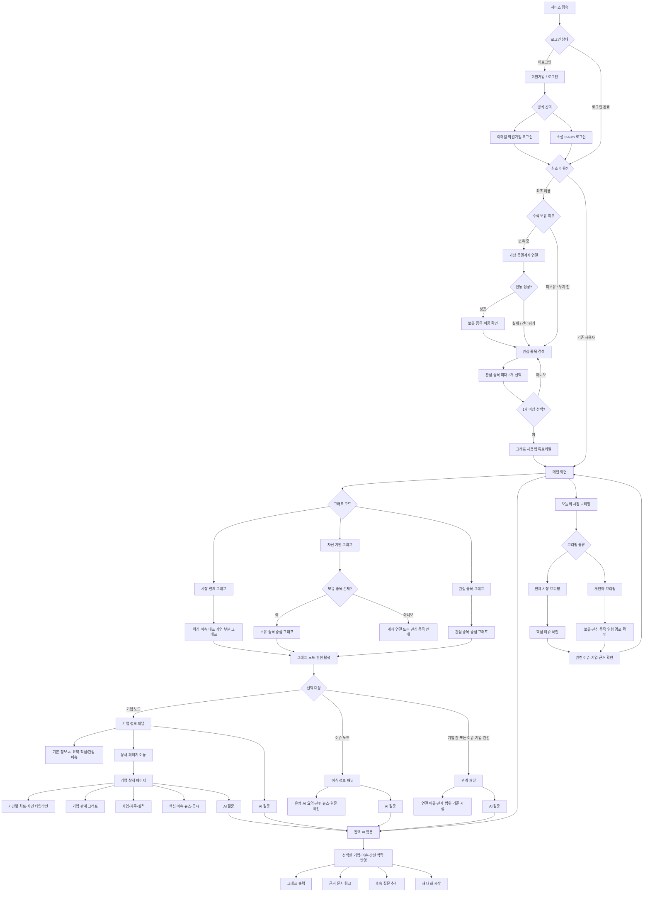

# 요구사항·WBS·사용자 플로우 대조 (2026-09-29)

근거 범위는 5기 요구사항명세서 v0.2(2026-09-22), 2026-09-29 WBS, 사용자 플로우 v0.1 SVG/라벨 및 지정된 5기 Notion 세 페이지로 제한한다. 명세서는 **목표 초안**이며 구현 완료 보고가 아니고, 우선순위·담당도 제안이다(`raw/requirements_v0.2.md:9,18-23`). 표의 화면 ID는 원문의 `UI-01`~`UI-11`을 그대로 참조한다(`raw/requirements_v0.2.md:156-170`). 플로우 대응은 비교를 위한 매핑으로서 화면의 완전한 명세를 뜻하지 않는다.

## 1. 요구사항 표

| ID | 분류(기능/비기능) | 요구사항 | 우선순위 | 관련 화면/플로우 노드 | 비고 |
|---|---|---|---|---|---|
| FR-01 | 기능 | 세션 유효성·설정 상태 확인 | Must | UI-01 / 로그인 상태·최초 이용? | 만료·위조 분기(`raw/requirements_v0.2.md:51`) |
| FR-02 | 기능 | 이메일 회원가입·동의·검증 | Must | UI-01 / 회원가입·로그인 | 인증 방식 미정 D-02(`raw/requirements_v0.2.md:52`) |
| FR-03 | 기능 | 이메일 로그인·실패 처리 | Must | UI-01 / 이메일 회원가입·로그인 | 설정 유무로 후속 경로(`raw/requirements_v0.2.md:53`) |
| FR-04 | 기능 | 소셜 OAuth 인증·계정 연결 | Should | UI-01 / 소셜 OAuth 로그인 | 제공자·병합 D-03 미정(`raw/requirements_v0.2.md:54`) |
| FR-05 | 기능 | 비회원 예시 체험·개인 데이터 차단 | Must | UI-01 / 로그인 상태→최초 이용? | 비회원 진입선은 SVG에서 명시되지 않음; D-01 미정(`raw/requirements_v0.2.md:55`; `raw/mermaid_flow_v0.1.svg:1`) |
| FR-06 | 기능 | 설정 완료 상태로 초기/재방문 분기 | Must | UI-02 / 최초 이용? | 최초 방문과 다른 기준(`raw/requirements_v0.2.md:56`) |
| FR-07 | 기능 | 로그아웃·개인 화면 데이터 제거 | Must | UI-01 / 플로우 노드 없음 | 세션 종료 뒤 보호 API 차단(`raw/requirements_v0.2.md:57`) |
| FR-08 | 기능 | 보유/관심 시작 모드 선택 | Must | UI-02 / 주식 보유 여부 | 계정 소유와 보유 여부 분리(`raw/requirements_v0.2.md:58`) |
| FR-09 | 기능 | 가상 계좌 연결·보유/비중 조회 | Must | UI-02 / 가상 증권계좌 연결→연동 성공? | 실패 시 관심 선택(`raw/requirements_v0.2.md:59`) |
| FR-10 | 기능 | 지원 종목명 검색 | Must | UI-02 / 관심 종목 검색 | 검색 결과 없음 처리(`raw/requirements_v0.2.md:60`) |
| FR-11 | 기능 | 관심 시작 1~3개, 0개/4개 차단 | Must | UI-02 / 관심 종목 최대 3개 선택→1개 이상 선택? | 계좌 연결 시 추가 생략 가능 D-04(`raw/requirements_v0.2.md:61`) |
| FR-12 | 기능 | 설정 저장·재접속 복원 | Must | UI-02 / 최초 이용?→메인 화면 | SVG에는 저장 동작 노드 없음(`raw/requirements_v0.2.md:62`) |
| FR-13 | 기능 | 편집 취소 시 저장 상태 복귀 | Must | UI-02 / 플로우 노드 없음 | Esc·닫기 동일, D-05(`raw/requirements_v0.2.md:63`) |
| FR-14 | 기능 | 그래프 튜토리얼 보기·건너뛰기·재열기 | Must | UI-02 / 그래프 사용법 튜토리얼 | 완료 강제하지 않음(`raw/requirements_v0.2.md:64`) |
| FR-15 | 기능 | 메인에서 설정 재변경 | Must | UI-02·03 / 플로우 노드 없음 | 저장과 취소 구분(`raw/requirements_v0.2.md:65`) |
| FR-16 | 기능 | 시장·자산·관심 그래프 모드 | Must | UI-03 / 그래프 모드→세 그래프 | 데이터 부재 시 안내(`raw/requirements_v0.2.md:66`) |
| FR-17 | 기능 | 기업·이슈 노드 및 두 종류 간선 탐색 | Must | UI-03 / 그래프 노드·간선 탐색→선택 대상 | ID 유효성 검사(`raw/requirements_v0.2.md:67`) |
| FR-18 | 기능 | 검색·유형 필터/강조 | Must | UI-03 / 플로우 노드 없음 | 숨김·흐림 D-06(`raw/requirements_v0.2.md:68`) |
| FR-19 | 기능 | 확대·축소·전체 보기 | Must | UI-03 / 플로우 노드 없음 | 한도·초기화(`raw/requirements_v0.2.md:69`) |
| FR-20 | 기능 | 기업 정보·시세·재무·요약·이슈 패널 | Must | UI-04 / 기업 정보 패널 | 미보유 수익값 생성 금지(`raw/requirements_v0.2.md:70`) |
| FR-21 | 기능 | 이슈 요약·관련 기업·근거 패널 | Must | UI-04 / 이슈 정보 패널 | 사건·근거 ID 유지(`raw/requirements_v0.2.md:71`) |
| FR-22 | 기능 | 기업 관계 유형·방향·근거·상태 패널 | Must | UI-05 / 관계 패널 | 미확인 관계 확정 표시 금지(`raw/requirements_v0.2.md:72`) |
| FR-23 | 기능 | 사건–기업 영향 방향·경로·근거 패널 | Must | UI-05 / 관계 패널 | 혼합/불확실 D-07 미정(`raw/requirements_v0.2.md:73`) |
| FR-24 | 기능 | 상세·브리핑·AI 맥락 ID 이동 | Must | UI-03·06·08·10 / 상세 페이지 이동·AI 질문 | 전역/맥락 이동 구분 D-05(`raw/requirements_v0.2.md:74`) |
| FR-25 | 기능 | 기업별 재무·실적·뉴스·공시·이슈 | Must | UI-06 / 기업 상세 페이지 | 공급자별 부분 실패(`raw/requirements_v0.2.md:75`) |
| FR-26 | 기능 | 1일·1개월·1년 주가 차트 | Must | UI-06 / 기간별 차트·사건 타임라인 | 결측 가격 임의 생성 금지(`raw/requirements_v0.2.md:76`) |
| FR-27 | 기능 | 상세의 기업 관계도·타임라인·질문 | Must | UI-06 / 기업 관계 그래프·AI 질문 | 기업 ID 유지(`raw/requirements_v0.2.md:77`) |
| FR-28 | 기능 | 기간/날짜·기업별 사건 조회 | Must | UI-07 / 기간별 차트·사건 타임라인 | 기간 경계 D-08 미정(`raw/requirements_v0.2.md:78`) |
| FR-29 | 기능 | 전체·당사·주변 영향 필터 | Must | UI-07 / 타임라인(독립 필터 노드 없음) | 기업별 사건 역할(`raw/requirements_v0.2.md:79`) |
| FR-30 | 기능 | 동시점 독립 사건 개별 카드 | Must | UI-07 / 타임라인(세부 노드 없음) | 3개 사건 개별 선택(`raw/requirements_v0.2.md:80`) |
| FR-31 | 기능 | 동일 사건의 여러 출처 묶음 | Must | UI-07·09 / 타임라인·근거 문서 링크 | 사건 1개·출처 여러 개(`raw/requirements_v0.2.md:81`) |
| FR-32 | 기능 | 후속 사건 별도 보존·연결 | Must | UI-07 / 타임라인(후속 노드 없음) | 원사건 덮어쓰기 금지(`raw/requirements_v0.2.md:82`) |
| FR-33 | 기능 | 발생 시각/공개 시각 구분 | Must | UI-07 / 타임라인(시간 노드 없음) | 발생 시각 미상 허용(`raw/requirements_v0.2.md:83`) |
| FR-34 | 기능 | 사건 변경 시 영향 경로 강조 교체 | Must | UI-07·03 / 타임라인·그래프 탐색 | 이전 강조 혼입 방지(`raw/requirements_v0.2.md:84`) |
| FR-35 | 기능 | 사건→근거·질문·그래프, 선택 복귀 | Must | UI-07·09·10 / 타임라인·근거·AI 질문 | 복귀선 SVG 없음(`raw/requirements_v0.2.md:85`) |
| FR-36 | 기능 | 한국시간 아침 07:30·저녁 18:30 브리핑 | Must | UI-08 / 오늘의 시장 브리핑→브리핑 종류 | 미생성·휴장 정책 필요 D-09(`raw/requirements_v0.2.md:86`) |
| FR-37 | 기능 | 아침 해외·야간/저녁 국내·당일 분석 | Must | UI-08 / 전체 시장 브리핑 | 미확보 분야 생성 금지(`raw/requirements_v0.2.md:87`) |
| FR-38 | 기능 | 보유·관심 종목 영향 경로 개인화 | Must | UI-08 / 개인화 브리핑→영향 경로 확인 | 종목 없는 경우 시장 예시(`raw/requirements_v0.2.md:88`) |
| FR-39 | 기능 | 동일 브리핑 관계도/문장 요약 전환 | Must | UI-08 / 브리핑 종류(전환 노드 없음) | 사건·출처 집합 일치(`raw/requirements_v0.2.md:89`) |
| FR-40 | 기능 | 브리핑 이슈 선택→근거·그래프·질문 | Must | UI-08 / 핵심 이슈 확인·관련 이슈·기업·근거 확인 | 선택 ID 유지(`raw/requirements_v0.2.md:90`) |
| FR-41 | 기능 | 과거 브리핑 가설·후속 근거 검증 | Should | UI-08 / 플로우 노드 없음 | 근거 부족은 보류, D-10 미정(`raw/requirements_v0.2.md:91`) |
| FR-42 | 기능 | 브리핑 원본 버전·기준 시각 보존 | Should | UI-08 / 플로우 노드 없음 | 후속 평가 별도 기록(`raw/requirements_v0.2.md:92`) |
| FR-43 | 기능 | 근거 문서 ID·출처·인용·검증 정보 | Must | UI-09 / 근거 문서 링크 | 미확보 구분(`raw/requirements_v0.2.md:93`) |
| FR-44 | 기능 | 원문과 인용 구간 검증 | Must | UI-09 / 근거 문서 링크(검증 노드 없음) | 규칙 D-11 미정(`raw/requirements_v0.2.md:94`) |
| FR-45 | 기능 | 원문 열기·실패 처리·선택 유지 | Must | UI-09 / 근거 문서 링크 | 실패 뒤 복귀(`raw/requirements_v0.2.md:95`) |
| FR-46 | 기능 | 전역/선택 기업·사건·관계 질문 맥락 | Must | UI-10 / 전역 AI 챗봇→맥락 반영 | 유효하지 않은 ID 대체 금지(`raw/requirements_v0.2.md:96`) |
| FR-47 | 기능 | 직접/추천 질문·공백/중복 방지 | Must | UI-10 / 후속 질문 추천 | 길이·횟수 D-12 미정(`raw/requirements_v0.2.md:97`) |
| FR-48 | 기능 | 근거 기반 답변·보류·인용 ID | Must | UI-10 / 근거 문서 링크 | 사실/가설/불확실 구분(`raw/requirements_v0.2.md:98`) |
| FR-49 | 기능 | 후속 질문의 선택 맥락 유지 | Must | UI-10 / 후속 질문 추천 | 기업 변경 시 맥락 변경(`raw/requirements_v0.2.md:99`) |
| FR-50 | 기능 | 답변의 유효 노드·간선 하이라이트 | Should | UI-10·03 / 그래프 출력 | 등록되지 않은 ID 제외(`raw/requirements_v0.2.md:100`) |
| FR-51 | 기능 | 새 대화 맥락 초기화 | Must | UI-10 / 새 대화 시작 | 기록 보존 정책 별도 D-13(`raw/requirements_v0.2.md:101`) |
| FR-52 | 기능 | 모델 실패·시간초과·한도 구분 | Must | UI-10·11 / 플로우 노드 없음 | 미완성 답변 확정 금지(`raw/requirements_v0.2.md:102`) |
| NFR-01 | 비기능 | 로딩·빈 결과·실패 및 복귀 구분 | 미기재 | UI-11 / 플로우 노드 없음 | 사용성(`raw/requirements_v0.2.md:108`) |
| NFR-02 | 비기능 | 노드·동시 사용자·API p95 목표 합의 | 미기재 | UI-03·11 / 그래프 탐색 | 30노드·3초는 승인값 아님(`raw/requirements_v0.2.md:109`) |
| NFR-03 | 비기능 | AI 진행·시간초과·재시도 | 미기재 | UI-10·11 / AI 질문 | 10초/30초 재검토(`raw/requirements_v0.2.md:110`) |
| NFR-04 | 비기능 | 서버 소유권·계좌 읽기 전용 | 미기재 | UI-01·02 / 로그인·계좌 연결 | 주문·이체 없음(`raw/requirements_v0.2.md:111`) |
| NFR-05 | 비기능 | 비밀번호·키·토큰 비노출 | 미기재 | UI-01 / 회원가입·로그인 | 평문 비밀번호 저장 금지(`raw/requirements_v0.2.md:112`) |
| NFR-06 | 비기능 | 개인정보 동의·보존·삭제 정책 | 미기재 | UI-01·02 / 플로우 노드 없음 | 배포 전 확정(`raw/requirements_v0.2.md:113`) |
| NFR-07 | 비기능 | 정규화·중복 방지·근거·스키마 | 미기재 | UI-03·07·09 / 그래프·타임라인 | 데이터 품질(`raw/requirements_v0.2.md:114`) |
| NFR-08 | 비기능 | 사실/가설/불확실 구분 | 미기재 | UI-08·10 / 브리핑·AI 질문 | 주가 상승 확률 표현 금지(`raw/requirements_v0.2.md:115`) |
| NFR-09 | 비기능 | 발생/공개/시세/자산 시각 구분 | 미기재 | UI-06·07·08 / 차트·타임라인 | 시간 정합성(`raw/requirements_v0.2.md:116`) |
| NFR-10 | 비기능 | 근거 ID·버전·시각·상태 추적 | 미기재 | UI-09 / 근거 문서 링크 | 추적성(`raw/requirements_v0.2.md:117`) |
| NFR-11 | 비기능 | 외부 장애·최종 정상 시각·예시 구분 | 미기재 | UI-11 / 플로우 노드 없음 | 장애 상태를 0건으로 처리 금지(`raw/requirements_v0.2.md:118,170`) |
| NFR-12 | 비기능 | 키보드·초점·버튼 이름·방향 텍스트 | 미기재 | UI-03~10 / 플로우 노드 없음 | 접근성(`raw/requirements_v0.2.md:119`) |
| NFR-13 | 비기능 | 외부 본문 지시 격리·XSS 차단 | 미기재 | UI-09·10 / 근거·AI 질문 | 입력 안전(`raw/requirements_v0.2.md:120`) |
| NFR-14 | 비기능 | 응답 순서 역전·중복 실행 방지 | 미기재 | UI-03·11 / 그래프 탐색 | 동시성(`raw/requirements_v0.2.md:121`) |

## 2. 기술 구조·외부 연동·비기능 경계

- **[제안·승인 전]** 시장 공통 기업·사건·관계는 GraphDB와 문서 저장소, 개인 자산·인증·설정은 RDB로 분리하고, 권한 검사한 종목 ID로 부분 그래프를 조회한다. 문서/Vector 저장소는 본문·인용 위치·벡터 검색용이다. 영구 포트폴리오 GraphDB 적재는 기본안에서 제외된다(`raw/requirements_v0.2.md:152-154,245-250`). `Company`, `Security`, `Industry`, `Issue`, `Event`, `Article`, `ImpactAssessment`와 유형화된 간선은 설계안이다. `ProductMarket` 채택도 미정이다(`raw/requirements_v0.2.md:252-274`).
- **[제안·구현 여부 별개]** 수집→정제/중복 제거→엔티티 정규화→동일·후속 사건 판별→영향 후보→원문/스키마 검증 후 적재→부분 그래프/타임라인→버전 보존 브리핑 순서. LLM의 임의 Cypher 실행·직접 적재를 허용하지 않으며 질문 유형에 따라 GraphDB+근거, 문서/Vector+Event, 권한 확인 자산 RDB/API를 라우팅한다(`raw/requirements_v0.2.md:276-285,294-318`).
- **[후보·미정]** 공시, 시세·재무, 뉴스/RSS·제휴, 가상 계좌 API와 AI 서비스가 명세의 연동 대상이다. 공급자·요금·사용/재배포 허가는 확인되지 않았고, 실제 증권사 연동은 MVP 가상 계좌와 별도 범위다. 소셜 OAuth는 `Should`이며 제공자 미정이다(`raw/requirements_v0.2.md:54,139-151`). API URL/응답은 미실행 구현 초안이다(`raw/requirements_v0.2.md:172-201`).
- **스택 명시 여부:** 명세는 `Frontend`, `Backend`, `Data`, `AI` 역할 및 GraphDB/RDB/문서·Vector **저장소 범주**를 적지만 **프론트엔드 프레임워크·언어·번들러는 명시하지 않는다**. 백엔드 런타임·프레임워크와 특정 DB 제품도 명세에서 확정하지 않는다(`raw/requirements_v0.2.md:17,49-50,139-154,245-250`). Notion 시퀀스의 PostgreSQL 표기와 WBS의 “Neo4j 등 제품 선택 후 설치”는 명세의 승인된 제품 선택으로 격상하지 않는다(`raw/notion/시퀀스_다이어그램__eb19fc00.md:12-19`; `raw/wbs_2026-09-29.md:71-74`).
- **비기능 목표 상태:** NFR-01~14는 사용성, 성능, AI 응답, 권한, 비밀정보, 개인정보, 데이터 품질, 설명 가능성, 시간 정합성, 추적성, 외부 장애, 접근성, 입력 안전, 동시성을 다룬다. 성능 노드 한도·API p95·동시 사용자, AI 제한 시간, 개인정보 보존/삭제는 아직 목표/정책 확정이 필요하다. `30노드·3초`, `10초/30초`는 승인된 숫자가 아니다(`raw/requirements_v0.2.md:104-121,345-350`).

## 3. WBS 일정·담당·2026-09-29 상태

**계획 시작 2026-09-29, MVP 목표/마일스톤 M4 2026-11-06.** M1 범위 승인 10-02, M2 핵심 화면 승인 10-13, M3 기능 통합 11-03, M4 시연·배포·인계 11-06 모두 `예정/0%`로 기록돼 있다. 기본 WBS의 개발·검증·출시 작업도 각 행 `예정/0%`이다. 오늘 시작하는 1.1·1.2도 `예정/0%`로, **시작 예정과 실제 착수/완료는 다르다**(`raw/wbs_2026-09-29.md:3-12,18,36-44`). 튜토리얼 탭은 기존 작업을 사용자 순서로 설명한 **상세 일정이지 추가 인력/작업 중복 집계 대상이 아니다**(`raw/wbs_2026-09-29.md:45-52,112`).

| 담당 역할 | 계획 작업·기간(선별) | 오늘 기록 상태/근거 |
|---|---|---|
| F1 프론트 | UI 규칙 2.2(10/06–08), 인증 디자인 2.3(10/06–12), 공통 UI 5.1(10/06–15), 인증 화면 5.2(10/14–22), 관심 선택 5.3(10/20–27); T1 로그인 진입 10/14–22, T3 관심 선택 10/20–27, 뉴스 종단 검증 N12 11/03–05 | 모두 예정·0%; 화면 UI/접근성 리뷰 협업(`raw/wbs_2026-09-29.md:14-15,27-29,53-55,98,103-105`) |
| A1 AI·클라우드 | 환경 3.1(10/01–07), 예시 데이터 3.3(10/07–13), 뉴스 영향 분석 N6(10/16–27)·품질 N7(10/22–29), 시연/배포 8.1–8.3(11/05–06) | 예정·0%; 질문 예시 답변과 뉴스 자동 분석 구별(`raw/wbs_2026-09-29.md:19-21,41-43,92-93,106`) |
| B1 백엔드 1 | 범위 1.1(09/29–10/02), 회원/설정 구조 3.2(10/06–08), 인증 4.1–4.2(10/08–20), 분기/완료 API 4.5(10/21–27), 인증 통합 6.1(10/22–28), T8 완료 저장(10/29–11/02) | 모두 예정·0%; 1.1 오늘 시작 계획(`raw/wbs_2026-09-29.md:8,20,22-26,33,60,107`) |
| B2 백엔드 2 | 개인화 메인 시안 2.5(10/08–13), 그래프 모델 G1(10/06–07)·적재 G3(10/08–13), 기사 연결 N5(10/16–23)·자동 적재 N8(10/23–29), 튜토리얼/메인 통합 6.3(10/30–11/03) | 예정·0%; 기본 그래프 인계 G8은 3인안 10/19 또는 2인안 10/22(`raw/wbs_2026-09-29.md:17,35,65-78,91,94,108`) |
| B3 백엔드 3 | mock 계좌 범위 1.4(09/30–10/02), 튜토리얼/노드 상세 시안 2.4(10/07–13), 뉴스 출처 N1(09/30–10/02)·크롤러 N2(10/06–13)·정제 N4(10/13–20), 상세 UI T7(10/26–11/02) | 예정·0%; 그래프 인계용 샘플 G2(10/06–13)(`raw/wbs_2026-09-29.md:11,16,59,72,87-90,109`) |
| B4 백엔드 4 | 화면/API 계약 1.3(09/30–10/02), 그래프 조회 G5(10/13–16), 관심 API 4.4(10/14–23), 계좌 API 4.3(10/19–23), 상세 API T6(10/23–30), 계좌 UI 5.4(10/23–28), 계좌/관심 연동 6.2(10/28–11/02), 영향 조회 N9(10/26–11/02) | 모두 예정·0%; B1·F1 계약 검토(`raw/wbs_2026-09-29.md:10,24-25,30,34,58,75,95,110`) |
| B5 백엔드 5·화면 지원 | **최초·재방문 플로우 작성 1.2(09/29–10/01)**, **와이어프레임 2.1(09/30–10/07)**, 그래프 상호작용 G6(3인안 10/15–19 또는 2인안 10/19–21), 개인화 메인 5.6(10/20–30), T5(10/20–28)·T9(10/29–11/03), 접근성 점검 7.3(11/02–04), 영향 화면 N11(10/29–11/02) | 모두 예정·0%; 1.2 오늘 시작 계획, UI·API 연계 역할(`raw/wbs_2026-09-29.md:9,13,32,39,57,61,76,97,111`) |

전체 사용자 경로는 첫 로그인 **튜토리얼 1회**와 재방문 메인 직행, 0개 선택 차단, 상세를 본 뒤 완료 저장을 기준으로 T1~T10(10/14–11/05)에 별도 표시된다. 일정상 그래프 기반 인계 G8(10/19 또는 10/22)과 자동 뉴스 적재/조회/표시 N8~N11(10/23–11/02), N12 검증(11/03–05)은 서로 다른 완료 조건이다(`raw/wbs_2026-09-29.md:6,45-62,69,78,85,94-98`).

## 4. Mermaid 사용자 플로우 v0.1 재구성

SVG의 `my-svg-flowchart-{원본 ID}-...` 노드와 `my-svg-L_{시작}_{끝}_0` path를 방향의 근거로, 라벨 텍스트와 좌표를 분기 조건의 근거로 사용했다(`raw/mermaid_flow_v0.1.svg:1`; `raw/mermaid_flow_v0.1_labels.txt:1-73`). 아래 영문 ID는 원본 A~BR을 그대로 사용한다. **[추론]** SVG 내부 생성 ID가 편집용 Mermaid 원문과 같다고 확정할 수 없고, 엣지 라벨에는 연결 대상 ID가 없어서 path와 표시 위치를 대조했다. 특히 `B→G`의 ‘로그인 완료’, `G→M`의 ‘기존 사용자’, `O→L`의 ‘아니오’, `U→V/W`의 ‘예/아니오’는 이 좌표 대응에 의존한다. SVG에 없는 저장·취소·로그아웃·실패 복구선은 덧그리지 않았다.

`K→L`은 SVG edge ID에 실제 존재하지만 ‘계좌 연결 완료 시 관심 종목 추가는 생략 가능’이라는 명세와 다른 **직렬 경로**다. `[추론]` 편집 원문에서 선택 생략 분기를 의도했는지는 SVG만으로 확정할 수 없다(`raw/mermaid_flow_v0.1.svg:1`; `raw/requirements_v0.2.md:61`). 브리핑 `BR→M` 복귀선은 SVG에 있다(`raw/mermaid_flow_v0.1.svg:1`).

## 5. 교차검증: 누락·불일치·결정 필요

1. **온보딩 튜토리얼 기준 상충.** v0.2는 설명 튜토리얼을 건너뛰거나 재열 수 있고 완료를 강제하지 않는다고 한다. 09-29 WBS는 첫 로그인에 관심 선택→그래프→노드 상세를 경험한 뒤 **1회 완료 상태 저장**, 재방문 직행, 이탈하면 미완료로 처리한다. 최신 계획은 WBS이지만 설명 건너뛰기와 체험 완료가 별개 상태인지 미정이며, SVG는 `P→M`만 보인다(`raw/requirements_v0.2.md:64`; `raw/wbs_2026-09-29.md:6,26,31,47-50,54-60`; `raw/mermaid_flow_v0.1.svg:1`).
2. **계좌 성공 후 관심 선택 강제 여부.** SVG `K→L→N→O`는 보유 확인 뒤에도 관심 1개 이상 선택으로 흐르지만, FR-11 및 TC-05는 보유 모드에서 관심 추가를 생략하고 관심 0개로 진입할 수 있다. Notion 시퀀스의 수정 지시는 계좌 성공과 관심 선택을 **대체 분기**로 처리하라 하고, WBS T3는 계좌 없이도 진행 가능하다고 한다. 성공→설정 저장/메인 연결선이 원본 SVG에 없다(`raw/mermaid_flow_v0.1.svg:1`; `raw/requirements_v0.2.md:61,211`; `raw/notion/시퀀스_다이어그램__eb19fc00.md:218-223`; `raw/wbs_2026-09-29.md:55`).
3. **인증/설정 빠진 화면.** FR-05 비회원 시연·FR-07 로그아웃·FR-12 저장·FR-13 취소·FR-15 재변경은 UI-01/02에 있으나 SVG에는 각각 독립 노드·복귀선이 없다. Notion 사용자 여정은 비회원/저장·복원·실패 시 관심 전환을 다룬다. 추가 UX/API 설계 없이는 플로우만으로 완료 기준을 검증할 수 없다(`raw/requirements_v0.2.md:55,57,62-65,160-161`; `raw/mermaid_flow_v0.1.svg:1`; `raw/notion/사용자_여정(사용자_이용_시나리오)__5636eb05.md:60-93`).
4. **그래프·타임라인 기능 압축.** FR-18·19의 검색/필터/확대·전체 보기, FR-28~35의 날짜·범위 필터, 동시 사건, 동일 출처, 후속 사건, 시각 미상, 강조 교체, 선택 상태 복귀는 UI-03·07에 있지만 SVG는 ‘그래프 노드·간선 탐색’과 ‘기간별 차트·사건 타임라인’이라는 묶음 노드뿐이다. Notion 사용자 여정은 선택·확장 상태 유지와 근거 원문 복귀를 명시하므로 상세 인터랙션·상태 전이가 추가로 필요하다(`raw/requirements_v0.2.md:68-69,78-85,162,166`; `raw/mermaid_flow_v0.1_labels.txt:28,63-65`; `raw/notion/사용자_여정(사용자_이용_시나리오)__5636eb05.md:102-139`).
5. **영향 간선 구분 미표현.** FR-22/23 및 UI-05는 기업–기업 관계와 사건–기업 영향을 각각 방향·근거·검증 상태로 구분하지만 SVG는 두 간선을 하나의 `AD 관계 패널`로 합친다. Notion 화면별 데이터는 이슈–기업 간선 ‘제거 의견’을 적어 화면 채택 자체가 불확실하다. 이는 제거 **확정**이 아닌 의견이다(`raw/requirements_v0.2.md:72-73,164`; `raw/mermaid_flow_v0.1_labels.txt:17,37-39`; `raw/notion/화면별_데이터__3fa5f8f9.md:45-49`).
6. **브리핑 시간과 제공 범위.** v0.2 FR-36은 07:30/18:30, Notion 화면별 데이터는 08:00/18:00, Notion 시퀀스 한 버전은 07:30/18:00을 *가정*한다. 명세의 09-22 목표를 채택하되 09-29 WBS에는 브리핑 시간을 확정하는 일정이 없으므로 **발행 시간은 확정 아님**이다. v0.2 FR-39의 관계도↔문장 전환과 FR-41/42의 이전 검증/원본 버전은 SVG에 독립 노드가 없다. 시퀀스는 미생성 상태·후속 평가와 요청 시 개인화 생성도 다룬다(`raw/requirements_v0.2.md:86,89,91-92,167,347-350`; `raw/notion/화면별_데이터__3fa5f8f9.md:56-58`; `raw/notion/시퀀스_다이어그램__eb19fc00.md:77-83,97,151-165`; `raw/mermaid_flow_v0.1_labels.txt:40-46`; `raw/wbs_2026-09-29.md:7-44`).
7. **WBS MVP와 명세 전체 범위 다름.** 09-29 WBS의 명시된 핵심 경로는 첫 로그인 1회 튜토리얼·관심 그래프·노드 상세·mock 계좌·뉴스 자동 수집/영향 분석 및 AI 질문 **예시 답변**이다. 09-22 명세의 Must인 완전한 브리핑·근거 기반 질문·타임라인 등은 WBS 주작업에서 동일 범위·기한으로 배정되지 않았다. 최신 WBS를 *현 일정 계획*으로 보되 명세 Must 삭제나 구현 완료로 해석하면 안 된다(`raw/wbs_2026-09-29.md:6,8,21,31,81-85,102`; `raw/requirements_v0.2.md:78-102,320-330`).
8. **방문 상태 정의 미합의.** SVG `G 최초 이용?`과 WBS T2의 ‘튜토리얼 미완료’ 분기는 FR-06의 ‘설정 완료 상태’와 동일 필드라는 보장이 없다. Notion 사용자 여정의 `setup`도 종목 설정 완료 여부를 기준으로 하므로 두 플래그의 관계/저장 시점을 정해야 한다(`raw/mermaid_flow_v0.1_labels.txt:5-6,53`; `raw/wbs_2026-09-29.md:47-50,54,60`; `raw/requirements_v0.2.md:56`; `raw/notion/사용자_여정(사용자_이용_시나리오)__5636eb05.md:69-87`).
9. **챗봇 전역 맥락.** SVG `M→AM→AN`은 전역 진입에도 ‘선택한 기업·이슈·간선 맥락 반영’으로 직렬 연결된다. FR-46과 Notion 여정은 전역 메뉴는 일반 질문, 노드에서만 선택 맥락을 준다고 구분한다. 전역 진입 때 빈 맥락 분기가 빠져 있다(`raw/mermaid_flow_v0.1.svg:1`; `raw/requirements_v0.2.md:96`; `raw/notion/사용자_여정(사용자_이용_시나리오)__5636eb05.md:151-160,251-260`).
10. **노드 상세 데이터 및 메인 뉴스.** WBS T6/T7/T9와 Notion 화면별 데이터는 노드 기사·영향 이유·근거·원문 및 메인의 종목별 뉴스/분석 시각 표시를 요구하지만 SVG의 `AB1`, `AC1`, `AD1`과 메인 `M`은 이를 모두 구체화하지 않는다. UI 데이터 계약에 대상 ID/시각/빈값/오류를 명시해야 한다(`raw/wbs_2026-09-29.md:58-61,95-97`; `raw/notion/화면별_데이터__3fa5f8f9.md:13-49`; `raw/mermaid_flow_v0.1_labels.txt:19,30-39`).
