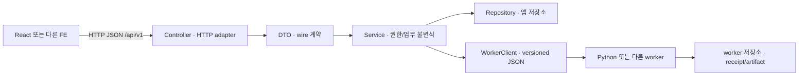

# 본개발 이식 가이드 · 스택 독립 실행 계약

> 2026-10-08에 작성한 이식 기준에 2026-10-12 본개발 경로·최신 원문 안내를 반영했다. 프론트엔드와 백엔드 모두 변경 가능하며 Java/Spring은 유력 후보일 뿐 확정 스택이 아니다. 이 문서는 담당자의 채택 판단 자료이지 본개발 앱, 배포 완료 보고, 현재 기능의 수용 기준 통과 보고가 아니다. 새 의존성은 추가하지 않았다.

## 1. 읽는 순서와 근거의 지위

1. [최신 명세·WBS 갱신 기록](../evidence/doc-delta-2026-10-12.md)과 [현재 작업 결정](../share/day-work-2026-10-10.md)을 읽는다. 10-08 결정은 이어서 유효하며 프로토타입 전체 요구 구현 권한과 본개발 채택·유료 호출 승인은 별개다.
2. [본개발 시작 안내](../share/production-start-2026-10-12.md)와 [개발 참여 규약](../../CONTRIBUTING.md#본개발-경로와-생성-조건)에서 루트의 예정 경로·이름·첫 실제 기능의 생성/CI 조건을 확인한다. 경로를 선언했다는 사실은 앱을 구현했다는 뜻이 아니다.
3. [계약·표본·차이 인계](contract-handoff.md)에서 현재 `/api`, 목표 `/api/v1`, worker JSON을 구분한 뒤 아래 선택축·자산 분류·전환 순서를 적용한다.

| 참고 경로 | 실제로 확인한 자료와 지위 | 이식할 때의 용도 |
|---|---|---|
| [`prototype/README.md`](../../prototype/README.md), [`prototype/bff/README.md`](../../prototype/bff/README.md), [`프로토타입 설명서`](../share/prototype-guide.md) | 현재 실행/시연/개발 연동 안내. 최종 실행 README와 설명서는 문서 S1 및 기존 outlook 생성 이행을 반영한다. 설명서 담당의 합성 smoke와 backend 실행 인용은 구분한다. | 현행 앱 재현·조회/생산 분리·오류 복구. [HTML](../share/prototype-guide.html)/[PDF](../share/prototype-guide.pdf)는 팀 전달용이며 전체 수용 기준 통과를 대신하지 않는다. |
| [`docs/system/out/bff-openapi.json`](../system/out/bff-openapi.json), [`bff-observation.json`](../system/out/bff-observation.json) | 저장된 실제 BFF OpenAPI 관측. 관측 시각 `2026-10-07T19:20:15.550609+00:00`; 이번에 서버를 다시 실행하지 않았다. | **현재 관측 기준선**. 새 S1 필드가 자동 포함된 것으로 보지 않는다. |
| [`docs/api/openapi.yaml`](../api/openapi.yaml), [`docs/system/README.md`](../system/README.md), [API v2 검토](../evidence/api-v2-review-2026-10-08.md) | 목표 OpenAPI 3.1과 잠정 API 공통 규칙. API v2 네 의도만 번역하고 현재 WBS·사용자 결정·S1 계약은 보존했다. 구현 완료·팀 최종 승인이 아니다. | 목표 요청·응답·오류·FS/화면/WBS 연결의 정본. 프로필 null/형식, 사건 맥락 관계, 최신 시세 독립성, 회원 제공자 enum을 consumer 이식 시 적용한다. |
| [`acceptance-matrix.md`](../system/out/acceptance-matrix.md), [`source-corrections.md`](../system/out/source-corrections.md), [10-12 갱신 기록](../evidence/doc-delta-2026-10-12.md) | 현재 10-12 입력의 103 ID·121 상세 정의 및 원문 정정 요청이다. 10-08의 104 ID는 브리핑 오타 정정 전 관측이다. 현행 실행 검증은 이 문서에서 수행하지 않았다. | ID가 같아도 다른 상세 정의를 합치지 않는다. 기능명·정의 파일/시트/행으로 수용 기준을 옮긴다. |
| [`links.yaml`](../system/links.yaml), [`wbs-migration.md`](../system/out/wbs-migration.md), [10-12 갱신 기록](../evidence/doc-delta-2026-10-12.md) | 최신 `wbs_2026-10-12`의 역할·제목·FS 의미를 대조한 WBS 편집 연결이다. 아래 10-08 매핑과 과거 근거는 당시 기록이며 현재 배정·진척을 대신하지 않는다. | 옛 번호만으로 연결하지 않는다. AI BE 번호는 현행 v2로 정정됐지만 FE 복합 참조·요구 메타·재무 요구42의 전용 FS/WBS 등 충돌은 남아 있다. |
| [`system-architecture/README.md`](../share/system-architecture/README.md) | 최종 S1 구조도. 사용자 조회·문서 worker·기존 outlook producer·별도 앱/worker 저장소를 구분한다. 그림의 구현 실선과 합성 실행 증거·유료 호출 승인도 분리한다. | React→BFF→공개 snapshot 및 JSON CLI 경계를 참고한다. 현재 실행 도식이지 본개발 스택·/api/v1·클라우드 배포 완료 도식이 아니다. |
| [`external-api-candidates-2026-10-08.md`](../evidence/external-api-candidates-2026-10-08.md) | 공급원·권리·등록 조건 조사. 실제 공급자 연결 시험은 아니다. | 데이터 표시/보관/모델 전송 권한과 계약 종료 시 삭제 조건을 함께 이전한다. |
| [`docs/design/tokens.json`](../design/tokens.json), [`prototype/web/DESIGN.md`](../../prototype/web/DESIGN.md), [`components/README.md`](../../prototype/web/src/components/README.md), [`docs/screen-plan/README.md`](../screen-plan/README.md) | 읽은 컴포넌트 규칙이 가리키는 토큰/디자인 원문과 77쪽 화면 관측 안내다. 최종 목표는 Figma(폰트 제외), SUIT 유지다. | 기존 화면을 최종 디자인으로 동결하지 않는다. 다른 FE도 상태·접근성·토큰·목표 디자인을 재현한다. |
| [`wireframe-correspondence.md`](../screen-plan/wireframe-correspondence.md), [`wireframe_2026-10-08/coverage.json`](../evidence/raw/wireframe_2026-10-08/coverage.json) 및 프레임 PNG | 대응 부록의 raw node·화면 ID 연결을 읽었다. 원본 이미지를 이번에 재조사하거나 Figma 동작을 검증하지 않았다. 부록의 ‘1:1 개선안/검토 전 범위’ 해석은 현재 사용자 결정으로 대체됐다. | 10-08 고정 raw는 폰트 제외 최종 목표 디자인이다. 정적 배치를 구현/동작 완료나 수치의 사실성으로 승격하지 않는다. |
| [`docs/design/ai-system.md`](../design/ai-system.md), [`docs/api/ai-contract.schema.json`](../api/ai-contract.schema.json), [문서 fixture](../../ai/worker/fixtures/contracts/synthetic-document/), [회차 fixture](../../ai/worker/fixtures/contracts/synthetic-outlook/) | 현재 S1 문서 세 stage와 기존 briefing-outlook 생성 능력을 보존한 worker 이행 자료다. source/표본 검사와 backend 실행 보고를 구분한다. S2–S7 전체 완료가 아니다. 팀 배포에는 이 저장소 자료를 사용한다. | 불변 산출물·현재 visibility·실행 receipt·회차 pin과 발행 고정을 보존한다. 확정 schema/fixture·worker lock·관측 범위는 [계약 인계](contract-handoff.md)를 우선한다. |

### 본개발 경로에 채택하는 방법

본개발 작업 위치는 저장소 루트의 `web/`(클라이언트), `api/`(앱 BE), `ai/`(AI 실행)로 정한다. 루트 `contracts/`는 실제 consumer와 생성·검증 명령을 갖춘 언어 중립 생성물·합성 fixture 배포가 필요할 때만 만들며 목표 OpenAPI와 JSON Schema의 정본은 계속 `docs/api/`다. 배포 생성물을 수동 편집한 두 번째 계약 원본을 두지 않는다. `infra/`는 별도 승인된 배포·운영 설정을 넣는 예정 경로다. 이 경로들은 아직 실제 앱이나 배포를 뜻하지 않으며 첫 실제 수직 기능에서 manifest·진입점·동작·테스트와 실제 runner 연결을 함께 추가한다. 전체 규칙과 리뷰 역할은 [CONTRIBUTING.md](../../CONTRIBUTING.md)에 있다.

이 문서의 ‘그대로 복사 가능’은 동일 스택에서의 채택 판단이지 `prototype/` import를 허용한다는 뜻이 아니다. 본개발은 채택한 코드의 소유권·실행 설정·테스트를 새 경로에 두고 prototype 앱/worker DB를 공유하지 않는다. PoC도 별도 읽기 전용 원천으로 유지하고 vendoring하지 않는다. `docs/api/` 정본을 옮기려면 모든 생성기·consumer·문서 링크를 같은 변경에서 옮기고 두 계약 원본을 남기지 않는다.

현재 루트 명령과 CI는 프로토타입·문서/계약을 검사한다. 본개발 새 앱에는 실제 실행기와 테스트·required gate 연결을 완료하기 전까지 그 검사 성공을 적용할 수 없다. credentials의 trust 승인, 유료 호출, 운영 배포 승인은 각각 별도다.

## 2. 서로 독립인 세 가지 선택축

React를 바꾼다고 BFF나 worker도 바꿀 필요는 없다. Spring을 선택해도 Python worker를 유지할 수 있고, worker 교체가 사용자 API 변경을 요구하지 않도록 계약을 고정한다. Angular/Vue/Svelte 중 어느 하나를 강제하지 않는다.

| 축 | 현재 스택 유지 | 다른 스택으로 전환 | 동일하게 유지해야 하는 검증 |
|---|---|---|---|
| FE: React / 다른 웹 프레임워크 | 라우트·컴포넌트·조회 훅을 같은 라이브러리 조건에서 재사용할 수 있다. 목표 API의 보안/오류 변화에 맞춘 client 수정은 필요하다. | 라우팅, 렌더링, 캐시, 취소·지연응답 차단, 창 상태, 접근성을 다시 구현한다. React hook 공유는 이식 가능성의 근거가 아니다. | 같은 HTTP fixture, URL의 기업/기간/asOf/버전, 로그아웃 후 이전 응답 차단, 빈 자료/실패 분리, Figma 목표와 토큰. |
| 앱 BE: FastAPI / Java·Spring | 현재 라우터·서비스·저장 로직은 같은 Python 의존성과 의미에서 재사용 가능하다. `/api/v1` gap은 별도 수정 대상이다. | Controller/DTO/Service/Repository/WorkerClient로 책임을 옮기고 서버의 세션·CSRF·권한·멱등 처리를 구현한다. Python import는 전환 계약이 아니다. | HTTP/OpenAPI, 소유권, 상태 전이, decimal 계산, 불변 발행과 현재 visibility, 고정 버전 조회. |
| AI: Python worker / 다른 런타임 | 기존 PoC 고정 버전의 공개 port와 worker adapter를 활용한다. 원본 PoC는 읽기 전용이다. | JSON 입력·receipt·결과를 동일하게 처리하는 runner와 provider adapter를 다시 구현한다. 추출/동일성/근거/fence/outbox 동작도 재증명해야 한다. | 같은 worker JSON fixture와 정확 인용, 단계 실패·복구, 중복 요청, 실제 usage/unknown, 공개 gate. |

**이식 가능한 것은 직렬화된 경계와 불변식이다.** 앱·worker·PoC의 물리 DB 테이블 공유, Python 객체 import, React hooks 공유를 portability 근거로 사용하지 않는다. worker는 자기 실행 저장소를 소유하며 앱은 transport를 통해 제출·조회·회수한다. S1용 앱→AI 내부 HTTP transport는 `ai/service`로 **로컬에 구현**했고 계약은 [`internal-ai-openapi.yaml`](../api/internal-ai-openapi.yaml)이다. 그러나 배포·보안 그룹·TLS 프록시는 확인하지 않았고 승인되지 않았으며 현재 BFF는 이를 소비하지 않고 설치된 CLI를 직접 호출한다. Spring 앱의 Java 전송 클라이언트(`api/`의 `com.zoop.ai`, 5개 operation, [설명](../../api/docs/AI_INTEGRATION.md))는 같은 계약에 대해 구현·검증했지만 인증·도메인 소비자와 결과 import는 아직 없다. S2/S3는 등록 전용 CLI `submit`을 갖지만 서비스에 S2/S3 kind가 없어 HTTP 대상이 아니다.

## 3. 자산별 채택 분류

표의 ‘그대로 복사 가능’은 **동일 스택만**을 뜻하며 의존성·라이선스·목표 계약 확인을 면제하지 않는다. 파일이 있다는 사실은 수용 기준 통과가 아니다.

| 영역 | 분류 | 현재 경로/자산 | 담당자가 판단할 범위 |
|---|---|---|---|
| FE | 그대로 복사 가능(동일 스택만) | `prototype/web/src/components/ui/`, `components/domain/`, `features/`, `pages/`, `App.tsx` | React/Radix/라우터/Query를 유지할 때 구현 참고·재사용. Figma 최종 디자인과 S1 consumer 변경을 포함해 선택한다. |
| FE | 계약·fixture·디자인 토큰만 이식 | `docs/design/tokens.json`, `components/README.md`, 화면계획서, HTTP 계약, `src/lib/`의 상태 계산 규칙·관련 테스트 | 다른 프레임워크에서는 상태·표시·접근성 계약을 옮긴다. 순수 TS 함수도 대상 런타임을 확인한 뒤 선택하며 framework-neutral이라는 이유만으로 자동 채택하지 않는다. |
| FE | 다시 구현 | `src/api/queries.ts`, API client, `features/use-chat.ts`, overlays, URL/캐시·취소 연결 | 다른 FE의 생명주기/반응성/캐시 방식으로 구현한다. `/api` client 및 생성 `src/api/schema.d.ts`는 목표 OpenAPI로 일괄 갱신한다. |
| FE | prototype-only 폐기 | 디자인시스템 정적 예시 데이터, 개발용 mock IdP 동의 화면, Vite 로컬 proxy/시연 전용 연결 | 디자인시스템의 토큰·상태 규칙은 보존하되 예시를 실제 자료나 로그인으로 서비스하지 않는다. |
| BE | 그대로 복사 가능(동일 스택만) | `prototype/bff/src/zoop_bff/routers/`, `schemas.py`, 업무 서비스, `accounts.py`, `chat_jobs.py` | FastAPI/Python 유지 시 참고. 현재 오류·세션·페이지 방식까지 목표 구현이라고 복사하지 않는다. |
| BE | 계약·fixture·디자인 토큰만 이식 | 목표/관측 OpenAPI, `prototype/bff/fixtures/poc-synthetic-inspect.json`, 합성 regression 자료, 회차·버전·소유권의 테스트 시나리오 | DTO wire와 도메인 의미를 옮긴다. actual-news fixture는 별도 권리·공개 여부 확인 대상이며 golden 합성 fixture와 섞지 않는다. |
| BE | 다시 구현 | 세션/CSRF/error/idempotency HTTP adapter, Repository, clock/scheduler, `graph_versions.py`, `briefing_rounds.py`, worker transport | Spring 등 다른 언어에서는 transaction·concurrency·쓰기 호환성을 새 저장 구현에서 증명한다. SQLite 테이블 이름을 공개 계약으로 삼지 않는다. |
| BE | prototype-only 폐기 | 모의 계정 seed/IdP, 데모 회차 재생, sandbox 경로, 임시 무키 공급원 전제 | 가상 보유 기능의 요구 자체를 폐기하지 않는다. 모의 데이터를 본인 실계좌로 승격하지 않는다. Yahoo/Naver 임시 연결을 운영 권리로 채택하지 않는다. |
| worker | 그대로 복사 가능(동일 스택만) | `ai/worker/src/zoop_ai/`의 확정 구현과 고정 PoC 공개 port adapter | Python 유지 시만 해당한다. S1 병행 구현 범위와 future stage를 구분한다. |
| worker | 그대로 복사 가능(동일 스택만) | `ai/pipeline/src/zoop_ai_pipeline/`(S2-1/S2-2/S3 오프라인 CLI)와 고정 private PoC 의존 | Python·동일 PoC 접근이 있을 때만 해당한다. S1 worker와 서로 import하지 않는 별도 프로젝트이며 replay 전용이다. |
| worker | 계약·fixture·디자인 토큰만 이식 | versioned JSON Schema, 합성 입력/출력, evidence offset·grant·artifact·receipt 의미 | 다른 런타임이 소비하는 wire 계약. 모델/프롬프트/정책 revision과 input digest도 보존한다. |
| worker | 다시 구현 | CLI와 그 위의 선택 HTTP transport(`ai/service`는 같은 Python 스택 한정 참고 구현), provider, job/fence/receipt/budget storage, exact/semantic validation adapter | 다른 런타임 선택 시 필요한 책임이다. HTTP를 다시 구현하면 소유자 결속(owner reservation→등록→accept), 현재 grant 재확인 후 결과 전달, 명시적 recover와 reconciling 정산 분리를 재증명한다. public API read에서 분석을 재실행하지 않는다. |
| worker | prototype-only 폐기 | authored replay 실행 설정, 로컬 경로 가정, 임시 테스트 policy | replay fixture는 회귀 검증 자료로 보존한다. replay 결과·0 paid call을 실제 provider 품질/과금 보장으로 표시하지 않는다. |

## 4. Java/Spring 참고 매핑 — 구현이나 버전 선택 아님

아래 그림은 **목표 책임 매핑**이다. Spring API 사용법·버전·build tool을 정하지 않으며 Java 앱을 생성하지 않았다. 실제 framework 설정을 정할 때 공식 문서를 Context7로 확인해야 한다.

| 현재 seam | Spring 참고 책임 | 잃으면 안 되는 조건 |
|---|---|---|
| `routers/*.py`, `deps.py`, `errors.py` | Controller + 공통 HTTP/security/error adapter | cookie 확인과 ownership은 서버 책임. 상태 코드/헤더/오류 envelope를 목표로 맞춘다. |
| `schemas.py`, `admin_schemas.py`, worker schema | DTO | camelCase, enum, missing/null, decimal, 오프셋의 의미를 그대로 전달한다. DB entity를 직접 직렬화하지 않는다. |
| `chat_jobs.py`, `briefing_rounds.py`, `admin_pipeline.py` | Service | 최초 context 고정, active job 제약, 검증 후 저장, 불변 회차, revalidation→publish 순서. |
| `statedb.py`, `accounts.py`, `graph_versions.py` | Repository + artifact storage adapter | atomic 앱 commit, 예상 버전 CAS, 버전별 읽기, 데이터 손실 없는 write cutover. |
| worker transport seam (로컬 구현: `ai/service` 내부 HTTP, [계약](../api/internal-ai-openapi.yaml)) | WorkerClient | worker DB 직접 접근 금지. submit 재전송 멱등(`Idempotency-Key`=jobId, 소유자 결속), ready와 앱 공개 완료 분리, 저장만 복구 시 provider 재호출 금지, `operator_reconcile`는 중단·에스컬레이션. |

**앱 PostgreSQL 저장 기준.** 최신 설계 기준은 [ERD v6](../erd/zoop-core-erd-v6.md)(35개 테이블, 2026-10-13)이다. 현재 적용된 Flyway migration은 인증 스키마(첫 `V20261012210200`과 이를 v6로 정렬한 `V20261013000000`)뿐이며 나머지 테이블은 각 소유자가 후속 migration으로 추가한다([소유권·남은 결정](../development/api-migration-ownership.md#인증-v6-이행-뒤-남은-결정)). 위 표의 `statedb.py` 이식은 SQLite 테이블 이름을 계약으로 삼지 않는다는 규칙을 그대로 따르며, ERD 테이블로의 대응과 데이터 이행은 각 테이블 소유자가 정한다. AI 작업 식별·영수증·grant snapshot의 저장 열은 v6가 정했지만 grant registry와 검증 영수증 형식은 닫지 않았다([AI 저장 책임 대조](../design/ai-system.md#erd-v6와-ai-저장-책임-대조)).

## 5. 전환 수용 순서와 롤백

각 단계는 **후속 담당자가 실행할 수용 게이트**다. 이 문서 작업에서 실행하지 않았다. feature flag나 compatibility shim을 영구 유지하지 않는다. 전환 중 라우팅 장치가 필요하면 제거 조건·소유자를 정하고, 최종 전환에서 모든 caller와 생성 타입을 함께 옮겨 오래된 새-쓰기 경로를 제거한다.

| 순서 | 수용 게이트 | 실패하면 유지할 기준선 |
|---|---|---|
| 1. golden HTTP/worker JSON fixtures | current와 target 사례를 별도 보존. 정상·빈 결과·오류·nullable·보조평면 문자·decimal·중복 요청을 새 consumer/producer에서 대조한다. snapshot·schema·policy·prompt·fixture revision/hash를 고정한다. | 기존 contract와 불변 artifact. live 호출을 golden 생성 조건으로 요구하지 않는다. |
| 2. read paths | 전체/개인화 그래프, 기업 문서, 직접 evidence, 과거 회차·cache가 같은 pin과 현재 visibility/권한을 적용한다. 미래 자료와 HOLD/REJECT는 노출되지 않는다. | 기존 read 서비스/active manifest. 읽기 실패를 0건으로 만들지 않는다. |
| 3. identity/jobs | 회원/관리자/비회원 분리, logout·차단, CSRF/Origin, 타인 리소스, 동시 job, 동일 digest 재전송·다른 digest 409, 취소 후 늦은 결과 fence를 확인한다. | 기존 identity와 작업 기록. 세션 저장 형식이 다르면 명시적 재로그인 전환을 선택하며 세션을 무조건 공유하지 않는다. |
| 4. writes/version | 앱 receipt+result 저장 원자성, worker artifact import 멱등, save_only 무호출, 회차 불변, projection 준비·CAS·두 조회 경로 준비, dependency 철회를 확인한다. | 기존 writer와 공개 버전. 새 writer를 열기 전에 schema write compatibility를 결정한다. |
| 5. switch | 한 시점에 writer/active pointer를 전환하고 실제 두 consumer 경로의 version/evidence를 확인한다. 구 endpoint·생성 타입·hook caller를 일괄 제거한다. | 단계 4에서 고정한 유효 버전. 부분 성공 상태로 새 공개 포인터를 열지 않는다. |
| 6. rollback | 전환 이후 새 쓰기·진행 job·receipt·발행·철회 기록까지 보존 가능한지를 실제 복구로 확인한다. | 단순 옛 바이너리 복귀와 데이터 복구를 구분한다. |

**롤백의 데이터 손실 조건:** 구 바이너리가 새 schema/enum/금액 표현/버전 metadata를 읽거나 쓸 수 없다면 바이너리만 되돌리면 안 된다. writer 중지·진행 작업 reconcile·새 쓰기 export/import 또는 승인된 역변환을 먼저 수행한다. 호환성 없는 새 쓰기를 열기 전, 현재 고정 artifact와 manifest·내용 hash·receipt·권한/visibility revision·schema decoder를 보존한다. 백업 시점 이후 쓰기를 버리는 restore는 데이터 손실 롤백이므로 영향 범위와 승인 없이 선택하지 않는다. 삭제/철회 자료는 백업 복귀로 다시 공개하지 않는다. 법적 삭제는 무조건 영구 보존보다 우선하며 최소 tombstone/audit만 허용 범위에서 보존한다.

옛 불변 artifact를 읽는 versioned decoder는 형식 보존 수단이다. 새 쓰기를 구 DTO로 우회시키는 영구 호환 shim과 다르다. 이식 완료 뒤 구 writer와 전환 flag는 제거하되 허용된 역사 자료의 의미는 유지한다.

## 6. 담당 선택표와 WBS 연결

새 담당자나 날짜를 임의로 배정하지 않는다. **아래 WBS 번호는 10-08 작성 당시 의미 연결의 참고표**다. 실제 배정·일정·진척과 작업 연결은 최신 [10-12 갱신 기록](../evidence/doc-delta-2026-10-12.md), [`links.yaml`](../system/links.yaml), [`wbs-migration.md`](../system/out/wbs-migration.md)에서 기능명·역할·출처까지 확인한다. 표지 `6.5.13~20` 대신 본문 `6.6.13~20`을 사용한 과거 판단과 원문 충돌은 기록으로 보존한다.

| 결정/인계 | 선택권·책임 역할 | 선택 가능한 자료 | 10-08 작성 당시 WBS 의미 연결 |
|---|---|---|---|
| FE 스택과 UI 채택 | 본개발 FE 담당 | React 구현 유지 / 다른 FE에 HTTP fixture·토큰·상태 계약 이식. Figma 목표는 동일, 폰트 SUIT 유지. | 인증 FE `6.2.6~7`, 그래프 FE `6.6.21~26`, 기업 FE `6.7.8~12`, 질문 FE `6.9.11~14` |
| 앱 BE 스택·저장소 | 본개발 BE/공통 기반 담당 | FastAPI 재사용 / Spring 참고 매핑. 보안·오류·쓰기 불변식을 모두 구현. | 공통 `6.1.2~5`, 인증 BE `6.2.1~5`, 데이터 `6.5.1~7`, 질문 BE `6.9.1~10` |
| AI runtime·PoC adapter | AI/데이터 담당 | Python worker+PoC 공개 port / 다른 runtime에서 같은 JSON과 의미 검증 재증명. S1과 후속 범위를 분리. | 원천/정제 `6.6.13~14`, 추출/동일성 `6.6.15~16`, 관계/영향 `6.6.17~18`, 공개/복구 `6.6.19~20` |
| 계약·전환 acceptance | API/통합 담당 | 목표 operationId·FS·screen·WBS, golden fixture와 current-target gap | `6.1.2`, `6.11.1`, 환경/DB `6.11.2`, E2E `6.11.3`, 정합 `6.11.4`, AI복구 `6.11.5`, 회귀 `6.11.7` |
| 모노레포/CI 준비 | 다음 RepoPrep 담당 | [언어별 CI target 인계](contract-handoff.md#5-repoprep에-전달할-ci-target-기준). 선택된 스택만 실행 target으로 등록. | 개발환경 `6.1.1`, DB `6.1.3`, 환경통합 `6.11.2`; 배포 `6.11.8`은 별도 승인 단계 |

FS042의 재무/시점그래프 ID 충돌과 기존/v2 AI 정의는 자동 통합하지 않는다. 재무 요구를 시점그래프 WBS에 붙이거나 폐기로 결정하지 않으며 [정정 요청](../system/out/source-corrections.md)을 인계한다. 본개발 채택 여부와 미정 운영 수치는 담당자가 결정하고, 채택한 계약·source revision·수용 증거를 기록한다.
