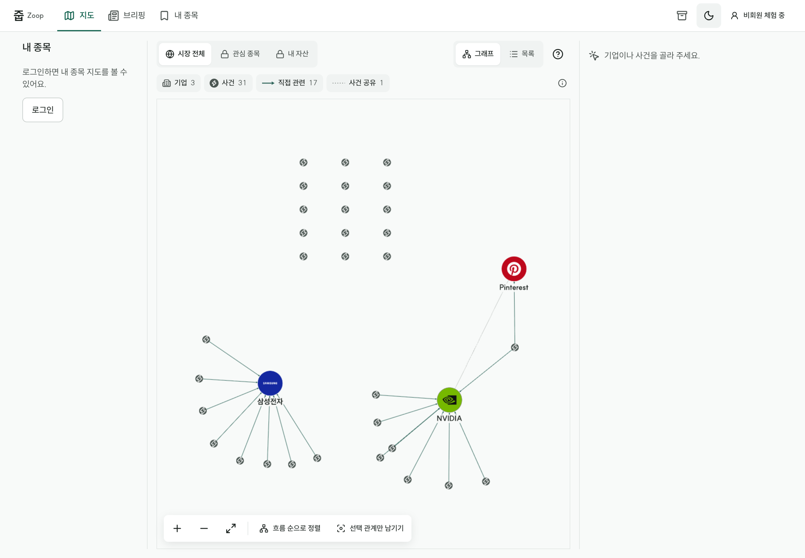
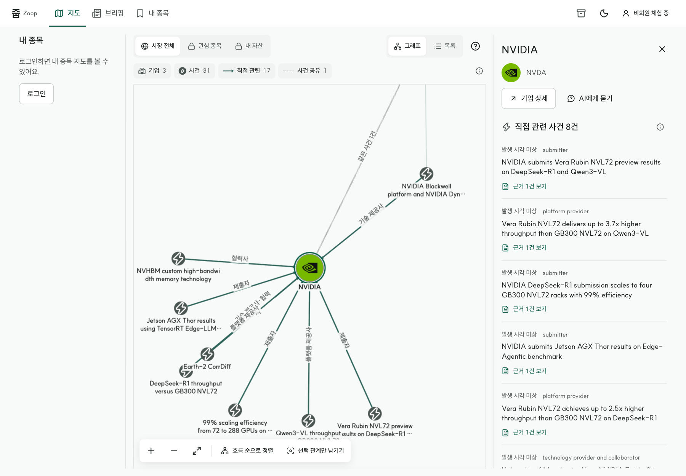

# 관계 그래프 화면 레퍼런스 조사 보고서

- 작성: 2026-09-30 · 5기 2조 줍(Zoop)
- 대상: 팀 전체(화면 설계 2.1~2.5, 그래프 G6·T5·5.6 담당자는 꼭 읽어 주세요)
- 한 줄 요약: **그래프를 주 화면으로 쓰는 서비스들은 “시간축, 고립 항목 정리, 포커스 모드, 근거 표시, 라벨 절제” 다섯 가지를 공통으로 씁니다. 줍도 이 순서로 다듬는 것을 제안합니다.**

---

## 1. 왜 조사했나요

줍의 핵심 화면은 “사건–기업 관계 그래프”입니다. 그런데 지금까지 참고한 디자인 자료(토스 TDS, 당근 SEED)는 목록·버튼·시트 같은 일반 앱 화면을 위한 것이어서, **그래프 자체를 어떻게 보여줄지**에는 답을 주지 못했습니다.

그래서 이번에는 **그래프가 주 화면인 실제 서비스 20종**과 **그래프 시각화 전문 도구·디자인 가이드**를 따로 조사했습니다. 공개 화면은 직접 캡처했고, 로그인이 필요한 유료 제품은 공식 문서와 공식 이미지로 확인했습니다.

## 2. 지금 줍 화면의 문제

현재 시연 데이터(검수한 실제 기사 저장본)의 기준 수치입니다.

| 항목 | 값 |
|---|---|
| 사건 | 31개 |
| 기업에 연결된 사건 | 16개 |
| **연결 없는 사건(고립)** | **15개 (48%)** |
| 기업 | 3개(삼성전자·NVIDIA·Pinterest) |
| 사건–기업 직접 관련 연결 | 17개(삼성전자 8, NVIDIA 8, Pinterest 1) |

| 전체 보기 | NVIDIA 선택 |
|---|---|
|  |  |

화면에서 보이는 문제는 네 가지입니다.

1. **첫 화면의 절반이 의미 없는 점 격자입니다.** 연결 없는 사건 15개가 위쪽에 줄지어 있어, 정작 기업 주변 관계가 작게 보입니다.
2. **“언제” 일어났는지 알 수 없습니다.** 뉴스 서비스인데 그래프에는 시간 정보가 없습니다.
3. **선택하면 선 라벨이 한꺼번에 나와 겹칩니다.** 기업 하나에 연결이 8개씩 몰려 있어서입니다.
4. **줍의 강점인 “원문 근거”가 그래프에서 안 보입니다.** 근거는 상세 패널을 열어야만 보입니다.

## 3. 레퍼런스에서 찾은 다섯 가지 해법

### 해법 1. 그래프 아래에 시간축을 둔다

| | |
|---|---|
|  |  |
| **AI Supply Chain**: 공급망 그래프가 월별로 재생됩니다. 줍과 도메인이 가장 가깝습니다. | **yFiles Fraud Detection**: 아래 막대 그래프에서 기간을 고르면 위 그래프가 그 기간으로 바뀝니다. |

- 같은 방식을 Cosmograph, KronoGraph, GDELT도 씁니다. 여러 서비스가 독립적으로 같은 답을 냈다는 점에서 신뢰할 만한 패턴입니다.
- **줍에 적용할 때 주의:** 지금 데이터는 사건 발생 시각이 있는 경우가 32건 중 11건뿐이고, 모두 9월 14~17일에 몰려 있습니다. 시간축은 **데이터 수집 기간이 늘어난 뒤**에 효과가 납니다.

### 해법 2. 연결 없는 항목은 따로 모은다

| | |
|---|---|
|  |  |
| **yFiles Knowledge Graph**: 고립 노드를 “문제 탐지” 패널로 따로 보여줍니다. | **나쁜 예(Graph Commons)**: 모든 노드를 한 화면에 그리면 라벨이 읽히지 않는 “헤어볼”이 됩니다. |

- 방법은 두 가지입니다. ① 그래프 가장자리에 “연결 없는 사건” 영역을 따로 두거나 ② 노드 하나로 묶어 “연결 없는 사건 15건”이라고 보여주고 누르면 목록을 펼칩니다.

### 해법 3. 선택한 기업만 남기는 포커스 모드

| | |
|---|---|
|  |  |
| **Palantir Quiver**: 선택한 항목의 앞뒤 연결만 남기고, 왼쪽 위에 “나가기” 버튼을 둡니다. | **Linkurious**: 겹치는 선은 곡선으로 벌리고, 노드/연결 종류별 개수와 켜고 끄기를 제공합니다. |

- 줍에는 이미 “선택 관계만 남기기” 버튼이 있지만 툴바 안에 숨어 있습니다. 기업을 누르면 **바로 포커스 모드로 들어가고, 1단계/2단계 범위를 고르고, 한 번에 전체로 돌아오는** 흐름으로 끌어올리는 것을 제안합니다.

### 해법 4. 근거를 그래프 위에 표시한다

| | |
|---|---|
|  |  |
| **Ogma**: 노드 네 모서리에 작은 배지를 붙입니다. | **Sayari**: 중심 기업 주변 노드에 개수 배지를 붙입니다. |

- 사건 노드 모서리에 **“근거 N건” 배지**를 붙이면, 상세를 열기 전에도 “이 연결은 원문 몇 건으로 뒷받침되는지” 알 수 있습니다.
- 반대 방향도 있습니다. 상세 패널에서 인용문을 고르면 **해당 연결선이 그래프에서 강조**되게 합니다(Kumu, Ogma 방식).

### 해법 5. 선 라벨은 필요할 때만

- 상용 도구들은 선 라벨을 **선택하거나 확대했을 때만** 보여줍니다. 평행한 선은 곡선으로 벌리고, 긴 라벨은 말줄임합니다(Linkurious, Cambridge Intelligence 가이드).
- 줍도 확대 수준에 따라 이미 라벨을 숨기고 있으므로, **선택 시에도 가장 가까운 몇 개만 보이게** 규칙을 다듬으면 됩니다.

## 4. 함께 보면 좋은 형식

| | |
|---|---|
|  |  |
| **LittleSis Oligrapher**: 오른쪽 이야기를 “다음”으로 넘기면 지도 강조가 바뀝니다. **출퇴근 브리핑**을 이런 단계별 형식으로 만들 수 있습니다. | **yFiles Event Timeline**: 기업을 가로줄로, 사건을 시각 위치로 놓습니다. 줍의 “기업 상세 타임라인”과 같은 구조입니다. |

## 5. 기술적으로 가능한가요

- 위 다섯 가지는 **지금 쓰는 그래프 라이브러리(Cytoscape.js)로 모두 만들 수 있습니다.** 라이브러리를 바꿀 필요는 없습니다.
- 지원되지 않는 것은 “여러 선을 한 다발로 묶기(간선 번들링)” 하나뿐이고, 현재 규모(수십~수백 노드)에서는 필요하지 않습니다.
- 대부분 **기존 데이터만으로 가능**합니다. 시간축만 데이터 수집 기간 확대가 필요합니다.

## 6. 팀이 정해야 할 것

| 질문 | 왜 필요한가 | 제안 |
|---|---|---|
| 시간축 기준을 **사건 발생 시각**으로 할까요, **기사 보도 시각**으로 할까요? | 발생 시각은 3분의 1만 있고, 보도 시각은 모두 있습니다. | 보도 시각으로 먼저 만들고, 발생 시각이 있으면 함께 표시 |
| 연결 없는 사건을 **메인 그래프에서 숨길까요**, **묶어서 보여줄까요**? | 숨기면 깔끔하지만 “데이터가 적다”는 사실이 가려집니다. | 묶음 노드 “연결 없는 사건 N건”으로 표시 |
| 브리핑을 **단계별 이야기 + 지도 강조** 형식으로 바꿀까요? | 브리핑과 그래프가 지금은 따로 놉니다. | 튜토리얼 이후 2차 과제로 검토 |

## 7. 더 보기

- 레퍼런스 갤러리와 우선순위 표: [`graph-refs/README.md`](graph-refs/README.md)
- 제품 20종 상세 분석: [`graph-refs/products.md`](graph-refs/products.md)
- 시각화 패턴·구현 가능성 표: [`graph-refs/patterns.md`](graph-refs/patterns.md)
- 이 조사를 바탕으로 한 실행 계획: [`../design/graph-ux-improvement-plan.md`](../design/graph-ux-improvement-plan.md)

**출처와 한계:** 캡처와 이미지는 팀 내부 참고용이며, 각 출처 URL은 위 상세 문서에 있습니다. 공식 이미지는 마케팅용이라 실제 제품과 다를 수 있습니다. 로그인이 필요한 제품(Bloomberg, Neo4j Bloom 등)은 화면을 직접 보지 못했습니다.
