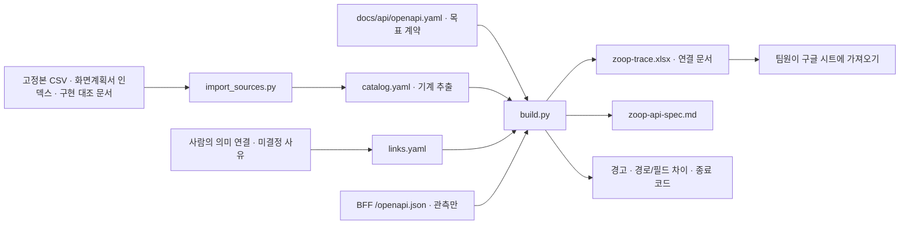

# 줍 문서·목표 API 연결 체계

화면계획서, 기능·비기능 명세, 요구사항, WBS, 프로토타입 판정, 목표 API를 **ID 참조**로 연결한다. 저장소에 원본을 두고 팀용 xlsx와 마크다운은 생성한다. 구글 시트는 생성한 xlsx를 가져다 보는 배포본이며 사람이 편집하는 원본을 대신하지 않는다.

API 명세는 **정식 서버가 구현할 목표 계약**이다. BFF의 현재 OpenAPI는 차이 비교 자료이지 목표 계약의 정본이 아니다. 현재 WBS `6.1.2 API 명세 최종 검토·구현 기준 확정` 및 `6.11.1 API·스키마 계약 통합 점검`에 연결한다. API 공통 규칙은 사용자 **잠정 채택/시연 기준**이며 팀 최종 승인·구현 완료로 표시하지 않는다.

현재 사용자 결정은 **[`../share/day-work-2026-10-10.md`](../share/day-work-2026-10-10.md)**다. 10-08 결정([`day-work-2026-10-08.md`](../share/day-work-2026-10-08.md))은 이어서 유효하다. 모든 명세/WBS 내용은 팀합의요구/설계대상이고 프로토타입은 전권 범위로 끝까지 완성한다. 단 기록된 **범위 예외**(추천 종목·산업·테마 FS011-02는 사용자 기능 제외·API 유보, 요구 42 재무·실적은 전용 FS/WBS 없는 유보)는 `links.yaml.authority.implementationScope.exceptions`가 정본이다. 본개발 채택은 담당자가 선택한다. 확정 일정은 WBS이며 옛 Notion 일정은 비권위, 갱신된 Notion 회의·API 결정은 사례별 증거다. 기존 UI 코드/화면계획서는 현재 관측이고 Figma는 폰트를 제외한 최종 목표 디자인이다. SUIT를 유지하고 기능을 먼저 완성한다. Java/Spring은 유력 후보일 뿐 확정 스택이 아니며 React/Python 재사용은 필수 전제가 아니다.



## 파일 역할과 편집 책임

| 파일 | 역할 | 편집 방식 |
|---|---|---|
| [`catalog.yaml`](catalog.yaml) | 명세 ID·우선순위·상태·요구사항 번호·상세 정의, 요구사항 원본 행, WBS 번호·기간·담당·원문 FS, 화면 ID·라우트·캡처 쪽수, 구현 문서 판정·출처 | **직접 편집하지 않는다.** 고정본을 가져와 교체한다. 입력 파일 SHA-256을 기록한다. |
| [`import_sources.py`](import_sources.py) | 새 고정본 폴더를 받아 기계 추출 부분만 갱신한다. | 스크립트 원본이다. `links.yaml`과 목표 계약에는 쓰지 않는다. |
| [`links.yaml`](links.yaml) | `authority`의 현재 사용자 결정·유효 `implementationScope`(범위 예외)·`chartResolution`, `detailAuthority`(현행/이력 시트·이력 전용 ID·원문 ID 정정·AI 의미 이행), `requirementBindings`, `reservedRequirements`, WBS 의미 연결·메모, API 불필요/계약 미정 사유, 구현 코드 위치, 프로토타입 전용 작업 제외 사유 | 사람이 편집한다. 원문 번호·상태를 고치는 별칭 파일이 아니다. |
| [`../api/openapi.yaml`](../api/openapi.yaml) | OpenAPI 3.1 목표 경로·요청·응답·오류·공통 규칙과 작업별 `x-zoop` 연결 | 사람이 편집한다. 작업 연결의 정본이다. `fsIds`, `nfsIds`, `screenIds`, `wbsIds`, `priority`, `prototype`, `teamQuestions`를 유지하며 유보 작업은 `featureStatus`, FS 없는 요구 연결은 `requirementIds`를 쓴다. |
| [`build.py`](build.py) | 팀용 문서·xlsx 생성, 저장본 전체 셀 되읽기, ID/P1/화면/WBS 의미/BFF 차이 검사 | 이미 설치된 PyYAML·openpyxl 환경에서 실행한다. 프로젝트 의존성·lockfile은 변경하지 않는다. |
| [`out/`](out/index.md) | 추적 xlsx, 화면별·기능별 한 쪽 요약, 경고, BFF 관측본과 작업별 전체 필드 차이 | 생성물이다. `screen-*.md`, `feature-*.md`, `api-differences/*.json`은 재생성 때 교체·정리한다. |
| [`../api/out/zoop-api-spec.md`](../api/out/zoop-api-spec.md) | 팀용 API 명세서: 공통 규칙·작업 목록·작업별 표·요청 필드·공통 스키마 | 생성물이다. 직접 편집하지 않는다. |

### 원문과 사람이 정한 연결을 구분하는 규칙

- CSV 출처의 `row`는 CSV 물리적 줄이 아니라 **xlsx 행 번호**다. 여러 줄 셀이 있어도 `csv.reader`의 레코드 번호로 원본 행을 보존한다. 구현 대조 마크다운은 텍스트 줄, 화면계획서는 슬라이드 쪽수를 쓴다.
- 목차는 **98개 ID**다(10-10·10-12 동일). 목차 밖에 남은 상세 ID(옛 AI 5개)와 옛 `메인 그래프`(03)·`AI 챗봇`(07) 탭은 `links.yaml.detailAuthority`로 현행/이력을 구분한다. 두 탭은 10-12 XLSX에서 삭제되지 않고 숨김 상태다. 목차 밖 ID가 이력·정정 목록에 없으면 hard error이며 활성 목록으로 자동 승격하지 않는다. 이력 정의는 인수 기준 대체 증거가 아니고 번호가 같아도 의미가 다른 AI ID(FS046~051)는 `legacyAiMeaning`의 의미 이행표로만 잇는다. 옛 FS046의 서버 공통 의무는 `aiJobs`·NFS001/003에 보존한다.
- 상세 `FS???`는 10-10에 `ㅊ`로 바뀌었고 같은 구획 제목은 `FS066-01 브리핑 리뷰`였다. 10-12 원문에서 B134가 `FS066-01`로 정정되어 `rawIdCorrections`는 비었고 해소 기록은 `resolvedRawIdCorrections`에 남는다. 생성기는 해소 기록의 원문 오류 ID가 고정본에 남아 있거나 대상 정의 행·제목 행이 다르면 hard error를 낸다. 이 정정은 B134 한 셀의 해소이며 목차 F61/G61, WBS FE 복합 산출물, 일정 역전, 표지/본문 충돌, 브리핑 메타 요구 36 등은 해소되지 않았다([10-12 기록](../evidence/doc-delta-2026-10-12.md)). FS042는 시점 기반 관계 그래프이며 요구 42의 재무·실적은 `reservedRequirements`로 요구 번호에만 연결한다. 새 FS/WBS를 만들지 않는다.
- 요구사항의 원본 번호 연결과 새 고정본의 제목이 다르면 확인 경고를 남긴다. 분리·통합인지 번호 이동인지 팀이 확인해야 한다. 새 정의서에서 중복이 사라졌다면 그 사실도 현재 입력에 따라 달라진다.
- WBS의 원문 FS/선행·재사용 참조는 `rawSpecIds`로 보존한다. 현재 제목·역할·FS 의미에 맞춘 편집 연결은 `links.yaml.wbsConnections`, API별 연결 정본은 `x-zoop.wbsIds`다. 번호가 우연히 존재해도 같은 업무로 보지 않는다. 저장한 제목/BE·FE 역할과 현재 본문이 다르면 hard error다. [내용 기반 이행표](out/wbs-migration.md)가 옛 번호·새 역할 분리의 근거를 보존한다.
- API 대응이 필요한 **P1 및 원문 제안 8개의 유효 포함 요구**는 작업 또는 `featureDecisions`의 **계약 미정 + 사유**가 필요하다. 클라이언트 품질·오프라인 파이프라인은 **API 불필요 + 사유**, 운영 연동은 별도 미정으로 구분한다. `FS074~081`의 원문 추가 제안·검토 전/우선 미정은 보존하되 현재 유효 구현 범위는 **팀합의요구/설계대상**이다. `원문 제안·유효 기준` 시트는 원문/현재 기준의 비교이며 보류 공수 목록이 아니다. 원문 WBS 충돌은 정정 요청으로 남기고 오프라인 요구를 가짜 API로 덮지 않는다.
- 프로토타입 상태는 `spec-v1.2-gap.md` §5 기준선에 §0.1→§0.2→§0.3→§0.4의 마지막 판정을 적용한다. 번호가 재사용된 AI ID의 옛 판정은 의미 이행표가 정한 현재 ID에만 붙인다. 판정 문서·코드 위치는 **실행 검증 증거가 아니며**, 원본 최신화만으로 승인·구현 완료를 올리지 않는다.
- 프로토타입 전용 모의 IdP, 스냅샷 파일, 데모 재생·샌드박스 명령은 목표 요청·응답에 넣지 않는다. 차이 표/제외 사유로만 설명한다. 명세가 「확인 필요」로 남긴 보존 기간·제한·정량 목표는 숫자로 확정하지 않는다.
- `DocumentSentiment`는 문서×기업, `BriefingOutlook`은 발행 회차 판정이다. `null`(아직 판정하지 않음)과 `undetermined`(판단 보류)를 구분한다. 이유·인용·판정 시각·모델·프롬프트 버전을 보존하고 확률·점수·가격 예측은 계약에 넣지 않는다.
- 긍정/부정 명칭은 사용자 결정 완료이며 혼재/판단 보류도 유지한다. 모델·추론 수준의 `.env` 설정 정책은 유지하며 AI 기능은 설계를 먼저 한다. live 예산·유료 실행 승인은 별개로 미정이다. 원본 충돌은 **작업자 가결정→시연→팀 최종 결정**으로 다루고 정정 요청을 보존한다. 요구 범위는 현재 사용자 결정에 따라 포함됐지만 실제 모델 호출 허가는 아니다.
- `catalog.yaml`의 `status`, `priority`, `scopeClass=proposal`은 원문 추출이고 `links.yaml.authority.implementationScope`는 현재 사용자 결정이다. 생성기는 출처 파일, 전 범위(기록된 예외 제외) 적용, 원문 제안 ID 집합, 완료/유료 실행 비승인 경계, OpenAPI의 `x-zoop-approvals.implementationScope` 참조와 `chartResolution`(1D=5m·1W=1h·1M=1d·1Y=1wk) 일치를 검사한다. 범위 예외 작업은 `x-zoop.featureStatus.exceptionRef`, 요구 번호 연결은 `x-zoop.requirementIds`로 계약에 표시한다. [`out/effective-authority.json`](out/effective-authority.json)은 결정·출처 해시·명세별 원문/유효 범위·예외·상세 권한을 분리해 제공한다.

## 갱신 절차

**고정본 갱신 → 가져오기 → 사람이 연결/목표 계약 편집 → 생성 → 검사** 순서다. 모든 명령은 저장소 루트에서 실행한다. 프로젝트의 `pyproject.toml`이나 lockfile에는 새 의존성을 추가하지 않는다.

### 1. 고정본을 새 날짜 폴더에 저장한다

현재 조합은 **명세 `functional-spec_2026-10-18`, WBS `wbs_2026-10-12`, 요구사항 `requirements-sheet_2026-10-06`**이며, 원본에서 삭제된 이력 탭 두 개(`03-메인-그래프.csv`·`07-AI-챗봇.csv`)는 탭이 마지막으로 남아 있던 `functional-spec_2026-10-12` 고정본에서 읽는다([10-18 원문 갱신 기록](../evidence/doc-delta-2026-10-18.md)). [10-12 원문 갱신 기록](../evidence/doc-delta-2026-10-12.md)에서 2026-10-12 09:45(KST) 재수집한 명세·WBS 18탭 135,892셀을 10-10 고정본과 대조해 변경 47셀(명세 26·WBS 21)을 확인했다. 38셀은 작업자가 공유 시트에 기록한 수정이고 9셀(WBS 6.8.7 신규 기재와 6.8.8 가중치)은 기록에 없는 팀 변경이다. 요구사항은 다시 받지 않고 10-06 고정본을 유지한다. 10-10 입력(`functional-spec_2026-10-10`, `wbs_2026-10-10`)과 [10-10 기록](../evidence/doc-delta-2026-10-10.md), 10-08 입력과 [10-08 delta](../evidence/doc-delta-2026-10-08.md)는 역사 기록으로 유지한다. 원본은 수정하지 않는다. WBS는 173개이며 본문 A:J 헤더는 이전 고정본과 동일하고 6.8.7 공란이 채워진 점만 제목·역할 변화다. 표지 `6.5.13~20` vs 본문 `6.6.13~20` 충돌은 별도로 남는다.

### 2. 기계 추출 원본을 가져온다

```bash
uv run --with pyyaml python docs/system/import_sources.py \
  --spec-dir docs/evidence/raw/functional-spec_2026-10-18 \
  --historical-spec-file docs/evidence/raw/functional-spec_2026-10-12/03-메인-그래프.csv \
  --historical-spec-file docs/evidence/raw/functional-spec_2026-10-12/07-AI-챗봇.csv \
  --wbs-dir docs/evidence/raw/wbs_2026-10-12 \
  --requirements-dir docs/evidence/raw/requirements-sheet_2026-10-06
```

세 디렉터리와 이력 탭 파일을 생략해도 위 최신 조합이 기본값이다. 기본 화면 인덱스는 `docs/screen-plan/captures/slide-index.json`, 구현 판정은 `docs/evidence/spec-v1.2-gap.md`다. `--spec-dir`, `--wbs-dir`, `--requirements-dir`, `--screens`, `--gap`으로 명시적 대안을 지정할 수 있다. 모든 CSV·보존 XLSX·수집 manifest와 두 입력 문서의 SHA-256을 기록한다. 상세 구획의 제목 행·메타 행과 WBS 표지/일정 요약의 비어 있지 않은 원문 행, 본문 열 헤더도 보존한다. 가져오기는 `catalog.yaml`만 교체한다. `scripts/repo_checks.py docs`는 importer의 암묵적 기본값이 아니라 catalog의 `sources`/`fingerprints`를 복사·명시 전달해 같은 고정본으로 재생성한다.

### 3. ID 연결과 목표 계약을 편집한다

새 작업은 안정된 `operationId`와 FS/NFS·화면·WBS·P1/P2·BFF 대응·팀 질문을 명시한다. `/api/v1`, 쿠키 세션·CSRF, 공통 오류, 불투명 커서는 사용자 **잠정 채택/시연 기준**이다. 전체 인증/REST 설계를 재작성하지 않으며 인증 제공자·운영값·정식 구현 완료를 대신하지 않는다. FS074~081도 구현 계획에 포함하되 기존 FS 재사용 근거와 API 불필요/운영 연동 미정을 보존한다. API 불필요 요구를 HTTP 작업에 연결하면 hard error다.

관계는 기업 간 관계와 기업 맥락 이슈 영향 경로를 구분한다. 이슈–기업 간선은 직접 클릭하지 않으며 데이터에 없는 관계 유형·산업·제품 단계는 만들지 않는다. 기업 목록의 독립 화면 ID/캡처, 기존/v2 AI 정의의 의미 변화 등은 화면/명세 정정 후 연결한다.

팀원 API v2는 [수신 Markdown](../evidence/raw/api-spec-v2_2026-10-08/zoop-api-spec-v2.md)의 네 의도만 현재 정본으로 번역했다. [검토·채택/정정 목록](../evidence/api-v2-review-2026-10-08.md)에 프로필의 required/nullable·날짜/URI, 요청 기업 맥락의 사건 관계 유형, 그래프와 독립인 최신 시세, Google/카카오 회원 인증과 실제 BFF 차이를 보존한다. 구 Markdown의 WBS·사용자 결정·S1 스키마 되돌림은 적용하지 않는다. 목표 계약을 바꿨다는 사실이 앱·OAuth·공급원 구현 완료를 뜻하지 않는다.

### 4. 팀용 파일을 생성한다

```bash
uv run --with pyyaml --with openpyxl python docs/system/build.py
```

저장된 BFF 관측본이 있으면 그것과 비교하며 `BFF_CACHED_OBSERVATION`을 남긴다. 관측본이 없으면 `BFF_UNOBSERVED`를 남기되 문서 생성은 완료한다. 현재 서버와 비교하려면 다음 명령을 쓴다.

```bash
uv run --with pyyaml --with openpyxl python docs/system/build.py \
  --bff-url http://127.0.0.1:8865/openapi.json
```

이 옵션은 `/openapi.json`만 GET한다. 로그인·데이터 API·모델 호출·외부 서비스 쓰기는 수행하지 않는다. `out/bff-openapi.json`은 구현 관측본이고 목표 계약을 덮어쓰지 않는다. 요청 URL과 UTC 관측 시각은 `out/bff-observation.json`에 기록한다.

### 5. 검사한다

```bash
uv run --with pyyaml --with openpyxl python docs/system/build.py --check \
  --bff-url http://127.0.0.1:8865/openapi.json

uv run --with openapi-spec-validator openapi-spec-validator docs/api/openapi.yaml
```

`--check`도 생성물을 갱신한다. 끊긴 참조, P1/유효 포함 요구의 API 대응 누락, 화면 없는 API, 입력 SHA-256 변경, **번호는 존재하나 WBS 제목/역할/FS 의미가 달라진 연결**, 유효 권한의 누락·불일치, 원문 제안 상태 훼손, 오프라인 요구의 가짜 API 연결, FS042 의미 미구분을 검사한다. 원문 상태 충돌은 `RAW_SCOPE_STATUS_CORRECTION`으로 남기며 단순히 기존 미승인 경고를 숨기지 않는다. xlsx를 저장 후 모든 시트·행·셀을 다시 읽어 입력과 대조한다. BFF 요청/응답·형식·enum·필수 여부·uniqueItems·권한의 전체 차이는 `out/api-differences/<operationId>.json`에 남긴다.

- **종료 0:** 검사 목록이 없다.
- **종료 1:** 원본 경고·팀 미결정·목표/BFF 차이·참조 오류 중 하나 이상 있다. 의도한 경로 버전 변경도 차이로 남긴다. 따라서 현재 목표 계약이 문법적으로 유효하고 P1 연결이 완료되어도 `--check`는 1일 수 있다.
- `warning`은 원문/팀 미결정, `difference`는 목표/BFF 차이, `error`는 끊긴 참조/의미 불일치/관측 실패다. 합격 기준은 `out/checks.json`의 **hard error 0**과 `xlsxReadback.status=passed`다. `severityCounts`, `scopeCounts`, 시트 행 수도 이 파일에 있다. 원문/목표 차이를 감춰 종료 0으로 만들지 않는다.

### PR에서 `zoop-trace.xlsx`가 충돌할 때

`out/zoop-trace.xlsx`는 `catalog.yaml`, `links.yaml`, `docs/api/openapi.yaml`에서 생성한 ZIP 형식의 바이너리 파일이다. 서로 다른 PR이 각자의 정본 변경 후 이 파일을 재생성하면, 수정한 시트·셀이 달라도 Git은 XLSX 내부 셀을 병합하지 못해 파일 전체를 충돌로 표시한다. 한쪽 파일만 선택하면 다른 쪽의 계약 변경이 추적표에서 빠진다.

작업 브랜치에 최신 `main`을 병합하고, XLSX 충돌 파일은 어느 쪽 버전으로든 임시 배치한 뒤 **병합된 정본에서 이 절의 생성 명령을 다시 실행**한다. `make docs-check`의 생성물 drift와 XLSX 되읽기가 통과하는지 확인하고, 재생성한 XLSX를 충돌 해결 파일로 스테이징한다. 이후 `git ls-files -u`가 비어 있는지 확인한다. 이 절차는 현재 충돌을 해결하지만, XLSX를 Git에서 계속 추적하고 여러 PR이 병렬로 정본을 바꾸는 한 같은 종류의 충돌은 다시 발생할 수 있다.

현재 결정 반영 작업은 새 BFF 관측이 필요하지 않으므로 `--bff-url` 없이 저장된 관측본을 사용한다. 기존 관측 시각/URL은 `out/bff-observation.json`, 재사용 사실은 `BFF_CACHED_OBSERVATION` 경고로 명시한다. 이는 현재 서버나 실제 기능 동작을 재검증한 결과가 아니다.

관측은 코드를 읽는 **새 BFF 프로세스**로 한다. 공유 포트/`prototype/bff/var/`/실제 `.env`를 읽거나 복사하지 않는다. 문서 관측용 포트 **8865**, 새 상태 **`/tmp/zoop-trace-20261008`**에 합성 fixture로만 기동한다. 다음 환경은 scheduler·시세·기업 지표를 모두 끄고 상속된 모델/비밀 환경을 전달하지 않는다. 관측 뒤 종료한다.

```bash
env -i PATH="$PATH" HOME="$HOME" \
  PYTHONPATH=prototype/bff/src \
  ZOOP_STATE_DIR=/tmp/zoop-trace-20261008 \
  ZOOP_BRIEFING_SCHEDULER=0 ZOOP_QUOTE_PROVIDER=off ZOOP_METRICS_PROVIDER=off \
  prototype/bff/.venv/bin/python -m uvicorn zoop_bff.main:app \
  --host 127.0.0.1 --port 8865
```

위 `uv run --with`는 팀의 재생성 예시다. 이번 10-08 작업은 설치 없이 **기존 문서/validator 환경의 Python 실행기**를 직접 사용했다. 이 서버는 `/openapi.json` 관측만 하며 유료 모델·live 분석·데이터/관리자 쓰기 요청은 하지 않는다.

## 팀에 보내는 파일

1. **[`out/zoop-trace.xlsx`](out/zoop-trace.xlsx)**: `추적표`, `화면→기능→API`, `기능→WBS→구현 상태`, `API 목록`, `오류 코드`, `경고`, `원문 WBS`, `원문 제안·유효 기준`, `범위 예외·상세 권한`, `수용 기준` **10개 시트**다. 원문 WBS는 173개 전부, 원문 제안은 8개를 별도 비교하며 모두 유효 구현 범위에 포함한다. 원문 상태/우선순위와 유효 범위/결정 출처를 별도 열로 표시한다. `범위 예외·상세 권한`은 범위 예외·유보 요구·이력 시트/ID·원문 ID 정정 연결·AI 의미 이행·요구 의미 연결을 한곳에 둔다. `수용 기준`은 모든 ID의 각 상세 정의를 독립 행으로 보존하고 현행/이력 구분과 기준/상세 유무를 명시한다. 기존 ID 단위 판정은 인용이고 현행 기능 실행 검증은 미실행이다. 값은 원문을 수식으로 실행하지 않는 문자열이며 저장본 전체 셀을 되읽는다.
2. **[`../api/out/zoop-api-spec.md`](../api/out/zoop-api-spec.md)**: 팀용 API 명세서다. 메서드·경로·권한·요청·응답·오류·연결 FS/NFS/화면/WBS·차이·확인 사항을 작업별로 본다. 개발자는 정본 `openapi.yaml`도 함께 받는다.
3. **[`out/index.md`](out/index.md)**와 그 옆의 `screen-*.md`, `feature-*.md`: 화면별·기능별 요약과 상호 링크다. 링크를 유지하려면 디렉터리 구조째 공유하거나 저장소에서 읽는다.
4. **[`out/warnings.md`](out/warnings.md)** 및 **[`out/api-differences.md`](out/api-differences.md)**: 현재 원본 오류·확인 필요·프로토타입과의 차이를 함께 전달한다. xlsx의 경고 시트를 제외해서 공유하지 않는다.
5. **[`out/wbs-migration.md`](out/wbs-migration.md)**: 117→173개 WBS의 번호·역할·의미 이행 근거다. 표지/본문·FS042 충돌과 공란 업무는 해결된 것처럼 소개하지 않는다.
6. **[`out/effective-authority.json`](out/effective-authority.json)** 및 **[`out/detail-authority.md`](out/detail-authority.md)**: 원문 상태·분류를 바꾸지 않고 현재 결정과 명세별 `implementationScope`, 범위 예외, 현행/이력 상세 권한을 기계 판독할 수 있다. `checks.json.scopeCounts`는 원문 기준(`rawIndexSpecs`·`rawProposals`·`rawDetailOnlyRecords`)과 유효 포함(`effectiveIncludedSpecs`·`scopeExceptionSpecs`)을 구분해 보인다. 전체 포함이라는 단일 수치로 합치지 않는다.
7. **[`out/acceptance-matrix.md`](out/acceptance-matrix.md)** 및 **[`out/acceptance-matrix.json`](out/acceptance-matrix.json)**: 전체 103개 ID(현행 목차 98 + 이력 전용 5)의 121개 상세 정의(현행 99·이력 22)를 출처별 원문 수용 기준, 유효 범위, 의미 이행된 기존 판정 출처, 코드 위치와 연결한다. 다른 정의를 합치지 않고 과거 통과 수치를 현재 runtime pass로 올리지 않는다. `checks.json.acceptanceCoverage`에서 ID/상세 출처 전수 coverage와 기준/상세 누락을 확인한다.
8. **[`out/source-corrections.md`](out/source-corrections.md)** 및 JSON: 현행/이력 정의, 번호가 재사용된 AI ID, 목차/상세 의미, 요구사항 제목·의미 연결, 요구 42와 FS042, FS066-01의 두 상세 정의, 미갱신 추가 제안 상태, WBS raw ID/표지·본문·날짜 순서·GraphDB 담당 경계의 두 원문과 작업자 안·담당자 수정 요청을 보존한다. 해소된 원문 ID 오류는 [`out/detail-authority.md`](out/detail-authority.md)에 해소 항목으로 남는다. 추가 WBS 일정/담당 충돌은 현재 작업 기준 문서에 별도로 연결한다.

팀이 구글 시트에서 제안한 수정은 담당자가 `links.yaml` 또는 `openapi.yaml`에 반영하고 다시 생성한다. 생성물만 고치면 다음 실행에서 사라진다. 원본 명세 번호의 정정은 원본 담당자가 새 고정본을 만든 뒤 가져오는 절차로 반영한다.
