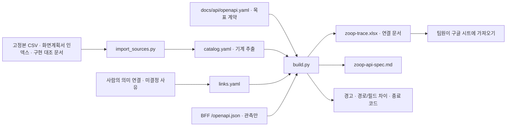

# 줍 문서·목표 API 연결 체계

화면계획서, 기능·비기능 명세, 요구사항, WBS, 프로토타입 판정, 목표 API를 **ID 참조**로 연결한다. 저장소에 원본을 두고 팀용 xlsx와 마크다운은 생성한다. 구글 시트는 생성한 xlsx를 가져다 보는 배포본이며 사람이 편집하는 원본을 대신하지 않는다.

API 명세는 **정식 서버가 구현할 목표 계약**이다. BFF의 현재 OpenAPI는 출발점과 차이 비교 자료이지 목표 계약의 정본이 아니다. WBS `6.1.2 공통 API 계약·오류 응답 규격` 및 `6.10.1 API·스키마 계약 통합 점검`에 연결한다.



## 파일 역할과 편집 책임

| 파일 | 역할 | 편집 방식 |
|---|---|---|
| [`catalog.yaml`](catalog.yaml) | 명세 ID·우선순위·상태·요구사항 번호·상세 정의, 요구사항 원본 행, WBS 번호·기간·담당·원문 FS, 화면 ID·라우트·캡처 쪽수, 구현 문서 판정·출처 | **직접 편집하지 않는다.** 고정본을 가져와 교체한다. 입력 파일 SHA-256을 기록한다. |
| [`import_sources.py`](import_sources.py) | 새 고정본 폴더를 받아 기계 추출 부분만 갱신한다. | 스크립트 원본이다. `links.yaml`과 목표 계약에는 쓰지 않는다. |
| [`links.yaml`](links.yaml) | 사람이 판단한 WBS 분리·통합 연결, API 불필요/계약 미정 사유, 구현 코드 위치, 프로토타입 전용 작업의 제외 사유 | 사람이 편집한다. 원문 번호를 고치는 별칭 파일이 아니다. |
| [`../api/openapi.yaml`](../api/openapi.yaml) | OpenAPI 3.1 목표 경로·요청·응답·오류·공통 규칙과 작업별 `x-zoop` 연결 | 사람이 편집한다. 작업 연결의 정본이다. `fsIds`, `nfsIds`, `screenIds`, `wbsIds`, `priority`, `prototype`, `teamQuestions`를 유지한다. |
| [`build.py`](build.py) | 팀용 문서·xlsx 생성과 ID/P1/화면/BFF 차이 검사 | 프로젝트 의존성 추가 없이 `uv run --with`로 실행한다. |
| [`out/`](out/index.md) | 추적 xlsx, 화면별·기능별 한 쪽 요약, 경고, BFF 관측본과 작업별 전체 필드 차이 | 생성물이다. `screen-*.md`, `feature-*.md`, `api-differences/*.json`은 재생성 때 교체·정리한다. |
| [`../api/out/zoop-api-spec.md`](../api/out/zoop-api-spec.md) | 팀용 API 명세서: 공통 규칙·작업 목록·작업별 표·요청 필드·공통 스키마 | 생성물이다. 직접 편집하지 않는다. |

### 원문과 사람이 정한 연결을 구분하는 규칙

- CSV 출처의 `row`는 CSV 물리적 줄이 아니라 **xlsx 행 번호**다. 여러 줄 셀이 있어도 `csv.reader`의 레코드 번호로 원본 행을 보존한다. 구현 대조 마크다운은 텍스트 줄, 화면계획서는 슬라이드 쪽수를 쓴다.
- 원본 명세의 `FS0??`, `FS???`, 상세 시트에만 있는 ID, 동일 ID의 기존/v2 정의, 요구사항 중복 번호는 원문 그대로 남기고 경고한다. 기능명 유사성을 근거로 ID를 자동 수정하거나 연결하지 않는다.
- 요구사항의 원본 번호 연결과 새 고정본의 제목이 다르면 확인 경고를 남긴다. 분리·통합인지 번호 이동인지 팀이 확인해야 한다. 새 정의서에서 중복이 사라졌다면 그 사실도 현재 입력에 따라 달라진다.
- WBS의 옛 FS 번호는 `rawSpecIds`로 보존한다. 현재 분리·통합 기능과의 연결은 `links.yaml.wbsConnections` 또는 API 작업의 `x-zoop.wbsIds`로 별도 관리한다. 원문 번호를 정정한 것처럼 표시하지 않는다.
- API 대응이 필요한 P1 기능은 작업을 연결하거나 `featureDecisions`에 **계약 미정 + 구체적 사유**를 남긴다. 클라이언트만의 품질 요구는 **API 불필요 + 사유**로 구분한다. 미정 항목에 아무 동작을 하지 않는 가짜 API를 만들지 않는다.
- 프로토타입 구현 상태는 `spec-v1.2-gap.md` §5 기준선에 §0.1→§0.2→§0.3 반영 행의 마지막 판정을 적용한다. 판정 문서의 출처와 코드 위치를 함께 적으며 **이번 생성기의 실행 검증 결과가 아니다**. 상태 문서 자체의 한계도 남긴다.
- 프로토타입 전용 모의 IdP, 스냅샷 파일, 데모 재생·샌드박스 명령은 목표 요청·응답에 넣지 않는다. 차이 표/제외 사유로만 설명한다. 명세가 「확인 필요」로 남긴 보존 기간·제한·정량 목표는 숫자로 확정하지 않는다.
- `DocumentSentiment`는 문서×기업, `BriefingOutlook`은 발행 회차 판정이다. `null`(아직 판정하지 않음)과 `undetermined`(판단 보류)를 구분한다. 이유·인용·판정 시각·모델·프롬프트 버전을 보존하고 확률·점수·가격 예측은 계약에 넣지 않는다.

## 갱신 절차

**고정본 갱신 → 가져오기 → 사람이 연결/목표 계약 편집 → 생성 → 검사** 순서다. 모든 명령은 저장소 루트에서 실행한다. 프로젝트의 `pyproject.toml`이나 lockfile에는 새 의존성을 추가하지 않는다.

### 1. 고정본을 새 날짜 폴더에 저장한다

`docs/evidence/raw/`의 기존 고정본은 덮어쓰지 않는다. 현재 조합은 기능·요구사항 `2026-10-06`, WBS `2026-10-03`이다. WBS는 10-06 재조회에서 계산값 변경이 없어 새 폴더를 만들지 않았다. 다음 갱신 때 실제 만들어진 폴더를 인자로 지정한다.

### 2. 기계 추출 원본을 가져온다

```bash
uv run --with pyyaml python docs/system/import_sources.py \
  --spec-dir docs/evidence/raw/functional-spec_2026-10-06 \
  --wbs-dir docs/evidence/raw/wbs_2026-10-03 \
  --requirements-dir docs/evidence/raw/requirements-sheet_2026-10-06
```

기본 화면 인덱스는 `docs/screen-plan/captures/slide-index.json`, 기본 구현 판정은 `docs/evidence/spec-v1.2-gap.md`다. 필요하면 `--screens`, `--gap`으로 다른 명시적 원본을 지정한다. 가져오기는 `catalog.yaml`만 갱신하므로 사람이 편집한 `links.yaml`과 `openapi.yaml`이 보존된다.

### 3. ID 연결과 목표 계약을 편집한다

새 작업마다 안정된 `operationId`를 정하고 `x-zoop`에 FS/NFS·화면·WBS·P1/P2·BFF 대응·팀 확인 사항을 넣는다. 원문 정책이 상충하면 각 정의의 출처를 남기고 팀 확인 사항으로 기록한다. `/api/v1`, 쿠키 세션·CSRF, 공통 오류, 불투명 커서는 이 문서의 **목표 계약 제안**이다. 기능 요구를 만족해야 하지만 정식 배포의 인증 제공자·운영 수치·권한 등급 승인을 대신하지 않는다.

관계는 기업 간 관계와 기업 맥락 이슈 영향 경로를 구분한다. 이슈–기업 간선은 직접 클릭하지 않으며 데이터에 없는 관계 유형·산업·제품 단계는 만들지 않는다. 기업 목록의 독립 화면 ID/캡처, 기존/v2 AI 정의의 의미 변화 등은 화면/명세 정정 후 연결한다.

### 4. 팀용 파일을 생성한다

```bash
uv run --with pyyaml --with openpyxl python docs/system/build.py
```

저장된 BFF 관측본이 있으면 그것과 비교하며 `BFF_CACHED_OBSERVATION`을 남긴다. 관측본이 없으면 `BFF_UNOBSERVED`를 남기되 문서 생성은 완료한다. 현재 서버와 비교하려면 다음 명령을 쓴다.

```bash
uv run --with pyyaml --with openpyxl python docs/system/build.py \
  --bff-url http://127.0.0.1:8841/openapi.json
```

이 옵션은 `/openapi.json`만 GET한다. 로그인·데이터 API·모델 호출·외부 서비스 쓰기는 수행하지 않는다. `out/bff-openapi.json`은 구현 관측본이고 목표 계약을 덮어쓰지 않는다. 요청 URL과 UTC 관측 시각은 `out/bff-observation.json`에 기록한다.

### 5. 검사한다

```bash
uv run --with pyyaml --with openpyxl python docs/system/build.py --check \
  --bff-url http://127.0.0.1:8841/openapi.json

uv run --with openapi-spec-validator openapi-spec-validator docs/api/openapi.yaml
```

`--check`도 생성물을 갱신한다. 끊긴 명세/요구사항/화면/WBS/오류 코드, P1 API 미연결, 화면 없는 API, 원본 갱신 후 재가져오기 누락, BFF 경로·필드 차이를 출력한다. 요청·응답의 중첩 필드·형식·enum·필수 여부·권한을 참조 스키마까지 펼쳐 비교한다. 모든 차이 이름과 양쪽 서명은 `out/api-differences/<operationId>.json`에 남긴다.

- **종료 0:** 검사 목록이 없다.
- **종료 1:** 원본 경고·팀 미결정·목표/BFF 차이·참조 오류 중 하나 이상 있다. 의도한 경로 버전 변경도 차이로 남긴다. 따라서 현재 목표 계약이 문법적으로 유효하고 P1 연결이 완료되어도 `--check`는 1일 수 있다.
- `warning`은 원본/팀 확인, `difference`는 목표/BFF 차이, `error`는 끊긴 참조/관측 불가 등이다. 전체 목록은 `out/warnings.md`, 기계용 집계는 `out/checks.json`이다. 차이를 감추려고 목표 계약을 BFF의 제한으로 되돌리지 않는다.

다른 담당자가 BFF를 수정했다면 **수정 내용을 읽는 새 BFF 프로세스**를 시작한 뒤 2번 가져오기와 4·5번 명령을 다시 실행한다. 기존 uvicorn은 `--reload`가 없으면 변경 코드를 읽지 않는다. 공유 데모 포트 `8787`과 `prototype/bff/var/`는 쓰지 않는다. 문서 작업용 BFF는 포트 `8841`, 별도 상태 `/tmp/zoop-state-docsys`를 사용하며 시작할 때 공유 상태를 읽기 전용 SQLite backup과 graph 복사로 옮긴다. 스키마 관측 서버에는 `ZOOP_BRIEFING_SCHEDULER=0`, `ZOOP_QUOTE_PROVIDER=off`, `ZOOP_METRICS_PROVIDER=off`를 지정하고 관측 후 종료한다.

## 팀에 보내는 파일

1. **[`out/zoop-trace.xlsx`](out/zoop-trace.xlsx)**: 구글 시트로 가져올 파일이다. `추적표`, `화면→기능→API`, `기능→WBS→구현 상태`, `API 목록`, `오류 코드`, `경고` 여섯 시트다. 필터·고정 머리글을 제공한다. 값은 원본을 수식으로 실행하지 않는 문자열이다.
2. **[`../api/out/zoop-api-spec.md`](../api/out/zoop-api-spec.md)**: 팀용 API 명세서다. 메서드·경로·권한·요청·응답·오류·연결 FS/NFS/화면/WBS·차이·확인 사항을 작업별로 본다. 개발자는 정본 `openapi.yaml`도 함께 받는다.
3. **[`out/index.md`](out/index.md)**와 그 옆의 `screen-*.md`, `feature-*.md`: 화면별·기능별 요약과 상호 링크다. 링크를 유지하려면 디렉터리 구조째 공유하거나 저장소에서 읽는다.
4. **[`out/warnings.md`](out/warnings.md)** 및 **[`out/api-differences.md`](out/api-differences.md)**: 현재 원본 오류·확인 필요·프로토타입과의 차이를 함께 전달한다. xlsx의 경고 시트를 제외해서 공유하지 않는다.

팀이 구글 시트에서 제안한 수정은 담당자가 `links.yaml` 또는 `openapi.yaml`에 반영하고 다시 생성한다. 생성물만 고치면 다음 실행에서 사라진다. 원본 명세 번호의 정정은 원본 담당자가 새 고정본을 만든 뒤 가져오는 절차로 반영한다.
