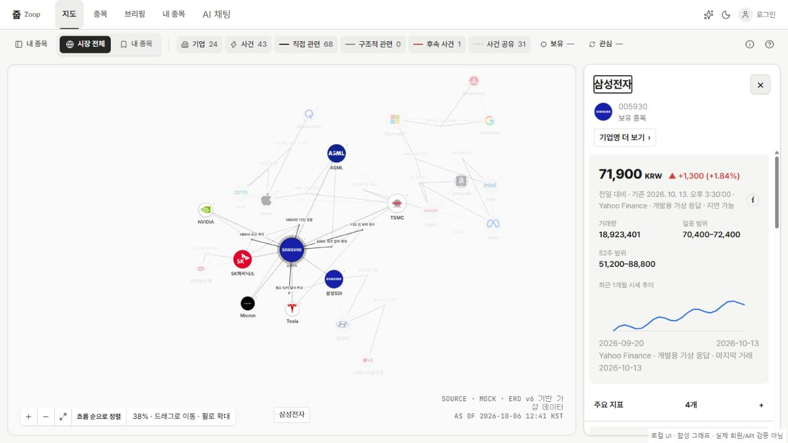
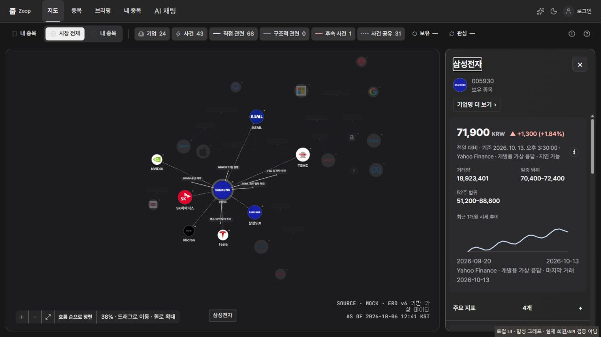
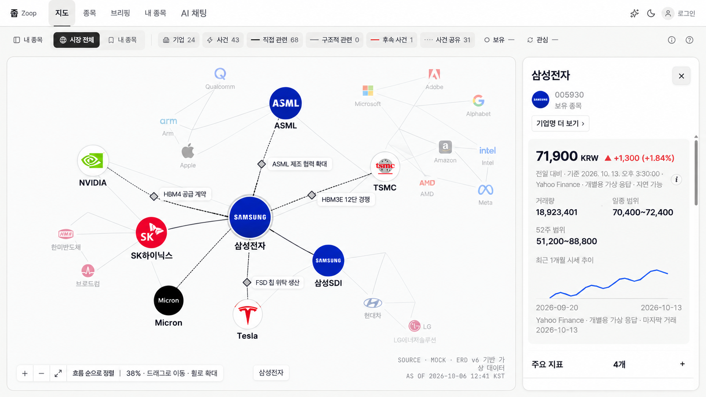

# 로컬 지도 UI · main 정렬

- 기준: origin/main `d87e548f` (2026-10-24).
- 브랜치: `feat/local-map-ui-current`. 사용자의 후속 요청으로 현재 구현을 PR로 공유한다. 아래 후속 개선안은 구현에 포함하지 않는다.
- 원래 보관본 `work/guided-graph-tutorial`과 열린 #312/#319는 수정하지 않는다.
- 대상: D-GRP-01/01b와 기존 지도 상세 패널의 색상·크기·입체감. 프로토타입/와이어프레임의 영역 구성과 main 동작을 유지한다.

## 옮긴 내용

기존 로컬 수정 중 로그인과 비슷한 무채색 라이트/다크 표면, 노드·연결선 크기, 관계 기반 배치만 main 위에 옮겼다. 원본의 로고 이미지와 데이터 ID, 관계 방향은 유지했다. 관련 요소는 상대적으로 가까이 두되, 거리를 관계 강도나 투자 중요도로 해석하지 않는다.

세 도구 버튼(사이드바 내 종목·시장 전체·내 종목)은 원본 SVG 경로를 currentColor로 그린다. 기존 마스크의 inline style을 제거하고 실제 글자색을 상속한다. 매트한 표면 효과도 기존 Tailwind recipe로 옮겨 새 CSS 클래스 블록을 만들지 않았다.

보관본에 섞인 backend 개발 도구, 미병합 #312의 캔버스·좌표/가독성 코드와 튜토리얼 코드는 가져오지 않았다. 현재 main의 선택·포커스·흐름 정렬·상세 패널 동작을 그대로 사용한다.

## 미리보기

`web/`에서 VITE_GRAPH_DATA_SOURCE=mock, VITE_EVIDENCE_DATA_SOURCE=mock으로 `pnpm dev --host 127.0.0.1 --port 5381 --strictPort`를 실행한다.

- 전체: <http://127.0.0.1:5381/dev/local-ui/?theme=light>
- 기업 선택: <http://127.0.0.1:5381/dev/local-ui/?theme=light&view=selected>
- 다크: <http://127.0.0.1:5381/dev/local-ui/?theme=dark&view=selected>

이 진입점은 합성 그래프와 로컬 게스트 상태를 명시한다. 실제 회원·API 연결을 검증하는 화면이 아니다. 운영 빌드 진입점에 추가하지 않는다.

## 화면을 보고 제안하는 다음 개선 — 아직 미적용

| 우선순위 | 관측                                                                              | 제안                                                                                                                                     |
| -------- | --------------------------------------------------------------------------------- | ---------------------------------------------------------------------------------------------------------------------------------------- |
| 1        | 축소하면 사건명과 기업명이 작아져 넓은 배치의 이점을 읽기 어렵다                  | #312의 화면 기준 최소 13px·라벨 충돌 처리를 병합 후 결합한다. 모든 글자를 동시에 키우기보다 선택·연관 노드 이름을 먼저 보인다            |
| 2        | 기본 53%에서 가장자리 노드가 잘릴 수 있다. 전체 맞춤 뒤에는 공간 대비 내용이 작다 | 최초 전체 맞춤과 선택 후 이웃 확대를 조합하는 카메라 정책을 검토한다. 사용자가 정한 53% 고정값을 바꾸는 제안이므로 후속 결정 후 적용한다 |
| 3        | 떨어진 통신 기업 묶음과 큰 반도체 묶음 사이의 빈 공간이 크다                      | 묶음 내부 간격은 유지하고 서로 분리된 묶음 사이의 과한 간격만 줄인다. 전체를 더 넓히지는 않는다                                          |
| 4        | 모든 일반 연결을 굵게 하면 교차점이 복잡해진다                                    | 기본 연결은 얇게, 선택된 연결·영향 경로는 굵고 선명하게 유지한다. 실선·점선·후속 방향 구분을 보존한다                                    |
| 5        | 상세 패널의 출처·시각·보조 값이 한꺼번에 보인다                                   | 제목/핵심 값/보조 값의 글자 굵기와 여백을 구분하고 본문은 읽을 수 있는 크기로 유지한다. 영역 구성이나 새 메뉴는 추가하지 않는다          |

현재 캡처는 `output/local-ui-current/`에 보관한다. 라이트/다크의 실제 브라우저에서 세 SVG의 computed stroke가 부모 버튼의 computed color와 일치함을 확인했다. 합성 지도에서 전체 맞춤과 삼성전자 선택·상세 패널을 확인했다.

## 검증 결과

- 타입 검사, lint(기존 관리자 react-refresh 경고 2개), prettier, 프로덕션 build 통과.
- 지도·아이콘·배치 관련 6개 파일 53개 검사 통과. 원래 main 아이콘으로 색상 회귀 3개 실패/1개 통과를 확인한 뒤 로컬 수정본으로 복구했다.
- 기본 5초 제한의 전체 실행에서 기존 email-entry 검사 2개가 실패했다. 해당 파일을 같은 기본 제한으로 따로 실행하면 36개 모두 통과했다. 로그인 코드는 변경하지 않았다.
- Windows 실행 지연을 고려해 `corepack pnpm@10.34.6 exec vitest run --maxWorkers=2 --testTimeout=15000`으로 전체 재검사: **79개 파일, 755개 검사 통과**. 시간 제한은 명령행에서만 변경했다.
- 운영 API·실기기·보조 기술 검증은 수행하지 않았다. 검증 당시 로컬에 저장했으며, 이후 요청으로 같은 구현을 PR로 공유한다.

## PR 비교 이미지

### 현재 구현 · 라이트

### 현재 구현 · 다크

### 후속 개선 시안 · 미적용

현재 화면 두 장은 실제 로컬 브라우저에서 합성 그래프로 촬영했다. 개선 시안은 현재 라이트 캡처를 참조해 AI로 생성한 디자인 예시이며, 실행 화면이나 API 검증 증거가 아니다. 시안의 문구·수치·선 종류·노드 연결은 실제 계약이나 관계를 증명하지 않는다. 특히 실선·점선·후속 화살표의 정확한 구분은 현재 코드와 계약을 따른다.

## 열린 PR과의 경계

- #312: 캔버스 가독성·좌표 저장·모바일 조작 개선은 가져오지 않았다. MapPage의 아이콘 호출 세 곳과 기존 선택 테스트의 노드 크기 기대값은 파일 수준으로 겹치므로 병합 때 통합 확인이 필요하다.
- #319: 상세 패널의 데이터·동작 변경은 포함하지 않는다. 공통 표면 스타일만 적용된다.
- #320: 튜토리얼 제어와 조작 버튼 이름표는 수정하지 않는다. MapPage와 선택 테스트는 파일만 겹친다.
- 이번 PR은 기존 로컬 UI를 공유하는 요청이다. 프로토타입의 새 기능을 이식하는 작업 B/C가 아니므로 새 프로토타입 컴포넌트 이식은 없다. 참고 원본 → main 대응: prototype/web/src/features/graph-explorer.tsx → web/src/pages/map/MapPage.tsx 및 components/graph, prototype/web/src/features/node-panel.tsx → main의 기존 상세 패널(동작 이식 없음). 기존 영역 구조를 유지하며 스타일·배치만 바꾼다.
