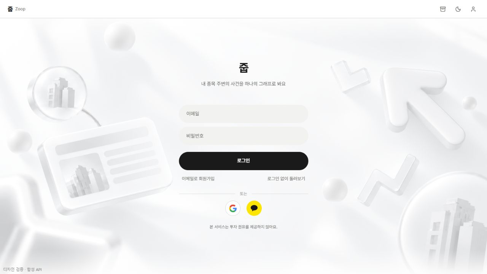
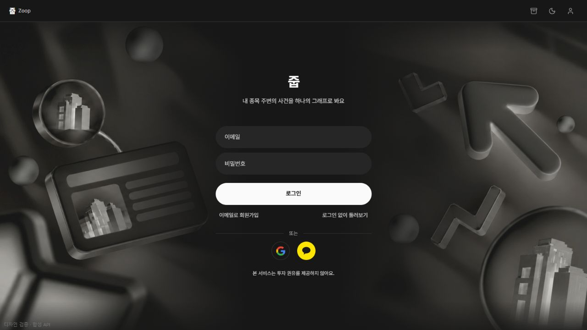

# D-AUT-01 로그인 화면

사용자가 확정한 시안을 실제 `/login`에 적용한다. 중앙의 로고·설명·폼은 HTML이며 배경 이미지에 로그인 UI가 들어 있지 않다.

- `LoginFrame.tsx`: 로그인 전용 레이아웃, 장식 이미지, 헤더 테마 전환.
- `login-surface.css`: 로그인에만 범위를 둔 무채색 다크 팔레트. 서비스 전체 토큰은 변경하지 않는다.
- `public/auth/login-news-background.webp`: 사용자가 서비스 적용을 요청해 제공한 최종 배경(1672×941). PNG를 무손실 WebP로 변환했다. 원본 픽셀을 유지하며 브라우저에서 명도를 조절한다.
- `LoginPage.tsx`: 둥근 입력칸과 버튼, 가운데 정렬한 서비스명, 회원가입·비회원 진입 링크, 서버가 제공하는 소셜 로그인 아이콘. 기존 인증·복구·오류·비회원 확인 흐름을 유지한다.
- `SlimHeader`의 `themeSwitch`는 선택 속성이고 로그인에서만 활성화한다. 기존 테마 저장·전환 함수를 사용한다.

## 화면 확인

캡처의 세션·소셜 제공자 응답은 **합성 API**이며, 실제 OAuth 또는 운영 계정 인증 성공의 증거가 아니다. 브라우저 검증용 임시 진입점은 PR에 포함하지 않는다.

768px 미만에서는 배경 장식을 숨기고 폼을 유지한다. 입력 레이블과 소셜 링크의 접근 가능한 이름은 유지한다. 달 아이콘으로 테마를 전환하며 선택을 저장한다.

## 검증 및 유지 시 주의점

- 인증 회귀 테스트: `pnpm test tests/auth` — 입력 누락, 인증 실패·재시도, 세션 실패·복구, 소셜 제공자 조회, 비회원 진입을 확인한다.
- `pnpm lint`, `pnpm build`로 정적 검사와 배포 빌드를 확인한다.
- 배경을 밝게 처리한 원본은 단순 반전·투명도 감소만 적용하면 다크 모드에서 삽화가 묻힌다. 현재는 반전 후 명도를 복원하고 중앙에만 어두운 그라데이션을 둔다. 배경 교체 시 양쪽 삽화와 중앙 글자를 함께 확인한다.
- 셸 CSS의 `--zoop-*` 별칭은 root에서 정의된다. 화면별 `--color-zoop-*`를 덮을 때 별칭도 같은 범위에서 연결해 헤더·포커스 색과 폼 색이 어긋나지 않게 한다.
- PNG 원본은 별도 보존한다. 노이즈를 점검할 때 압축본과 원본을 구분하며 손실 압축을 반복하지 않는다.

참조: `docs/wireframe/README.md`의 D-AUT-01, `web/docs/ui-style-guide.md`, 사용자 승인 로그인 시안.
