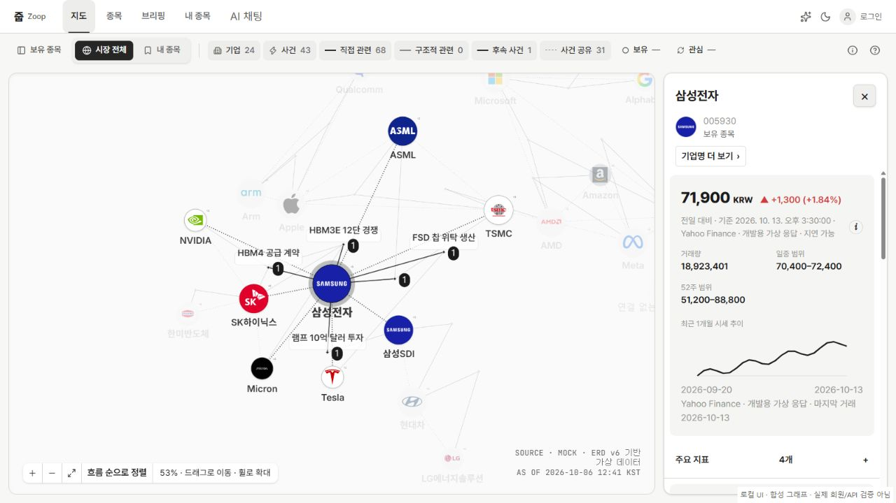
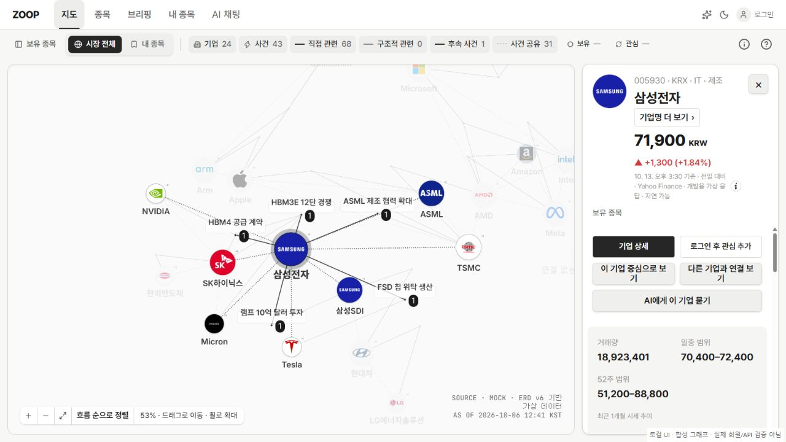
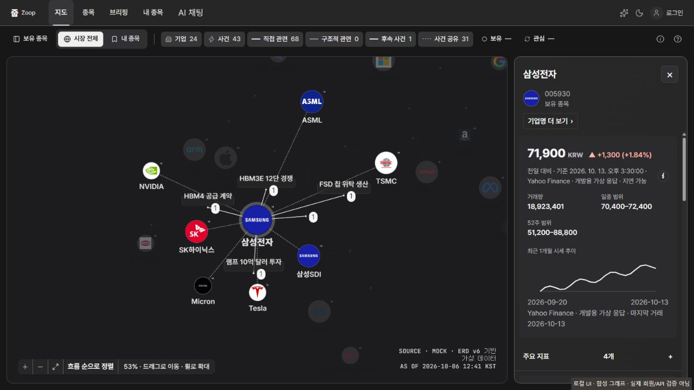
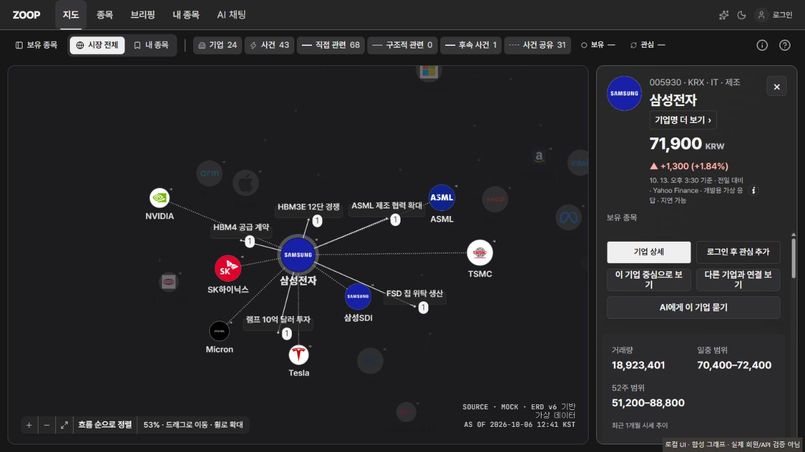
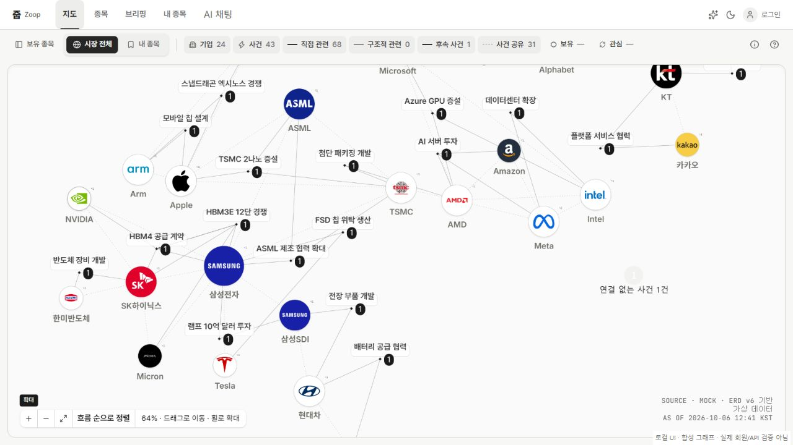
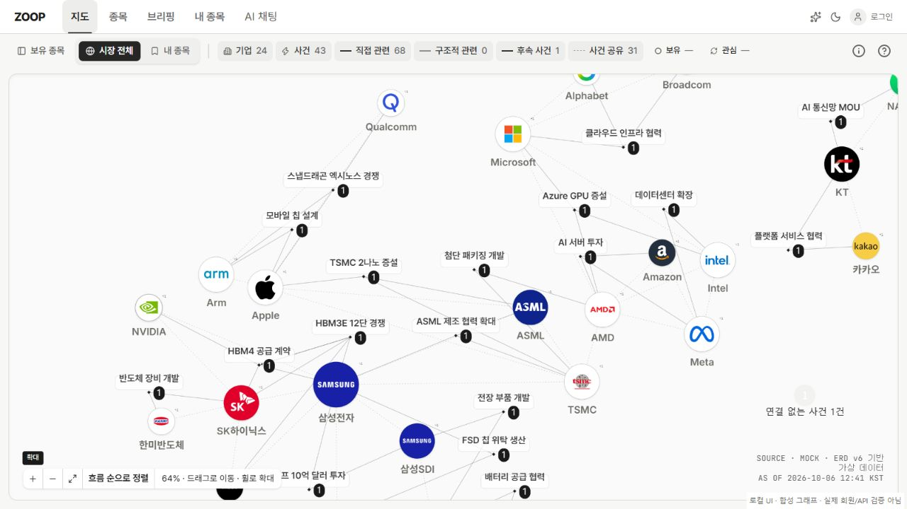
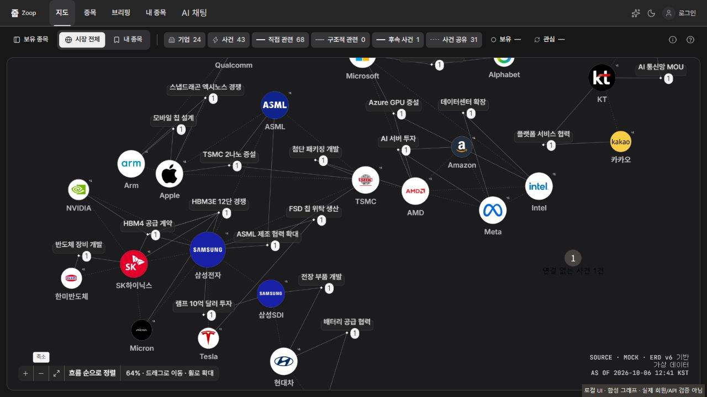
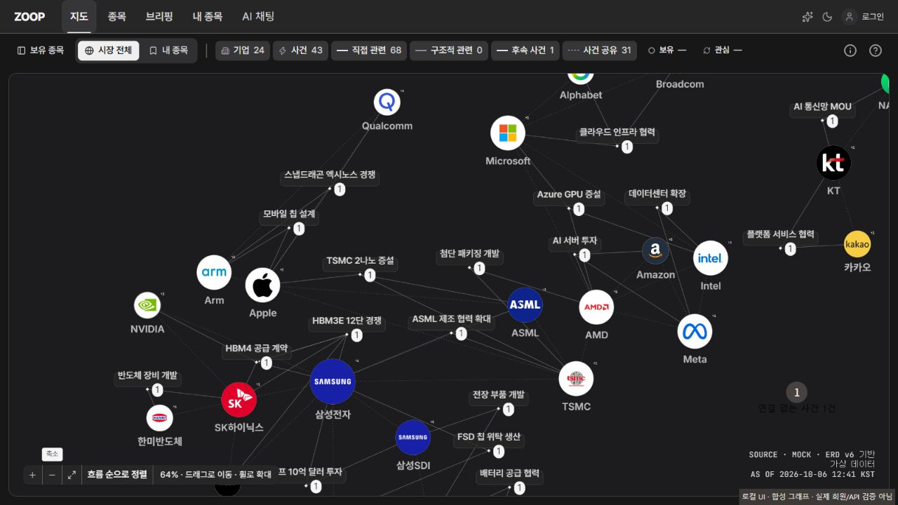

# PR #330 · 2026-10-24 리뷰 반영

기준 main: `3110e378d820893659bda2529fb8c2849cbc10b7`. 기존 #330의 `8e667d73`만 cherry-pick했어요. #327·#321의 과거 커밋은 다시 가져오지 않았어요.

## 통합 경계

- `graph-appearance.ts`: 이미 대체된 `readableLabels`/`MIN_LABEL_PX`를 재도입하는 충돌만 실제 발생했어요. main 파일을 유지하고 `graph-readability.ts`의 화면 최소 13px·선택 기업 16px 처리를 사용해요.
- `graph-model.ts`: 자동 통합됐어요. 기업 19·선택 기업 24·사건 15 및 사건 말줄임 15×scale/220×scale만 얹고, 선택 굵기 800·잉크색·배지 10×scale·관계 배치를 유지했어요.
- `map-appearance-styles.ts`: main 색·연결선·다크 값을 유지했어요. matte의 메뉴 13px 고정 덮어쓰기만 제거했어요.
- `graph-appearance.test.ts`: main 테스트를 그대로 유지했어요. #334는 기준 main에 아직 없어서 가져오지 않았어요.
- D-GRP-03의 `기업명 더 보기`를 기업명 아래·시세 위에 복원했어요. 기존 `.company-aliases` 스타일을 재사용해요.

## 모바일 닫기

M-GRP-01 시트 안 실제 D-GRP-02/03/04/06/07, 연결 없는 사건, D-BRF-04 패널을 렌더링해 닫기 ×가 하나이고 실행되는지 확인해요. 각 패널의 로딩·오류 상태와 튜토리얼 안내가 함께 있는 경우를 포함해요. 튜토리얼 단독 시트는 MapPage에서 열리지 않으며, 실습 단계의 기존 상호작용 잠금 정책과 완료 흐름은 바꾸지 않았어요.

matchMedia를 대체한 DOM 시험이에요. 실제 휴대전화 터치·보조 기술을 검증했다는 뜻은 아니에요.

## 추가 사용자 요청 · 연결선 태그 제거

D-GRP-01: 사건 이름은 사건 노드에만 표시해요. 초기 렌더링·호버·선택·경로·확대 후에도 연결선 이름표와 연결선 호버의 떠 있는 설명은 표시하지 않아요. 선의 모양·굵기·선택·클릭 범위와 관계 상세·키보드 목록의 설명은 유지해요. 사건 노드 이름·근거 배지·노드 호버는 유지해요.

## 합성 지도 비교

로컬 실제 G6, 합성 그래프(기업 24·사건 43), 1280×720에서 확인했어요. 실제 회원/API 자료가 아니에요. 선택 상태 53%, 전체 지도 확대 상태 64%를 확인했어요. 이름표 증가로 인한 눈에 띄는 추가 숨김은 이 표본에서 관측하지 못했어요. 이름표가 커지면서 기존 충돌 분리 결과가 달라질 수 있어, 모든 데이터의 숨김 건수나 좌표 동일성을 보장하는 정량 검사는 아니에요. 최종 전체 지도 캡처에는 추가 요청인 연결선 태그 제거도 포함해요.

| 상태          | main                                                            | 수정                                                           |
| ------------- | --------------------------------------------------------------- | -------------------------------------------------------------- |
| 선택 · 라이트 |             |             |
| 선택 · 다크   |                |                |
| 전체 · 라이트 |  |  |
| 전체 · 다크   |     |     |

결정 필요: 실제 API의 긴 제목·고밀도 그래프에서 추가 숨김이 발견되면 별도 검토해요. 이번 리뷰에서는 요청한 글자 크기와 폭을 낮추지 않았어요.
